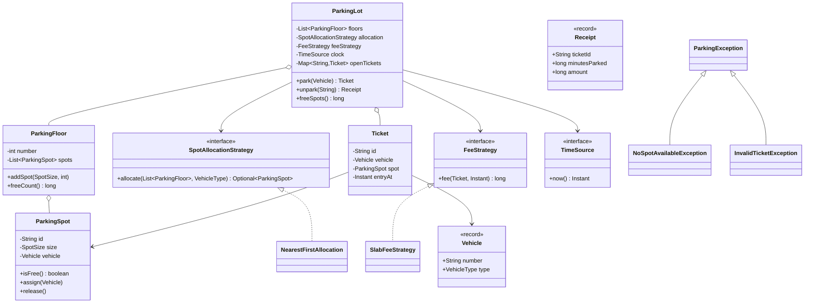

# D4 · Parking lot

Oct 11, 2026 · @saurav chaurasiya

Is doc me LLD ka case study D4 (Parking lot) hai — machine coding round ka sabse common sawaal, poore chalne layak Java code ke saath.

---

## D4 — Parking lot

Parking lot ek machine coding problem hai jisme tumhe ek multi-floor parking ka system banana hota hai: gaadi andar aaye to uske size ke hisaab se spot allot ho aur ticket mile, bahar jaaye to time ke hisaab se fee calculate ho. Ye sawaal itna common hai kyunki isme OOP (object-oriented programming) ki saari cheezein ek saath test ho jaati hain — entity design, do jagah strategy pattern, exception design aur thread safety.

### Ye cheez hai kya

- Kis category ki cheez hai: LLD / machine coding case study, boss level — 45 se 60 minute me hath se likhne wala code.
- Kis problem ke liye banayi gayi: interviewer dekhna chahta hai ki tum requirements ko classes me tod sakte ho ya nahi, aur future change ke liye jagah chhodte ho ya nahi.
- Is lesson ke baad tum kya kar paoge: khali editor me 40 minute me ye poora design likh paoge, aur "agar bike ke liye nayi pricing aa jaaye to kahan change karoge" ka jawab turant de paoge.

Is case study ke pehle ye concepts aane chahiye: O3 (inheritance vs composition), O5 (relationships aur UML), O7 (exception design), P20 (Strategy pattern), P10 (Facade), S2 (Open/Closed principle), aur thread safety ke liye T1 (race condition aur synchronized).

### Sawaal

Ek mall ki parking ka software banao. Requirements, exactly jaise interviewer bolta hai:

- Parking me kai floors hain, har floor pe kai spots. Spot teen size ke hote hain: small, medium, large.
- Teen tarah ki gaadi: bike, car, truck. Bike kisi bhi spot me, car medium ya large me, truck sirf large me.
- Gaadi andar aane pe nearest available spot milna chahiye (floor 1 pehle, uske baad floor 2), aur ek ticket generate ho.
- Nikalte waqt fee lagti hai: pehle 15 minute free, uske baad per hour charge, aur adhoora ghanta poora ginna hai. Bike 10, car 20, truck 40 per hour.
- Parking full ho to saaf error aaye. Galat ya already-used ticket pe bhi saaf error aaye.
- Entry gate kai hain, yani do gaadiyan ek hi waqt me andar aa sakti hain.

> Pehle khud socho — 10 min. Hints: (1) "nearest spot kaise chuna jaaye" aur "fee kaise lagegi" — ye dono kal badal sakte hain, to inko class me hardcode mat karo. (2) time ko `Instant.now()` se seedha padhne pe test likhna mushkil ho jaata hai. (3) do entry gate ek hi khaali spot ko dono ko de sakte hain — kis method pe lock lagega?

### Problem kyun aata hai

- Requirements me do cheezein "policy" hain, "structure" nahi: spot allocation ka rule aur pricing ka rule. Inko entity ke andar likh dene se har naye rule pe purani class badalni padti hai (S2 Open/Closed ka violation).
- Gaadi ke type aur spot ke size ka mapping ek business rule hai, par log usko `if-else` ki chain me daal dete hain, jo teesri gaadi aane pe hi gandi ho jaati hai.
- Fee ka hisaab time pe depend karta hai, aur agar code `Instant.now()` seedha call kare to demo ya unit test me result har baar badal jaayega — interview me tum apna hi output verify nahi kar paoge.
- Kai entry gate hone ka matlab concurrency: do thread ek hi free spot ko dekh ke dono "mil gaya" bol sakte hain. Ye classic race condition hai (T1).
- Ticket ka lifecycle sambhalna padta hai: ek ticket ek hi baar use ho, warna ek hi gaadi ke do receipt ban jaayenge.

### Naive approach

- Pehla obvious solution: ek hi `ParkingLot` class jisme spots ki list ho aur usi me `if-else` se size aur price dono decide ho.
- Yahan tootta hai — neeche wahi bura version, jisme teen dikkatein ek saath hain:

```java
// BURA VERSION - sirf dikhane ke liye, ise copy mat karna
class BadParkingLot {
    private final List<String> freeSpots = new ArrayList<>(); // sirf id, size ka pata hi nahi

    String park(String vehicleNumber, String type) {
        // dikkat 1: rule class ke andar hardcoded hai, nayi gaadi aayi to yahi method badlega
        if (type.equals("BIKE") || type.equals("CAR") || type.equals("TRUCK")) {
            if (freeSpots.isEmpty()) return null;   // dikkat 2: null return, caller ko pata nahi kya hua
            return freeSpots.remove(0);             // dikkat 3: lock nahi hai, do thread same spot le sakte hain
        }
        return null;
    }

    int fee(String type, long minutes) {
        // dikkat 4: pricing bhi usi class me, aur magic numbers
        if (type.equals("BIKE")) return (int) (minutes / 60) * 10;
        if (type.equals("CAR")) return (int) (minutes / 60) * 20;
        return (int) (minutes / 60) * 40;
    }
}
```

- Exact failures: `null` return karne se caller `NullPointerException` khaayega aur asli wajah ("parking full") kahin log hi nahi hogi; `minutes / 60` integer division hai, isliye 90 minute ka bill 1 ghante ka banega (adhoora ghanta poora ginna tha); `freeSpots.remove(0)` do thread se call hone pe dono ko same spot mil sakta hai; aur pricing badalne pe `ParkingLot` hi edit karni padegi.

### Sahi design

Design ko paanch hisson me baanto, aur jo cheezein badalti hain unhe interface ke peeche rakho.

1. **Entities** — `ParkingSpot`, `ParkingFloor`, `Ticket`. Ye structure hain, policy nahi. `ParkingSpot` apna occupied state khud sambhalta hai (encapsulation, O1).
2. **Value objects** — `Vehicle` aur `Receipt` ko `record` banao: immutable hain, `equals`/`hashCode` free milte hain (O6).
3. **Do strategies** — `SpotAllocationStrategy` (kaunsa spot doge) aur `FeeStrategy` (kitna paisa). Dono interface hain, concrete implementation inject hoti hai. Nayi pricing = nayi class, purani class chhuo hi mat (S2, P20).
4. **Facade** — `ParkingLot` ek hi entry point deta hai: `park(vehicle)` aur `unpark(ticketId)`. Caller ko andar ka kuch nahi dikhta (P10).
5. **Exception hierarchy** — ek base `ParkingException`, aur usse extend karne wale `NoSpotAvailableException` aur `InvalidTicketException`. Caller chahe to base pakde, chahe to specific (O7). `null` kabhi return nahi karte.

Do chhote par important design decisions, jo interview me bolne layak hain:

- **Time ko inject karo.** `TimeSource` ek chhota interface hai jiska production implementation `Instant::now` hai aur test me `FakeClock`. Isse fee ka test deterministic ho jaata hai — yahi wajah hai ki neeche ka demo har baar exactly same output deta hai.
- **Vehicle-to-spot mapping ek data structure me rakho**, `if-else` me nahi. `Map<VehicleType, List<SpotSize>>` me preference order likh do; nayi gaadi add karna ek line ka kaam ho jaata hai.



Neeche poora code hai — ek hi file me, `ParkingLotDemo.java` naam se save karke `java ParkingLotDemo.java` se chal jaayega (Java 17 ya upar, `record` ke liye). Comments Hinglish me hain.

```java
import java.time.Duration;
import java.time.Instant;
import java.util.ArrayList;
import java.util.List;
import java.util.Map;
import java.util.Optional;
import java.util.UUID;
import java.util.concurrent.ConcurrentHashMap;

// ---------- 1. Domain enums ----------
enum VehicleType { BIKE, CAR, TRUCK }
enum SpotSize { SMALL, MEDIUM, LARGE }

// ---------- 2. Value objects (immutable, equals/hashCode free) ----------
record Vehicle(String number, VehicleType type) {}
record Receipt(String ticketId, String vehicleNumber, long minutesParked, long amount) {}

// ---------- 3. Exception hierarchy: ek base, do specific ----------
class ParkingException extends RuntimeException {
    ParkingException(String msg) { super(msg); }
}
class NoSpotAvailableException extends ParkingException {
    NoSpotAvailableException(VehicleType t) { super("Koi free spot nahi mila: " + t); }
}
class InvalidTicketException extends ParkingException {
    InvalidTicketException(String id) { super("Ticket valid nahi hai: " + id); }
}

// ---------- 4. Time inject karne ke liye, taaki fee ka test deterministic ho ----------
interface TimeSource { Instant now(); }

// ---------- 5. Entities ----------
class ParkingSpot {
    private final String id;
    private final SpotSize size;
    private Vehicle vehicle;   // null = khaali

    ParkingSpot(String id, SpotSize size) { this.id = id; this.size = size; }

    String id() { return id; }
    SpotSize size() { return size; }
    boolean isFree() { return vehicle == null; }

    void assign(Vehicle v) {
        // double-assign ek bug hai, isliye chup na raho - exception phenko
        if (!isFree()) throw new ParkingException("Spot " + id + " already bhara hua hai");
        this.vehicle = v;
    }
    void release() { this.vehicle = null; }
}

class ParkingFloor {
    private final int number;
    private final List<ParkingSpot> spots = new ArrayList<>();

    ParkingFloor(int number) { this.number = number; }

    // spot id jaisa dikhega: F1-S1, F1-M2, F2-L1
    void addSpot(SpotSize size, int count) {
        for (int i = 1; i <= count; i++) {
            spots.add(new ParkingSpot("F" + number + "-" + size.name().charAt(0) + i, size));
        }
    }
    int number() { return number; }
    List<ParkingSpot> spots() { return spots; }
    long freeCount() { return spots.stream().filter(ParkingSpot::isFree).count(); }
}

class Ticket {
    private final String id;
    private final Vehicle vehicle;
    private final ParkingSpot spot;
    private final Instant entryAt;

    Ticket(String id, Vehicle vehicle, ParkingSpot spot, Instant entryAt) {
        this.id = id; this.vehicle = vehicle; this.spot = spot; this.entryAt = entryAt;
    }
    String id() { return id; }
    Vehicle vehicle() { return vehicle; }
    ParkingSpot spot() { return spot; }
    Instant entryAt() { return entryAt; }
}

// ---------- 6. Strategy 1: kaunsa spot doge ----------
interface SpotAllocationStrategy {
    Optional<ParkingSpot> allocate(List<ParkingFloor> floors, VehicleType type);
}

class NearestFirstAllocation implements SpotAllocationStrategy {
    // rule if-else me nahi, data me - nayi gaadi add karna ek line ka kaam
    private static final Map<VehicleType, List<SpotSize>> FITS = Map.of(
        VehicleType.BIKE,  List.of(SpotSize.SMALL, SpotSize.MEDIUM, SpotSize.LARGE),
        VehicleType.CAR,   List.of(SpotSize.MEDIUM, SpotSize.LARGE),
        VehicleType.TRUCK, List.of(SpotSize.LARGE)
    );

    @Override
    public Optional<ParkingSpot> allocate(List<ParkingFloor> floors, VehicleType type) {
        // chhote size ko pehle try karo (waste na ho), phir neeche ke floor se upar
        for (SpotSize size : FITS.get(type)) {
            for (ParkingFloor floor : floors) {
                for (ParkingSpot spot : floor.spots()) {
                    if (spot.isFree() && spot.size() == size) return Optional.of(spot);
                }
            }
        }
        return Optional.empty();   // null nahi, Optional
    }
}

// ---------- 7. Strategy 2: kitna paisa ----------
interface FeeStrategy { long fee(Ticket ticket, Instant exitAt); }

class SlabFeeStrategy implements FeeStrategy {
    private static final Map<VehicleType, Long> RATE_PER_HOUR = Map.of(
        VehicleType.BIKE, 10L, VehicleType.CAR, 20L, VehicleType.TRUCK, 40L
    );
    private static final long FREE_MINUTES = 15;

    @Override
    public long fee(Ticket ticket, Instant exitAt) {
        long minutes = Duration.between(ticket.entryAt(), exitAt).toMinutes();
        long billable = Math.max(0, minutes - FREE_MINUTES);
        // adhoora ghanta poora ginna hai, isliye ceiling division
        long hours = (billable + 59) / 60;
        return hours * RATE_PER_HOUR.get(ticket.vehicle().type());
    }
}

// ---------- 8. Facade: bahar wale ko sirf do method dikhte hain ----------
class ParkingLot {
    private final List<ParkingFloor> floors;
    private final SpotAllocationStrategy allocation;
    private final FeeStrategy feeStrategy;
    private final TimeSource clock;
    private final Map<String, Ticket> openTickets = new ConcurrentHashMap<>();

    ParkingLot(List<ParkingFloor> floors, SpotAllocationStrategy a, FeeStrategy f, TimeSource clock) {
        this.floors = floors; this.allocation = a; this.feeStrategy = f; this.clock = clock;
    }

    // synchronized: do entry gate ek hi khaali spot do gaadiyon ko na de dein
    synchronized Ticket park(Vehicle v) {
        ParkingSpot spot = allocation.allocate(floors, v.type())
            .orElseThrow(() -> new NoSpotAvailableException(v.type()));
        spot.assign(v);
        Ticket t = new Ticket(UUID.randomUUID().toString().substring(0, 8), v, spot, clock.now());
        openTickets.put(t.id(), t);
        return t;
    }

    synchronized Receipt unpark(String ticketId) {
        // remove hi karte hain, isliye ek ticket dobara use nahi ho sakta
        Ticket t = openTickets.remove(ticketId);
        if (t == null) throw new InvalidTicketException(ticketId);
        Instant exit = clock.now();
        long amount = feeStrategy.fee(t, exit);
        t.spot().release();
        return new Receipt(t.id(), t.vehicle().number(),
            Duration.between(t.entryAt(), exit).toMinutes(), amount);
    }

    long freeSpots() { return floors.stream().mapToLong(ParkingFloor::freeCount).sum(); }
}

// ---------- 9. Demo ----------
public class ParkingLotDemo {

    // fake clock se output har baar exactly same aata hai
    static class FakeClock implements TimeSource {
        private Instant now = Instant.parse("2026-10-11T09:00:00Z");
        public Instant now() { return now; }
        void advanceMinutes(long m) { now = now.plus(Duration.ofMinutes(m)); }
    }

    public static void main(String[] args) {
        // floor 1: 1 small + 2 medium, floor 2: 1 large
        ParkingFloor f1 = new ParkingFloor(1);
        f1.addSpot(SpotSize.SMALL, 1);
        f1.addSpot(SpotSize.MEDIUM, 2);
        ParkingFloor f2 = new ParkingFloor(2);
        f2.addSpot(SpotSize.LARGE, 1);

        FakeClock clock = new FakeClock();
        ParkingLot lot = new ParkingLot(List.of(f1, f2),
            new NearestFirstAllocation(), new SlabFeeStrategy(), clock);

        System.out.println("Free spots start me: " + lot.freeSpots());

        // bike ko chhota spot milna chahiye, waste na ho
        Ticket bike = lot.park(new Vehicle("DL-01-AB-1111", VehicleType.BIKE));
        System.out.println("Bike spot: " + bike.spot().id());

        Ticket car1 = lot.park(new Vehicle("DL-02-CD-2222", VehicleType.CAR));
        System.out.println("Car1 spot: " + car1.spot().id());

        Ticket car2 = lot.park(new Vehicle("DL-03-EF-3333", VehicleType.CAR));
        System.out.println("Car2 spot: " + car2.spot().id());

        // dono medium bhar gaye, to teesri car ko large (floor 2) milega
        Ticket car3 = lot.park(new Vehicle("DL-04-GH-4444", VehicleType.CAR));
        System.out.println("Car3 spot: " + car3.spot().id());

        // ab car ke liye kuch nahi bacha - exception, null nahi
        try {
            lot.park(new Vehicle("DL-05-IJ-5555", VehicleType.CAR));
        } catch (NoSpotAvailableException e) {
            System.out.println("Expected: " + e.getMessage());
        }

        // 10 min baad bike nikalti hai -> 15 min free window ke andar, fee 0
        clock.advanceMinutes(10);
        Receipt rb = lot.unpark(bike.id());
        System.out.println("Bike receipt: " + rb.minutesParked() + " min, Rs " + rb.amount());

        // total 90 min baad car1 nikalti hai -> (90-15)=75 billable -> 2 ghante -> 2*20 = 40
        clock.advanceMinutes(80);
        Receipt r = lot.unpark(car1.id());
        System.out.println("Car1 receipt: " + r.minutesParked() + " min, Rs " + r.amount());

        // wahi ticket dobara -> openTickets me nahi hai, isliye InvalidTicketException
        try {
            lot.unpark(car1.id());
        } catch (InvalidTicketException e) {
            System.out.println("Expected: " + e.getMessage());
        }

        System.out.println("Free spots end me: " + lot.freeSpots());
    }
}
```

Isko chalane pe exactly ye output aata hai (ticket id random hai, isliye wo line tumhare paas alag dikhegi):

```text
Free spots start me: 4
Bike spot: F1-S1
Car1 spot: F1-M1
Car2 spot: F1-M2
Car3 spot: F2-L1
Expected: Koi free spot nahi mila: CAR
Bike receipt: 10 min, Rs 0
Car1 receipt: 90 min, Rs 40
Expected: Ticket valid nahi hai: 15eed912
Free spots end me: 2
```

### Kya choose karein aur kyun

Spot allocation ka rule — interviewer aksar "isko aise badal do" bolta hai, isliye teeno jaan lo.

| Option | Kab use karo | Kab mat karo |
| --- | --- | --- |
| Nearest-first linear scan (upar wala code) | Spots ki ginti hazaar tak ho, code interview me likhna ho, simplicity sabse zaroori ho | Lakh spots hon — har `park()` pe poora scan O(n) ho jaata hai |
| Size-wise `Queue<ParkingSpot>` (har size ki alag free-list) | `park()` ko O(1) banana ho, high traffic ho | "nearest to gate" ki definition badalti rehti ho — queue me order fix ho jaata hai |
| Size-wise `PriorityQueue` distance ke hisaab se | Gate se distance ya floor priority matter kare, aur spots bahut hon | Rule simple ho — PriorityQueue extra complexity hai bina fayde ke |

Fee ka rule — ye sabse aam follow-up hai.

| Option | Kab use karo | Kab mat karo |
| --- | --- | --- |
| Flat per-hour rate (upar wala `SlabFeeStrategy`) | Simple mall parking, interview ka base case | Weekend / night me rate alag ho |
| Slab-based (pehle 2 ghante 20, uske baad 10 per hour) | Real mall parking aisa hi hota hai | Base case bhi na bana ho — pehle simple likho, phir ye add karo |
| Decorator se layering (base fee + night surcharge + EV discount) | Kai rules ek saath lagte hon aur combination badalta ho (P9 Decorator) | Sirf do rate hon — decorator over-engineering lagega |

### India me kaise hota hai

- **Mall aur airport parking me entry ab FASTag se hoti hai.** NPCI ka NETC FASTag (National Electronic Toll Collection — gaadi ke windshield pe lage RFID tag se automatic payment) toll ke saath parking ke liye bhi use hota hai: tag read hua, entry record bani, nikalte waqt duration se fee kat gayi ([NETC FASTag Parking, NPCI](https://www.npci.org.in/PDF/netc/NETC_FASTag_Parking.pdf)).
- **Delhi metro ki Kashmere Gate parking India ki pehli cashless metro parking thi** isi tag-based model pe — yani tumhara `Ticket` object real duniya me ek tag read event hai, kaagaz ka parchi nahi ([NPCI press release](https://www.npci.org.in/PDF/npci/press-releases/2021/NPCI-Press-Release-DMRC-Inaugurate-India's-First-Cashless-Metro-Parking-with-NETC-FASTag-at-Kashmere-Gate.pdf)).
- **Iska design pe asar**: entry pe paisa nahi kata, exit pe kata — matlab fee calculation exit pe hoti hai aur payment ek alag system (wallet ya bank) se jaata hai. Us payment ke fail hone pa gaadi ko rokna nahi hai, baad me recover karna hai — yahi saga aur compensating transaction ki soch hai (HLD ka L2.10).
- **Interview tip**: agar interviewer Indian context me le jaaye, to bolo ki `Ticket` me `entrySource` (tag, QR, manual) field add karoge aur `FeeStrategy` ke saath ek alag `PaymentGateway` interface rakhoge — parking lot ka core isse change nahi hota. Yahi Open/Closed ka demo hai.

### Interview follow-ups

- **"Spot allocation O(1) karo."** Har `SpotSize` ke liye ek `Queue<ParkingSpot>` of free spots rakho (`Map<SpotSize, Deque<ParkingSpot>>`). `park()` me vehicle ke preference order me pehli non-empty queue se `poll()`, `unpark()` me wapas `offer()`. Allocation strategy interface wahi rehta hai, sirf ek nayi implementation class aati hai — `ParkingLot` me ek line nahi badalti.
- **"Weekend pe rate double, aur pehle 2 ghante 20 phir 10 per hour."** Nayi `FeeStrategy` implementation (`WeekendSlabFeeStrategy`). Agar rules combine hote hain to Decorator (P9) use karo: `new NightSurcharge(new SlabFeeStrategy())`.
- **"Monthly pass holders ko free."** Ek `FeeStrategy` jo pehle pass check kare aur na mile to delegate kare — ya `Vehicle` me ek `subscriberId` field. Interview me bolna: ye pricing policy hai, isliye `FeeStrategy` me jaayega, `ParkingLot` me nahi.
- **"Do entry gate ek hi spot de rahe hain, kaise rokoge?"** Upar `park()` aur `unpark()` `synchronized` hain, to poora lot ek lock pe chalta hai — correct hai par scale nahi karta. Behtar: per-size free queue ko `ConcurrentLinkedDeque` banao, ya `ParkingSpot` me ek `AtomicBoolean occupied` rakho aur `compareAndSet(false, true)` se claim karo (T5 Atomics aur CAS). Tab lot-level lock ki zaroorat nahi.
- **"Ticket kho gaya to?"** Lookup ka doosra raasta chahiye: `Map<String vehicleNumber, Ticket>` ya spot id se reverse lookup, plus ek fixed "lost ticket" charge. Ye bolna dikhata hai ki tum access patterns soch rahe ho (HLD ka L1.10b wahi idea hai).
- **"Ye in-memory hai, DB me kaise le jaoge?"** `openTickets` ka `Map` ek `TicketRepository` interface ke peeche daal do (P24 Repository) — in-memory implementation test ke liye, SQL implementation production ke liye. Spot ka occupied flag DB me jaane pe optimistic locking (version column) se race rokni padegi.
- **`ParkingSpot` me `Vehicle` rakha hai ya `Ticket`?** `Vehicle` — kyunki spot ko sirf ye jaanna chahiye ki woh khaali hai ya nahi aur kaun khada hai. `Ticket` billing ka concept hai; spot ko usse jodne se do zimmedariyan ek class me aa jaayengi (S1).

### Self-check

1. Kaunsi do cheezein strategy interface ke peeche gayi, aur kyun?
2. `TimeSource` kyun banaya — `Instant.now()` seedha call karne me kya dikkat thi?
3. `(billable + 59) / 60` kya kar raha hai, aur `billable / 60` likhne se kya galat hota?
4. Bike ko `SMALL` pehle kyun diya jaata hai, aur ye kaunsi line me decide hota hai?
5. `unpark()` me `remove()` use kiya `get()` nahi — isse kaunsa bug khud hi ruk gaya?
6. Allocation ko O(1) karne ke liye kya badlega, aur `ParkingLot` me kitni lines badlengi?

### Notebook

D4 shape: entities (ParkingSpot, ParkingFloor, Ticket) + value objects as records (Vehicle, Receipt) + do strategy (SpotAllocationStrategy, FeeStrategy) + facade (ParkingLot) + exception hierarchy (ParkingException se NoSpotAvailable aur InvalidTicket) · jo badalta hai woh interface ke peeche: allocation rule aur pricing rule · vehicle-to-size mapping `Map<VehicleType, List<SpotSize>>` me, if-else me nahi · time inject karo (TimeSource + FakeClock) warna fee ka test deterministic nahi · adhoora ghanta poora: `(billable + 59) / 60`, kabhi integer division akela nahi · null kabhi return nahi, `Optional` ya exception · ticket `remove()` se ek hi baar usable · concurrency: park/unpark synchronized theek hai, scale pe per-spot AtomicBoolean CAS ya concurrent free-queue · follow-ups ka pattern: naya rule = nayi strategy class, core class chhuo mat.

### Padhne ke liye

- [NETC FASTag Parking — NPCI](https://www.npci.org.in/PDF/netc/NETC_FASTag_Parking.pdf) — India me parking entry aur exit asli me kaise chalte hain.
- [NPCI press release: India ki pehli cashless metro parking](https://www.npci.org.in/PDF/npci/press-releases/2021/NPCI-Press-Release-DMRC-Inaugurate-India's-First-Cashless-Metro-Parking-with-NETC-FASTag-at-Kashmere-Gate.pdf) — tag-based ticket ka real example.

### Deep Dive (SDE-2) — jab time ho

#### Lot-level lock hatao: per-spot CAS

Upar ka `synchronized park()` correct hai par poore lot ko ek lock pe la deta hai — 1,000 spots aur 8 gates pe ye bottleneck ban jaayega. Scale karne ka tareeka: `ParkingSpot` me `private final AtomicBoolean occupied` rakho, aur claim karo `if (occupied.compareAndSet(false, true))` se. Jo thread CAS jeet gaya usko spot mila; haarne wala agla spot try karega. Isse koi global lock nahi chahiye. Dhyaan: ab `isFree()` ka scan aur claim do alag steps hain, isliye allocate me "dekha-phir-claim" loop likhna padega, aur fail hone pe aage badhna padega (T5, T11).

#### Multi-lot aur sharding ka sawaal

Agar ek company ki 500 parkings hain, to ek hi `ParkingLot` object nahi chalega. Design ek level upar le jao: `ParkingLotId` se shard karo, har lot ka state apne hi node ya apni hi DB row range me. Yahan HLD aa jaata hai — shard key `lot_id` hai (L1.14), aur ek lot hot ho sakta hai (airport Diwali pe) jo hot key problem hai (L2.15). Interview me ye pul banana — LLD se HLD — SDE-2 round me bahut acha jaata hai.

#### Fee ko paise me rakho, double me nahi

Code me `long amount` rupaye me hai. Production me paisa ke liye `long` in paise (smallest unit) ya `BigDecimal` use karte hain, `double` kabhi nahi — kyunki `0.1 + 0.2` floating point me exactly `0.3` nahi hota aur ledger me ye rounding error ban jaata hai. Agar interviewer paisa poochhe to khud se bolo: "main amount ko paise me integer rakhunga, aur currency ko ek alag type me".

#### Testing ka plan jo bolne layak hai

Teen level: (a) unit test `SlabFeeStrategy` ke edge cases pe — 0 min, exactly 15 min, 16 min, exactly 60 min, 61 min; (b) unit test `NearestFirstAllocation` pe — bike ko small mile, car ko medium, medium full hone pe large, truck ko sirf large, aur kuch na ho to `Optional.empty()`; (c) ek concurrency test jo 50 threads se ek hi waqt me `park()` call kare aur assert kare ki allot hue spots ki ginti kabhi total spots se zyada na ho. Teesra test hi asli thread-safety claim verify karta hai (HLD ka L1.23a bhi yahi soch distributed level pe hai).

---

## Aage kya

- Ye LLD ka pehla case study hai jo study order me aata hai (T12 ke baad). Iske pehle wale zones: [Part 3 · Thread Jungle](https://claude.ai/code/artifact/05d7fa44-518a-49fd-a70c-40ac902f184f) (T1 se T12) aur [2C · Behavior Bazaar](https://claude.ai/code/artifact/d1ac6852-9994-4501-9b0a-7d0f654e5c38) (P13 se P26).
- Agla case study study order me: [D5 · Elevator](https://claude.ai/code/artifact/2c033fbb-c658-4639-949a-8dc05b500153), uske baad [D10 · LRU / LFU cache](https://claude.ai/code/artifact/5c863943-6249-4b4b-8943-003de1517344).
- Judne wale lessons: O1 (encapsulation), O3 (inheritance vs composition), O5 (relationships aur UML), O7 (exception design — isi doc ka exception hierarchy), S1 (single responsibility), S2 (open/closed), P9 (decorator), P10 (facade), P20 (strategy), P24 (repository), T1 (synchronized), T5 (atomics aur CAS).
