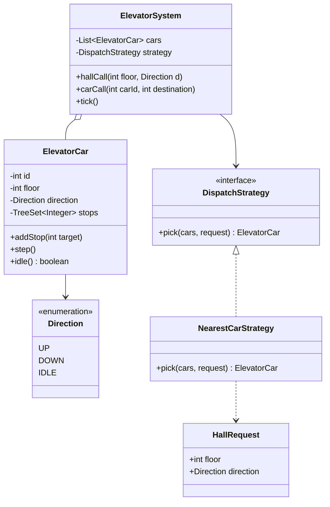

# D5 · Elevator

Oct 16, 2026 · @saurav chaurasiya

**Is doc me 1 case study:** D5 Elevator — multi-car lift system ka LLD, dispatch strategy ke saath. Ye ek boss level hai: pehle khud whiteboard pe banao, phir code haath se likho.

**Padhne ka tareeka** — pehle *Sawaal* padho aur 15 minute khud design karo. Classes aur unke rishte kaagaz pe banao. Uske baad hi *Sahi design* kholo.

---

## D5 — Elevator

Elevator system ka LLD matlab: kai lift cars, har floor pe log, aur ek dimaag jo decide karta hai ki kaunsi call kaunsi car ko jaaye. Ye interview me isliye poocha jaata hai kyunki isme teen cheezein ek saath test hoti hain — object modelling, ek scheduling algorithm, aur strategy ko pluggable rakhna.

### Ye cheez hai kya

- Kis category ki cheez hai: ek classic object-oriented design problem jisme ek simulation loop hota hai. Isme koi database nahi, sirf in-memory state aur behaviour.
- Kis problem ke liye banayi gayi: do tarah ki requests ko ek saath handle karna — **hall call** (floor pe laga button, jisme sirf direction pata hai) aur **car call** (lift ke andar ka button, jisme destination floor pata hai). Dono ko ek hi car ke stop list me merge karna padta hai.
- Is lesson ke baad tum kya kar paoge: classes aur unke rishte 10 minute me bana paoge, LOOK algorithm likh paoge, aur dispatch strategy ko ek interface ke peeche rakh kar SOLID wala jawab de paoge.

Roz ki misaal: ek auto driver jo Connaught Place se Karol Bagh ja raha hai. Raaste me jo sawari milti hai use bitha leta hai; jo ulti disha me hai use nahi. Lift bhi yahi karti hai — ek direction me chalti rehti hai aur raaste ke stops nipta deti hai.

### Sawaal

Ek building me 10 floors (0 se 9) aur 2 lift cars hain. Do tarah ke buttons hain: floor pe UP/DOWN button, aur car ke andar floor number buttons. Tumhe design karna hai:

- Ek hall call aane pe kaunsi car jaaye, ye kaun decide karta hai.
- Ek car apne stops ko kis order me serve karti hai.
- Kal ko building manager kahe "peak hours me alag logic chahiye" — toh kitna code badalna padega.

> Pehle khud socho — 15 min. Hints: (1) Hall call aur car call ek hi cheez nahi hain — kya dono ko ek hi class banaoge? (2) Ek car ke stops ko `List` me rakhoge ya `TreeSet` me? (3) "Kal ko logic badal jaaye" wali line hamesha ek interface ki taraf ishaara hoti hai.

### Problem kyun aata hai

- **Do alag request types** — hall call ke paas direction hai par destination nahi; car call ke paas destination hai par direction nahi. Inhe ek hi field set me thoonsoge toh har jagah `if (type == ...)` likhna padega.
- **Order naturally sorted chahiye** — car ko hamesha "abhi se upar wala agla stop" chahiye. Ek plain `List` pe har baar sort ya scan karna padega.
- **Direction ka reversal** — lift upar jaate-jaate ek point pe mudti hai. Ye decision kab lena hai, ye hi poore algorithm ka dil hai.
- **Dispatch ek alag faisla hai** — "kaunsi car jaaye" aur "ek car kaise chale" do alag zimmedariyan hain. Dono ek hi class me daal doge toh dono ko alag-alag test nahi kar paoge.
- **Starvation** — agar strategy hamesha nearest car chunti hai toh kisi ek floor ki call bahut der tak pending reh sakti hai, especially agar woh building ke kone pe ho.

### Naive approach

- Pehla obvious solution: ek `Queue<Integer>` me saare requested floors daal do aur FIFO (first in, first out) order me serve karo.

Neeche wala code chalta hai, par lift ko bewajah upar-neeche bhagata hai.

```java
// GALAT: FIFO queue, direction ka koi concept nahi
class NaiveElevator {
    private int floor = 0;
    private final Queue<Integer> queue = new LinkedList<>();

    void request(int target) { queue.add(target); }

    void run() {
        while (!queue.isEmpty()) {
            int target = queue.poll();
            while (floor != target) {
                floor += (target > floor) ? 1 : -1;   // ek-ek floor chalo
            }
            // darwaza khola
        }
    }
}
```

Ye exactly kahan tootta hai:

- **Raaste ka stop chhod deti hai.** Requests 8, 2, 3 is order me aayein toh lift 0 se 8 jaayegi, phir 2, phir 3 — kul 8 + 6 + 1 = 15 floors. LOOK order (2, 3, 8) me sirf 8 floors lagte.
- **Direction ka matlab hi nahi hai.** Floor 3 pe khada banda UP dabaye ya DOWN, is code ke liye dono ek hi hain. Lift neeche jaa rahi hogi tab bhi UP wale ko bitha legi.
- **Multi-car ka koi jawab nahi.** Ye ek car ka code hai; do cars ke liye dispatch ka faisla kahin hai hi nahi.
- **Strategy badalna matlab is class ko todna.** Peak-hour logic jodna hai toh isi `run()` ke andar `if` ghusana padega — Open-Closed principle ka seedha ullanghan ([1B · SOLID Temple](https://claude.ai/code/artifact/f98bb328-8939-4ef4-a9a6-24c5ce970199)).

### Sahi design

1. **Do request types alag rakho.** `HallRequest` (floor + direction) aur car call (sirf ek destination floor). Car call ko alag class banane ki zarurat nahi — woh seedha `addStop(floor)` hai.
2. **Stops ko `TreeSet<Integer>` me rakho.** Sorted set se `higher(floor)` aur `lower(floor)` O(log n) me mil jaate hain — LOOK algorithm ko bas yahi do operations chahiye.
3. **LOOK algorithm** — lift apni direction me tab tak chalti hai jab tak us taraf koi stop bacha hai; nahi bacha toh direction palat deti hai. (SCAN hamesha building ke chhor tak jaata hai, LOOK sirf aakhri stop tak — isliye LOOK practical hai.)
4. **Dispatch ko ek interface ke peeche rakho** — `DispatchStrategy.pick(cars, request)`. Aaj `NearestCarStrategy`, kal `PeakHourStrategy`. Ye Strategy pattern hai ([2C · Behavior Bazaar](https://claude.ai/code/artifact/d1ac6852-9994-4501-9b0a-7d0f654e5c38)).
5. **Cost function likho, `if` ka jungle nahi.** Har car ke liye ek number nikaalo aur sabse kam wala chuno. Raaste me padne wali call ka cost sirf distance; ulti disha wali call pe ek detour penalty jodo.
6. **Car ko apna direction khud sambhalne do.** Jab IDLE car ko pehla stop milta hai, usi waqt uska iraada (UP ya DOWN) tay ho jaata hai — warna dispatcher use "bina disha wali" samajh kar galat penalty laga dega.
7. **Simulation ko tick-based rakho.** `tick()` har car ko ek `step()` deta hai: ya toh darwaza kholo, ya ek floor chalo. Time ko discrete rakhne se poora system deterministic aur testable ho jaata hai.
8. **Controller sirf jodta hai.** `ElevatorSystem` ke paas cars ki list aur ek strategy hai; woh khud koi algorithm nahi jaanta. Isse strategy aur car dono alag-alag unit test ho jaate hain.

Classes aur unke rishte:



Poora chalne layak code. Ek hi file me rakha hai taaki tum ise seedha `Demo.java` naam se save karke `javac Demo.java && java Demo` chala sako.

```java
import java.util.*;

enum Direction { UP, DOWN, IDLE }

// Hall call: floor pe laga button. Yahan sirf direction pata hai, destination nahi.
final class HallRequest {
    final int floor;
    final Direction direction;

    HallRequest(int floor, Direction direction) {
        this.floor = floor;
        this.direction = direction;
    }
}

final class ElevatorCar {
    private final int id;
    private int floor;
    private Direction direction = Direction.IDLE;
    // sorted set, taaki "abhi se agla upar wala stop" O(log n) me mil jaaye
    private final TreeSet<Integer> stops = new TreeSet<>();

    ElevatorCar(int id, int startFloor) {
        this.id = id;
        this.floor = startFloor;
    }

    int id() { return id; }
    int floor() { return floor; }
    Direction direction() { return direction; }
    boolean idle() { return stops.isEmpty(); }

    void addStop(int target) {
        stops.add(target);
        // naya kaam mila aur lift khadi thi -- ab iska iraada tay ho jaata hai
        if (direction == Direction.IDLE && target != floor) {
            direction = target > floor ? Direction.UP : Direction.DOWN;
        }
    }

    // Ek tick ka kaam: ya toh darwaza kholo, ya ek floor chalo. LOOK algorithm.
    void step() {
        if (stops.remove(floor)) {
            System.out.println("E" + id + ": floor " + floor + " -- darwaza khula");
            if (stops.isEmpty()) direction = Direction.IDLE;
            return;
        }
        if (stops.isEmpty()) {
            direction = Direction.IDLE;
            return;
        }
        if (direction == Direction.IDLE) {
            direction = nearestStop() > floor ? Direction.UP : Direction.DOWN;
        } else if (direction == Direction.UP && stops.higher(floor) == null) {
            direction = Direction.DOWN;   // upar kuch nahi bacha, mud jao
        } else if (direction == Direction.DOWN && stops.lower(floor) == null) {
            direction = Direction.UP;     // neeche kuch nahi bacha, mud jao
        }
        floor += (direction == Direction.UP) ? 1 : -1;
        System.out.println("E" + id + ": floor " + floor + " (" + direction + ")");
    }

    // sabse paas wala stop -- upar ya neeche, jo bhi kareeb ho
    private int nearestStop() {
        Integer hi = stops.ceiling(floor);
        Integer lo = stops.floor(floor);
        if (hi == null) return lo;
        if (lo == null) return hi;
        return (hi - floor) <= (floor - lo) ? hi : lo;
    }
}

// Kaunsi car jaaye -- ye faisla yahan hai, car ke andar nahi.
interface DispatchStrategy {
    ElevatorCar pick(List<ElevatorCar> cars, HallRequest request);
}

final class NearestCarStrategy implements DispatchStrategy {
    private static final int DETOUR_PENALTY = 10;

    public ElevatorCar pick(List<ElevatorCar> cars, HallRequest r) {
        ElevatorCar best = null;
        int bestCost = Integer.MAX_VALUE;
        for (ElevatorCar c : cars) {
            int cost = cost(c, r);
            if (cost < bestCost) {
                bestCost = cost;
                best = c;
            }
        }
        return best;
    }

    // if ka jungle nahi -- har car ka ek number, sabse chhota jeeta
    private int cost(ElevatorCar c, HallRequest r) {
        int distance = Math.abs(c.floor() - r.floor);
        if (c.idle()) return distance;
        boolean onTheWay =
            (c.direction() == Direction.UP   && r.direction == Direction.UP   && r.floor >= c.floor()) ||
            (c.direction() == Direction.DOWN && r.direction == Direction.DOWN && r.floor <= c.floor());
        return onTheWay ? distance : distance + DETOUR_PENALTY;
    }
}

final class ElevatorSystem {
    private final List<ElevatorCar> cars;
    private final DispatchStrategy strategy;

    ElevatorSystem(List<ElevatorCar> cars, DispatchStrategy strategy) {
        this.cars = cars;
        this.strategy = strategy;
    }

    void hallCall(int floor, Direction direction) {
        ElevatorCar chosen = strategy.pick(cars, new HallRequest(floor, direction));
        System.out.println("Hall call floor " + floor + " " + direction + " -> E" + chosen.id());
        chosen.addStop(floor);
    }

    void carCall(int carId, int destination) {
        for (ElevatorCar c : cars) {
            if (c.id() == carId) {
                c.addStop(destination);
                return;
            }
        }
        throw new NoSuchElementException("Elevator " + carId + " nahi mila");
    }

    void tick() {
        for (ElevatorCar c : cars) c.step();
    }

    boolean allIdle() {
        for (ElevatorCar c : cars) if (!c.idle()) return false;
        return true;
    }
}

public class Demo {
    public static void main(String[] args) {
        ElevatorCar e1 = new ElevatorCar(1, 0);
        ElevatorCar e2 = new ElevatorCar(2, 8);
        ElevatorSystem system = new ElevatorSystem(List.of(e1, e2), new NearestCarStrategy());

        // do hall calls: 7 pe neeche jaana hai, 1 pe upar jaana hai
        system.hallCall(7, Direction.DOWN);
        system.hallCall(1, Direction.UP);

        int tick = 0;
        while (!system.allIdle() && tick < 30) {
            tick++;
            System.out.println("-- tick " + tick);
            system.tick();
            if (tick == 2) {
                // floor 1 pe sawaar hua banda 6 dabata hai, aur floor 3 pe naya hall call
                system.carCall(1, 6);
                system.hallCall(3, Direction.UP);
            }
        }
        System.out.println("Sab idle, total ticks = " + tick);
    }
}
```

Isko chalane pe bilkul ye output aata hai:

```text
Hall call floor 7 DOWN -> E2
Hall call floor 1 UP -> E1
-- tick 1
E1: floor 1 (UP)
E2: floor 7 (DOWN)
-- tick 2
E1: floor 1 -- darwaza khula
E2: floor 7 -- darwaza khula
Hall call floor 3 UP -> E1
-- tick 3
E1: floor 2 (UP)
-- tick 4
E1: floor 3 (UP)
-- tick 5
E1: floor 3 -- darwaza khula
-- tick 6
E1: floor 4 (UP)
-- tick 7
E1: floor 5 (UP)
-- tick 8
E1: floor 6 (UP)
-- tick 9
E1: floor 6 -- darwaza khula
Sab idle, total ticks = 9
```

Dhyaan se dekho: floor 3 wali nayi call E1 ko mili, E2 ko nahi — E1 pehle se UP jaa raha tha aur 3 uske raaste me tha, isliye uska cost 2 tha jabki E2 ka 4. Aur floor pe pahunchne aur darwaza khulne me do alag tick lagte hain, kyunki ek tick me ek hi kaam hota hai.

### Kya choose karein aur kyun

| Option | Kab use karo | Kab mat karo |
| --- | --- | --- |
| `TreeSet<Integer>` for stops | Jab tumhe bar-bar "agla upar/neeche wala stop" chahiye. Yahi default hai. | Jab stops ki ginti 3-4 se zyada kabhi nahi hoti — tab array bhi theek hai. |
| Do alag `TreeSet` (up aur down) | Jab tum SCAN ka strict version chahte ho aur dono directions ke stops alag track karne hain. | Shuruaat me — ek set plus direction se kaam chal jaata hai aur code aadha rehta hai. |
| Nearest car strategy | Default dispatch. Simple, samajhne me aasan, interview me defend karne layak. | Jab fairness chahiye — door wale floor ki call bhookhi reh sakti hai. |
| Zone-based strategy | Tall buildings (30+ floors) — har car ka apna floor band hota hai. | Chhoti building me — cars bekaar me apne zone me baithi rahengi. |
| Estimated-wait-time strategy | Jab metric hi average waiting time hai aur tum har car ka full route simulate kar sakte ho. | Interview ke pehle 20 minute me — pehle simple cost function likho, phir ise improvement ki tarah bolo. |

### India me kaise hota hai

Ye lesson paise wala nahi hai, par iska dimaag wahi hai jo payments dispatch me lagta hai. Ola ya Uber me "kaunsa driver ye ride le" bhi exactly yahi shape hai: ek request, kai candidates, ek cost function, aur ek pluggable strategy. Paytm jaise PSP me "ye transaction kis bank channel se jaaye" bhi wahi hai — har channel ka cost (success rate, latency, fees) nikaalo aur sabse accha chuno. Interview me agar tum ye connection khud bana do, toh ye case study ek simple LLD se badhkar ek design conversation ban jaati hai.

Starvation wala point bhi yahin se aata hai: payment routing me ek channel hamesha ignore ho jaaye toh uska data hi nahi milega, isliye wahan bhi thodi si forced exploration rakhni padti hai — lift me bhi purani call ko priority badhani padti hai.

### Interview follow-ups

- **Hall call aur car call ek hi class kyun nahi?** — Dono ke fields alag hain: hall call me direction hai aur destination nahi, car call me ulta. Ek class banaoge toh aadhe fields hamesha null rahenge aur har jagah null-check aayega.
- **`TreeSet` kyun, `PriorityQueue` kyun nahi?** — `PriorityQueue` sirf minimum deta hai; tumhe "current floor se agla upar wala" chahiye, jo `higher()` hai. `PriorityQueue` me peek ke alawa order pe navigate nahi kar sakte. (Ye `equals`/`hashCode` aur collections wale O6 ka hi practical use hai.)
- **Strategy pattern yahan kyun, simple method kyun nahi?** — Kyunki requirement me hi likha tha ki logic badlega. Interface hone se nayi strategy jodne pe `ElevatorSystem` ka ek line bhi nahi badalta.
- **Thread-safety ka kya?** — Asli system me calls alag threads se aati hain. Har car ka state uske apne lock ke peeche ho, ya ek single-threaded event loop ho jisme requests queue se aayein. Ye [Part 3 · Thread Jungle](https://claude.ai/code/artifact/05d7fa44-518a-49fd-a70c-40ac902f184f) wala topic hai.
- **Starvation kaise rokoge?** — Har pending hall call pe `requestedAt` rakho aur cost function me age ka ghataav jodo: `cost = distance + penalty - ageSeconds / 10`. Purani call apne aap jeetne lagti hai.
- **Emergency aur maintenance mode?** — Car ka ek mode field ho (`NORMAL`, `MAINTENANCE`, `FIRE`). Dispatcher maintenance wali car ko candidates me hi na le, aur fire mode me saari cars ground floor ko ek hi stop maanein.

### Self-check

1. LOOK aur SCAN me farq ek line me batao, aur ye code kaunsa karta hai.
2. `addStop` me IDLE car ka direction set karna zaroori kyun tha — na karte toh kya galat hota?
3. Cost function ke do cases likho (on-the-way aur ulti disha) aur dono ka formula.
4. Starvation rokne ke liye cost function me kya jodoge?
5. Bina dekhe `step()` ka poora logic kaagaz pe likho — 5 lines me.

### Notebook

Do request types: HallRequest (floor + direction) aur car call (sirf floor) · Stops `TreeSet<Integer>` me, kyunki `higher()`/`lower()` hi LOOK ka dil hai · LOOK = apni direction me chalo jab tak us taraf stop hai, warna palat jao (SCAN chhor tak jaata hai, LOOK aakhri stop tak) · Dispatch alag zimmedari: `DispatchStrategy` interface, `NearestCarStrategy` ek implementation · Cost = distance, ulti disha pe + penalty; idle car pe sirf distance · IDLE car ko pehla stop milte hi uska direction set karo, warna dispatcher use galat samjhega · Tick-based simulation = deterministic aur testable · Starvation ka ilaaj: cost me request ki age ghatao.

### Padhne ke liye

- [SCAN / elevator disk scheduling](https://www.geeksforgeeks.org/dsa/scan-elevator-disk-scheduling-algorithms)
- [Disk scheduling: SCAN, LOOK, SSTF (Gordon College notes)](https://cs.gordon.edu/courses/cs322/slides/disk_scheduling/ds15.html)
- [State pattern in Java](https://java-design-patterns.com/patterns/state/)
- [Strategy aur State ka farq (SDSU CS635 notes)](https://eli.sdsu.edu/courses/fall19/cs635/notes/D08StrategyState.pdf)

### Deep Dive (SDE-2) — jab time ho

#### Door ko State pattern se model karna

- Abhi code me darwaza ek print statement hai. Asli system me uske states hain: `CLOSED`, `OPENING`, `OPEN`, `CLOSING`, aur har state me allowed actions alag hain (OPEN me lift chal nahi sakti).
- State pattern me har state ek class hoti hai jo khud batati hai ki next state kya hoga. Isse `if (doorState == ...)` ka jungle hat jaata hai.
- Rule jo yaad rakhna hai: Strategy algorithm chunne ke liye hai (bahar se diya jaata hai), State lifecycle ke liye (object khud badalta hai). Dono ka UML lagbhag ek jaisa dikhta hai, iraada alag hai.

#### Multi-car coordination ke behtar metrics

- Sirf distance optimise karna aadha jawab hai. Asli metrics do hain: average waiting time (button dabane se darwaza khulne tak) aur average journey time.
- Behtar strategy har car ka poora route simulate karti hai aur dekhti hai ki is nayi call ko jodne se baaki sab passengers ka wait kitna badhega — ye marginal cost hai, sirf distance nahi.
- Interview me ye line bolna kaafi hai: pehle simple cost function, phir metric define, phir strategy ko us metric pe tune karna — aur strategy interface ki wajah se ye badlaav plug-in jaisa hai.

#### Concurrency ka saaf model

- Do raaste hain: har car ka apna lock (fine-grained, par deadlock ka risk jab controller do cars ko ek saath dekhe), ya ek single-threaded event loop jisme saare requests ek `BlockingQueue` me aate hain.
- Lift jaise system ke liye event loop aam taur pe behtar hai: state ek hi thread chhuta hai, isliye reasoning aasan aur test deterministic rehta hai.
- Agar event loop chuno toh `tick()` bhi usi loop ka ek event ban jaata hai — time khud ek message ban jaata hai, jo ki testing ke liye bahut sundar property hai.

---

## Aage kya

- Pichhla case study: [D4 · Parking lot](https://claude.ai/code/artifact/8808bc69-f983-4ccc-b9b4-789d7394520f) — wahan bhi allocation strategy pluggable thi, usse compare karo.
- Agla case study: [D6 · BookMyShow](https://claude.ai/code/artifact/f3d169f5-f1c9-4a30-8a6e-6c8de8e5296b).
- Zaroori prerequisites: [1A · OOP Village](https://claude.ai/code/artifact/cc69c0d1-92e9-4c1d-afd8-8add12f3e7db) (O1–O7), [1B · SOLID Temple](https://claude.ai/code/artifact/f98bb328-8939-4ef4-a9a6-24c5ce970199) (S1–S5), [2C · Behavior Bazaar](https://claude.ai/code/artifact/d1ac6852-9994-4501-9b0a-7d0f654e5c38) (Strategy aur State).
