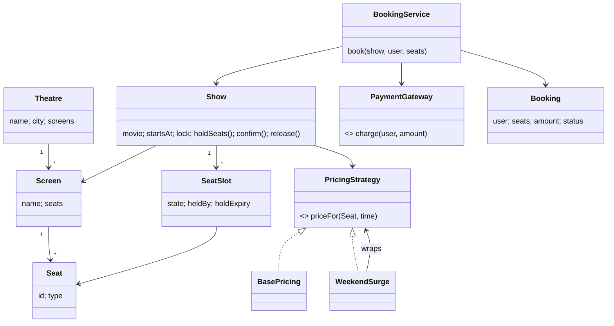

# D6 · BookMyShow

Oct 16, 2026 · @saurav chaurasiya

**Is doc me:** movie ticket booking ka LLD (Low Level Design — classes aur unke beech ka relation) Java me: City/Theatre/Screen/Show/Seat, seat hold with expiry, same seat ke liye do threads ki race, payment step aur pricing strategy.

**Padhne ka tareeka** — pehle Sawaal pe 15 min khud design karo, phir Sahi design ka code chalao aur output se apne jawab ko match karo.

---

## D6 — BookMyShow

BookMyShow ka LLD ek aisa system hai jisme bahut saare log ek hi show ki limited seats ke liye ek saath compete karte hain. Asli challenge classes banana nahi, balki ye guarantee dena hai ki ek seat kabhi do logon ko nahi bikegi.

### Ye cheez hai kya

- Category: LLD case study, concurrency-heavy (shared mutable state pe correctness).
- Problem: ek seat, do users, ek hi millisecond. Kaun jeeta, aur haarne wale ko kya milega.
- Is lesson ke baad tum kar paoge: domain model (Theatre, Screen, Show, Seat) banana, seat hold with expiry likhna, race condition ko lock se theek karna, aur Strategy pattern se pricing alag rakhna.
- Analogy: IRCTC counter pe ek hi berth ki do clerks ek saath ticket kaat dein to dono ko same berth mil jayegi. Isliye ek register me pehle entry hoti hai, tab hi dusra clerk dekhta hai ki berth khaali hai ya nahi.

### Sawaal

PVR Select Citywalk (Delhi) me Kantara 3 ka Saturday 8 PM show hai: 1 screen, 200 seats (Silver Rs.150, Gold Rs.250, Platinum Rs.400). Release weekend pe ek show ke liye 5,000 users ek saath app kholte hain, aur sabse achhi seat (A1) pe 200 users ek second ke andar click karte hain. User seat chunke payment page pe jaata hai, UPI approve karne me 1-2 min lagte hain.

Design karo: City, Theatre, Screen, Show, Seat; seat hold 5 min ke liye, expire hone pe wapas available; payment fail ho to seat release; weekend pe surge pricing; aur guarantee ki ek seat do logon ko kabhi confirm na ho.

> Pehle khud socho — 15 min. Hints: (1) Seat ki state kitni hain: AVAILABLE, HELD, BOOKED? Kaun si state kab badalti hai? (2) "Check karo free hai, phir hold karo" ye do steps hain. Beech me koi aur ghus jaye to? (3) Pricing ka rule badalta rahega (weekend, festival, coupon). Isko Show ke andar if-else me daaloge ya bahar rakhoge?

### Problem kyun aata hai

- Seat ek shared resource hai: ek hi object ko 200 threads padh aur likh rahe hain.
- Payment me 1-2 min lagte hain. Us dauran seat ko kisi aur ko dena nahi hai, par hamesha ke liye block bhi nahi karna (user app band kar de to seat dead ho jayegi).
- Multi-seat booking (couple ya family, 4 seats) me ya to saari seats milni chahiye ya koi nahi. Aadhi seats ka hold rakh ke baaki me fail hona bug hai.
- Pricing rules rozana badalte hain. Agar pricing Show class me hardcode hai to har naye rule pe core booking code chhedna padega.

### Naive approach

- Pehla khayal: seat object me status field rakho, check karo AVAILABLE hai, phir BOOKED set kar do.
- Kahan toot-ta hai: check aur set alag instructions hain. Do threads dono check pass kar lete hain (dono ko AVAILABLE dikhta hai), phir dono BOOKED likh dete hain. Result: 200 users ke test me 2-5 users ko same A1 ka ticket mil sakta hai, aur payment dono ka kat chuka hota hai.
- Doosri galti: hold ka koi expiry nahi. 5,000 users me se 500 payment page chhod ke chale gaye to 500 seats hamesha ke liye HELD, show half-empty chalega.

```java
// BAD: check-then-act without lock, aur expiry ka koi concept nahi
class Seat {
    String status = "AVAILABLE";
    boolean book(String user) {
        if (status.equals("AVAILABLE")) {   // thread 1 aur thread 2 dono yahan pass
            // yahan context switch ho jaye to dusra thread bhi andar aa jata hai
            status = "BOOKED";              // dono ne likh diya, dono ko ticket mila
            return true;
        }
        return false;
    }
}
```

### Sahi design

1. **Domain model**: Theatre (city ke saath) me Screens, Screen me Seats (SeatType: SILVER/GOLD/PLATINUM). Show = ek movie + ek screen + ek time. Seat khud immutable rehti hai; show ke andar uski live state alag `SeatSlot` me rakhte hain, kyunki ek physical seat har show me alag state me hoti hai.
2. **State machine**: AVAILABLE -> HELD (hold expiry ke saath) -> BOOKED. HELD expire ho jaye to wapas AVAILABLE. BOOKED se wapas koi transition nahi.
3. **Concurrency**: har Show ke paas ek `ReentrantLock` (ek aisa lock jo ek time pe sirf ek thread ko andar aane deta hai). Check aur update dono ek hi lock ke andar, isliye race khatam. Multi-seat hold me pehle saari seats check, phir saari hold: all-or-nothing.
4. **Expiry lazily**: koi background timer nahi. Jab bhi seat padhi jaati hai, dekhte hain ki `holdExpiry` guzar gaya ya nahi; guzar gaya to wapas AVAILABLE. Clock inject karte hain taaki test me sleep na karna pade.
5. **Pricing = Strategy pattern**: `PricingStrategy` interface, `BasePricing` aur `WeekendSurge` (jo Decorator ki tarah kisi doosri strategy ko wrap karta hai). Show ko bas `priceFor` call karna hai.
6. **Booking flow** (`BookingService`): hold -> payment charge -> confirm. Payment fail ho to hold release. Confirm fail ho (hold expire ho gaya) to exception, refund karna padega.
7. **Demo**: do threads `CountDownLatch` se ek saath chhode jaate hain taaki race asli ho; phir 200 threads wala test.



Poora runnable code (ek file, `Demo.java`):

```java
import java.time.*;
import java.util.*;
import java.util.concurrent.*;
import java.util.concurrent.atomic.*;
import java.util.concurrent.locks.*;

enum SeatType { SILVER, GOLD, PLATINUM }
enum SeatState { AVAILABLE, HELD, BOOKED }
enum BookingStatus { CONFIRMED, PAYMENT_FAILED }

// Clock ko inject karte hain taaki expiry ka demo bina sleep ke deterministic ho
class MutableClock extends Clock {
    private volatile Instant now = Instant.parse("2026-10-16T18:00:00Z");
    void advance(Duration d) { now = now.plus(d); }
    public ZoneId getZone() { return ZoneOffset.UTC; }
    public Clock withZone(ZoneId z) { return this; }
    public Instant instant() { return now; }
}

class Seat {
    final String id; final SeatType type;
    Seat(String id, SeatType type) { this.id = id; this.type = type; }
}

// Ek show ke andar ek seat ki live state: kaun hold kar raha hai, kab tak
class SeatSlot {
    final Seat seat;
    SeatState state = SeatState.AVAILABLE;
    String heldBy; Instant holdExpiry;
    SeatSlot(Seat s) { this.seat = s; }
}

class Screen {
    final String name; final List<Seat> seats = new ArrayList<>();
    Screen(String name, int silver, int gold, int platinum) {
        this.name = name;
        int n = 1;
        for (int i = 0; i < silver; i++) seats.add(new Seat("A" + n++, SeatType.SILVER));
        for (int i = 0; i < gold; i++) seats.add(new Seat("A" + n++, SeatType.GOLD));
        for (int i = 0; i < platinum; i++) seats.add(new Seat("A" + n++, SeatType.PLATINUM));
    }
}
class Theatre {
    final String name; final String city; final List<Screen> screens = new ArrayList<>();
    Theatre(String name, String city) { this.name = name; this.city = city; }
}

// Strategy pattern: pricing ka rule alag class me, Show ko pata nahi kaunsa rule chal raha hai
interface PricingStrategy { long priceFor(Seat seat, LocalDateTime showTime); }
class BasePricing implements PricingStrategy {
    public long priceFor(Seat s, LocalDateTime t) {
        switch (s.type) { case SILVER: return 150; case GOLD: return 250; default: return 400; }
    }
}
class WeekendSurge implements PricingStrategy {
    private final PricingStrategy inner; // Decorator jaisa: base price ke upar 20% surge
    WeekendSurge(PricingStrategy inner) { this.inner = inner; }
    public long priceFor(Seat s, LocalDateTime t) {
        long base = inner.priceFor(s, t);
        DayOfWeek d = t.getDayOfWeek();
        return (d == DayOfWeek.SATURDAY || d == DayOfWeek.SUNDAY) ? base * 120 / 100 : base;
    }
}

class SeatUnavailableException extends RuntimeException {
    SeatUnavailableException(String m) { super(m); }
}

class Show {
    final String movie; final Screen screen; final LocalDateTime startsAt;
    private final Map<String, SeatSlot> slots = new LinkedHashMap<>();
    private final PricingStrategy pricing;
    private final Clock clock;
    private final Duration holdTtl;
    // Ek show ka ek lock: multi-seat hold ya poora hota hai ya bilkul nahi
    private final ReentrantLock lock = new ReentrantLock();

    Show(String movie, Screen screen, LocalDateTime startsAt, PricingStrategy p, Clock c, Duration ttl) {
        this.movie = movie; this.screen = screen; this.startsAt = startsAt;
        this.pricing = p; this.clock = c; this.holdTtl = ttl;
        for (Seat s : screen.seats) slots.put(s.id, new SeatSlot(s));
    }

    // Expired hold ko lazily wapas AVAILABLE kar dete hain (background job ki zarurat nahi)
    private void releaseIfExpired(SeatSlot s) {
        if (s.state == SeatState.HELD && !clock.instant().isBefore(s.holdExpiry)) {
            s.state = SeatState.AVAILABLE; s.heldBy = null; s.holdExpiry = null;
        }
    }

    // Check-then-act ek hi lock ke andar: yahi race condition ka fix hai
    long holdSeats(String user, List<String> seatIds) {
        lock.lock();
        try {
            for (String id : seatIds) {
                SeatSlot s = slots.get(id);
                if (s == null) throw new IllegalArgumentException("seat nahi mili " + id);
                releaseIfExpired(s);
                if (s.state != SeatState.AVAILABLE)
                    throw new SeatUnavailableException(id + " already " + s.state);
            }
            long total = 0;
            for (String id : seatIds) {
                SeatSlot s = slots.get(id);
                s.state = SeatState.HELD; s.heldBy = user;
                s.holdExpiry = clock.instant().plus(holdTtl);
                total += pricing.priceFor(s.seat, startsAt);
            }
            return total;
        } finally { lock.unlock(); }
    }

    // Payment ke baad confirm: hold abhi bhi isi user ka aur valid hona chahiye
    boolean confirm(String user, List<String> seatIds) {
        lock.lock();
        try {
            for (String id : seatIds) {
                SeatSlot s = slots.get(id);
                releaseIfExpired(s);
                if (s.state != SeatState.HELD || !user.equals(s.heldBy)) return false;
            }
            for (String id : seatIds) { slots.get(id).state = SeatState.BOOKED; slots.get(id).holdExpiry = null; }
            return true;
        } finally { lock.unlock(); }
    }

    void release(String user, List<String> seatIds) {
        lock.lock();
        try {
            for (String id : seatIds) {
                SeatSlot s = slots.get(id);
                if (s.state == SeatState.HELD && user.equals(s.heldBy)) {
                    s.state = SeatState.AVAILABLE; s.heldBy = null; s.holdExpiry = null;
                }
            }
        } finally { lock.unlock(); }
    }

    SeatState stateOf(String id) {
        lock.lock();
        try { SeatSlot s = slots.get(id); releaseIfExpired(s); return s.state; }
        finally { lock.unlock(); }
    }
}

interface PaymentGateway { boolean charge(String user, long amount); }

class Booking {
    final String user; final List<String> seats; final long amount; final BookingStatus status;
    Booking(String u, List<String> s, long a, BookingStatus st) { user = u; seats = s; amount = a; status = st; }
    public String toString() { return user + " " + seats + " Rs." + amount + " " + status; }
}

class BookingService {
    private final PaymentGateway gateway;
    BookingService(PaymentGateway g) { this.gateway = g; }

    // Flow: hold -> pay -> confirm. Payment fail ya confirm fail to hold release
    Booking book(Show show, String user, List<String> seats) {
        long amount = show.holdSeats(user, seats);
        boolean paid = gateway.charge(user, amount);
        if (!paid) { show.release(user, seats); return new Booking(user, seats, amount, BookingStatus.PAYMENT_FAILED); }
        if (!show.confirm(user, seats)) throw new IllegalStateException("hold expire ho gaya, refund karo");
        return new Booking(user, seats, amount, BookingStatus.CONFIRMED);
    }
}

public class Demo {
    static Show newShow(PricingStrategy p, MutableClock clk) {
        Theatre t = new Theatre("PVR Select Citywalk", "Delhi");
        Screen sc = new Screen("Screen 1", 4, 4, 2);
        t.screens.add(sc);
        // 2026-10-17 Saturday hai, weekend surge lagega
        return new Show("Kantara 3", sc, LocalDateTime.of(2026, 10, 17, 20, 0), p, clk, Duration.ofMinutes(5));
    }

    public static void main(String[] args) throws Exception {
        MutableClock clk = new MutableClock();
        PaymentGateway ok = (u, amt) -> true;
        PaymentGateway fail = (u, amt) -> false;

        System.out.println("== 1. Pricing strategy ==");
        Show base = newShow(new BasePricing(), clk);
        Show surge = newShow(new WeekendSurge(new BasePricing()), clk);
        System.out.println("A10 (PLATINUM) base  = " + base.holdSeats("probe", List.of("A10")));
        System.out.println("A10 (PLATINUM) surge = " + surge.holdSeats("probe", List.of("A10")));

        System.out.println("== 2. Do threads, ek seat (A1) ==");
        Show show = newShow(new BasePricing(), clk);
        BookingService svc = new BookingService(ok);
        CountDownLatch ready = new CountDownLatch(2), go = new CountDownLatch(1);
        AtomicInteger wins = new AtomicInteger(), losses = new AtomicInteger();
        List<Thread> ts = new ArrayList<>();
        for (String u : List.of("Aman", "Riya")) {
            Thread t = new Thread(() -> {
                ready.countDown();
                try { go.await(); } catch (InterruptedException e) { return; }
                try { svc.book(show, u, List.of("A1")); wins.incrementAndGet(); }
                catch (SeatUnavailableException e) { losses.incrementAndGet(); }
            });
            ts.add(t); t.start();
        }
        ready.await(); go.countDown();
        for (Thread t : ts) t.join();
        System.out.println("wins=" + wins + " losses=" + losses + " A1=" + show.stateOf("A1"));

        System.out.println("== 3. 200 threads, ek seat (A2) ==");
        ExecutorService pool = Executors.newFixedThreadPool(16);
        CountDownLatch go2 = new CountDownLatch(1);
        AtomicInteger w2 = new AtomicInteger(), l2 = new AtomicInteger();
        List<Future<?>> fs = new ArrayList<>();
        for (int i = 0; i < 200; i++) {
            final String u = "user" + i;
            fs.add(pool.submit(() -> {
                try { go2.await(); } catch (InterruptedException e) { return; }
                try { svc.book(show, u, List.of("A2")); w2.incrementAndGet(); }
                catch (SeatUnavailableException e) { l2.incrementAndGet(); }
            }));
        }
        go2.countDown();
        for (Future<?> f : fs) f.get();
        pool.shutdown();
        System.out.println("wins=" + w2 + " losses=" + l2 + " A2=" + show.stateOf("A2"));

        System.out.println("== 4. Hold expiry ==");
        show.holdSeats("Kabir", List.of("A3"));
        System.out.println("A3 after hold      = " + show.stateOf("A3"));
        try { show.holdSeats("Meera", List.of("A3")); } catch (SeatUnavailableException e) { System.out.println("Meera rejected: " + e.getMessage()); }
        clk.advance(Duration.ofMinutes(6));
        System.out.println("A3 after 6 min     = " + show.stateOf("A3"));
        System.out.println("Meera retry        = " + svc.book(show, "Meera", List.of("A3")));
        System.out.println("Kabir late confirm = " + show.confirm("Kabir", List.of("A3")));

        System.out.println("== 5. Payment fail, multi-seat all-or-nothing ==");
        System.out.println(new BookingService(fail).book(show, "Zoya", List.of("A5", "A6")));
        System.out.println("A5=" + show.stateOf("A5") + " A6=" + show.stateOf("A6"));
        try { svc.book(show, "Dev", List.of("A7", "A1")); } catch (SeatUnavailableException e) { System.out.println("Dev rejected: " + e.getMessage()); }
        System.out.println("A7 (Dev ka bacha hua?) = " + show.stateOf("A7"));
        System.out.println(svc.book(show, "Neha", List.of("A7", "A8")));
    }
}
```

Isko chalane pe bilkul ye output aata hai (3 baar chalaya, har baar same; kaun sa thread jeeta ye run pe depend karta hai, isliye hum naam nahi, count print karte hain):

```text
== 1. Pricing strategy ==
A10 (PLATINUM) base  = 400
A10 (PLATINUM) surge = 480
== 2. Do threads, ek seat (A1) ==
wins=1 losses=1 A1=BOOKED
== 3. 200 threads, ek seat (A2) ==
wins=1 losses=199 A2=BOOKED
== 4. Hold expiry ==
A3 after hold      = HELD
Meera rejected: A3 already HELD
A3 after 6 min     = AVAILABLE
Meera retry        = Meera [A3] Rs.150 CONFIRMED
Kabir late confirm = false
== 5. Payment fail, multi-seat all-or-nothing ==
Zoya [A5, A6] Rs.500 PAYMENT_FAILED
A5=AVAILABLE A6=AVAILABLE
Dev rejected: A1 already BOOKED
A7 (Dev ka bacha hua?) = AVAILABLE
Neha [A7, A8] Rs.500 CONFIRMED
```

Output se kya sabit hua:

- Section 2 aur 3: 2 ya 200 threads, har baar **exactly 1 win**, baaki sab SeatUnavailableException. Lock hata do to ye count 1 se zyada aa sakta hai.
- Section 4: hold 5 min ke baad khud chhoot gaya; Kabir ka late confirm `false` aaya, yaani uska paisa wapas karna padega (refund path).
- Section 5: Dev ne \[A7, A1\] maanga, A1 booked tha, to A7 bhi hold nahi hua. Ye all-or-nothing hai.
- Patterns: **Strategy** (PricingStrategy), **Decorator** (WeekendSurge wrap karta hai), **State** (SeatState transitions; yahan enum + checks, bade system me State pattern classes), lock based mutual exclusion.

### Kya choose karein aur kyun

Seat ko concurrent access se bachane ke teen tareeke hain:

| Option | Kab use karo | Kab mat karo |
| --- | --- | --- |
| Per-show `ReentrantLock` / `synchronized` (is lesson me) | Single JVM (ek process) me interview LLD; multi-seat all-or-nothing chahiye; simple aur provably correct | Jab app multiple servers pe chal rahi ho (lock sirf ek JVM ke andar kaam karta hai) |
| Per-seat lock ya `AtomicReference` CAS (compare-and-set — "agar abhi bhi purani value hai to hi nayi likho") | Ek show pe bahut zyada contention (high traffic) aur zyadatar single-seat bookings | Multi-seat booking me deadlock ka risk: seats ko sorted order me lock karna padega |
| DB row lock ya optimistic locking (`UPDATE ... WHERE status='AVAILABLE'`, version column) / Redis `SET NX EX` | Production, multiple servers; seat state DB me hi truth hai | Interview me jab sirf in-memory classes poochhe gaye hon; network hop ka extra latency |

Interview me pehle in-memory lock se shuru karo, phir bolo ki multi-server pe wahi idea DB conditional update ya Redis lock se aayega.

### India me kaise hota hai

- BookMyShow jaisi ticketing systems me seat select hote hi seat ko kuch minutes ke liye temporarily hold karna ek standard pattern hai; payment complete na ho to hold khud chhoot jaata hai.
- Flash sales (bade release ka pehla ghanta) me hot seats pe heavy contention hota hai, isliye isko DB level conditional update ya distributed lock se handle kiya jaata hai. [Inside BookMyShow's Architecture: How It Prevents Double Booking During Flash Sales](https://medium.com/@mamidipaka2003/inside-bookmyshows-architecture-how-it-prevents-double-booking-during-flash-sales-%EF%B8%8F-7895eeff2716) ye pattern explain karta hai (third-party analysis hai, BookMyShow ka official doc nahi).
- Seat locking, hold aur concurrency pe ek aur detailed walkthrough: [Designing BookMyShow: A Deep Dive into Seat Booking, Locking, and Concurrency](https://medium.com/@sakshigaur_74312/designing-bookmyshow-a-deep-dive-into-seat-booking-locking-and-concurrency-dfc64f39bae9).
- Payment ke side pe wahi pattern: UPI collect request approve hone me time lagta hai, isliye hold ka TTL (time to live — kitni der tak valid) payment timeout se thoda zyada rakhte hain. Distributed locks ki theory [2D · Lock Fort](https://claude.ai/code/artifact/97588686-7110-4318-8124-3a8727c7604e) me hai.

### Interview follow-ups

- **Hold expire hone ka kaam kaun karega: background job ya lazy check?** — Is lesson me lazy check hai (read pe expiry dekhna); simple aur timer-free hai. Production me lazy check + Redis TTL ya periodic sweeper dono rakhte hain taaki UI pe seat map sahi dikhe.
- **Payment ho gaya par tab tak hold expire ho chuka aur kisi aur ne seat le li, to?** — `confirm` false dega. Paisa kat chuka hai, isliye refund (compensating transaction — pehle kiye gaye kaam ko undo karne wala naya kaam) trigger karo. Isliye hold TTL payment timeout se zyada rakhte hain.
- **Multi-server pe ye lock kaam karega?** — Nahi, `ReentrantLock` sirf ek JVM me hai. DB me `UPDATE seat SET status='HELD' WHERE id=? AND status='AVAILABLE'` aur affected rows == 1 check karo, ya Redis `SET NX EX`.
- **Per-show lock se 5,000 users ek hi lock pe line nahi lagayenge?** — Critical section bahut chhota hai (memory me do-chaar operations, microseconds), to ek show pe bhi thousands ops/sec nikalte hain. Zyada chahiye to per-seat lock lo, aur multi-seat ke liye seat ids sort karke lock karo (deadlock se bachne ke liye).
- **Pricing me coupon aur festival rule kaise add karoge?** — Naye `PricingStrategy` implementations ya Decorators; Show code nahi chhedna (Open/Closed principle). Dekho [1B · SOLID Temple](https://claude.ai/code/artifact/f98bb328-8939-4ef4-a9a6-24c5ce970199) aur [2C · Behavior Bazaar](https://claude.ai/code/artifact/d1ac6852-9994-4501-9b0a-7d0f654e5c38).
- **Payment gateway do baar call ho gaya (retry) to?** — Booking ke liye idempotency key (same request dobara aaye to same result) rakho, taaki user ko double charge na lage.

### Self-check

1. Naive `if (status == AVAILABLE) status = BOOKED` me race kahan hai, aur lock use karne se wo kaise khatam hota hai?
2. Seat ki teen states kaun si hain aur HELD se wapas AVAILABLE kab jaati hai?
3. Hold expiry lazily kaise handle ki gayi, aur Clock inject karne se testing me kya fayda hua?
4. Multi-seat hold ko all-or-nothing kaise banaya gaya (do loop kyun)?
5. Pricing me Strategy pattern kyun, aur `WeekendSurge` Decorator ki tarah kaise kaam karta hai?

### Notebook

Seat = shared mutable state, check-then-act hamesha ek lock ke andar · States: AVAILABLE -> HELD(expiry) -> BOOKED · Hold ka TTL payment timeout se zyada · Expiry lazy check se, Clock inject karke test · Multi-seat: pehle sab check, phir sab hold (all-or-nothing) · Pricing = Strategy (+ Decorator for surge) · Multi-server pe DB conditional update ya Redis SET NX EX · Confirm fail = refund.

### Padhne ke liye

- [Designing BookMyShow: Seat Booking, Locking, and Concurrency](https://medium.com/@sakshigaur_74312/designing-bookmyshow-a-deep-dive-into-seat-booking-locking-and-concurrency-dfc64f39bae9)
- [Design a Ticket Booking Site Like Ticketmaster (Hello Interview)](https://www.hellointerview.com/learn/system-design/problem-breakdowns/ticketmaster)
- [Movie Ticket Booking Low Level Design (BookMyShow) — LLD Guide](https://lldhub.in/blog/movie-ticket-booking-lld)
- [BookMyShow Seat Selection Architecture: Distributed Locks, Payment Sagas](https://developersvoice.com/blog/practical-design/scalable-net-ticketing-architecture-distributed-locks/)

### Deep Dive (SDE-2) — jab time ho

#### Per-seat locking aur deadlock

- Har seat ka apna lock ho to alag seats wale users ek dusre ko block nahi karte.
- Multi-seat me do users \[A1, A2\] aur \[A2, A1\] maange to ulta order deadlock deta hai. Fix: seat ids ko hamesha sorted order me lock karo.
- Ya `tryLock` with timeout use karo aur fail pe sab release karke retry.

#### Multi-server: DB aur Redis

- DB: `UPDATE show_seat SET status='HELD', held_by=?, hold_expiry=? WHERE show_id=? AND seat_id=? AND (status='AVAILABLE' OR hold_expiry < now())`. Affected rows 1 hai to jeet, 0 hai to haar. Isme expired hold ka takeover bhi ek hi statement me ho jaata hai.
- Redis: `SET seat:show1:A1 user EX 300 NX` (NX = sirf tab set karo jab key na ho). TTL automatic expiry deta hai. Redis lock ki safety limits ke liye [2D · Lock Fort](https://claude.ai/code/artifact/97588686-7110-4318-8124-3a8727c7604e) dekho.
- Truth hamesha DB me; Redis sirf speed ke liye. Payment confirm tab bhi DB transaction me.

#### Booking ko state machine aur saga banana

- Booking ki states: CREATED -> SEATS\_HELD -> PAYMENT\_PENDING -> CONFIRMED / FAILED / EXPIRED. State pattern ke liye dekho [2C · Behavior Bazaar](https://claude.ai/code/artifact/d1ac6852-9994-4501-9b0a-7d0f654e5c38).
- Hold -> pay -> confirm ek mini saga hai: har step fail ho to compensating action (seat release, refund). Concurrency basics ke liye [Part 3 · Thread Jungle](https://claude.ai/code/artifact/05d7fa44-518a-49fd-a70c-40ac902f184f).

#### Observer aur extensibility

- Booking confirm hone pe email/SMS/ticket PDF bhejna Observer pattern se: `BookingService` listeners ko notify kare, core flow me notification code na ghuse.
- Seat map live update (kisi ne seat hold ki to dusre users ko greyed dikhe) ke liye WebSocket ya polling; consistency eventual rakhna theek hai kyunki final check `holdSeats` me hota hai.

---

## Aage kya

- Pichhla: [D5 · Elevator](https://claude.ai/code/artifact/2c033fbb-c658-4639-949a-8dc05b500153)
- Agla: [D7 · Vending machine](https://claude.ai/code/artifact/10e3436e-5183-4425-aa0a-c60ffd5ebda6)
- Related: [1A · OOP Village](https://claude.ai/code/artifact/cc69c0d1-92e9-4c1d-afd8-8add12f3e7db), [1B · SOLID Temple](https://claude.ai/code/artifact/f98bb328-8939-4ef4-a9a6-24c5ce970199), [2C · Behavior Bazaar](https://claude.ai/code/artifact/d1ac6852-9994-4501-9b0a-7d0f654e5c38), [Part 3 · Thread Jungle](https://claude.ai/code/artifact/05d7fa44-518a-49fd-a70c-40ac902f184f), [2D · Lock Fort](https://claude.ai/code/artifact/97588686-7110-4318-8124-3a8727c7604e)
