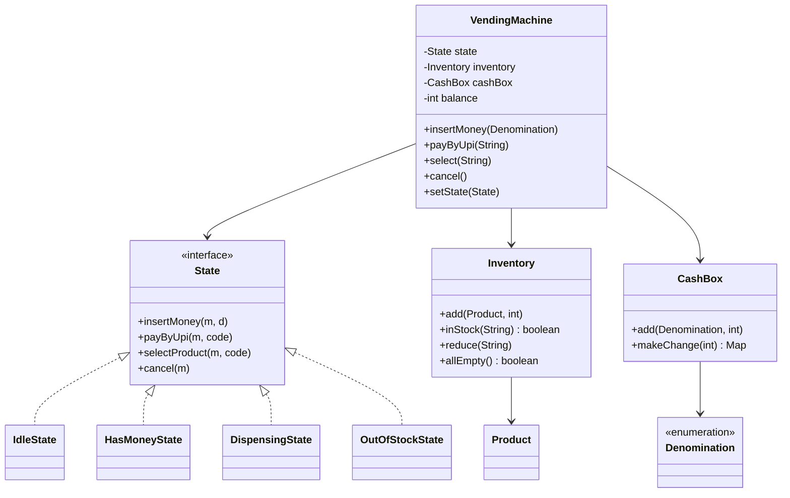

# D7 · Vending machine

Oct 16, 2026 · @saurav chaurasiya

**Is doc me ye hai:** Vending machine ka LLD — State pattern (Idle, HasMoney, Dispensing, OutOfStock), coin/note/UPI QR payment, greedy change aur uska failure case, inventory aur refund — runnable Java ke saath.

**Padhne ka tareeka** — pehle Sawaal pe 15 min khud socho, phir code chalao aur output se apna design milao.

---

## D7 — Vending machine

Vending machine ek aisi machine hai jo paisa (coin, note ya UPI QR) leti hai, product nikalti hai aur bacha hua paisa (change) wapas deti hai. LLD me ye **State pattern** ka classic example hai, kyunki machine ka behaviour is baat pe depend karta hai ki wo abhi kis state me hai.

### Ye cheez hai kya

- Category: LLD case study — State pattern + inventory + payment + change-making algorithm.
- Problem: ek hi button press ("product select karo") ka matlab alag-alag hota hai jab machine khali ho, jab paisa na ho, jab paisa ho, ya jab product nikal raha ho. Isko giant `if-else` ke bina handle karna hai.
- Is lesson ke baad tum kar paoge: state machine ko classes me model karna, greedy change algorithm likhna aur uska failure case pakadna, aur cancel pe sahi refund dena.
- Analogy: chai ki tapri pe bhaiya ka "mood" — jab chai ban rahi hai to naya order nahi lete, jab doodh khatam to sirf "khatam" bolte hain. Mood (state) badla to same sawaal ka jawab badal gaya.

### Sawaal

Tum ek railway station ke liye vending machine ka LLD design kar rahe ho: 40 slots, 6 products (Rs 10 se Rs 60), roz lagbhag 300 transactions, ek transaction 20 second me hona chahiye. Customer coin/note daal sakta hai ya UPI QR scan karke pay kar sakta hai (jaise Paytm/PhonePe se). Machine me chhutta paisa (coin/note) ka limited stock hai.

Requirements:

- Product select karo, paisa do, product lo, change lo.
- Paisa kam ho to product nahi milega. Cancel pe poora paisa wapas.
- Change na ban sake to product mat do, paisa refund karo.
- Product khatam ho to machine OutOfStock state me chali jaye.

> Pehle khud socho — 15 min. Hints: (1) Machine ke kitne alag "mode" hain, aur har mode me 4 actions (paisa daalo, select, cancel, UPI) ka kya matlab hai? (2) Change dene ke liye sabse bada coin pehle uthao — ye kab galat answer deta hai? (3) Product dene se pehle ya baad me check karoge ki change ban sakta hai?

### Problem kyun aata hai

- Ek action ka matlab state pe depend karta hai: `selectProduct()` Idle me "pehle paisa daalo" hai, HasMoney me "dispense karo", OutOfStock me "sorry".
- Naye state (jaise Maintenance) aane pe har method me naya `if` jodna padta hai.
- Paisa lena aur product dena do alag cheezein hain. Beech me kuch fail ho to customer ka paisa kat jata hai ya machine ka product chala jata hai.
- Change limited coins se banta hai. Sirf "balance minus price" kaafi nahi hai.

### Naive approach

- Ek `VendingMachine` class me `int state` flag aur har method me `if (state == ...)` chain.
- Kahan tootta hai: 4 states x 4 actions = 16 combinations ek class me. Ek state add karne pe 4 methods badalne padte hain, aur ek jagah bhi `if` bhool gaye to machine galat behave karti hai (jaise OutOfStock me paisa le leti hai).

Ye bura version hai:

```java
class BadVendingMachine {
    int state = 0; // 0=idle, 1=hasMoney, 2=dispensing, 3=outOfStock
    int balance;

    void selectProduct(String code, int price) {
        if (state == 0) { System.out.println("paisa daalo"); }
        else if (state == 1) {
            if (balance >= price) { state = 2; /* dispense + change */ balance = 0; state = 0; }
            else { System.out.println("paisa kam"); }
        } else if (state == 2) { /* ... */ }
        else if (state == 3) { /* ... */ }
        // insertMoney, cancel, payByUpi me bhi yahi 4-way if. Change ka koi check nahi.
    }
}
```

### Sahi design

1. **State pattern** ([2C Behavior Bazaar](https://claude.ai/code/artifact/d1ac6852-9994-4501-9b0a-7d0f654e5c38) me detail): `State` interface me 4 actions. Har state ek class: `IdleState`, `HasMoneyState`, `DispensingState`, `OutOfStockState`. Machine sirf current state ko call forward karti hai (delegation — kaam kisi aur object ko de dena).
2. **Transitions**: Idle + paisa -> HasMoney. HasMoney + select (paisa kaafi) -> Dispensing. Dispensing khatam -> Idle (ya sab products khatam to OutOfStock). HasMoney + cancel -> refund -> Idle.
3. **Payment**: coin/note `Denomination` enum se. UPI QR path alag hai: payment success hone pe seedha Dispensing, change 0 (exact amount). Real me gateway ka callback aata hai, yahan mock hai.
4. **Change algorithm**: greedy (sabse bada denomination pehle, jitna stock ho). Product dene se PEHLE `makeChange()` check hota hai. `null` aaya to refund.
5. **Refund**: jo coin/note customer ne daale wahi wapas, change banane ki zaroorat nahi.
6. **Exceptions**: galat product code pe `VendingException` (unchecked) — [O7 exceptions](https://claude.ai/code/artifact/cc69c0d1-92e9-4c1d-afd8-8add12f3e7db) wali soch.
7. **Extensibility**: naya state (Maintenance) = nayi class, purani classes ko haath nahi lagana. Ye Open/Closed hai ([1B SOLID Temple](https://claude.ai/code/artifact/f98bb328-8939-4ef4-a9a6-24c5ce970199)). Change algorithm ko `ChangeStrategy` interface ke peeche rakhna Strategy pattern hoga (Deep Dive me).

Class diagram:



Poora runnable code (ek file `Demo.java`, Java 11+):

```java
import java.util.*;

// Domain exception: galat operation pe (O7 wali unchecked exception)
class VendingException extends RuntimeException {
    VendingException(String m) { super(m); }
}

// Coin aur note ki denominations (rupees). Bade se chhota order me, greedy ke liye
enum Denomination {
    NOTE_100(100), NOTE_50(50), NOTE_20(20), NOTE_10(10), COIN_5(5), COIN_2(2), COIN_1(1);
    final int value;
    Denomination(int v) { value = v; }
}

class Product {
    final String code; final String name; final int price;
    Product(String c, String n, int p) { code = c; name = n; price = p; }
}

// Inventory: product code -> (product, quantity)
class Inventory {
    private final Map<String, Product> products = new LinkedHashMap<>();
    private final Map<String, Integer> qty = new HashMap<>();
    void add(Product p, int q) { products.put(p.code, p); qty.merge(p.code, q, Integer::sum); }
    Product get(String code) {
        Product p = products.get(code);
        if (p == null) throw new VendingException("Invalid code " + code);
        return p;
    }
    boolean inStock(String code) { return qty.getOrDefault(code, 0) > 0; }
    void reduce(String code) { qty.merge(code, -1, Integer::sum); }
    boolean allEmpty() { return qty.values().stream().allMatch(q -> q <= 0); }
}

// Cash drawer: kitne coin/note machine ke paas hain (change dene ke liye)
class CashBox {
    private final EnumMap<Denomination, Integer> stock = new EnumMap<>(Denomination.class);
    void add(Denomination d, int n) { stock.merge(d, n, Integer::sum); }
    void remove(Map<Denomination, Integer> m) { m.forEach((d, n) -> stock.merge(d, -n, Integer::sum)); }

    // Greedy: sabse bada denomination pehle. Stock kam ho to null (change nahi ban sakta)
    Map<Denomination, Integer> makeChange(int amount) {
        Map<Denomination, Integer> result = new EnumMap<>(Denomination.class);
        int left = amount;
        for (Denomination d : Denomination.values()) {        // bade se chhota
            int can = Math.min(left / d.value, stock.getOrDefault(d, 0));
            if (can > 0) { result.put(d, can); left -= can * d.value; }
        }
        return left == 0 ? result : null;
    }
}

// ---- State pattern ----
interface State {
    void insertMoney(VendingMachine m, Denomination d);
    void payByUpi(VendingMachine m, String code);
    void selectProduct(VendingMachine m, String code);
    void cancel(VendingMachine m);
}

class IdleState implements State {
    public void insertMoney(VendingMachine m, Denomination d) {
        m.addBalance(d);
        m.setState(new HasMoneyState());
    }
    public void payByUpi(VendingMachine m, String code) {
        Product p = m.inventory().get(code);
        if (!m.inventory().inStock(code)) { m.log("Sold out: " + p.name); return; }
        m.log("UPI QR dikhaya: Rs " + p.price + " pay karo " + p.name + " ke liye");
        m.log("UPI payment SUCCESS (mock gateway)");
        m.setState(new DispensingState());
        m.state().selectProduct(m, code);   // Dispensing state ko kaam do (exact amount, change 0)
    }
    public void selectProduct(VendingMachine m, String code) { m.log("Pehle paisa daalo ya UPI use karo"); }
    public void cancel(VendingMachine m) { m.log("Cancel: kuch refund nahi (balance 0)"); }
}

class HasMoneyState implements State {
    public void insertMoney(VendingMachine m, Denomination d) { m.addBalance(d); }
    public void payByUpi(VendingMachine m, String code) { m.log("Cash balance hai, pehle cancel karo"); }
    public void selectProduct(VendingMachine m, String code) {
        Product p = m.inventory().get(code);
        if (!m.inventory().inStock(code)) { m.log("Sold out: " + p.name); return; }
        if (m.balance() < p.price) {
            m.log("Insufficient money: balance Rs " + m.balance() + ", " + p.name + " Rs " + p.price);
            return;
        }
        // Dispense se PEHLE check: change ban sakta hai? Nahi to product mat do
        if (m.cashBox().makeChange(m.balance() - p.price) == null) {
            m.log("Exact change nahi hai (change Rs " + (m.balance() - p.price) + "). Refund kar rahe hain");
            cancel(m);
            return;
        }
        m.setState(new DispensingState());
        m.state().selectProduct(m, code);
    }
    public void cancel(VendingMachine m) { m.refundAll(); m.setState(new IdleState()); }
}

class DispensingState implements State {
    public void insertMoney(VendingMachine m, Denomination d) { m.log("Dispense chal raha hai, ruko"); }
    public void payByUpi(VendingMachine m, String code) { m.log("Dispense chal raha hai, ruko"); }
    public void selectProduct(VendingMachine m, String code) {
        Product p = m.inventory().get(code);
        m.inventory().reduce(code);
        m.log("Dispensed: " + p.name);
        int change = m.balance() - p.price;
        m.clearBalance();
        if (change > 0) {
            Map<Denomination, Integer> c = m.cashBox().makeChange(change);
            m.cashBox().remove(c);
            m.log("Change Rs " + change + " -> " + c);
        }
        m.setState(m.inventory().allEmpty() ? new OutOfStockState() : new IdleState());
    }
    public void cancel(VendingMachine m) { m.log("Dispense ke beech cancel nahi hota"); }
}

class OutOfStockState implements State {
    public void insertMoney(VendingMachine m, Denomination d) { m.log("Machine khali hai, paisa wapas: " + d); }
    public void payByUpi(VendingMachine m, String code) { m.log("Machine khali hai"); }
    public void selectProduct(VendingMachine m, String code) { m.log("Machine khali hai"); }
    public void cancel(VendingMachine m) { m.log("Machine khali hai"); }
}

class VendingMachine {
    private State state = new IdleState();
    private final Inventory inventory = new Inventory();
    private final CashBox cashBox = new CashBox();
    private final EnumMap<Denomination, Integer> inserted = new EnumMap<>(Denomination.class);
    private int balance = 0;

    Inventory inventory() { return inventory; }
    CashBox cashBox() { return cashBox; }
    State state() { return state; }
    void setState(State s) { state = s; }
    int balance() { return balance; }
    void log(String s) { System.out.println("  [" + state.getClass().getSimpleName() + "] " + s); }

    void addBalance(Denomination d) {
        balance += d.value; cashBox.add(d, 1); inserted.merge(d, 1, Integer::sum);
        log("Inserted " + d + ", balance Rs " + balance);
    }
    void clearBalance() { balance = 0; inserted.clear(); }
    void refundAll() {
        // Jo coin/note customer ne daale the wahi wapas (change banane ki zaroorat nahi)
        Map<Denomination, Integer> r = new EnumMap<>(inserted);
        cashBox.remove(r);
        log("Refund Rs " + balance + " -> " + r);
        clearBalance();
    }

    // Public API: sab kaam current state ko delegate
    void insertMoney(Denomination d) { state.insertMoney(this, d); }
    void payByUpi(String code) { state.payByUpi(this, code); }
    void select(String code) { state.selectProduct(this, code); }
    void cancel() { state.cancel(this); }
}

public class Demo {
    public static void main(String[] args) {
        VendingMachine vm = new VendingMachine();
        vm.inventory().add(new Product("A1", "Chips", 20), 1);
        vm.inventory().add(new Product("B1", "Cold Drink", 35), 2);
        vm.cashBox().add(Denomination.NOTE_10, 1);  // operator ne ek Rs 10 note
        vm.cashBox().add(Denomination.COIN_5, 1);   // aur ek Rs 5 coin rakha hai

        System.out.println("Demo 1: successful purchase with change");
        vm.insertMoney(Denomination.NOTE_50);
        vm.select("B1");               // 50 - 35 = 15 -> change 10 + 5

        System.out.println("Demo 2: insufficient money");
        vm.insertMoney(Denomination.NOTE_20);
        vm.select("B1");
        System.out.println("Demo 3: cancel and refund");
        vm.cancel();

        System.out.println("Demo 4: greedy failure (alag machine: Rs 5 coin hai, Re 1 nahi)");
        VendingMachine vm2 = new VendingMachine();
        vm2.inventory().add(new Product("A1", "Chips", 20), 1);
        vm2.cashBox().add(Denomination.COIN_5, 1);
        vm2.insertMoney(Denomination.NOTE_20);
        vm2.insertMoney(Denomination.COIN_2);
        vm2.insertMoney(Denomination.COIN_2);
        vm2.insertMoney(Denomination.COIN_2);
        vm2.select("A1");              // balance 26, change 6: greedy 5 pe atakta hai, 2+2+2 se ban sakta tha
        System.out.println("Demo 5: UPI QR payment, last item -> OutOfStock");
        vm.payByUpi("A1");
        vm.payByUpi("B1");
        vm.insertMoney(Denomination.NOTE_10);
    }
}
```

Isko chalane pe bilkul ye output aata hai:

```text
Demo 1: successful purchase with change
  [IdleState] Inserted NOTE_50, balance Rs 50
  [DispensingState] Dispensed: Cold Drink
  [DispensingState] Change Rs 15 -> {NOTE_10=1, COIN_5=1}
Demo 2: insufficient money
  [IdleState] Inserted NOTE_20, balance Rs 20
  [HasMoneyState] Insufficient money: balance Rs 20, Cold Drink Rs 35
Demo 3: cancel and refund
  [HasMoneyState] Refund Rs 20 -> {NOTE_20=1}
Demo 4: greedy failure (alag machine: Rs 5 coin hai, Re 1 nahi)
  [IdleState] Inserted NOTE_20, balance Rs 20
  [HasMoneyState] Inserted COIN_2, balance Rs 22
  [HasMoneyState] Inserted COIN_2, balance Rs 24
  [HasMoneyState] Inserted COIN_2, balance Rs 26
  [HasMoneyState] Exact change nahi hai (change Rs 6). Refund kar rahe hain
  [HasMoneyState] Refund Rs 26 -> {NOTE_20=1, COIN_2=3}
Demo 5: UPI QR payment, last item -> OutOfStock
  [IdleState] UPI QR dikhaya: Rs 20 pay karo Chips ke liye
  [IdleState] UPI payment SUCCESS (mock gateway)
  [DispensingState] Dispensed: Chips
  [IdleState] UPI QR dikhaya: Rs 35 pay karo Cold Drink ke liye
  [IdleState] UPI payment SUCCESS (mock gateway)
  [DispensingState] Dispensed: Cold Drink
  [OutOfStockState] Machine khali hai, paisa wapas: NOTE_10
```

Output ko padho:

- Demo 1: Rs 50 - Rs 35 = Rs 15 change, greedy ne Rs 10 note + Rs 5 coin diya.
- Demo 2: Rs 20 < Rs 35, state HasMoney hi rahi, product nahi nikla.
- Demo 3: cancel pe wahi Rs 20 ka note wapas aaya, state Idle ho gayi.
- Demo 4: change Rs 6 chahiye tha. Greedy ne Rs 5 uthaya, bacha Re 1, aur Re 1 ka coin hai nahi, to fail. Jabki 2+2+2 se ban sakta tha (machine me teen Rs 2 ke coin the). Isliye product diya hi nahi, refund kiya.
- Demo 5: UPI se last items nikle, phir machine OutOfStock me gayi aur naya note wapas kar diya.

### Kya choose karein aur kyun

| Option | Kab use karo | Kab mat karo |
| --- | --- | --- |
| `if-else` / enum switch | 2 states, kabhi badlega nahi (quick script) | 3+ states ya naye states aane wale hain |
| State pattern (classes) | Behaviour state pe depend kare, transitions saaf ho | Sirf ek flag ho jisse behaviour nahi badalta |
| Enum with abstract methods | States stateless hain, class explosion nahi chahiye | States ko apna data/dependencies chahiye |
| Greedy change | Canonical coin system (1,2,5,10) aur stock bahut hai | Stock limited ho ya odd denominations ho |
| DP / backtracking change | Limited stock, exact change ka guarantee chahiye | Latency tight aur amounts bade (bahut slow ho sakta hai) |
| UPI QR (exact amount) | Change ka jhanjhat hi hatana hai | Network kharab ho (offline fallback chahiye) |

### India me kaise hota hai

- UPI QR vending/kiosk par common ho gaya hai: machine ek dynamic QR (amount ke saath) dikhati hai, customer kisi bhi UPI app se pay karta hai, aur payment confirm hone pe hi dispense hota hai. Isse change ki problem hi nahi rehti.
- India ka QR standard NPCI + Mastercard + Visa ne milkar launch kiya tha (BharatQR), jisme ek hi QR se kai networks ke payments chal sakte hain: [NFCW — BharatQR launch](https://www.nfcw.com/2017/02/21/350341/government-backed-bharatqr-launches-india-take-country-one-step-closer-mobile-payments/).
- Merchant ki taraf se QR kaise generate aur accept hota hai, uska overview: [Razorpay — Bharat QR](https://razorpay.com/blog/what-is-bharatqr-code-and-how-does-it-power-digital-transactions/).
- Interview ke liye dhyan rakho: UPI callback late aa sakta hai ya duplicate aa sakta hai. Isliye real machine me payment ko ek `orderId` se jodte hain aur dispense se pehle payment status verify karte hain (idempotency — same request dobara aaye to ek hi baar asar ho).

### Interview follow-ups

- **Naya state (Maintenance) add karna ho to?** — Nayi `MaintenanceState` class likho aur transition wahi se trigger karo. Baaki states ko chhuna nahi padta (Open/Closed).
- **Greedy change kab fail hota hai?** — Jab stock limited ho (Demo 4) ya denominations canonical na hon (jaise coins 1, 3, 4 aur amount 6: greedy 4+1+1, optimal 3+3). Solution: DP ya backtracking, ya "exact change only" mode.
- **State objects har baar `new` kyun, singleton kyun nahi?** — Ye states stateless hain, to singleton/shared instance chalega aur garbage kam banega. Demo me simple rakhne ke liye `new` kiya.
- **Do customers ek saath use karein to?** — Ek physical machine me ek transaction hota hai. Lekin remote UPI callback aur UI thread ek saath aa sakte hain, to state transitions pe `synchronized` ya single-threaded event queue chahiye.
- **Dispense fail ho jaye (motor atak gayi) to?** — Dispensing state ko success/fail result do. Fail pe refund karo (cash) ya UPI refund trigger karo (compensating action — pehle kiye gaye kaam ko ulta karna).
- **Product dene ke baad change fail ho to?** — Isliye change check dispense se PEHLE hota hai. Is design me product dene ke baad change fail nahi hona chahiye.

### Self-check

1. State pattern me `if (state == X)` ki jagah kya aata hai, aur isse naya state add karna kaise aasan hota hai?
2. Idle state me `selectProduct()` call ho to kya hona chahiye, aur HasMoney me?
3. Change Rs 6 ho aur machine me sirf ek Rs 5 coin aur teen Rs 2 coin hon, to greedy kya karega? Sahi answer kya hai?
4. Cancel pe refund me "wahi coin/note wapas" kyun, `makeChange()` kyun nahi?
5. UPI QR payment me change ki problem kyun nahi aati?

### Notebook

State pattern: har state ek class, machine sirf delegate karti hai · States: Idle, HasMoney, Dispensing, OutOfStock · Greedy change: bada denomination pehle, limited stock pe fail ho sakta hai · Dispense se PEHLE change check, fail pe refund · Cancel refund = jo daala wahi wapas · UPI QR = exact amount, change zero · Naya state = nayi class (Open/Closed)

### Padhne ke liye

- [State Design Pattern — GeeksforGeeks](https://www.geeksforgeeks.org/state-design-pattern/)
- [Vending Machine LLD — awesome-low-level-design (GitHub)](https://github.com/ashishps1/awesome-low-level-design/blob/main/problems/vending-machine.md)
- [Change-making problem — Wikipedia](https://en.wikipedia.org/wiki/Change-making_problem)
- [Canonical Coin Systems for Change-Making Problems (arXiv)](https://ar5iv.arxiv.org/html/0809.0400)

### Deep Dive (SDE-2) — jab time ho

#### Greedy kab sahi hota hai (canonical coin system)

- Coin system "canonical" hai agar greedy hamesha optimal (sabse kam coins) deta hai. Rupee ke 1, 2, 5, 10, 20, 50 ke liye greedy sahi hai jab stock unlimited ho.
- Stock limited hone pe canonical system bhi fail ho sakta hai (Demo 4). Matlab problem denominations ki nahi, stock ki hai.
- Non-canonical example: coins 1, 3, 4 aur amount 6. Greedy 4+1+1 (3 coins), optimal 3+3 (2 coins).

#### Change ko Strategy bana do

- `ChangeStrategy` interface rakho: `GreedyChange`, `DpChange`. Machine config se choose kare.
- DP bounded stock ke saath: state = (denomination index, remaining amount), O(D x amount). Vending ke chhote amounts (< Rs 500) ke liye fast hai.
- Trade-off: greedy O(D) aur simple, DP exact. Hybrid: pehle greedy try karo, fail pe DP.

#### Concurrency aur payment safety

- Ek machine = ek customer, par UPI callback alag thread se aata hai. State transition ko `synchronized` ya single-thread executor se serialize karo ([Thread Jungle](https://claude.ai/code/artifact/05d7fa44-518a-49fd-a70c-40ac902f184f) dekho).
- UPI callback duplicate aaye to `orderId` se dedupe karo, warna do product nikal sakte hain.
- Dispense motor fail ho to payment ko reverse karne ka flow (refund) pehle se design karo. Cash ke liye cash refund, UPI ke liye gateway refund.
- Production me inventory aur cash level server ko report hote hain (restock alerts) — ye Observer pattern ka kaam hai.

---

## Aage kya

- Pichhla: [D6 · BookMyShow](https://claude.ai/code/artifact/f3d169f5-f1c9-4a30-8a6e-6c8de8e5296b)
- Agla: [D8 · ATM](https://claude.ai/code/artifact/2e0b4b9f-03c6-4571-b177-e4e643a1aaa9)
- Related: [2C Behavior Bazaar](https://claude.ai/code/artifact/d1ac6852-9994-4501-9b0a-7d0f654e5c38) (State pattern, Strategy, Observer), [1B SOLID Temple](https://claude.ai/code/artifact/f98bb328-8939-4ef4-a9a6-24c5ce970199) (Open/Closed), [1A OOP Village](https://claude.ai/code/artifact/cc69c0d1-92e9-4c1d-afd8-8add12f3e7db) (O7 exceptions)
