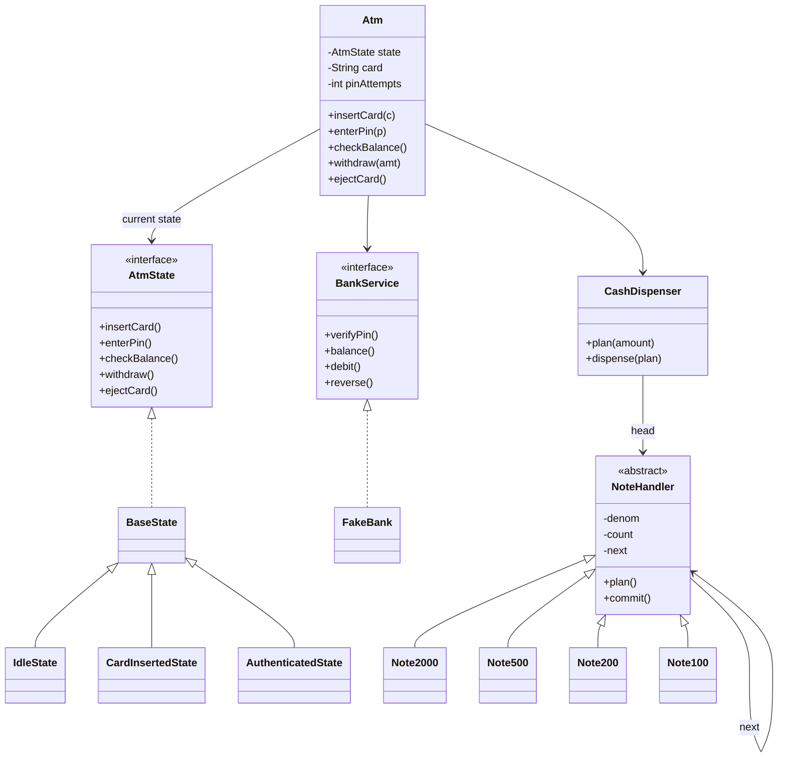

# D8 · ATM

Oct 16, 2026 · @saurav chaurasiya

**Is doc me:** ATM ka Low Level Design (LLD — classes aur unke beech ka code-level design) Java me: card insert, PIN check, balance enquiry, withdrawal, cash dispenser, aur debit ke baad failure pe reversal.

**Padhne ka tareeka** — pehle Sawaal pe 15 min khud socho, phir Naive approach ka bad code dekho, phir Sahi design ka code chalao aur output se match karo.

---

## D8 — ATM

ATM ek aisi machine hai jo card + PIN se customer ko pehchaanti hai aur bank se baat karke cash nikaalti hai. LLD ke nazariye se ye ek **state machine** (har waqt ek hi state, aur state ke hisaab se allowed actions) hai, jisme cash dene ka kaam **Chain of Responsibility** (request ko handlers ki zanjeer me aage pass karna) se hota hai.

### Ye cheez hai kya

- Category: LLD case study, behavioral patterns ka combo (State + Chain of Responsibility + Strategy-jaisa bank abstraction).
- Problem: ek machine jo kai steps (card, PIN, menu, cash) ko sahi order me chalaye, galat order ko rok de, aur paisa kaatke cash na nikle to paisa wapas kare.
- Is lesson ke baad tum kar paoge: ATM ke states ko State pattern me model karna, notes ka breakdown Chain of Responsibility se nikalna, bank ko interface ke peeche rakhna, aur debit-ke-baad-failure ko reversal se handle karna.

Analogy: bank ki line me token milta hai, counter pe clerk pehle ID dekhta hai, phir passbook, phir cash gin ke deta hai. Order galat ho (bina ID ke cash) to clerk mana kar deta hai. ATM wahi clerk hai, bas har step code me likha hai.

### Sawaal

Tum ek bank ke ATM software team me ho. Ek ATM pe din me 400 withdrawals aate hain, peak pe 1 transaction har 20 second me. Cassette (cash ka dabba) me 2000, 500, 200 aur 100 ke notes hain. Bank ka core system alag server pe hai aur kabhi slow ya fail ho sakta hai.

Requirements:

- Card daalo, 3 attempts me PIN sahi karo, warna card retain (machine rakh le).
- Balance enquiry aur cash withdrawal.
- Amount 100 ke multiple me ho, aur machine exact amount notes se bana sake.
- Customer ka paisa kat jaye par cash na nikle (jam, power cut) to paisa wapas aaye.

> Pehle khud socho — 15 min. Hints: (1) Card insert hone se pehle withdraw call ho jaye to kya hoga? Ye rule kahan likhoge, if-else me ya kisi aur tareeke se? (2) 3700 ko 2000/500/200/100 notes me kaise todoge, aur naya note (jaise 50) aaye to kitna code badlega? (3) Debit ho gaya par cash nahi nikla, to order of operations kya rakhoge?

### Problem kyun aata hai

- ATM me kaam ka order fix hai (card, PIN, menu, cash). Order tootne pe security bug banta hai, jaise bina PIN ke cash.
- Ek hi class me sab if-else bhar do to har naya state (jaise out-of-service) pe poori class chhedni padti hai.
- Notes ka breakdown hard-code karoge to naya denomination aane pe purana code badalna padta hai (Open/Closed Principle — extend karo, modify nahi).
- Bank aur hardware dono fail ho sakte hain. Debit ke baad hardware fail hua to customer ka paisa phans jata hai.
- Bank ki real implementation test me nahi chal sakti, isliye ATM ko bank ke interface se baat karni chahiye, concrete class se nahi.

### Naive approach

- Ek `Atm` class, ek `String state`, aur har method me if-else. Notes ke liye lambi if-else chain.
- Kahan toot-ta hai: 4 states x 5 actions = 20 combinations ka check ek jagah; naya state aate hi har method badlo. Notes ka 50 add karne pe withdraw ka core logic chhedna padta hai. Aur debit pehle, dispense baad me, bina reversal ke: 1 jam = 1 customer ka paisa gaya.

```java
class BadAtm {
    String state = "IDLE"; // string state, typo hua to silently bug
    int[] cash = {5, 10, 10, 3};

    void withdraw(int amt) {
        if (state.equals("IDLE")) { System.out.println("card daalo"); }
        else if (state.equals("CARD")) { System.out.println("PIN daalo"); }
        else if (state.equals("AUTH")) {
            bank.debit(amt);                 // pehle paisa kaat liya
            while (amt >= 2000) { amt -= 2000; cash[0]--; }
            while (amt >= 500)  { amt -= 500;  cash[1]--; }
            // 200, 100 ... copy-paste. Exact na bane to? Kuch check nahi.
            dispenser.push();                // yahan jam hua to debit wapas kaun karega?
        }
    }
}
```

### Sahi design

1. **State pattern** (har state ek alag class, ATM sirf current state ko kaam delegate karta hai): `IdleState`, `CardInsertedState`, `AuthenticatedState`. Galat action pe state khud mana kar deti hai.
2. **Chain of Responsibility** notes ke liye: `Note2000 -> Note500 -> Note200 -> Note100`. Har handler apne denomination ke jitne notes de sakta hai deta hai, bacha hua amount agle ko bhej deta hai.
3. **Do phase dispense**: pehle `plan` (dry run, inventory touch nahi), phir `commit` (notes ghatao). Isse exact na ban paaye to bina kuch badle reject.
4. **BankService interface**: ATM sirf interface jaanta hai. Test me `FakeBank`, production me real bank gateway lag sakta hai (Dependency Inversion).
5. **Order**: validate amount, plan notes, bank debit, dispense. Dispense fail ho to `bank.reverse(txnId)`, jo ek compensating transaction hai (pehle ki hui cheez ko ulta karne wala naya step).
6. **Idempotency** (same request dobara aaye to asar ek hi baar ho): `debit` aur `reverse` dono txnId pe chalte hain, isliye retry safe hai.
7. **PIN attempts** ka counter `Atm` me hai, 3 galat pe card retain aur state `Idle`.



Neeche poora runnable code hai. Ek file `Demo.java` me daalke `javac Demo.java && java Demo` chalao.

```java
import java.util.*;

// ---------- Bank abstraction (ATM ko bank ka andar ka kuch nahi pata) ----------
interface BankService {
    boolean verifyPin(String cardNo, String pin);
    long balance(String cardNo);
    // txnId idempotency ke liye: same txnId dobara aaye to dobara debit nahi hoga
    boolean debit(String cardNo, long amount, String txnId);
    void reverse(String cardNo, long amount, String txnId); // compensating transaction
}

class FakeBank implements BankService {
    private final Map<String, String> pins = new HashMap<>();
    private final Map<String, Long> balances = new HashMap<>();
    private final Set<String> debited = new HashSet<>();
    private final Set<String> reversed = new HashSet<>();
    void addAccount(String card, String pin, long bal) { pins.put(card, pin); balances.put(card, bal); }
    public boolean verifyPin(String c, String p) { return p.equals(pins.get(c)); }
    public long balance(String c) { return balances.get(c); }
    public boolean debit(String c, long amt, String txnId) {
        if (debited.contains(txnId)) return true;            // duplicate call, kuch mat karo
        if (balances.get(c) < amt) return false;
        balances.put(c, balances.get(c) - amt);
        debited.add(txnId);
        return true;
    }
    public void reverse(String c, long amt, String txnId) {
        if (!debited.contains(txnId) || !reversed.add(txnId)) return; // sirf ek baar reverse
        balances.put(c, balances.get(c) + amt);
    }
}

// ---------- Chain of Responsibility: note denominations ----------
abstract class NoteHandler {
    protected final int denom;
    protected int count;                 // is denomination ke kitne notes cassette me bache hain
    protected NoteHandler next;
    NoteHandler(int denom, int count) { this.denom = denom; this.count = count; }
    NoteHandler setNext(NoteHandler n) { this.next = n; return n; }

    // Dry run: inventory change kiye bina plan banao. Exact na bane to null.
    Map<Integer, Integer> plan(int amount, Map<Integer, Integer> acc) {
        int use = Math.min(amount / denom, count);
        if (use > 0) acc.put(denom, use);
        int rest = amount - use * denom;
        if (rest == 0) return acc;
        return next == null ? null : next.plan(rest, acc);
    }
    // Plan confirm hone ke baad hi inventory ghatao
    void commit(Map<Integer, Integer> plan) {
        Integer n = plan.get(denom);
        if (n != null) count -= n;
        if (next != null) next.commit(plan);
    }
    String stock() { return denom + "x" + count + (next == null ? "" : ", " + next.stock()); }
}
class Note2000 extends NoteHandler { Note2000(int c) { super(2000, c); } }
class Note500  extends NoteHandler { Note500(int c)  { super(500, c); } }
class Note200  extends NoteHandler { Note200(int c)  { super(200, c); } }
class Note100  extends NoteHandler { Note100(int c)  { super(100, c); } }

class CashDispenser {
    private final NoteHandler head;
    boolean jammed = false;              // demo ke liye hardware fault inject karne ka flag
    CashDispenser(NoteHandler head) { this.head = head; }
    Map<Integer, Integer> plan(int amount) { return head.plan(amount, new LinkedHashMap<>()); }
    void dispense(Map<Integer, Integer> plan) {
        if (jammed) throw new IllegalStateException("cash dispenser jam");
        head.commit(plan);
    }
    String stock() { return head.stock(); }
}

// ---------- State pattern: ATM ke states ----------
interface AtmState {
    String insertCard(Atm atm, String cardNo);
    String enterPin(Atm atm, String pin);
    String checkBalance(Atm atm);
    String withdraw(Atm atm, int amount);
    String ejectCard(Atm atm);
}

abstract class BaseState implements AtmState {
    public String insertCard(Atm a, String c) { return "Not allowed: card pehle se andar hai"; }
    public String enterPin(Atm a, String p)   { return "Not allowed: pehle card daalo"; }
    public String checkBalance(Atm a)         { return "Not allowed: pehle PIN verify karo"; }
    public String withdraw(Atm a, int amt)    { return "Not allowed: pehle PIN verify karo"; }
    public String ejectCard(Atm a)            { return "Not allowed: card hai hi nahi"; }
}

class IdleState extends BaseState {
    public String insertCard(Atm atm, String cardNo) {
        atm.card = cardNo; atm.pinAttempts = 0;
        atm.setState(new CardInsertedState());
        return "Card accepted, PIN daalo";
    }
}

class CardInsertedState extends BaseState {
    public String enterPin(Atm atm, String pin) {
        if (atm.bank.verifyPin(atm.card, pin)) {
            atm.setState(new AuthenticatedState());
            return "PIN sahi, menu khul gaya";
        }
        atm.pinAttempts++;
        if (atm.pinAttempts >= Atm.MAX_ATTEMPTS) {
            atm.card = null;
            atm.setState(new IdleState());
            return "PIN " + Atm.MAX_ATTEMPTS + " baar galat, card retain (lock) ho gaya";
        }
        return "PIN galat, " + (Atm.MAX_ATTEMPTS - atm.pinAttempts) + " attempt bache";
    }
    public String ejectCard(Atm atm) { atm.card = null; atm.setState(new IdleState()); return "Card wapas"; }
}

class AuthenticatedState extends BaseState {
    public String checkBalance(Atm atm) { return "Balance = Rs " + atm.bank.balance(atm.card); }
    public String withdraw(Atm atm, int amount) {
        if (amount <= 0 || amount % 100 != 0) return "Rejected: amount 100 ke multiple me hona chahiye";
        Map<Integer, Integer> plan = atm.dispenser.plan(amount);
        if (plan == null) return "Rejected: ATM ke paas exact " + amount + " banane ke notes nahi hain";
        String txnId = "TXN-" + (++atm.txnSeq);
        if (!atm.bank.debit(atm.card, amount, txnId)) return "Rejected: balance kam hai";
        try {
            atm.dispenser.dispense(plan);               // debit ke BAAD hardware step
            return "Dispensed Rs " + amount + " " + plan;
        } catch (RuntimeException e) {
            atm.bank.reverse(atm.card, amount, txnId);  // failure after debit -> reversal
            return "Hardware fail (" + e.getMessage() + "), Rs " + amount + " reverse kar diya";
        }
    }
    public String ejectCard(Atm atm) { atm.card = null; atm.setState(new IdleState()); return "Card wapas"; }
}

class Atm {
    static final int MAX_ATTEMPTS = 3;
    final BankService bank; final CashDispenser dispenser;
    AtmState state = new IdleState();
    String card; int pinAttempts; int txnSeq;
    Atm(BankService b, CashDispenser d) { bank = b; dispenser = d; }
    void setState(AtmState s) { state = s; }
    String insertCard(String c) { return state.insertCard(this, c); }
    String enterPin(String p)   { return state.enterPin(this, p); }
    String checkBalance()       { return state.checkBalance(this); }
    String withdraw(int amt)    { return state.withdraw(this, amt); }
    String ejectCard()          { return state.ejectCard(this); }
}

public class Demo {
    static void say(String step, String result) { System.out.println(String.format("%-22s -> %s", step, result)); }

    public static void main(String[] args) {
        FakeBank bank = new FakeBank();
        bank.addAccount("CARD-1", "1234", 20000);
        bank.addAccount("CARD-2", "4321", 5000);
        // chain: 2000 -> 500 -> 200 -> 100
        NoteHandler h = new Note2000(5);
        h.setNext(new Note500(10)).setNext(new Note200(10)).setNext(new Note100(3));
        CashDispenser disp = new CashDispenser(h);
        Atm atm = new Atm(bank, disp);

        System.out.println("== 1. Successful withdrawal ==");
        say("insertCard", atm.insertCard("CARD-1"));
        say("enterPin 1234", atm.enterPin("1234"));
        say("checkBalance", atm.checkBalance());
        say("withdraw 3700", atm.withdraw(3700));
        say("checkBalance", atm.checkBalance());
        say("stock", disp.stock());

        System.out.println("== 2. Dispenser exact amount nahi bana sakta ==");
        say("withdraw 450", atm.withdraw(450));
        say("withdraw 99900", atm.withdraw(99900));
        say("ejectCard", atm.ejectCard());

        System.out.println("== 3. Wrong PIN lockout ==");
        say("insertCard", atm.insertCard("CARD-2"));
        say("enterPin 1111", atm.enterPin("1111"));
        say("enterPin 2222", atm.enterPin("2222"));
        say("enterPin 3333", atm.enterPin("3333"));
        say("withdraw 500", atm.withdraw(500));

        System.out.println("== 4. Debit ke baad dispenser jam -> reversal ==");
        say("insertCard", atm.insertCard("CARD-1"));
        say("enterPin 1234", atm.enterPin("1234"));
        disp.jammed = true;
        say("withdraw 1000", atm.withdraw(1000));
        say("checkBalance", atm.checkBalance());
    }
}
```

Isko chalane pe bilkul ye output aata hai:

```text
== 1. Successful withdrawal ==
insertCard             -> Card accepted, PIN daalo
enterPin 1234          -> PIN sahi, menu khul gaya
checkBalance           -> Balance = Rs 20000
withdraw 3700          -> Dispensed Rs 3700 {2000=1, 500=3, 200=1}
checkBalance           -> Balance = Rs 16300
stock                  -> 2000x4, 500x7, 200x9, 100x3
== 2. Dispenser exact amount nahi bana sakta ==
withdraw 450           -> Rejected: amount 100 ke multiple me hona chahiye
withdraw 99900         -> Rejected: ATM ke paas exact 99900 banane ke notes nahi hain
ejectCard              -> Card wapas
== 3. Wrong PIN lockout ==
insertCard             -> Card accepted, PIN daalo
enterPin 1111          -> PIN galat, 2 attempt bache
enterPin 2222          -> PIN galat, 1 attempt bache
enterPin 3333          -> PIN 3 baar galat, card retain (lock) ho gaya
withdraw 500           -> Not allowed: pehle PIN verify karo
== 4. Debit ke baad dispenser jam -> reversal ==
insertCard             -> Card accepted, PIN daalo
enterPin 1234          -> PIN sahi, menu khul gaya
withdraw 1000          -> Hardware fail (cash dispenser jam), Rs 1000 reverse kar diya
checkBalance           -> Balance = Rs 16300
```

Output kaise padhein:

- Scenario 1: 3700 = 2000 x1 + 500 x3 + 200 x1. Chain ne bade note se shuru kiya, bacha hua amount agle handler ko diya. Balance 20000 se 16300 hua.
- Scenario 2: 450 100 ka multiple nahi hai, aur 99900 ke liye machine me total cash hi kam hai (cassette me kul Rs 13600), isliye plan `null` aaya aur bank ko debit call hi nahi gaya.
- Scenario 3: 3 galat PIN ke baad state `Idle` ho gayi, to withdraw ko State pattern ne hi roka. Koi if-else nahi.
- Scenario 4: debit hua, dispense fail hua, `reverse` chala, balance 16300 hi raha.
- Patterns: State (AtmState), Chain of Responsibility (NoteHandler), Dependency Inversion (BankService). Naya note jodna ho to ek nayi `NoteHandler` subclass banao aur chain me daal do, `withdraw` ka code nahi badlega.

### Kya choose karein aur kyun

| Option | Kab use karo | Kab mat karo |
| --- | --- | --- |
| State pattern (state = class) | States 3+ hon aur har state me allowed actions alag hon, jaise ATM, vending machine | Sirf 2 states (on/off) hon, tab enum + if kaafi hai |
| Enum + switch | Chhota, fixed state machine, interview me 10 min ka time ho | State ke saath behavior bhi badhta ja raha ho, switch har method me phail jata hai |
| Chain of Responsibility (notes) | Denominations badal sakte hon (50 ka note aaya, 2000 band hua) | Sirf ek fixed rule ho aur kabhi na badle |
| Greedy loop / array | Quick prototype | Per-denomination alag rule ya inventory logic chahiye |
| Bank interface | Test me fake bank, production me real gateway | Kabhi nahi; ATM ko concrete bank class se bandhna galat hai |
| Debit pehle, reversal baad me | Bank ledger ka rule hai ki paisa pehle hold ho | Jab cash nikalna reversible na ho aur reversal ka path hi na ho |

### India me kaise hota hai

- India me ATM ke peeche **NPCI** (National Payments Corporation of India) aur banks ka switch network chalta hai. Aapka card kisi aur bank ke ATM pe chale to request issuer bank tak switch ke through jaati hai.
- Failed ATM transaction (paisa kata, cash nahi mila) ke liye RBI ne time limit aur compensation ke rules banaye hain, ye RBI ke notification me padh sakte ho: [RBI Notification on failed transactions TAT](https://www.rbi.org.in/Scripts/NotificationUser.aspx?Id=11693). TAT matlab turnaround time, yaani kitne din me paisa wapas aana chahiye.
- Card ke bina cash nikalne ka UPI-based flow bhi aaya hai, jisme card ki jagah UPI se authenticate hota hai. Overview: [RBI cardless cash withdrawal via UPI at all ATMs](https://www.outlookmoney.com/news/rbi-plans-to-introduce-card-less-cash-withdrawal-through-upi-across-all-atms-in-india-news-198187).
- UPI me bhi "paisa kata par receiver ko nahi mila" ka wahi problem hai, aur auto-reversal se hi solve hota hai: [Paytm blog on UPI money deducted](https://paytm.com/blog/payments/upi/upi-money-deducted-not-received-recovery-guide/).
- Design samajhne ke liye ek aur LLD walkthrough: [Design an ATM System, Ujjwal Bhardwaj](https://ujjwalbhardwaj.me/post/low-level-design-design-an-atm-system/).

### Interview follow-ups

- **Debit ke baad cash na nikle to?** — Dispense fail pe `reverse(txnId)` chalao. Agar ATM crash ho jaye (reverse bhi na chale), bank side pe pending debit ko reconciliation (do systems ke records match karna) se pakdo aur auto-reverse karo.
- **Do customers ek hi account se ek saath nikalein?** — Bank ki `debit` atomic honi chahiye (DB transaction ya conditional update `balance >= amt`). ATM ke andar ek hi session chalta hai, race bank me hoti hai.
- **Naya note denomination (50) kaise jodoge?** — Ek nayi `NoteHandler` subclass, chain me jod do. Open/Closed Principle follow hota hai.
- **Greedy hamesha exact amount bana deta hai?** — Nahi. Limited inventory me greedy fail ho sakta hai jabki solution maujood ho (jaise 600 chahiye, 500 x1 aur 100 x0, par 200 x3 hain). Fix: dynamic programming ya backtracking.
- **PIN attempts ka counter kahan rakhoge?** — Demo me ATM session me hai. Real me bank side pe card ke saath, warna attacker card nikalke dobara daal ke counter reset kar dega.
- **Concurrency kahan aati hai?** — Ek ATM pe ek hi user, to ATM state single-threaded. Concurrency bank service aur cash inventory (agar remote refill/monitoring thread ho) me aati hai, wahan lock ya atomic counters lagao.
- **Testing kaise karoge?** — `FakeBank` aur `jammed` flag jaisa fault injection (jaan boojhkar fail karwana), taaki reversal path ka test ban sake.

### Self-check

1. State pattern se ATM me if-else kaise hata? Kaunsa action kaunsi state me allowed hai ye kahan likha hai?
2. `plan` aur `commit` alag kyun hain? Seedha notes ghatane me kya galat hota?
3. Debit ke baad dispenser jam ho jaye to kaunsa step chalta hai, aur wo idempotent kyun hona chahiye?
4. 3700 ka breakdown 2000/500/200/100 chain me kaise nikla? Har handler ne kya kiya?
5. ATM ko `BankService` interface se kyun bandhna chahiye, `FakeBank` se kyun nahi?

### Notebook

ATM = State (Idle, CardInserted, Authenticated) · notes = Chain of Responsibility 2000 -> 500 -> 200 -> 100 · pehle plan (dry run), phir debit, phir dispense · dispense fail = reverse(txnId), ek compensating transaction · debit aur reverse idempotent (txnId ke saath) · bank interface ke peeche, test me FakeBank · limited inventory me greedy fail ho sakta hai, tab DP chahiye.

### Padhne ke liye

- [Design an ATM System, Ujjwal Bhardwaj](https://ujjwalbhardwaj.me/post/low-level-design-design-an-atm-system/)
- [awesome-low-level-design: ATM problem](https://github.com/ashishps1/awesome-low-level-design/blob/main/problems/atm.md)
- [ATM Machine System Design, Tech by Example](https://techbyexample.com/atm-machine-system-design/)
- [RBI Notification on failed transactions TAT](https://www.rbi.org.in/Scripts/NotificationUser.aspx?Id=11693)

### Deep Dive (SDE-2) — jab time ho

#### Limited inventory me exact amount (greedy ki limit)

- Greedy bade note se shuru karta hai aur kabhi peeche nahi dekhta. Limited count ho to ye fail ho sakta hai jabki koi combination maujood ho.
- Fix: bounded coin-change (har denomination ka count limited) DP se, ya backtracking. 4 denominations pe ye bahut sasta hai.
- Business rule bhi chahiye: customer ko bade notes na mil jaye jab chhote khatam ho rahe hon, ya cassette balance rakhne ke liye 100/200 prefer karo. Ye Strategy pattern se plug-in ho sakta hai.

#### Failure ke har point pe kya hota hai

- Debit se pehle fail: kuch nahi hua, customer ko error dikhao.
- Debit ke baad, dispense se pehle ATM crash: ATM ko durable log (disk pe write-ahead record) rakhna chahiye ki txnId debit hua par cash nahi gaya. Restart pe reverse chalao ya bank reconciliation pakde.
- Dispense hua par ack (confirmation) bank ko nahi pahuncha: bank debit rakhe, kyunki cash nikla hai. Isiliye status clearly `DISPENSED` ya `NOT_DISPENSED` bhejna padta hai, sensor se confirm karke.
- Ye wahi idea hai jo [2C Saga Sea](https://claude.ai/code/artifact/429b3ea6-a261-431d-a384-a0c6eb68a9f6) me saga aur compensating transaction ke naam se aata hai.

#### Security aur session

- PIN kabhi plain text me store ya log nahi hota. Real ATM me keypad (PIN pad) PIN ko hardware me encrypt karke bhejta hai, aur bank HSM (hardware security module, keys ki tijori jaisi tamper-proof device) me verify hota hai.
- Session timeout: user ne 30 second kuch nahi kiya to card eject ya retain karo. State machine me ye ek aur transition hai (`CardInsertedState` -> `Idle`), timer ek alag thread se.
- Daily withdrawal limit bank side pe enforce hota hai, ATM sirf bank ka reject message dikhata hai.
- Card retain wala flag bank side pe persist karo, nahi to attacker ATM badal ke attempts reset kar lega.

#### Extensibility

- Naya state (`OutOfServiceState`, jab cassette khali ho) sirf ek nayi class hai. Baaki states me ek-do transition badalte hain.
- Naye transactions (PIN change, mini statement): `Command` pattern (har action ek object) se menu extensible ho jata hai. Detail: [2C Behavior Bazaar](https://claude.ai/code/artifact/d1ac6852-9994-4501-9b0a-7d0f654e5c38).
- Observer pattern se ATM ke events (low cash, jam) monitoring service ko bhej sakte ho.

---

## Aage kya

- Pichhla: [D7 · Vending machine](https://claude.ai/code/artifact/10e3436e-5183-4425-aa0a-c60ffd5ebda6)
- Agla: [D9 · Rate limiter](https://claude.ai/code/artifact/1a82c7a8-3aa0-49a2-b8d8-bb9398c1d502)
- Related: [2C Behavior Bazaar](https://claude.ai/code/artifact/d1ac6852-9994-4501-9b0a-7d0f654e5c38) (State, Chain of Responsibility, Command), [2C Saga Sea](https://claude.ai/code/artifact/429b3ea6-a261-431d-a384-a0c6eb68a9f6) (compensating transaction)
