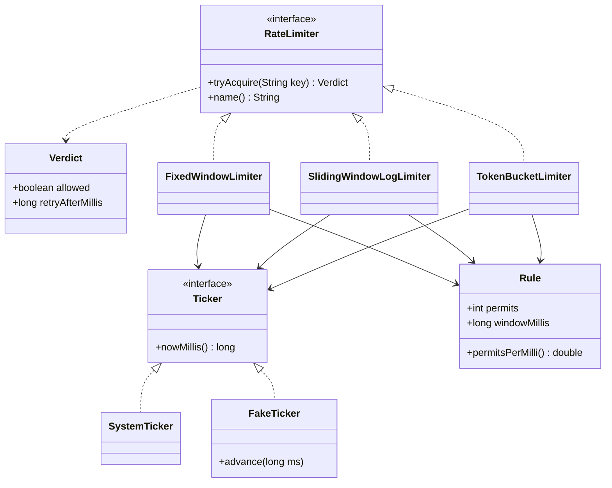

# D9 · Rate limiter

Oct 12, 2026 · @saurav chaurasiya

Is doc me LLD ka machine coding boss level D9 — Rate limiter ka poora design aur chalne layak Java code hai.

---

## D9 — Rate limiter

Rate limiter ek chhota component hai jo batata hai: "is caller ko abhi ek aur request karne do, ya mana kar do". Matlab ek gate jo counting karta hai. Machine coding round me ye sabse common question hai kyunki isme teen cheezein ek saath test hoti hain — interface design, thread safety, aur time ke saath badalti state. Is level me hum ek hi interface ke peeche teen algorithm likhenge aur unka farak code chala ke dekhenge.

### Ye cheez hai kya

- Kis category ki cheez hai: ek stateful utility — per caller (per key) ek chhoti state rakhta hai aur time ke hisaab se usse update karta hai
- Kis problem ke liye banayi gayi: ek client ya ek buggy loop poore system ko kha na jaaye; aur paid API ka cost control me rahe
- Is lesson ke baad tum kya kar paoge: 30 minute me `RateLimiter` interface + token bucket + sliding window likh paoge, thread safety defend kar paoge, aur "single JVM se distributed me kaise le jaoge" ka jawab de paoge

### Sawaal

Paytm ke payment API pe ek rate limiter likhna hai. Requirements:

1. Per merchant limit: 5 request per second (asli duniya me zyada hoti hai, par test karne me 5 aasan hai)
2. Ek hi interface ke peeche teen algorithm pluggable ho — fixed window, sliding window log, token bucket
3. Reject karne pe client ko batao ki kitne millisecond baad retry kare (HTTP me ye `Retry-After` header banta hai)
4. Multi-threaded ho — ek hi merchant ki 8 thread se aayi 200 request pe bhi limit exactly 5 pe tooti chahiye
5. Test deterministic ho — `Thread.sleep` pe based test nahi chahiye

> Pehle khud socho — 5 min. Hints: (1) Requirement 5 ka matlab hai `System.currentTimeMillis()` ko seedha call nahi karoge. (2) Lock kis cheez pe lagaoge — poori map pe ya ek key pe? (3) "5 per second" ke do matlab ho sakte hain, aur wahi teen algorithm ka asli farak hai.

### Problem kyun aata hai

- "5 request per second" apne aap me ambiguous hai. Ghadi ke hisaab se har second me 5? Ya pichhle 1000 millisecond me 5? Dono se alag behaviour nikalta hai.
- State per key hai, aur key laakhon ho sakti hain. Ek global lock lagaoge to throughput (ek second me kitna kaam nikal raha hai) gir jaayega; har key ka apna lock chahiye.
- Read-then-write ka pattern hai: counter padho, limit se compare karo, phir badhao. Beech me doosra thread ghus gaya to limit silently toot jaati hai — aur ye bug load pe hi dikhta hai, dev machine pe nahi.
- Time ek hidden dependency hai. Code me `System.currentTimeMillis()` likh diya to test me 1 second rukna padega, aur boundary case test karna almost impossible ho jaayega.
- Memory leak: jo key ek baar aayi aur dobara nahi aayi, uski state map me padi rehti hai. Laakhon key = heap full.

### Naive approach

- Ek `HashMap<String, Integer>` counter rakho.
- Ek scheduler har second map clear kar de.

Ye bura version hai — interview me ye likhne par follow-up me phans jaoge:

```java
import java.util.HashMap;
import java.util.Map;

// BURA version
class NaiveLimiter {
    private final Map<String, Integer> hits = new HashMap<>();   // ConcurrentHashMap bhi nahi
    private final int limit = 5;

    boolean allow(String userId) {
        int n = hits.getOrDefault(userId, 0);                    // 1. padha
        if (n >= limit) return false;
        hits.put(userId, n + 1);                                 // 2. likha - beech me doosra thread ghus sakta hai
        return true;
    }

    void resetAll() {                                            // koi scheduler har second ise call karta hai
        hits.clear();                                            // sab users ka window ek hi boundary pe reset
    }
}
```

Ye exactly kahan tootta hai:

- `getOrDefault` aur `put` ke beech me context switch hua to do thread dono ko `n = 4` dikhega, dono allow honge — limit 6 pe chali gayi. `HashMap` khud bhi concurrent write pe corrupt ho sakta hai.
- `resetAll()` sabka counter ek hi waqt zero karta hai, isliye boundary ke aas-paas double burst nikal jaata hai (neeche demo me ye dikhega).
- Client ko sirf `false` milta hai — kitni der baad retry karna hai, ye batane ka koi tareeka nahi. Client turant retry karega aur load badhega.
- Ye state ek JVM ki memory me hai. 10 pod chalenge to limit 10 guna ho jaayegi.
- Scheduler thread ek extra moving part hai jo fail ho sakta hai, aur fail hone pe limiter chup-chaap sab kuch block kar dega.

### Sahi design

1. Time ko ek interface ke peeche daalo: `Ticker`. Prod me `SystemTicker`, test me `FakeTicker` jise tum haath se aage badha sakte ho. Isse boundary case bhi deterministic test ho jaata hai.
2. Config ko ek `record Rule(int permits, long windowMillis)` me rakho — constructor me hi validate karo, galat config object ban hi na paaye.
3. Jawab ko `record Verdict(boolean allowed, long retryAfterMillis)` banao, sirf `boolean` nahi. Yahi `Retry-After` header banta hai aur client ko samajhdaar retry karne deta hai.
4. Ek `RateLimiter` interface: `Verdict tryAcquire(String key)`. Teen implementation isi ke peeche aayengi — ye Strategy pattern hai.
5. State `ConcurrentHashMap<String, X>` me rakho aur lock us ek key ki state object pe lagao (`synchronized (w)`), poori map pe nahi. Isse do alag merchant ek doosre ko block nahi karte.
6. Fixed window: `windowId = now / windowMillis` — ghadi ke hisaab se slot. Sasta, par slot boundary pe double burst nikal jaata hai.
7. Sliding window log: har allowed request ka timestamp ek `Deque` me. Har call pe window se bahar nikle timestamps hata do. Bilkul exact, par per key memory `permits` ke barabar.
8. Token bucket: bucket me `capacity` tokens, har millisecond `permits/windowMillis` token wapas bharte hain. Request ek token uthati hai. Lazy refill karo — timer thread mat rakho, jab call aaye tabhi `(now - lastRefill) * rate` ka hisaab lagao.
9. `double tokens` rakho, `int` nahi — warna 5 token per 1000ms jaise fractional refill rate pe token kabhi wapas hi nahi bharenge.

Classes aur unka rishta:



Poora chalne layak code. Isse `RateLimiterDemo.java` naam se save karo, `javac RateLimiterDemo.java` aur `java RateLimiterDemo` chalao. Java 17 ya naya chahiye (`record` ke liye):

```java
import java.util.ArrayDeque;
import java.util.Deque;
import java.util.Map;
import java.util.concurrent.ConcurrentHashMap;

// ---------- 1. Time ka source alag rakho: test me fake, prod me real ----------
interface Ticker {
    long nowMillis();
}

final class SystemTicker implements Ticker {
    public long nowMillis() { return System.currentTimeMillis(); }
}

final class FakeTicker implements Ticker {          // test me time ko haath se aage badhate hain
    private long t = 0;
    public long nowMillis() { return t; }
    void advance(long ms) { t += ms; }
}

// ---------- 2. Rule: kitne permits, kitne time me ----------
record Rule(int permits, long windowMillis) {
    Rule {
        if (permits <= 0 || windowMillis <= 0)
            throw new IllegalArgumentException("permits aur windowMillis dono > 0 hone chahiye");
    }
    double permitsPerMilli() { return (double) permits / windowMillis; }
}

// ---------- 3. Jawab: allow/deny + client ko kitna rukna hai ----------
record Verdict(boolean allowed, long retryAfterMillis) {
    static Verdict allow() { return new Verdict(true, 0L); }
    static Verdict deny(long retryAfterMillis) { return new Verdict(false, Math.max(0L, retryAfterMillis)); }
}

// ---------- 4. Ek hi interface, teen algorithm ----------
interface RateLimiter {
    Verdict tryAcquire(String key);
    String name();
}

// ---------- 5A. Fixed window: sasta, par boundary pe double burst ----------
final class FixedWindowLimiter implements RateLimiter {
    private final Rule rule;
    private final Ticker ticker;
    private final Map<String, Window> windows = new ConcurrentHashMap<>();

    private static final class Window {
        long windowId = -1;                                 // kaunsa window chal raha hai
        int used;
    }

    FixedWindowLimiter(Rule rule, Ticker ticker) { this.rule = rule; this.ticker = ticker; }

    public String name() { return "fixed-window"; }

    public Verdict tryAcquire(String key) {
        long now = ticker.nowMillis();
        long windowId = now / rule.windowMillis();          // ghadi ke hisaab se fixed slot - Redis key bhi aise banti hai
        Window w = windows.computeIfAbsent(key, k -> new Window());
        synchronized (w) {                                  // lock sirf is key pe, poori map pe nahi
            if (w.windowId != windowId) {                   // naya slot aaya -> counter zero
                w.windowId = windowId;
                w.used = 0;
            }
            if (w.used < rule.permits()) {
                w.used++;
                return Verdict.allow();
            }
            return Verdict.deny((windowId + 1) * rule.windowMillis() - now);
        }
    }
}

// ---------- 5B. Sliding window log: exact, par memory zyada ----------
final class SlidingWindowLogLimiter implements RateLimiter {
    private final Rule rule;
    private final Ticker ticker;
    private final Map<String, Deque<Long>> log = new ConcurrentHashMap<>();

    SlidingWindowLogLimiter(Rule rule, Ticker ticker) { this.rule = rule; this.ticker = ticker; }

    public String name() { return "sliding-window-log"; }

    public Verdict tryAcquire(String key) {
        long now = ticker.nowMillis();
        Deque<Long> stamps = log.computeIfAbsent(key, k -> new ArrayDeque<>());
        synchronized (stamps) {
            // window se bahar nikle stamps hata do
            while (!stamps.isEmpty() && now - stamps.peekFirst() >= rule.windowMillis()) stamps.pollFirst();
            if (stamps.size() < rule.permits()) {
                stamps.addLast(now);
                return Verdict.allow();
            }
            return Verdict.deny(stamps.peekFirst() + rule.windowMillis() - now);
        }
    }
}

// ---------- 5C. Token bucket: burst allow karta hai, average rate pakka ----------
final class TokenBucketLimiter implements RateLimiter {
    private final double capacity;
    private final double refillPerMilli;
    private final Ticker ticker;
    private final Map<String, Bucket> buckets = new ConcurrentHashMap<>();

    private static final class Bucket {
        double tokens;
        long lastRefillMillis;
        Bucket(double tokens, long lastRefillMillis) { this.tokens = tokens; this.lastRefillMillis = lastRefillMillis; }
    }

    TokenBucketLimiter(Rule rule, Ticker ticker) {
        this.capacity = rule.permits();
        this.refillPerMilli = rule.permitsPerMilli();
        this.ticker = ticker;
    }

    public String name() { return "token-bucket"; }

    public Verdict tryAcquire(String key) {
        long now = ticker.nowMillis();
        Bucket b = buckets.computeIfAbsent(key, k -> new Bucket(capacity, now));
        synchronized (b) {
            // lazy refill: timer thread nahi, jab call aaya tabhi hisaab
            double gained = (now - b.lastRefillMillis) * refillPerMilli;
            b.tokens = Math.min(capacity, b.tokens + gained);
            b.lastRefillMillis = now;
            if (b.tokens >= 1.0) {
                b.tokens -= 1.0;
                return Verdict.allow();
            }
            return Verdict.deny((long) Math.ceil((1.0 - b.tokens) / refillPerMilli));
        }
    }
}

// ---------- 6. Demo ----------
public class RateLimiterDemo {

    private static String burst(RateLimiter rl, String key, int n) {
        int ok = 0;
        long retry = 0;
        for (int i = 0; i < n; i++) {
            Verdict v = rl.tryAcquire(key);
            if (v.allowed()) ok++;
            else retry = v.retryAfterMillis();
        }
        return ok + " allow / " + (n - ok) + " deny" + (ok < n ? "  (retry after " + retry + "ms)" : "");
    }

    public static void main(String[] args) throws Exception {
        Rule rule = new Rule(5, 1000);          // 5 request per second per user

        System.out.println("Rule: 5 request / 1000ms, key = user:42");
        System.out.println();

        System.out.println("[fixed-window] boundary pe double burst");
        FakeTicker c1 = new FakeTicker();
        RateLimiter fixed = new FixedWindowLimiter(rule, c1);
        c1.advance(900);
        System.out.println("  t=900ms   " + burst(fixed, "user:42", 5));
        c1.advance(100);
        System.out.println("  t=1000ms  " + burst(fixed, "user:42", 5));
        System.out.println("  => 200ms ke andar 10 request nikal gayi, limit 5/sec thi");
        System.out.println();

        System.out.println("[sliding-window-log] wahi case, ab theek");
        FakeTicker c2 = new FakeTicker();
        RateLimiter sliding = new SlidingWindowLogLimiter(rule, c2);
        c2.advance(900);
        System.out.println("  t=900ms   " + burst(sliding, "user:42", 5));
        c2.advance(100);
        System.out.println("  t=1000ms  " + burst(sliding, "user:42", 5));
        System.out.println();

        System.out.println("[token-bucket] burst allow, fir refill rate pe");
        FakeTicker c3 = new FakeTicker();
        RateLimiter bucket = new TokenBucketLimiter(rule, c3);
        System.out.println("  t=0ms     " + burst(bucket, "user:42", 7));
        c3.advance(400);
        System.out.println("  t=400ms   " + burst(bucket, "user:42", 3));
        System.out.println();

        System.out.println("[thread-safety] 8 thread, 200 request, limit 5 -> exactly 5 allow");
        FakeTicker c4 = new FakeTicker();
        RateLimiter shared = new TokenBucketLimiter(rule, c4);
        java.util.concurrent.atomic.AtomicInteger allowed = new java.util.concurrent.atomic.AtomicInteger();
        Thread[] ts = new Thread[8];
        for (int i = 0; i < ts.length; i++) {
            ts[i] = new Thread(() -> {
                for (int j = 0; j < 25; j++)
                    if (shared.tryAcquire("user:42").allowed()) allowed.incrementAndGet();
            });
            ts[i].start();
        }
        for (Thread t : ts) t.join();
        System.out.println("  allowed = " + allowed.get() + "  (hona chahiye 5)");
    }
}
```

Chalane pe exactly ye output aata hai:

```text
Rule: 5 request / 1000ms, key = user:42

[fixed-window] boundary pe double burst
  t=900ms   5 allow / 0 deny
  t=1000ms  5 allow / 0 deny
  => 200ms ke andar 10 request nikal gayi, limit 5/sec thi

[sliding-window-log] wahi case, ab theek
  t=900ms   5 allow / 0 deny
  t=1000ms  0 allow / 5 deny  (retry after 900ms)

[token-bucket] burst allow, fir refill rate pe
  t=0ms     5 allow / 2 deny  (retry after 200ms)
  t=400ms   2 allow / 1 deny  (retry after 200ms)

[thread-safety] 8 thread, 200 request, limit 5 -> exactly 5 allow
  allowed = 5  (hona chahiye 5)
```

Is output ki teen lines par dhyaan do:

- Fixed window ne 900ms aur 1000ms pe 5-5 request nikaal di — 200 millisecond me 10, jabki limit 5 per second thi. Yahi boundary burst hai.
- Sliding window log ne wahi 5 request mana kar di aur bataya ki 900ms baad try karo.
- Token bucket me `t=400ms` pe 400 × 0.005 = 2 token wapas bhare, isliye 3 me se 2 allow hui.

### Kya choose karein aur kyun

| Option | Kab use karo | Kab mat karo |
| --- | --- | --- |
| Fixed window counter | Rough protection, sabse sasta — ek counter per key | Jab boundary burst nuksan kare (payment, OTP bhejna) |
| Sliding window log | Exact limit chahiye aur `permits` chhota hai (OTP: 3 per 10 min) | Bade limits pe — 1000 permits = 1000 timestamp per key memory me |
| Sliding window counter | Fixed ka memory + sliding ke kareeb accuracy chahiye | Jab bilkul exact count audit karna ho |
| Token bucket | Default choice — burst allow karta hai, average rate pakka rakhta hai | Jab burst bilkul mana ho (downstream ek-ek request hi le sakta hai) |
| Leaky bucket (queue) | Downstream ko smooth, fixed rate pe feed karna ho | Latency-sensitive path pe — request queue me rukti hai |
| In-JVM map | Single pod, ya per-pod local limit | Multi-pod global limit — 10 pod = 10 guna limit |
| Redis (Lua script ya Bucket4j) | Multi-pod global limit | Ultra high QPS pe ek hot key — local bucket + periodic sync karo |

Ek cheez saaf rakho: token bucket aur leaky bucket me farak ye hai ki token bucket reject karta hai, leaky bucket rok ke rakhta hai. Rokne ka matlab queue, aur queue bounded honi chahiye — warna memory bhar jaati hai. Woh `L2.17a — Backpressure` (abhi banna baaki) ka topic hai.

### India me kaise hota hai

- Razorpay ki API "Too many requests" error deti hai jab integration allowed request rate cross kar le. Unka official guidance teen cheezein kehta hai: exponentially badhte backoff ke saath retry karo, polling kam karo, aur status jaanne ke liye webhook use karo — API ko baar-baar poochhna band karo ([Razorpay — common errors](https://razorpay.com/docs/errors/common.md)).
- UPI me rate limiting switch ke andar bhi built-in hai: status check karne wali `ReqChkTxn` call "only after the specified timeout" allowed hai, matlab PSP apni marzi se poll nahi kar sakta ([Oracle Banking Payments — India UPI](https://docs.oracle.com/cd/G15796_01/RHTML/India_UPI/Responsive%20HTML5/UPI/UPI/UPI.htm)). Isliye PSP code me status poller ke saath ek rate limiter hamesha hota hai.
- Java me khud se likhne ke bajaye production me do library chalti hain: Resilience4j ka `RateLimiter` (fixed `limitRefreshPeriod` cycles, default `limitForPeriod` 50, `timeoutDuration` 5s, aur `AtomicRateLimiter` jo state ek `AtomicReference` me rakhta hai) aur Bucket4j (token bucket, `capacity` + `refill`, aur Redis, Hazelcast, Postgres jaise backends ke saath distributed).
- Dono me ek design lesson chhupa hai: Bucket4j ka Greedy vs Intervally refill wahi farak hai jo tumhare token bucket (lazy, smooth refill) aur fixed window (ek saath poora reset) me hai.

### Interview follow-ups

- **"10 pod chal rahe hain, limit kaise global rahegi?"** — State Redis me le jao: ek Lua script jo `GET`, compare aur `SET` ek atomic step me kare. Ya Bucket4j ka Redis backend. In-JVM map rakhoge to limit pod count se multiply ho jaayegi.
- **"Redis down ho gaya to?"** — Policy pehle decide karo: fail-open (sab allow, availability bachao) ya fail-closed (sab reject, downstream bachao). Payments me usually fail-open with a local per-pod fallback limit, kyunki limiter ki wajah se payment fail karna bura hai.
- **`synchronized` ke bina kar sakte ho?** — Haan, `AtomicReference` pe compare-and-set loop se, jaise Resilience4j karta hai: purani state padho, nayi state banao, `compareAndSet`, fail hua to dobara. Lock-free hai par likhna mushkil — interview me `synchronized` bol ke CAS ka option mention karna best hai.
- **"Memory leak kaise rokoge?"** — Idle keys ko nikalo: Caffeine jaisi cache `expireAfterAccess` ke saath, ya ek periodic sweep. Dhyan rakho — key nikalne ka matlab uska quota reset, isliye expiry window se badi honi chahiye.
- **"Key kya hoga?"** — Jo cheez tum protect kar rahe ho: user id, merchant id, API key, IP, ya `(merchant, endpoint)` ka pair. IP akela bura key hai — ek office NAT ke peeche 500 log ho sakte hain.
- **"Reject ka HTTP response?"** — `429 Too Many Requests` + `Retry-After` header. Isi liye `Verdict` me `retryAfterMillis` rakha hai, nahi to client blind retry karega.
- **"Ye kaunsa design pattern hai?"** — Strategy: ek interface, teen interchangeable algorithm. Detail: [P20 — Strategy](https://claude.ai/code/artifact/d1ac6852-9994-4501-9b0a-7d0f654e5c38)

### Self-check

1. Fixed window aur sliding window log ne 900ms/1000ms waale case me alag jawab kyun diya?
2. Token bucket me `tokens` ko `double` kyun rakha, `int` se kya tootta?
3. Lock kis object pe lagaya aur poori map pe lagane se kya nuksan hota?
4. `Ticker` interface na hota to test me kya karna padta?
5. Ek limiter in-JVM se distributed banane me exactly kya badalta hai, aur Redis down hone pe kya policy loge?
6. Reject karne pe client ko kaunsa HTTP status aur kaunsa header bhejte hain?

### Notebook

`RateLimiter` interface + teen strategy (fixed, sliding log, token bucket) · `Ticker` inject karo, tabhi test deterministic · `Verdict(allowed, retryAfterMillis)` — sirf boolean kaafi nahi, 429 + `Retry-After` chahiye · `ConcurrentHashMap` + per-key `synchronized`, global lock nahi · token bucket = lazy refill, `double tokens`, `Math.min(capacity, ...)` · fixed window ka flaw = boundary pe 2x burst · multi-pod = Redis Lua ya Bucket4j; Redis down pe fail-open + local fallback · idle keys expire karo warna heap leak.

### Padhne ke liye

- [Resilience4j — RateLimiter (cycles, AtomicRateLimiter, config)](https://resilience4j.readme.io/docs/ratelimiter)
- [Bucket4j 8.21.0 — token bucket, bandwidth aur refill, distributed backends](https://bucket4j.com/8.21.0/toc.html)
- [Stripe — Scaling your API with rate limiters](https://stripe.com/blog/rate-limiters)
- [Razorpay — common API errors, "Too many requests"](https://razorpay.com/docs/errors/common.md)

### Deep Dive (SDE-2) — jab time ho

#### Distributed version: Redis Lua

- Problem: `GET` aur `SET` do alag network call hain, beech me doosra pod ghus sakta hai. Isliye logic Redis ke andar bhejo.
- Ek Lua script Redis pe atomic chalti hai: tokens padho, elapsed time se refill karo, 1 ghatao, naya state `SET` karo with `PEXPIRE`, aur `{allowed, retryAfterMillis}` wapas karo.
- State ko ek hash me rakho: `tokens` aur `last_refill_ms`. `PEXPIRE` lagao taaki idle key apne aap nikal jaaye — ye memory leak ka Redis-side jawab hai.
- Time kiska use karo: Redis ka `TIME` command, pod ka clock nahi. Pods ka clock drift karta hai, Redis ek hi ghadi hai.
- Hot key: ek bada merchant ek hi Redis key pe hoga. Us case me per-pod local bucket rakho jo global quota ka `1/N` hissa le aur har few seconds me sync kare — approximate, par Redis bachta hai.

#### Lock-free version: AtomicReference + CAS

- Immutable state record banao: `record BucketState(double tokens, long lastRefillMillis)`.
- Loop: `BucketState old = ref.get()` → naya state calculate karo → `ref.compareAndSet(old, next)` → false aaya to loop dobara.
- Fayda: koi thread block nahi hota. Nuksan: high contention pe wahi kaam dobara hota hai (wasted CPU), aur code padhna mushkil.
- Background: [T5 — Atomics & CAS](https://claude.ai/code/artifact/05d7fa44-518a-49fd-a70c-40ac902f184f) · [T6 — ConcurrentHashMap](https://claude.ai/code/artifact/05d7fa44-518a-49fd-a70c-40ac902f184f)

#### Sliding window counter: memory ka beech ka raasta

- Do counter rakho: current window ka aur pichhle window ka.
- Estimate: `pichhla_count × (window ka jo hissa abhi bacha hai) + current_count`.
- Memory per key: do integer, log waali `Deque` nahi. Accuracy 99% ke aas-paas, aur boundary burst khatam.
- Ye Cloudflare-style approach hai aur bade limits (10,000 per minute) pe practical choice hai.

#### Multiple limits ek saath

- Asli API pe ek se zyada rule hoti hai: 5 per second aur 1000 per hour, dono.
- Ek `CompositeRateLimiter` banao jo list of limiters rakhe aur sabse pehle deny karne wale ka `Verdict` wapas kare.
- Dhyan: jo limiter allow kar chuka hai usne token kharch kar diya. Isliye pehle sab se *check* karo, phir sab se *consume* karo — ya reservation/rollback rakho. Bucket4j isi liye ek bucket me multiple bandwidth support karta hai.
- Ordering tip: sabse sasti aur sabse zyada reject karne wali rule pehle lagao.

#### Client side rate limiting

- Server side limiter defence hai, par tumhara apna service jab bank ya NPCI ko call karta hai to tum client ho — wahan bhi limiter chahiye.
- Yahan token bucket ke saath wait karna theek hai (`acquire` blocking), kyunki tum khud apni request ko smooth kar rahe ho.
- Iske saath retry budget bhi rakho: [L2.3 — Retries, backoff, jitter](https://claude.ai/code/artifact/c269ac61-440b-4525-bd04-31baf708dece)

---

## Aage kya

- Pichhla boss: [D10 · LRU / LFU cache](https://claude.ai/code/artifact/5c863943-6249-4b4b-8943-003de1517344)
- Agla boss: `D3 — Splitwise` (abhi banna baaki)
- HLD side ka jodidar lesson: [L1.21 — Rate limiting](https://claude.ai/code/artifact/6a87e8d2-04fb-418e-b433-e5a88508f83e) — pehle woh padho to ye code 20 minute me likh jaayega

* Agla case study: [D3 · Splitwise](https://claude.ai/code/artifact/ea3677ad-81fd-4911-b64a-341b000d17ea) — strategy pattern, BigDecimal me paisa, pairwise balance sheet, aur greedy debt simplification.
