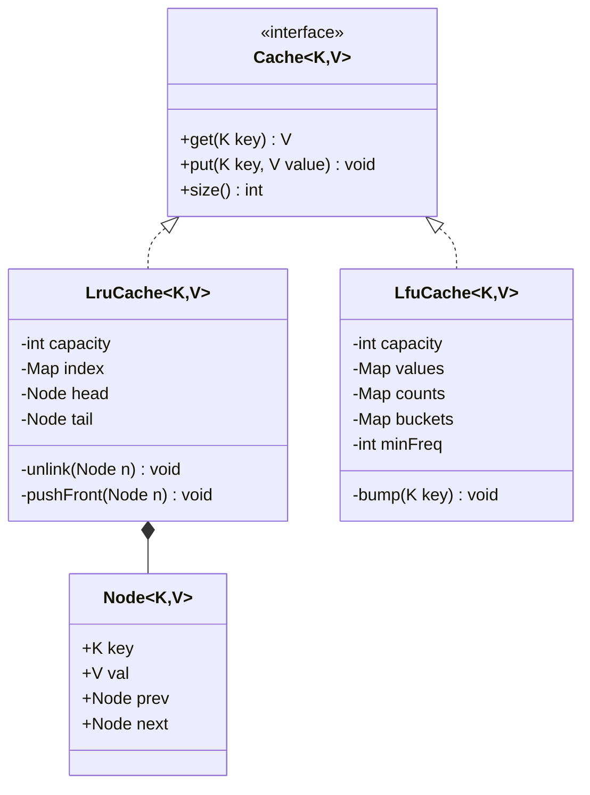
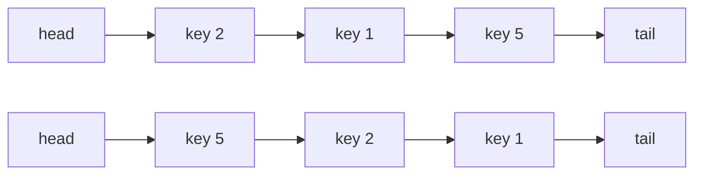

# D10 · LRU / LFU cache

Oct 12, 2026 · @saurav chaurasiya

Is doc me ek hi case study hai: D10 — LRU / LFU cache, machine coding ke liye poora chalne layak Java ke saath.

---

## D10 — LRU / LFU cache

Cache ek chhoti, tezi se padhi jaane wali jagah hai jahaan hum sirf utna data rakhte hain jitna kaam ka ho. Jab jagah bhar jaati hai, kisi ko nikalna padta hai — aur kisko nikalna hai, yahi eviction policy tay karti hai. LRU (Least Recently Used — jisko sabse pehle padha gaya tha, yaani jiska aakhri use sabse purana hai) use nikalta hai; LFU (Least Frequently Used — jiska use sabse kam baar hua hai) use nikalta hai. Machine coding interview me ye sawaal `get` aur `put` dono ko O(1) (constant time — data ka size badhne par bhi waqt nahi badhta) me likhne ko kehta hai.

### Ye cheez hai kya

- Category: data structure design. Do structures ko mila ke ek naya behaviour banana — lookup ke liye hash map, order ke liye linked list ya buckets.
- Kis problem ke liye: limited memory me sabse kaam ke items rakhna, aur eviction ka faisla constant time me lena.
- Is lesson ke baad tum: LRU ko doubly linked list + HashMap se khud likh paoge, LFU ko frequency buckets se likh paoge, dono ki complexity bata paoge, thread-safety ka sawaal handle kar paoge, aur bata paoge ki Redis aur Caffeine production me iska kaun sa roop use karte hain.

### Sawaal

Paytm ke payment gateway me ek `MerchantConfigService` hai. Har incoming transaction pe merchant ka config chahiye: uska MDR (Merchant Discount Rate — har transaction pe merchant se liya jaane wala percentage), uske enabled payment modes, uska risk tier. Ye config DB me hai aur ek call pe 8 ms lagte hain. Peak pe 20,000 TPS (transactions per second — ek second me kitne requests) aate hain, par active merchants sirf 50,000 hain aur unme se 2,000 merchants poore traffic ka 80% laate hain. Tumhe ek in-process cache likhna hai jo 10,000 entries rakhe, `get` aur `put` dono O(1) me kare, aur capacity bharne pe sahi entry nikaale. Pehle LRU likho, phir socho ki LFU kab behtar hota.

> Pehle khud socho — 20 min, khud haath se Java likho. Hints: (1) "recently used" ka order kis structure me O(1) me badla ja sakta hai? (2) us structure me beech ka ek node nikalne ke liye kya chahiye? (3) `get` bhi order badalta hai — kya ye read operation reh jaata hai?

### Problem kyun aata hai

- Ek hi structure dono kaam nahi kar sakta. HashMap lookup O(1) deta hai par order nahi rakhta. List order rakhti hai par usme kisi key ko dhoondhna O(n) hai.
- "Beech se nikaalna" singly linked list me O(n) hai, kyunki pichhle node ka pata nahi hota. Isliye doubly linked list chahiye — jisme har node ke paas `prev` aur `next` dono hote hain.
- `get` ko order badalna padta hai, isliye ye read nahi, write hai. Yahi baat concurrency me sab se badi dikkat banti hai: do threads ek saath `get` karein toh list ke pointers kharab ho sakte hain.
- LFU me ek extra problem hai: frequency ke hisaab se minimum nikalna. Naive soch heap (priority queue) ki hoti hai, par heap se nikalna O(log n) hai, O(1) nahi.

### Naive approach

- Pehla obvious solution: ek `HashMap` data ke liye, aur ek `ArrayList` order ke liye — sabse naya index 0 pe.
- Tootta kahan hai: `order.remove(Integer.valueOf(key))` poori list scan karta hai (O(n)), aur `order.add(0, key)` saare elements ko ek jagah aage shift karta hai (phir O(n)). 10,000 entries aur 20,000 TPS pe ye CPU kha jaayega. Aur ek chhupa bug bhi hai: `List.remove(int)` index se hataata hai aur `List.remove(Object)` value se — `Integer` keys ke saath ye galti bahut hoti hai.

Niche ka code chalta hai aur sahi jawab bhi deta hai, par per-operation O(n) hai — interview me isi ko theek karne ko kaha jaayega:

```java
import java.util.*;

// BURA code: order ko ArrayList me rakha hai, isliye har get aur put O(n) hai
class NaiveLru {
    private final int cap;
    private final Map<Integer, String> data = new HashMap<>();
    private final List<Integer> order = new ArrayList<>(); // sabse naya index 0 pe

    NaiveLru(int cap) { this.cap = cap; }

    String get(int key) {
        if (!data.containsKey(key)) return null;
        order.remove(Integer.valueOf(key)); // O(n) scan + O(n) shift
        order.add(0, key);                  // phir O(n) shift
        return data.get(key);
    }

    void put(int key, String val) {
        if (data.containsKey(key)) { data.put(key, val); get(key); return; }
        if (data.size() == cap) {
            int victim = order.remove(order.size() - 1); // sabse purana peeche hai
            data.remove(victim);
        }
        data.put(key, val);
        order.add(0, key);
    }
}
```

### Sahi design

1. LRU ka core idea: `HashMap<K, Node>` se O(1) lookup, aur doubly linked list se O(1) reorder. Node ke paas `prev` aur `next` hone ki wajah se use list se nikalna sirf do pointer badalna hai.
2. List ke do dummy nodes rakho — `head` aur `tail` — jo kabhi data nahi rakhte. Isse `null` checks poori tarah khatam ho jaate hain. Ye sabse bada practical trick hai; interview me isse code aadha ho jaata hai.
3. Convention tay karo aur usse badlo mat: `head` ke turant baad sabse naya item, `tail` ke turant pehle sabse purana. Evict karna = `tail.prev` nikaalna.
4. `get` me: node dhoondo, list se unlink karo, front pe push karo, value wapas do. `put` me: agar key hai toh value badlo aur front pe lao; nahi hai aur jagah bhari hai toh `tail.prev` evict karo, phir naya node front pe daalo.
5. LFU ka core idea: frequency ko bucket me rakho. `counts: K -> frequency`, aur `buckets: frequency -> LinkedHashSet<K>`. `LinkedHashSet` insertion order yaad rakhta hai, isliye ek hi frequency me tie hone pe sabse purana key nikal jaata hai (LFU + LRU tie-break).
6. LFU me `minFreq` ko ek int field me track karo. Eviction = `buckets.get(minFreq)` ka pehla key. Nayi entry ki frequency hamesha 1 hoti hai, isliye `put` ke baad `minFreq = 1`. Frequency badhne pe agar purana bucket khaali ho gaya aur wahi `minFreq` tha, toh `minFreq` ek badh jaata hai — isse heap ki zaroorat hi nahi padti.

Class structure aisa dikhta hai:



Aur LRU ki list pe ek `get` kya karta hai:



Pehli line `get(5)` se pehle ki list hai, doosri uske baad ki — 5 beech se nikla aur front pe aa gaya, 1 ab evict hone ki line me sabse aage hai.

Ye poora program hai. Copy karo, `javac CacheDemo.java` aur `java CacheDemo` chalao — output niche diya hai:

```java
import java.util.*;

interface Cache<K, V> {
    V get(K key);            // nahi mila toh null
    void put(K key, V value);
    int size();
}

class LruCache<K, V> implements Cache<K, V> {

    // Doubly linked list ka node: prev aur next dono hone se O(1) me unlink hota hai
    private static final class Node<K, V> {
        K key; V val; Node<K, V> prev, next;
        Node(K key, V val) { this.key = key; this.val = val; }
    }

    private final int capacity;
    private final Map<K, Node<K, V>> index = new HashMap<>();
    // Dummy nodes: head ke baad sabse naya, tail ke pehle sabse purana. Koi null check nahi.
    private final Node<K, V> head = new Node<>(null, null);
    private final Node<K, V> tail = new Node<>(null, null);

    LruCache(int capacity) {
        if (capacity <= 0) throw new IllegalArgumentException("capacity 0 se bada hona chahiye");
        this.capacity = capacity;
        head.next = tail;
        tail.prev = head;
    }

    private void unlink(Node<K, V> n) {       // node ko list se nikaalo
        n.prev.next = n.next;
        n.next.prev = n.prev;
    }

    private void pushFront(Node<K, V> n) {    // node ko head ke turant baad daalo
        n.next = head.next;
        n.prev = head;
        head.next.prev = n;
        head.next = n;
    }

    @Override public V get(K key) {
        Node<K, V> n = index.get(key);
        if (n == null) return null;
        unlink(n);                            // get bhi order badalta hai: ye write hai
        pushFront(n);
        return n.val;
    }

    @Override public void put(K key, V value) {
        Node<K, V> n = index.get(key);
        if (n != null) {                      // key pehle se hai: value update + front
            n.val = value;
            unlink(n);
            pushFront(n);
            return;
        }
        if (index.size() == capacity) {       // jagah nahi: sabse purana nikaalo
            Node<K, V> victim = tail.prev;
            unlink(victim);
            index.remove(victim.key);
        }
        Node<K, V> fresh = new Node<>(key, value);
        index.put(key, fresh);
        pushFront(fresh);
    }

    @Override public int size() { return index.size(); }
}

class LfuCache<K, V> implements Cache<K, V> {

    private final int capacity;
    private final Map<K, V> values = new HashMap<>();
    private final Map<K, Integer> counts = new HashMap<>();
    // frequency -> us frequency ke keys, insertion order me (purana pehle)
    private final Map<Integer, LinkedHashSet<K>> buckets = new HashMap<>();
    private int minFreq = 0;

    LfuCache(int capacity) {
        if (capacity <= 0) throw new IllegalArgumentException("capacity 0 se bada hona chahiye");
        this.capacity = capacity;
    }

    // key ki frequency ek badhao aur usse agle bucket me shift karo
    private void bump(K key) {
        int f = counts.get(key);
        counts.put(key, f + 1);
        LinkedHashSet<K> old = buckets.get(f);
        old.remove(key);
        if (old.isEmpty()) {
            buckets.remove(f);
            if (minFreq == f) minFreq = f + 1;  // yahi heap ki jagah le leta hai
        }
        buckets.computeIfAbsent(f + 1, k -> new LinkedHashSet<>()).add(key);
    }

    @Override public V get(K key) {
        if (!values.containsKey(key)) return null;
        bump(key);
        return values.get(key);
    }

    @Override public void put(K key, V value) {
        if (values.containsKey(key)) {
            values.put(key, value);
            bump(key);
            return;
        }
        if (values.size() == capacity) {
            LinkedHashSet<K> lowest = buckets.get(minFreq);
            K victim = lowest.iterator().next();   // same frequency me sabse purana
            lowest.remove(victim);
            if (lowest.isEmpty()) buckets.remove(minFreq);
            values.remove(victim);
            counts.remove(victim);
        }
        values.put(key, value);
        counts.put(key, 1);
        buckets.computeIfAbsent(1, k -> new LinkedHashSet<>()).add(key);
        minFreq = 1;                               // nayi entry ki frequency 1 hai
    }

    @Override public int size() { return values.size(); }
}

public class CacheDemo {
    public static void main(String[] args) {
        Cache<Integer, String> lru = new LruCache<>(2);
        lru.put(1, "merchant-A");
        lru.put(2, "merchant-B");
        System.out.println("LRU get(1)      = " + lru.get(1));  // merchant-A, ab 1 sabse naya
        lru.put(3, "merchant-C");                               // jagah nahi: 2 evict hoga
        System.out.println("LRU get(2)      = " + lru.get(2));  // null
        System.out.println("LRU get(3)      = " + lru.get(3));  // merchant-C
        System.out.println("LRU size        = " + lru.size());  // 2

        Cache<Integer, String> lfu = new LfuCache<>(2);
        lfu.put(1, "merchant-A");
        lfu.put(2, "merchant-B");
        System.out.println("LFU get(1)      = " + lfu.get(1));  // merchant-A, 1 ki freq ab 2
        lfu.put(3, "merchant-C");                               // freq 1 wale me se 2 evict
        System.out.println("LFU get(2)      = " + lfu.get(2));  // null
        System.out.println("LFU get(1)      = " + lfu.get(1));  // merchant-A, bacha hua
        System.out.println("LFU get(3)      = " + lfu.get(3));  // merchant-C
        System.out.println("LFU size        = " + lfu.size());  // 2
    }
}
```

Isko chalane pe exactly ye output aata hai:

```
LRU get(1)      = merchant-A
LRU get(2)      = null
LRU get(3)      = merchant-C
LRU size        = 2
LFU get(1)      = merchant-A
LFU get(2)      = null
LFU get(1)      = merchant-A
LFU get(3)      = merchant-C
LFU size        = 2
```

Dono me `get(2)` null hai, par wajah alag hai: LRU me 2 sabse purana tha, LFU me 2 ki frequency sabse kam thi. Yahi is case study ka asli point hai.

### Kya choose karein aur kyun

| Option | Kab use karo | Kab mat karo |
| --- | --- | --- |
| LRU (HashMap + doubly linked list) | Recency maayne rakhti ho: session data, recently viewed, user ka last-used address. Likhna aasan, dono op O(1). | Jab ek bada scan ya batch job poora cache bahaa de (cache pollution). Ek baar padhe gaye 50,000 keys asli hot keys ko nikaal denge. |
| LFU (counts + frequency buckets) | Jab kuch keys hamesha hot rehti hain: top 2,000 merchants, popular products, config. Scan se kharab nahi hota. | Jab access pattern badalta rehta ho. Purana popular key apni high count ke dum pe jamma reh jaata hai, naya popular key ghus nahi pata. |
| LFU + aging / decay | Lambe chalne wale production cache, jahaan popularity waqt ke saath badalti hai. Har N operations pe sab counts aadhe kar do. | Interview ke pehle 20 min me. Pehle plain LFU likho, aging ko follow-up me discuss karo. |
| `LinkedHashMap` access-order mode | Jab tumhe production code me jaldi LRU chahiye aur custom structure ki zaroorat nahi. 5 line me ban jaata hai. | Machine coding interview me — wahaan structure khud likhna hi sawaal hai. Aur ye thread-safe nahi hai. |
| W-TinyLFU (Caffeine) | Real production in-process cache. Frequency sketch + admission window, LRU aur LFU dono ke nuksaan se bachta hai. | Jab tumhe khud likhna ho. Isko hand-code karna interview ka scope nahi — naam lena hi signal hai. |
| Redis `allkeys-lru` / `allkeys-lfu` | Jab cache process ke bahar shared chahiye, kai pods ke beech. | Jab per-request latency me ek network hop bhi nahi chahiye — tab in-process cache hi chahiye. |

### India me kaise hota hai

- Java me LRU ka sabse chhota production-ready roop `LinkedHashMap` ka access-order constructor + `removeEldestEntry` override hai; Oracle apne docs me iska exact example deta hai — [LinkedHashMap (Java SE 21)](https://docs.oracle.com/en/java/javase/21/docs/api/java.base/java/util/LinkedHashMap.html). Dhyaan: access-order mode me `get` bhi structural modification hai, isliye `Collections.synchronizedMap` reads pe bhi lagana padta hai.
- Redis, jo Indian payments stack me config aur rate-limit cache ka default hai, LRU ko exact nahi rakhta — woh har eviction pe kuch random keys sample karta hai aur unme se sabse purana nikaalta hai (`maxmemory-samples`, default 5). LFU bhi available hai — [Redis key eviction](https://redis.io/docs/latest/develop/reference/eviction/). Yahi batata hai ki production me "approximate LRU" bilkul acceptable hai.
- In-process cache ke liye Java world me Caffeine standard hai; woh W-TinyLFU use karta hai aur apni hit-rate comparison publicly document karta hai — [Caffeine efficiency](https://github.com/ben-manes/caffeine/wiki/Efficiency).
- Practical setup jo payments services me common hai: do-layer cache. Pod ke andar Caffeine (1-2 second TTL, config ke liye), uske peeche Redis (shared, lamba TTL), uske peeche DB. Isse ek hot Redis key bhi node ko garam nahi karti — wahi hot key ki baat jo HLD L2.15 me hai.

### Interview follow-ups

- **"Dummy head aur tail kyun?"** — `unlink` aur `pushFront` me `null` check poori tarah khatam ho jaate hain. List kabhi khaali nahi hoti, isliye `n.prev` aur `n.next` hamesha exist karte hain.
- **"`get` read hai ya write?"** — Write. Order badalta hai. Isliye LRU cache pe `ReadWriteLock` lagana ek classic galti hai — read lock ke andar list modify ho jaayegi.
- **"Thread-safe kaise banaoge?"** — Sabse simple: poore `get` aur `put` ko ek `synchronized` ya `ReentrantLock` me daalo. Behtar: segment me baanto (N chhote caches, key ke hash se chuno) taaki contention N guna kam ho. Production: `ConcurrentHashMap` + eviction ko async kar do, jaisa Caffeine karta hai.
- **"LFU me minimum frequency O(1) me kaise?"** — `minFreq` ek int field hai. Nayi entry pe 1 ho jaata hai; frequency badhne pe sirf tab badhta hai jab purana bucket khaali ho gaya aur wahi `minFreq` tha. Heap ki zaroorat nahi.
- **"LFU ka sabse bada practical problem?"** — Cache pollution ulta roop: kal ka popular key apni jamma count ke dum pe aaj ka naya popular key block kar deta hai. Fix: periodic decay (sab counts aadhe karo) ya window-based counting.
- **"TTL bhi chahiye toh?"** — Node me `expiresAt` rakho aur `get` me lazy check karo (expired mila toh unlink + null return). Background sweeper sirf memory wapas lene ke liye chahiye, correctness ke liye lazy check kaafi hai.
- **"Capacity memory me chahiye, entries me nahi — toh?"** — Har entry ka weight rakho, aur eviction loop chalao jab tak total weight capacity se neeche na aaye. `while`, `if` nahi — ek bada entry daalne pe kai chhote nikal sakte hain.

### Self-check

1. LRU me HashMap kya deta hai aur doubly linked list kya, apne shabdon me?
2. Dummy head/tail nodes se code me exactly kya saaf hota hai?
3. LFU me `minFreq` kis do mauke pe badalta hai?
4. Ek hi frequency me do keys hon toh LFU kis ko nikaalta hai, aur code me ye kahan likha hai?
5. `get` ko read maan ke `ReadWriteLock` lagane me kya toot jaayega?
6. Ek batch job jo 50,000 keys ek baar padh gaya — LRU aur LFU me se kis pe kam asar padega?

### Notebook

LRU = HashMap (O(1) lookup) + doubly linked list (O(1) reorder); head ke baad naya, tail ke pehle purana, evict = `tail.prev` · dummy head/tail se saare null checks khatam · `get` write hai, order badalta hai — isliye ReadWriteLock galat hai · LFU = `counts` + `buckets: freq -> LinkedHashSet`, tie pe sabse purana jaata hai, `minFreq` int field heap ki jagah leta hai · nayi entry freq 1, isliye put ke baad `minFreq = 1` · LRU ka dukh = ek scan cache bahaa deta hai; LFU ka dukh = purana popular key jamma reh jaata hai, fix decay · production: `LinkedHashMap` access-order sabse chhota, Caffeine W-TinyLFU asli, Redis approximate LRU sampling se.

### Padhne ke liye

- [LinkedHashMap — Java SE 21 docs (access-order, removeEldestEntry)](https://docs.oracle.com/en/java/javase/21/docs/api/java.base/java/util/LinkedHashMap.html)
- [Redis — Key eviction (approximate LRU, LFU, maxmemory-samples)](https://redis.io/docs/latest/develop/reference/eviction/)
- [Caffeine — Efficiency (W-TinyLFU ki hit-rate comparison)](https://github.com/ben-manes/caffeine/wiki/Efficiency)
- [ConcurrentHashMap — Java SE 21 docs](https://docs.oracle.com/en/java/javase/21/docs/api/java.base/java/util/concurrent/ConcurrentHashMap.html)

### Deep Dive (SDE-2) — jab time ho

#### Thread-safe banane ke teen level

- Level 1, sabse simple: `get` aur `put` dono ko `synchronized` kar do. Correct hai, par ek hi lock pe sab threads line me lag jaate hain — 20,000 TPS pe ye bottleneck hai.
- Level 2, segmentation: 16 chhote `LruCache` banao aur `Math.floorMod(key.hashCode(), 16)` se segment chuno. Contention 16 guna kam ho jaata hai. Capacity bhi 16 me baant do. Nuksaan: eviction per-segment hai, global nahi, isliye ek segment jaldi bhar sakta hai — practically ye acceptable hai.
- Level 3, production: `ConcurrentHashMap` data ke liye, aur recency ko exact mat rakho. Caffeine yahi karta hai — access events ek buffer me jaate hain aur eviction background me batch hoke hota hai. Yaani "approximate recency, exact data". Redis bhi approximate LRU karta hai, isliye ye shortcut nahi, standard practice hai.

#### LRU ka asli dukh: cache pollution

- Ek reconciliation job raat ko 50,000 merchant configs ek-ek baar padh jaata hai. LRU ke hisaab se ye sab "recently used" hain, toh 2,000 asli hot merchants cache se nikal jaate hain.
- Subah peak traffic aaya aur hit rate (jitne percent requests cache se mile) 90% se 20% pe gir gaya. DB pe 5 guna load.
- Teen fix: batch job ke liye alag cache (ya cache bypass flag), scan-resistant policy (LFU, SLRU, W-TinyLFU), ya admission policy — nayi key ko cache me ghusne se pehle sabit karna pade ki woh evict hone wali key se zyada popular hai. W-TinyLFU ka yahi core idea hai.

#### LFU ka asli dukh: purani popularity

- Ek merchant pichhle mahine top pe tha, uski count 50 lakh ho gayi. Aaj woh bandh ho gaya, par count ki wajah se woh cache me jamma rehta hai.
- Naya popular merchant count 1 se shuru karta hai aur eviction ki pehli line me khada hota hai — woh kabhi warm hi nahi hota.
- Fix 1, decay: har N operations pe saari counts aadhi kar do (`count = count / 2`). Redis LFU yahi karta hai, `lfu-decay-time` config se.
- Fix 2, windowed counting: puri history ki jagah sirf pichhle ek window ka count rakho, count-min sketch jaise approximate structure me — isse memory bhi bachti hai.

#### Interview me step-by-step kaise bolna hai

1. Requirements: `get`, `put`, fixed capacity, dono O(1). Pucho ki TTL chahiye ya nahi, aur thread-safe chahiye ya nahi — ye do sawaal poochna hi signal hai.
2. Interface pehle likho (`Cache<K,V>`), implementation baad me. Isse interviewer ko dikh jaata hai ki tum LRU aur LFU ko swap kar sakte ho — yahi Strategy pattern hai.
3. LRU likho, dummy nodes ke saath. Bolte hue likho: "ye `unlink`, ye `pushFront`, dono do pointer badalte hain, isliye O(1)".
4. Demo `main` chalao do-teen line ke saath. Chalta hua code dekhna interviewer ke liye sabse bada signal hai.
5. Follow-ups ke liye tayyar raho: thread-safety, TTL, weight-based capacity, LFU, aur "production me kya use karoge" (Caffeine ya Redis, naam ke saath).

#### Isse aage ke sawaal jo isi code pe bante hain

- LRU ke upar TTL lagao (`expiresAt` + lazy expiry).
- Capacity entries ki jagah bytes me (`weigher` function + `while` loop eviction).
- Write-through aur write-behind cache ([L1.6 — Cache patterns](https://claude.ai/code/artifact/32bb1c8e-3433-417c-a3f4-3a34babed6bf) ka LLD roop).
- Cache stampede se bachna: ek hi key ke liye ek hi loader chale (`ConcurrentHashMap.computeIfAbsent` ya ek `Future` per key) — isko single-flight kehte hain, HLD side pe [L1.9](https://claude.ai/code/artifact/32bb1c8e-3433-417c-a3f4-3a34babed6bf) me hai.

---

## Aage kya

- Ye case study `Part 3 · Thread Jungle` ([T1 se T12](https://claude.ai/code/artifact/05d7fa44-518a-49fd-a70c-40ac902f184f)) ke baad aata hai — thread-safety wala hissa tab zyada khulega, khaas kar [T6 ConcurrentHashMap](https://claude.ai/code/artifact/05d7fa44-518a-49fd-a70c-40ac902f184f) ke baad.
- Pehle ka case study: [D4 · Parking lot](https://claude.ai/code/artifact/8808bc69-f983-4ccc-b9b4-789d7394520f)
- Study order me iske baad: [D9 Rate limiter](https://claude.ai/code/artifact/1a82c7a8-3aa0-49a2-b8d8-bb9398c1d502), phir [D3 Splitwise](https://claude.ai/code/artifact/ea3677ad-81fd-4911-b64a-341b000d17ea), phir [D2 Digital wallet](https://claude.ai/code/artifact/4df48566-b65f-4525-ac39-494302d44562), phir [D1 · Payment gateway / UPI flow](https://claude.ai/code/artifact/3a14c198-3582-4167-9d22-bb2756140172)
- HLD side ka jodidar lesson: [L1.6 — Cache patterns](https://claude.ai/code/artifact/32bb1c8e-3433-417c-a3f4-3a34babed6bf) aur [L1.8 — Eviction & TTL](https://claude.ai/code/artifact/32bb1c8e-3433-417c-a3f4-3a34babed6bf)

* Study order me agla boss: [D9 · Rate limiter](https://claude.ai/code/artifact/1a82c7a8-3aa0-49a2-b8d8-bb9398c1d502) — ek interface, teen algorithm, aur thread safety
