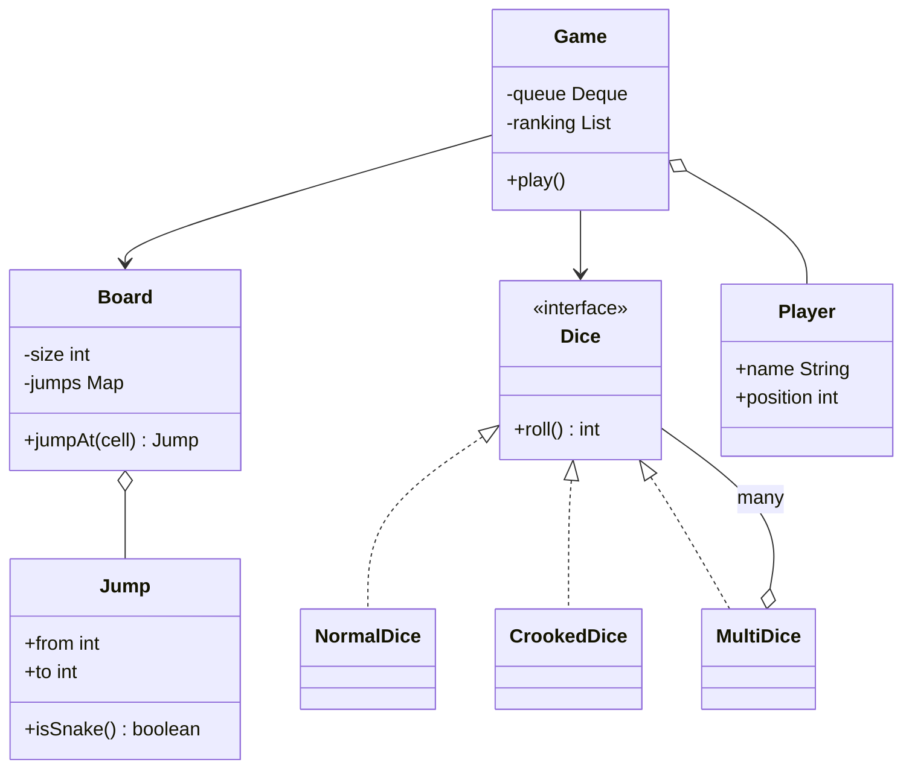

# D11 · Snake & Ladder

Oct 16, 2026 · @saurav chaurasiya

**Is doc me:** Snake & Ladder ka poora Java LLD (low level design — classes aur unke rishte) : Board, Cell, jumps, Dice strategy, Player, game loop, turn order, winning rule.

**Padhne ka tareeka** — pehle Sawaal pe khud 15 min socho, phir Naive approach dekho, phir Sahi design ka code chala ke output match karo.

---

## D11 — Snake & Ladder

Snake & Ladder ek turn-based board game hai jisme players dice phenk ke aage badhte hain, ladder chadhte hain aur snake se neeche girte hain. LLD interview me ye isliye pucha jata hai kyunki chhota hai, par isme Strategy pattern, clean modeling aur extensibility teeno test ho jaate hain.

### Ye cheez hai kya

- Category: LLD case study (object modeling + ek simple game loop)
- Problem: 100 cell ka board, kuch snakes aur ladders, 2 ya zyada players, dice. Pehle exact 100 pe pahunche wo jeete. Design aisa ho ki kal ko dice ya rules badlo to code na toote.
- Is lesson ke baad tum kar paoge: Board/Jump/Dice/Player/Game ke classes banana, Strategy se dice swap karna, turn order ke liye queue use karna, aur interviewer ke "ab ye feature add karo" sawaal ka jawab dena.
- Analogy: ye cricket scoreboard jaisa hai. Rules (board) fixed hain, khiladi (players) aate jaate hain, aur ball (dice) ki type badal sakti hai bina match ke rules badle.

### Sawaal

Swiggy ke office me Friday ko "game hour" hota hai. Team ek in-app Snake & Ladder game banana chahti hai: 10x10 board (100 cell), 8 snakes, 8 ladders, 2 se 6 players, ek ya do dice. Ek game 5 se 10 minute chalega, ek server pe 500 games ek saath chal sakte hain (har game apna alag object). Design karo: kaunse classes honge, dice kaise swap hoga, aur turn kaise aage badhega.

> Pehle khud socho — 15 min. Hints: (1) Snake aur ladder me actual farak kya hai, kya dono ek hi class ho sakte hain? (2) Dice ko hard-code karoge ya kisi interface ke peeche rakhoge? (3) Agar player ka roll 100 se upar chala jaye to kya hoga, aur turn order kaise store karoge?

### Problem kyun aata hai

- Ye game simple dikhta hai, isliye log seedha ek bada `Game` class likh dete hain jisme board, dice, rules sab mile hote hain.
- Interviewer ke follow-ups (crooked dice, 2 dice, 6 aane pe extra turn) ke baad aisa code har baar andar se kholna padta hai.
- Snake aur ladder ko alag classes banane se duplicate logic aata hai, jabki dono ka kaam ek hi hai: ek cell se doosre cell pe bhej dena.
- Random dice ki wajah se test karna mushkil hota hai, jab tak randomness bahar se na di jaye.

### Naive approach

- Ek `Game` class, jisme `Random` seedha andar, snake aur ladder do alag arrays, aur sab rules `if/else` me.
- Kahan toot-ta hai: crooked dice add karna ho to `Game` khol ke `if (crooked)` daalna padega. 3 variants (normal, crooked, 2 dice) ke baad 3 branches har jagah. Test me random ki wajah se result har baar alag, to assertion likh hi nahi sakte.
- Overshoot (100 se upar) ka koi rule nahi, aur ek cell pe snake aur ladder dono daal do to koi check nahi.

```java
// Bura design: sab kuch ek class me, dice hard-coded
class Game {
    int[] snakeFrom = {17, 20}, snakeTo = {7, 6};
    int[] ladderFrom = {4, 9}, ladderTo = {14, 18};
    int[] pos = new int[2];

    void play() {
        int turn = 0;
        while (true) {
            int roll = new Random().nextInt(6) + 1; // seed nahi, test nahi ho sakta
            pos[turn] += roll;                       // 100 se upar jaye to? koi rule nahi
            for (int i = 0; i < snakeFrom.length; i++)
                if (pos[turn] == snakeFrom[i]) pos[turn] = snakeTo[i];
            for (int i = 0; i < ladderFrom.length; i++)
                if (pos[turn] == ladderFrom[i]) pos[turn] = ladderTo[i];
            if (pos[turn] == 100) break;
            turn = (turn + 1) % 2;                   // sirf 2 player, hard-coded
        }
    }
}
```

### Sahi design

1. **Dice ko interface banao** (Strategy pattern — algorithm ko interface ke peeche rakhna taaki runtime pe badal sako). `NormalDice`, `CrookedDice`, `MultiDice` teeno `Dice` implement karte hain.
2. **Snake aur Ladder ko ek hi class `Jump` banao.** `to < from` ho to snake, warna ladder. Alag class sirf tab banao jab behaviour alag ho.
3. **`Board`** sirf size aur `Map<Integer, Jump>` rakhta hai. Constructor me validate hota hai: jump board ke andar ho, aur ek cell pe do jump na ho. Cell ke liye alag object nahi banaya, kyunki cell me koi behaviour nahi hai; ek `int` kaafi hai (YAGNI — jo abhi chahiye nahi, wo mat banao).
4. **`Player`** naam aur position rakhta hai. Position 0 matlab player abhi board pe nahi aaya.
5. **`Game`** players ko `ArrayDeque` me rakhta hai (turn order: aage se nikalo, khelo, peeche daalo). Winning rule: exact landing. Roll se 100 se upar jaye to move cancel, player wahin rehta hai.
6. Jo player jeet jaye wo queue se hat jata hai aur ranking me jaata hai. Jab ek hi player bacha, game khatam.
7. `Random` bahar se inject hota hai, to `new Random(42)` se demo reproducible hai.

Ek jump ke baad doosra jump nahi chalta (jump ka `to` cell agar kisi aur jump ka `from` ho, to hum chain nahi karte). Ye ek design choice hai, aur Deep Dive me iski baat hai.

Poora runnable code (`Demo.java`, ek hi file):

```java
import java.util.*;

// Strategy: dice kaise phenke jayenge
interface Dice {
    int roll();
}

class NormalDice implements Dice {
    private final Random rng;
    private final int faces;
    NormalDice(Random rng, int faces) { this.rng = rng; this.faces = faces; }
    public int roll() { return rng.nextInt(faces) + 1; }
}

// Crooked (loaded) dice: aadhe time 6 deta hai, baaki time 1 se 5
class CrookedDice implements Dice {
    private final Random rng;
    CrookedDice(Random rng) { this.rng = rng; }
    public int roll() { return rng.nextBoolean() ? 6 : rng.nextInt(5) + 1; }
}

// Multiple dice: kai dice ka sum
class MultiDice implements Dice {
    private final List<Dice> dice;
    MultiDice(List<Dice> dice) { this.dice = dice; }
    public int roll() {
        int sum = 0;
        for (Dice d : dice) sum += d.roll();
        return sum;
    }
}

// Snake aur Ladder dono ek hi cheez: start se end tak jump
class Jump {
    final int from, to;
    Jump(int from, int to) {
        if (from == to) throw new IllegalArgumentException("from aur to same nahi ho sakte");
        this.from = from; this.to = to;
    }
    boolean isSnake() { return to < from; }
    public String toString() { return (isSnake() ? "Snake " : "Ladder ") + from + "->" + to; }
}

class Board {
    private final int size;
    private final Map<Integer, Jump> jumps = new HashMap<>();
    Board(int size, List<Jump> list) {
        this.size = size;
        for (Jump j : list) {
            if (j.from < 1 || j.from >= size || j.to < 1 || j.to > size)
                throw new IllegalArgumentException("jump board ke bahar: " + j);
            if (jumps.put(j.from, j) != null)
                throw new IllegalArgumentException("ek cell pe do jump: " + j.from);
        }
    }
    int size() { return size; }
    Jump jumpAt(int cell) { return jumps.get(cell); }
}

class Player {
    final String name;
    int position = 0; // 0 matlab abhi board pe aaya nahi
    Player(String name) { this.name = name; }
}

class Game {
    private final Board board;
    private final Dice dice;
    private final Deque<Player> queue = new ArrayDeque<>();
    private final List<Player> ranking = new ArrayList<>();

    Game(Board board, Dice dice, List<Player> players) {
        this.board = board; this.dice = dice; queue.addAll(players);
    }

    // Winning rule: exact landing. Overshoot ho to move cancel
    private static final int MAX_TURNS = 500; // safety: game kabhi infinite na chale

    void play() {
        int turn = 0;
        while (queue.size() > 1 && turn < MAX_TURNS) {
            Player p = queue.pollFirst();
            turn++;
            int roll = dice.roll();
            int target = p.position + roll;
            String log = "T" + turn + " " + p.name + " roll=" + roll + " : " + p.position;
            if (target > board.size()) {
                log += " (overshoot, wahin raha)";
            } else {
                p.position = target;
                Jump j = board.jumpAt(target);
                if (j != null) {
                    p.position = j.to;
                    log += " -> " + target + " [" + j + "]";
                }
                log += " -> " + p.position;
            }
            System.out.println(log);
            if (p.position == board.size()) {
                ranking.add(p);
                System.out.println("   " + p.name + " ne game khatam kiya, rank " + ranking.size());
            } else {
                queue.addLast(p); // turn order: line ke peeche
            }
        }
        if (!queue.isEmpty()) ranking.add(queue.pollFirst());
        System.out.println("Final ranking:");
        for (int i = 0; i < ranking.size(); i++)
            System.out.println("  " + (i + 1) + ". " + ranking.get(i).name);
    }
}

public class Demo {
    public static void main(String[] args) {
        List<Jump> jumps = List.of(
            new Jump(4, 14), new Jump(9, 18), new Jump(17, 7),
            new Jump(20, 6), new Jump(12, 22), new Jump(23, 8));
        Board board = new Board(25, jumps);

        System.out.println("== Game 1: normal dice ==");
        new Game(board, new NormalDice(new Random(42), 6),
            List.of(new Player("Asha"), new Player("Ravi"))).play();

        System.out.println("== Game 2: 2 dice ==");
        Dice two = new MultiDice(List.of(new NormalDice(new Random(7), 6), new NormalDice(new Random(8), 6)));
        new Game(board, two, List.of(new Player("Asha"), new Player("Ravi"), new Player("Neha"))).play();

        System.out.println("== Game 3: crooked dice ==");
        new Game(board, new CrookedDice(new Random(1)),
            List.of(new Player("Asha"), new Player("Ravi"))).play();
    }
}
```

Demo me board chhota (25 cell) rakha hai taaki output chhota rahe. Class structure:



Isko chalane pe bilkul ye output aata hai:

```text
== Game 1: normal dice ==
T1 Asha roll=3 : 0 -> 3
T2 Ravi roll=4 : 0 -> 4 [Ladder 4->14] -> 14
T3 Asha roll=1 : 3 -> 4 [Ladder 4->14] -> 14
T4 Ravi roll=3 : 14 -> 17 [Snake 17->7] -> 7
T5 Asha roll=1 : 14 -> 15
T6 Ravi roll=2 : 7 -> 9 [Ladder 9->18] -> 18
T7 Asha roll=6 : 15 -> 21
T8 Ravi roll=3 : 18 -> 21
T9 Asha roll=2 : 21 -> 23 [Snake 23->8] -> 8
T10 Ravi roll=6 : 21 (overshoot, wahin raha)
T11 Asha roll=3 : 8 -> 11
T12 Ravi roll=3 : 21 -> 24
T13 Asha roll=1 : 11 -> 12 [Ladder 12->22] -> 22
T14 Ravi roll=1 : 24 -> 25
   Ravi ne game khatam kiya, rank 1
Final ranking:
  1. Ravi
  2. Asha
== Game 2: 2 dice ==
T1 Asha roll=10 : 0 -> 10
T2 Ravi roll=8 : 0 -> 8
T3 Neha roll=9 : 0 -> 9 [Ladder 9->18] -> 18
T4 Asha roll=7 : 10 -> 17 [Snake 17->7] -> 7
T5 Ravi roll=6 : 8 -> 14
T6 Neha roll=8 : 18 (overshoot, wahin raha)
T7 Asha roll=9 : 7 -> 16
T8 Ravi roll=12 : 14 (overshoot, wahin raha)
T9 Neha roll=7 : 18 -> 25
   Neha ne game khatam kiya, rank 1
T10 Asha roll=2 : 16 -> 18
T11 Ravi roll=2 : 14 -> 16
T12 Asha roll=4 : 18 -> 22
T13 Ravi roll=4 : 16 -> 20 [Snake 20->6] -> 6
T14 Asha roll=8 : 22 (overshoot, wahin raha)
T15 Ravi roll=7 : 6 -> 13
T16 Asha roll=6 : 22 (overshoot, wahin raha)
T17 Ravi roll=5 : 13 -> 18
T18 Asha roll=3 : 22 -> 25
   Asha ne game khatam kiya, rank 2
Final ranking:
  1. Neha
  2. Asha
  3. Ravi
== Game 3: crooked dice ==
T1 Asha roll=6 : 0 -> 6
T2 Ravi roll=3 : 0 -> 3
T3 Asha roll=5 : 6 -> 11
T4 Ravi roll=5 : 3 -> 8
T5 Asha roll=6 : 11 -> 17 [Snake 17->7] -> 7
T6 Ravi roll=6 : 8 -> 14
T7 Asha roll=6 : 7 -> 13
T8 Ravi roll=4 : 14 -> 18
T9 Asha roll=6 : 13 -> 19
T10 Ravi roll=3 : 18 -> 21
T11 Asha roll=6 : 19 -> 25
   Asha ne game khatam kiya, rank 1
Final ranking:
  1. Asha
  2. Ravi
```

Output se kuch cheezein pakdo:

- Game 1 T3: Asha 3 se 4 pe aayi, wahan ladder 4->14 thi, to seedha 14. Ravi ne T2 me wahi ladder li thi.
- Game 1 T4: Ravi 14 se 17 pe aaya, snake 17->7 ne neeche bhej diya.
- Game 1 T10: Ravi 21 pe tha, roll 6 se 27 banta jo board (25) se bahar hai, to move cancel.
- Game 2: Neha jeeti, par game tab tak chala jab tak bache hue 2 me se ek (Asha) bhi 25 pe nahi pahunchi. Ravi last bacha, to automatically rank 3.
- Game 3 me crooked dice 6 zyada deta hai, isliye game sirf 11 turn me khatam hua.

### Kya choose karein aur kyun

| Option | Kab use karo | Kab mat karo |
| --- | --- | --- |
| `Dice` interface (Strategy) | Dice ki type badalne ki sambhavna ho: normal, crooked, 2 dice | Agar dice kabhi badalne wala nahi aur sirf ek hi type hai, to bhi interface sasta hai, par zaroori nahi |
| Snake aur Ladder ek `Jump` class | Dono ka behaviour same ho (cell A se cell B) | Agar snake pe alag effect ho (jaise score kam ho, ya animation), tab subclass banao |
| Alag `Cell` class | Cell me behaviour ho (trap, bonus, safe zone) | Sirf number aur jump ke liye `int` + `Map` kaafi hai |
| `ArrayDeque` for turn order | Players aage se nikal ke peeche jaate hon, aur jeetne wale hatenge | Agar fixed circular order ho aur koi hatega nahi, to index `(i + 1) % n` bhi chalega |
| Exact landing rule | Classic rule, game me suspense rehta hai | Agar interviewer bole "100 se upar ho to bhi jeet", to rule ek chhota method me swap karo |

### India me kaise hota hai

- Snake & Ladder (Moksha Patam) bharat ka purana khel hai; ye Gyan Chaupar naam ke khel se aaya jisme snakes vices aur ladders virtues dikhate the. Ludo King jaise mobile games isi tarah ke board games ko lakhon concurrent players ke saath chalate hain.
- Online game servers me pattern wahi hota hai jo hamne banaya: har game ek alag in-memory object, randomness ek server-side service se (cheating rokne ke liye client pe dice nahi phenka jata), aur har move ek event ki tarah log hota hai.
- Interview me ye problem machine coding rounds me bahut aati hai. Neeche ke links me koi Indian-interview style walkthroughs hain.

### Interview follow-ups

- **Crooked dice kaise add karoge?** — `Dice` interface ka naya implementation `CrookedDice` likho aur `Game` me inject karo. `Game` ka code nahi badalta. Ye Open/Closed principle hai (extend karo, modify mat karo).
- **Do dice aur 6-6 pe extra turn dena ho to?** — `MultiDice` sum deta hai. Extra turn ke liye `Game` me rule chahiye: agar roll ek special value hai to player ko queue ke peeche daalne ke bajaye wapas aage daalo. Is rule ko `TurnRule` strategy me nikaal sakte ho.
- **Ek cell pe snake ka end dusre snake ke start pe ho to?** — Ya to constructor me reject karo (hamne chain nahi kiya), ya loop me `while (board.jumpAt(pos) != null)` chalao. Cycle (A se B, B se A) ho sakta hai, isliye validate karna zaroori hai warna infinite loop.
- **Game kabhi khatam hi na ho to?** — Overshoot rule me player atak sakta hai. Hamne `MAX_TURNS` guard rakha. Production me turn limit ya timeout rakhte hain.
- **Test kaise karoge?** — Fixed values deta hua `FixedDice` (jaise `[3, 4, 1]` ek ek karke) inject karo, ya `new Random(42)` seed. Dono se result deterministic hota hai.
- **500 games ek server pe ek saath?** — Har `Game` ka apna state hai, koi shared mutable static nahi, to games independent threads pe chal sakte hain. Ek hi game ke andar turn sequential hai, to lock ki zaroorat nahi.

### Self-check

1. Snake aur Ladder ko ek class `Jump` me kyun rakha?
2. Strategy pattern se `Game` class ko dice ke baare me kya pata hona chahiye?
3. Turn order ke liye `ArrayDeque` kaise kaam karta hai, aur jeete hue player ka kya hota hai?
4. Overshoot hone par kya hota hai, aur agar ye rule na ho to kya problem aayegi?
5. `Random` ko bahar se inject karne ka kya fayda hai?

### Notebook

Snake aur ladder = ek `Jump(from, to)`, `to < from` matlab snake · `Dice` ek Strategy interface hai: Normal, Crooked, Multi · Board = size + `Map<Integer, Jump>`, constructor me validation · Turn order = `ArrayDeque`, pollFirst, khelo, addLast · Winning = exact landing, overshoot pe move cancel · `Random` inject karo (seed) to test deterministic · Safety ke liye `MAX_TURNS` guard.

### Padhne ke liye

- [Low Level Design - Snake and Ladder Game (koding substack)](https://koding.substack.com/p/low-level-design-snake-and-ladder)
- [Java LLD: Designing Snakes and Ladders with O(1) move resolution (DEV Community)](https://dev.to/machinecodingmaster/java-lld-designing-snakes-and-ladders-with-o1-move-resolution-31k2)
- [Snake and Ladder, an LLD interview approach (LeetCode Discuss)](https://leetcode.com/discuss/interview-question/object-oriented-design/1779179/snake-and-ladder-an-lld-interview-approach-feedback-welcome)
- [Strategy pattern (Wikipedia)](https://en.wikipedia.org/wiki/Strategy_pattern)

### Deep Dive (SDE-2) — jab time ho

#### Dice ki fairness aur ek bug jo humne khud pakda

- Pehle draft me CrookedDice sirf even numbers (2, 4, 6) deta tha. Board ka last cell 25 (odd) tha, aur 24 ya 22 jaise even cells se exact 25 ke liye odd roll chahiye.
- Result: ek player 24 pe atak gaya aur game kabhi khatam nahi hua (500+ turns tak overshoot). Isi liye `MAX_TURNS` guard rakha.
- Seekh: dice ka distribution aur winning rule saath me sochna padta hai. Rule badlo ya dice, dono ko jaancho.

#### Extensibility: extra turn, chained jumps, special cells

- **Extra turn on 6:** `Game` me `TurnPolicy` interface, jo bataye ki roll ke baad player ko dobara khelna hai ya nahi. Default policy: kabhi nahi.
- **Chained jumps:** `resolve(cell)` method me loop, aur visited set se cycle detect karo.
- **Special cells (skip turn, bonus):** tab `Cell` ya `Effect` interface banta hai, `Jump` uska ek implementation. Ye tabhi karo jab requirement aaye.
- **Observer pattern:** `Game` events (moved, snake bitten, won) ke liye `GameListener` list rakhe, taaki UI, logging, aur leaderboard alag alag subscribe karein.

#### Concurrency aur multiplayer

- Ek game ke andar ek time pe ek hi player khelta hai, to `Game.play` ko lock nahi chahiye. Online version me har player ka move network se aata hai, to `Game` ko `synchronized` ya ek single-threaded executor per game rakho (ek game ke saare events ek queue me serial).
- Alag games ke beech koi shared state nahi, to 500 games alag alag threads pe scale hote hain.
- Fair randomness ke liye server `SecureRandom` use kare, aur seed log kare taaki dispute me game replay ho sake.

---

## Aage kya

- Pichhla: [D10 · LRU / LFU cache](https://claude.ai/code/artifact/5c863943-6249-4b4b-8943-003de1517344)
- Agla: [D12 · Tic-tac-toe](https://claude.ai/code/artifact/b1f9b186-1da4-4281-923c-2ce408cfa879)
- Related: [2C · Behavior Bazaar (Strategy, Observer, State)](https://claude.ai/code/artifact/d1ac6852-9994-4501-9b0a-7d0f654e5c38) · [LLD Part 0 · Base Camp (LLD kaise approach karein)](https://claude.ai/code/artifact/1068ad91-026e-4eae-965e-3dabebf25471) · [1B · SOLID Temple (Open/Closed)](https://claude.ai/code/artifact/f98bb328-8939-4ef4-a9a6-24c5ce970199)
