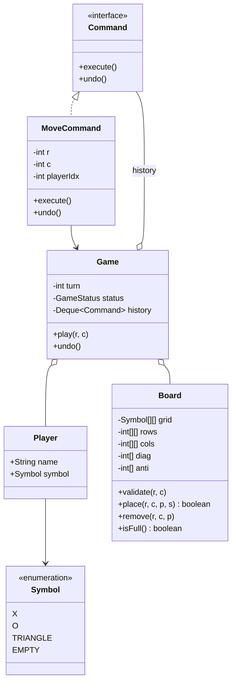

# D12 · Tic-tac-toe

Oct 16, 2026 · @saurav chaurasiya

**Is doc me:** N x N Tic-tac-toe ka poora Java design: Board, Player, move validation, O(1) win check counters se, draw detection, Command pattern se undo, aur N players tak extension.

**Padhne ka tareeka** — pehle Sawaal pe 15 min khud socho, phir Naive approach dekho, phir Sahi design ka code chalao. Deep Dive tab padho jab time ho.

---

## D12 — Tic-tac-toe

Tic-tac-toe ek chhota turn-based board game hai jisme players baari-baari se ek grid ke cell me apna symbol rakhte hain, aur jo pehle ek poori row, column ya diagonal bhar de woh jeetta hai. LLD interview me ye isliye poocha jata hai ki game chhota hai, par isme validation, win check, undo aur extensibility sab ek saath test hote hain.

### Ye cheez hai kya

- **Category:** LLD case study (low-level design — classes, interfaces aur unke relations design karna, system ke servers nahi).
- **Problem:** ek rule-based game ko aise model karna ki board size, player count aur rules badalne pe code na toote.
- **Lesson ke baad tum kar paoge:**
  - N x N board aur N players ka clean object model banana.
  - Win check ko O(1) (constant time — board kitna bhi bada ho, kaam same rehta hai) me karna, counters se.
  - Command pattern (har action ko ek object banana jisme execute aur undo dono ho) se undo lagana.
- **Analogy:** cricket scoreboard har ball pe poora match dobara nahi ginta; sirf total aur wickets update karta hai. Waise hi hum har move pe poora board scan nahi karte, sirf counters update karte hain.

### Sawaal

Maan lo Hotstar apni app me ek mini-game section add karta hai aur tumhe uska Tic-tac-toe module banana hai. Do users online ek hi game khelte hain; ek game me max 9 moves (3 x 3), par product team bolti hai ki aage 10 x 10 board aur 3 players ka mode bhi aayega. Ek server pe 50,000 games parallel chalte hain, to har move ka server-side processing 1 ms se kam hona chahiye (latency — request ka jawab aane me lagne wala time). Requirements:

- N x N board, har player ka alag symbol.
- Galat move (bhara hua cell, board ke bahar, galat baari) reject ho, game crash na ho.
- Har move ke baad turant pata chale: jeet, draw, ya game chalu.
- Undo: last move wapas lena.

> Pehle khud socho — 15 min. Hints: (1) Win check har move pe poora board scan kare to N=1000 pe kya hoga? (2) Kaun sa data rakhoge jisse sirf 4 numbers badhane se pata chal jaye ki jeet hui? (3) Undo ke liye har move ko kya bana doge ki usko ulta bhi chalaya ja sake?

### Problem kyun aata hai

- Beginner board ek 2D array me rakhta hai aur sab logic ek `Game` class me daal deta hai (God class — ek class jo sab kuch karti hai).
- Win check hard-coded 3 x 3 ke liye hota hai; N badalte hi toot jata hai.
- Symbol `char` ya `String` rakhne se kuch bhi pass ho jata hai ("Z", "", null).
- Undo baad me yaad aata hai; tab pata chalta hai ki state kai jagah bikhri hai aur wapas karna mushkil hai.
- Do se zyada players ka socha hi nahi hota, to `turn = !turn` jaisa boolean code me ghus jata hai.

### Naive approach

- Pehla seedha solution: har move ke baad poora board scan karo, har row, har column aur dono diagonals.
- Kahan toot-ta hai:
  - Cost O(N^2) har move pe (N x N cells scan karne ka kaam). 3 x 3 pe 8 lines, thik hai. 1000 x 1000 board pe 10 lakh cells har move pe, aur 1000 x 1000 board me \~10 lakh moves, matlab total \~10^12 operations.
  - 50,000 games parallel hon aur har game 100 x 100 ho, to har move 10,000 cell reads x 50,000 = 50 crore reads per "round" — 1 ms budget kab ka nikal gaya.
  - Boolean turn aur hard-coded `"X"`/`"O"` se 3 players impossible.

Ye bad snippet dekho, jisme sab kuch ek jagah hai aur win check scan karta hai:

```java
class BadGame {
    String[][] b = new String[3][3];   // 3 hard-coded
    boolean xTurn = true;              // sirf 2 players

    boolean play(int r, int c) {
        b[r][c] = xTurn ? "X" : "O";   // bounds ya occupied check hi nahi
        xTurn = !xTurn;
        // har move pe poora scan: O(N^2), aur N=3 ke liye hard-coded
        for (int i = 0; i < 3; i++) {
            if (b[i][0] != null && b[i][0].equals(b[i][1]) && b[i][1].equals(b[i][2])) return true;
            if (b[0][i] != null && b[0][i].equals(b[1][i]) && b[1][i].equals(b[2][i])) return true;
        }
        return false; // diagonals bhool gaye, undo hai hi nahi
    }
}
```

### Sahi design

1. **Symbol enum** — har piece ek enum value; galat symbol compile time pe hi pakda jata hai.
2. **Player** — naam + symbol. Players ek `List<Player>` me rehte hain, baari `(turn + 1) % size` se, to N players free me mil jate hain.
3. **Board** — grid + counters. Har player ke liye `rows[p][i]`, `cols[p][i]`, `diag[p]`, `anti[p]` (anti-diagonal — dusri taraf ka tirchha). Piece rakhne pe sirf in me se zyada se zyada 4 counters +1 hote hain. Agar koi counter N ho gaya, matlab us player ne poori line bhar di. Ye O(1) hai.
4. **Validation** — Board `validate(r, c)` me bounds aur occupied check karta hai aur `InvalidMoveException` fenkta hai. Exception pe state koi badalti nahi, isliye turn bhi wahi rehta hai.
5. **Command pattern** — `MoveCommand` ke `execute()` aur `undo()`. Game ek `Deque<Command>` (stack) me history rakhta hai. Undo = stack se pop + `undo()` (counters ko ulta karna).
6. **Draw** — jeet nahi hui aur `filled == N*N` ho gaya to draw. Ye bhi O(1), kyunki `filled` ek counter hai.
7. **Game** — orchestrator: turn, status, winner, history. Board ko rules ka pata hai, Game ko flow ka.

Class diagram:



Ye poora runnable Java hai: teen scripted games (invalid move + undo + win, phir draw, phir 3 players 4 x 4) deterministic order me chalte hain. Command pattern yahan undo ke liye use hua hai, aur Game ke andar baari ghoomna N-player extension hai.

```java
import java.util.*;

// Symbol: har player ka piece
enum Symbol {
    X('X'), O('O'), TRIANGLE('T'), EMPTY('.');
    final char ch;
    Symbol(char ch) { this.ch = ch; }
}

class Player {
    final String name;
    final Symbol symbol;
    Player(String name, Symbol symbol) { this.name = name; this.symbol = symbol; }
}

class InvalidMoveException extends RuntimeException {
    InvalidMoveException(String msg) { super(msg); }
}

enum GameStatus { IN_PROGRESS, WON, DRAW }

// Board: grid + O(1) win check ke counters
class Board {
    private final int n;
    private final Symbol[][] grid;
    // counters[p][i]: player p ke kitne piece row/col i me hain
    private final int[][] rows, cols;
    private final int[] diag, anti;
    private int filled = 0;

    Board(int n, int players) {
        this.n = n;
        grid = new Symbol[n][n];
        for (Symbol[] r : grid) Arrays.fill(r, Symbol.EMPTY);
        rows = new int[players][n];
        cols = new int[players][n];
        diag = new int[players];
        anti = new int[players];
    }

    int size() { return n; }
    boolean isFull() { return filled == n * n; }

    void validate(int r, int c) {
        if (r < 0 || r >= n || c < 0 || c >= n)
            throw new InvalidMoveException("(" + r + "," + c + ") board ke bahar hai");
        if (grid[r][c] != Symbol.EMPTY)
            throw new InvalidMoveException("(" + r + "," + c + ") pehle se bhara hai");
    }

    // piece rakho aur sirf 4 counters badhao: O(1). true = is move se jeet gaya
    boolean place(int r, int c, int p, Symbol s) {
        grid[r][c] = s;
        filled++;
        rows[p][r]++;
        cols[p][c]++;
        if (r == c) diag[p]++;
        if (r + c == n - 1) anti[p]++;
        return rows[p][r] == n || cols[p][c] == n || diag[p] == n || anti[p] == n;
    }

    // undo: place ka exact ulta
    void remove(int r, int c, int p) {
        grid[r][c] = Symbol.EMPTY;
        filled--;
        rows[p][r]--;
        cols[p][c]--;
        if (r == c) diag[p]--;
        if (r + c == n - 1) anti[p]--;
    }

    void print() {
        for (Symbol[] row : grid) {
            StringBuilder sb = new StringBuilder("   ");
            for (Symbol s : row) sb.append(s.ch).append(' ');
            System.out.println(sb);
        }
    }
}

// Command pattern: har move ek object jo execute aur undo dono jaanta hai
interface Command {
    void execute();
    void undo();
}

class MoveCommand implements Command {
    private final Game game;
    private final int r, c, playerIdx;
    private boolean wasWin, wasDraw;

    MoveCommand(Game game, int r, int c, int playerIdx) {
        this.game = game; this.r = r; this.c = c; this.playerIdx = playerIdx;
    }

    public void execute() {
        Player pl = game.players.get(playerIdx);
        wasWin = game.board.place(r, c, playerIdx, pl.symbol);
        wasDraw = !wasWin && game.board.isFull();
        if (wasWin) { game.status = GameStatus.WON; game.winner = pl; }
        else if (wasDraw) game.status = GameStatus.DRAW;
        else game.turn = (playerIdx + 1) % game.players.size();
    }

    public void undo() {
        game.board.remove(r, c, playerIdx);
        game.status = GameStatus.IN_PROGRESS;
        game.winner = null;
        game.turn = playerIdx; // baari wapas usi player ko
    }
}

class Game {
    final Board board;
    final List<Player> players;
    final Deque<Command> history = new ArrayDeque<>();
    int turn = 0;
    GameStatus status = GameStatus.IN_PROGRESS;
    Player winner;

    Game(int n, List<Player> players) {
        this.board = new Board(n, players.size());
        this.players = players;
    }

    Player current() { return players.get(turn); }

    void play(int r, int c) {
        if (status != GameStatus.IN_PROGRESS)
            throw new InvalidMoveException("game khatam ho chuka hai");
        board.validate(r, c);
        Command cmd = new MoveCommand(this, r, c, turn);
        cmd.execute();
        history.push(cmd);
    }

    void undo() {
        if (history.isEmpty()) throw new InvalidMoveException("undo karne ko kuch nahi");
        history.pop().undo();
    }
}

public class Demo {
    static void tryPlay(Game g, int r, int c) {
        String who = g.current().name;
        try {
            g.play(r, c);
            System.out.println(who + " -> (" + r + "," + c + ") ok, status=" + g.status);
        } catch (InvalidMoveException e) {
            System.out.println(who + " -> (" + r + "," + c + ") REJECT: " + e.getMessage());
        }
    }

    public static void main(String[] args) {
        System.out.println("== Game 1: 3x3, invalid move + undo + win ==");
        Game g = new Game(3, List.of(new Player("Saurav", Symbol.X), new Player("Rohan", Symbol.O)));
        tryPlay(g, 0, 0);
        tryPlay(g, 1, 1);
        tryPlay(g, 0, 0);   // occupied
        tryPlay(g, 5, 5);   // out of bounds
        tryPlay(g, 0, 1);
        tryPlay(g, 2, 2);
        g.undo();
        System.out.println("undo ke baad turn: " + g.current().name);
        g.board.print();
        tryPlay(g, 2, 0);
        tryPlay(g, 0, 2);
        g.board.print();
        System.out.println("winner: " + g.winner.name);
        tryPlay(g, 1, 0);

        System.out.println("== Game 2: 3x3 draw ==");
        Game d = new Game(3, List.of(new Player("A", Symbol.X), new Player("B", Symbol.O)));
        int[][] mv = {{0,0},{0,1},{0,2},{1,1},{1,0},{1,2},{2,1},{2,0},{2,2}};
        for (int[] m : mv) d.play(m[0], m[1]);
        d.board.print();
        System.out.println("status: " + d.status);

        System.out.println("== Game 3: 4x4, 3 players ==");
        Game t = new Game(4, List.of(new Player("P1", Symbol.X), new Player("P2", Symbol.O), new Player("P3", Symbol.TRIANGLE)));
        int[][] m3 = {{0,0},{0,1},{0,2},{1,0},{1,1},{1,2},{2,0},{2,1},{2,2},{3,0}};
        for (int[] m : m3) t.play(m[0], m[1]);
        t.board.print();
        System.out.println("status: " + t.status + ", winner: " + t.winner.name);
    }
}
```

Isko chalane pe bilkul ye output aata hai:

```text
== Game 1: 3x3, invalid move + undo + win ==
Saurav -> (0,0) ok, status=IN_PROGRESS
Rohan -> (1,1) ok, status=IN_PROGRESS
Saurav -> (0,0) REJECT: (0,0) pehle se bhara hai
Saurav -> (5,5) REJECT: (5,5) board ke bahar hai
Saurav -> (0,1) ok, status=IN_PROGRESS
Rohan -> (2,2) ok, status=IN_PROGRESS
undo ke baad turn: Rohan
   X X . 
   . O . 
   . . . 
Rohan -> (2,0) ok, status=IN_PROGRESS
Saurav -> (0,2) ok, status=WON
   X X X 
   . O . 
   O . . 
winner: Saurav
Saurav -> (1,0) REJECT: game khatam ho chuka hai
== Game 2: 3x3 draw ==
   X O X 
   X O O 
   O X X 
status: DRAW
== Game 3: 4x4, 3 players ==
   X O T . 
   X O T . 
   X O T . 
   X . . . 
status: WON, winner: P1
```

Output ke points:

- Game 1 me bhare hue cell `(0,0)` aur board ke bahar `(5,5)` dono reject hue, aur dono ke baad baari Saurav ki hi rahi (agla valid move `(0,1)` Saurav ne hi khela).
- Undo ne Rohan ka `(2,2)` hata diya aur baari Rohan ko wapas mili. Board print me `(2,2)` khali dikhta hai.
- Saurav ne `(0,2)` pe row 0 poori ki aur `WON` aaya, bina board scan kiye. Uske baad aur move `game khatam ho chuka hai` se reject hua.
- Game 2 me 9 moves ke baad kisi counter ne 3 nahi chhua, to `DRAW`.
- Game 3 me 3 players aur 4 x 4 board pe wahi code chala; P1 ne column 0 poora kiya.

### Kya choose karein aur kyun

| Option | Kab use karo | Kab mat karo |
| --- | --- | --- |
| Har move pe poora board scan | 3 x 3 jaisa fixed chhota board, prototype | N bada ho ya latency tight ho |
| Counters (row/col/diag per player) | Standard N x N, N players, win = poori line | Win condition "K in a row" ho (K < N); tab line ke andar sliding window chahiye |
| Sirf last move ke aaspaas scan | K-in-a-row (Gomoku jaisa) variant | Plain N x N me counters zyada simple aur O(1) hain |
| Command pattern se undo | Multi-step undo/redo, move log, replay | Sirf last move ka undo aur state bahut chhoti ho (tab simple remove bhi chal jata hai) |
| Memento (poore state ka snapshot) | State bahut complex ho aur reverse karna mushkil | Board bada ho: har move pe snapshot O(N^2) memory khata hai |

### India me kaise hota hai

- Tic-tac-toe production system nahi, **machine coding round** (1-2 ghante me chalta hua code likhna) ka classic sawaal hai. Indian product companies (Flipkart, Swiggy, Uber India, Razorpay jaisi) ke LLD rounds me aise game-design sawaal aam hain, par kis company ne kab kya poocha ye officially published nahi hota, isliye is par bharosa karke company-specific claim mat banao.
- O(1) win check wala trick LeetCode ke "Design Tic-Tac-Toe" (problem 348) se famous hua; wahi counters idea yahan N players tak badha hai: [LeetCode 348 explanation](https://algo.monster/liteproblems/348).
- Undo/redo ka standard jawab Command pattern hai; real apps (editors, payment-flow wizards) me yahi pattern use hota hai: [Command pattern — Refactoring.Guru](https://refactoring.guru/design-patterns/command).
- Interviewer yahi dekhta hai: requirements pehle poochna, classes ka split, extensibility (N players, naye rules), aur code chalna.

### Interview follow-ups

- **Win check O(1) kaise hai?** — Move pe sirf us row, column aur (agar cell diagonal pe hai to) diagonal ke counters badhte hain, aur check bhi sirf wahi 4 numbers N se compare karna hai. Board size se kaam nahi badhta.
- **Undo kaise karoge?** — Har move ek `MoveCommand`, jisme `execute()` aur `undo()` hain. Undo me wahi counters -1, cell `EMPTY`, status `IN_PROGRESS`, aur baari us player ko wapas.
- **Redo bhi chahiye?** — Ek aur stack rakho. Undo pe command history se redo stack me jaye; naya move aaye to redo stack saaf karo.
- **3 ya zyada players?** — Counters `[player][index]` hain aur baari `(turn+1) % players.size()`; kuch aur nahi badalta. Board ko bas players ki sankhya constructor me do.
- **Win condition K-in-a-row ho (Gomoku)?** — Counters kaam nahi karenge. Last move ke cell se 4 directions me dono taraf gino (max K-1 steps), O(K) per move, phir bhi board-size se independent.
- **Do users parallel move bheje to?** — Game object pe lock ya per-game single-threaded actor; turn check aur place atomic hona chahiye, warna do moves same turn me ghus sakte hain. Detail ke liye [Thread Jungle](https://claude.ai/code/artifact/05d7fa44-518a-49fd-a70c-40ac902f184f) dekho.
- **Computer opponent (AI)?** — Player ko interface banao: `HumanPlayer`, `BotPlayer` (Strategy pattern — alag-alag algorithm ek interface ke peeche). Bot ki `chooseMove(board)` minimax ya random ho sakti hai.

### Self-check

1. Naive scan O(N^2) kyun tha aur counters O(1) kaise ho gaye?
2. Counters per player kyun chahiye, ek shared counter kyun nahi chalega?
3. `MoveCommand.undo()` ko kaun kaun si cheezein wapas karni padti hain?
4. Invalid move pe exception fenkne se turn kyun nahi badalta?
5. 4 players aur 6 x 6 board ke liye kaun si class badlegi?

### Notebook

Win check = 4 counters (row, col, diag, anti) · counters per player, jeet jab counter == N · draw = filled == N\*N bina jeet ke · move = Command object, undo = counters ulta · turn = (turn+1) % players · validate pehle, state badalna baad me · scan O(N^2) vs counters O(1) · Gomoku jaise K-in-a-row me counters nahi chalte.

### Padhne ke liye

- [Design Tic-Tac-Toe (LeetCode 348) — AlgoMonster](https://algo.monster/liteproblems/348)
- [Design Tic-Tac-Toe — walkccc](https://walkccc.me/LeetCode/problems/348/)
- [Command pattern — Refactoring.Guru](https://refactoring.guru/design-patterns/command)
- [Behavior Bazaar (Command, Strategy, State)](https://claude.ai/code/artifact/d1ac6852-9994-4501-9b0a-7d0f654e5c38)

### Deep Dive (SDE-2) — jab time ho

#### Counters ka math

- Ek cell `(r, c)` kitni lines me aata hai: hamesha 1 row, 1 column; diagonal sirf agar `r == c`; anti-diagonal sirf agar `r + c == N-1`. Isliye ek move pe max 4 updates.
- Center cell (odd N) dono diagonals me aata hai, corner cells ek me, baaki kisi me nahi.
- Counter sirf ek player ke piece ginta hai. Do alag players ek line me ho to dono ke counters N tak kabhi nahi pahunchte; yehi "blocked line" ka matlab hai.
- Memory: players x (2N + 2) ints, yaani O(P x N), full N x N grid se bhi kam.

#### Undo ke edge cases

- Jeet ke baad undo: status `WON` se wapas `IN_PROGRESS`, winner null. Hamare code me `MoveCommand.undo()` yeh karta hai.
- Draw wale move ka undo bhi `IN_PROGRESS` karta hai; `filled` badhne-ghatne se hi draw detect hota hai, alag flag nahi.
- Agar undo sirf current player ka ho ya dono ka (do-do move peeche)? Business rule hai; stack pop 2 baar karke bhi ho sakta hai.
- Command ko serialize karke (player, r, c) list save karo to poora game replay ho sakta hai: event sourcing jaisa idea.

#### Extensibility aur patterns

- **Strategy:** `WinStrategy` interface (`LineCountWin`, `KInARowWin`) se rules badlo bina Game badle.
- **Observer:** UI ya notification ko `GameListener` se `onMove`, `onWin`, `onDraw` events do.
- **State:** `InProgress`, `Won`, `Draw` ko state objects banao to har method ke andar `if (status ...)` nahi likhna padega.
- **Factory/Builder:** `GameBuilder` se size, players, rules ek jagah configure karo.
- Test: validation, undo-after-win, draw, aur 3-player flow ke unit tests; Board deterministic hai to test aasan hai.

---

## Aage kya

- Pichhla: [D11 · Snake & Ladder](https://claude.ai/code/artifact/0c8daa73-72c1-4103-861c-db1108c4a30f)
- Agla: [D13 · Chess](https://claude.ai/code/artifact/e03651c0-17bd-4e49-b262-c53b2b310ff5). Wahan same Command-undo aur Strategy (piece ke alag move rules) ka bada version aayega.
- Related: [Behavior Bazaar — Command, Strategy, State](https://claude.ai/code/artifact/d1ac6852-9994-4501-9b0a-7d0f654e5c38) · [Thread Jungle](https://claude.ai/code/artifact/05d7fa44-518a-49fd-a70c-40ac902f184f) · [D5 · Elevator](https://claude.ai/code/artifact/2c033fbb-c658-4639-949a-8dc05b500153) (state machine ka ek aur LLD example)
