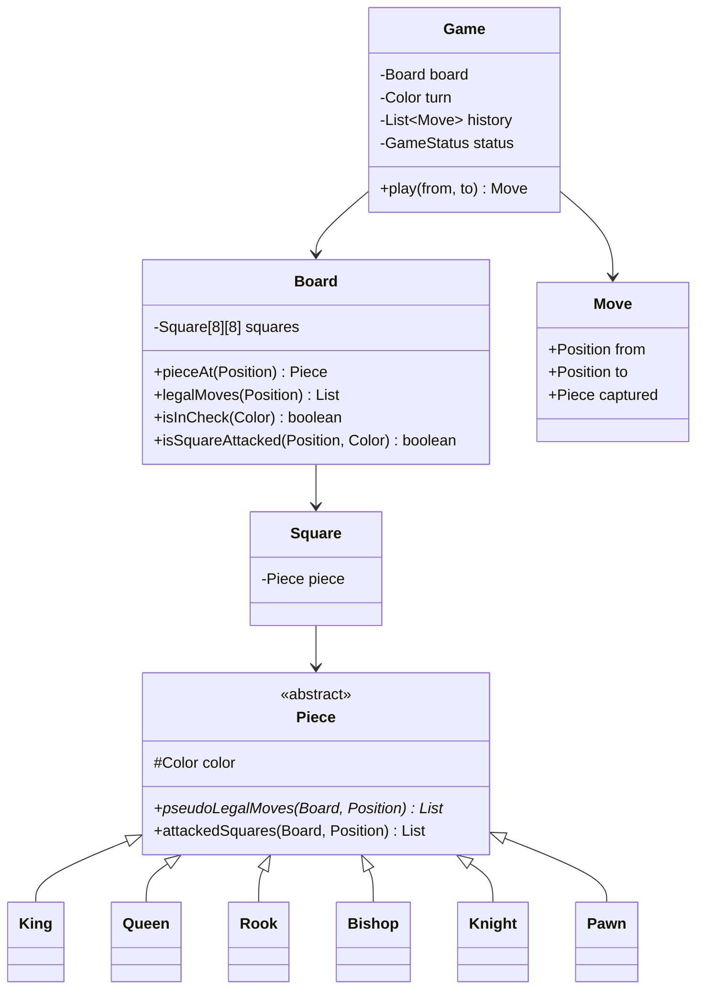

# D13 · Chess

Oct 16, 2026 · @saurav chaurasiya

**Is doc me:** Chess ka LLD (low level design — classes, interfaces aur unke beech ke rishte), Java me, polymorphic move generation aur check-validation ke saath.

**Padhne ka tareeka** — Pehle Sawaal pe 15 min khud socho, phir Sahi design ka code chalao aur output se match karo.

---

## D13 — Chess

Chess ek 2-player turn-based board game hai jisme 8x8 board pe 6 tarah ke pieces apne-apne rules se chalte hain. LLD interview me ye isliye aata hai kyunki ye polymorphism (ek hi method, alag-alag piece me alag behaviour) ka sabse saaf example hai.

### Ye cheez hai kya

- Category: LLD case study — game engine ka rules-core (UI nahi, network nahi)
- Problem: 6 piece types ki alag move rules, raste me blocking, aur "apna king check me nahi chhodna" jaisa global rule ko clean classes me todna
- Is lesson ke baad tum kar paoge: abstract `Piece` se polymorphic move generation likhna, move ko try-check-undo se validate karna, aur castling / en passant / promotion ko bina purana code todhe jodna
- Analogy: school ki sports team jaisi — coach (Game) baari batata hai, har khiladi (Piece) apna role jaanta hai, referee (validator) check karta hai ki chaal rules ke andar hai.

### Sawaal

Maan lo ek Indian online chess app ban raha hai (50,000 concurrent games). Har game ke server-side engine ko ye karna hai:

- 8x8 board, 32 pieces, white pehle chalta hai
- Har move ki validation: piece ka rule, raasta khali, aur chaal ke baad apna king check me na ho
- Move history (undo / replay / PGN export ke liye), aur status: ACTIVE / CHECK / CHECKMATE / STALEMATE
- Ek move validate hone me 1 ms se kam lagna chahiye (engine ek server pe hazaaron games chalata hai)

> Pehle khud socho — 15 min. Hints: (1) Har piece ka move-logic kahan rakhoge — ek bada `switch` ya har piece ki apni class? (2) "Apna king check me nahi hona chahiye" rule kis class ka kaam hai — Piece ka ya Game/Board ka? (3) Move validate karne ke liye board ko copy karoge ya move apply karke undo?

### Problem kyun aata hai

- Piece types alag hain, par sab ek jaisa interface chahte hain: "tum kahan ja sakte ho?"
- Naye rules (castling, en passant, promotion) baad me aate hain, purana code nahi tootna chahiye (Open-Closed Principle)
- Do alag cheezein mix ho jaati hain: piece ka apna rule vs poore board ka rule (king safety)
- Check detection ke liye "dushman ke pieces kahan attack karte hain" nikaalna padta hai, aur pawn ka attack uski chaal se alag hota hai

### Naive approach

- Ek `Board` class me `isValidMove(type, from, to)` aur ek bada `switch (type)`.
- Kahan tootta hai: 6 piece types x special rules = 40+ branches ek method me. Castling add karne ke liye `switch` me ghuso, har baar regression ka risk. Aur check ka rule har branch me copy-paste ho jaata hai (6 jagah bug fix karna).

```java
// BAD: type string pe switch, sab logic ek jagah
boolean isValidMove(String type, int fr, int fc, int tr, int tc) {
    switch (type) {
        case "ROOK":   return fr == tr || fc == tc;           // raasta check bhool gaye
        case "BISHOP": return Math.abs(fr - tr) == Math.abs(fc - tc);
        case "PAWN":   return tc == fc && tr == fr + 1;       // capture, 2-step kuch nahi
        // ... king check ka logic kahin nahi
        default: return false;
    }
}
```

### Sahi design

Design ke steps:

1. `Color` enum aur `Position` record (row, col) — coordinates ko ek value object banao, `"e2"` parse karne ka kaam yahin.
2. `Square` ek khana hai jo `Piece` hold karta hai (ya khali). `Board` 8x8 `Square` ka grid hai.
3. `Piece` abstract class: `pseudoLegalMoves(board, from)` abstract. Har subclass (King, Queen, Rook, Bishop, Knight, Pawn) apna rule likhta hai. Ye **Polymorphism** hai, aur `slide()` / `step()` helpers Template Method jaise kaam karte hain.
4. Sliding pieces (Rook, Bishop, Queen) ek shared `slide()` helper use karte hain jo apne piece pe ruk jaata hai aur dushman pe capture ke baad ruk jaata hai — yahi path-blocking hai. Knight kood ke jaata hai, isliye wo `step()` use karta hai.
5. Pawn ka `attackedSquares()` override hota hai, kyunki pawn seedha chalta hai par tirchha maarta hai. King-in-check ke liye attack squares chahiye, chaal nahi.
6. Move validation do level pe hoti hai: (a) pseudo-legal = piece ka rule + raasta, (b) legal = move apply karo, apna king check me hai to reject, move undo karo.
7. `Game` turn, history aur status sambhalta hai. Illegal move pe `IllegalMoveException` fenkta hai, board ko chhedta nahi.

Neeche poora code hai. Isme `Game.play` Facade jaisa kaam karta hai aur `Piece` hierarchy **Strategy-jaisa polymorphism** hai (har piece ek move-strategy hai).



Ye complete runnable Java hai (ek file `Demo.java`, compile + run ho chuka hai):

```java
import java.util.*;

enum Color {
    WHITE, BLACK;
    Color opposite() { return this == WHITE ? BLACK : WHITE; }
}

// Position: (row, col). row 0 = rank 1 (white side), col 0 = file a
record Position(int row, int col) {
    boolean inBounds() { return row >= 0 && row < 8 && col >= 0 && col < 8; }
    static Position parse(String s) { return new Position(s.charAt(1) - '1', s.charAt(0) - 'a'); }
    @Override public String toString() { return "" + (char) ('a' + col) + (row + 1); }
}

// Square: board ka ek khana, piece hold karta hai (ya null)
class Square {
    private Piece piece;
    Piece getPiece() { return piece; }
    void setPiece(Piece p) { this.piece = p; }
    boolean isEmpty() { return piece == null; }
}

// Piece: abstract. Har piece apni move generation khud karta hai (polymorphism)
abstract class Piece {
    protected final Color color;
    protected Piece(Color color) { this.color = color; }
    Color getColor() { return color; }
    abstract char symbol();

    // Pseudo-legal: board ke rules se chalne wale moves, king ki safety abhi check nahi hui
    abstract List<Position> pseudoLegalMoves(Board board, Position from);

    // Kin squares ko ye piece attack karta hai. Default: jahan chal sakta hai wahi. Pawn override karega
    List<Position> attackedSquares(Board board, Position from) { return pseudoLegalMoves(board, from); }

    // Sliding helper: ek direction me tab tak chalo jab tak koi piece raste me na aaye (path-blocking)
    protected void slide(Board b, Position from, int dr, int dc, List<Position> out) {
        Position p = new Position(from.row() + dr, from.col() + dc);
        while (p.inBounds()) {
            Piece target = b.pieceAt(p);
            if (target == null) out.add(p);
            else { if (target.color != color) out.add(p); break; } // dushman ko capture, apne pe ruk jao
            p = new Position(p.row() + dr, p.col() + dc);
        }
    }

    // Step helper: ek hi step (King, Knight)
    protected void step(Board b, Position from, int dr, int dc, List<Position> out) {
        Position p = new Position(from.row() + dr, from.col() + dc);
        if (!p.inBounds()) return;
        Piece target = b.pieceAt(p);
        if (target == null || target.color != color) out.add(p);
    }
}

class Rook extends Piece {
    Rook(Color c) { super(c); }
    char symbol() { return color == Color.WHITE ? 'R' : 'r'; }
    List<Position> pseudoLegalMoves(Board b, Position f) {
        List<Position> r = new ArrayList<>();
        for (int[] d : new int[][]{{1,0},{-1,0},{0,1},{0,-1}}) slide(b, f, d[0], d[1], r);
        return r;
    }
}

class Bishop extends Piece {
    Bishop(Color c) { super(c); }
    char symbol() { return color == Color.WHITE ? 'B' : 'b'; }
    List<Position> pseudoLegalMoves(Board b, Position f) {
        List<Position> r = new ArrayList<>();
        for (int[] d : new int[][]{{1,1},{1,-1},{-1,1},{-1,-1}}) slide(b, f, d[0], d[1], r);
        return r;
    }
}

class Queen extends Piece {
    Queen(Color c) { super(c); }
    char symbol() { return color == Color.WHITE ? 'Q' : 'q'; }
    List<Position> pseudoLegalMoves(Board b, Position f) {
        List<Position> r = new ArrayList<>();
        for (int[] d : new int[][]{{1,0},{-1,0},{0,1},{0,-1},{1,1},{1,-1},{-1,1},{-1,-1}}) slide(b, f, d[0], d[1], r);
        return r;
    }
}

class Knight extends Piece {
    Knight(Color c) { super(c); }
    char symbol() { return color == Color.WHITE ? 'N' : 'n'; }
    List<Position> pseudoLegalMoves(Board b, Position f) {
        List<Position> r = new ArrayList<>();
        for (int[] d : new int[][]{{2,1},{2,-1},{-2,1},{-2,-1},{1,2},{1,-2},{-1,2},{-1,-2}}) step(b, f, d[0], d[1], r); // knight kood ke jaata hai, blocking nahi
        return r;
    }
}

class King extends Piece {
    King(Color c) { super(c); }
    char symbol() { return color == Color.WHITE ? 'K' : 'k'; }
    List<Position> pseudoLegalMoves(Board b, Position f) {
        List<Position> r = new ArrayList<>();
        for (int dr = -1; dr <= 1; dr++)
            for (int dc = -1; dc <= 1; dc++)
                if (dr != 0 || dc != 0) step(b, f, dr, dc, r);
        return r;
    }
}

class Pawn extends Piece {
    Pawn(Color c) { super(c); }
    char symbol() { return color == Color.WHITE ? 'P' : 'p'; }
    private int dir() { return color == Color.WHITE ? 1 : -1; }
    List<Position> pseudoLegalMoves(Board b, Position f) {
        List<Position> r = new ArrayList<>();
        Position one = new Position(f.row() + dir(), f.col());
        if (one.inBounds() && b.pieceAt(one) == null) {
            r.add(one);
            int startRow = color == Color.WHITE ? 1 : 6;
            Position two = new Position(f.row() + 2 * dir(), f.col());
            if (f.row() == startRow && b.pieceAt(two) == null) r.add(two); // pehli chaal me 2 khane
        }
        for (Position p : attackedSquares(b, f)) {           // tirchhe sirf capture ke liye
            Piece t = b.pieceAt(p);
            if (t != null && t.color != color) r.add(p);
        }
        return r;
    }
    @Override List<Position> attackedSquares(Board b, Position f) {
        List<Position> r = new ArrayList<>();
        for (int dc : new int[]{-1, 1}) {
            Position p = new Position(f.row() + dir(), f.col() + dc);
            if (p.inBounds()) r.add(p);   // khali khana bhi "attacked" hai (king check ke liye zaroori)
        }
        return r;
    }
}

// Move: ek chaal ka record (undo ke liye captured piece yaad rakhta hai)
class Move {
    final Position from, to;
    final Piece moved, captured;
    Move(Position from, Position to, Piece moved, Piece captured) {
        this.from = from; this.to = to; this.moved = moved; this.captured = captured;
    }
    @Override public String toString() {
        return moved.symbol() + " " + from + (captured != null ? "x" : "-") + to
             + (captured != null ? " (captured " + captured.symbol() + ")" : "");
    }
}

class IllegalMoveException extends RuntimeException {
    IllegalMoveException(String msg) { super(msg); }
}

class Board {
    private final Square[][] squares = new Square[8][8];
    Board() {
        for (int r = 0; r < 8; r++) for (int c = 0; c < 8; c++) squares[r][c] = new Square();
    }
    static Board standard() {
        Board b = new Board();
        for (Color col : Color.values()) {
            int back = col == Color.WHITE ? 0 : 7, pawnRow = col == Color.WHITE ? 1 : 6;
            Piece[] row = {new Rook(col), new Knight(col), new Bishop(col), new Queen(col),
                           new King(col), new Bishop(col), new Knight(col), new Rook(col)};
            for (int c = 0; c < 8; c++) {
                b.squares[back][c].setPiece(row[c]);
                b.squares[pawnRow][c].setPiece(new Pawn(col));
            }
        }
        return b;
    }
    Piece pieceAt(Position p) { return squares[p.row()][p.col()].getPiece(); }

    // Raw move: koi rule check nahi, bas piece uthake rakh do. Captured piece return hota hai
    Piece applyRaw(Position from, Position to) {
        Piece captured = pieceAt(to);
        squares[to.row()][to.col()].setPiece(pieceAt(from));
        squares[from.row()][from.col()].setPiece(null);
        return captured;
    }
    void undoRaw(Position from, Position to, Piece captured) {
        squares[from.row()][from.col()].setPiece(pieceAt(to));
        squares[to.row()][to.col()].setPiece(captured);
    }

    Position findKing(Color c) {
        for (int r = 0; r < 8; r++) for (int col = 0; col < 8; col++) {
            Piece p = squares[r][col].getPiece();
            if (p instanceof King && p.getColor() == c) return new Position(r, col);
        }
        throw new IllegalStateException("King missing");
    }
    boolean isSquareAttacked(Position target, Color by) {
        for (int r = 0; r < 8; r++) for (int c = 0; c < 8; c++) {
            Piece p = squares[r][c].getPiece();
            if (p != null && p.getColor() == by
                && p.attackedSquares(this, new Position(r, c)).contains(target)) return true;
        }
        return false;
    }
    boolean isInCheck(Color c) { return isSquareAttacked(findKing(c), c.opposite()); }

    // Legal moves = pseudo-legal moves jinke baad apna king check me na ho (try karo, check karo, wapas lo)
    List<Position> legalMoves(Position from) {
        Piece p = pieceAt(from);
        List<Position> legal = new ArrayList<>();
        for (Position to : p.pseudoLegalMoves(this, from)) {
            Piece cap = applyRaw(from, to);
            boolean safe = !isInCheck(p.getColor());
            undoRaw(from, to, cap);
            if (safe) legal.add(to);
        }
        return legal;
    }
    boolean hasAnyLegalMove(Color c) {
        for (int r = 0; r < 8; r++) for (int col = 0; col < 8; col++) {
            Piece p = squares[r][col].getPiece();
            if (p != null && p.getColor() == c && !legalMoves(new Position(r, col)).isEmpty()) return true;
        }
        return false;
    }
    String render() {
        StringBuilder sb = new StringBuilder();
        for (int r = 7; r >= 0; r--) {
            sb.append(r + 1).append(' ');
            for (int c = 0; c < 8; c++) {
                Piece p = squares[r][c].getPiece();
                sb.append(p == null ? '.' : p.symbol()).append(' ');
            }
            sb.append('\n');
        }
        return sb.append("  a b c d e f g h").toString();
    }
}

enum GameStatus { ACTIVE, CHECK, CHECKMATE, STALEMATE }

class Game {
    private final Board board = Board.standard();
    private Color turn = Color.WHITE;
    private final List<Move> history = new ArrayList<>();
    private GameStatus status = GameStatus.ACTIVE;

    Board getBoard() { return board; }
    Color getTurn() { return turn; }
    GameStatus getStatus() { return status; }
    List<Move> getHistory() { return Collections.unmodifiableList(history); }

    Move play(String fromStr, String toStr) {
        if (status == GameStatus.CHECKMATE || status == GameStatus.STALEMATE)
            throw new IllegalMoveException("Game khatam ho chuka hai");
        Position from = Position.parse(fromStr), to = Position.parse(toStr);
        Piece p = board.pieceAt(from);
        if (p == null) throw new IllegalMoveException("Khana " + from + " khali hai");
        if (p.getColor() != turn) throw new IllegalMoveException("Abhi " + turn + " ki baari hai");
        if (!p.pseudoLegalMoves(board, from).contains(to))
            throw new IllegalMoveException(p.symbol() + " " + from + " se " + to + " nahi ja sakta (rule ya raasta band)");
        if (!board.legalMoves(from).contains(to))
            throw new IllegalMoveException("Is chaal ke baad " + turn + " ka king check me rahega");
        Piece captured = board.applyRaw(from, to);
        Move m = new Move(from, to, p, captured);
        history.add(m);
        turn = turn.opposite();
        boolean inCheck = board.isInCheck(turn), canMove = board.hasAnyLegalMove(turn);
        status = !canMove ? (inCheck ? GameStatus.CHECKMATE : GameStatus.STALEMATE)
                          : (inCheck ? GameStatus.CHECK : GameStatus.ACTIVE);
        return m;
    }
}

public class Demo {
    static void attempt(Game g, String from, String to) {
        try {
            Move m = g.play(from, to);
            System.out.println("OK       " + m + "  -> status " + g.getStatus() + ", ab " + g.getTurn() + " ki baari");
        } catch (IllegalMoveException e) {
            System.out.println("REJECTED " + from + "->" + to + " : " + e.getMessage());
        }
    }
    public static void main(String[] args) {
        Game g = new Game();
        attempt(g, "e2", "e4");
        attempt(g, "b1", "c3"); // galat baari: ab black ki baari hai
        attempt(g, "d7", "d6");
        attempt(g, "f1", "b5"); // bishop check deta hai
        attempt(g, "a7", "a6"); // illegal: check hata nahi raha
        attempt(g, "c7", "c6"); // legal: check ko block kiya
        attempt(g, "a1", "a3"); // rook ke aage apna pawn (a2) hai, raasta band
        attempt(g, "b5", "c6"); // capture
        attempt(g, "b7", "c6"); // black wapas capture
        System.out.println();
        System.out.println(g.getBoard().render());
        System.out.println("Move history:");
        int i = 1;
        for (Move m : g.getHistory()) System.out.println("  " + (i++) + ". " + m);
    }
}
```

Isko chalane pe bilkul ye output aata hai:

```text
OK       P e2-e4  -> status ACTIVE, ab BLACK ki baari
REJECTED b1->c3 : Abhi BLACK ki baari hai
OK       p d7-d6  -> status ACTIVE, ab WHITE ki baari
OK       B f1-b5  -> status CHECK, ab BLACK ki baari
REJECTED a7->a6 : Is chaal ke baad BLACK ka king check me rahega
OK       p c7-c6  -> status ACTIVE, ab WHITE ki baari
REJECTED a1->a3 : R a1 se a3 nahi ja sakta (rule ya raasta band)
OK       B b5xc6 (captured p)  -> status CHECK, ab BLACK ki baari
OK       p b7xc6 (captured B)  -> status ACTIVE, ab WHITE ki baari

8 r n b q k b n r 
7 p . . . p p p p 
6 . . p p . . . . 
5 . . . . . . . . 
4 . . . . P . . . 
3 . . . . . . . . 
2 P P P P . P P P 
1 R N B Q K . N R 
  a b c d e f g h
Move history:
  1. P e2-e4
  2. p d7-d6
  3. B f1-b5
  4. p c7-c6
  5. B b5xc6 (captured p)
  6. p b7xc6 (captured B)
```

Output se ye cheezein verify hoti hain:

- `b1->c3` reject hua kyunki black ki baari thi (turn check)
- `a7->a6` reject hua kyunki `Bb5` check de raha tha aur `a6` se check nahi hata (king-safety check)
- `c7->c6` allowed hua kyunki usne check ko block kiya
- `a1->a3` reject hua kyunki rook ke aage apna pawn `a2` hai (path-blocking)
- `b5xc6` aur `b7xc6` captures hain, history me captured piece ke saath dikhte hain

### Kya choose karein aur kyun

| Option | Kab use karo | Kab mat karo |
| --- | --- | --- |
| Har piece ki apni class (polymorphism) | Naye rules / pieces aate rahenge, interview ka default jawab | Sirf throwaway script ho |
| Ek `switch` on piece type | 10 line ka quick prototype | Production ya interview me, OCP todta hai |
| Move apply + undo se validate | Simple, copy nahi, fast | Multi-thread me ek hi board share ho (lock chahiye) |
| Board clone karke validate | Immutability chahiye, concurrency safe | Engine search me, clone 100x slow hai |
| Bitboards (64-bit integer per piece type) | Strong engine (Stockfish type), nanoseconds me move gen | LLD interview, readability kharab ho jaati hai |

### India me kaise hota hai

- Chess ka rules-core har online platform me UI aur network se alag rakha jaata hai: ek pure-logic module jo sirf board, pieces, moves aur game status jaanta hai. Yehi D13 ka design hai.
- India chess ka bada market hai (Viswanathan Anand ke baad boom), isliye Indian ed-tech aur gaming apps ko 10,000s concurrent games chahiye hote hain. Per-game ek chhota in-memory `Game` object hota hai, aur move history DB me jaati hai.
- Interview me Indian product companies (Flipkart, Amazon India, Swiggy type) Chess ko LLD round me poochte hain, aur dekhte hain ki tum polymorphism aur check validation sahi rakhte ho ya nahi.
- Reference reads: [Chess LLD interview guide](https://vinitshahdeo.substack.com/p/chess-lld-interview), [awesome-low-level-design: chess-game](https://github.com/ashishps1/awesome-low-level-design/blob/main/problems/chess-game.md).

### Interview follow-ups

- **Check kaise detect karte ho?** — King ki position nikaalo, dushman ke har piece ka `attackedSquares` dekho, agar king ka square usme hai to check. Pawn ka attack uski chaal se alag hota hai, isliye alag method.
- **Checkmate aur stalemate me kya fark hai?** — Dono me current player ke paas koi legal move nahi hota. Agar king check me hai to checkmate, nahi to stalemate (draw).
- **Move validate karne ke liye board copy karte ho?** — Nahi, apply-then-undo. Captured piece Move me yaad rakhte hain, undo O(1) hai, allocation nahi.
- **Naya piece (jaise Archbishop) add karna ho?** — Bas ek nayi `Piece` subclass. Board, Game, validator me ek line nahi badalti. Yahi Open-Closed Principle hai.
- **Undo / redo kaise?** — History me `Move` list hai jisme captured piece saved hai. Undo = `undoRaw` aur turn flip. Ye **Command pattern** ka natural fit hai.
- **Do players alag threads se move bhejein to?** — `Game.play` ko synchronize karo (ya per-game single-thread executor). Turn check se pehle hi galat player ka move reject ho jaata hai, par race pe do valid moves ek saath apply ho sakte hain.

### Self-check

1. `pseudoLegalMoves` aur legal move me kya fark hai?
2. Pawn ko `attackedSquares` override kyun karna padta hai?
3. Rook ka path-blocking `slide()` me kaise implement hota hai? Knight ko ye kyun nahi chahiye?
4. Checkmate aur stalemate ko code me kaise alag karte ho?
5. Naya piece type add karne ke liye kitni existing classes badalni padengi?

### Notebook

Piece abstract class me `pseudoLegalMoves` abstract, har subclass apna rule · Sliding pieces: direction me chalo, apne pe ruk, dushman pe capture karke ruk · Legal = pseudo-legal minus jin chaalon ke baad apna king check me ho · Validation = apply, check, undo (clone nahi) · Pawn ka attack != pawn ki chaal · Status: koi legal move nahi + check = CHECKMATE, koi legal move nahi + no check = STALEMATE

### Padhne ke liye

- [Chess Low Level Design: The Complete LLD Interview Guide](https://vinitshahdeo.substack.com/p/chess-lld-interview)
- [awesome-low-level-design: Chess game](https://github.com/ashishps1/awesome-low-level-design/blob/main/problems/chess-game.md)
- [Educative: Class diagram for the chess game](https://www.educative.io/courses/grokking-the-low-level-design-interview-using-ood-principles/class-diagram-for-the-chess-game)

### Deep Dive (SDE-2) — jab time ho

#### Castling (rokad)

- King do khane chalta hai aur rook uske upar se kood jaata hai. Shart: king aur wo rook kabhi hile na hon, beech ke khane khali hon, king check me na ho, aur jis khane se guzre wo attacked na ho.
- Design: `Piece` me `boolean hasMoved` flag. `King.pseudoLegalMoves` me castling destination add karo (`g1` / `c1`), aur `Move` ko `MoveType` (NORMAL, CASTLE\_KING\_SIDE, CASTLE\_QUEEN\_SIDE) do, taaki `Game` rook ko bhi shift kare.
- Purane pieces ka code nahi badalta, sirf King aur Move extend hote hain.

#### En passant

- Pawn ne abhi-abhi 2 khane chalke aaya ho, to dushman ka pawn usse "guzarte hue" tirchha capture kar sakta hai, sirf agli hi chaal me.
- Design: `Game` ya `Board` me `lastMove` (ya `enPassantTarget` Position) rakho. `Pawn.pseudoLegalMoves` ko board se ye target chahiye, to `Board` pe `getEnPassantTarget()` do. Capture hone wala pawn `to` square pe nahi hota, isliye `Move` me `capturedPosition` alag rakho.
- Undo me bhi ye capture wapas karna padega, isliye `Move` ko full-fidelity record banao.

#### Promotion

- Pawn aakhri rank pe pahunche to Queen / Rook / Bishop / Knight ban jaata hai (user ki choice).
- Design: `play(from, to, promoteTo)` overload, ya `PromotionPolicy` interface (Strategy). `Move` me `promotedTo` field. Apply me pawn ko naye piece se replace karo, undo me wapas pawn.
- Testing me underpromotion (knight banna) ka case zaroor rakho, kyunki wo kabhi-kabhi checkmate deta hai.

#### Draw rules aur persistence

- Threefold repetition, 50-move rule, insufficient material: board position ka hash (Zobrist hashing) history me rakho aur Game status me check karo.
- Move history ko PGN (Portable Game Notation) ya FEN (board snapshot string) me serialize karo, taaki game resume / replay ho sake. Isme `Move` ki immutable record shape kaam aati hai.

#### Performance aur concurrency

- Har move pe saare dushman pieces ka attack nikaalna O(pieces x moves) hai, 1 ms ke andar fit hota hai. Engine (AI) ko lakhon positions/sec chahiye, to bitboards ya incremental attack maps use karte hain.
- Online game me per-game ek single-thread executor (Actor jaisa) rakho, locks ki jagah. Details ke liye Thread Jungle zone dekho: [Part 3 · Thread Jungle](https://claude.ai/code/artifact/05d7fa44-518a-49fd-a70c-40ac902f184f).

---

## Aage kya

- Pichhla: [D12 · Tic-tac-toe](https://claude.ai/code/artifact/b1f9b186-1da4-4281-923c-2ce408cfa879)
- Agla: [D14 · Logger framework](https://claude.ai/code/artifact/892e0e3d-e903-4c58-96fb-777eb27d5c98)
- Related: [1A · OOP Village](https://claude.ai/code/artifact/cc69c0d1-92e9-4c1d-afd8-8add12f3e7db) (polymorphism, abstraction), [1B · SOLID Temple](https://claude.ai/code/artifact/f98bb328-8939-4ef4-a9a6-24c5ce970199) (Open-Closed Principle)
