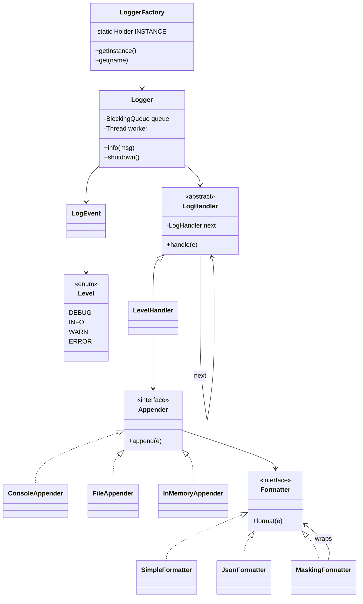

# D14 · Logger framework

Oct 16, 2026 · @saurav chaurasiya

**Is doc me:** ek chhota Logger framework (log4j jaisa) Java me banate hain: log levels, filter chain, multiple appenders, formatter, async logging aur card/phone masking.

**Padhne ka tareeka** — pehle Sawaal pe 15 min khud socho, phir Naive approach, phir Sahi design ka code chalao. Deep Dive baad me.

---

## D14 — Logger framework

Logger framework ek chhota library hota hai jo application ke events (kya hua, kab, kitna serious) ko alag-alag jagah (console, file, remote) bhejta hai. Level ke hisaab se filter karta hai aur sensitive data chhupa deta hai.

### Ye cheez hai kya

- Category: LLD case study, jisme Chain of Responsibility, Strategy, Observer, Singleton aur Producer-Consumer ek saath aate hain
- Problem: `System.out.println` se production me na filter hota hai, na file me jaata hai, na PII (personally identifiable information — aisi info jisse insaan pehchana jaye, jaise card number) chhupti hai
- Is lesson ke baad tum kar paoge: levels + appenders + formatter wala extensible logger design, async queue ke saath, aur masking ke saath
- Analogy: CCTV control room. Camera (code) har event record karta hai, guard (level filter) tay karta hai kaun si footage screen pe jaaye, kaun si locker (file) me, aur face blur (masking) pehle lag jaata hai.

### Sawaal

Paytm ke Payment Service me roz 5 crore log lines banti hain, peak pe 20,000 lines per second. Dev environment me DEBUG chahiye, production console me sirf INFO+, aur audit file me sirf WARN+. Log me kabhi-kabhi poora card number (16 digit) ya customer ka mobile number (10 digit) aa jaata hai, jo PCI-DSS (Payment Card Industry Data Security Standard — card data ke liye security rules) ke hisaab se allowed nahi hai. Logging se payment API ki p99 latency (99% requests is time se tez hoti hain) 2 ms se zyada nahi badhni chahiye, chahe disk slow ho.

> Pehle khud socho — 15 min. Hints: (1) level kaise compare karoge aur har destination ka alag minimum level kaise rakhoge? (2) disk slow ho to caller thread kyun block ho? (3) masking formatter me kare ya har `log.info()` call karne wale ki zimmedari ho?

### Problem kyun aata hai

- Har team apna `System.out.println` likhti hai, format alag, level nahi
- File write synchronous hoga to payment thread disk ka wait karega (latency badhegi)
- Naya destination (Kafka, Splunk) jodna ho to purana code badalna padta hai
- Developer message me raw card number daal deta hai, aur wo log files me hamesha ke liye reh jaata hai
- Multi-thread me log lines aapas me mix ho jaati hain

### Naive approach

- Ek class, andar `if` ladder, seedha file me write, caller ke thread me
- Kahan tootta hai: 20,000 lines/sec pe har call 0.1 ms disk wait bhi ho to ek thread ka 2 second/sec ka kaam hota hai; fsync (disk pe pakka likhwana) pe 5-10 ms lag sakte hain, to API ki p99 latency udd jaati hai. Naya appender jodne ko class badalni padti hai (Open/Closed principle toot-ta hai). Masking kisi ko yaad nahi.

```java
// Bura design: sab kuch ek jagah, sync, masking nahi
class BadLogger {
    static void log(String level, String msg) throws Exception {
        if (level.equals("DEBUG") || level.equals("INFO")) {
            System.out.println(level + " " + msg);          // console hardcoded
        }
        Files.writeString(Path.of("app.log"), msg + "\n",   // har call pe disk, caller block
            StandardOpenOption.CREATE, StandardOpenOption.APPEND);
    }
}
```

### Sahi design

1. `Level` enum, har level ka weight (DEBUG 10 < INFO 20 < WARN 30 < ERROR 40). Compare karna sasta hai.
2. `LogEvent` immutable object: level, logger name, message, sequence number.
3. `Formatter` interface (**Strategy** pattern — format badalna ho to class swap): `SimpleFormatter`, `JsonFormatter`. `MaskingFormatter` ek wrapper hai (Decorator) jo kisi bhi formatter ke output me card/phone chhupa deta hai.
4. `Appender` interface (**Strategy** — destination swap): `ConsoleAppender`, `FileAppender`, `InMemoryAppender`.
5. `LogHandler` chain (**Chain of Responsibility**): har handler ka apna minimum level aur apna appender, aur wo event agle handler ko pass karta hai. Iss tarah ek event kai appenders (Observer jaisa fan-out) tak jaata hai, aur har ek apna level khud filter karta hai.
6. `Logger`: caller ke thread me sirf threshold check + queue me `offer`. Bounded queue (`ArrayBlockingQueue`) bharne pe event drop hota hai (backpressure — producer tez ho aur consumer dheema, to system ko bachane ka tareeka) aur counter badhta hai. Ek background thread queue se nikaal ke chain chalata hai.
7. `LoggerFactory`: thread-safe **Singleton** (holder idiom — JVM class loading khud thread-safety deta hai) aur `ConcurrentHashMap.computeIfAbsent` se ek naam ka ek hi logger.
8. Shutdown: queue me POISON event daalo, worker ko `join()` karo. Isse sab pending lines flush hoti hain aur output deterministic rehta hai.

Pehle code ka pehla hissa: level, event, formatters aur masking. Ye bas data aur transformation hain, koi thread nahi.

```java
import java.io.*;
import java.nio.file.*;
import java.time.*;
import java.util.*;
import java.util.concurrent.*;
import java.util.regex.*;

// ---------- Level ----------
enum Level {
    DEBUG(10), INFO(20), WARN(30), ERROR(40);
    final int weight;
    Level(int w) { weight = w; }
}

// ---------- Immutable log event ----------
final class LogEvent {
    final Level level; final String loggerName; final String message; final long seq;
    LogEvent(Level l, String n, String m, long s) { level = l; loggerName = n; message = m; seq = s; }
}

// ---------- Formatter: Strategy ----------
interface Formatter { String format(LogEvent e); }

class SimpleFormatter implements Formatter {
    public String format(LogEvent e) {
        return "[" + e.level + "] " + e.loggerName + " - " + e.message;
    }
}
class JsonFormatter implements Formatter {
    public String format(LogEvent e) {
        return "{\"seq\":" + e.seq + ",\"level\":\"" + e.level + "\",\"msg\":\"" + e.message + "\"}";
    }
}

// ---------- PII masking: Decorator-style wrapper over any Formatter ----------
class MaskingFormatter implements Formatter {
    private static final Pattern CARD = Pattern.compile("\\b(\\d{4})[ -]?(\\d{4})[ -]?(\\d{4})[ -]?(\\d{4})\\b");
    private static final Pattern PHONE = Pattern.compile("\\b([6-9]\\d)\\d{6}(\\d{2})\\b");
    private final Formatter inner;
    MaskingFormatter(Formatter inner) { this.inner = inner; }
    public String format(LogEvent e) { return mask(inner.format(e)); }
    static String mask(String s) {
        s = CARD.matcher(s).replaceAll("****-****-****-$4");
        return PHONE.matcher(s).replaceAll("$1XXXXXX$2");
    }
}
```

Ab appenders (destination Strategy) aur level-filter chain.

```java
// ---------- Appender: Strategy for destination; Observer when many are attached ----------
interface Appender { void append(LogEvent e); default void close() {} }

class ConsoleAppender implements Appender {
    private final Formatter f;
    ConsoleAppender(Formatter f) { this.f = f; }
    public void append(LogEvent e) { System.out.println("CONSOLE " + f.format(e)); }
}
class InMemoryAppender implements Appender {
    private final Formatter f;
    private final List<String> lines = new CopyOnWriteArrayList<>();
    InMemoryAppender(Formatter f) { this.f = f; }
    public void append(LogEvent e) { lines.add(f.format(e)); }
    List<String> lines() { return lines; }
}
class FileAppender implements Appender {
    private final Formatter f; private final PrintWriter out;
    FileAppender(Path p, Formatter f) throws IOException {
        this.f = f; this.out = new PrintWriter(Files.newBufferedWriter(p));
    }
    public synchronized void append(LogEvent e) { out.println(f.format(e)); }
    public synchronized void close() { out.close(); }
}

// ---------- Chain of Responsibility: level filter ----------
abstract class LogHandler {
    private LogHandler next;
    LogHandler setNext(LogHandler n) { this.next = n; return n; }
    final void handle(LogEvent e) {
        if (accept(e)) {
            write(e);
            if (next != null) next.handle(e);   // agle handler ko do
        }
    }
    abstract boolean accept(LogEvent e);
    abstract void write(LogEvent e);
}
class LevelHandler extends LogHandler {
    private final Level min; private final Appender appender;
    LevelHandler(Level min, Appender a) { this.min = min; this.appender = a; }
    boolean accept(LogEvent e) { return true; }
    void write(LogEvent e) { if (e.level.weight >= min.weight) appender.append(e); }
}
```

Ab async Logger (bounded queue + worker thread), singleton factory, aur demo `main`.

```java
// ---------- Logger: bounded queue + background thread (producer-consumer) ----------
class Logger {
    private static final LogEvent POISON = new LogEvent(Level.ERROR, "", "", -1);
    private final String name;
    private final Level threshold;
    private final LogHandler head;
    private final BlockingQueue<LogEvent> queue;
    private final Thread worker;
    private final java.util.concurrent.atomic.AtomicLong seq = new java.util.concurrent.atomic.AtomicLong();
    private final java.util.concurrent.atomic.AtomicLong dropped = new java.util.concurrent.atomic.AtomicLong();

    Logger(String name, Level threshold, LogHandler head, int capacity) {
        this.name = name; this.threshold = threshold; this.head = head;
        this.queue = new ArrayBlockingQueue<>(capacity);
        this.worker = new Thread(this::drain, "log-worker-" + name);
        worker.start();
    }
    private void drain() {
        try {
            while (true) {
                LogEvent e = queue.take();
                if (e == POISON) return;
                head.handle(e);
            }
        } catch (InterruptedException ie) { Thread.currentThread().interrupt(); }
    }
    void log(Level l, String msg) {
        if (l.weight < threshold.weight) return;           // sasta check pehle
        LogEvent e = new LogEvent(l, name, msg, seq.incrementAndGet());
        if (!queue.offer(e)) dropped.incrementAndGet();    // queue full: drop, caller ko block nahi karte
    }
    void debug(String m) { log(Level.DEBUG, m); }
    void info(String m)  { log(Level.INFO, m); }
    void warn(String m)  { log(Level.WARN, m); }
    void error(String m) { log(Level.ERROR, m); }
    long dropped() { return dropped.get(); }
    void shutdown() throws InterruptedException {
        queue.put(POISON);   // baaki sab events ke baad aayega
        worker.join();       // flush: worker khatam hone tak wait
    }
}

// ---------- Thread-safe singleton factory (holder idiom) ----------
class LoggerFactory {
    private LoggerFactory() {}
    private static class Holder { static final LoggerFactory INSTANCE = new LoggerFactory(); }
    static LoggerFactory getInstance() { return Holder.INSTANCE; }
    private final ConcurrentMap<String, Logger> loggers = new ConcurrentHashMap<>();
    Logger get(String name, Level threshold, LogHandler head, int capacity) {
        return loggers.computeIfAbsent(name, n -> new Logger(n, threshold, head, capacity));
    }
    void shutdownAll() throws InterruptedException {
        for (Logger l : loggers.values()) l.shutdown();
    }
}

public class Demo {
    public static void main(String[] args) throws Exception {
        Formatter masked = new MaskingFormatter(new SimpleFormatter());
        Formatter maskedJson = new MaskingFormatter(new JsonFormatter());
        InMemoryAppender mem = new InMemoryAppender(maskedJson);
        Path file = Files.createTempFile("payments", ".log");
        FileAppender fileApp = new FileAppender(file, masked);

        // chain: console (INFO+) -> file (WARN+) -> memory (DEBUG+)
        LogHandler head = new LevelHandler(Level.INFO, new ConsoleAppender(masked));
        head.setNext(new LevelHandler(Level.WARN, fileApp))
            .setNext(new LevelHandler(Level.DEBUG, mem));

        Logger log = LoggerFactory.getInstance().get("PaymentService", Level.DEBUG, head, 100);
        Logger same = LoggerFactory.getInstance().get("PaymentService", Level.ERROR, null, 1);
        System.out.println("same logger instance: " + (log == same));

        log.debug("cache miss for order 42");
        log.info("Pay started, card 4111 1111 1111 1111");
        log.info("OTP sent to 9876543210");
        log.warn("UPI retry #2 for 9123456789");
        log.error("Bank timeout for card 5500-0000-0000-0004");

        LoggerFactory.getInstance().shutdownAll();   // flush + join: ab output deterministic
        fileApp.close();

        System.out.println("--- file (WARN+) ---");
        Files.readAllLines(file).forEach(System.out::println);
        System.out.println("--- memory (DEBUG+, JSON) ---");
        mem.lines().forEach(System.out::println);
        System.out.println("dropped = " + log.dropped());
        Files.deleteIfExists(file);
    }
}
```

Isko chalane pe bilkul ye output aata hai:

```text
same logger instance: true
CONSOLE [INFO] PaymentService - Pay started, card ****-****-****-1111
CONSOLE [INFO] PaymentService - OTP sent to 98XXXXXX10
CONSOLE [WARN] PaymentService - UPI retry #2 for 91XXXXXX89
CONSOLE [ERROR] PaymentService - Bank timeout for card ****-****-****-0004
--- file (WARN+) ---
[WARN] PaymentService - UPI retry #2 for 91XXXXXX89
[ERROR] PaymentService - Bank timeout for card ****-****-****-0004
--- memory (DEBUG+, JSON) ---
{"seq":1,"level":"DEBUG","msg":"cache miss for order 42"}
{"seq":2,"level":"INFO","msg":"Pay started, card ****-****-****-1111"}
{"seq":3,"level":"INFO","msg":"OTP sent to 98XXXXXX10"}
{"seq":4,"level":"WARN","msg":"UPI retry #2 for 91XXXXXX89"}
{"seq":5,"level":"ERROR","msg":"Bank timeout for card ****-****-****-0004"}
dropped = 0
```

- Console pe INFO, WARN, ERROR aaye, DEBUG nahi (INFO+ filter)
- File me sirf WARN aur ERROR (WARN+ filter)
- Memory appender me paanchon events JSON me, DEBUG ke saath
- Card 4111 1111 1111 1111 ban gaya `****-****-****-1111`, phone 9876543210 ban gaya `98XXXXXX10`
- `same logger instance: true` batata hai ki factory ne dobara naya logger nahi banaya (doosre call ke threshold/head ignore hue)



### Kya choose karein aur kyun

| Option | Kab use karo | Kab mat karo |
| --- | --- | --- |
| Sync logging | Chhota tool, CLI, kam volume | Payment API jaisa latency-sensitive path |
| Async + bounded queue + drop | Normal app logs, high volume | Audit log jo kabhi lose nahi hona chahiye |
| Async + bounded queue + block | Audit/compliance logs | Jab caller ko kabhi rukna nahi hai |
| Async + unbounded queue | Kabhi nahi (OutOfMemory ka risk) | Production me |
| Mask at formatter | Ek hi jagah, sab appenders safe | Jab raw data kisi trusted vault me chahiye |
| Mask at call site | Kabhi nahi, bhool jaate hain | Production me |

### India me kaise hota hai

- Indian fintech jaise Paytm, Razorpay, PhonePe PCI-DSS follow karte hain, jisme card number (PAN — primary account number) log/display me chhupana zaruri hota hai. Common rule: sirf first 6 aur last 4 digit dikhao, ya sirf last 4. Masking ke rules ki summary: [PCI DSS Masking Requirements guide](https://blog.rsisecurity.com/pci-dss-masking-requirements/).
- Java ecosystem me real framework Apache Log4j 2 hai, jo asynchronous loggers ke liye LMAX Disruptor (lock-free ring buffer) use karta hai: [Log4j 2 Asynchronous Loggers](https://logging.apache.org/log4j/2.x/manual/async).
- Card tokenization aur PCI-DSS ka detail yahan: [2G · Security Vault](https://claude.ai/code/artifact/f0f0e8e4-dde8-492e-9a80-08a35792d4e7) (L2.24 tokenization/PCI-DSS).
- Interview me yaad rakho: production me aap apna logger nahi, SLF4J + Log4j2/Logback use karte ho. LLD round me ye design bas pattern samajhne ke liye hota hai.

### Interview follow-ups

- **Queue full ho jaye to kya karoge?** — Policy tay karo: drop (app logs), block (audit logs), ya sirf low-level (DEBUG) drop karo. Dropped counter metrics me bhejo.
- **App crash ho to pending logs?** — Shutdown hook me flush/join karo. Crash (kill -9) me queue ke logs jaate hain, isliye ERROR ke liye sync write ya durable queue sochte hain.
- **Naya appender, jaise Kafka, kaise jodoge?** — `Appender` implement karo aur chain me ek `LevelHandler` jodo. Purana code nahi badalta.
- **Log ordering multi-thread me?** — Ek hi worker thread order queue ke order me rakhta hai; sequence number se bhi ordering check ho sakti hai.
- **Singleton thread-safe kaise?** — Holder idiom ya enum; double-checked locking me `volatile` chahiye.
- **Masking regex fail ho jaye (naye format)?** — Defense in depth: structured logging me sensitive fields ko type se mark karo, aur regex sirf safety net rakho.

### Self-check

1. Chain of Responsibility yahan filter kaise karta hai aur ek event kai appenders tak kaise pahunchta hai?
2. Bounded queue unbounded se behtar kyun hai?
3. Strategy pattern kahan kahan use hua (formatter, appender)?
4. Holder idiom singleton thread-safe kyun hai?
5. `shutdown()` me POISON aur `join()` kya karte hain?

### Notebook

Level = enum with weight · Handler chain: har node min level + appender · Strategy: Formatter aur Appender · Masking = wrapper formatter, call site pe nahi · Async: bounded `ArrayBlockingQueue` + 1 worker thread + drop counter · Factory = holder-idiom singleton + `computeIfAbsent` · Shutdown = POISON + join

### Padhne ke liye

- [Log4j 2 Asynchronous Loggers](https://logging.apache.org/log4j/2.x/manual/async)
- [PCI DSS Masking Requirements](https://blog.rsisecurity.com/pci-dss-masking-requirements/)
- [2C · Behavior Bazaar (Strategy, Observer, Chain of Responsibility)](https://claude.ai/code/artifact/d1ac6852-9994-4501-9b0a-7d0f654e5c38)

### Deep Dive (SDE-2) — jab time ho

#### Disruptor vs ArrayBlockingQueue

- ArrayBlockingQueue ek lock use karta hai, to bahut zyada producers me contention hoti hai
- Log4j2 ka Disruptor lock-free ring buffer hai, jo throughput aur latency dono behtar karta hai
- Interview me bolo: pehle simple queue, measure karo, phir zarurat pade to Disruptor

#### Structured logging aur MDC

- JSON logs me fields alag rakho (txnId, userId). Masking field-level pe hoti hai, regex pe nahi
- MDC (Mapped Diagnostic Context — thread ke saath chipka hua key-value map) se har log line me requestId aa jaata hai
- Async me MDC copy karna padta hai kyunki worker thread alag hai

#### Log rotation aur sampling

- File size/time pe rotate karo, purani compress karo
- Bahut noisy DEBUG ko sample karo (har 100 me se 1)
- Rate limiting ka idea [D9 Rate limiter](https://claude.ai/code/artifact/1a82c7a8-3aa0-49a2-b8d8-bb9398c1d502) se milta hai

---

## Aage kya

- Pichhla: [D13 · Chess](https://claude.ai/code/artifact/e03651c0-17bd-4e49-b262-c53b2b310ff5)
- Agla: [D15 · Notification service](https://claude.ai/code/artifact/6f904711-e790-423b-bf3c-79b94a671bfa)
- Related: [2A · Creational Forge](https://claude.ai/code/artifact/296276bb-5e6c-4e9d-82d1-c02909c5bd2f), [2C · Behavior Bazaar](https://claude.ai/code/artifact/d1ac6852-9994-4501-9b0a-7d0f654e5c38), [Part 3 · Thread Jungle](https://claude.ai/code/artifact/05d7fa44-518a-49fd-a70c-40ac902f184f)
