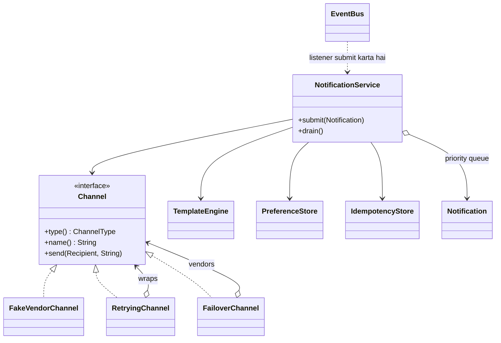

# D15 · Notification service

Oct 16, 2026 · @saurav chaurasiya

**Is doc me:** Ek Notification service ka Java LLD: Channel interface (Strategy), template rendering, user preferences, priority queue, retry with exponential backoff (Decorator), vendor failover, Observer se event to notification, aur idempotency key se duplicate send rokna.

**Padhne ka tareeka** — Pehle Sawaal pe 15 min khud socho, phir Naive approach dekho, phir Sahi design ka code chala ke output match karo. HLD side ke liye [C8 · Notification service](https://claude.ai/code/artifact/729bdcdf-fa6a-4de0-852e-a88e13273429) saath me padho.

---

## D15 — Notification service

Notification service ek aisa component hai jo kisi event (payment hua, OTP chahiye) ko user tak SMS, email ya push ke through pohonchata hai. LLD me iska matlab hai: classes aur interfaces aise banao ki naya channel, naya vendor ya naya rule add karne pe purana code na toote.

### Ye cheez hai kya

- Category: LLD case study, jisme Strategy, Decorator, Observer aur ek priority queue saath me use hote hain.
- Problem: alag-alag channels, flaky vendors, user ki pasand-napasand, aur duplicate messages ko ek clean design me sambhalna.
- Is lesson ke baad tum ye kar paoge: 40 minute ke interview me Channel interface, retry decorator, failover, preferences aur idempotency ke saath poora working design likh paoge.

Analogy: Notification service ek post office jaisi hai. Letter (message) ek hi hai, par delivery speed post se ho, courier se ho ya WhatsApp se, ye user ki pasand aur vendor ki availability pe depend karta hai. Ek hi letter do baar nahi jaana chahiye.

### Sawaal

Paytm jaisi app me ek UPI payment successful hota hai. Peak pe 20,000 payment events per second aate hain, aur har event pe user ko push, SMS ya email jaana hai. Design karo ek Notification service jisme:

- 3 channels hon: SMS, Email, Push. Aage WhatsApp bhi aa sakta hai.
- User apne preferences set kar sake (kaunsa channel chahiye).
- OTP jaisi HIGH priority wali cheez promotional LOW priority se pehle nikle.
- Vendor fail ho to retry ho, phir doosre vendor pe failover ho.
- Kafka se same event do baar aaye to user ko do SMS na mile.

> Pehle khud socho — 15 min. Hints: (1) Channel ko interface bana ke vendor alag rakho, taaki naya channel add karna sirf ek nayi class ho. (2) Retry aur failover ko channel ke andar mat ghusao, wrapper (Decorator) bana ke upar lagao. (3) Duplicate rokne ke liye har notification pe ek idempotency key rakho aur "pehle dekha ya nahi" check atomic rakho.

### Problem kyun aata hai

- Vendors fail hote hain: SMS vendor ka 503 aana roz ki baat hai, aur OTP na pohonche to user login hi nahi kar sakta.
- At-least-once delivery (Kafka message kam se kam ek baar pohonchata hai, kabhi do baar bhi) ki wajah se same event dobara aata hai, aur bina dedup ke user ko do SMS jaate hain.
- Har user ki pasand alag hai: koi sirf push chahta hai, par OTP har haal me jaana chahiye.
- Sab notifications barabar nahi: OTP 2 second me jaana chahiye, cashback ka promo 10 minute late chalega.
- Naya channel aaye to poora if-else badalna padta hai, jo Open/Closed principle ke khilaf hai.

### Naive approach

- Ek `NotificationService` class me `if (type == SMS) ... else if (type == EMAIL) ...` aur seedha ek vendor ki call.
- Ye kahan toot-ta hai:
  - Vendor down hua to retry nahi, failover nahi; 20,000 events/sec me OTP drop hote hain.
  - Kafka redelivery pe 1% duplicate bhi ho to 200 duplicate SMS har second.
  - Naya channel (WhatsApp) = purani class edit, purane tests dobara.
  - User preference ya priority ka koi concept nahi.

Ye raha bura version:

```java
// BURA DESIGN: sab kuch ek class me, retry/failover/dedup kuch nahi
class BadNotificationService {
    void notify(String userId, String type, String msg) {
        if (type.equals("SMS")) {
            smsVendorA.send(userId, msg);   // vendor down to exception upar tak
        } else if (type.equals("EMAIL")) {
            emailVendor.send(userId, msg);
        } else if (type.equals("PUSH")) {
            pushVendor.send(userId, msg);
        }
        // WhatsApp aaya to yahan naya else-if, preference check bhi nahi
    }
}
```

### Sahi design

1. `Channel` interface banao (Strategy pattern, yani ek hi kaam ke alag-alag tareeke ko interface ke peeche rakhna). SMS, Email, Push, aur har vendor iska implementation hai.
2. `RetryingChannel` ek Decorator (kisi object ko wrap karke naya behaviour jodna) hai. Ye kisi bhi Channel ko lekar exponential backoff (har fail ke baad wait double: 100ms, 200ms, 400ms) ke saath retry karta hai.
3. `FailoverChannel` vendors ki list leta hai: primary ke retries khatam hone pe secondary try karta hai.
4. `TemplateEngine` template id aur channel se text nikaal ke `{{amt}}` jaise placeholders bharta hai.
5. `PreferenceStore` batata hai user ne kaunsa channel allow kiya. HIGH priority (OTP, fraud alert) opt-out bypass karti hai.
6. `IdempotencyStore` me key `eventId:channel` rakhte hain. `Set.add()` atomic hai, isliye do threads ek saath aayein to sirf ek jeetega.
7. `EventBus` Observer pattern hai: `PAYMENT_SUCCESS` event pe subscribed listener notification bana ke queue me daal deta hai.
8. `PriorityBlockingQueue` HIGH ko pehle nikaalta hai; same priority me FIFO (pehle aaya pehle gaya).

Poora code ek file me, `Demo.java`:

```java
import java.util.*;
import java.util.concurrent.*;
import java.util.function.*;

enum ChannelType { SMS, EMAIL, PUSH }

enum Priority { HIGH, NORMAL, LOW } // ordinal chhota = pehle process hoga

class DeliveryException extends Exception {
    DeliveryException(String m) { super(m); }
}

// Notification: ek event ke liye ek user ko bhejna wala message request
class Notification implements Comparable<Notification> {
    private static final java.util.concurrent.atomic.AtomicLong SEQ = new java.util.concurrent.atomic.AtomicLong();
    final long seq = SEQ.incrementAndGet();
    final String idempotencyKey;
    final String userId;
    final String templateId;
    final Map<String, String> params;
    final Priority priority;

    Notification(String key, String userId, String templateId, Map<String, String> params, Priority p) {
        this.idempotencyKey = key; this.userId = userId; this.templateId = templateId;
        this.params = params; this.priority = p;
    }
    // HIGH pehle; same priority me FIFO (seq se)
    public int compareTo(Notification o) {
        int c = priority.compareTo(o.priority);
        return c != 0 ? c : Long.compare(seq, o.seq);
    }
}

record Recipient(String userId, String phone, String email, String deviceToken) {}

// Strategy interface: har channel / vendor isko implement karta hai
interface Channel {
    ChannelType type();
    String name();
    void send(Recipient to, String body) throws DeliveryException;
}

// Fake vendor: failuresLeft tak fail karta hai, phir chal padta hai
class FakeVendorChannel implements Channel {
    private final ChannelType type; private final String name;
    private int failuresLeft; // -1 matlab hamesha down
    FakeVendorChannel(ChannelType t, String name, int failuresLeft) {
        this.type = t; this.name = name; this.failuresLeft = failuresLeft;
    }
    public ChannelType type() { return type; }
    public String name() { return name; }
    public synchronized void send(Recipient to, String body) throws DeliveryException {
        if (failuresLeft != 0) {
            if (failuresLeft > 0) failuresLeft--;
            throw new DeliveryException(name + " ne 503 diya");
        }
        System.out.println("    [" + name + "] -> " + to.userId() + " : " + body);
    }
}

// Decorator: kisi bhi Channel ko retry + exponential backoff ke saath wrap karta hai
class RetryingChannel implements Channel {
    private final Channel inner; private final int maxAttempts; private final long baseDelayMs;
    private final LongConsumer sleeper; // demo me real sleep nahi, sirf print
    RetryingChannel(Channel inner, int maxAttempts, long baseDelayMs, LongConsumer sleeper) {
        this.inner = inner; this.maxAttempts = maxAttempts; this.baseDelayMs = baseDelayMs; this.sleeper = sleeper;
    }
    public ChannelType type() { return inner.type(); }
    public String name() { return inner.name(); }
    public void send(Recipient to, String body) throws DeliveryException {
        DeliveryException last = null;
        for (int attempt = 1; attempt <= maxAttempts; attempt++) {
            try { inner.send(to, body); return; }
            catch (DeliveryException e) {
                last = e;
                System.out.println("    retry: " + inner.name() + " attempt " + attempt + " fail (" + e.getMessage() + ")");
                if (attempt < maxAttempts) sleeper.accept(baseDelayMs << (attempt - 1)); // 100, 200, 400...
            }
        }
        throw new DeliveryException(inner.name() + " " + maxAttempts + " attempts ke baad bhi fail");
    }
}

// Failover: primary fail ho to secondary try karo (same ChannelType ke vendors)
class FailoverChannel implements Channel {
    private final List<Channel> vendors;
    FailoverChannel(List<Channel> vendors) { this.vendors = vendors; }
    public ChannelType type() { return vendors.get(0).type(); }
    public String name() { return "failover" + vendors.stream().map(Channel::name).toList(); }
    public void send(Recipient to, String body) throws DeliveryException {
        for (Channel c : vendors) {
            try { c.send(to, body); return; }
            catch (DeliveryException e) {
                System.out.println("    failover: " + c.name() + " se nahi gaya, agla vendor try");
            }
        }
        throw new DeliveryException("saare " + type() + " vendors fail");
    }
}

class TemplateEngine {
    private final Map<String, Map<ChannelType, String>> templates = new HashMap<>();
    void register(String id, ChannelType t, String text) {
        templates.computeIfAbsent(id, k -> new EnumMap<>(ChannelType.class)).put(t, text);
    }
    boolean has(String id, ChannelType t) { return templates.getOrDefault(id, Map.of()).containsKey(t); }
    String render(String id, ChannelType t, Map<String, String> params) {
        String s = templates.get(id).get(t);
        for (var e : params.entrySet()) s = s.replace("{{" + e.getKey() + "}}", e.getValue());
        return s;
    }
}

class PreferenceStore {
    private final Map<String, Set<ChannelType>> allowed = new ConcurrentHashMap<>();
    void set(String userId, ChannelType... types) {
        Set<ChannelType> s = EnumSet.noneOf(ChannelType.class);
        s.addAll(Arrays.asList(types));
        allowed.put(userId, s);
    }
    // HIGH priority (OTP, fraud alert) opt-out ko bypass karti hai
    boolean allows(String userId, ChannelType t, Priority p) {
        if (p == Priority.HIGH) return true;
        return allowed.getOrDefault(userId, EnumSet.allOf(ChannelType.class)).contains(t);
    }
}

class IdempotencyStore {
    private final Set<String> seen = ConcurrentHashMap.newKeySet();
    // add() atomic hai: sirf pehla caller true paata hai
    boolean firstTime(String key) { return seen.add(key); }
    void forget(String key) { seen.remove(key); }
}

// Observer: event aate hi subscribers ko notify
interface EventListener { void onEvent(String eventType, String userId, String eventId, Map<String, String> data); }

class EventBus {
    private final Map<String, List<EventListener>> subs = new HashMap<>();
    void subscribe(String eventType, EventListener l) { subs.computeIfAbsent(eventType, k -> new ArrayList<>()).add(l); }
    void publish(String eventType, String userId, String eventId, Map<String, String> data) {
        for (EventListener l : subs.getOrDefault(eventType, List.of())) l.onEvent(eventType, userId, eventId, data);
    }
}

class NotificationService {
    private final Map<ChannelType, Channel> channels = new EnumMap<>(ChannelType.class);
    private final Map<String, Recipient> users = new HashMap<>();
    private final TemplateEngine templates; private final PreferenceStore prefs; private final IdempotencyStore idem;
    private final PriorityBlockingQueue<Notification> queue = new PriorityBlockingQueue<>();

    NotificationService(TemplateEngine t, PreferenceStore p, IdempotencyStore i) { templates = t; prefs = p; idem = i; }
    void register(Channel c) { channels.put(c.type(), c); }
    void addUser(Recipient r) { users.put(r.userId(), r); }
    void submit(Notification n) { queue.add(n); }

    // Worker loop ka kaam: queue se priority order me nikalo aur bhejo
    void drain() {
        Notification n;
        while ((n = queue.poll()) != null) process(n);
    }

    private void process(Notification n) {
        System.out.println("-- " + n.priority + " " + n.templateId + " user=" + n.userId + " key=" + n.idempotencyKey);
        Recipient r = users.get(n.userId);
        for (ChannelType t : ChannelType.values()) {
            Channel ch = channels.get(t);
            if (ch == null || !templates.has(n.templateId, t)) continue;
            if (!prefs.allows(n.userId, t, n.priority)) {
                System.out.println("  " + t + ": skip (user ne band kiya)");
                continue;
            }
            String dedupKey = n.idempotencyKey + ":" + t;
            if (!idem.firstTime(dedupKey)) {
                System.out.println("  " + t + ": skip (duplicate, key=" + dedupKey + ")");
                continue;
            }
            try {
                ch.send(r, templates.render(n.templateId, t, n.params));
            } catch (DeliveryException e) {
                idem.forget(dedupKey); // fail hua to key wapas, taaki baad me dobara try ho sake
                System.out.println("  " + t + ": FAILED -> " + e.getMessage() + " (DLQ me daalo)");
            }
        }
    }
}

public class Demo {
    public static void main(String[] args) {
        TemplateEngine tpl = new TemplateEngine();
        tpl.register("PAY_OK", ChannelType.SMS, "Rs {{amt}} paid to {{merchant}}. Ref {{ref}}");
        tpl.register("PAY_OK", ChannelType.EMAIL, "Receipt: Rs {{amt}} to {{merchant}} (ref {{ref}})");
        tpl.register("PAY_OK", ChannelType.PUSH, "Paid Rs {{amt}} to {{merchant}}");
        tpl.register("OTP", ChannelType.SMS, "OTP {{otp}} for login. Do not share.");

        PreferenceStore prefs = new PreferenceStore();
        prefs.set("u1", ChannelType.SMS, ChannelType.PUSH, ChannelType.EMAIL);
        prefs.set("u2", ChannelType.PUSH); // u2 ne sirf push rakha

        LongConsumer fakeSleep = ms -> System.out.println("    backoff: " + ms + " ms ruko");

        // Primary SMS vendor hamesha down; secondary theek. Dono retry decorator ke andar.
        Channel smsPrimary = new RetryingChannel(new FakeVendorChannel(ChannelType.SMS, "SmsVendorA", -1), 3, 100, fakeSleep);
        Channel smsSecondary = new RetryingChannel(new FakeVendorChannel(ChannelType.SMS, "SmsVendorB", 0), 3, 100, fakeSleep);
        Channel sms = new FailoverChannel(List.of(smsPrimary, smsSecondary));

        NotificationService svc = new NotificationService(tpl, prefs, new IdempotencyStore());
        svc.register(sms);
        svc.register(new FakeVendorChannel(ChannelType.EMAIL, "EmailVendor", 0));
        svc.register(new RetryingChannel(new FakeVendorChannel(ChannelType.PUSH, "PushVendor", 1), 3, 100, fakeSleep));
        svc.addUser(new Recipient("u1", "+91-98100-00001", "u1@mail.com", "tok-u1"));
        svc.addUser(new Recipient("u2", "+91-98100-00002", "u2@mail.com", "tok-u2"));

        // Observer: PAYMENT_SUCCESS event aate hi notification banao
        EventBus bus = new EventBus();
        bus.subscribe("PAYMENT_SUCCESS", (type, uid, eid, data) ->
            svc.submit(new Notification("evt-" + eid, uid, "PAY_OK", data, Priority.NORMAL)));

        System.out.println("=== 1. Payment event u1 (sab channel) aur u2 (sirf push) ===");
        bus.publish("PAYMENT_SUCCESS", "u1", "p1001", Map.of("amt", "499", "merchant", "Swiggy", "ref", "UPI123"));
        bus.publish("PAYMENT_SUCCESS", "u2", "p1002", Map.of("amt", "120", "merchant", "Zomato", "ref", "UPI124"));
        svc.drain();

        System.out.println("=== 2. Same event dobara aaya (Kafka redelivery) ===");
        bus.publish("PAYMENT_SUCCESS", "u1", "p1001", Map.of("amt", "499", "merchant", "Swiggy", "ref", "UPI123"));
        svc.drain();

        System.out.println("=== 3. Priority: NORMAL pehle submit, HIGH baad me, HIGH pehle jaayega ===");
        svc.submit(new Notification("evt-p1003", "u2", "PAY_OK", Map.of("amt", "50", "merchant", "Chai", "ref", "UPI125"), Priority.NORMAL));
        svc.submit(new Notification("otp-77", "u2", "OTP", Map.of("otp", "482913"), Priority.HIGH));
        svc.drain();
    }
}
```

Isko chalane pe bilkul ye output aata hai:

```text
=== 1. Payment event u1 (sab channel) aur u2 (sirf push) ===
-- NORMAL PAY_OK user=u1 key=evt-p1001
    retry: SmsVendorA attempt 1 fail (SmsVendorA ne 503 diya)
    backoff: 100 ms ruko
    retry: SmsVendorA attempt 2 fail (SmsVendorA ne 503 diya)
    backoff: 200 ms ruko
    retry: SmsVendorA attempt 3 fail (SmsVendorA ne 503 diya)
    failover: SmsVendorA se nahi gaya, agla vendor try
    [SmsVendorB] -> u1 : Rs 499 paid to Swiggy. Ref UPI123
    [EmailVendor] -> u1 : Receipt: Rs 499 to Swiggy (ref UPI123)
    retry: PushVendor attempt 1 fail (PushVendor ne 503 diya)
    backoff: 100 ms ruko
    [PushVendor] -> u1 : Paid Rs 499 to Swiggy
-- NORMAL PAY_OK user=u2 key=evt-p1002
  SMS: skip (user ne band kiya)
  EMAIL: skip (user ne band kiya)
    [PushVendor] -> u2 : Paid Rs 120 to Zomato
=== 2. Same event dobara aaya (Kafka redelivery) ===
-- NORMAL PAY_OK user=u1 key=evt-p1001
  SMS: skip (duplicate, key=evt-p1001:SMS)
  EMAIL: skip (duplicate, key=evt-p1001:EMAIL)
  PUSH: skip (duplicate, key=evt-p1001:PUSH)
=== 3. Priority: NORMAL pehle submit, HIGH baad me, HIGH pehle jaayega ===
-- HIGH OTP user=u2 key=otp-77
    retry: SmsVendorA attempt 1 fail (SmsVendorA ne 503 diya)
    backoff: 100 ms ruko
    retry: SmsVendorA attempt 2 fail (SmsVendorA ne 503 diya)
    backoff: 200 ms ruko
    retry: SmsVendorA attempt 3 fail (SmsVendorA ne 503 diya)
    failover: SmsVendorA se nahi gaya, agla vendor try
    [SmsVendorB] -> u2 : OTP 482913 for login. Do not share.
-- NORMAL PAY_OK user=u2 key=evt-p1003
  SMS: skip (user ne band kiya)
  EMAIL: skip (user ne band kiya)
    [PushVendor] -> u2 : Paid Rs 50 to Chai
```

Output se kya dikhta hai:

- Section 1 me u1 ke liye SmsVendorA 3 baar fail hua (backoff 100ms, 200ms), phir failover ne SmsVendorB se SMS bheja.
- PushVendor pehli baar fail hua, retry me chal gaya. Ye retry decorator ka kaam hai.
- u2 ne sirf push rakha tha, isliye uska SMS aur Email skip hua. Ye preference filtering hai.
- Section 2 me wahi event dobara aaya aur teeno channels pe duplicate skip hua. Ye idempotency hai.
- Section 3 me HIGH OTP, NORMAL se baad me submit hone ke bawajood pehle gaya, aur u2 ke SMS opt-out ke bawajood gaya.

Class diagram:



Patterns ka naam:

- **Strategy**: `Channel` ke implementations.
- **Decorator**: `RetryingChannel` (aur `FailoverChannel` composite jaisa wrapper).
- **Observer**: `EventBus` aur `EventListener`.

### Kya choose karein aur kyun

| Option | Kab use karo | Kab mat karo |
| --- | --- | --- |
| Retry decorator (same vendor) | Temporary error: timeout, 503, network blip | Permanent error: galat number, invalid token; retry bekaar hai |
| Failover (doosra vendor) | Vendor ka outage ya retries khatam ho gaye | Message pehle hi deliver ho chuka ho (duplicate ka risk, isliye idempotency saath me) |
| Idempotency key in-memory Set | Demo ya single instance | Multi-instance production; wahan Redis `SETNX` ya DB unique key chahiye |
| Priority queue | OTP aur promo ek hi pipeline me | Agar HIGH ko alag SLA chahiye to alag queue/topic better hai, taaki promo flood OTP ko na roke |

### India me kaise hota hai

- India me SMS bhejne ke liye TRAI ka DLT (Distributed Ledger Technology) registration lagta hai: sender id aur har message template pehle register karna padta hai. Isliye template engine me template id pehle se fixed hota hai. Padho: [India SMS Compliance: TRAI DLT Registration and TCCCPR Guide](https://www.telerivet.com/blog/india-sms-compliance-trai-dlt-registration-and-tcccpr-guide).
- Fintech apps transactional SMS ke liye aksar 2 ya zyada SMS aggregators rakhti hain, taaki ek down ho to doosre pe failover ho. Ye general industry practice hai; kisi specific company ki internal detail ke taur pe mat bolna.
- Retry aur fallback ke design pattern ke liye ye article dekho: [How to Design Notification Retry and Fallback](https://www.suprsend.com/post/notification-retry-and-fallback).

### Interview follow-ups

- **Retry me jitter kyun lagate hain?** — Agar 10,000 requests ek saath fail hui aur sab 100ms baad retry karein, to vendor pe dobara spike aata hai (thundering herd). Backoff me random jitter jodne se retries failein.
- **Retry kab nahi karna chahiye?** — Permanent errors (invalid phone, uninstalled app token) pe. Sirf timeout, 5xx jaise transient errors pe retry karo.
- **Failover ke baad duplicate aa sakta hai?** — Haan, agar vendor A ne message bheja par ack lost ho gaya. Isliye idempotency key vendor ko bhi pass karo jahan vendor support kare, aur doosre vendor ka log reconcile karo.
- **Multi-instance me idempotency kaise?** — Redis `SET key NX EX ttl` ya DB me unique constraint. In-memory Set sirf ek JVM me kaam karta hai. Dekho [2A · Idempotency Island](https://claude.ai/code/artifact/c269ac61-440b-4525-bd04-31baf708dece).
- **Naya channel (WhatsApp) kaise add karoge?** — Nayi class jo `Channel` implement kare, template register karo, service me `register()`. Purana code nahi chhoota (Open/Closed).
- **Send fail hone pe idempotency key kyun hataya?** — Warna us notification ka dobara try hamesha "duplicate" bol ke skip ho jaata. Hum key tabhi rakhte hain jab send success ho ya chal raha ho.

### Self-check

1. Strategy aur Decorator is design me kahan lage hain, aur kyun?
2. Exponential backoff me 3 attempts ke beech kitna wait hota hai (base 100ms)?
3. Idempotency key `eventId:channel` kyun hai, sirf `eventId` kyun nahi?
4. HIGH priority preference ko bypass kyun karti hai?
5. Primary vendor 3 retries ke baad fail ho to aage kya hota hai?

### Notebook

Channel = Strategy interface · Retry = Decorator + exponential backoff (100, 200, 400 ms) · Failover = vendors ki list, ek ke baad ek · Idempotency key = eventId:channel, atomic `Set.add` · HIGH priority preference bypass karti hai · EventBus = Observer, event se notification bante hain · transient error pe retry, permanent pe nahi.

### Padhne ke liye

- [How to Design Notification Retry and Fallback](https://www.suprsend.com/post/notification-retry-and-fallback)
- [Designing a Notification System: Queues, Retries, Rate Limiting and Scale](https://dev.to/mangeshmandlik/designing-a-notification-system-queues-retries-rate-limiting-scale-4bg1)
- [India SMS Compliance: TRAI DLT Registration Guide](https://www.telerivet.com/blog/india-sms-compliance-trai-dlt-registration-and-tcccpr-guide)
- [2E · Resilience Ridge](https://claude.ai/code/artifact/4769dea3-018e-41e1-ae18-253fa36a6d21)

### Deep Dive (SDE-2) — jab time ho

#### Concurrency aur real worker

- Demo me `drain()` ek thread me chalta hai. Production me N worker threads `queue.take()` karte hain, ek `ExecutorService` pe.
- Channel implementations stateless honi chahiye ya thread-safe, kyunki ek hi `Channel` object kai threads share karte hain.
- Dekho [Part 3 · Thread Jungle](https://claude.ai/code/artifact/05d7fa44-518a-49fd-a70c-40ac902f184f).

#### Retry budget aur circuit breaker

- Agar vendor poori tarah down hai to har notification 3 retries karke waqt barbaad karti hai. Circuit breaker (kuch fail ke baad kuch der call hi band) lagao, to FailoverChannel seedha secondary pe jaye.
- Retry ka total budget rakho, jaise OTP ke liye max 5 second, warna OTP aane tak user ruk jaata hai.
- Dekho [2E · Resilience Ridge](https://claude.ai/code/artifact/4769dea3-018e-41e1-ae18-253fa36a6d21).

#### Idempotency aur failure ka rishta

- Hamare demo me send fail pe key `forget()` hoti hai. Par agar send hua aur process crash ho gaya, to key rah jaati hai aur retry skip ho jaata hai (at-most-once). Production me status ko `PENDING, SENT, FAILED` states me store karo.
- Dead letter queue (DLQ, wo queue jahan baar baar fail hone wale messages jaate hain) me daal ke baad me manually ya scheduler se replay karo.

#### Scale par kya badlega

- Queue in-memory se Kafka topic ban jaata hai, priority ke liye alag topics (otp, txn, promo).
- Preferences aur templates cache me rakho, DB har event pe mat maaro.
- Rate limit per user aur per vendor lagao, taaki promo flood na ho. HLD side: [C8 · Notification service](https://claude.ai/code/artifact/729bdcdf-fa6a-4de0-852e-a88e13273429) aur [Q9 · Notification system](https://claude.ai/code/artifact/bfecee08-f812-4c61-9f8a-c042ee6feb05).

---

## Aage kya

- Pichhla: [D14 · Logger framework](https://claude.ai/code/artifact/892e0e3d-e903-4c58-96fb-777eb27d5c98)
- Agla: [D16 · Food delivery](https://claude.ai/code/artifact/cd1fbbdc-bb85-4bb6-a1d0-821491e4730d)
- Related: HLD twins [C8 · Notification service](https://claude.ai/code/artifact/729bdcdf-fa6a-4de0-852e-a88e13273429) aur [Q9 · Notification system](https://claude.ai/code/artifact/bfecee08-f812-4c61-9f8a-c042ee6feb05); patterns ke liye [2C · Behavior Bazaar](https://claude.ai/code/artifact/d1ac6852-9994-4501-9b0a-7d0f654e5c38) (Strategy, Observer) aur [2B · Structural Bridge](https://claude.ai/code/artifact/38514da5-5649-4d61-b49d-f65f893e6a5e) (Decorator); [2A · Idempotency Island](https://claude.ai/code/artifact/c269ac61-440b-4525-bd04-31baf708dece)
