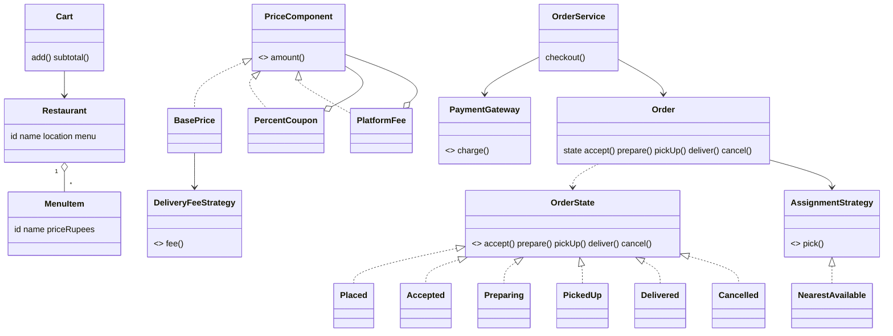

# D16 · Food delivery

Oct 16, 2026 · @saurav chaurasiya

**Is doc me:** Swiggy/Zomato jaisa food delivery ka LLD (low level design — classes aur unke rishte) : Restaurant, Menu, Cart, Order state machine, delivery partner assignment, pricing aur payment.

**Padhne ka tareeka** — pehle Sawaal pe 15 min khud socho, phir Sahi design ka Java run karke output se match karo.

---

## D16 — Food delivery

Food delivery system ek aisa software model hai jisme customer restaurant ke menu se items cart me daalta hai, order place karta hai, aur ek delivery partner khana ghar tak pahunchata hai. LLD interview me ye question isliye aata hai kyunki isme State, Strategy aur Decorator teeno patterns natural tareeke se fit hote hain.

### Ye cheez hai kya

- Category: LLD case study (object model + design patterns, no database ya network design)
- Problem: cart ke rules, order ki lifecycle, partner assignment aur final bill ko clean classes me todna taaki naye rules (naya coupon, naya assignment logic) bina purana code toote add ho sakein
- Is lesson ke baad tum: Order ko State pattern se model kar paoge, nearest-partner ko Strategy se plug kar paoge, aur coupon/fees ko Decorator chain se jod paoge
- Analogy: ye ek tiffin service ki tarah hai. Ek hi dukaan ka tiffin ek baar me jaata hai (single-restaurant cart), tiffin ke raste ke fixed padav hain (order states), aur sabse paas wala delivery wala utha leta hai (nearest partner).

### Sawaal

Tum Swiggy ka order module design kar rahe ho. Ek city me roughly 2 lakh orders/din hain, peak dinner time pe \~50 orders/second. Ek customer ek hi restaurant se order kar sakta hai (cart me do restaurants ka item mix nahi hoga). Order ke states: PLACED, ACCEPTED, PREPARING, PICKED\_UP, DELIVERED ya CANCELLED. Restaurant ke paas wala free delivery partner assign hona chahiye. Bill me items, delivery fee, coupon discount aur platform fee lagti hai. Payment order place karte waqt hota hai. Interview ke 45 min me ye sab classes aur code me dikhao.

> Pehle khud socho — 15 min. Hints: (1) Cart ko kaun rokega agar doosre restaurant ka item aaye — Cart khud ya service? (2) Har state me kaunse actions legal hain — if-else ya har state ki apni class? (3) Delivery fee aur coupons ko aise likho ki naya coupon aane pe purani class edit na karni pade.

### Problem kyun aata hai

- Cart rule (single restaurant) agar UI pe hi check hua to API se bypass ho jayega
- Order status ek String ho to koi bhi code kisi bhi status ko kisi bhi status se badal dega (DELIVERED ke baad CANCELLED jaisa nonsense)
- Delivery fee, coupon, platform fee ke combinations badalte rehte hain; ek bada `if` ladder har release me phat-ta hai
- Partner assignment logic (nearest, least-busy, rating-based) experiment hota rehta hai
- Payment aur order dono jud te hain, lekin ek doosre ke andar ghusne nahi chahiye

### Naive approach

- Ek `Order` class jisme `String status` aur ek `updateStatus(String)` method, aur bill ek hi method me hard-coded.
- Break kahan hota hai: 50 orders/sec pe do threads ek hi order ko ek saath `cancel` aur `pickUp` kar sakte hain, aur validation ka koi central point nahi. Naya coupon type aane pe `calculateBill` me ek aur `if` — 10 coupon types ke baad 10 branches aur har change me regression risk.

```java
// Naive: status string, validation koi nahi, bill me if-else ladder
class Order {
    String status = "PLACED";
    void updateStatus(String s) { status = s; }   // DELIVERED -> CANCELLED bhi chalega
    int bill(String coupon) {
        int t = subtotal + 30;
        if (coupon.equals("WELCOME20")) t -= Math.min(t * 20 / 100, 100);
        else if (coupon.equals("FLAT50")) t -= 50;
        // har naye coupon ke liye yahan ek aur else-if
        return t;
    }
}
```

### Sahi design

1. **Cart** apna restaurant yaad rakhta hai; doosre restaurant ka item aaye to `CartRuleException` fenk deta hai. Rule domain object ke andar hai, UI pe nahi.
2. **Pricing**: delivery fee ke liye **Strategy pattern** (`FlatFee`, `DistanceFee`, `FreeAbove`), aur coupon/platform fee ke liye **Decorator pattern** (`PercentCoupon`, `PlatformFee` ek doosre ko wrap karte hain). Naya coupon = ek nayi class.
3. **Order** me **State pattern**: har state ek class hai, jo sirf legal transitions override karti hai; baaki default method exception fenkta hai. Isse illegal transition compile-time structure se hi rok jaata hai.
4. **Partner assignment** ek **Strategy** (`AssignmentStrategy`, abhi `NearestAvailable`). Order PREPARING me jaate hi partner dhoondhta hai.
5. **Observer pattern**: `OrderListener` har state change pe notification bhejta hai (D15 jaisa notification service yahin plug hota hai).
6. **OrderService** facade hai: cart validate, price nikaal, payment charge, phir Order banata hai.



Ye poora code `Demo.java` me hai (ek file, `javac Demo.java && java Demo`):

```java
import java.util.*;

public class Demo {

    // ---------- Domain ----------
    record Location(double x, double y) {
        double distanceTo(Location o) { return Math.hypot(x - o.x, y - o.y); }
    }

    record MenuItem(String id, String name, int priceRupees) {}

    static class Restaurant {
        final String id, name;
        final Location location;
        final Map<String, MenuItem> menu = new LinkedHashMap<>();
        Restaurant(String id, String name, Location location) {
            this.id = id; this.name = name; this.location = location;
        }
        Restaurant addItem(MenuItem m) { menu.put(m.id(), m); return this; }
    }

    // ---------- Cart: single-restaurant rule ----------
    static class CartRuleException extends RuntimeException {
        CartRuleException(String msg) { super(msg); }
    }

    static class Cart {
        private Restaurant restaurant;                 // cart ek hi restaurant ka
        private final Map<MenuItem, Integer> lines = new LinkedHashMap<>();

        void add(Restaurant r, String itemId, int qty) {
            if (restaurant != null && !restaurant.id.equals(r.id)) {
                throw new CartRuleException("Cart me pehle se " + restaurant.name
                        + " ka item hai, " + r.name + " se add nahi ho sakta");
            }
            MenuItem item = r.menu.get(itemId);
            if (item == null) throw new CartRuleException("Item menu me nahi hai: " + itemId);
            restaurant = r;
            lines.merge(item, qty, Integer::sum);
        }
        Restaurant restaurant() { return restaurant; }
        Map<MenuItem, Integer> lines() { return Collections.unmodifiableMap(lines); }
        int subtotal() {
            int s = 0;
            for (var e : lines.entrySet()) s += e.getKey().priceRupees() * e.getValue();
            return s;
        }
        boolean isEmpty() { return lines.isEmpty(); }
    }

    // ---------- Pricing: Strategy (delivery fee) + Decorator (discounts) ----------
    interface DeliveryFeeStrategy { int fee(int subtotal, double km); }
    static class FlatFee implements DeliveryFeeStrategy {
        public int fee(int subtotal, double km) { return 30; }
    }
    static class DistanceFee implements DeliveryFeeStrategy {
        public int fee(int subtotal, double km) { return 20 + (int) Math.ceil(km) * 5; }
    }
    static class FreeAbove implements DeliveryFeeStrategy {
        private final int threshold; private final DeliveryFeeStrategy inner;
        FreeAbove(int threshold, DeliveryFeeStrategy inner) { this.threshold = threshold; this.inner = inner; }
        public int fee(int subtotal, double km) { return subtotal >= threshold ? 0 : inner.fee(subtotal, km); }
    }

    interface PriceComponent { int amount(Cart cart, double km); String describe(Cart cart, double km); }

    static class BasePrice implements PriceComponent {
        private final DeliveryFeeStrategy feeStrategy;
        BasePrice(DeliveryFeeStrategy f) { this.feeStrategy = f; }
        public int amount(Cart c, double km) { return c.subtotal() + feeStrategy.fee(c.subtotal(), km); }
        public String describe(Cart c, double km) {
            return "subtotal " + c.subtotal() + " + delivery " + feeStrategy.fee(c.subtotal(), km);
        }
    }
    static abstract class PriceDecorator implements PriceComponent {
        protected final PriceComponent inner;
        PriceDecorator(PriceComponent inner) { this.inner = inner; }
    }
    static class PercentCoupon extends PriceDecorator {
        private final String code; private final int percent; private final int maxOff;
        PercentCoupon(PriceComponent in, String code, int percent, int maxOff) {
            super(in); this.code = code; this.percent = percent; this.maxOff = maxOff;
        }
        int off(Cart c) { return Math.min(c.subtotal() * percent / 100, maxOff); } // discount sirf subtotal pe
        public int amount(Cart c, double km) { return inner.amount(c, km) - off(c); }
        public String describe(Cart c, double km) { return inner.describe(c, km) + " - " + code + " " + off(c); }
    }
    static class PlatformFee extends PriceDecorator {
        PlatformFee(PriceComponent in) { super(in); }
        public int amount(Cart c, double km) { return inner.amount(c, km) + 5; }
        public String describe(Cart c, double km) { return inner.describe(c, km) + " + platform 5"; }
    }

    // ---------- Payment ----------
    interface PaymentGateway { boolean charge(String orderId, int amount); }
    static class FakeUpiGateway implements PaymentGateway {
        public boolean charge(String orderId, int amount) {
            System.out.println("  [UPI] " + orderId + " ke liye Rs " + amount + " charge hua");
            return true;
        }
    }

    // ---------- Delivery partner assignment: Strategy ----------
    static class DeliveryPartner {
        final String name; final Location location; boolean available = true;
        DeliveryPartner(String n, Location l) { name = n; location = l; }
    }
    interface AssignmentStrategy {
        Optional<DeliveryPartner> pick(Restaurant r, List<DeliveryPartner> partners);
    }
    static class NearestAvailable implements AssignmentStrategy {
        public Optional<DeliveryPartner> pick(Restaurant r, List<DeliveryPartner> partners) {
            return partners.stream().filter(p -> p.available)
                    .min(Comparator.comparingDouble(p -> p.location.distanceTo(r.location)));
        }
    }

    // ---------- Order: State pattern ----------
    static class IllegalTransitionException extends RuntimeException {
        IllegalTransitionException(String msg) { super(msg); }
    }

    interface OrderState {
        String name();
        default OrderState accept(Order o)  { throw bad("accept"); }
        default OrderState prepare(Order o) { throw bad("prepare"); }
        default OrderState pickUp(Order o)  { throw bad("pickUp"); }
        default OrderState deliver(Order o) { throw bad("deliver"); }
        default OrderState cancel(Order o)  { throw bad("cancel"); }
        private IllegalTransitionException bad(String action) {
            return new IllegalTransitionException(action + " allowed nahi hai state " + name() + " me");
        }
    }
    static class Placed implements OrderState {
        public String name() { return "PLACED"; }
        public OrderState accept(Order o) { return new Accepted(); }
        public OrderState cancel(Order o) { return new Cancelled(); }
    }
    static class Accepted implements OrderState {
        public String name() { return "ACCEPTED"; }
        public OrderState prepare(Order o) { return new Preparing(); }
        public OrderState cancel(Order o) { return new Cancelled(); }
    }
    static class Preparing implements OrderState {
        public String name() { return "PREPARING"; }
        public OrderState pickUp(Order o) { return new PickedUp(); }
        // PREPARING me cancel nahi: khana ban raha hai
    }
    static class PickedUp implements OrderState {
        public String name() { return "PICKED_UP"; }
        public OrderState deliver(Order o) { return new Delivered(); }
    }
    static class Delivered implements OrderState { public String name() { return "DELIVERED"; } }
    static class Cancelled implements OrderState { public String name() { return "CANCELLED"; } }

    interface OrderListener { void onChange(Order o, String from, String to); }

    static class Order {
        final String id; final Restaurant restaurant;
        final Map<MenuItem, Integer> lines; final int total;
        DeliveryPartner partner;
        private OrderState state = new Placed();
        private final List<OrderListener> listeners = new ArrayList<>();
        private final AssignmentStrategy assignment;
        private final List<DeliveryPartner> pool;

        Order(String id, Cart cart, int total, AssignmentStrategy a, List<DeliveryPartner> pool) {
            this.id = id; this.restaurant = cart.restaurant();
            this.lines = new LinkedHashMap<>(cart.lines()); this.total = total;
            this.assignment = a; this.pool = pool;
        }
        void listen(OrderListener l) { listeners.add(l); }
        String state() { return state.name(); }

        private synchronized void move(java.util.function.Function<OrderState, OrderState> action) {
            String from = state.name();
            state = action.apply(state);           // illegal ho to exception, state nahi badlegi
            listeners.forEach(l -> l.onChange(this, from, state.name()));
        }
        void accept()  { move(s -> s.accept(this)); }
        void prepare() {
            move(s -> s.prepare(this));
            // khana banna shuru hote hi partner dhoondo (nearest available)
            assignment.pick(restaurant, pool).ifPresent(p -> { p.available = false; partner = p; });
            System.out.println("  partner assigned: " + (partner == null ? "koi nahi" : partner.name));
        }
        void pickUp()  { move(s -> s.pickUp(this)); }
        void deliver() {
            move(s -> s.deliver(this));
            if (partner != null) partner.available = true;
        }
        void cancel()  { move(s -> s.cancel(this)); }
    }

    // ---------- Service (facade) ----------
    static class OrderService {
        private final PaymentGateway gateway; private final AssignmentStrategy assignment;
        private final List<DeliveryPartner> pool; private int seq = 100;
        OrderService(PaymentGateway g, AssignmentStrategy a, List<DeliveryPartner> pool) {
            gateway = g; assignment = a; this.pool = pool;
        }
        Order checkout(Cart cart, PriceComponent price, Location customer) {
            if (cart.isEmpty()) throw new CartRuleException("Cart khaali hai");
            double km = cart.restaurant().location.distanceTo(customer);
            int total = price.amount(cart, km);
            System.out.println("  bill: " + price.describe(cart, km) + " = total Rs " + total);
            String id = "ORD-" + (++seq);
            if (!gateway.charge(id, total)) throw new IllegalStateException("Payment fail");
            Order o = new Order(id, cart, total, assignment, pool);
            o.listen((ord, from, to) -> System.out.println("  [notify] " + ord.id + ": " + from + " -> " + to));
            return o;
        }
    }

    public static void main(String[] args) {
        Restaurant biryani = new Restaurant("R1", "Biryani House", new Location(0, 0))
                .addItem(new MenuItem("i1", "Chicken Biryani", 280))
                .addItem(new MenuItem("i2", "Raita", 40));
        Restaurant pizza = new Restaurant("R2", "Pizza Point", new Location(5, 5))
                .addItem(new MenuItem("p1", "Margherita", 249));

        List<DeliveryPartner> pool = List.of(
                new DeliveryPartner("Ramesh", new Location(1, 1)),
                new DeliveryPartner("Sunil", new Location(3, 4)),
                new DeliveryPartner("Imran", new Location(0.5, 0.2)));
        OrderService svc = new OrderService(new FakeUpiGateway(), new NearestAvailable(), pool);

        System.out.println("== 1. Cart rule ==");
        Cart cart = new Cart();
        cart.add(biryani, "i1", 2);
        cart.add(biryani, "i2", 1);
        try {
            cart.add(pizza, "p1", 1);
        } catch (CartRuleException e) {
            System.out.println("  REJECTED: " + e.getMessage());
        }
        System.out.println("  cart subtotal: " + cart.subtotal());

        System.out.println("== 2. Pricing chain banayi (strategy + decorator) ==");
        PriceComponent price = new PlatformFee(new PercentCoupon(
                new BasePrice(new FreeAbove(999, new DistanceFee())), "WELCOME20", 20, 100));

        System.out.println("== 3. Full lifecycle ==");
        Order order = svc.checkout(cart, price, new Location(3, 4));
        order.accept();
        order.prepare();
        order.pickUp();
        order.deliver();
        System.out.println("  final state: " + order.state() + ", Imran free? " + pool.get(2).available);

        System.out.println("== 4. Illegal transition ==");
        try {
            order.cancel();
        } catch (IllegalTransitionException e) {
            System.out.println("  REJECTED: " + e.getMessage());
        }

        System.out.println("== 5. Cancel allowed in PLACED ==");
        Cart c2 = new Cart();
        c2.add(pizza, "p1", 1);
        Order o2 = svc.checkout(c2, new BasePrice(new FlatFee()), new Location(6, 6));
        o2.cancel();
        try {
            o2.accept();
        } catch (IllegalTransitionException e) {
            System.out.println("  REJECTED: " + e.getMessage());
        }
        System.out.println("  final state: " + o2.state());
    }
}
```

Isko chalane pe bilkul ye output aata hai:

```text
== 1. Cart rule ==
  REJECTED: Cart me pehle se Biryani House ka item hai, Pizza Point se add nahi ho sakta
  cart subtotal: 600
== 2. Pricing chain banayi (strategy + decorator) ==
== 3. Full lifecycle ==
  bill: subtotal 600 + delivery 45 - WELCOME20 100 + platform 5 = total Rs 550
  [UPI] ORD-101 ke liye Rs 550 charge hua
  [notify] ORD-101: PLACED -> ACCEPTED
  [notify] ORD-101: ACCEPTED -> PREPARING
  partner assigned: Imran
  [notify] ORD-101: PREPARING -> PICKED_UP
  [notify] ORD-101: PICKED_UP -> DELIVERED
  final state: DELIVERED, Imran free? true
== 4. Illegal transition ==
  REJECTED: cancel allowed nahi hai state DELIVERED me
== 5. Cancel allowed in PLACED ==
  bill: subtotal 249 + delivery 30 = total Rs 279
  [UPI] ORD-102 ke liye Rs 279 charge hua
  [notify] ORD-102: PLACED -> CANCELLED
  REJECTED: accept allowed nahi hai state CANCELLED me
  final state: CANCELLED
```

Output se kya dikhta hai:

- Cart rule: Pizza Point ka item Biryani House ke cart me reject hua, subtotal 600 hi raha
- Bill: 600 + delivery 45 (5 km, `DistanceFee`: 20 + 5x5) - coupon 100 (20% = 120, lekin max 100) + platform 5 = 550
- Lifecycle: PLACED se DELIVERED tak har transition pe notification, aur Imran (sabse paas wala free partner) assign hua aur delivery ke baad free ho gaya
- Illegal transition: DELIVERED ke baad `cancel` reject; CANCELLED ke baad `accept` reject

### Kya choose karein aur kyun

| Option | Kab use karo | Kab mat karo |
| --- | --- | --- |
| Status enum + switch | 3-4 states, rules simple, interview me jaldi likhna ho | States me alag-alag behaviour aur transitions badhne lage |
| State pattern (class per state) | Har state ke legal actions alag hon, naye states aane ka chance ho | Sirf 2 states (on/off) — overkill |
| Transition table (Map of state -> allowed states) | Rules config se aane hon, data-driven | Har transition ke saath side effects (partner assign) bhi chahiye |
| Decorator for pricing | Discounts/fees ka combination dynamic ho | Sirf ek fixed formula ho |
| Strategy for assignment | Nearest, least-busy, rating-based ko swap karna ho | Kabhi ek hi algorithm rahega |

### India me kaise hota hai

- Swiggy delivery partner assignment ek real-time optimisation problem hai (distance, restaurant ki prep time, rider ki load). Swiggy ke delivery model ka overview: [Swiggy's Delivery Model (ICMR case study)](https://icmrindia.org/Casestudies/catalogue/Leadership%20and%20Entrepreneurship/Swiggys_Delivery_Model-Excerpts.htm).
- Swiggy ne apne backend ke liye actor model use kiya hai, jiska ek kahani yahan hai: [Swiggy customer story (Akka)](https://akka.io/customer-stories/swiggy).
- Production me order ek durable state machine hota hai jiske events Kafka jaisi queue pe jaate hain (HLD twin [Q6 · Swiggy / Blinkit](https://claude.ai/code/artifact/c2b42992-bec2-42ee-a468-476a1f8a3173)). Ye LLD sirf in-memory object model hai.

### Interview follow-ups

- **Concurrency kaise handle karoge — do threads ek order ko cancel aur pickUp karein?** — `move()` method `synchronized` hai, to transitions ek ek karke chalti hain. Distributed setup me DB me optimistic locking (version column) lagao.
- **Naya state "REJECTED\_BY\_RESTAURANT" add karna ho?** — Nayi State class banao aur `Placed` me `reject()` override karo; baaki states untouched (Open/Closed).
- **Partner nahi mila to?** — `Optional.empty()` aata hai; order PREPARING me rehta hai aur retry queue me jaata hai, ya `AssignmentStrategy` ko widen radius ke saath dobara chalao.
- **Payment fail ya order cancel ho to refund?** — Refund ek compensating transaction (pichhla kaam ulta karne wala step) hai; `Cancelled` state me enter hone pe listener refund trigger kare.
- **Coupon stacking rules?** — Decorator chain ka order matter karta hai; ek `CouponPolicy` validate kare ki kaunse coupons saath chal sakte hain.
- **Cart ko multiple restaurants allow karna ho?** — Cart ko `SubCart` per restaurant me todo, aur checkout pe har restaurant ke liye alag Order banao.

### Self-check

1. Single-restaurant rule Cart ke andar kyun hai, UI me kyun nahi?
2. State pattern me illegal transition exception kaise banta hai bina `if` ke?
3. Decorator aur Strategy me pricing me kaun kya kaam karta hai?
4. Partner kis state me assign hota hai aur delivery ke baad uska kya hota hai?
5. PREPARING me cancel kyun allowed nahi rakha, aur real life me kya hota hai?

### Notebook

Cart = single restaurant rule domain me · Order = State pattern, illegal move pe exception · Delivery fee = Strategy, coupon/platform = Decorator · Partner = AssignmentStrategy (nearest available) · Notification = Observer listener · Transition `synchronized`, distributed me optimistic lock

### Padhne ke liye

- [State pattern (Refactoring Guru)](https://Refactoring.guru/design-patterns/state)
- [Swiggy's Delivery Model (ICMR)](https://icmrindia.org/Casestudies/catalogue/Leadership%20and%20Entrepreneurship/Swiggys_Delivery_Model-Excerpts.htm)
- [Swiggy customer story (Akka)](https://akka.io/customer-stories/swiggy)

### Deep Dive (SDE-2) — jab time ho

#### Behavior patterns ka base

- State, Strategy aur Observer ki detail [2C · Behavior Bazaar](https://claude.ai/code/artifact/d1ac6852-9994-4501-9b0a-7d0f654e5c38) me hai; Decorator [2B · Structural Bridge](https://claude.ai/code/artifact/38514da5-5649-4d61-b49d-f65f893e6a5e) me.
- Payment ka detail flow [D1 Payment gateway / UPI flow](https://claude.ai/code/artifact/3a14c198-3582-4167-9d22-bb2756140172) me.

#### Better partner assignment

- Nearest greedy hamesha optimal nahi: dusra order jaldi aane wala ho to batching (ek rider, do orders) behtar hai.
- Straight-line distance ki jagah road ETA use karo; `AssignmentStrategy` same rahegi, sirf scoring badlegi.
- Hot area me spatial index (geohash/grid) se candidates pehle chhaante, phir score.

#### Order ko durable banana

- State change ko event ke roop me store karo (event sourcing), taaki order ka poora history audit ho sake.
- Transition ke saath outbox pattern se event publish karo, taaki DB aur queue consistent rahein.
- Idempotent API: restaurant ka "accept" button dobara dabe to same result mile.

---

## Aage kya

- Pichhla: [D15 · Notification service](https://claude.ai/code/artifact/6f904711-e790-423b-bf3c-79b94a671bfa)
- Agla: [D17 · Library management](https://claude.ai/code/artifact/71d828d9-5e63-424c-b3ae-a9bf10d2bd9e)
- HLD twin: [Q6 · Swiggy / Blinkit](https://claude.ai/code/artifact/c2b42992-bec2-42ee-a468-476a1f8a3173)
- Related: [2C · Behavior Bazaar](https://claude.ai/code/artifact/d1ac6852-9994-4501-9b0a-7d0f654e5c38), [2B · Structural Bridge](https://claude.ai/code/artifact/38514da5-5649-4d61-b49d-f65f893e6a5e), [D1 Payment gateway / UPI flow](https://claude.ai/code/artifact/3a14c198-3582-4167-9d22-bb2756140172)
