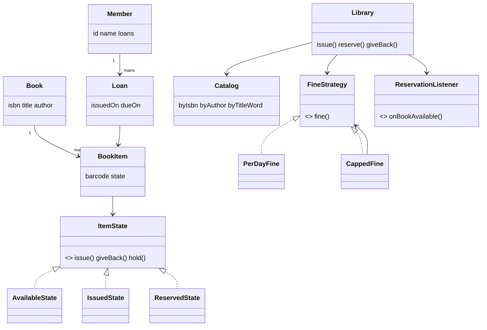

# D17 · Library management

Oct 16, 2026 · @saurav chaurasiya

**Is doc me:** Library management ka LLD (Low Level Design — classes aur unke rishte) Java me: Book vs BookItem, catalog search, issue/return limits, reservation queue, fine strategy.

**Padhne ka tareeka** — pehle Sawaal pe 15 min khud socho, phir Sahi design ka code chalake output match karo.

---

## D17 — Library management

Library management system ek aisa software hai jo kitabon ki copies, members, issue/return, reservation aur late fine ko track karta hai. LLD interview me ye isliye poocha jata hai kyunki isme chhote me hi State, Observer aur Strategy teeno patterns natural tareeke se aa jaate hain.

### Ye cheez hai kya

- Category: LLD case study (object modeling + design patterns).
- Problem: ek hi title ki kai physical copies hoti hain, har copy ki apni state hoti hai (shelf pe, issued, kisi ke liye hold). Isko clean classes me kaise todein.
- Is lesson ke baad tum kar paoge: Book vs BookItem ka fark samjhana, catalog ko maps se index karna, limit/fine/reservation rules ko extensible tareeke se likhna.
- Analogy: library ek tiffin service jaisi hai. Menu item (Book) ek hai, par dabbe (BookItem) kai hain, aur har dabba kisi ek customer ke paas hota hai.

### Sawaal

Ek college library hai: 50,000 titles, har title ki 1 se 10 copies, 5,000 members, roz \~800 issue/return. Ek member maximum 5 books rakh sakta hai, loan 14 din ka, late return pe Rs 2 per din fine. Agar saari copies issued hain to member reservation queue me lag sakta hai, aur copy wapas aate hi use notification milna chahiye. Search title ya author se 50 ms ke andar hona chahiye.

> Pehle khud socho — 15 min. Hints: (1) Book aur BookItem alag kyun? (2) Search ke liye kaunsa data structure, taaki poori list scan na ho? (3) Rules badalne pe (fine formula, limit) kya kya code chhuna padega?

### Problem kyun aata hai

- Ek title ki kai copies: "Clean Code available hai?" ka matlab hai "kam se kam ek copy free hai".
- Har copy ki state alag: ek issued, ek lost, ek kisi ke liye hold.
- Rules badalte rehte hain: student ke liye 5 books, faculty ke liye 10; fine flat ya capped.
- Reservation me fairness chahiye: pehle jisne maanga, use pehle copy mile (FIFO — first in first out).
- Return pe do kaam: fine nikalo aur agle member ko batao.

### Naive approach

- Ek hi `Book` class me `isIssued` flag, aur search me poori list pe loop.
- Breaks: 3 copies wali title me ek flag se 3 copies track nahi hoti. 50,000 titles pe har search O(n) scan hai, aur fine ka formula `if/else` me hardcoded hai.

```java
// Bura design: copy aur title ek hi class, fine hardcoded, search linear
class Book {
    String title, author;
    boolean isIssued;           // 3 copies hain to ye ek flag kaise batayega?
}
class Library {
    List<Book> books = new ArrayList<>();
    Book searchByTitle(String t) {
        for (Book b : books) if (b.title.equals(t)) return b;   // O(n)
        return null;
    }
    long fine(int daysLate) { return daysLate * 2; }            // rule badla to code badlo
}
```

### Sahi design

1. `Book` = title ki identity (isbn, title, author). `BookItem` = physical copy (barcode). Ek Book ki kai BookItem.
2. `BookItem` ki state **State pattern** se: `AvailableState`, `IssuedState`, `ReservedState`. Galat transition (jaise issued copy dobara issue) state khud reject karti hai, `if/else` nahi.
3. `Catalog` teen `HashMap` rakhta hai (isbn, author, title ka har word). Lookup O(1) hai, scan nahi.
4. `FineStrategy` interface (**Strategy pattern**): `PerDayFine` aur `CappedFine` (decorator jaisa wrapper) badal sakte ho.
5. `ReservationListener` (**Observer pattern**): return pe queue ka pehla member copy hold karke notify hota hai.
6. `Library` ke methods `synchronized` hain, taaki do members ek hi copy ek saath issue na kar saken.

Ye poora Java code hai, ek file `Demo.java` me:

```java
import java.time.LocalDate;
import java.time.temporal.ChronoUnit;
import java.util.*;

// Book = title ki "identity", BookItem = shelf pe rakhi physical copy
class Book {
    final String isbn, title, author;
    Book(String isbn, String title, String author) { this.isbn = isbn; this.title = title; this.author = author; }
    public String toString() { return title + " by " + author; }
}

class LibraryException extends RuntimeException {
    LibraryException(String m) { super(m); }
}

// State pattern: har state decide karti hai ki kaunsa action allowed hai
interface ItemState {
    String name();
    default ItemState issue(Member m, BookItem i) { throw new LibraryException("Copy " + i.barcode + " " + name() + " state me hai, issue nahi ho sakti"); }
    default ItemState giveBack(BookItem i) { throw new LibraryException("Copy " + i.barcode + " " + name() + " state me hai, return nahi ho sakti"); }
    default ItemState hold(Member m, BookItem i) { throw new LibraryException("Copy " + i.barcode + " ko hold nahi kar sakte (" + name() + ")"); }
}
class AvailableState implements ItemState {
    public String name() { return "AVAILABLE"; }
    public ItemState issue(Member m, BookItem i) { return new IssuedState(); }
    public ItemState hold(Member m, BookItem i) { return new ReservedState(m); }
}
class IssuedState implements ItemState {
    public String name() { return "ISSUED"; }
    public ItemState giveBack(BookItem i) { return new AvailableState(); }
}
class ReservedState implements ItemState {
    final Member holder;
    ReservedState(Member holder) { this.holder = holder; }
    public String name() { return "RESERVED(" + holder.name + ")"; }
    public ItemState issue(Member m, BookItem i) {
        if (m != holder) throw new LibraryException("Copy " + i.barcode + " sirf " + holder.name + " ke liye hold hai");
        return new IssuedState();
    }
}

class BookItem {
    final String barcode; final Book book;
    private ItemState state = new AvailableState();
    BookItem(String barcode, Book book) { this.barcode = barcode; this.book = book; }
    ItemState state() { return state; }
    void issue(Member m) { state = state.issue(m, this); }
    void giveBack() { state = state.giveBack(this); }
    void hold(Member m) { state = state.hold(m, this); }
}

// Observer: jab reserved copy aaye to member ko notify karo
interface ReservationListener { void onBookAvailable(Member m, Book b, BookItem copy); }

class Member {
    final String id, name; final List<Loan> loans = new ArrayList<>();
    Member(String id, String name) { this.id = id; this.name = name; }
}

class Loan {
    final BookItem item; final Member member; final LocalDate issuedOn, dueOn;
    Loan(BookItem item, Member member, LocalDate issuedOn, int days) {
        this.item = item; this.member = member; this.issuedOn = issuedOn; this.dueOn = issuedOn.plusDays(days);
    }
}

// Strategy: fine ka formula badal sako bina Library ko chhue
interface FineStrategy { long fine(long daysLate); }
class PerDayFine implements FineStrategy {
    private final long rate; PerDayFine(long rate) { this.rate = rate; }
    public long fine(long daysLate) { return daysLate * rate; }
}
class CappedFine implements FineStrategy {
    private final FineStrategy base; private final long cap;
    CappedFine(FineStrategy base, long cap) { this.base = base; this.cap = cap; }
    public long fine(long daysLate) { return Math.min(cap, base.fine(daysLate)); }
}

// Catalog: teen maps = O(1) search, poori list scan nahi
class Catalog {
    private final Map<String, Book> byIsbn = new HashMap<>();
    private final Map<String, List<Book>> byAuthor = new HashMap<>();
    private final Map<String, Set<Book>> byTitleWord = new HashMap<>();
    private final Map<String, List<BookItem>> copies = new HashMap<>();

    void addBook(Book b) {
        byIsbn.put(b.isbn, b);
        byAuthor.computeIfAbsent(b.author.toLowerCase(), k -> new ArrayList<>()).add(b);
        for (String w : b.title.toLowerCase().split("\\s+"))
            byTitleWord.computeIfAbsent(w, k -> new LinkedHashSet<>()).add(b);
    }
    BookItem addCopy(String isbn, String barcode) {
        BookItem c = new BookItem(barcode, byIsbn.get(isbn));
        copies.computeIfAbsent(isbn, k -> new ArrayList<>()).add(c);
        return c;
    }
    Collection<Book> searchTitle(String word) { return byTitleWord.getOrDefault(word.toLowerCase(), Set.of()); }
    List<Book> searchAuthor(String a) { return byAuthor.getOrDefault(a.toLowerCase(), List.of()); }
    List<BookItem> copiesOf(String isbn) { return copies.getOrDefault(isbn, List.of()); }
}

class Library {
    private final Catalog catalog = new Catalog();
    private final FineStrategy fineStrategy;
    private final ReservationListener listener;
    private final int maxLoans, loanDays;
    private final Map<String, Deque<Member>> waitQueue = new HashMap<>(); // isbn -> reservation queue

    Library(FineStrategy f, ReservationListener l, int maxLoans, int loanDays) {
        this.fineStrategy = f; this.listener = l; this.maxLoans = maxLoans; this.loanDays = loanDays;
    }
    Catalog catalog() { return catalog; }

    synchronized Loan issue(Member m, String isbn, LocalDate today) {
        if (m.loans.size() >= maxLoans)
            throw new LibraryException(m.name + " ki limit (" + maxLoans + " books) poori ho chuki hai");
        for (BookItem c : catalog.copiesOf(isbn)) {
            if (c.state() instanceof AvailableState || isHeldFor(c, m)) {
                c.issue(m);
                Loan loan = new Loan(c, m, today, loanDays);
                m.loans.add(loan);
                return loan;
            }
        }
        throw new LibraryException("Koi copy free nahi hai, reserve() use karo");
    }
    private boolean isHeldFor(BookItem c, Member m) {
        return c.state() instanceof ReservedState rs && rs.holder == m;
    }

    synchronized void reserve(Member m, String isbn) {
        waitQueue.computeIfAbsent(isbn, k -> new ArrayDeque<>()).addLast(m);
    }

    // return: fine nikalo, phir queue ka pehla member ho to copy hold karke notify karo
    synchronized long giveBack(Member m, BookItem item, LocalDate today) {
        Loan loan = m.loans.stream().filter(l -> l.item == item).findFirst()
                .orElseThrow(() -> new LibraryException("Ye copy " + m.name + " ke naam pe nahi hai"));
        item.giveBack();
        m.loans.remove(loan);
        long late = Math.max(0, ChronoUnit.DAYS.between(loan.dueOn, today));
        long fine = fineStrategy.fine(late);
        Deque<Member> q = waitQueue.get(item.book.isbn);
        if (q != null && !q.isEmpty()) {
            Member next = q.pollFirst();
            item.hold(next);
            listener.onBookAvailable(next, item.book, item);
        }
        return fine;
    }
}
```

Ye `Demo.java` ka aakhri hissa hai (upar wale code ke neeche usi file me), jisme `main` hai. Fixed `LocalDate` use hui hai, `now()` nahi:

```java
public class Demo {
    public static void main(String[] args) {
        LocalDate d0 = LocalDate.of(2026, 10, 1);
        ReservationListener sms = (m, b, c) ->
            System.out.println("[NOTIFY] " + m.name + ": '" + b.title + "' ki copy " + c.barcode + " ab aapke liye hold hai");
        Library lib = new Library(new CappedFine(new PerDayFine(2), 100), sms, 2, 14);

        Book b1 = new Book("111", "Clean Code", "Robert Martin");
        Book b2 = new Book("222", "Clean Architecture", "Robert Martin");
        Book b3 = new Book("333", "Effective Java", "Joshua Bloch");
        for (Book b : List.of(b1, b2, b3)) lib.catalog().addBook(b);
        BookItem c1 = lib.catalog().addCopy("111", "CC-1");
        lib.catalog().addCopy("222", "CA-1");
        lib.catalog().addCopy("333", "EJ-1");

        Member asha = new Member("M1", "Asha"), ravi = new Member("M2", "Ravi");

        System.out.println("Title 'clean': " + lib.catalog().searchTitle("clean"));
        System.out.println("Author 'robert martin': " + lib.catalog().searchAuthor("Robert Martin"));

        // 1) limit: 2 books ke baad teesri reject
        lib.issue(asha, "111", d0);
        lib.issue(asha, "222", d0);
        try { lib.issue(asha, "333", d0); }
        catch (LibraryException e) { System.out.println("[REJECTED] " + e.getMessage()); }

        // 2) Ravi ko Clean Code chahiye, koi copy free nahi -> reservation
        try { lib.issue(ravi, "111", d0); }
        catch (LibraryException e) { System.out.println("[REJECTED] " + e.getMessage()); }
        lib.reserve(ravi, "111");
        System.out.println("Return se pehle state: " + c1.state().name());

        // 3) Asha 10 din late (due 15 Oct, return 25 Oct) -> fine + Ravi ko notification
        LocalDate returnDate = LocalDate.of(2026, 10, 25);
        long fine = lib.giveBack(asha, c1, returnDate);
        System.out.println("Late fine: Rs " + fine + " (due " + d0.plusDays(14) + ", returned " + returnDate + ")");
        System.out.println("Return ke baad state: " + c1.state().name());

        // 4) Hold ki hui copy sirf Ravi issue kar sakta hai
        try { lib.issue(asha, "111", returnDate); }
        catch (LibraryException e) { System.out.println("[REJECTED] " + e.getMessage()); }
        lib.issue(ravi, "111", returnDate);
        System.out.println("Ravi ne issue ki, state: " + c1.state().name());
    }
}
```

Isko chalane pe bilkul ye output aata hai:

```text
Title 'clean': [Clean Code by Robert Martin, Clean Architecture by Robert Martin]
Author 'robert martin': [Clean Code by Robert Martin, Clean Architecture by Robert Martin]
[REJECTED] Asha ki limit (2 books) poori ho chuki hai
[REJECTED] Koi copy free nahi hai, reserve() use karo
Return se pehle state: ISSUED
[NOTIFY] Ravi: 'Clean Code' ki copy CC-1 ab aapke liye hold hai
Late fine: Rs 20 (due 2026-10-15, returned 2026-10-25)
Return ke baad state: RESERVED(Ravi)
[REJECTED] Koi copy free nahi hai, reserve() use karo
Ravi ne issue ki, state: ISSUED
```

Class relationships ka diagram:



Output ke hisaab se dekho: Asha ki teesri book limit pe reject hui, 10 din late return pe Rs 20 fine laga, aur return hote hi Ravi ko notification gayi aur copy `RESERVED(Ravi)` ho gayi. Patterns ke detail ke liye [Behavior Bazaar (P13–P26)](https://claude.ai/code/artifact/d1ac6852-9994-4501-9b0a-7d0f654e5c38) dekho.

### Kya choose karein aur kyun

| Option | Kab use karo | Kab mat karo |
| --- | --- | --- |
| Book + BookItem alag | Ek title ki kai copies hon (hamesha library me) | Sirf ebook, jahan copies unlimited hon |
| State pattern for copy | 3+ states aur har ke rules alag | Sirf 2 states (available / not) ho |
| Enum + switch for state | Chhota demo, states fixed | Har state ka behaviour badhta jaaye |
| Strategy for fine | Formula member type ya policy se badle | Fine kabhi na badle |
| HashMap indexes | Exact word / author search | Fuzzy search; tab inverted index (Elasticsearch) |

### India me kaise hota hai

- Indian colleges aur universities me **Koha** (open source integrated library system) bahut use hota hai; usme circulation rules (kitni books, kitne din) aur holds (reservation queue) configurable hote hain. Overview: [KOHA – Open Source Integrated Library Software (INFLIBNET)](https://ebooks.inflibnet.ac.in/lisp5/?p=185).
- Koha me circulation module ka configuration (loan period, fine rate member category ke hisaab se) yahan samjhaya gaya hai: [Configuring the circulation module (Packt)](https://subscription.packtpub.com/book/web-development/9781849510820/6/ch06/configuring-the-circulation-module).
- Wahi cheez tumhare design me `FineStrategy` aur `maxLoans` ke roop me hai: rules data/config me, code me nahi.

### Interview follow-ups

- **Book aur BookItem alag kyun?** — Title ek hai, copies kai; state copy ki hoti hai title ki nahi.
- **Do members ek saath last copy maangein to?** — `synchronized` ya per-copy lock; DB me optimistic locking (version column) ya `SELECT ... FOR UPDATE`.
- **Naya fine rule (weekend free) kaise add karein?** — Naya `FineStrategy` likho, Library ko inject karo; Library code nahi badalta (Open/Closed principle).
- **Reserved copy 2 din tak na uthayi jaaye to?** — Hold ka expiry time rakho, scheduler expire karke agle member ko do.
- **Search "clean arch" jaisa partial ho to?** — Prefix ke liye Trie ya inverted index; scale pe Elasticsearch.
- **Notification SMS, email dono chahiye?** — `ReservationListener` ke kai implementations ek list me rakho (Observer ki list).

### Self-check

1. Book aur BookItem me kya fark hai aur state kiski hoti hai?
2. State pattern ne `if/else` ki jagah kya kiya?
3. Catalog me teen maps kyun, ek list kyun nahi?
4. Return pe order kya hai: fine, state change, notify. Kyun?
5. Fine ka cap kaise lagaya bina `PerDayFine` badle?

### Notebook

Book = title, BookItem = copy · state copy ki hoti hai · Strategy se fine, State se copy lifecycle, Observer se reservation notify · search ke liye HashMap index, O(1) · reservation queue FIFO `ArrayDeque` · tarikhen hamesha inject karo (`LocalDate` parameter), `now()` hardcode mat karo taaki test ho sake.

### Padhne ke liye

- [Low-Level Design: Library Management System (OOP Interview)](https://techinterview.org/low-level-design-library-management-system/)
- [Library Management System — Catalog, Borrowing, Reservations, and Fines](https://techinterview.org/lld-library-system/)
- [Design a library management system (Coding Shuttle)](https://www.codingshuttle.com/low-level-system-design-lld-handbook/design-a-library-management-system)

### Deep Dive (SDE-2) — jab time ho

#### Concurrency aur DB

- `synchronized` ek JVM me kaam karta hai; multi-server me DB row lock ya unique constraint (copy\_id, status) chahiye.
- Issue ko ek transaction banao: copy status update + loan insert saath me.

#### Reservation edge cases

- Hold expiry, member ka multiple reservations ek hi title pe, aur cancel karne pe queue se nikalna.
- Fairness: ek member ka limit poora ho to hold skip karein ya rukein, policy decide karo.

#### Search at scale

- Title word index = chhota inverted index. Bade catalog pe Elasticsearch, typo tolerance aur ranking ke saath.
- Index ko write pe update karo (book add hone pe), read pe nahi.

---

## Aage kya

- Pichhla: [D16 · Food delivery](https://claude.ai/code/artifact/cd1fbbdc-bb85-4bb6-a1d0-821491e4730d)
- Agla: [D18 · Inventory management](https://claude.ai/code/artifact/b276a0ff-2084-4ccd-97c8-7a1d340b1f51)
- Related: [Behavior Bazaar (P13–P26)](https://claude.ai/code/artifact/d1ac6852-9994-4501-9b0a-7d0f654e5c38), [SOLID Temple (S1–S5)](https://claude.ai/code/artifact/f98bb328-8939-4ef4-a9a6-24c5ce970199)
