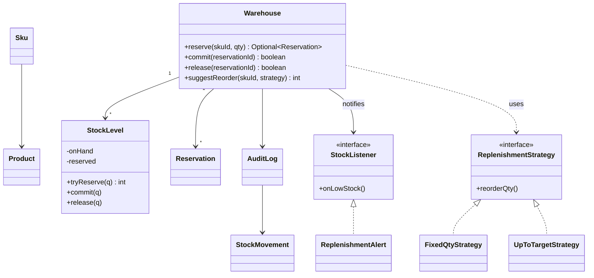

# D18 · Inventory management

Oct 16, 2026 · @saurav chaurasiya

**Is doc me:** Blinkit-style dark store ka inventory system Java me: reserve, commit, release flow, oversell-proof stock decrement, low-stock Observer, replenishment Strategy aur audit log.

**Padhne ka tareeka** — pehle Sawaal pe 15 min khud socho, phir Naive approach ka bug samjho, phir 4 code blocks ko ek file `Demo.java` me jod ke run karo.

---

## D18 — Inventory management

Inventory management system batata hai ki kisi warehouse ya dark store (chhota local warehouse jo sirf 2-3 km ke orders deliver karta hai) me kis SKU ke kitne units hain, kitne orders ke liye roke hue hain, aur kitne bech sakte hain. Iska main kaam hai ki ek bhi unit do customers ko na bik jaye (overselling) aur har stock movement ka hisaab rahe.

### Ye cheez hai kya

- Category: LLD case study, concurrency-heavy domain model (state + locking + Observer + Strategy).
- Problem: Blinkit/Zepto jaise app me ek hi doodh ke packet ke liye kai log ek saath order karte hain; stock galat gina to customer ko "order cancelled" milta hai.
- Is lesson ke baad tum kar paoge: reserve → commit → release flow design karna, check-then-act race fix karna, low-stock alert (Observer) aur reorder rule (Strategy) plug karna, aur audit log rakhna.
- Analogy: cinema ki ticket window. Pehle seat "hold" hoti hai (reserve), payment ke baad ticket ban jata hai (commit), payment fail ho to seat wapas khul jati hai (release).

Kuch terms jo aage aayenge:

- **SKU (stock keeping unit — ek bikne wali exact cheez, jaise "Amul Taaza 1L pack")**: Product ek idea hai (Amul Milk), SKU uska specific pack hai (1L aur 500ml alag SKU).
- **On-hand** — shelf pe physically padi quantity.
- **Reserved** — on-hand me se jo orders ke liye roki hui hai par abhi dispatch nahi hui.
- **Available** — `on-hand - reserved`; yahi bechne ke liye safe number hai.
- **Race condition (do threads ek saath same data padh ke galat result banate hain)** — overselling ki jad yahi hai.
- **Critical section (code ka woh hissa jise ek time pe sirf ek thread chala sakta hai)** — lock isi ko banata hai.

### Sawaal

Tum Blinkit ke ek dark store (Gurgaon Sector 12) ka inventory service design kar rahe ho. Store me \~4,000 SKUs hain, aur shaam 7-9 baje peak me \~800 orders per minute aate hain (lagbhag 13 orders per second), har order me 4-5 SKUs. Ek popular SKU (doodh, anda, Maggi) pe ek second me 40-50 threads ek saath stock check kar sakte hain.

Requirements:

- Stock kabhi negative nahi hona chahiye, aur reserved kabhi on-hand se zyada nahi.
- Order place hote hi stock reserve ho; payment success pe commit, failure ya timeout pe release.
- Available stock threshold se neeche gira to ops team ko alert jaye.
- Har movement (receive, reserve, commit, release) ka audit log ho.
- Reorder quantity ka rule badalna aasan ho (fixed qty, ya target level tak).

> Pehle khud socho — 15 min. Hints: (1) Reserve aur commit alag steps kyun hain, seedha decrement kyun nahi? (2) "available >= qty check" aur "reserved += qty" ke beech koi dusra thread aa jaye to kya hoga? (3) Alert har reserve pe jaye ya sirf threshold cross hone pe?

### Problem kyun aata hai

- Order place hone aur payment complete hone ke beech 30-90 second ka gap hota hai; us beech stock kisi aur ko nahi bechna.
- Payment fail hoti hai ya user app band kar deta hai; roka hua stock wapas nahi aaya to app "out of stock" dikhata rahega jabki shelf pe maal hai.
- Concurrent requests me check-then-act race hota hai, to total reserved on-hand se zyada ho jata hai (oversell).
- Warehouse me maal physically kam ya zyada nikalta hai (damage, expiry); bina audit log ke pata nahi chalta kab aur kyun.
- Low-stock alert inventory ka kaam nahi hai; SMS, purchase order, dashboard alag modules hain, unhe loosely coupled rakhna padta hai.

### Naive approach

- Ek `int quantity` field, order aaya to check karo aur seedha ghata do.
- Bug 1: check aur decrement alag steps hain, to race hota hai. Stock 50 ho aur 40 threads 3-3 maangein, to 16 se zyada orders pass ho sakte hain aur quantity negative ja sakti hai.
- Bug 2: payment fail hone pe stock wapas karne ka koi tareeka nahi, ya wapas karte waqt double-add ho jata hai.
- Bug 3: alert har decrement pe fire hota hai, to 10 se neeche jaate hi har order pe ek alert jata hai.

```java
// Naive: check aur update ke beech gap hai, isliye oversell hota hai
class NaiveStock {
    int quantity = 50;
    boolean order(int q) {
        if (quantity >= q) {      // thread A aur B dono yahan pass ho sakte hain
            quantity -= q;        // dono ghatate hain, stock negative ja sakta hai
            return true;
        }
        return false;
    }
}
```

### Sahi design

1. **Entities:** `Product` (idea), `Sku` (bikne wali exact pack), `Warehouse` (dark store), `StockLevel` (ek warehouse + SKU ka on-hand aur reserved), `Reservation` (ek order ka hold).
2. **Reserve → commit → release:** reserve sirf `reserved` badhata hai. Commit `reserved` aur `on-hand` dono ghatata hai (maal nikal gaya). Release sirf `reserved` ghatata hai (maal shelf pe hi hai).
3. **Thread safety:** har `StockLevel` ka apna lock (`synchronized`), to alag SKUs ek dusre ko block nahi karte. Check aur update ek hi critical section me hote hain. Ye [Part 3 · Thread Jungle](https://claude.ai/code/artifact/05d7fa44-518a-49fd-a70c-40ac902f184f) ke locks ka seedha use hai.
4. **Idempotent commit/release (idempotent — same call do baar chalao to bhi asar ek hi baar):** `open.remove(reservationId)` atomic hai, to double commit ya double release se stock do baar nahi ghatta.
5. **Observer pattern:** `Warehouse` listeners ko bulata hai jab available threshold cross karta hai. Inventory ko pata nahi ki alert SMS jata hai ya Slack.
6. **Strategy pattern:** `ReplenishmentStrategy` interface; `FixedQtyStrategy` aur `UpToTargetStrategy` alag rules hain, runtime pe badal sakte ho.
7. **Audit log:** har movement ek immutable `StockMovement` record, global sequence number ke saath.

Neeche ka code ek hi file `Demo.java` hai, 4 hisson me tora hua. Pehla hissa: imports, domain types, Observer aur Strategy.

```java
import java.util.*;
import java.util.concurrent.*;
import java.util.concurrent.atomic.*;

// ---------- Domain ----------
enum MovementType { RECEIVE, RESERVE, COMMIT, RELEASE }

record Product(String productId, String name) {}
record Sku(String skuId, Product product, int packSizeGrams) {}

// Audit log ki ek entry - immutable
record StockMovement(long seq, String warehouseId, String skuId, MovementType type, int qty, String ref) {
    @Override public String toString() {
        return "#" + seq + " " + type + " " + skuId + " x" + qty + " ref=" + ref;
    }
}

// ---------- Observer ----------
interface StockListener { void onLowStock(String warehouseId, String skuId, int available, int threshold); }

class ReplenishmentAlert implements StockListener {
    final List<String> alerts = new CopyOnWriteArrayList<>();
    public void onLowStock(String wh, String sku, int available, int threshold) {
        alerts.add("LOW STOCK " + wh + "/" + sku + " available=" + available + " threshold=" + threshold);
    }
}

// ---------- Strategy: kitna reorder karna hai ----------
interface ReplenishmentStrategy { int reorderQty(int available, int threshold); }

class FixedQtyStrategy implements ReplenishmentStrategy {
    private final int qty;
    FixedQtyStrategy(int qty) { this.qty = qty; }
    public int reorderQty(int available, int threshold) { return qty; }
}
class UpToTargetStrategy implements ReplenishmentStrategy {
    private final int target;
    UpToTargetStrategy(int target) { this.target = target; }
    public int reorderQty(int available, int threshold) { return Math.max(0, target - available); }
}
```

Doosra hissa: audit log aur thread-safe `StockLevel`. `tryReserve` me check, update aur bacha hua available teeno ek lock ke andar hain.

```java
// ---------- Audit log ----------
class AuditLog {
    private final List<StockMovement> entries = new CopyOnWriteArrayList<>();
    private final AtomicLong seq = new AtomicLong();
    void record(String wh, String sku, MovementType t, int qty, String ref) {
        entries.add(new StockMovement(seq.incrementAndGet(), wh, sku, t, qty, ref));
    }
    List<StockMovement> all() { return entries; }
    long count(MovementType t) { return entries.stream().filter(e -> e.type() == t).count(); }
}

// ---------- Stock level: per (warehouse, sku) ek lock ----------
class StockLevel {
    private int onHand;      // shelf pe physically
    private int reserved;    // orders ke liye roka hua
    StockLevel(int onHand) { this.onHand = onHand; }

    synchronized int available() { return onHand - reserved; }
    synchronized int onHand() { return onHand; }
    synchronized int reserved() { return reserved; }
    synchronized void receive(int q) { onHand += q; }

    // check + update ek hi critical section me - yahi overselling rokta hai
    // success pe reserve ke BAAD ka available return karta hai, fail pe -1
    synchronized int tryReserve(int q) {
        if (onHand - reserved < q) return -1;
        reserved += q;
        return onHand - reserved;
    }
    synchronized void commit(int q) { reserved -= q; onHand -= q; }   // packed/dispatched
    synchronized void release(int q) { reserved -= q; }               // cancel/timeout
}

class Reservation {
    final String id, skuId; final int qty;
    Reservation(String id, String skuId, int qty) { this.id = id; this.skuId = skuId; this.qty = qty; }
}
```

Teesra hissa: `Warehouse` jo reserve, commit, release, alert aur reorder suggestion ko jodta hai. Alert tab jaata hai jab available threshold ke upar se neeche cross kare.

```java
// ---------- Warehouse (dark store) ----------
class Warehouse {
    final String id;
    private final Map<String, StockLevel> levels = new ConcurrentHashMap<>();
    private final Map<String, Integer> thresholds = new ConcurrentHashMap<>();
    private final Map<String, Reservation> open = new ConcurrentHashMap<>();
    private final List<StockListener> listeners = new CopyOnWriteArrayList<>();
    private final AuditLog audit;
    private final AtomicLong resSeq = new AtomicLong();

    Warehouse(String id, AuditLog audit) { this.id = id; this.audit = audit; }

    void addListener(StockListener l) { listeners.add(l); }

    void receive(Sku sku, int qty, int lowThreshold) {
        levels.computeIfAbsent(sku.skuId(), k -> new StockLevel(0)).receive(qty);
        thresholds.put(sku.skuId(), lowThreshold);
        audit.record(id, sku.skuId(), MovementType.RECEIVE, qty, "GRN");
    }

    // Reserve: fail hua to Optional.empty - exception se flow nahi chalate
    Optional<Reservation> reserve(String skuId, int qty) {
        StockLevel lv = levels.get(skuId);
        if (lv == null) return Optional.empty();
        int after = lv.tryReserve(qty);   // check + update + remaining ek atomic step me
        if (after < 0) return Optional.empty();
        Reservation r = new Reservation("R" + resSeq.incrementAndGet(), skuId, qty);
        open.put(r.id, r);
        audit.record(id, skuId, MovementType.RESERVE, qty, r.id);
        int th = thresholds.getOrDefault(skuId, 0);
        int before = after + qty;
        // sirf threshold cross hone pe alert - har reserve pe nahi
        if (before > th && after <= th) {
            for (StockListener l : listeners) l.onLowStock(id, skuId, after, th);
        }
        return Optional.of(r);
    }

    boolean commit(String reservationId) {
        Reservation r = open.remove(reservationId);   // remove atomic hai, double commit nahi hoga
        if (r == null) return false;
        levels.get(r.skuId).commit(r.qty);
        audit.record(id, r.skuId, MovementType.COMMIT, r.qty, r.id);
        return true;
    }

    boolean release(String reservationId) {
        Reservation r = open.remove(reservationId);
        if (r == null) return false;
        levels.get(r.skuId).release(r.qty);
        audit.record(id, r.skuId, MovementType.RELEASE, r.qty, r.id);
        return true;
    }

    int suggestReorder(String skuId, ReplenishmentStrategy s) {
        return s.reorderQty(levels.get(skuId).available(), thresholds.getOrDefault(skuId, 0));
    }
    StockLevel level(String skuId) { return levels.get(skuId); }
}
```

Chautha hissa: demo. 40 threads ek `CountDownLatch` pe ruk ke ek saath chhootte hain, har ek 3 packet maangta hai, stock 50 hai. Ginti deterministic hai: `50 / 3 = 16` (floor), kyunki lock ki wajah se threads ke kisi bhi interleaving me exactly 16 reserve fit hote hain.

```java
public class Demo {
    public static void main(String[] args) throws Exception {
        AuditLog audit = new AuditLog();
        Warehouse wh = new Warehouse("DS-Gurgaon-12", audit);
        ReplenishmentAlert alert = new ReplenishmentAlert();
        wh.addListener(alert);

        Sku milk = new Sku("MILK-1L", new Product("P1", "Amul Taaza Milk"), 1000);
        wh.receive(milk, 50, 10);   // 50 packet, low-stock threshold 10

        // 40 threads, har ek 3 packet maangta hai = 120 demand, stock sirf 50
        int threads = 40, perOrder = 3;
        ExecutorService pool = Executors.newFixedThreadPool(threads);
        CountDownLatch ready = new CountDownLatch(threads), go = new CountDownLatch(1);
        AtomicInteger ok = new AtomicInteger(), fail = new AtomicInteger();
        List<Reservation> won = new CopyOnWriteArrayList<>();
        for (int i = 0; i < threads; i++) {
            pool.submit(() -> {
                ready.countDown();
                try { go.await(); } catch (InterruptedException e) { return; }
                Optional<Reservation> r = wh.reserve("MILK-1L", perOrder);
                if (r.isPresent()) { ok.incrementAndGet(); won.add(r.get()); } else fail.incrementAndGet();
            });
        }
        ready.await(); go.countDown();
        pool.shutdown(); pool.awaitTermination(10, TimeUnit.SECONDS);

        StockLevel lv = wh.level("MILK-1L");
        System.out.println("Stock 50, " + threads + " threads x " + perOrder + " packet");
        System.out.println("Reserve success = " + ok.get() + ", fail = " + fail.get());
        System.out.println("onHand=" + lv.onHand() + " reserved=" + lv.reserved() + " available=" + lv.available());
        System.out.println(alert.alerts.size() + " alert(s): " + alert.alerts);

        // 10 reservations commit (dispatch), 6 release (cancel)
        for (int i = 0; i < 10; i++) wh.commit(won.get(i).id);
        for (int i = 10; i < 16; i++) wh.release(won.get(i).id);
        System.out.println("Double commit allowed? " + wh.commit(won.get(0).id));
        System.out.println("After commit/release: onHand=" + lv.onHand() + " reserved=" + lv.reserved() + " available=" + lv.available());

        System.out.println("Reorder (fixed 30)      = " + wh.suggestReorder("MILK-1L", new FixedQtyStrategy(30)));
        System.out.println("Reorder (upto target 60) = " + wh.suggestReorder("MILK-1L", new UpToTargetStrategy(60)));

        System.out.println("Audit: RECEIVE=" + audit.count(MovementType.RECEIVE) + " RESERVE=" + audit.count(MovementType.RESERVE)
            + " COMMIT=" + audit.count(MovementType.COMMIT) + " RELEASE=" + audit.count(MovementType.RELEASE));
        System.out.println("Audit pehli entry: " + audit.all().get(0));
    }
}
```

Isko chalane pe bilkul ye output aata hai:

```text
Stock 50, 40 threads x 3 packet
Reserve success = 16, fail = 24
onHand=50 reserved=48 available=2
1 alert(s): [LOW STOCK DS-Gurgaon-12/MILK-1L available=8 threshold=10]
Double commit allowed? false
After commit/release: onHand=20 reserved=0 available=20
Reorder (fixed 30)      = 30
Reorder (upto target 60) = 40
Audit: RECEIVE=1 RESERVE=16 COMMIT=10 RELEASE=6
Audit pehli entry: #1 RECEIVE MILK-1L x50 ref=GRN
```

Output ka matlab:

- 16 success x 3 = 48 reserved, 24 fail; 2 packet bache par kisi ek order ko (3 chahiye) nahi mil sakte. Oversell zero.
- Alert exactly 1 baar aaya, 14th reserve pe jab available 11 se 8 hua (threshold 10 cross). Baaki reserves pe dobara nahi aaya.
- 10 commit (30 packet nikle) se on-hand 50 se 20 hua, 6 release (18 packet) se reserved 0 hua, available 20. Dobara commit `false` mila (idempotent).
- Reorder: fixed rule 30 deta hai, target-60 rule `60 - 20 = 40` deta hai. Same warehouse, alag Strategy.
- Audit me 1 + 16 + 10 + 6 = 33 entries.



### Kya choose karein aur kyun

| Option | Kab use karo | Kab mat karo |
| --- | --- | --- |
| `synchronized` per StockLevel | Single JVM, simple, correctness pehle (ye demo) | Multiple app servers, kyunki lock sirf ek JVM ke andar hai |
| `AtomicInteger` + CAS (compare-and-set — value tabhi badlo jab abhi bhi wahi ho jo padhi thi) loop | Ek hi counter ho aur contention kam ho | Jab on-hand aur reserved dono saath badalne hon (do fields ek saath atomic nahi) |
| DB row lock (`SELECT ... FOR UPDATE`) | Multi-server, durable stock, thoda slow chalega | Flash sale jaisi extreme hot SKU contention, wahan row queue ban jati hai |
| Conditional update (`UPDATE ... SET reserved = reserved + ? WHERE on_hand - reserved >= ?`) | Multi-server, ek query me check+update, no explicit lock | Complex multi-SKU rules jo ek query me nahi aate |
| Redis Lua script ya atomic DECRBY | Bahut high QPS (queries per second) hot SKU, fast path | Source of truth ke roop me akela; Redis restart pe durability ka sawaal |

### India me kaise hota hai

- Blinkit ke dark stores ka kaam: kuch minute ki delivery ke liye har store ka apna local inventory hota hai aur app sirf wahi dikhata hai jo us store me available hai. Overview ke liye [Q6 · Swiggy / Blinkit](https://claude.ai/code/artifact/c2b42992-bec2-42ee-a468-476a1f8a3173) dekho.
- Reserve → commit → release ka pattern e-commerce me standard hai; Amazon-style systems me reservation ko TTL (time to live — itne time baad apne aap expire) ke saath rakha jata hai taaki payment fail hone pe stock khud wapas aa jaye. Reference: [Design Amazon's Inventory System at 1M Reservations/sec](https://raunakbaliyan.substack.com/p/design-amazons-product-inventory).
- Flash sale (Big Billion Days jaisi) me hot SKU ko Redis counter ya queue se pehle filter karte hain, phir DB me final commit hota hai. Reference: [Design a Flash Sale System That Never Oversells Stock](https://www.matthewswong.com/en/blog/design-flash-sale-inventory-system/).
- Payment fail ho to release ek compensating transaction (pichle kaam ko undo karne wala naya kaam) hai. Ye [D16 · Food delivery](https://claude.ai/code/artifact/cd1fbbdc-bb85-4bb6-a1d0-821491e4730d) ke order flow se jud'ta hai.

### Interview follow-ups

- **Multiple servers ho to?** — JVM lock kaam nahi karega. DB conditional update ya row lock use karo, ya SKU ko warehouse ke hisaab se shard karke ek owner service rakho. Dekho [2D · Lock Fort](https://claude.ai/code/artifact/97588686-7110-4318-8124-3a8727c7604e).
- **Reservation expire kaise ho?** — `expiresAt` field rakho aur ek scheduled sweeper expire hui reservations pe `release` chalaye. Release idempotent hai to sweeper aur payment-failure callback dono safe hain.
- **Ek order me 5 SKUs hon aur 4th fail ho jaye?** — Pehle 3 reservations release karo (compensation). Deadlock se bachne ke liye SKUs ko hamesha sorted order me lock karo.
- **Alert baar baar na aaye, iska tareeka?** — Sirf threshold cross hone par fire karo (upar se neeche). Restock ke baad threshold ke upar jaane par flag reset ho jata hai.
- **Physical count aur system count alag nikle (cycle count)?** — Ek `ADJUST` movement type add karo jo difference audit log me likhe; seedha quantity overwrite mat karo.
- **Hot SKU pe lock contention kaise ghataein?** — Stock ko N buckets me baanto (jaise 4 buckets me 12-12-13-13) aur random bucket se reserve karo; ya Redis atomic counter fast path rakho.

### Self-check

1. Reserve aur commit alag kyun hain, aur release kya badalta hai?
2. Naive code me oversell exactly kahan hota hai?
3. `tryReserve` check aur update ek saath kyun karta hai, aur alert ke liye "after" value wahin se kyun return hoti hai?
4. Observer aur Strategy is design me kahan lage hain?
5. Double commit se stock do baar kyun nahi ghatta?

### Notebook

SKU = Product ka specific pack · available = onHand - reserved · reserve badhata hai reserved, commit ghatata hai dono, release sirf reserved · check+update ek critical section me · alert sirf threshold cross pe · commit/release `remove` se idempotent · har movement audit log me immutable entry

### Padhne ke liye

- [Design an Inventory Management System (LLD handbook)](https://www.codingshuttle.com/low-level-system-design-lld-handbook/design-an-inventory-management-system/)
- [Design Inventory Management System: Step-by-Step Guide](https://www.systemdesignhandbook.com/guides/design-inventory-management-system/)
- [Design Amazon's Inventory System at 1M Reservations/sec](https://raunakbaliyan.substack.com/p/design-amazons-product-inventory)
- [Design a Flash Sale System That Never Oversells Stock](https://www.matthewswong.com/en/blog/design-flash-sale-inventory-system/)

### Deep Dive (SDE-2) — jab time ho

#### Multi-server correctness

- DB me `stock(warehouse_id, sku_id, on_hand, reserved, version)` rakho aur reserve ek conditional `UPDATE` se karo; affected rows 0 aaye to fail.
- Optimistic locking (version check karke update, conflict pe retry) kam contention me achha hai; pessimistic (row lock) high contention me.
- Reservation table alag rakho: `(reservation_id, sku, qty, status, expires_at)`; status ek state machine hai RESERVED, COMMITTED, RELEASED.

#### Event-sourced stock

- Current quantity ko source of truth na maan ke movements ka sum maano: `on_hand = sum(RECEIVE) - sum(COMMIT) + ADJUST`.
- Fayda: poora audit, replay, aur bug mile to rebuild. Nuksan: read ke liye snapshot/cache chahiye.
- Audit log append-only rakho, kabhi update ya delete nahi.

#### Reservation TTL aur sweeper

- Har reservation pe `expiresAt = now + 10 min`; sweeper (background job) expire hue holds ko release karta hai.
- Race: payment success callback aur sweeper ek saath aaye to status transition conditional ho (`RESERVED -> COMMITTED` ya `RESERVED -> RELEASED`, jo pehle jeete).

#### Replenishment ko smart banana

- Reorder point = (daily demand x lead time) + safety stock. Strategy interface me forecast-based implementation bhi plug ho sakti hai.
- Perishable SKUs (doodh, dahi) ke liye batch aur expiry date track karo, aur FEFO (first expired, first out) se pick karo.

---

## Aage kya

- Pichhla: [D17 · Library management](https://claude.ai/code/artifact/71d828d9-5e63-424c-b3ae-a9bf10d2bd9e)
- Agla: [D19 · Pub-sub / message queue](https://claude.ai/code/artifact/913ace55-1518-4d5a-b643-6e65ee54c434)
- Related: [Part 3 · Thread Jungle](https://claude.ai/code/artifact/05d7fa44-518a-49fd-a70c-40ac902f184f), [2D · Lock Fort](https://claude.ai/code/artifact/97588686-7110-4318-8124-3a8727c7604e), [Q6 · Swiggy / Blinkit](https://claude.ai/code/artifact/c2b42992-bec2-42ee-a468-476a1f8a3173)
