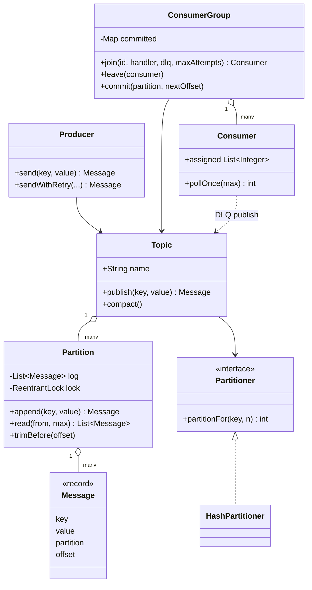

# D19 · Pub-sub / message queue

Oct 16, 2026 · @saurav chaurasiya

**Is doc me:** ek in-memory "Kafka-lite" ka LLD (Low Level Design — classes aur code level ka design): Topic, partitions, producer, consumer group, offsets, ack, retry, DLQ aur backpressure, poora runnable Java me.

**Padhne ka tareeka** — pehle Sawaal pe khud 15 min socho, phir Naive approach ka bug dekho, phir Sahi design ka code chala ke output apne se match karo.

---

## D19 — Pub-sub / message queue

Pub-sub (publish-subscribe — ek bhejne wala, kai sunne wale) message queue ek aisa component hai jahan producer message likhta hai aur consumer baad me, apni speed se, padhta hai. Beech me ek broker hota hai jo messages ko order me store karta hai. Is lesson me hum Kafka ka chhota version khud banayenge.

### Ye cheez hai kya

- Category: LLD case study, concurrency-heavy (locks, bounded buffer, thread-safe append)
- Problem: producer aur consumer ki speed alag hoti hai; seedha call karo to ek slow hone pe dusra bhi atak jata hai. Beech me durable (data kho na jaye) log chahiye
- Is lesson ke baad tum kar paoge: Topic/Partition/ConsumerGroup ke classes design karna, key-based partitioning se ordering samjhana, at-least-once delivery with ack/retry/DLQ likhna, aur bounded queue se backpressure dikhana
- Analogy: society ka notice board plus register. Guard (producer) notice register me ek ke baad ek likhta hai (append-only). Har flat wala (consumer group) apna bookmark rakhta hai ki kahan tak padha (offset). Register ke pages limited hain, bhar gaye to naya notice rukega (backpressure)

### Sawaal

Swiggy ke order events (order\_created, paid, picked\_up, delivered) ek topic `orders` me aate hain. Peak pe 50,000 events/sec (QPS — queries per second), har event \~1 KB, aur teen alag consumers hain: billing, notification, analytics. Ek hi order ke events ka order nahi bigadna chahiye (paid se pehle delivered nahi), kisi bhi consumer ka crash hone pe event khona nahi chahiye, aur ek kharab (poison) event poori line ko rok na de. Is-ka in-memory broker design karo jo yeh sab guarantees de.

> Pehle khud socho — 15 min. Hints: (1) ordering poore topic me nahi, sirf ek partition (topic ka ek hissa, ek alag append-only log) me possible hai, to key se partition choose karo (2) offset (log me message ka position number) consumer group ke paas rakho, message ke paas nahi (3) ack ke baad hi offset commit karo, aur baar-baar fail hone wale message ko DLQ (Dead Letter Queue — kharab messages ka alag parking lot) me bhejo

### Problem kyun aata hai

- Producer aur consumer ki speed alag: producer 50k/sec, consumer 5k/sec ho sakta hai. Bina buffer ke ya to data jata hai ya producer atakta hai
- Ordering vs parallelism ka tradeoff: ek log = ordering milti hai par throughput (ek second me kitna kaam) kam; kai logs = throughput badhta hai par global order jata hai
- Consumer crash hoga: kahan se dobara padhna hai, ye yaad rakhna padega
- Poison message: ek aisa message jo kabhi process nahi hoga, wo agar retry hota raha to uske peeche ke sab messages atak jayenge (head-of-line blocking)
- Concurrent producers: do threads ek saath append karein to same offset ya gap ban sakta hai
- Unbounded queue = memory khatam = OOM (OutOfMemoryError). Limit chahiye, aur limit hit hone pe producer ko pata chalna chahiye (backpressure — peeche wale ko bolna "ruk, main bhar gaya")

### Naive approach

- Ek `LinkedBlockingQueue` me sab messages, consumers `take()` karte hain
- Kahan tootta hai:
  - `take()` karte hi message queue se gayi. Consumer crash hua to message permanently gaya (at-most-once, ya sahi bolein to loss)
  - Ek queue me 2 consumers = ek hi order ke events alag threads me, order bigad jata hai
  - Replay nahi: analytics group ko wohi message chahiye jo billing ko mila, par queue se message nikalte hi gayab
  - Unbounded ho to 50k/sec x 1 KB = 50 MB/sec; consumer 10x slow ho to ek ghante me \~160 GB jama, OOM

```java
// Naive: ek shared queue, take karte hi message gayab
class NaiveBroker {
    private final Queue<String> q = new ConcurrentLinkedQueue<>(); // unbounded
    void publish(String msg) { q.add(msg); }          // koi limit nahi
    String consume() { return q.poll(); }             // crash hua to msg gaya
}
// Problem: no ack, no offset, no ordering per key, no DLQ, no backpressure
```

### Sahi design

1. **Topic** = kai **Partition** ka collection. Partition = ek bounded append-only log, ReentrantLock se protected, jahan lock ke andar hi offset assign hota hai (isse gap/duplicate offset nahi banta)
2. **Producer** message bhejta hai; **Partitioner** (Strategy pattern — algorithm ko interface ke peeche rakho taaki badal sako) `hash(key) % N` se partition chunta hai. Same key = same partition = same order
3. **ConsumerGroup** apne committed offset per partition rakhta hai. Group ke andar ek partition ek time pe sirf ek consumer ko milta hai; alag groups independent hain (pub-sub fan-out)
4. **Rebalance** (members badalne pe partitions dobara baantna): member join/leave pe round-robin assignment dobara
5. **At-least-once**: pehle handler chalao, phir offset commit (ack). Beech me crash hua to message dobara aayega, isliye handler idempotent (baar-baar chalane pe same result) hona chahiye
6. **Retry + DLQ**: handler fail hua to `maxAttempts` tak retry; sab fail to message DLQ topic me, offset commit, taaki line aage badhe
7. **Backpressure**: partition full ho to `BackpressureException`; producer retry/slow-down kare. `compact()` sab groups ka minimum committed offset dekh ke purana data hatata hai
8. Patterns: **Strategy** (Partitioner), **Observer-jaisa pull model** (consumer khud poll karta hai, broker push nahi karta), **Producer-Consumer** with bounded buffer

Ye poora code ek `Demo.java` file hai; isko chalane ka tareeka: `javac Demo.java && java Demo`.

```java
import java.util.*;
import java.util.concurrent.*;
import java.util.concurrent.atomic.AtomicInteger;
import java.util.concurrent.locks.ReentrantLock;
import java.util.function.Function;

public class Demo {

    // Ek record: partition + offset broker lagata hai, producer nahi
    record Message(String key, String value, int partition, long offset) {
        @Override public String toString() { return key + ":" + value + "@p" + partition + "/o" + offset; }
    }

    // Queue full ho to producer ko ye exception milta hai (backpressure signal)
    static class BackpressureException extends RuntimeException {
        BackpressureException(String m) { super(m); }
    }

    // Strategy pattern: key se partition kaise chunna - badla ja sakta hai
    interface Partitioner { int partitionFor(String key, int numPartitions); }

    static class HashPartitioner implements Partitioner {
        private final AtomicInteger rr = new AtomicInteger();
        public int partitionFor(String key, int n) {
            if (key == null) return Math.floorMod(rr.getAndIncrement(), n); // key nahi to round-robin
            return Math.floorMod(key.hashCode(), n);                        // same key -> same partition
        }
    }

    // Append-only log. Lock ke andar offset assign + add = koi gap/duplicate offset nahi
    static class Partition {
        private final int id, capacity;
        private final List<Message> log = new ArrayList<>();
        private long baseOffset = 0;                  // trim ke baad pehla bacha hua offset
        private final ReentrantLock lock = new ReentrantLock();
        Partition(int id, int capacity) { this.id = id; this.capacity = capacity; }

        Message append(String key, String value) {
            lock.lock();
            try {
                if (log.size() >= capacity)
                    throw new BackpressureException("partition " + id + " full (cap=" + capacity + ")");
                Message m = new Message(key, value, id, baseOffset + log.size());
                log.add(m);
                return m;
            } finally { lock.unlock(); }
        }
        List<Message> read(long from, int max) {
            lock.lock();
            try {
                int start = (int) Math.max(0, from - baseOffset);
                return new ArrayList<>(log.subList(Math.min(start, log.size()), Math.min(log.size(), start + max)));
            } finally { lock.unlock(); }
        }
        void trimBefore(long offset) {                  // sab groups ne consume kar liya, jagah khali karo
            lock.lock();
            try {
                int drop = (int) Math.max(0, Math.min(offset - baseOffset, log.size()));
                log.subList(0, drop).clear();
                baseOffset += drop;
            } finally { lock.unlock(); }
        }
        long endOffset() { lock.lock(); try { return baseOffset + log.size(); } finally { lock.unlock(); } }
        int size() { lock.lock(); try { return log.size(); } finally { lock.unlock(); } }
    }

    static class Topic {
        final String name;
        final List<Partition> partitions = new ArrayList<>();
        private final Partitioner partitioner;
        private final List<ConsumerGroup> groups = new ArrayList<>();
        Topic(String name, int numPartitions, int capacityPerPartition, Partitioner p) {
            this.name = name; this.partitioner = p;
            for (int i = 0; i < numPartitions; i++) partitions.add(new Partition(i, capacityPerPartition));
        }
        Message publish(String key, String value) {
            return partitions.get(partitioner.partitionFor(key, partitions.size())).append(key, value);
        }
        void register(ConsumerGroup g) { groups.add(g); }
        // Sabse peeche wala group jahan tak pahuncha, usse pehle ka data hata do
        void compact() {
            for (Partition p : partitions) {
                long min = Long.MAX_VALUE;
                for (ConsumerGroup g : groups) min = Math.min(min, g.committed(p.id));
                if (!groups.isEmpty()) p.trimBefore(min);
            }
        }
    }

    static class Producer {
        private final Topic topic;
        Producer(Topic t) { this.topic = t; }
        Message send(String key, String value) { return topic.publish(key, value); }
        // Backpressure: full ho to thoda ruk kar retry (bounded), phir fail
        Message sendWithRetry(String key, String value, int tries, Runnable onFull) {
            for (int i = 1; ; i++) {
                try { return topic.publish(key, value); }
                catch (BackpressureException e) { if (i == tries) throw e; onFull.run(); }
            }
        }
    }

    // Consumer group: topic ke partitions members me baante hain, offsets group ke paas hote hain
    static class ConsumerGroup {
        final String name; final Topic topic;
        private final Map<Integer, Long> committed = new ConcurrentHashMap<>();
        Map<Integer, Long> committedView() { return committed; }
        private final List<Consumer> members = new ArrayList<>();
        ConsumerGroup(String name, Topic topic) {
            this.name = name; this.topic = topic;
            for (Partition p : topic.partitions) committed.put(p.id, 0L);
            topic.register(this);
        }
        synchronized Consumer join(String id, Function<Message, Void> handler, Topic dlq, int maxAttempts) {
            Consumer c = new Consumer(id, this, handler, dlq, maxAttempts);
            members.add(c);
            rebalance();
            return c;
        }
        synchronized void leave(Consumer c) { members.remove(c); rebalance(); }
        // Round-robin assignment: partition i -> member (i % members)
        private void rebalance() {
            for (Consumer m : members) m.assigned.clear();
            for (int i = 0; i < topic.partitions.size() && !members.isEmpty(); i++)
                members.get(i % members.size()).assigned.add(i);
        }
        long committed(int p) { return committed.get(p); }
        void commit(int p, long nextOffset) { committed.put(p, nextOffset); }
    }

    static class Consumer {
        final String id; final ConsumerGroup group; final Function<Message, Void> handler;
        final Topic dlq; final int maxAttempts;
        final List<Integer> assigned = new ArrayList<>();
        Consumer(String id, ConsumerGroup g, Function<Message, Void> h, Topic dlq, int maxAttempts) {
            this.id = id; this.group = g; this.handler = h; this.dlq = dlq; this.maxAttempts = maxAttempts;
        }
        // At-least-once: pehle process, phir commit. Beech me crash = message dobara aayega
        int pollOnce(int maxPerPartition) {
            int done = 0;
            for (int p : new ArrayList<>(assigned)) {
                for (Message m : group.topic.partitions.get(p).read(group.committed(p), maxPerPartition)) {
                    boolean ok = false;
                    for (int attempt = 1; attempt <= maxAttempts && !ok; attempt++) {
                        try { handler.apply(m); ok = true; }
                        catch (RuntimeException e) {
                            System.out.println("  [" + id + "] attempt " + attempt + "/" + maxAttempts
                                + " fail for " + m + " (" + e.getMessage() + ")");
                        }
                    }
                    if (!ok) {   // poison message: DLQ me daalo taaki partition atke nahi
                        dlq.publish(m.key(), m.value());
                        System.out.println("  [" + id + "] -> DLQ " + m);
                    }
                    group.commit(p, m.offset() + 1);   // ack: ab offset aage badhao
                    done++;
                }
            }
            return done;
        }
    }

    public static void main(String[] args) throws Exception {
        // --- Demo 1: same key ordering ---
        System.out.println("== Demo 1: same key, same partition, order safe ==");
        Topic orders = new Topic("orders", 3, 100, new HashPartitioner());
        Producer prod = new Producer(orders);
        String[][] events = {{"user-A","created"},{"user-B","created"},{"user-A","paid"},
                             {"user-C","created"},{"user-A","shipped"},{"user-B","paid"}};
        for (String[] e : events) System.out.println("sent " + prod.send(e[0], e[1]));

        // --- Demo 2: consumer group split ---
        System.out.println("== Demo 2: group 'billing', 2 consumers split 3 partitions ==");
        Topic dlq = new Topic("orders.DLQ", 1, 100, new HashPartitioner());
        ConsumerGroup billing = new ConsumerGroup("billing", orders);
        Map<String, Integer> flaky = new HashMap<>();   // user-C ka message pehli baar fail hoga
        Function<Message, Void> handler = m -> {
            if (m.key().equals("user-B") && m.value().equals("paid")) throw new IllegalStateException("bad payload"); // poison
            if (m.key().equals("user-C") && flaky.merge(m.toString(), 1, Integer::sum) == 1)
                throw new IllegalStateException("db timeout");   // transient
            return null;
        };
        Consumer c1 = billing.join("c1", handler, dlq, 3);
        Consumer c2 = billing.join("c2", handler, dlq, 3);
        System.out.println("c1 owns partitions " + c1.assigned + ", c2 owns " + c2.assigned);

        System.out.println("== Demo 3: retries then DLQ ==");
        System.out.println("c1 processed " + c1.pollOnce(10));
        System.out.println("c2 processed " + c2.pollOnce(10));
        System.out.println("committed offsets: " + new TreeMap<>(billing.committedView()));
        System.out.println("DLQ contents: " + dlq.partitions.get(0).read(0, 10));

        // --- Demo 4: rebalance ---
        System.out.println("== Demo 4: c2 leaves, c1 takes everything ==");
        billing.leave(c2);
        System.out.println("c1 now owns " + c1.assigned);
        orders.compact();
        System.out.println("after compact, stored messages: " + orders.partitions.stream().mapToInt(Partition::size).sum());

        // --- Demo 5: backpressure ---
        System.out.println("== Demo 5: bounded queue backpressure ==");
        Topic tiny = new Topic("tiny", 1, 3, new HashPartitioner());
        Producer tp = new Producer(tiny);
        ConsumerGroup g = new ConsumerGroup("slow", tiny);
        Consumer sc = g.join("s1", m -> null, dlq, 1);
        for (int i = 1; i <= 4; i++) {
            try { System.out.println("sent " + tp.send("k", "m" + i)); }
            catch (BackpressureException e) { System.out.println("REJECTED m" + i + ": " + e.getMessage()); }
        }
        sc.pollOnce(2); tiny.compact();
        System.out.println("consumer drained 2, retry m4 -> " + tp.sendWithRetry("k", "m4", 2, () -> {}));

        // --- Demo 6: thread-safe append ---
        System.out.println("== Demo 6: 4 producer threads x 1000 msgs ==");
        Topic big = new Topic("big", 4, 10_000, new HashPartitioner());
        ExecutorService pool = Executors.newFixedThreadPool(4);
        CountDownLatch latch = new CountDownLatch(4);
        for (int t = 0; t < 4; t++) {
            final int tid = t;
            pool.submit(() -> {
                Producer p = new Producer(big);
                for (int i = 0; i < 1000; i++) p.send("key-" + (tid * 1000 + i), "v");
                latch.countDown();
            });
        }
        latch.await(); pool.shutdown();
        boolean contiguous = true; int total = 0;
        for (Partition p : big.partitions) {
            List<Message> all = p.read(0, 10_000);
            total += all.size();
            for (int i = 0; i < all.size(); i++) if (all.get(i).offset() != i) contiguous = false;
        }
        System.out.println("total=" + total + " offsets contiguous (no gap/dup)=" + contiguous);
    }
}
```

Isko chalane pe bilkul ye output aata hai:

```text
== Demo 1: same key, same partition, order safe ==
sent user-A:created@p1/o0
sent user-B:created@p2/o0
sent user-A:paid@p1/o1
sent user-C:created@p0/o0
sent user-A:shipped@p1/o2
sent user-B:paid@p2/o1
== Demo 2: group 'billing', 2 consumers split 3 partitions ==
c1 owns partitions [0, 2], c2 owns [1]
== Demo 3: retries then DLQ ==
  [c1] attempt 1/3 fail for user-C:created@p0/o0 (db timeout)
  [c1] attempt 1/3 fail for user-B:paid@p2/o1 (bad payload)
  [c1] attempt 2/3 fail for user-B:paid@p2/o1 (bad payload)
  [c1] attempt 3/3 fail for user-B:paid@p2/o1 (bad payload)
  [c1] -> DLQ user-B:paid@p2/o1
c1 processed 3
c2 processed 3
committed offsets: {0=1, 1=3, 2=2}
DLQ contents: [user-B:paid@p0/o0]
== Demo 4: c2 leaves, c1 takes everything ==
c1 now owns [0, 1, 2]
after compact, stored messages: 0
== Demo 5: bounded queue backpressure ==
sent k:m1@p0/o0
sent k:m2@p0/o1
sent k:m3@p0/o2
REJECTED m4: partition 0 full (cap=3)
consumer drained 2, retry m4 -> k:m4@p0/o3
== Demo 6: 4 producer threads x 1000 msgs ==
total=4000 offsets contiguous (no gap/dup)=true
```

Output ke saath claims ka match:

- Demo 1: `user-A` ke teeno events `p1` me offset 0, 1, 2 par hain, to order safe hai
- Demo 2: 3 partitions, 2 consumers: c1 ko `[0, 2]`, c2 ko `[1]`
- Demo 3: `user-C:created` pehli baar "db timeout" se fail hua, retry me pass (transient failure); `user-B:paid` teeno attempts fail hua to DLQ me gaya aur offset commit hua (`2=2`)
- DLQ me message ka partition/offset naya (`p0/o0`) hai, kyunki DLQ apna alag topic hai; asli location chahiye ho to value me metadata daalo
- Demo 5: cap=3 pe chautha message reject hua; consumer ne 2 padhe, compact hua, tab retry pass hua
- Demo 6: 4 threads x 1000 = 4000 messages, offsets me koi gap ya duplicate nahi



### Kya choose karein aur kyun

| Option | Kab use karo | Kab mat karo |
| --- | --- | --- |
| Single queue, competing consumers (SQS-style) | Simple job queue, ordering nahi chahiye, ek hi consumer group | Replay chahiye ya kai groups ko same message dena hai |
| Partitioned log (Kafka-style, ye design) | High throughput, per-key ordering, replay, fan-out | Per-message priority ya delay queue chahiye |
| Push-based broker (RabbitMQ-style) | Low latency routing, complex exchange rules | Bahut bada backlog jahan consumer ko apni speed chahiye |

| Backpressure choice | Kab use karo | Kab mat karo |
| --- | --- | --- |
| Reject (exception, ye demo) | Producer retry/shed kar sakta hai | Producer ko data kho dena mehnga hai aur retry logic nahi |
| Block producer (`put` with wait) | Internal pipeline, producer ko slow karna theek hai | User-facing request thread, wahan timeout ka risk |
| Drop oldest/newest | Metrics, logs jahan loss chalta hai | Payments, orders |

### India me kaise hota hai

- Indian companies (Paytm, Swiggy, Razorpay jaise) apne event pipelines Apache Kafka pe chalati hain: topics partitions me bante hain, consumer groups se services scale hoti hain, aur failed events DLQ topics me jaate hain
- Paytm ka ek Kafka tech talk: [Kafka in action - Tech Talk - Paytm](https://www.slideshare.net/slideshow/kafka-in-action-tech-talk/84290380)
- Delivery guarantees ka official explanation: [Kafka Message Delivery Guarantees (Confluent)](https://docs.confluent.io/kafka/design/delivery-semantics.html)
- Payments me practice: consumer hamesha idempotent likha jata hai, kyunki at-least-once me duplicate aate hain. Dekho [2A · Idempotency Island](https://claude.ai/code/artifact/c269ac61-440b-4525-bd04-31baf708dece)

### Interview follow-ups

- **Ordering kaise guarantee karte ho?** — Sirf partition ke andar. Same key same partition me jati hai, aur ek partition ka ek hi consumer group member hota hai. Global order chahiye to ek partition, par throughput gira kar
- **Exactly-once milega?** — Practically at-least-once plus idempotent consumer (ya dedup by message id). True exactly-once ke liye transactional offset commit + output write chahiye, jo mehnga hai
- **Hot key (ek key pe bahut zyada traffic) ho to?** — Us partition ka consumer bottleneck banta hai. Key me salt/suffix daalo (ordering thodi kamzor), ya us key ko alag topic do
- **Poison message ne partition rok diya to?** — Bounded retries ke baad DLQ me bhejo aur commit karo. DLQ ko alag monitor karo aur baad me replay tool do
- **Consumer processing ke baad par commit se pehle crash hua?** — Message dobara aayega (duplicate). Isliye handler idempotent rakho
- **Queue bhar jaye to?** — Reject ya block karke producer ko slow karo (backpressure). Lag (producer offset minus committed offset) pe alert lagao. Dekho [2E · Resilience Ridge (L2.17a backpressure)](https://claude.ai/code/artifact/4769dea3-018e-41e1-ae18-253fa36a6d21)

### Self-check

1. Offset message ke paas kyun nahi, consumer group ke paas kyun hota hai?
2. Same key ki ordering partition me kaise bachti hai, aur kab toot sakti hai (partition count badalne pe)?
3. At-least-once me commit process ke pehle karein ya baad me, aur dusra choice kya deta?
4. Retry exhausted hone pe DLQ me daal ke offset commit kyun karte hain?
5. Partition ka append lock ke andar offset assign karna kyun zaroori hai?

### Notebook

Topic = partitions ka set · ordering sirf partition ke andar · offset group-wise committed hota hai · process phir commit = at-least-once · retries exhaust to DLQ + commit · bounded partition + reject = backpressure · key hash % N, N badla to key ki jagah badal jati hai · consumer idempotent rakho

### Padhne ke liye

- [Kafka Message Delivery Guarantees (Confluent)](https://docs.confluent.io/kafka/design/delivery-semantics.html)
- [Kafka Consumer Groups: How They Work (Conduktor)](https://www.conduktor.io/glossary/kafka-consumer-groups-explained)
- [Kafka Deep Dive for System Design Interviews (Hello Interview)](https://www.hellointerview.com/learn/system-design/deep-dives/kafka)
- [How Kafka Works (System Design Newsletter)](https://newsletter.systemdesign.one/p/how-kafka-works)

### Deep Dive (SDE-2) — jab time ho

#### Rebalance aur offset ki gadbad

- Real Kafka me rebalance ke time consumers pause hote hain (stop-the-world) ya cooperative rebalance use hota hai, jisme sirf badle hue partitions move hote hain
- Offset commit auto ho ya manual: auto-commit me crash pe loss ya duplicate dono ho sakte hain, isliye critical flows me manual commit
- Is demo me `committed` map group ke andar hai; real Kafka me wo ek internal topic `__consumer_offsets` me durable rehta hai

#### Backpressure ke aur tareeke

- Bounded blocking queue (`ArrayBlockingQueue`) se producer thread block, ye in-process me simple hai. Dekho [Part 3 · Thread Jungle](https://claude.ai/code/artifact/05d7fa44-518a-49fd-a70c-40ac902f184f)
- Pull model khud backpressure hai: consumer sirf utna padhta hai jitna sambhal sake, broker ko nahi pata
- Lag-based autoscaling: lag badhe to consumers badhao (par consumers <= partitions, warna extra idle rahenge)

#### Durability, replication aur extensions

- Real broker log disk pe likhta hai (sequential write fast hota hai) aur replicas (copies) pe replicate karta hai. Dekho [1E · Kafka River](https://claude.ai/code/artifact/eeb39ee8-3f52-4c04-b57b-68213f02c429)
- Delay/retry topics: failed message ko `retry-5s`, `retry-1m` topics me bhejna, taaki main partition na ruke
- Extensions: retention by time, per-partition ordering ke saath consumer threads (har partition ka alag executor), schema registry, metrics (lag, DLQ count)

---

## Aage kya

- Pichhla: [D18 · Inventory management](https://claude.ai/code/artifact/b276a0ff-2084-4ccd-97c8-7a1d340b1f51)
- Agla: [D20 · Task scheduler](https://claude.ai/code/artifact/ef4e9ef2-1aa2-4124-87c5-8d43dd317d05)
- Related: [1E · Kafka River](https://claude.ai/code/artifact/eeb39ee8-3f52-4c04-b57b-68213f02c429), [Part 3 · Thread Jungle](https://claude.ai/code/artifact/05d7fa44-518a-49fd-a70c-40ac902f184f), [2E · Resilience Ridge (L2.17a backpressure)](https://claude.ai/code/artifact/4769dea3-018e-41e1-ae18-253fa36a6d21)
