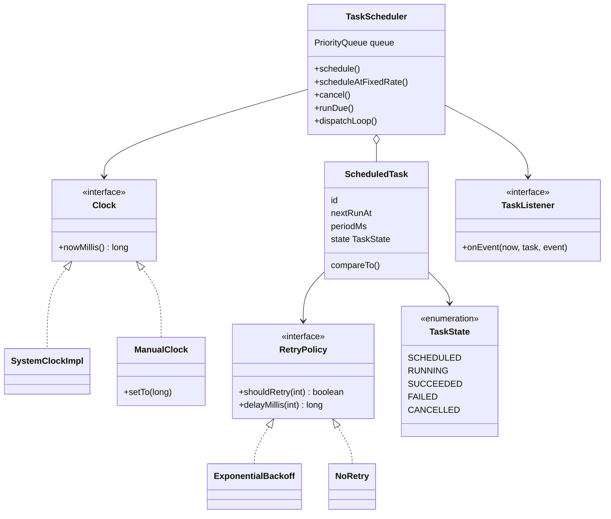
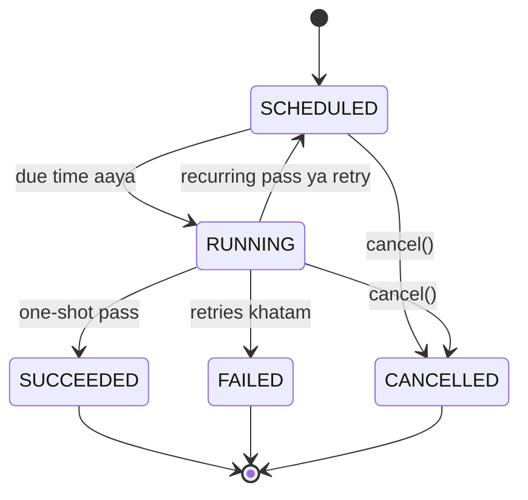

# D20 · Task scheduler

Oct 16, 2026 · @saurav chaurasiya

**Is doc me:** time-ordered PriorityQueue, worker pool, task state machine, cancellation, retry with exponential backoff, aur pluggable Clock (taaki tests deterministic rahein).

**Padhne ka tareeka** — pehle Sawaal pe 15 min khud socho, phir code `Demo.java` me paste karke chalao. Output har baar same aayega.

---

## D20 — Task scheduler

Task scheduler ek component hai jo "ye kaam is time pe karo" type ke requests store karta hai aur sahi time aane pe kaam ko worker threads pe chala deta hai. Java ka `ScheduledThreadPoolExecutor` isi ka production version hai; interview me tumse uska chhota version design karwaya jaata hai.

### Ye cheez hai kya

- Category: LLD case study (concurrency + time + state machine ka mix)
- Problem: kaam abhi nahi, baad me karna hai (ek baar ya baar-baar), aur fail ho to khud dobara try karna hai
- Is lesson ke baad tum kar paoge: time-keyed queue, task states, cancellation aur retry policy ke saath ek testable scheduler design karna
- Analogy: alarm clock jaisa socho. Tum kai alarms set karte ho (kuch ek baar, kuch roz), clock sabse paas wale alarm pe nazar rakhta hai, aur snooze button retry jaisa hai.

### Sawaal

Paytm ke backend me ek scheduler chahiye. Roz subah 6 baje lakhon merchants ke settlement reports banenge, har 30 second me soundbox device heartbeat check hoga, aur failed payout webhook ko 1s, 2s, 4s ke gap pe retry karna hai.

- Scale (single node): 100K pending tasks, peak 5K tasks/sec due
- Kisi task ka start time 1 second se zyada late nahi hona chahiye
- Cancel kiya hua task kabhi nahi chalna chahiye
- Tests ko real time ka wait nahi karna chahiye (1 din ka schedule 1 ms me test ho)

> Pehle khud socho — 15 min. Hints: (1) Agla task kaun sa hai, ye O(1) me kaise pata chalega? (2) Retry ka matlab task ko wapas queue me daalna hai, kis time ke saath? (3) `System.currentTimeMillis()` hardcode karoge to test kaise likhoge?

### Problem kyun aata hai

- Har kaam ke liye alag thread + `Thread.sleep` lagaoge to 100K tasks = 100K sleeping threads (har ek \~1 MB stack = \~100 GB). Possible hi nahi.
- Recurring task ka agla time kisi ne yaad rakhna hai, warna har run ke baad thoda drift hota hai.
- Fail hone pe turant retry karoge to down service pe aur load padega (retry storm).
- Cancel aur run ek saath aa jaaye (race condition) to cancelled task bhi chal sakta hai.
- Real clock use karoge to test flaky banega aur slow bhi.

### Naive approach

- Har task ke liye ek thread banao, usme `sleep(delay)`, phir job chalao.
- Break point: 100K tasks pe 100K threads, memory aur context switching dono khatam. Cancel karne ke liye thread ko interrupt karna padta hai, aur retry ka koi structure nahi. Test me 1 ghante ka task = 1 ghante ka wait.

```java
// Naive: har task ek thread, sleep se time ka wait, clock hardcoded
class NaiveScheduler {
    void schedule(Runnable job, long delayMs) {
        new Thread(() -> {
            try { Thread.sleep(delayMs); } catch (InterruptedException e) { return; }
            job.run();            // fail hua to? retry? koi plan nahi
        }).start();               // 100K tasks = 100K threads
    }
}
```

### Sahi design

1. **Task** = `id`, `name`, `job`, `nextRunAt`, `periodMs` (0 matlab one-shot), `RetryPolicy`, aur `state`.
2. **PriorityQueue** (min-heap, ek tree jaisa structure jisme sabse chhota upar rehta hai) ko `nextRunAt` se order karo. Head hamesha agla due task. `peek` O(1), insert/poll O(log n). Same time pe `id` se tie-break, taaki FIFO ho.
3. **Clock interface** (Strategy pattern): `SystemClockImpl` production me, `ManualClock` tests me. Scheduler kabhi `System.currentTimeMillis()` nahi bulata.
4. **Worker pool** `Executor` ke through: dispatcher sirf due tasks nikalta hai aur `executor.execute(...)` ko deta hai. Demo me `Runnable::run` (same thread) taaki output fixed rahe; production me `Executors.newFixedThreadPool(n)`.
5. **State machine**: `SCHEDULED -> RUNNING -> SUCCEEDED / FAILED`, aur kisi bhi non-terminal state se `CANCELLED`. Retry pe task `RUNNING -> SCHEDULED` wapas jaata hai.
6. **Cancellation lazy**: sirf `state = CANCELLED` set karo. Queue se `remove(obj)` O(n) hota hai, isliye task jab head pe aata hai tab poll karke skip kar do.
7. **Recurring**: fixed rate, `nextRunAt += periodMs` (run ke end time se nahi), taaki drift na ho.
8. **Retry** (Strategy): `RetryPolicy` batata hai retry karna hai ya nahi aur kitni der baad. `ExponentialBackoff` = base, 2x base, 4x base, cap tak.
9. **Observer**: `TaskListener` har state change ka event deta hai (logging, metrics ke liye). Demo isi se log print karta hai.
10. **Dispatcher loop** (`dispatchLoop`): `Condition.await(waitTime)` se head tak sota hai, naya earlier task aaye to `signalAll` se jaagta hai. Ye busy-wait se bachata hai.

Class diagram:



State diagram:



Poora code (`Demo.java` me save karo). Isme Strategy (Clock, RetryPolicy), Observer (TaskListener), State (TaskState) aur Executor-based worker pool ek saath hain:

```java
import java.util.*;
import java.util.concurrent.*;
import java.util.concurrent.atomic.*;
import java.util.concurrent.locks.*;

// ---------- Clock (Strategy: time ka source pluggable) ----------
interface Clock { long nowMillis(); }

class SystemClockImpl implements Clock {
    public long nowMillis() { return System.currentTimeMillis(); }
}

// Test ke liye: time sirf tab badhta hai jab hum bolein
class ManualClock implements Clock {
    private final AtomicLong now = new AtomicLong(0);
    public long nowMillis() { return now.get(); }
    public void setTo(long t) { now.set(t); }
}

// ---------- Task state ----------
enum TaskState { SCHEDULED, RUNNING, SUCCEEDED, FAILED, CANCELLED }

// ---------- Retry policy (Strategy) ----------
interface RetryPolicy {
    boolean shouldRetry(int attemptsSoFar);   // attemptsSoFar = ab tak kitni baar fail hua
    long delayMillis(int attemptsSoFar);
}

class ExponentialBackoff implements RetryPolicy {
    private final int maxAttempts; private final long baseMs; private final long capMs;
    ExponentialBackoff(int maxAttempts, long baseMs, long capMs) {
        this.maxAttempts = maxAttempts; this.baseMs = baseMs; this.capMs = capMs;
    }
    public boolean shouldRetry(int attemptsSoFar) { return attemptsSoFar < maxAttempts; }
    public long delayMillis(int attemptsSoFar) {
        return Math.min(capMs, baseMs << (attemptsSoFar - 1));   // base, 2*base, 4*base ...
    }
}

class NoRetry implements RetryPolicy {
    public boolean shouldRetry(int a) { return false; }
    public long delayMillis(int a) { return 0; }
}

// ---------- Task ----------
class ScheduledTask implements Comparable<ScheduledTask> {
    final long id; final String name; final Runnable job;
    final long periodMs;                 // 0 = one-shot, >0 = recurring (fixed rate)
    final RetryPolicy retry;
    volatile long nextRunAt;
    volatile TaskState state = TaskState.SCHEDULED;
    int failures = 0;                    // lagatar kitni baar fail hua
    int runs = 0;                        // kitni baar successfully chala

    ScheduledTask(long id, String name, Runnable job, long firstRunAt, long periodMs, RetryPolicy retry) {
        this.id = id; this.name = name; this.job = job;
        this.nextRunAt = firstRunAt; this.periodMs = periodMs; this.retry = retry;
    }
    // Pehle time, phir id (same time pe FIFO — deterministic tie-break)
    public int compareTo(ScheduledTask o) {
        int c = Long.compare(nextRunAt, o.nextRunAt);
        return c != 0 ? c : Long.compare(id, o.id);
    }
    boolean isTerminal() {
        return state == TaskState.SUCCEEDED || state == TaskState.FAILED || state == TaskState.CANCELLED;
    }
}

// ---------- Observer: scheduler events ----------
interface TaskListener { void onEvent(long now, ScheduledTask t, String event); }

// ---------- Scheduler ----------
class TaskScheduler {
    private final PriorityQueue<ScheduledTask> queue = new PriorityQueue<>();
    private final ReentrantLock lock = new ReentrantLock();
    private final Condition wake = lock.newCondition();
    private final Clock clock;
    private final Executor workers;          // worker pool pluggable
    private final TaskListener listener;
    private final AtomicLong ids = new AtomicLong();

    TaskScheduler(Clock clock, Executor workers, TaskListener listener) {
        this.clock = clock; this.workers = workers; this.listener = listener;
    }

    ScheduledTask schedule(String name, Runnable job, long delayMs, RetryPolicy retry) {
        return enqueue(name, job, delayMs, 0, retry);
    }
    ScheduledTask scheduleAtFixedRate(String name, Runnable job, long initialDelayMs, long periodMs, RetryPolicy retry) {
        return enqueue(name, job, initialDelayMs, periodMs, retry);
    }

    private ScheduledTask enqueue(String name, Runnable job, long delayMs, long periodMs, RetryPolicy retry) {
        ScheduledTask t = new ScheduledTask(ids.incrementAndGet(), name, job, clock.nowMillis() + delayMs, periodMs, retry);
        lock.lock();
        try { queue.add(t); wake.signalAll(); } finally { lock.unlock(); }
        listener.onEvent(clock.nowMillis(), t, "SCHEDULED for t=" + t.nextRunAt);
        return t;
    }

    // Cancel = lazy: state badal do, queue se nikalna poll ke time hoga (O(1), remove() O(n) hota)
    boolean cancel(ScheduledTask t) {
        lock.lock();
        try {
            if (t.isTerminal()) return false;
            t.state = TaskState.CANCELLED;   // RUNNING task bhi: agla run nahi hoga
        } finally { lock.unlock(); }
        listener.onEvent(clock.nowMillis(), t, "CANCELLED");
        return true;
    }

    OptionalLong nextRunAt() {
        lock.lock();
        try {
            ScheduledTask h = queue.peek();
            return h == null ? OptionalLong.empty() : OptionalLong.of(h.nextRunAt);
        } finally { lock.unlock(); }
    }

    // Worker loop ki ek iteration: jo due hai sab workers ko do
    void runDue() {
        while (true) {
            ScheduledTask t;
            lock.lock();
            try {
                t = queue.peek();
                if (t == null || t.nextRunAt > clock.nowMillis()) return;
                queue.poll();
                if (t.state == TaskState.CANCELLED) continue;   // lazy delete
                t.state = TaskState.RUNNING;
            } finally { lock.unlock(); }
            final ScheduledTask task = t;
            workers.execute(() -> execute(task));
        }
    }

    // Production dispatcher thread: next task tak so jao, naya aaye to jaag jao
    void dispatchLoop() throws InterruptedException {
        lock.lock();
        try {
            while (!Thread.currentThread().isInterrupted()) {
                ScheduledTask h = queue.peek();
                if (h == null) { wake.await(); continue; }
                long wait = h.nextRunAt - clock.nowMillis();
                if (wait > 0) { wake.await(wait, TimeUnit.MILLISECONDS); continue; }
                lock.unlock();
                try { runDue(); } finally { lock.lock(); }
            }
        } finally { lock.unlock(); }
    }

    private void execute(ScheduledTask t) {
        long start = clock.nowMillis();
        listener.onEvent(start, t, "RUNNING (ok=" + t.runs + ", fail=" + t.failures + ")");
        try {
            t.job.run();
        } catch (Exception e) {
            onFailure(t, e);
            return;
        }
        onSuccess(t, start);
    }

    private void onSuccess(ScheduledTask t, long start) {
        lock.lock();
        try {
            t.runs++; t.failures = 0;
            if (t.state == TaskState.CANCELLED) return;       // job ne khud cancel kiya
            if (t.periodMs > 0) {
                t.nextRunAt = t.nextRunAt + t.periodMs;       // fixed rate: drift nahi
                t.state = TaskState.SCHEDULED;
                queue.add(t); wake.signalAll();
            } else {
                t.state = TaskState.SUCCEEDED;
            }
        } finally { lock.unlock(); }
        listener.onEvent(clock.nowMillis(), t, t.state == TaskState.SUCCEEDED ? "SUCCEEDED" : "OK, next at t=" + t.nextRunAt);
    }

    private void onFailure(ScheduledTask t, Exception e) {
        String msg;
        lock.lock();
        try {
            t.failures++;
            if (t.state == TaskState.CANCELLED) { return; }
            if (t.retry.shouldRetry(t.failures)) {
                long d = t.retry.delayMillis(t.failures);
                t.nextRunAt = clock.nowMillis() + d;
                t.state = TaskState.SCHEDULED;
                queue.add(t); wake.signalAll();
                msg = "FAILED(" + e.getMessage() + ") -> retry in " + d + "ms at t=" + t.nextRunAt;
            } else {
                t.state = TaskState.FAILED;
                msg = "FAILED(" + e.getMessage() + ") -> gave up after " + t.failures + " attempts";
            }
        } finally { lock.unlock(); }
        listener.onEvent(clock.nowMillis(), t, msg);
    }
}

public class Demo {
    // Virtual time loop: clock ko seedha agle due time pe le jao, limit tak
    static void runUntil(TaskScheduler s, ManualClock clock, long limit) {
        while (true) {
            OptionalLong next = s.nextRunAt();
            if (next.isEmpty() || next.getAsLong() > limit) break;
            clock.setTo(Math.max(clock.nowMillis(), next.getAsLong()));
            s.runDue();
        }
        clock.setTo(limit);
    }

    public static void main(String[] args) {
        ManualClock clock = new ManualClock();
        TaskListener log = (now, t, ev) ->
            System.out.printf("t=%4d  %-12s %s%n", now, t.name, ev);
        // Direct executor: demo me same thread, taaki output deterministic ho
        TaskScheduler s = new TaskScheduler(clock, Runnable::run, log);

        System.out.println("--- 1. Ordering by time ---");
        s.schedule("C-at-300", () -> {}, 300, new NoRetry());
        s.schedule("A-at-100", () -> {}, 100, new NoRetry());
        s.schedule("B-at-200", () -> {}, 200, new NoRetry());
        s.schedule("D-at-200", () -> {}, 200, new NoRetry());   // B ke saath tie

        System.out.println("--- 2. Recurring (3 baar) ---");
        AtomicInteger beats = new AtomicInteger();
        ScheduledTask[] hb = new ScheduledTask[1];
        hb[0] = s.scheduleAtFixedRate("heartbeat", () -> {
            if (beats.incrementAndGet() == 3) s.cancel(hb[0]);   // teesri baar ke baad band
        }, 50, 100, new NoRetry());

        System.out.println("--- 3. Cancelled task ---");
        ScheduledTask report = s.schedule("report-120", () -> System.out.println("   !!! report chal gaya (bug)"), 120, new NoRetry());

        System.out.println("--- 4. Retry with backoff ---");
        AtomicInteger tries = new AtomicInteger();
        s.schedule("payout", () -> {
            if (tries.incrementAndGet() < 3) throw new RuntimeException("bank timeout #" + tries.get());
        }, 10, new ExponentialBackoff(4, 100, 1000));
        s.schedule("always-bad", () -> { throw new RuntimeException("boom"); }, 20, new ExponentialBackoff(3, 50, 1000));

        System.out.println("--- simulation shuru ---");
        runUntil(s, clock, 60);
        s.cancel(report);            // t=60 pe cancel, due time 120 tha
        runUntil(s, clock, 400);
        System.out.println("--- final ---");
        System.out.println("heartbeat runs = " + beats.get() + ", payout attempts = " + tries.get());
    }
}
```

Isko chalane pe bilkul ye output aata hai:

```text
--- 1. Ordering by time ---
t=   0  C-at-300     SCHEDULED for t=300
t=   0  A-at-100     SCHEDULED for t=100
t=   0  B-at-200     SCHEDULED for t=200
t=   0  D-at-200     SCHEDULED for t=200
--- 2. Recurring (3 baar) ---
t=   0  heartbeat    SCHEDULED for t=50
--- 3. Cancelled task ---
t=   0  report-120   SCHEDULED for t=120
--- 4. Retry with backoff ---
t=   0  payout       SCHEDULED for t=10
t=   0  always-bad   SCHEDULED for t=20
--- simulation shuru ---
t=  10  payout       RUNNING (ok=0, fail=0)
t=  10  payout       FAILED(bank timeout #1) -> retry in 100ms at t=110
t=  20  always-bad   RUNNING (ok=0, fail=0)
t=  20  always-bad   FAILED(boom) -> retry in 50ms at t=70
t=  50  heartbeat    RUNNING (ok=0, fail=0)
t=  50  heartbeat    OK, next at t=150
t=  60  report-120   CANCELLED
t=  70  always-bad   RUNNING (ok=0, fail=1)
t=  70  always-bad   FAILED(boom) -> retry in 100ms at t=170
t= 100  A-at-100     RUNNING (ok=0, fail=0)
t= 100  A-at-100     SUCCEEDED
t= 110  payout       RUNNING (ok=0, fail=1)
t= 110  payout       FAILED(bank timeout #2) -> retry in 200ms at t=310
t= 150  heartbeat    RUNNING (ok=1, fail=0)
t= 150  heartbeat    OK, next at t=250
t= 170  always-bad   RUNNING (ok=0, fail=2)
t= 170  always-bad   FAILED(boom) -> gave up after 3 attempts
t= 200  B-at-200     RUNNING (ok=0, fail=0)
t= 200  B-at-200     SUCCEEDED
t= 200  D-at-200     RUNNING (ok=0, fail=0)
t= 200  D-at-200     SUCCEEDED
t= 250  heartbeat    RUNNING (ok=2, fail=0)
t= 250  heartbeat    CANCELLED
t= 300  C-at-300     RUNNING (ok=0, fail=0)
t= 300  C-at-300     SUCCEEDED
t= 310  payout       RUNNING (ok=0, fail=2)
t= 310  payout       SUCCEEDED
--- final ---
heartbeat runs = 3, payout attempts = 3
```

Output se ye cheezein verify hoti hain:

- Ordering: `A-at-100` (t=100), phir `B` aur `D` (dono t=200, B pehle kyunki id chhoti), phir `C` (t=300), jabki submit order C, A, B, D tha.
- Recurring: `heartbeat` t=50, 150, 250 pe chala, teesri run ke baad apne aap cancel ho gaya.
- Cancelled: `report-120` ka sirf CANCELLED event aaya, kabhi RUNNING nahi.
- Retry: `payout` 10 pe fail, 110 pe fail (100ms backoff), 310 pe pass (200ms backoff). `always-bad` 3 attempts ke baad FAILED.

### Kya choose karein aur kyun

| Option | Kab use karo | Kab mat karo |
| --- | --- | --- |
| PriorityQueue + lock + Condition (ye design) | Chhote/medium scheduler, interview, poora control chahiye | Millions of timers, jahan O(log n) insert bhi bhaari pade |
| `DelayQueue` (JDK) | Blocking take() chahiye, wake-up logic khud nahi likhna | Clock pluggable chahiye (DelayQueue `System.nanoTime` pe chalti hai, fake clock mushkil) |
| `ScheduledThreadPoolExecutor` | Production me single JVM ka kaam, bas chalana hai | Persistence, cluster-wide uniqueness, ya custom retry chahiye |
| Timing wheel (circular array of buckets) | Bahut saare timers, approximate precision chalti hai (network timeouts) | Exact millisecond ordering aur lambe delays |
| DB-backed (Quartz, `SELECT ... FOR UPDATE SKIP LOCKED`) | Restart ke baad bhi tasks bachne chahiye, multi-node | Sub-second precision aur bahut high QPS |

### India me kaise hota hai

- Payments me retry-with-backoff standard hai: Razorpay webhooks fail hone par automatic retry karta hai badhte gap ke saath, aur Paytm jaise PSPs me settlement/reconciliation jobs cron-style recurring tasks hote hain.
- Java me single-node scheduling ke liye [ScheduledThreadPoolExecutor](https://docs.oracle.com/en/java/javase/21/docs/api/java.base/java/util/concurrent/ScheduledThreadPoolExecutor.html) hi base hai; uske andar bhi delay-ordered heap queue hoti hai, bilkul humare design jaisi.
- Bahut saare timers ke liye Kafka, Netty jaise systems timing wheel use karte hain, jiska original paper [Hashed and Hierarchical Timing Wheels](https://www.cs.columbia.edu/~nahum/w6998/papers/sosp87-timing-wheels.pdf) hai.
- Multi-node ke liye HLD twin dekho: [Q18 · Job scheduler](https://claude.ai/code/artifact/f34c8263-0b8d-42e6-80ea-90a73678be35), jahan DB + leader election + sharding aate hain.

### Interview follow-ups

- **Recurring task ka fixed rate aur fixed delay me kya fark hai?** — Fixed rate: `nextRunAt += period` (start-to-start, drift nahi, par run lambi ho to catch-up burst). Fixed delay: `nextRunAt = finishTime + period` (end-to-start, load kam par drift hota hai).
- **Cancel eager kyun nahi, lazy kyun?** — `PriorityQueue.remove(obj)` O(n) hai. Lazy me O(1) flag, aur head pe aane par skip. Nuksan: cancelled tasks memory me tab tak rahte hain; bahut zyada ho to periodically purge karo (JDK me `setRemoveOnCancelPolicy`).
- **Ek task bahut slow ho to baaki tasks late honge?** — Haan agar pool chhota hai. Isliye dispatcher kabhi job khud nahi chalata, sirf worker pool ko deta hai, aur slow jobs ke liye alag pool (bulkhead) rakho.
- **Same task do baar chal gaya (duplicate) to?** — Multi-node me ho sakta hai. Job ko idempotent (baar baar chalane se bhi result same) banao, ya DB me lock/lease lo. Dekho [2A · Idempotency Island](https://claude.ai/code/artifact/c269ac61-440b-4525-bd04-31baf708dece).
- **Retry me jitter kyun?** — Agar 10,000 tasks ek saath fail hue aur sab 100ms baad retry karenge to thundering herd (sab ek saath tootna) hoga. Random jitter se retries spread kar do.
- **Process restart pe tasks kaise bachayein?** — Tasks ko DB me persist karo (`nextRunAt` pe index), start pe load karo. In-memory queue sirf cache ban jaati hai.

### Self-check

1. Scheduler ka agla task O(1) me kaise milta hai, aur insert ki cost kya hai?
2. Same `nextRunAt` wale do tasks me order kaun decide karta hai aur kyun zaroori hai?
3. ManualClock se test deterministic kyun ho jaata hai? Real clock me kya dikkat thi?
4. Cancel lazy kaise kaam karta hai? Running task cancel ho to kya hota hai?
5. 3 attempts, base 50ms pe backoff delays kya honge?

### Notebook

Min-heap keyed by `nextRunAt`, tie-break `id` · Clock injected, kabhi `System.currentTimeMillis()` nahi · Dispatcher sirf due tasks nikaale, run worker pool kare · Cancel = flag + lazy skip (O(1)) · Retry = Strategy, exponential backoff + jitter + cap · Recurring fixed rate = `nextRunAt += period` · States: SCHEDULED, RUNNING, SUCCEEDED, FAILED, CANCELLED

### Padhne ke liye

- [ScheduledThreadPoolExecutor (Java SE 21)](https://docs.oracle.com/en/java/javase/21/docs/api/java.base/java/util/concurrent/ScheduledThreadPoolExecutor.html)
- [Hashed and Hierarchical Timing Wheels (Varghese, Lauck)](https://www.cs.columbia.edu/~nahum/w6998/papers/sosp87-timing-wheels.pdf)
- [The Morning Paper: Timing wheels explained](https://blog.acolyer.org/2015/11/23/hashed-and-hierarchical-timing-wheels/)

### Deep Dive (SDE-2) — jab time ho

#### Timing wheel kaise kaam karta hai

- Ek circular array jisme har slot ek tick (maan lo 1 ms) ka bucket hai. Task ko `(now + delay) % size` slot me daalo, insert O(1).
- Har tick pe pointer aage badhta hai aur us slot ke tasks fire hote hain. Delay wheel ke size se bada ho to hierarchical wheels (seconds wheel, minutes wheel) lagte hain.
- Trade-off: precision tick jitni hi hoti hai, par insert/cancel O(1) hai. Bahut zyada timers ke liye heap se behtar.

#### Distributed scheduler

- Tasks DB me, `status` + `next_run_at` columns pe index. Har node `SELECT ... WHERE next_run_at <= now() FOR UPDATE SKIP LOCKED LIMIT n` se batch uthata hai (bina ek-dusre ko block kiye).
- Lease/heartbeat: worker crash ho to task ki lease expire hoke dusre worker ko mil jaati hai. Ye at-least-once deta hai, isliye jobs idempotent hone chahiye.
- Isi ka poora HLD version [Q18 · Job scheduler](https://claude.ai/code/artifact/f34c8263-0b8d-42e6-80ea-90a73678be35) me hai.

#### Concurrency ke gotchas

- `cancel()` aur `runDue()` dono ek hi lock lete hain, isliye check-then-act race nahi banta. Cancel ke baad bhi ek task jo already RUNNING tha khatam hoga, par dobara queue me nahi aayega (`onSuccess` state check karta hai).
- Job ko lock ke andar kabhi mat chalao; warna slow job poore scheduler ko block kar dega. Demo me lock sirf queue/state ke liye hai.
- Threads, locks aur executors ke basics ke liye [Part 3 · Thread Jungle](https://claude.ai/code/artifact/05d7fa44-518a-49fd-a70c-40ac902f184f) dekho.

#### Missed runs aur clock jump

- Server pause ya GC ke baad bahut saare recurring runs due ho sakte hain. Policy chuno: sab catch-up karo, ya sirf ek run karke `nextRunAt` ko aage badhao (skip missed).
- Wall clock (NTP se badal sakta hai) vs monotonic clock (`System.nanoTime`, sirf aage badhta hai): delays ke liye monotonic, calendar jobs ("roz 6 baje") ke liye wall clock. Clock interface dono ko hide kar sakta hai.

---

## Aage kya

- Pichhla: [D19 · Pub-sub / message queue](https://claude.ai/code/artifact/913ace55-1518-4d5a-b643-6e65ee54c434)
- Agla: [D21 · Cab booking](https://claude.ai/code/artifact/9852f8a2-78bb-4da6-9b22-e1c8c4d8ac99)
- Related: [Part 3 · Thread Jungle](https://claude.ai/code/artifact/05d7fa44-518a-49fd-a70c-40ac902f184f), HLD twin [Q18 · Job scheduler](https://claude.ai/code/artifact/f34c8263-0b8d-42e6-80ea-90a73678be35)
