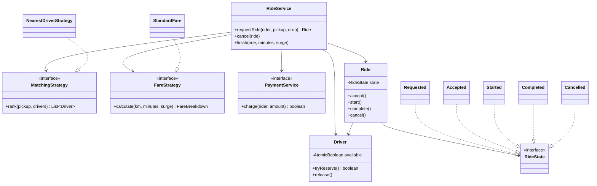
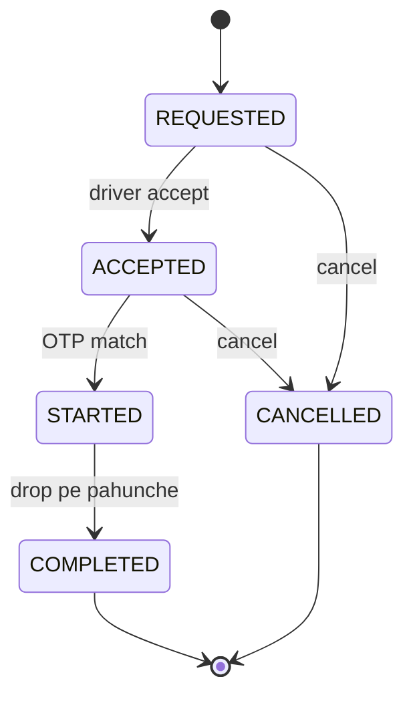

# D21 · Cab booking

Oct 16, 2026 · @saurav chaurasiya

**Is doc me:** Ola/Uber style cab booking ka LLD — Rider, Driver, Ride, matching strategy, fare strategy, State pattern, aur ek driver do rides ko concurrently na mile.

**Padhne ka tareeka** — pehle Sawaal pe 15 min khud socho, phir Sahi design ka Java chalake output match karo.

---

## D21 — Cab booking

Cab booking system ek aisa LLD (low level design — classes aur unke rishte) problem hai jisme rider ride maangta hai, system sabse paas ka free driver dhundhta hai, ride kuch states se guzarti hai, aur end me fare banke payment hota hai.

### Ye cheez hai kya

- Category: LLD case study — Strategy + State pattern aur concurrency ka combo.
- Problem: rider ko driver milna chahiye, par ek driver ko do rides ek saath nahi milni chahiye, aur fare ka formula badalna aasan hona chahiye.
- Lesson ke baad tum kar paoge: matching aur fare ko pluggable strategy bana paoge, ride lifecycle ko State pattern se model kar paoge, aur driver reservation ko atomic (ek hi step me check + set) bana paoge.
- Analogy: auto stand pe do sawaari ek hi khali auto ki taraf bhaagein — jo pehle haath rakhe uski auto, dusre ko agli auto. Wo "pehle haath rakhna" hi atomic reserve hai.

### Sawaal

Ola jaisa app design karo: Bengaluru me 20,000 online drivers, peak pe 500 ride requests per second, driver ka location har 4 second me update hota hai. Matching 200 ms ke andar honi chahiye. Fare = base + per km + per minute, aur demand zyada ho to surge multiplier (1.5x, 2x). Ride ke states: REQUESTED, ACCEPTED, STARTED, COMPLETED, CANCELLED. Ride complete hote hi payment.

> Pehle khud socho — 15 min. Hints: (1) matching aur fare dono ko interface ke peeche rakho taaki kal "highest rated driver" ya "night fare" aaye to Ride class na toote. (2) Ride ka state if-else se nahi, State objects se chalao. (3) "Driver free hai?" check aur "driver ko busy mark karo" ek atomic step hona chahiye, warna do riders ko same driver mil sakta hai.

### Problem kyun aata hai

- Do riders ek saath ride maangte hain aur dono ka sabse paas wala driver ek hi hota hai (race condition — do threads ka timing pe depend karta natija).
- Fare ka formula business badalta rehta hai: surge, night charge, airport fee. Formula Ride me hardcode hua to har badlav pe Ride edit karni padegi.
- Ride ke states me galat transition ho sakta hai: STARTED ride cancel ya COMPLETED ride dobara start.
- Driver ko ride ke baad free karna bhool gaye to driver hamesha busy dikhega.

### Naive approach

- Pehla khayal: list me se nearest free driver dhundo, phir `busy = true` set karo. Fare Ride ke andar hardcode, state ek String.
- Kahan tootta hai: 500 req/s pe do threads ek hi `isFree()` check se guzar jaate hain, dono driver ko le lete hain. 500 req/s aur \~50 ms ke check-set gap me har second kai riders ko same driver milega.
- State string hone se `status = "COMPLETD"` jaisi typo compile hoti hai, aur transition rules jagah jagah if-else me bikhre hote hain.

Ye code check aur set ko alag rakhta hai, isliye race hai:

```java
class NaiveDispatcher {
    Driver assign(Location pickup) {
        Driver best = null;
        for (Driver d : drivers) {
            if (d.isFree() && (best == null || d.dist(pickup) < best.dist(pickup))) best = d;
        }
        // yahan tak do threads ek hi best tak pahunch sakte hain
        best.setFree(false);          // check aur set ke beech gap = race
        return best;
    }
    double fare(double km, double min) { return 50 + km * 12 + min * 2; } // surge ke liye edit karo
}
```

### Sahi design

1. `Location` ek record hai jo do points ke beech distance deta hai.
2. `Driver` ka availability `AtomicBoolean` hai; `tryReserve()` me `compareAndSet(true, false)` hota hai, yani check + set ek atomic step. Jo thread jeete wo driver le jaata hai.
3. `MatchingStrategy` (Strategy pattern) free drivers ko best-first rank karta hai; `NearestDriverStrategy` distance se sort karta hai, tie par id se (deterministic).
4. `RideService.requestRide` ranked list me upar se neeche `tryReserve()` try karta hai; fail hua to agla candidate. Isliye do riders kabhi same driver nahi pate.
5. `RideState` (State pattern) har state ko apna class deta hai; jo transition allowed nahi, default method exception phenkta hai.
6. `FareStrategy` (Strategy pattern) base + per km + per minute nikalke surge multiplier lagata hai aur breakdown deta hai.
7. `finish()` ride complete karta hai, fare banata hai, `PaymentService` se charge karta hai, aur tab driver ko release karta hai.

Yeh diagram classes ke rishte dikhata hai:



Yeh state transitions ka diagram hai:



Ye poora runnable Java hai (ek file `Demo.java`, demo `main` ke saath):

```java
import java.util.*;
import java.util.concurrent.*;
import java.util.concurrent.atomic.*;

public class Demo {

    // ---------- Location ----------
    record Location(double x, double y) {
        // x,y km me hain (simple grid); real me lat/long + haversine lagta hai
        double distanceKm(Location o) {
            return Math.hypot(x - o.x, y - o.y);
        }
    }

    // ---------- Driver: availability ek AtomicBoolean pe ----------
    static class Driver {
        final String id;
        volatile Location location;
        private final AtomicBoolean available = new AtomicBoolean(true);

        Driver(String id, Location location) { this.id = id; this.location = location; }

        // check-and-set ek hi atomic step me: sirf ek thread jeetega
        boolean tryReserve() { return available.compareAndSet(true, false); }
        void release()       { available.set(true); }
        boolean isAvailable(){ return available.get(); }
    }

    static class Rider {
        final String name;
        Rider(String name) { this.name = name; }
    }

    // ---------- Fare Strategy ----------
    record FareBreakdown(double base, double distanceCharge, double timeCharge,
                         double surgeMultiplier, double total) {}

    interface FareStrategy {
        FareBreakdown calculate(double km, double minutes, double surgeMultiplier);
    }

    static class StandardFare implements FareStrategy {
        final double base, perKm, perMin;
        StandardFare(double base, double perKm, double perMin) {
            this.base = base; this.perKm = perKm; this.perMin = perMin;
        }
        public FareBreakdown calculate(double km, double minutes, double surge) {
            double d = km * perKm, t = minutes * perMin;
            double total = (base + d + t) * surge;
            return new FareBreakdown(base, d, t, surge, Math.round(total * 100) / 100.0);
        }
    }

    // ---------- Matching Strategy ----------
    interface MatchingStrategy {
        // candidates ko best-first order me lautata hai
        List<Driver> rank(Location pickup, Collection<Driver> drivers);
    }

    static class NearestDriverStrategy implements MatchingStrategy {
        public List<Driver> rank(Location pickup, Collection<Driver> drivers) {
            List<Driver> list = new ArrayList<>();
            for (Driver d : drivers) if (d.isAvailable()) list.add(d);
            list.sort(Comparator.comparingDouble((Driver d) -> d.location.distanceKm(pickup))
                                .thenComparing(d -> d.id)); // tie ho to id se, deterministic
            return list;
        }
    }

    // ---------- State pattern ----------
    interface RideState {
        String name();
        default RideState accept()   { throw bad("accept"); }
        default RideState start()    { throw bad("start"); }
        default RideState complete() { throw bad("complete"); }
        default RideState cancel()   { throw bad("cancel"); }
        private IllegalStateException bad(String a) {
            return new IllegalStateException("Ride " + name() + " state me " + a + "() allowed nahi");
        }
    }
    static class Requested implements RideState {
        public String name() { return "REQUESTED"; }
        public RideState accept() { return new Accepted(); }
        public RideState cancel() { return new Cancelled(); }
    }
    static class Accepted implements RideState {
        public String name() { return "ACCEPTED"; }
        public RideState start()  { return new Started(); }
        public RideState cancel() { return new Cancelled(); }
    }
    static class Started implements RideState {
        public String name() { return "STARTED"; }
        public RideState complete() { return new Completed(); }
        // STARTED se cancel allowed nahi: trip chalu hai
    }
    static class Completed implements RideState { public String name() { return "COMPLETED"; } }
    static class Cancelled implements RideState { public String name() { return "CANCELLED"; } }

    // ---------- Ride ----------
    static class Ride {
        private static final AtomicInteger SEQ = new AtomicInteger(1);
        final String id = "R" + SEQ.getAndIncrement();
        final Rider rider; final Location pickup, drop;
        Driver driver;
        private RideState state = new Requested();
        FareBreakdown fare;

        Ride(Rider rider, Location pickup, Location drop) {
            this.rider = rider; this.pickup = pickup; this.drop = drop;
        }
        synchronized String state() { return state.name(); }
        synchronized void accept()   { state = state.accept(); }
        synchronized void start()    { state = state.start(); }
        synchronized void complete() { state = state.complete(); }
        synchronized void cancel()   { state = state.cancel(); }
    }

    // ---------- Payment ----------
    interface PaymentService { boolean charge(Rider rider, double amount); }

    // ---------- Service ----------
    static class RideService {
        private final Map<String, Driver> drivers = new ConcurrentHashMap<>();
        private final MatchingStrategy matching;
        private final FareStrategy fareStrategy;
        private final PaymentService payment;

        RideService(MatchingStrategy m, FareStrategy f, PaymentService p) {
            this.matching = m; this.fareStrategy = f; this.payment = p;
        }
        void addDriver(Driver d) { drivers.put(d.id, d); }

        // Rider ride maangta hai: rank karo, phir ek ek ko atomically reserve karne ki koshish
        Ride requestRide(Rider rider, Location pickup, Location drop) {
            Ride ride = new Ride(rider, pickup, drop);
            for (Driver d : matching.rank(pickup, drivers.values())) {
                if (d.tryReserve()) {       // CAS: dusra thread yahan fail hoga, agle candidate pe jayega
                    ride.driver = d;
                    return ride;
                }
            }
            return ride; // driver null => koi driver nahi mila
        }

        void cancel(Ride ride) {
            ride.cancel();
            if (ride.driver != null) ride.driver.release();
        }

        void finish(Ride ride, double minutes, double surge) {
            ride.complete();
            double km = ride.pickup.distanceKm(ride.drop);
            ride.fare = fareStrategy.calculate(km, minutes, surge);
            boolean paid = payment.charge(ride.rider, ride.fare.total());
            ride.driver.location = ride.drop;
            ride.driver.release();          // payment ke baad driver wapas available
            System.out.println("  payment " + (paid ? "SUCCESS" : "FAILED") + " Rs " + ride.fare.total());
        }
    }

    public static void main(String[] args) throws Exception {
        PaymentService pay = (r, amt) -> true; // stub
        RideService svc = new RideService(new NearestDriverStrategy(),
                new StandardFare(50, 12, 2), pay);
        Location pickup = new Location(0, 0);
        svc.addDriver(new Driver("D1", new Location(1, 1)));   // ~1.41 km
        svc.addDriver(new Driver("D2", new Location(3, 0)));   // 3 km
        svc.addDriver(new Driver("D3", new Location(0, 5)));   // 5 km

        System.out.println("== 1. Matching (nearest available) ==");
        Ride r1 = svc.requestRide(new Rider("Asha"), pickup, new Location(6, 8)); // 10 km
        System.out.println("  " + r1.id + " -> driver " + r1.driver.id + ", state " + r1.state());

        System.out.println("== 2. Lifecycle + fare ==");
        r1.accept();  System.out.println("  " + r1.state());
        r1.start();   System.out.println("  " + r1.state());
        try { svc.cancel(r1); } catch (IllegalStateException e) { System.out.println("  " + e.getMessage()); }
        svc.finish(r1, 25, 1.5);
        FareBreakdown f = r1.fare;
        System.out.println("  " + r1.state() + " | base " + f.base() + " + distance " + f.distanceCharge()
                + " + time " + f.timeCharge() + " = " + (f.base() + f.distanceCharge() + f.timeCharge())
                + " x surge " + f.surgeMultiplier() + " = Rs " + f.total());
        System.out.println("  D1 available again: " + r1.driver.isAvailable()
                + ", D1 ab " + r1.driver.location);

        System.out.println("== 3. Cancel before start ==");
        Ride r2 = svc.requestRide(new Rider("Bala"), pickup, new Location(2, 2));
        System.out.println("  " + r2.id + " -> driver " + r2.driver.id);
        r2.accept();
        svc.cancel(r2);
        System.out.println("  " + r2.state() + ", " + r2.driver.id + " available: " + r2.driver.isAvailable());

        System.out.println("== 4. Concurrent: 2 riders, dono ka nearest D2 hai ==");
        Set<String> got = ConcurrentHashMap.newKeySet();
        runConcurrent(svc, 2, pickup, got);
        System.out.println("  assigned drivers (sorted): " + new TreeSet<>(got)
                + " | distinct: " + (got.size() == 2));

        System.out.println("== 5. Concurrent: 8 riders, sirf 1 free driver ==");
        RideService one = new RideService(new NearestDriverStrategy(), new StandardFare(50, 12, 2), pay);
        one.addDriver(new Driver("X1", new Location(1, 0)));
        Set<String> got2 = ConcurrentHashMap.newKeySet();
        int matched = runConcurrent(one, 8, pickup, got2);
        System.out.println("  matched = " + matched + ", no driver = " + (8 - matched)
                + ", driver(s) used: " + new TreeSet<>(got2));
    }

    // N riders ek saath start hote hain (latch), matched count lautata hai
    static int runConcurrent(RideService svc, int n, Location pickup, Set<String> out) throws Exception {
        ExecutorService pool = Executors.newFixedThreadPool(n);
        CountDownLatch go = new CountDownLatch(1);
        List<Future<Ride>> fs = new ArrayList<>();
        for (int i = 0; i < n; i++) {
            final int k = i;
            fs.add(pool.submit(() -> {
                go.await();
                return svc.requestRide(new Rider("Rider" + k), pickup, new Location(5, 5));
            }));
        }
        go.countDown();
        int matched = 0;
        for (Future<Ride> f : fs) {
            Ride r = f.get();
            if (r.driver != null) { matched++; out.add(r.driver.id); }
        }
        pool.shutdown();
        return matched;
    }
}
```

Isko chalane pe bilkul ye output aata hai:

```text
== 1. Matching (nearest available) ==
  R1 -> driver D1, state REQUESTED
== 2. Lifecycle + fare ==
  ACCEPTED
  STARTED
  Ride STARTED state me cancel() allowed nahi
  payment SUCCESS Rs 330.0
  COMPLETED | base 50.0 + distance 120.0 + time 50.0 = 220.0 x surge 1.5 = Rs 330.0
  D1 available again: true, D1 ab Location[x=6.0, y=8.0]
== 3. Cancel before start ==
  R2 -> driver D2
  CANCELLED, D2 available: true
== 4. Concurrent: 2 riders, dono ka nearest D2 hai ==
  assigned drivers (sorted): [D2, D3] | distinct: true
== 5. Concurrent: 8 riders, sirf 1 free driver ==
  matched = 1, no driver = 7, driver(s) used: [X1]
```

Output ke points:

- Matching: dono ka nearest driver D2 tha, par ek ko D2 mila aur dusre ko D3. Set hamesha `[D2, D3]` aata hai, kaun sa rider kaun sa driver pata hai wo thread timing pe hai, isliye hum sirf set print karte hain.
- 8 riders aur 1 driver: exactly 1 matched, 7 ko no driver, har baar.
- Fare: (50 + 120 + 50) x 1.5 = 330. Distance 10 km x 12 = 120, time 25 min x 2 = 50.
- STARTED ride pe cancel exception deta hai; ye State pattern ka kaam hai.

### Kya choose karein aur kyun

| Option | Kab use karo | Kab mat karo |
| --- | --- | --- |
| `AtomicBoolean` CAS (compareAndSet) per driver | ek process me driver reserve, low contention | multiple servers ho (tab shared store chahiye) |
| `synchronized` poore dispatcher pe | chhota demo, simple correctness | 500 req/s pe — saari requests line me lag jaati hain |
| Redis `SET NX` / DB row lock (optimistic/pessimistic locking) | multi-server production me driver lock | single JVM demo me overkill |
| Nearest driver strategy | default, sabse kam pickup time | driver ratings ya ETA (estimated time of arrival) zyada important ho |
| Enum + switch for state | 3-4 states, rules simple | transitions ke saath behavior badhta jaye |
| State pattern classes | har state ke alag rules aur side effects | bahut chhota state machine |

### India me kaise hota hai

- Ola/Uber city ko geo-cells (grid ke khane) me baantte hain aur sirf paas ke cells ke drivers dekhte hain, poori list nahi scan karte. Ye geo-index wala hissa HLD me aata hai: [Q5 · Uber / Ola](https://claude.ai/code/artifact/1ec4db1c-b889-4ec9-8236-dcf6379db14b).
- Nearest-driver ke upar ETA, driver rating aur acceptance rate bhi ranking me jaate hain; hamari `MatchingStrategy` isiliye interface hai. Overview: [How Uber finds nearby drivers](https://singhajit.com/how-uber-finds-nearby-drivers-1-million-requests-per-second/).
- Surge pricing demand-supply imbalance pe chalti hai: [Uber research — Driver Surge Pricing](https://www.uber.com/blog/research/driver-surge-pricing).
- Multi-server me driver lock distributed hota hai: [2D · Lock Fort](https://claude.ai/code/artifact/97588686-7110-4318-8124-3a8727c7604e).
- Payment idempotent honi chahiye (ek ride, ek charge): [2A · Idempotency Island](https://claude.ai/code/artifact/c269ac61-440b-4525-bd04-31baf708dece).

### Interview follow-ups

- **Do riders ko same driver kaise nahi milega?** — `tryReserve()` me `compareAndSet(true, false)`. Ek hi thread jeet'ta hai, haara hua agle candidate pe jaata hai.
- **Driver accept na kare to?** — Reserve timeout ke saath rakho; timeout pe `release()` karke next candidate ko offer karo. Ride REQUESTED me hi rehti hai.
- **Naya fare type (night charge) aaye to?** — Nayi `FareStrategy` class. Ride aur RideService nahi badlte (Open/Closed principle).
- **Server restart ho gaya to?** — In-memory state chali jaayegi. Production me ride state DB me aur driver lock Redis me.
- **Payment fail ho to?** — Ride COMPLETED rehti hai, payment status alag track hota hai aur retry (idempotent key ke saath) chalta hai. Driver tabhi release hota hai jab flow aage badhe.
- **Surge multiplier kaun decide karta hai?** — Alag `SurgeService` zone-wise demand/supply se nikalta hai; `finish()` ko sirf number milta hai.

### Self-check

1. Check-then-set me race kaise banti hai aur CAS usse kaise rokta hai?
2. Strategy aur State pattern is design me kahan kahan use hue?
3. STARTED state me `cancel()` kyun allowed nahi aur ye kahan enforce hota hai?
4. Fare ka breakdown kya hai agar 10 km, 25 min, surge 1.5 ho?
5. Driver ko release kab karte hain aur cancel path me kya karte hain?

### Notebook

Driver availability = AtomicBoolean + compareAndSet · Matching aur Fare dono Strategy · Ride lifecycle State pattern, invalid transition pe exception · Driver release payment ke baad ya cancel pe · Multi-server me Redis/DB lock · Fare = (base + km x rate + min x rate) x surge

### Padhne ke liye

- [How Uber finds nearby drivers](https://singhajit.com/how-uber-finds-nearby-drivers-1-million-requests-per-second/)
- [Uber research: Driver Surge Pricing](https://www.uber.com/blog/research/driver-surge-pricing)
- [Low Level Design: Driver Matching Service](https://www.techinterview.org/post/3233471614/lld-driver-matching/?format=md)

### Deep Dive (SDE-2) — jab time ho

#### Fair matching aur batching

- Greedy nearest ek rider ke liye theek hai, par batching (kuch second ki window me saari requests collect karke global best match) total pickup time kam karta hai.
- Hungarian algorithm jaise assignment solvers use hote hain; trade-off: rider ko thoda wait.

#### Reserve timeout aur offer flow

- Driver ko offer 10-15 sec ke liye jaata hai; `ScheduledExecutorService` timeout pe release + next candidate.
- Driver ek hi time pe ek offer dekhe, isliye reserve offer se pehle hi hota hai.

#### Geo index

- 20,000 drivers ko har request pe scan karna O(n) hai; geohash ya grid cell se sirf paas ke cells dekho.
- `Driver.location` volatile hai kyunki location updater thread aur matching thread alag hain.

#### Fare me money

- `double` paise ke liye galat hai; production me `long` paise ya `BigDecimal` use karo.
- Surge ko ride request ke time lock karo taaki rider ko dikhaya gaya price hi lage.

---

## Aage kya

- Pichhla: [D20 · Task scheduler](https://claude.ai/code/artifact/ef4e9ef2-1aa2-4124-87c5-8d43dd317d05)
- Agla: [D22 · Hotel booking](https://claude.ai/code/artifact/aadee403-96b5-48f4-9e98-6f832e1f26ec)
- Related: HLD twin [Q5 · Uber / Ola](https://claude.ai/code/artifact/1ec4db1c-b889-4ec9-8236-dcf6379db14b); [Part 3 · Thread Jungle](https://claude.ai/code/artifact/05d7fa44-518a-49fd-a70c-40ac902f184f) (atomics, locks); [2C · Behavior Bazaar](https://claude.ai/code/artifact/d1ac6852-9994-4501-9b0a-7d0f654e5c38) (strategy, state)
