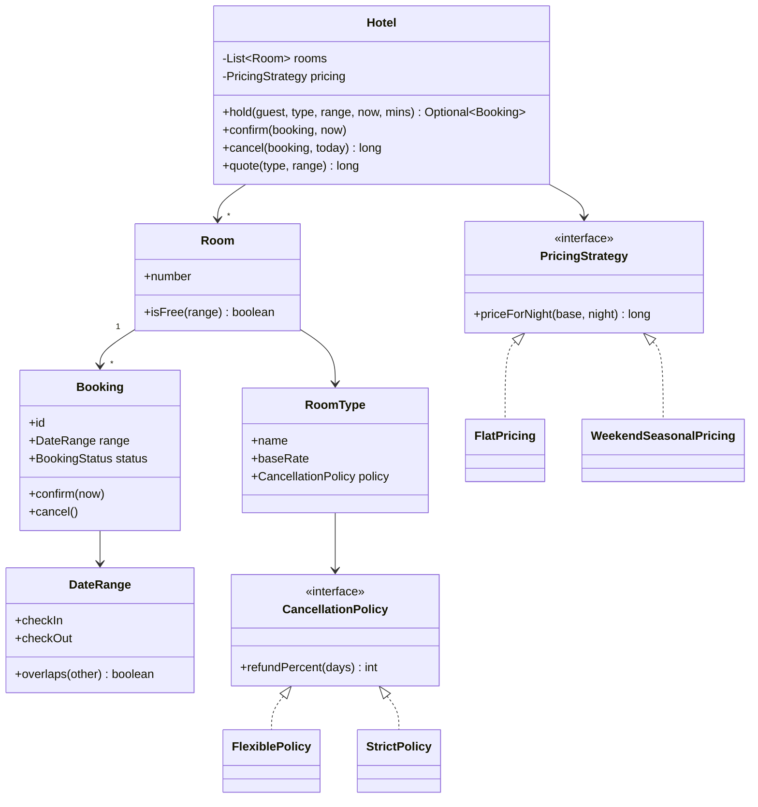

# D22 · Hotel booking

Oct 16, 2026 · @saurav chaurasiya

**Is doc me:** OYO / MakeMyTrip style hotel booking ka LLD (Low Level Design — classes aur unke rishte) in Java: date-range availability, hold → confirm → cancel, pricing aur cancellation strategy, aur last room ki race.

**Padhne ka tareeka** — pehle Sawaal aur Naive approach padho, phir Sahi design ka code khud chalao. Deep Dive baad me.

---

## D22 — Hotel booking

Hotel booking system ek aisa module hai jo guest ko kisi date range ke liye room dikhata hai, hold karta hai, payment ke baad confirm karta hai, aur cancel hone par policy ke hisaab se refund deta hai. Asli challenge ye hai ki ek hi room ko do log ek hi raat ke liye na le jayein.

### Ye cheez hai kya

- Category: reservation / inventory system (BookMyShow ka seat booking jaisa, par yahan resource ek **date range** ke liye block hota hai, ek point-in-time ke liye nahi).
- Problem: ek room ki availability dates ke hisaab se badalti hai, price weekend/season se badalta hai, aur cancel karne par refund policy alag hoti hai.
- Is lesson ke baad tum kar paoge: overlapping intervals ka check likhna, booking ko state machine (HELD → CONFIRMED → CANCELLED) banana, Strategy pattern se pricing aur refund alag karna, aur last room ki race ko lock se sahi karna.
- Analogy: shaadi ka hall book karna. Pehle "tentative hold" lagta hai, advance dene par confirm hota hai, aur tareekh se kitne din pehle cancel kiya, us par advance wapas milta hai.

### Sawaal

Ek OYO jaisa platform hai. Ek hotel me 40 rooms hain (3 room types: Standard, Deluxe, Suite). Peak season (Diwali) me ek hotel pe 200 booking attempts per minute aate hain, aur kabhi kabhi last Deluxe room ke liye 8-10 log ek saath click karte hain. Hold 15 minute ka hota hai, payment fail ho to room wapas free hona chahiye. Requirements:

- Check-in / check-out dates ke liye availability check.
- Hold, confirm, cancel.
- Weekend (Fri/Sat) +20% aur Diwali week +50% pricing.
- Cancellation policy: 7 din pehle tak 100% refund, 2-7 din 50%, usse kam 0%.
- Last room pe koi double booking nahi.

> Pehle khud socho — 5 min. Hints: (1) 10-13 Nov aur 13-15 Nov ki booking overlap karti hai ya nahi? (2) Check aur hold alag alag steps hon to do threads beech me kya kar sakte hain? (3) Pricing aur refund rules badalte rehte hain, unko code me kahan rakhoge?

### Problem kyun aata hai

- Availability ek date range ka sawaal hai: har naye request ko us room ki saari purani bookings se compare karna padta hai.
- Boundary galat hui to ya to back-to-back stay (13 ko ek jaye, dusra aaye) reject hoga, ya asli overlap accept ho jayega.
- "Check phir book" do alag steps hain; beech me doosra thread ghus sakta hai (check-then-act race).
- Payment time leta hai; agar hold nahi hai to guest payment kar de aur room tab tak kisi aur ko mil chuka ho.
- Pricing aur cancellation rules business team roz badalti hai; if-else me ghusa diye to har change pe core class chhedni padegi.

### Naive approach

- Room pe ek `boolean booked` rakho, aur book karte waqt use true kar do.
- Ye sirf ek din ke liye chalta hai. 10-13 Nov book hua to 15-17 Nov ke liye bhi room "booked" dikhega, yaani 100 percent rooms ek hi booking se hamesha ke liye block.
- Check aur set alag alag hain, to 8 threads ek saath `if (!booked)` pass kar sakte hain aur 8 guests ko ek hi room mil jata hai.

```java
// Bura version: dates ka koi concept nahi, aur check-then-act race hai
class Room {
    boolean booked;
    boolean book() {
        if (!booked) {      // do threads yahan ek saath pahunch sakte hain
            booked = true;
            return true;
        }
        return false;
    }
}
```

### Sahi design

1. **DateRange** ko half-open interval `[checkIn, checkOut)` banao. Checkout wali raat guest nahi rukta, isliye 10-13 aur 13-15 overlap nahi karte.
2. Overlap ka rule: do ranges A aur B overlap karti hain jab `A.start < B.end` aur `B.start < A.end`. Ye ek line me saare cases (partial, andar, bahar) cover karta hai.
3. **Room** apni active bookings ki list rakhta hai. Room free hai agar kisi active booking ki range naye request se overlap nahi karti.
4. **Booking** ek chhoti State machine hai: HELD, CONFIRMED, CANCELLED, EXPIRED. Galat transition pe exception.
5. **PricingStrategy** (Strategy pattern) har raat ka rate nikalta hai: weekend multiplier aur seasonal multiplier.
6. **CancellationPolicy** (Strategy pattern) RoomType ke saath judi hai: check-in se kitne din pehle cancel hua, uske hisaab se refund percent.
7. **Hotel** availability check aur hold ko ek `synchronized` block me karta hai, taaki last room ek hi thread ko mile.

Neeche poora code ek file me hai. Pehle model, strategies aur booking state:

```java
import java.time.DayOfWeek;
import java.time.LocalDate;
import java.time.LocalDateTime;
import java.time.temporal.ChronoUnit;
import java.util.*;
import java.util.concurrent.*;
import java.util.concurrent.atomic.AtomicInteger;

// Booking ka lifecycle (State)
enum BookingStatus { HELD, CONFIRMED, CANCELLED, EXPIRED }

// Half-open date range [checkIn, checkOut): checkOut wali raat guest nahi rukta
record DateRange(LocalDate checkIn, LocalDate checkOut) {
    DateRange {
        if (!checkOut.isAfter(checkIn)) throw new IllegalArgumentException("checkOut must be after checkIn");
    }
    boolean overlaps(DateRange o) {
        return checkIn.isBefore(o.checkOut) && o.checkIn.isBefore(checkOut);
    }
    long nights() { return ChronoUnit.DAYS.between(checkIn, checkOut); }
    List<LocalDate> nightDates() { return checkIn.datesUntil(checkOut).toList(); }
}

// Pricing Strategy: ek raat ka rate kaise nikalna hai
interface PricingStrategy {
    long priceForNight(long baseRate, LocalDate night);
}
class FlatPricing implements PricingStrategy {
    public long priceForNight(long base, LocalDate n) { return base; }
}
class WeekendSeasonalPricing implements PricingStrategy {
    private final DateRange peak; private final int peakPct;
    WeekendSeasonalPricing(DateRange peak, int peakPct) { this.peak = peak; this.peakPct = peakPct; }
    public long priceForNight(long base, LocalDate n) {
        long rate = base;
        DayOfWeek d = n.getDayOfWeek();
        if (d == DayOfWeek.FRIDAY || d == DayOfWeek.SATURDAY) rate = rate * 120 / 100; // weekend +20%
        if (peak.overlaps(new DateRange(n, n.plusDays(1)))) rate = rate * peakPct / 100; // season multiplier
        return rate;
    }
}

// Cancellation Strategy: check-in se kitne din pehle cancel kiya, uske hisaab se refund %
interface CancellationPolicy {
    int refundPercent(long daysBeforeCheckIn);
}
class FlexiblePolicy implements CancellationPolicy {
    public int refundPercent(long d) { return d >= 7 ? 100 : d >= 2 ? 50 : 0; }
}
class StrictPolicy implements CancellationPolicy {
    public int refundPercent(long d) { return d >= 14 ? 100 : d >= 7 ? 25 : 0; }
}

class RoomType {
    final String name; final long baseRate; final CancellationPolicy policy;
    RoomType(String name, long baseRate, CancellationPolicy policy) {
        this.name = name; this.baseRate = baseRate; this.policy = policy;
    }
}

class Room {
    final String number; final RoomType type;
    // is room ki saari bookings; sirf active (HELD/CONFIRMED) availability rokti hain
    private final List<Booking> bookings = new ArrayList<>();
    Room(String number, RoomType type) { this.number = number; this.type = type; }
    // caller ko Hotel ka lock pakadna hota hai
    boolean isFree(DateRange r) {
        for (Booking b : bookings) if (b.isActive() && b.range.overlaps(r)) return false;
        return true;
    }
    void attach(Booking b) { bookings.add(b); }
}

class Booking {
    final String id; final String guest; final Room room; final DateRange range;
    final long totalPrice; final LocalDateTime heldUntil;
    private BookingStatus status = BookingStatus.HELD;
    Booking(String id, String guest, Room room, DateRange range, long totalPrice, LocalDateTime heldUntil) {
        this.id = id; this.guest = guest; this.room = room; this.range = range;
        this.totalPrice = totalPrice; this.heldUntil = heldUntil;
    }
    BookingStatus status() { return status; }
    boolean isActive() { return status == BookingStatus.HELD || status == BookingStatus.CONFIRMED; }
    void confirm(LocalDateTime now) {
        if (status != BookingStatus.HELD) throw new IllegalStateException(id + " confirm nahi ho sakta, status=" + status);
        if (now.isAfter(heldUntil)) { status = BookingStatus.EXPIRED; throw new IllegalStateException(id + " hold expire ho chuka"); }
        status = BookingStatus.CONFIRMED;
    }
    void cancel() {
        if (status != BookingStatus.HELD && status != BookingStatus.CONFIRMED)
            throw new IllegalStateException(id + " cancel nahi ho sakta, status=" + status);
        status = BookingStatus.CANCELLED;
    }
}
```

Ab Hotel (jahan lock hai) aur demo `main`:

```java
class Hotel {
    final String name;
    private final List<Room> rooms = new ArrayList<>();
    private final PricingStrategy pricing;
    private final AtomicInteger seq = new AtomicInteger();
    // ek hotel ke andar saari availability + booking decisions ek lock ke andar
    private final Object lock = new Object();
    Hotel(String name, PricingStrategy pricing) { this.name = name; this.pricing = pricing; }
    void addRoom(Room r) { rooms.add(r); }

    long quote(RoomType t, DateRange r) {
        long sum = 0;
        for (LocalDate n : r.nightDates()) sum += pricing.priceForNight(t.baseRate, n);
        return sum;
    }

    // check + hold ek atomic step: dono threads same room nahi utha sakte
    Optional<Booking> hold(String guest, RoomType type, DateRange range, LocalDateTime now, int holdMinutes) {
        synchronized (lock) {
            for (Room room : rooms) {
                if (room.type == type && room.isFree(range)) {
                    Booking b = new Booking("BK" + seq.incrementAndGet(), guest, room, range,
                            quote(type, range), now.plusMinutes(holdMinutes));
                    room.attach(b);
                    return Optional.of(b);
                }
            }
            return Optional.empty();
        }
    }
    void confirm(Booking b, LocalDateTime now) { synchronized (lock) { b.confirm(now); } }

    // cancel karo aur refund amount wapas do
    long cancel(Booking b, LocalDate today) {
        synchronized (lock) {
            long days = ChronoUnit.DAYS.between(today, b.range.checkIn());
            int pct = b.room.type.policy.refundPercent(days);
            boolean wasConfirmed = b.status() == BookingStatus.CONFIRMED;
            b.cancel();
            return wasConfirmed ? b.totalPrice * pct / 100 : 0; // sirf paid booking ka refund
        }
    }
}

public class Demo {
    public static void main(String[] args) throws Exception {
        RoomType deluxe = new RoomType("Deluxe", 3000, new FlexiblePolicy());
        // Diwali season: 1 Nov se 6 Nov 2026 tak 150%
        PricingStrategy pricing = new WeekendSeasonalPricing(
                new DateRange(LocalDate.of(2026, 11, 1), LocalDate.of(2026, 11, 6)), 150);
        Hotel hotel = new Hotel("Hotel Taj Palace Jaipur", pricing);
        hotel.addRoom(new Room("101", deluxe));
        hotel.addRoom(new Room("102", deluxe));

        LocalDateTime now = LocalDateTime.of(2026, 10, 16, 10, 0);
        LocalDate today = now.toLocalDate();

        System.out.println("--- 1. Pricing (Strategy) ---");
        DateRange weekdays = new DateRange(LocalDate.of(2026, 10, 19), LocalDate.of(2026, 10, 21)); // Mon, Tue
        DateRange weekend = new DateRange(LocalDate.of(2026, 10, 23), LocalDate.of(2026, 10, 25)); // Fri, Sat
        DateRange diwali = new DateRange(LocalDate.of(2026, 11, 2), LocalDate.of(2026, 11, 4)); // Mon, Tue peak
        System.out.println("Mon-Tue 2 raat: " + hotel.quote(deluxe, weekdays));
        System.out.println("Fri-Sat 2 raat: " + hotel.quote(deluxe, weekend));
        System.out.println("Diwali Mon-Tue 2 raat: " + hotel.quote(deluxe, diwali));

        System.out.println("--- 2. Overlap rejection ---");
        DateRange ab = new DateRange(LocalDate.of(2026, 11, 10), LocalDate.of(2026, 11, 13));
        DateRange back2back = new DateRange(LocalDate.of(2026, 11, 13), LocalDate.of(2026, 11, 15));
        DateRange partial = new DateRange(LocalDate.of(2026, 11, 12), LocalDate.of(2026, 11, 14));
        DateRange inside = new DateRange(LocalDate.of(2026, 11, 11), LocalDate.of(2026, 11, 12));
        System.out.println("10-13 vs 13-15 overlap? " + ab.overlaps(back2back));
        System.out.println("10-13 vs 12-14 overlap? " + ab.overlaps(partial));
        System.out.println("10-13 vs 11-12 overlap? " + ab.overlaps(inside));
        Room r = new Room("201", deluxe);
        Hotel small = new Hotel("Small", new FlatPricing());
        small.addRoom(r);
        Booking first = small.hold("Amit", deluxe, ab, now, 15).get();
        System.out.println("Amit 10-13: " + first.id + " room " + first.room.number);
        System.out.println("Riya 12-14: " + small.hold("Riya", deluxe, partial, now, 15).map(b -> b.id).orElse("REJECTED (overlap)"));
        System.out.println("Karan 13-15: " + small.hold("Karan", deluxe, back2back, now, 15).map(b -> b.id).orElse("REJECTED"));

        System.out.println("--- 3. Hold -> confirm -> cancel ---");
        DateRange stay = new DateRange(LocalDate.of(2026, 10, 30), LocalDate.of(2026, 11, 1)); // Fri, Sat
        Booking b = hotel.hold("Neha", deluxe, stay, now, 15).get();
        System.out.println(b.id + " status=" + b.status() + " price=" + b.totalPrice);
        try { hotel.confirm(b, now.plusMinutes(20)); } catch (IllegalStateException e) { System.out.println("Late confirm: " + e.getMessage()); }
        System.out.println(b.id + " status=" + b.status());
        Booking b2 = hotel.hold("Neha", deluxe, stay, now, 15).get();
        hotel.confirm(b2, now.plusMinutes(5));
        System.out.println(b2.id + " status=" + b2.status() + " price=" + b2.totalPrice);
        System.out.println("Refund 14 din pehle (today=2026-10-16, checkIn=2026-10-30): " + hotel.cancel(b2, today));
        System.out.println(b2.id + " status=" + b2.status());

        // alag booking: check-in se 3 din pehle cancel => 50%
        Booking b3 = hotel.hold("Sanjay", deluxe, weekdays, now, 15).get();
        hotel.confirm(b3, now.plusMinutes(1));
        long refund = hotel.cancel(b3, LocalDate.of(2026, 10, 16)); // 19 Oct me 3 din
        System.out.println("Sanjay total=" + b3.totalPrice + " refund(3 din pehle)=" + refund);
        Booking b4 = hotel.hold("Pooja", deluxe, weekdays, now, 15).get();
        hotel.confirm(b4, now.plusMinutes(1));
        System.out.println("Pooja total=" + b4.totalPrice + " refund(1 din pehle)=" + hotel.cancel(b4, LocalDate.of(2026, 10, 18)));

        System.out.println("--- 4. Last room race ---");
        Hotel one = new Hotel("One-room hotel", new FlatPricing());
        one.addRoom(new Room("301", deluxe));
        DateRange night = new DateRange(LocalDate.of(2026, 12, 31), LocalDate.of(2027, 1, 1));
        int users = 8;
        ExecutorService pool = Executors.newFixedThreadPool(users);
        CountDownLatch start = new CountDownLatch(1);
        List<Future<Optional<Booking>>> fs = new ArrayList<>();
        for (int i = 1; i <= users; i++) {
            final String g = "user" + i;
            fs.add(pool.submit(() -> { start.await(); return one.hold(g, deluxe, night, now, 15); }));
        }
        start.countDown();
        int won = 0;
        for (Future<Optional<Booking>> f : fs) if (f.get().isPresent()) won++;
        pool.shutdown();
        System.out.println("Threads=" + users + " winners=" + won + " losers=" + (users - won));
    }
}
```

Isko chalane pe bilkul ye output aata hai:

```text
--- 1. Pricing (Strategy) ---
Mon-Tue 2 raat: 6000
Fri-Sat 2 raat: 7200
Diwali Mon-Tue 2 raat: 9000
--- 2. Overlap rejection ---
10-13 vs 13-15 overlap? false
10-13 vs 12-14 overlap? true
10-13 vs 11-12 overlap? true
Amit 10-13: BK1 room 201
Riya 12-14: REJECTED (overlap)
Karan 13-15: BK2
--- 3. Hold -> confirm -> cancel ---
BK1 status=HELD price=7200
Late confirm: BK1 hold expire ho chuka
BK1 status=EXPIRED
BK2 status=CONFIRMED price=7200
Refund 14 din pehle (today=2026-10-16, checkIn=2026-10-30): 7200
BK2 status=CANCELLED
Sanjay total=6000 refund(3 din pehle)=3000
Pooja total=6000 refund(1 din pehle)=0
--- 4. Last room race ---
Threads=8 winners=1 losers=7
```

Output ka matlab:

- 10-13 aur 13-15 overlap nahi karte (back-to-back stay allowed), par 10-13 aur 12-14 karte hain, isliye Riya reject hui aur Karan ko BK2 mila.
- Hold 15 minute ka tha, confirm 20 minute baad aaya, to BK1 EXPIRED ho gaya aur room wapas free; isi liye Neha ki doosri hold ko room mil gaya.
- Fri-Sat ke 2 raat: 3000 x 1.2 x 2 = 7200. Diwali weekday: 3000 x 1.5 x 2 = 9000.
- 3 din pehle cancel pe 50% (3000 of 6000), 1 din pehle pe 0.
- 8 threads ek saath chhute, sirf 1 ko room mila. Result har baar yahi hota hai kyunki check + hold ek lock ke andar hai.

Class diagram:



### Kya choose karein aur kyun

| Option | Kab use karo | Kab mat karo |
| --- | --- | --- |
| `synchronized` per Hotel (is demo me) | Ek JVM, ek hotel ke rooms kam (10-500); simple aur sahi | Multiple servers chal rahe hon; JVM lock sirf apne process me kaam karta hai |
| Per-room lock (ReentrantLock) | Bahut busy hotel, alag room types pe parallelism chahiye | Multi-room group booking, jahan do lock lene pad jayein (deadlock ka risk) |
| DB unique/exclusion constraint ya `SELECT ... FOR UPDATE` | Production: multiple app servers, durability chahiye | Pure in-memory interview demo |
| Optimistic locking (version column) | Conflicts kam hon, retry sasta ho | Last-room jaisi high contention; bahut retries |

Rule of thumb: interview me `synchronized` se shuru karo, phir bolo ki production me yehi guarantee DB constraint se aayegi.

### India me kaise hota hai

- OYO, MakeMyTrip, Goibibo jaise platforms hotel ka inventory aur rate hotels/channel managers se sync karte hain, isliye "available" dikhne ke baad bhi booking fail ho sakti hai; hold + confirm isi gap ko handle karta hai.
- Cancellation policy har hotel ya rate plan ke saath judi hoti hai (free cancellation till X din, non-refundable rate sasta). Ye data-driven Strategy ka asli use hai.
- Peak season (Diwali, long weekend, IPL) me dynamic pricing chalta hai; rate ek raat ke level pe nikalta hai, jaisa is demo me.
- Payment ke liye hold-time me UPI / card ka flow chalta hai; payment fail ya timeout hone par hold expire karke room free karna padta hai. Payment side ke liye [D1 · Payment gateway / UPI flow](https://claude.ai/code/artifact/3a14c198-3582-4167-9d22-bb2756140172) dekho.
- Ye design ideas public interview guides me bhi isi tarah aate hain: [Hotel Booking Platform LLD](https://techinterview.org/lld-hotel-booking-platform/) aur [Design Hotel Booking System](https://www.systemdesignhandbook.com/guides/design-hotel-booking-system/). OYO ke internal code ka public source mere paas nahi hai, isliye upar ka India wala hissa general industry practice hai.

### Interview follow-ups

- **Overlap condition kya hai, aur back-to-back stay kaise allow hota hai?** — `A.start < B.end && B.start < A.end` with half-open `[checkIn, checkOut)`. Checkout wale din naya guest aa sakta hai.
- **Multiple servers hon to?** — JVM lock kaam nahi karega. DB me per-room per-night row aur unique constraint (room\_id, date), ya `SELECT ... FOR UPDATE`, ya Redis lock ([L2.13 — Distributed locks](https://claude.ai/code/artifact/97588686-7110-4318-8124-3a8727c7604e)).
- **Hold expire kaise karoge?** — Background scheduler jo `heldUntil` nikal chuke HELD bookings ko EXPIRED kare, aur confirm pe bhi time check (jaisa demo me). Dono chahiye, kyunki scheduler late ho sakta hai.
- **Naya pricing rule (last-minute discount) kaise add karoge?** — Naya `PricingStrategy` class ya do strategies ka Decorator; `Hotel` ko chhedna nahi padega (Open/Closed).
- **Refund payment gateway fail ho jaye to?** — Booking CANCELLED rakho, refund ko alag retryable job banao, idempotency key ke saath ([L2.1 — Idempotency keys](https://claude.ai/code/artifact/c269ac61-440b-4525-bd04-31baf708dece)).
- **Overbooking (airline jaisa) allow karna ho to?** — Availability check me capacity ke upar chhota buffer allow karo, aur conflict hone par walk-in upgrade / relocation policy rakho.

### Self-check

1. Half-open interval kyun, aur 10-13 vs 13-15 overlap kyun nahi karte?
2. Check-then-act race kya hai, aur is demo me kaise fix hui?
3. Booking ke states kaun se hain, aur EXPIRED kab aata hai?
4. Pricing aur cancellation, dono Strategy kyun hain? Naya rule add karne me kya badalta hai?
5. Multiple app servers hon to `synchronized` kyun kaafi nahi?

### Notebook

Availability = interval overlap · `A.start < B.end && B.start < A.end`, half-open range · Hold → Confirm → Cancel/Expire ek State machine · Check + hold ek hi atomic step (lock) · Pricing aur refund Strategy pattern · Production me guarantee DB constraint se.

### Padhne ke liye

- [Low-Level Design: Hotel Booking Platform — Availability, Atomic Reservation, Dynamic Pricing](https://techinterview.org/lld-hotel-booking-platform/)
- [Design Hotel Booking System (System Design Handbook)](https://www.systemdesignhandbook.com/guides/design-hotel-booking-system/)
- [Hotel Booking case (System Design Space)](https://system-design.space/en/chapter/hotel-booking-case/)

### Deep Dive (SDE-2) — jab time ho

#### Per-night inventory table

- Rooms ki list scan karne ki jagah har room type ke liye `(type, date) -> available_count` rakho. Booking = range ki har raat ka count ek saath ghatana, ek transaction me.
- Fayda: availability query O(nights), rooms ki sankhya se independent. Nuksaan: room number baad me assign karna padta hai.

#### DB level guarantee

- Postgres me `tstzrange`/`daterange` pe EXCLUDE constraint (`EXCLUDE USING gist (room_id WITH =, stay WITH &&)`) DB hi overlap rok deta hai.
- App lock bug se chhoot bhi jaye to data corrupt nahi hota. Phir app me unique violation ko "room nahi mila" me map karo.

#### Hold expiry aur payment

- Hold ke saath payment attempt ki state alag rakho; payment success aur hold expiry ki race ke liye confirm me `heldUntil` aur status dono ek lock me check karo.
- Late payment success (hold expire hone ke baad) aaye to ya to room dobara try karo, ya auto-refund. Ye ek Saga jaisa flow hai ([L2.11 — Saga](https://claude.ai/code/artifact/429b3ea6-a261-431d-a384-a0c6eb68a9f6)).

#### Lock granularity

- Per-hotel lock simple hai par ek busy hotel pe saare room types serialize ho jate hain. Per-room-type lock ya per-room lock throughput badhata hai.
- Multi-room booking me locks ko hamesha ek fixed order (room number) me lo, warna deadlock ho sakta hai. Threads ke basics ke liye [Part 3 · Thread Jungle](https://claude.ai/code/artifact/05d7fa44-518a-49fd-a70c-40ac902f184f) dekho.

---

## Aage kya

- Pichhla: [D21 · Cab booking](https://claude.ai/code/artifact/9852f8a2-78bb-4da6-9b22-e1c8c4d8ac99)
- Agla: [D23 · Stock broker](https://claude.ai/code/artifact/ede5f910-7551-4d64-b195-e3e8ab965b89)
- Related: [D6 · BookMyShow](https://claude.ai/code/artifact/f3d169f5-f1c9-4a30-8a6e-6c8de8e5296b) (seat booking, same race), [Part 3 · Thread Jungle](https://claude.ai/code/artifact/05d7fa44-518a-49fd-a70c-40ac902f184f) (locks aur concurrency)
