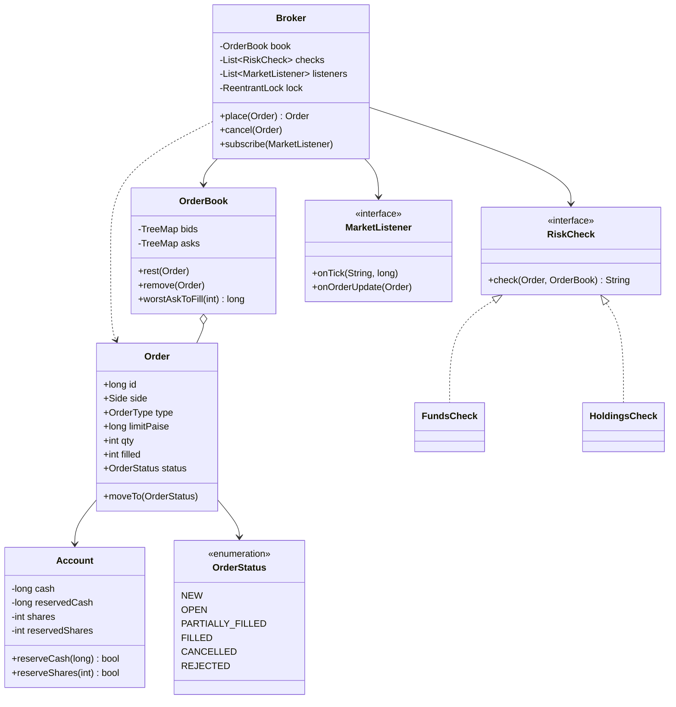

# D23 · Stock broker

Oct 16, 2026 · @saurav chaurasiya

**Is doc me:** Zerodha-style stock broker ka LLD — Account (funds + holdings), Order (market/limit, buy/sell) ki state, pre-trade risk checks, price-time priority order book, atomic trade settlement, aur Observer se price ticks.

**Padhne ka tareeka** — pehle Sawaal pe 15 min khud socho, phir Sahi design ka code chalao aur output se milao. Is doc ka HLD twin hai [Q15 · Stock exchange](https://claude.ai/code/artifact/1cc64540-421c-436d-b45e-1714800c9805).

---

## D23 — Stock broker

Stock broker ek aisa software hai jo investor ke buy/sell orders leta hai, pehle check karta hai ki uske paas paisa ya shares hain ya nahi, phir order ko exchange ki order book me match karke funds aur holdings update karta hai. Is lesson me hum ek symbol (jaise INFY) ka chhota broker aur matching engine (buy aur sell orders ko aapas me jodne wala hissa) banayenge.

### Ye cheez hai kya

- **Category:** LLD case study — domain modeling + State, Strategy, Observer patterns + concurrency (ek lock ke andar atomic update).
- **Problem:** Investor ka paisa/shares kabhi negative na ho, ek hi share do logo ko na bik jaye, aur order ki har state ka hisaab rahe.
- **Is lesson ke baad:** Tum Account, Order, OrderBook, Broker design kar paoge, price-time priority matching likh paoge, aur interview me "partial fill", "reserve vs debit", "market vs limit" confidently samjha paoge.
- **Analogy:** Sabzi mandi ka auction samjho. Jo bhaav sabse achha de (price priority) usse pehle sauda hota hai, aur same bhaav pe jo pehle aaya (time priority) uska number pehle aata hai. Broker woh munshi hai jo pehle check karta hai ki tumhari jeb me paisa hai, phir tumhara order mandi tak pahunchata hai.

Kuch naye terms:

- **Order book** (ek symbol ke saare pending buy aur sell orders ki list) — buy side ko **bids**, sell side ko **asks** kehte hain.
- **Market order** (jo bhi best price mile us pe turant execute ho) vs **limit order** (sirf tumhare diye price ya usse behtar pe execute ho, warna book me wait kare).
- **Partial fill** (order ka sirf kuch hissa execute hona, baaki baaki rehna).
- **Holdings** (tumhare demat account me jitne shares hain).
- **LTP** (last traded price — aakhri trade ka price, jo screen pe tick ki tarah dikhta hai).
- **Paise long** (Rs 1,500 ko 150000 paise long me rakhna; float me paisa kabhi nahi, kyunki 0.1 + 0.2 != 0.3).

### Sawaal

Tum Zerodha jaise broker ke LLD interviewer ke saamne ho. Platform pe 1 crore (10 million) users hain, peak pe 5,000 orders/sec aate hain, aur har order ka risk check + matching 10 ms ke andar hona chahiye.

Ek symbol (INFY) ke liye design karo: user ka Account (cash + holdings), Order (market/limit, buy/sell), pre-trade risk check (paisa ya shares kam hain to reject), price-time priority order book, trade pe funds aur holdings ka atomic update, aur price ticks/order updates ke liye Observer. Demo me ye teen cheezein dikhani hain: insufficient funds se rejected order, limit order jo pehle book me rest kare aur baad me match ho, aur partial fill.

> Pehle khud socho — 15 min. Hints: (1) Paisa aur shares order lagte hi "reserve" karne padenge, warna ek hi paisa do orders me kharch ho jayega. (2) Bids ko high-to-low aur asks ko low-to-high sort rakhna hai, har price pe FIFO queue. (3) Trade ka cash + shares ka transfer ek lock ke andar hona chahiye, beech me kisi ko half-state na dikhe.

### Problem kyun aata hai

- **Double spend:** Riya ke paas Rs 1 lakh hai aur woh do orders Rs 80,000 ke daalti hai. Reserve nahi kiya to dono pass ho jayenge aur balance negative ho jayega.
- **Half-settled trade:** Buyer ka paisa kat gaya par seller ke shares transfer nahi hue (crash/thread race) — paisa ya shares hawa me.
- **Fairness:** Same price pe do sellers hain, to pehle aane wale ko pehle fill milna chahiye, warna exchange pe case ho jata hai.
- **Order lifecycle:** Order NEW se OPEN, PARTIALLY\_FILLED, FILLED ya CANCELLED jata hai. Galat jump (FILLED order ko cancel karna) bug hai.
- **Market order ka price unknown:** Buy market order me kitna paisa roka jaye? Book dekhna padega.
- **Float paisa:** double me paisa rakha to rounding se paise ghat-badh jayenge.

### Naive approach

- Ek `Map<String, Double>` me balance, order aate hi match karo, balance seedha ghatao/badhao.
- Kahan tootta hai: 1) 5,000 orders/sec pe do threads ek hi balance padhte hain aur dono pass ho jate hain (check-then-act race). 2) `double` se Rs 0.1 + Rs 0.2 jaisa error aata hai. 3) Matching ke liye poori list scan karne se O(n) per order, 1 lakh pending orders pe 10 ms budget toot jata hai. 4) Price-time priority ka koi guarantee nahi.

Ye bura snippet dekho:

```java
// Naive: koi reserve nahi, koi lock nahi, double paisa, linear scan
class NaiveBroker {
    Map<String, Double> cash = new HashMap<>();
    Map<String, Integer> shares = new HashMap<>();
    List<String[]> orders = new ArrayList<>(); // [user, side, price, qty] — type safety zero

    void buy(String user, double price, int qty) {
        if (cash.get(user) >= price * qty) {            // check
            for (String[] o : orders) { /* poori list scan, koi priority nahi */ }
            cash.put(user, cash.get(user) - price * qty); // act — beech me dusra thread ghus sakta hai
        }
    }
}
```

### Sahi design

1. **Money = paise (long).** Rs 1,500 = 150000. Koi float/double nahi.
2. **Account me 4 buckets:** free cash, reserved cash, free shares, reserved shares. Order lagte hi paisa/shares free se reserved me jate hain (lock), trade pe reserved se actual transfer hota hai.
3. **Order ek state machine hai (State pattern):** `NEW -> OPEN -> PARTIALLY_FILLED -> FILLED`, ya `CANCELLED` / `REJECTED`. `canMoveTo` galat jump pe exception deta hai.
4. **Risk checks Strategy pattern me:** `RiskCheck` interface, `FundsCheck` aur `HoldingsCheck` alag classes. Naya rule (jaise max order size) = nayi class, Broker nahi badalta.
5. **OrderBook:** bids `TreeMap` (high price pehle), asks `TreeMap` (low price pehle), har price level pe `ArrayDeque` FIFO. Price priority TreeMap se, time priority deque se.
6. **Matching:** incoming order opposite side ke best level se match hota hai jab tak price cross kare. **Trade price = resting order ka price** (jo pehle se book me tha).
7. **Settlement atomic:** `Broker.place` ek `ReentrantLock` ke andar risk check, reserve, match, settle sab karta hai. Ek symbol ka ek hi writer.
8. **Observer pattern:** `MarketListener` — har trade pe `onTick`, har order state change pe `onOrderUpdate`.

Pehle class diagram:



Ab poora runnable Java (ek file `Demo.java`, `javac Demo.java && java Demo`):

```java
import java.util.*;
import java.util.concurrent.locks.ReentrantLock;

enum Side { BUY, SELL }
enum OrderType { MARKET, LIMIT }

// State pattern (enum ke andar): kaun si state se kaun si state allowed hai
enum OrderStatus {
    NEW, OPEN, PARTIALLY_FILLED, FILLED, CANCELLED, REJECTED;
    boolean canMoveTo(OrderStatus next) {
        switch (this) {
            case NEW: return next == OPEN || next == FILLED || next == PARTIALLY_FILLED
                    || next == REJECTED || next == CANCELLED;
            case OPEN: return next == PARTIALLY_FILLED || next == FILLED || next == CANCELLED;
            case PARTIALLY_FILLED: return next == PARTIALLY_FILLED || next == FILLED || next == CANCELLED;
            default: return false; // FILLED / CANCELLED / REJECTED terminal hain
        }
    }
}

class Money { // sab paisa "paise" me, long. 1 rupee = 100 paise
    static String rs(long paise) { return String.format("Rs %,d.%02d", paise / 100, Math.abs(paise % 100)); }
}

class Account {
    final String id;
    private long cash;            // free cash (paise)
    private long reservedCash;    // pending buy orders ke liye roka hua
    private int shares;           // free shares
    private int reservedShares;   // pending sell orders ke liye roka hua
    Account(String id, long cash, int shares) { this.id = id; this.cash = cash; this.shares = shares; }
    long freeCash() { return cash; }
    int freeShares() { return shares; }
    // reserve = cash free se reserved me shift (money kahin gaya nahi, bas lock)
    boolean reserveCash(long amt) { if (cash < amt) return false; cash -= amt; reservedCash += amt; return true; }
    void releaseCash(long amt) { reservedCash -= amt; cash += amt; }
    boolean reserveShares(int q) { if (shares < q) return false; shares -= q; reservedShares += q; return true; }
    void releaseShares(int q) { reservedShares -= q; shares += q; }
    void payFromReserved(long amt) { reservedCash -= amt; }
    void receiveCash(long amt) { cash += amt; }
    void deliverReserved(int q) { reservedShares -= q; }
    void receiveShares(int q) { shares += q; }
    public String toString() {
        return id + "[cash=" + Money.rs(cash) + ", reserved=" + Money.rs(reservedCash)
                + ", shares=" + shares + ", reservedShares=" + reservedShares + "]";
    }
}

class Order {
    private static long seq = 0;
    final long id = ++seq;           // time priority isi sequence se
    final Account account; final Side side; final OrderType type;
    final long limitPaise; final int qty;
    int filled; OrderStatus status = OrderStatus.NEW;
    long reservePerUnit;             // buy ke liye: har share pe kitna cash roka
    String reason = "";
    Order(Account a, Side s, OrderType t, long limitPaise, int qty) {
        this.account = a; this.side = s; this.type = t; this.limitPaise = limitPaise; this.qty = qty;
    }
    int remaining() { return qty - filled; }
    void moveTo(OrderStatus next) {
        if (!status.canMoveTo(next)) throw new IllegalStateException(status + " -> " + next);
        status = next;
    }
    public String toString() {
        return "#" + id + " " + account.id + " " + side + " " + qty + " "
                + (type == OrderType.MARKET ? "MKT" : "@" + Money.rs(limitPaise)) + " " + status
                + " filled=" + filled + (reason.isEmpty() ? "" : " (" + reason + ")");
    }
}

record Trade(long buyOrderId, long sellOrderId, int qty, long pricePaise) {}

// Observer pattern: broker events publish karta hai, listeners sunte hain
interface MarketListener {
    void onTick(String symbol, long lastPricePaise);
    void onOrderUpdate(Order o);
}

// Strategy pattern: har risk rule alag class, naya rule = nayi class
interface RiskCheck { String check(Order o, OrderBook book); } // null = pass, warna reject reason

class FundsCheck implements RiskCheck {
    public String check(Order o, OrderBook book) {
        if (o.side != Side.BUY) return null;
        long unit = o.type == OrderType.LIMIT ? o.limitPaise : book.worstAskToFill(o.qty);
        if (unit < 0) return "no liquidity";
        long need = unit * o.qty;
        if (o.account.freeCash() < need)
            return "insufficient funds: need " + Money.rs(need) + ", free " + Money.rs(o.account.freeCash());
        return null;
    }
}
class HoldingsCheck implements RiskCheck {
    public String check(Order o, OrderBook book) {
        if (o.side != Side.SELL) return null;
        if (o.account.freeShares() < o.qty)
            return "insufficient holdings: need " + o.qty + ", free " + o.account.freeShares();
        return null;
    }
}

// Ek symbol ki order book: price-time priority
class OrderBook {
    final TreeMap<Long, ArrayDeque<Order>> bids = new TreeMap<>(Comparator.reverseOrder()); // best = sabse high
    final TreeMap<Long, ArrayDeque<Order>> asks = new TreeMap<>();                           // best = sabse low

    long worstAskToFill(int qty) { // market buy ke liye: qty bharne me sabse mehnga level
        int need = qty; long worst = -1;
        for (var e : asks.entrySet()) {
            for (Order o : e.getValue()) { need -= o.remaining(); worst = e.getKey(); if (need <= 0) return worst; }
        }
        return -1; // poori qty nahi mil sakti
    }
    void rest(Order o) {
        (o.side == Side.BUY ? bids : asks).computeIfAbsent(o.limitPaise, k -> new ArrayDeque<>()).addLast(o);
    }
    void remove(Order o) {
        var m = o.side == Side.BUY ? bids : asks;
        var q = m.get(o.limitPaise);
        if (q != null) { q.remove(o); if (q.isEmpty()) m.remove(o.limitPaise); }
    }
    String show() {
        StringBuilder sb = new StringBuilder();
        List<String> a = new ArrayList<>();
        for (var e : asks.descendingMap().entrySet()) a.add("  ASK " + Money.rs(e.getKey()) + " : " + sum(e.getValue()));
        sb.append(String.join("\n", a)).append(a.isEmpty() ? "" : "\n");
        for (var e : bids.entrySet()) sb.append("  BID ").append(Money.rs(e.getKey())).append(" : ").append(sum(e.getValue())).append("\n");
        return sb.toString().stripTrailing();
    }
    private int sum(Collection<Order> c) { int s = 0; for (Order o : c) s += o.remaining(); return s; }
}

class Broker {
    private final String symbol;
    private final OrderBook book = new OrderBook();
    private final List<RiskCheck> checks = List.of(new FundsCheck(), new HoldingsCheck());
    private final List<MarketListener> listeners = new ArrayList<>();
    private final ReentrantLock lock = new ReentrantLock(); // ek symbol = ek writer, trade atomic
    Broker(String symbol) { this.symbol = symbol; }
    void subscribe(MarketListener l) { listeners.add(l); }
    OrderBook book() { return book; }

    Order place(Order o) {
        lock.lock();
        try {
            for (RiskCheck c : checks) {                      // 1. pre-trade risk
                String err = c.check(o, book);
                if (err != null) { o.reason = err; o.moveTo(OrderStatus.REJECTED); notifyOrder(o); return o; }
            }
            reserve(o);                                       // 2. funds/shares lock
            match(o);                                         // 3. matching
            if (o.remaining() > 0) {
                if (o.type == OrderType.LIMIT) {
                    book.rest(o);
                    if (o.status == OrderStatus.NEW) o.moveTo(OrderStatus.OPEN);
                } else { release(o); o.reason = "market order ka bacha hissa cancel"; o.moveTo(OrderStatus.CANCELLED); }
            }
            notifyOrder(o);
            return o;
        } finally { lock.unlock(); }
    }

    void cancel(Order o) {
        lock.lock();
        try {
            if (o.status != OrderStatus.OPEN && o.status != OrderStatus.PARTIALLY_FILLED) return;
            book.remove(o); release(o); o.moveTo(OrderStatus.CANCELLED); notifyOrder(o);
        } finally { lock.unlock(); }
    }

    private void reserve(Order o) {
        if (o.side == Side.BUY) {
            o.reservePerUnit = o.type == OrderType.LIMIT ? o.limitPaise : book.worstAskToFill(o.qty);
            o.account.reserveCash(o.reservePerUnit * o.qty);
        } else o.account.reserveShares(o.qty);
    }
    private void release(Order o) {
        if (o.side == Side.BUY) o.account.releaseCash(o.reservePerUnit * o.remaining());
        else o.account.releaseShares(o.remaining());
    }

    private void match(Order in) {
        var opp = in.side == Side.BUY ? book.asks : book.bids;
        while (in.remaining() > 0 && !opp.isEmpty()) {
            var best = opp.firstEntry();
            long px = best.getKey();
            boolean crosses = in.type == OrderType.MARKET
                    || (in.side == Side.BUY ? px <= in.limitPaise : px >= in.limitPaise);
            if (!crosses) break;
            ArrayDeque<Order> q = best.getValue();
            while (in.remaining() > 0 && !q.isEmpty()) {
                Order rest = q.peekFirst();                   // pehle aaya, pehle fill
                int qty = Math.min(in.remaining(), rest.remaining());
                execute(in, rest, qty, px);                   // trade price = resting order ka price
                if (rest.remaining() == 0) q.pollFirst();
            }
            if (q.isEmpty()) opp.remove(px);
        }
    }

    // Settlement: buyer ka cash -> seller, seller ke shares -> buyer. Lock ke andar, isliye atomic.
    private void execute(Order in, Order rest, int qty, long px) {
        Order buy = in.side == Side.BUY ? in : rest, sell = in.side == Side.BUY ? rest : in;
        long cost = px * qty;
        buy.account.payFromReserved(cost);
        buy.account.releaseCash((buy.reservePerUnit - px) * qty); // price improvement ka paisa wapas
        buy.account.receiveShares(qty);
        sell.account.deliverReserved(qty);
        sell.account.receiveCash(cost);
        for (Order o : List.of(buy, sell)) {
            o.filled += qty;
            o.moveTo(o.remaining() == 0 ? OrderStatus.FILLED : OrderStatus.PARTIALLY_FILLED);
        }
        System.out.println("  TRADE " + qty + " " + symbol + " @ " + Money.rs(px)
                + " (buy #" + buy.id + ", sell #" + sell.id + ")");
        if (rest != in) notifyOrder(rest);
        for (MarketListener l : listeners) l.onTick(symbol, px);
    }
    private void notifyOrder(Order o) { for (MarketListener l : listeners) l.onOrderUpdate(o); }
}

public class Demo {
    static long rs(long r) { return r * 100; }
    public static void main(String[] args) {
        Account amit = new Account("Amit", rs(10_000), 100);
        Account karan = new Account("Karan", rs(0), 40);
        Account riya = new Account("Riya", rs(2_00_000), 0);
        Account dev = new Account("Dev", rs(5_000), 0);
        Broker broker = new Broker("INFY");
        broker.subscribe(new MarketListener() {
            public void onTick(String s, long p) { System.out.println("  [TICK] " + s + " ltp=" + Money.rs(p)); }
            public void onOrderUpdate(Order o) { System.out.println("  [ORDER] " + o); }
        });

        System.out.println("== 1. Dev ke paas Rs 5,000, 10 share @ Rs 1,500 chahiye ==");
        broker.place(new Order(dev, Side.BUY, OrderType.LIMIT, rs(1500), 10));

        System.out.println("== 2. Amit 50 @ 1500, Karan 40 @ 1500, Amit 30 @ 1495 sell (resting) ==");
        broker.place(new Order(amit, Side.SELL, OrderType.LIMIT, rs(1500), 50));
        broker.place(new Order(karan, Side.SELL, OrderType.LIMIT, rs(1500), 40));
        broker.place(new Order(amit, Side.SELL, OrderType.LIMIT, rs(1495), 30));
        System.out.println(broker.book().show());

        System.out.println("== 3. Riya BUY 70 @ 1500 limit: pehle 1495, phir time priority se Amit ka 1500 ==");
        Order r = broker.place(new Order(riya, Side.BUY, OrderType.LIMIT, rs(1500), 70));
        System.out.println(broker.book().show());

        System.out.println("== 4. Riya MARKET BUY 100: book me sirf 50 hai, to rejected (no liquidity) ==");
        broker.place(new Order(riya, Side.BUY, OrderType.MARKET, 0, 100));

        System.out.println("== 5. Riya LIMIT BUY 60 @ 1500: 50 mile, 10 bid me rest (partial fill) ==");
        Order partial = broker.place(new Order(riya, Side.BUY, OrderType.LIMIT, rs(1500), 60));
        System.out.println(broker.book().show());

        System.out.println("== 6. Dev ke paas shares nahi, SELL 5 rejected; phir Riya apna bacha bid cancel kare ==");
        broker.place(new Order(dev, Side.SELL, OrderType.LIMIT, rs(1510), 5));
        broker.cancel(partial);

        System.out.println("== Final balances ==");
        for (Account a : List.of(amit, karan, riya, dev)) System.out.println("  " + a);
    }
}
```

Isko chalane pe bilkul ye output aata hai:

```text
== 1. Dev ke paas Rs 5,000, 10 share @ Rs 1,500 chahiye ==
  [ORDER] #1 Dev BUY 10 @Rs 1,500.00 REJECTED filled=0 (insufficient funds: need Rs 15,000.00, free Rs 5,000.00)
== 2. Amit 50 @ 1500, Karan 40 @ 1500, Amit 30 @ 1495 sell (resting) ==
  [ORDER] #2 Amit SELL 50 @Rs 1,500.00 OPEN filled=0
  [ORDER] #3 Karan SELL 40 @Rs 1,500.00 OPEN filled=0
  [ORDER] #4 Amit SELL 30 @Rs 1,495.00 OPEN filled=0
  ASK Rs 1,500.00 : 90
  ASK Rs 1,495.00 : 30
== 3. Riya BUY 70 @ 1500 limit: pehle 1495, phir time priority se Amit ka 1500 ==
  TRADE 30 INFY @ Rs 1,495.00 (buy #5, sell #4)
  [ORDER] #4 Amit SELL 30 @Rs 1,495.00 FILLED filled=30
  [TICK] INFY ltp=Rs 1,495.00
  TRADE 40 INFY @ Rs 1,500.00 (buy #5, sell #2)
  [ORDER] #2 Amit SELL 50 @Rs 1,500.00 PARTIALLY_FILLED filled=40
  [TICK] INFY ltp=Rs 1,500.00
  [ORDER] #5 Riya BUY 70 @Rs 1,500.00 FILLED filled=70
  ASK Rs 1,500.00 : 50
== 4. Riya MARKET BUY 100: book me sirf 50 hai, to rejected (no liquidity) ==
  [ORDER] #6 Riya BUY 100 MKT REJECTED filled=0 (no liquidity)
== 5. Riya LIMIT BUY 60 @ 1500: 50 mile, 10 bid me rest (partial fill) ==
  TRADE 10 INFY @ Rs 1,500.00 (buy #7, sell #2)
  [ORDER] #2 Amit SELL 50 @Rs 1,500.00 FILLED filled=50
  [TICK] INFY ltp=Rs 1,500.00
  TRADE 40 INFY @ Rs 1,500.00 (buy #7, sell #3)
  [ORDER] #3 Karan SELL 40 @Rs 1,500.00 FILLED filled=40
  [TICK] INFY ltp=Rs 1,500.00
  [ORDER] #7 Riya BUY 60 @Rs 1,500.00 PARTIALLY_FILLED filled=50
  BID Rs 1,500.00 : 10
== 6. Dev ke paas shares nahi, SELL 5 rejected; phir Riya apna bacha bid cancel kare ==
  [ORDER] #8 Dev SELL 5 @Rs 1,510.00 REJECTED filled=0 (insufficient holdings: need 5, free 0)
  [ORDER] #7 Riya BUY 60 @Rs 1,500.00 CANCELLED filled=50
== Final balances ==
  Amit[cash=Rs 129,850.00, reserved=Rs 0.00, shares=20, reservedShares=0]
  Karan[cash=Rs 60,000.00, reserved=Rs 0.00, shares=0, reservedShares=0]
  Riya[cash=Rs 20,150.00, reserved=Rs 0.00, shares=120, reservedShares=0]
  Dev[cash=Rs 5,000.00, reserved=Rs 0.00, shares=0, reservedShares=0]
```

Output ko code se milao:

- **Step 1:** Dev ke paas Rs 5,000 hain par Rs 15,000 chahiye, to `FundsCheck` ne order `REJECTED` kar diya. Koi paisa reserve nahi hua (final balance me Dev ka cash Rs 5,000 hi hai).
- **Step 2:** Teen sell orders book me `OPEN` hain. Rs 1,500 pe 90 shares (Amit ke 50 + Karan ke 40), Rs 1,495 pe 30 shares.
- **Step 3:** Riya ka BUY 70 @ 1,500 pehle sabse sasta Rs 1,495 level khata hai (price priority), phir Rs 1,500 pe Amit ka order Karan se pehle fill hota hai (time priority, Amit ka order id #2 hai, Karan ka #3). Amit ka #2 order `PARTIALLY_FILLED` hua (40/50).
- **Step 4:** Market buy 100 pe book me sirf 50 hain, to `worstAskToFill` -1 deta hai aur order "no liquidity" se reject.
- **Step 5 (partial fill):** Riya ka LIMIT BUY 60 pe sirf 50 shares milte hain (10 Amit ke + 40 Karan ke). Baaki 10 `BID Rs 1,500 : 10` ban ke book me rest karte hain, order `PARTIALLY_FILLED`.
- **Step 6:** Dev ka SELL holdings na hone se reject, aur Riya ka bacha bid cancel hone pe reserved cash wapas free ho gaya (final: Riya reserved Rs 0.00).
- **Paisa check:** Amit = 10,000 + 30 x 1,495 + 50 x 1,500 = Rs 1,29,850. Total cash aur total shares trade ke baad bhi wahi hain (cash 2,15,000 aur shares 140), kuch hawa me nahi gaya.

Design ke patterns:

- **State:** `OrderStatus.canMoveTo` — galat transition pe exception.
- **Strategy:** `RiskCheck` implementations — naye rule add karna Open/Closed principle follow karta hai.
- **Observer:** `MarketListener` — UI, WebSocket feed, ya notification service sab subscribe kar sakte hain.
- **Concurrency:** `ReentrantLock` per symbol (ek symbol, ek writer) — settlement atomic.

### Kya choose karein aur kyun

| Option | Kab use karo | Kab mat karo |
| --- | --- | --- |
| Ek lock per symbol (hamara design) | Ek symbol ki matching sequential honi chahiye; simple aur correct | Ek hi symbol pe lakhon orders/sec aur lock contention bottleneck ho |
| Single-threaded engine per symbol + queue (LMAX-style disruptor) | Production exchange jaisa low latency, no locks | Interview me simple LLD chahiye aur ring buffer ka overhead explain nahi karna |
| Global lock saare symbols pe | Prototype ya test | Kabhi nahi, ek symbol ki wajah se sab ruk jayenge |
| Reserve-then-settle (hamara) | Funds/holdings pehle lock, trade pe transfer; double spend nahi | Jab sirf ek order ek baar hota ho aur paisa instant debit ho (wallet jaisa) |
| Debit at order time | Simple, par cancel pe refund chahiye | Market orders me exact price unknown hota hai |
| paise `long` | Hamesha paisa ke liye | Kabhi nahi float use karna |
| `BigDecimal` | Fractional rates, tax, multi-currency | Hot path me, kyunki allocation slow hai |

### India me kaise hota hai

- Zerodha Kite pe Market, Limit, SL (stop-loss) aur SL-M order types hote hain, aur har order exchange (NSE/BSE) ko jata hai jo price-time priority se match karta hai. Order types ki official list: [Zerodha support — order types and execution](https://support.zerodha.com/category/trading-and-markets/trading-faqs/articles/order-types-and-execution).
- Zerodha Varsity me limit aur market orders ka beginner-friendly explanation hai: [Varsity — understanding the various order types](https://zerodha.com/varsity/chapter/understanding-the-various-order-types/).
- Broker side par **RMS** (risk management system — margin, funds aur position limits check karne wala module) har order se pehle chalta hai. Hamara `RiskCheck` chain usi ka chhota version hai.
- Exchange ka matching engine broker se alag hota hai; broker sirf order forward karta hai aur exchange se trade confirmation aane pe funds/holdings update karta hai. Asli system ka HLD [Q15 · Stock exchange](https://claude.ai/code/artifact/1cc64540-421c-436d-b45e-1714800c9805) me hai.

### Interview follow-ups

- **Market order me kitna paisa reserve karoge?** — Book walk karke qty bharne wala sabse mehnga level lo (`worstAskToFill`), uska price x qty reserve karo. Trade pe jo bacha wo wapas release hota hai.
- **Stop-loss order kaise add karoge?** — Naya `OrderType.STOP` aur ek trigger price. Order alag "pending trigger" list me rehta hai, aur `onTick` listener LTP trigger cross hone pe use market/limit order me badal ke `place` karta hai.
- **Order cancel aur match ek saath aaye to?** — Dono `Broker` ke same lock ke andar chalte hain, isliye ek hi pehle hoga. Cancel pehle hua to order book se hat chuka, match nahi hoga.
- **Multiple symbols kaise?** — `Map<String, Broker>` ya per-symbol `OrderBook` + per-symbol lock. Alag symbols parallel chalte hain, accounts ke liye ordered locking ya reserve model use karo.
- **Price improvement ka kya hota hai?** — Riya ne 1,500 limit diya par match 1,495 pe hua to trade price 1,495 hai aur extra Rs 5 per share `releaseCash` se wapas free ho jata hai.
- **Trade ke baad crash ho jaye to?** — Real system me orders aur trades ek durable log (database ya Kafka) me likhte hain, restart pe replay karte hain. Idempotent settlement ke liye trade id ko unique key rakho.

### Self-check

1. Reserve aur debit me kya fark hai, aur order lagte hi reserve kyun?
2. Price priority aur time priority OrderBook me kaise implement hui?
3. Trade ka price resting order ka kyun hota hai, incoming ka kyun nahi?
4. Partial fill ke baad order ki state kya hogi, aur woh book me kab rest karega?
5. `FundsCheck` ko `Strategy` kyun kaha, aur naya rule kaise add karoge?

### Notebook

Paisa hamesha paise long me · Order lagte hi funds/shares reserve · Bids high-to-low, asks low-to-high, har level pe FIFO · Trade price resting order ka · Settlement lock ke andar atomic · State machine: NEW, OPEN, PARTIALLY\_FILLED, FILLED, CANCELLED, REJECTED · Observer se ticks aur order updates.

### Padhne ke liye

- [Zerodha support — order types and execution](https://support.zerodha.com/category/trading-and-markets/trading-faqs/articles/order-types-and-execution)
- [Zerodha Varsity — understanding the various order types](https://zerodha.com/varsity/chapter/understanding-the-various-order-types/)
- [Zerodha Z-Connect — advanced order features on Kite](https://zerodha.com/z-connect/featured/advanced-order-features-on-kite-a-comprehensive-guide)

### Deep Dive (SDE-2) — jab time ho

#### Matching algorithms

- **FIFO (price-time)** sabse common hai. Pro-rata (same price pe size ke hisaab se hissa) kuch derivatives markets me hota hai.
- Order book ke liye `TreeMap` O(log P) hai (P = distinct price levels). Fixed tick size ho to array-indexed levels O(1) ho sakte hain.

#### Concurrency aur latency

- Lock ki jagah **single-writer** model: har symbol ek thread, orders ek queue se aate hain. Isse lock contention aur context switch khatam hote hain.
- Accounts shared hain (ek user kai symbols trade karta hai), isliye reserve step ko account-level atomic rakho (CAS ya account ka apna lock).

#### Failure aur audit

- Har order aur trade ko append-only log me likho (event sourcing) aur state replay se rebuild karo. Ledger ke liye [D2 Digital wallet](https://claude.ai/code/artifact/4df48566-b65f-4525-ac39-494302d44562) ka idea yahan lagta hai.
- Daily end-of-day reconciliation: broker ke trades vs exchange ke trade file ka match.

#### Order types aur extensions

- IOC (immediate or cancel) — hamara market order jaisa; FOK (fill or kill) — poora fill ya kuch nahi; GTC/GTD — time-in-force.
- Circuit limits, tick size aur lot size validation naye `RiskCheck` ban jate hain.

---

## Aage kya

- Pichhla: [D22 · Hotel booking](https://claude.ai/code/artifact/aadee403-96b5-48f4-9e98-6f832e1f26ec)
- Agla: [D24 · Coupon / cashback engine](https://claude.ai/code/artifact/ff0a7aed-8545-4bf4-b0d5-a6456aabc343)
- HLD twin: [Q15 · Stock exchange](https://claude.ai/code/artifact/1cc64540-421c-436d-b45e-1714800c9805)
- Related: [2C · Behavior Bazaar](https://claude.ai/code/artifact/d1ac6852-9994-4501-9b0a-7d0f654e5c38) (Strategy, Observer, State), [Part 3 · Thread Jungle](https://claude.ai/code/artifact/05d7fa44-518a-49fd-a70c-40ac902f184f) (locks), [D2 Digital wallet](https://claude.ai/code/artifact/4df48566-b65f-4525-ac39-494302d44562)
