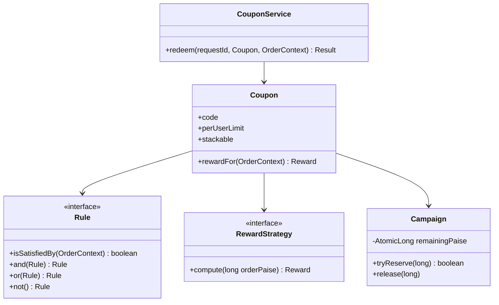

# LLD D24 · Coupon / cashback engine

Oct 16, 2026 · @saurav chaurasiya

**Is doc me:** coupon ke rules ko Specification + Composite se compose karna, discount ke Strategy, best coupon selection, usage limit, thread-safe budget aur idempotent redemption, runnable Java ke saath.

**Padhne ka tareeka** — pehle Sawaal pe 15 min khud socho, phir Sahi design ka code chalake output match karo. Ye last LLD case study hai.

---

## D24 — Coupon / cashback engine

Coupon engine wo component hai jo order aate hi decide karta hai ki kaun se coupon lagenge, kitna discount ya cashback milega, aur campaign ka budget bacha hai ya nahi. Paisa yahan real kharch hota hai, isliye galti ka matlab seedha nuksaan.

### Ye cheez hai kya

- Category: LLD case study (rules engine + concurrency + money correctness).
- Problem: marketing roz naye coupon chahti hai ("UPI se Rs 500 pe 10% off, max Rs 150"), aur code har baar badalna nahi chahiye. Saath me budget se zyada paisa baantna bhi nahi hai.
- Is lesson ke baad tum kar paoge: rules ko tree ki tarah compose karna, reward ke liye Strategy lagana, best coupon chunna, aur 1000 concurrent redemptions me bhi budget exact rakhna.
- Analogy: mithai ki dukaan ka "pehle 100 customers ko free laddoo" board. Gate pe ek hi bhaiya gin raha ho to 100 pe ruk jaata hai; 10 bhaiya alag alag gin rahe hon to 130 ladoo bant jaate hain. Hamara budget counter wahi ek gin-ne wala bhaiya hai.

### Sawaal

Paytm-jaisi app pe Diwali sale hai. 2 crore users, peak pe 5,000 checkout/sec, har checkout pe 20-30 coupons evaluate hote hain. Ek flash campaign ka budget sirf Rs 5 lakh hai aur 1 lakh log ek hi second me coupon try karenge.

Requirements:

- Rules: min order value, payment method sirf UPI, sirf new user, category (FOOD/GROCERY).
- Reward: flat off, percent off with cap, wallet me cashback.
- Per-user usage limit, campaign budget, best coupon selection, stacking rules.
- Retry (network timeout) pe double redemption nahi honi chahiye.
- Target: rule evaluation microseconds me, budget kabhi negative nahi.

> Pehle khud socho — 15 min. Hints: (1) rule ko class banao ya data? Naya rule aaye to kya badlega? (2) budget ka check aur decrement alag alag steps hue to kya hoga? (3) client ne same request 2 baar bheji to?

### Problem kyun aata hai

- Rules ka combination explode hota hai: min order x payment x user type x category. If-else me har naya combo naya branch.
- Discount ka formula alag alag hota hai, par selection logic same rehna chahiye.
- Budget shared counter hai. Hazaaron threads ek saath padhte aur likhte hain (race condition — do threads ek hi value pe galat decision lete hain).
- Retry aam hai. Redemption idempotent (same request baar baar bhejne pe bhi asar sirf ek baar) nahi hui to user ko double cashback.
- Coupon stacking ke rules na ho to marketing ka budget ek user pe hi khatam.

### Naive approach

- Ek `applyCoupon` method, andar if-else ki lambi chain, aur budget ek normal `long`.
- Break kaise hota hai: 100 threads ek saath `if (budget >= 5000)` check karte hain, sab ko true milta hai, sab minus karte hain. Budget Rs 500 tha, Rs 5,000 baant diya. Naya rule = naya if = purane coupons ke regression.

```java
// Ye mat karo: rules hard-coded, budget unsafe
class BadCouponService {
    long budgetPaise = 50_000;                       // shared, unsynchronized
    long apply(String code, long amount, String payment, boolean newUser) {
        if (code.equals("NEW50") && newUser && amount >= 20_000) {
            if (budgetPaise >= 5_000) {              // check
                budgetPaise -= 5_000;                // act: beech me dusra thread ghus sakta hai
                return 5_000;
            }
        } else if (code.equals("UPI10") && payment.equals("UPI")) {
            // ... 40 aur branches, retry pe dobara kat jaata hai
        }
        return 0;
    }
}
```

### Sahi design

1. **Rule = Specification** (ek chhota interface jo bolta hai "ye order is condition ko satisfy karta hai ya nahi"). `and`, `or`, `not` se rules combine hote hain. Ye **Composite pattern** hai: ek rule aur rules ka tree, dono same type. Dekho [Structural Bridge (Composite)](https://claude.ai/code/artifact/38514da5-5649-4d61-b49d-f65f893e6a5e).
2. **Reward = Strategy**: `flat`, `percentCapped`, `cashback` sab same interface `RewardStrategy` implement karte hain. Dekho [Behavior Bazaar (Strategy)](https://claude.ai/code/artifact/d1ac6852-9994-4501-9b0a-7d0f654e5c38).
3. **Coupon** = rule + strategy + campaign + perUserLimit + stackable flag. Sab paise me, `long`.
4. **Best pick**: eligible coupons ka reward nikalo. Non-stackable me se sabse bada ek lo, stackable sab jodo. Tie hone pe list me pehla jeet-ta hai (deterministic).
5. **Campaign budget**: `AtomicLong` pe CAS loop (compare-and-set: "agar value abhi bhi wahi hai jo maine padhi thi to badlo, warna dobara padho"). Lock nahi, par check+decrement ek atomic step. Dekho [Thread Jungle](https://claude.ai/code/artifact/05d7fa44-518a-49fd-a70c-40ac902f184f).
6. **Redemption**: `ConcurrentHashMap.computeIfAbsent(requestId, ...)` — ek requestId ke liye body sirf ek baar chalti hai, retry ko purana result milta hai. Ye [Idempotency keys](https://claude.ai/code/artifact/c269ac61-440b-4525-bd04-31baf708dece) ka in-memory version hai.
7. **Order of checks**: rule, phir usage limit, phir budget. Budget fail ho to usage count rollback.

Complete runnable code (ek file `Demo.java`):

```java
import java.util.*;
import java.util.concurrent.*;
import java.util.concurrent.atomic.*;

public class Demo {
    enum Payment { UPI, CARD, WALLET }
    enum Category { FOOD, GROCERY, TRAVEL }

    // Order ka snapshot: rules sirf isi ko dekhte hain. Paisa paise (long) me.
    record OrderContext(String userId, long amountPaise, Payment payment, Category category, boolean newUser) {}

    // ---- Specification + Composite: ek rule ya rules ka tree, dono same interface ----
    interface Rule {
        boolean isSatisfiedBy(OrderContext c);
        default Rule and(Rule o) { return c -> isSatisfiedBy(c) && o.isSatisfiedBy(c); }
        default Rule or(Rule o)  { return c -> isSatisfiedBy(c) || o.isSatisfiedBy(c); }
        default Rule not()       { return c -> !isSatisfiedBy(c); }
    }
    static final class Rules {
        static Rule minOrder(long paise) { return c -> c.amountPaise() >= paise; }
        static Rule payment(Payment p)   { return c -> c.payment() == p; }
        static Rule newUserOnly()        { return OrderContext::newUser; }
        static Rule category(Category k) { return c -> c.category() == k; }
        static Rule all(Rule... rs) {
            return c -> { for (Rule r : rs) if (!r.isSatisfiedBy(c)) return false; return true; };
        }
    }

    // ---- Strategy: reward kaise nikalna hai ----
    record Reward(long discountPaise, long cashbackPaise) {
        long total() { return discountPaise + cashbackPaise; }
        static final Reward NONE = new Reward(0, 0);
    }
    interface RewardStrategy { Reward compute(long orderPaise); }
    static RewardStrategy flat(long off) { return o -> new Reward(Math.min(off, o), 0); }
    static RewardStrategy percentCapped(int pct, long capPaise) {
        return o -> new Reward(Math.min(o * pct / 100, capPaise), 0);
    }
    static RewardStrategy cashback(int pct, long capPaise) {
        return o -> new Reward(0, Math.min(o * pct / 100, capPaise));
    }

    // ---- Campaign: budget ka CAS loop, lock ke bina thread-safe ----
    static final class Campaign {
        final String id;
        private final AtomicLong remainingPaise;
        Campaign(String id, long budgetPaise) { this.id = id; this.remainingPaise = new AtomicLong(budgetPaise); }
        boolean tryReserve(long paise) {
            while (true) {
                long cur = remainingPaise.get();
                if (cur < paise) return false;                       // budget kam hai, all-or-nothing
                if (remainingPaise.compareAndSet(cur, cur - paise)) return true;
            }
        }
        void release(long paise) { remainingPaise.addAndGet(paise); }
        long remaining() { return remainingPaise.get(); }
    }

    record Coupon(String code, Rule rule, RewardStrategy strategy, Campaign campaign,
                  int perUserLimit, boolean stackable) {
        Reward rewardFor(OrderContext c) {
            return rule.isSatisfiedBy(c) ? strategy.compute(c.amountPaise()) : Reward.NONE;
        }
    }

    // ---- Best coupon + stacking policy ----
    record Pick(List<Coupon> coupons, long totalPaise) {}
    static Pick pickBest(List<Coupon> all, OrderContext c) {
        Coupon bestExclusive = null; long bestVal = 0; long stackSum = 0;
        List<Coupon> stackables = new ArrayList<>();
        for (Coupon k : all) {
            long v = k.rewardFor(c).total();
            if (v == 0) continue;
            if (k.stackable()) { stackables.add(k); stackSum += v; }
            else if (v > bestVal) { bestVal = v; bestExclusive = k; }
        }
        List<Coupon> chosen = new ArrayList<>();
        if (bestExclusive != null) chosen.add(bestExclusive);
        chosen.addAll(stackables);
        return new Pick(chosen, bestVal + stackSum);
    }

    // ---- Redemption: idempotent + usage limit + budget ----
    enum Status { APPLIED, RULE_FAILED, USAGE_LIMIT, BUDGET_EXHAUSTED }
    record Result(Status status, Reward reward) {}

    static final class CouponService {
        private final Map<String, Result> byRequestId = new ConcurrentHashMap<>();
        private final Map<String, AtomicInteger> usage = new ConcurrentHashMap<>();

        Result redeem(String requestId, Coupon k, OrderContext c) {
            // computeIfAbsent: ek requestId ke liye body sirf ek baar chalti hai (idempotent)
            return byRequestId.computeIfAbsent(requestId, id -> doRedeem(k, c));
        }
        private Result doRedeem(Coupon k, OrderContext c) {
            Reward r = k.rewardFor(c);
            if (r.total() == 0) return new Result(Status.RULE_FAILED, Reward.NONE);
            AtomicInteger used = usage.computeIfAbsent(c.userId() + "|" + k.code(), x -> new AtomicInteger());
            if (used.incrementAndGet() > k.perUserLimit()) {
                used.decrementAndGet();
                return new Result(Status.USAGE_LIMIT, Reward.NONE);
            }
            if (!k.campaign().tryReserve(r.total())) {
                used.decrementAndGet();                               // rollback: user ka count wapas
                return new Result(Status.BUDGET_EXHAUSTED, Reward.NONE);
            }
            return new Result(Status.APPLIED, r);
        }
    }

    static String rs(long paise) { return String.format("Rs %d.%02d", paise / 100, paise % 100); }

    public static void main(String[] args) throws Exception {
        Campaign big = new Campaign("DIWALI", 10_000_000);
        Coupon newUser50 = new Coupon("NEW50", Rules.newUserOnly().and(Rules.minOrder(20_000)),
                flat(5_000), big, 1, false);
        Coupon upi10 = new Coupon("UPI10", Rules.payment(Payment.UPI).and(Rules.minOrder(50_000)),
                percentCapped(10, 15_000), big, 3, false);
        Coupon food20 = new Coupon("FOOD20", Rules.all(Rules.category(Category.FOOD), Rules.minOrder(30_000))
                .and(Rules.payment(Payment.CARD).not()), percentCapped(20, 10_000), big, 5, false);
        Coupon cb5 = new Coupon("CASHBACK5", Rules.payment(Payment.UPI).or(Rules.payment(Payment.WALLET)),
                cashback(5, 3_000), big, 5, true);
        List<Coupon> all = List.of(newUser50, upi10, food20, cb5);

        System.out.println("== 1. Rule evaluation ==");
        OrderContext o1 = new OrderContext("u1", 100_000, Payment.UPI, Category.FOOD, true);
        OrderContext o2 = new OrderContext("u2", 100_000, Payment.CARD, Category.FOOD, false);
        for (OrderContext o : List.of(o1, o2)) {
            System.out.println("order " + o.userId() + " " + rs(o.amountPaise()) + " " + o.payment() + " " + o.category() + " newUser=" + o.newUser());
            for (Coupon k : all) {
                Reward r = k.rewardFor(o);
                System.out.println("  " + k.code() + " -> " + (r.total() == 0 ? "not eligible" : "eligible, reward " + rs(r.total())));
            }
        }

        System.out.println("== 2. Best coupon + stacking ==");
        for (OrderContext o : List.of(o1, o2)) {
            Pick p = pickBest(all, o);
            StringBuilder names = new StringBuilder();
            for (Coupon k : p.coupons()) names.append(k.code()).append(' ');
            System.out.println(o.userId() + " picks [" + names.toString().trim() + "] total " + rs(p.totalPaise()));
        }

        System.out.println("== 3. Usage limit + idempotency ==");
        CouponService svc = new CouponService();
        Result a = svc.redeem("req-1", newUser50, o1);
        Result b = svc.redeem("req-2", newUser50, o1);
        Result c = svc.redeem("req-1", newUser50, o1);
        System.out.println("req-1 first : " + a.status() + " " + rs(a.reward().total()));
        System.out.println("req-2 (limit=1): " + b.status());
        System.out.println("req-1 retry : " + c.status() + " same object=" + (a == c));
        System.out.println("campaign remaining: " + rs(big.remaining()) + " (sirf ek baar kata)");

        System.out.println("== 4. Budget exhaustion under concurrency ==");
        Campaign small = new Campaign("FLASH", 50_000);               // 10 x Rs 50 cashback
        Coupon flash = new Coupon("FLASH50", c2 -> true, cashback(100, 5_000), small, 1, false);
        CouponService svc2 = new CouponService();
        int users = 100;
        ExecutorService pool = Executors.newFixedThreadPool(16);
        CountDownLatch start = new CountDownLatch(1);
        List<Future<Result>> fs = new ArrayList<>();
        for (int i = 0; i < users; i++) {
            final int n = i;
            fs.add(pool.submit(() -> {
                start.await();
                OrderContext oc = new OrderContext("user" + n, 5_000, Payment.UPI, Category.FOOD, false);
                return svc2.redeem("flash-req-" + n, flash, oc);
            }));
        }
        start.countDown();
        int applied = 0, exhausted = 0; long paid = 0;
        for (Future<Result> f : fs) {
            Result r = f.get();
            if (r.status() == Status.APPLIED) { applied++; paid += r.reward().total(); }
            else if (r.status() == Status.BUDGET_EXHAUSTED) exhausted++;
        }
        pool.shutdown();
        System.out.println("users=" + users + " applied=" + applied + " exhausted=" + exhausted);
        System.out.println("paid out " + rs(paid) + ", budget left " + rs(small.remaining()));
    }
}
```

Class diagram:



Isko chalane pe bilkul ye output aata hai:

```text
== 1. Rule evaluation ==
order u1 Rs 1000.00 UPI FOOD newUser=true
  NEW50 -> eligible, reward Rs 50.00
  UPI10 -> eligible, reward Rs 100.00
  FOOD20 -> eligible, reward Rs 100.00
  CASHBACK5 -> eligible, reward Rs 30.00
order u2 Rs 1000.00 CARD FOOD newUser=false
  NEW50 -> not eligible
  UPI10 -> not eligible
  FOOD20 -> not eligible
  CASHBACK5 -> not eligible
== 2. Best coupon + stacking ==
u1 picks [UPI10 CASHBACK5] total Rs 130.00
u2 picks [] total Rs 0.00
== 3. Usage limit + idempotency ==
req-1 first : APPLIED Rs 50.00
req-2 (limit=1): USAGE_LIMIT
req-1 retry : APPLIED same object=true
campaign remaining: Rs 99950.00 (sirf ek baar kata)
== 4. Budget exhaustion under concurrency ==
users=100 applied=10 exhausted=90
paid out Rs 500.00, budget left Rs 0.00
```

Output se kya dikhta hai:

- u1 (UPI, FOOD, new user) ke liye chaaron coupon eligible; u2 (CARD) ke liye koi nahi, kyunki rules fail hue.
- UPI10 aur FOOD20 dono Rs 100 de rahe the (tie); UPI10 pehle list me tha, wahi chuna gaya. CASHBACK5 stackable hai to saath juda: total Rs 130.
- `req-2` pe `USAGE_LIMIT`, aur `req-1` ka retry wahi purana object laya, budget sirf ek baar (Rs 50) kata.
- 100 threads, budget Rs 500, har cashback Rs 50: exactly 10 applied, 90 exhausted, budget 0. Ye count har run pe same aata hai, kyunki sabka reward barabar hai aur CAS galat decision nahi hone deta.

Patterns: **Specification/Composite** (rules), **Strategy** (reward), **Idempotent receiver** (requestId map), **CAS** (budget).

### Kya choose karein aur kyun

| Option | Kab use karo | Kab mat karo |
| --- | --- | --- |
| Specification (code me composable rules) | Rules developer likhta hai, type-safety chahiye, kam change | Marketing ko bina deploy ke rule badalna ho |
| Rules as data (JSON/DSL parse karke Specification tree banao) | Campaigns daily badlte hain | Sirf 3-4 fixed coupons hain |
| `AtomicLong` CAS budget | Single JVM, ek counter | Multiple servers, budget ek hi hona chahiye |
| Redis `DECRBY`/Lua budget | Multi-server, high QPS | Strict audit trail chahiye bina DB ke |
| DB row `UPDATE ... WHERE remaining >= x` | Durability aur audit sabse upar | Lakhon TPS ek hi row pe (hot row) |
| Best single coupon | Simple, predictable cost | Marketing stacking allow karna chahe |
| Stacking with exclusive/stackable groups | Cashback + discount dono dene hain | Budget tight hai |

### India me kaise hota hai

- Paytm ke offers pe har coupon ke terms alag hote hain: min amount, per-user ek baar, campaign limit. Dekho [Paytm cashback voucher T&C](https://paytm.com/offer/apollo-pharmacy-offer/paytm-first-cashback-voucher-tnc) aur [Movie ticket cashback T&C](https://paytm.com/offer/rs-2100-cashback-pay-using-upi/movie-tickets-voucher-tnc).
- Bank partner offers me payment method rule saaf dikhta hai: [Axis Bank debit card x Paytm promo T&C](https://www.axisbank.com/docs/default-source/default-document-library/paytm-promo-code-t-nd-cs.pdf).
- "Pehle X users" ya "total budget khatam hone tak" jaise clauses hi campaign budget counter ka business roop hain.
- Cashback aksar wallet ya reward ledger me credit hota hai, async. Wo hissa [C13 · Loyalty / cashback](https://claude.ai/code/artifact/715332b6-bf8c-47e8-a4f6-38cdf31f111d) me HLD level pe hai.

### Interview follow-ups

- **Multiple servers pe budget kaise sambhaloge?** — Budget ko Redis ya DB me rakho, atomic decrement (Lua script ya conditional UPDATE) se. In-memory `AtomicLong` sirf ek JVM me sahi hai.
- **Redemption ke baad payment fail ho gaya to?** — Reserve ko pehle "held" rakho, payment success pe confirm, fail pe `release` (compensating action — pichle step ko ulta karne wala step). Timeout pe auto-release.
- **Same user do tabs se ek saath redeem kare?** — Usage count bhi atomic hona chahiye (humne `AtomicInteger` + rollback use kiya), ya DB me unique key `(user, coupon, n)`.
- **Naya rule type (e.g. city, time window) kaise add karoge?** — Naya `Rule` factory method; baaki code untouched (Open/Closed).
- **Best coupon NP-hard to nahi?** — Stacking constraints complex hon to subset selection mushkil hai; practical me groups + priority se greedy chalta hai.
- **Percent discount me rounding?** — Hamesha paise me integer math, ek jagah rounding policy (floor), taaki ledger se mismatch na ho.

### Self-check

1. Specification pattern me `and/or/not` kyun Composite kehlata hai?
2. Naive budget code me race kahan hai, aur CAS loop use kaise theek karta hai?
3. `computeIfAbsent(requestId, ...)` retry ko kaise safe banata hai?
4. Budget fail hone par usage count rollback kyun zaruri hai?
5. Single JVM se multi-server jaane par budget ka design kya badalta hai?

### Notebook

Rule = Specification, tree = Composite · Reward = Strategy · Paisa hamesha `long` paise · Budget check+decrement ek atomic step (CAS) · requestId se idempotent redemption · Budget fail pe usage rollback · Multi-server me Redis/DB atomic decrement.

### Padhne ke liye

- [Specification pattern (Wikipedia)](https://en.wikipedia.org/wiki/Specification_pattern)
- [Specification Pattern for a data-driven rules engine](https://medium.com/@jonblankenship/using-the-specification-pattern-to-build-a-data-driven-rules-engine-b3db95189ff8)
- [AtomicLong (Java SE 25 docs)](https://docs.oracle.com/en/java/javase/25/docs/api//java.base/java/util/concurrent/atomic/AtomicLong.html)
- [Demystifying Java's Compare-and-Swap](https://dzone.com/articles/demystifying-javas-compare-and-swap-cas)

### Deep Dive (SDE-2) — jab time ho

#### Reserve, confirm, release

- Redeem pe budget pehle reserve karo (hold), payment success pe confirm, fail/timeout pe release. Bina iske failed payments budget kha jaate hain.
- Har state change ko ledger entry banao, taaki reconciliation ho sake. Dekho [Recon Ruins](https://claude.ai/code/artifact/93d00bdd-f45f-441f-946c-c84355b5c05e).

#### Hot campaign counter

- Ek hi counter pe lakhon threads contention banate hain. Budget ko N shards me baanto (har shard ka chhota budget), khatam hone pe dusre shard se steal karo.
- Trade-off: thoda budget unused reh sakta hai, par throughput bahut badhta hai.

#### Rules as data

- Rule tree ko JSON me store karo (`{"and":[{"minOrder":50000},{"payment":"UPI"}]}`) aur startup pe Specification me parse karo. Versioning rakho, taaki chalte order purane rule pe hi evaluate ho.
- Rule evaluation pure function rakho (koi DB call nahi); user attributes (new user?) pehle se `OrderContext` me load karo.

---

## Aage kya

- Pichhla: [D23 · Stock broker](https://claude.ai/code/artifact/ede5f910-7551-4d64-b195-e3e8ab965b89)
- Agla: ye last LLD case study hai. Ab revision karo: [LLD Part 0 · Base Camp](https://claude.ai/code/artifact/1068ad91-026e-4eae-965e-3dabebf25471) se shuru karke patterns aur Thread Jungle dobara padho.
- Related: [C13 · Loyalty / cashback](https://claude.ai/code/artifact/715332b6-bf8c-47e8-a4f6-38cdf31f111d) (HLD twin), [D2 · Digital wallet](https://claude.ai/code/artifact/4df48566-b65f-4525-ac39-494302d44562), [D9 · Rate limiter](https://claude.ai/code/artifact/1a82c7a8-3aa0-49a2-b8d8-bb9398c1d502), [Structural Bridge](https://claude.ai/code/artifact/38514da5-5649-4d61-b49d-f65f893e6a5e), [Behavior Bazaar](https://claude.ai/code/artifact/d1ac6852-9994-4501-9b0a-7d0f654e5c38), [Thread Jungle](https://claude.ai/code/artifact/05d7fa44-518a-49fd-a70c-40ac902f184f), [Idempotency Island](https://claude.ai/code/artifact/c269ac61-440b-4525-bd04-31baf708dece)
