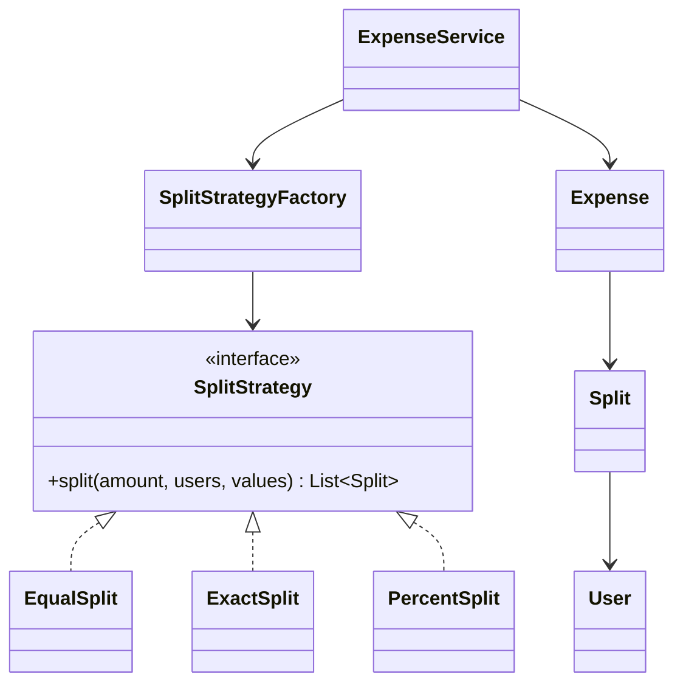

# Part 0 · Base Camp

Sep 28, 2026 · @saurav chaurasiya

**Is doc me:** A0 — LLD / machine coding interview kaise approach karein. Ek hi level, par ye pura LLD track ka base hai; isko ratt lo.

---

## A0 — LLD / machine coding interview kaise approach karein

### Sawaal

Flipkart-style machine coding round hai, 90 min. Problem statement: *"Splitwise jaisa expense sharing banao — user add karo, group banao, EQUAL / EXACT / PERCENT split support karo, aur kaun kisko kitna dena hai wo dikhao."* Interviewer ne bola: "koi DB nahi, in-memory chalega, `main()` se demo dikhana." Tum **pehle 10 minute** me exactly kya karoge? Apna minute-by-minute plan likh ke rakho, phir aage padho.

> **Pehle khud socho — 5 min.** Hints: (1) Sabse pehla kaam class likhna hai ya requirement list likhna hai? (2) 90 min me se demo, edge case aur walkthrough ke liye kitna time bachana zaroori hai? (3) Interviewer "extensible design" ka proof kis **ek** cheez me dhoondta hai?

### Problem kyun aata hai

Machine coding round code likhne ka test nahi hai, **bounded time me design decision lene** ka test hai. Problem statement jaan-boojh ke ambiguous di jaati hai. Log do tarah se fail karte hain: (a) 50 min design sochte rahe, code adhoora, demo hi nahi chala → reject; (b) turant 400-line ka ek `Main.java` likh diya jo chal bhi gaya, par saara logic ek class me → "no design, no extensibility" → reject. Rubric alag-alag axis pe score karta hai: working demo · class design · nayi requirement add karne me kitna code badla · edge cases · naming aur structure. Sirf ek axis pe full marks se clear nahi hota.

### Naive approach

Sab kuch ek "manager" class me:

```
class ExpenseManager {
    Map<String, Double> balances = new HashMap<>();

    void addExpense(String type, String payer, List<String> users,
                    double amount, List<Double> values) {
        if (type.equals("EQUAL")) {
            // divide, update balances, print
        } else if (type.equals("EXACT")) {
            // validate sum == amount, update, print
        } else if (type.equals("PERCENT")) {
            // validate sum == 100, update, print
        }
        // validation + balance update + printing — sab isi method me
    }
}
```

Chal jayega, par: naya split type add karna = **isi method ko todna** (Open-Closed principle gaya), unit test karna mushkil kyunki sab coupled hai, aur interviewer ko ek bhi class aisi nahi dikh rahi jiska naam domain se aaya ho. Score yahin girta hai — code "kaam kar raha hai" ke bawajood.

### Sahi design

Ek fix 7-step recipe, har baar wahi, timeboxed (90 min round ke hisaab se):

1. **0–7 min · Requirements freeze.** Bullet me likho: 5–6 must-have, aur 2 cheezein *explicitly out of scope*. Loudly bolo: "Main assume kar raha hoon — single currency, no persistence, single-threaded, no auth." Interviewer galat assumption turant correct kar dega — ye round ka sabse sasta feedback hai.
2. **7–12 min · Entities aur enums.** Statement se noun nikalo: `User`, `Group`, `Expense`, `Split`, `SplitType`. Ye sirf data hain — inme business logic nahi.
3. **12–20 min · Interfaces + ek pattern.** Jo cheez "type" ke hisaab se badalti hai → **Strategy**. Jo object banana branching maangta hai → **Factory**. Bas. Ek ya do pattern, jinhe justify kar sako.
4. **20–65 min · Implementation, bottom-up.** Entities → strategy impls → service → in-memory repository. Har \~15 min pe compile karo, warna last 10 min me 30 errors milenge.
5. **65–75 min · `main()` demo.** Ek scripted scenario jo har feature ko ek baar chhuye, aur output insaan ke padhne layak ho.
6. **75–85 min · Edge cases + validation.** amount ≤ 0, percent ka sum ≠ 100, exact ka sum ≠ amount, user group me nahi, khud ko khud pay kar raha hai, aur **rounding** (paise!).
7. **85–90 min · 3-line README + walkthrough.** Classes ka map, aur ek line: "naya split type add karne ke liye ye 2 jagah chhuni padegi."

Skeleton — Strategy hi extensibility ka proof hai:

```java
// ---------- entities: data only ----------
record User(String id, String name) {}

record Split(User user, double amount) {}

enum SplitType { EQUAL, EXACT, PERCENT }

class Expense {
    final String id;
    final User paidBy;
    final double amount;
    final List<Split> splits;

    Expense(String id, User paidBy, double amount, List<Split> splits) {
        if (amount <= 0) throw new IllegalArgumentException("amount must be > 0");
        this.id = id; this.paidBy = paidBy; this.amount = amount; this.splits = splits;
    }
}

// ---------- the one pattern that earns the score ----------
interface SplitStrategy {
    List<Split> split(double amount, List<User> users, List<Double> values);
}

class EqualSplit implements SplitStrategy {
    public List<Split> split(double amount, List<User> users, List<Double> ignored) {
        long paise = Math.round(amount * 100);      // paise me kaam karo, double me nahi
        long each  = paise / users.size();
        long rem   = paise % users.size();          // bacha hua paisa payer ke khaate me
        List<Split> out = new ArrayList<>();
        for (int i = 0; i < users.size(); i++) {
            long p = each + (i == 0 ? rem : 0);
            out.add(new Split(users.get(i), p / 100.0));
        }
        return out;
    }
}

class ExactSplit implements SplitStrategy {
    public List<Split> split(double amount, List<User> users, List<Double> values) {
        double sum = values.stream().mapToDouble(Double::doubleValue).sum();
        if (Math.abs(sum - amount) > 0.01) throw new IllegalArgumentException("exact splits must sum to amount");
        List<Split> out = new ArrayList<>();
        for (int i = 0; i < users.size(); i++) out.add(new Split(users.get(i), values.get(i)));
        return out;
    }
}

class PercentSplit implements SplitStrategy {
    public List<Split> split(double amount, List<User> users, List<Double> pct) {
        double sum = pct.stream().mapToDouble(Double::doubleValue).sum();
        if (Math.abs(sum - 100.0) > 0.001) throw new IllegalArgumentException("percent must sum to 100");
        List<Split> out = new ArrayList<>();
        for (int i = 0; i < users.size(); i++) out.add(new Split(users.get(i), amount * pct.get(i) / 100.0));
        return out;
    }
}

class SplitStrategyFactory {
    private static final Map<SplitType, SplitStrategy> REGISTRY = Map.of(
        SplitType.EQUAL,   new EqualSplit(),
        SplitType.EXACT,   new ExactSplit(),
        SplitType.PERCENT, new PercentSplit());

    static SplitStrategy of(SplitType type) {
        SplitStrategy s = REGISTRY.get(type);
        if (s == null) throw new UnsupportedOperationException("no strategy for " + type);
        return s;
    }
}

// ---------- service: patla, sirf orchestrate karta hai ----------
class ExpenseService {
    private final Map<String, Map<String, Double>> ledger = new HashMap<>(); // owedBy -> owedTo -> amount
    private int seq = 0;

    Expense addExpense(User paidBy, double amount, List<User> users,
                       SplitType type, List<Double> values) {
        List<Split> splits = SplitStrategyFactory.of(type).split(amount, users, values);
        Expense e = new Expense("EXP" + (++seq), paidBy, amount, splits);
        for (Split s : splits) {
            if (s.user().equals(paidBy)) continue;
            ledger.computeIfAbsent(s.user().id(), k -> new HashMap<>())
                  .merge(paidBy.id(), s.amount(), Double::sum);
        }
        return e;
    }

    void showBalances() {
        if (ledger.isEmpty()) { System.out.println("No balances"); return; }
        ledger.forEach((from, owed) -> owed.forEach((to, amt) ->
            System.out.printf("%s owes %s : %.2f%n", from, to, amt)));
    }
}

public class Main {
    public static void main(String[] args) {
        User saurav = new User("u1", "Saurav");
        User riya   = new User("u2", "Riya");
        User karan  = new User("u3", "Karan");

        ExpenseService svc = new ExpenseService();
        svc.addExpense(saurav, 1000.0, List.of(saurav, riya, karan), SplitType.EQUAL, List.of());
        svc.addExpense(riya,    500.0, List.of(saurav, riya),        SplitType.PERCENT, List.of(60.0, 40.0));
        svc.showBalances();

        // edge case demo — interviewer ke saamne ye chalana bhulna nahi
        try {
            svc.addExpense(saurav, 300.0, List.of(saurav, riya), SplitType.PERCENT, List.of(70.0, 20.0));
        } catch (IllegalArgumentException ex) {
            System.out.println("rejected: " + ex.getMessage());
        }
    }
}
```



### Kya choose karein aur kyun

Strategy + Factory chuna, `if-else` chain ya inheritance tree nahi, kyunki naya split type = **ek naya class + registry me ek line**; purana tested code chhua hi nahi gaya (OCP). Inheritance (`class PercentExpense extends Expense`) yahan galat hai kyunki badalne wali cheez *behaviour* hai, *identity* nahi — `Expense` to har case me Expense hi hai. In-memory storage ko bhi ek `ExpenseRepository` interface ke peeche rakho — 2 min ka kaam, aur "DB kaise lagaoge?" ka jawab pehle se taiyar. Par **over-engineer mat karo**: 90 min me DI framework, har class ka Builder, ya generics gymnastics = time gaya aur demo nahi chala. Ek chalte hue simple design > ek adhoore "perfect" design.

### India me kaise hota hai

Flipkart, Swiggy, Uber, Udaan jaisi companies ka machine coding round exactly aise 60–120 min ke problem statement pe chalta hai, jisme working aur extensible code chahiye hota hai — DSA puzzle nahi ([workat.tech — what is a machine coding round](https://workat.tech/machine-coding/article/what-is-a-machine-coding-round-omfn1w54ojlg)). Evaluation me demo chalna, class design, aur "nayi requirement pe kitna code badla" — teen alag axis pe marks milte hain ([machine coding round preparation guide](https://www.lowleveldesignmastery.com/blog/machine-coding-round/)). Aur ye pattern payments codebase me literally waisa hi dikhta hai: `UpiPaymentMethod`, `CardPaymentMethod`, `WalletPaymentMethod` — sab ek `PaymentMethod` interface ke peeche, aur routing layer runtime pe strategy choose karta hai. Juspay ke open-source Hyperswitch me bhi har payment processor ek pluggable **connector** hai, core business logic chhue bina naya processor add ho jata hai ([Hyperswitch architecture](https://hyperswitch.io/blog/high-level-architecture-of-hyperswitch)).

### Interview follow-ups

- *"Naya split type add karo — abhi, mere saamne."* → Naya class jo `SplitStrategy` implement kare + factory registry me ek entry. Baaki kuch nahi badla. Yahi Strategy ka pura point hai, aur yahi wo moment hai jahan score banta hai.
- *"Isme concurrency add karo — do log ek saath expense daal rahe hain."* → Ledger `ConcurrentHashMap` + per-group lock, ya single writer thread + queue (contention kam, ordering guaranteed). Detail: Part 3 · Thread Jungle (T1–T12) — abhi banna baaki.
- *"DB laga do."* → `ExpenseRepository` interface service ke peeche; `InMemoryExpenseRepository` → `JdbcExpenseRepository`. Service ka ek line bhi nahi badlega.
- *"Rounding kaise handle kiya?"* → Paise me integer arithmetic, remainder payer ko. `double` se paisa compare kabhi nahi; production me `BigDecimal` ya `long paise`.
- *"Kitne design pattern use karne chahiye?"* → 1–2, jo justify ho sake. Pattern ki list ragadna negative marking hai — interviewer "pattern jaanta hai" nahi, "pattern **kab** lagana hai jaanta hai" dekh raha hai.

### Self-check

(1) 90 min ka 7-step timebox bina dekhe likho, minute ke saath. (2) God-class approach me "naya split type" add karne pe kitne methods badalte hain, aur Strategy me kitne? (3) Kaun si 3 edge cases tum har machine coding demo me dikhaoge?

### Notebook

Machine coding = bounded-time **decision** test, DSA nahi · 7 steps: requirements freeze 7m → entities 5m → interface + 1 pattern 8m → code bottom-up 45m → main() demo 10m → edge cases 10m → walkthrough 5m · Jo "type" se badle = Strategy; banana branching maange = Factory · God class = OCP violation, score yahin girta hai · Paisa = long paise ya BigDecimal, double kabhi nahi; remainder payer ko · Repository interface 2 min me bana do, "DB kaise?" ka jawab ready · 1–2 pattern max; chalta hua simple > adhoora perfect.

---

## Aage kya

- Ye LLD track ka **pehla** zone hai — isse pehle kuch nahi.
- Agla zone: **1A · OOP Village** (O1–O5) — abhi banna baaki.
- Aaj ka HLD zone: [1A · Scaling Valley — L1.1–L1.5](https://claude.ai/code/artifact/7ddee338-4d3e-45ec-b8a6-405a5af727a5)

* **Agla zone ban gaya:** [LLD 1A · OOP Village (O1–O5)](https://claude.ai/code/artifact/cc69c0d1-92e9-4c1d-afd8-8add12f3e7db)
