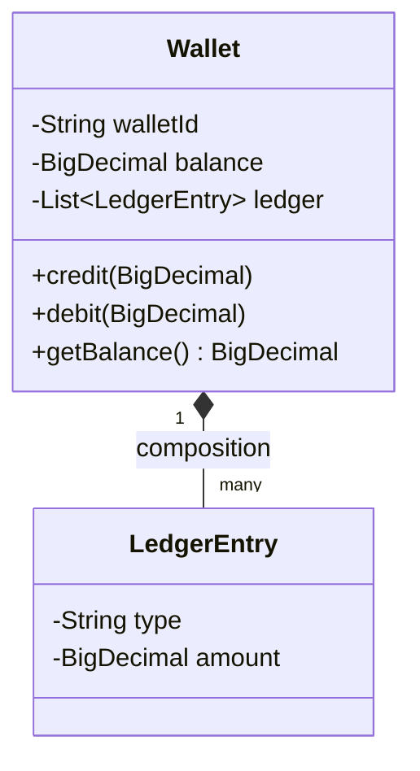
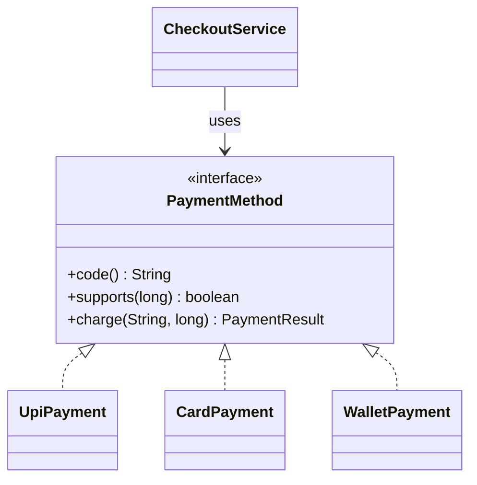
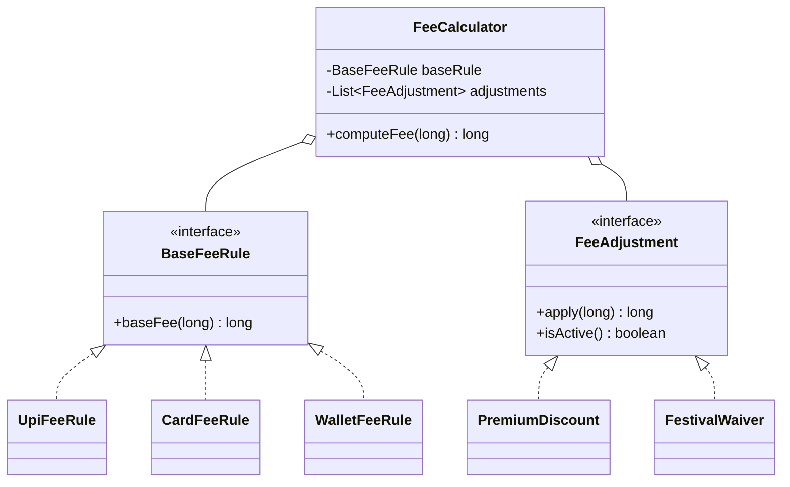
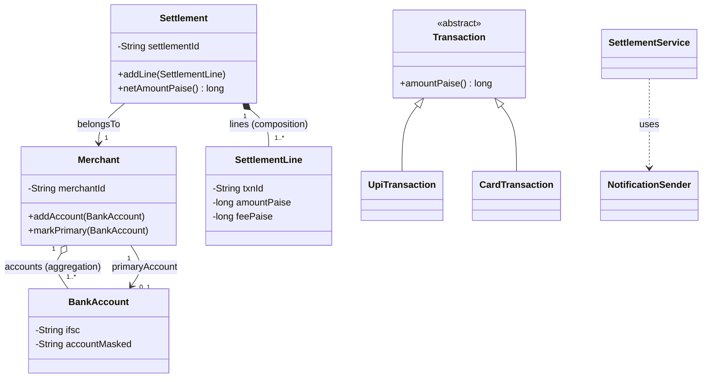
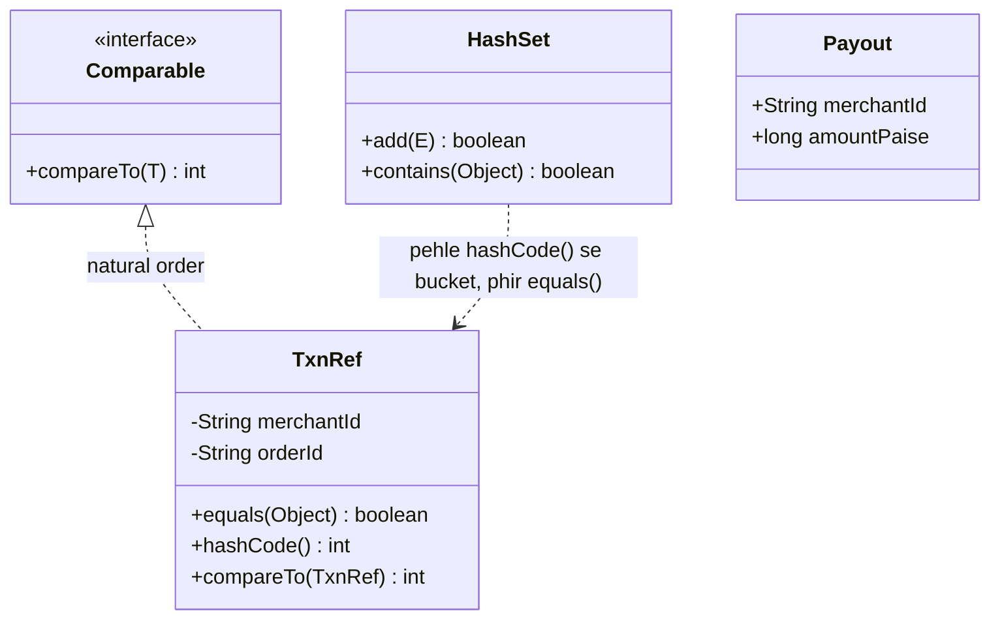
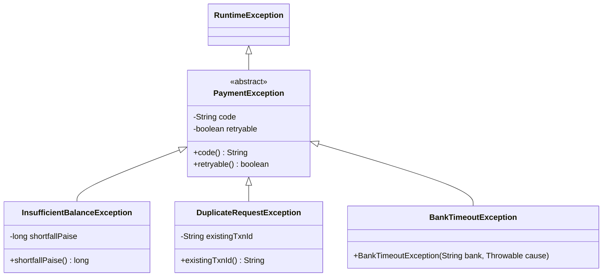

# 1A · OOP Village

Sep 29, 2026 · @saurav chaurasiya

**Is doc me 7 lessons:** O1 Encapsulation · O2 Abstraction · O3 Inheritance vs composition · O4 Polymorphism · O5 Relationships & UML · O6 equals, hashCode aur collections · O7 Exception design.

**Padhne ka tareeka — zaroori:** har lesson do hisso me hai. **Core** (\~20 min) woh hai jo pakka aana chahiye — machine coding round me yahi kaam aata hai. Uske neeche **Deep Dive** hai — tables, edge cases aur extra follow-ups; pehli baar me chhod sakte ho. Roz ka target: **2 lessons ka Core**, ya **1 lesson Core + Deep Dive**.

**LLD me ek extra rule:** code sirf padhna kaafi nahi. Har lesson ka Java khud IDE me type karke chalao — copy-paste nahi. Machine coding round me haath ki speed bhi test hoti hai.

---

## O1 — Encapsulation

Encapsulation ka matlab hai object ka data andar chhupa ke rakhna, aur usko badalne ke liye bahar sirf gine-chune methods dena. Bahar ka code `balance` field ko seedha nahi chhoo sakta — usko `credit()` ya `debit()` bulana padta hai, aur wahi method niyam check karta hai. Isse object galat state me pahunchna lagbhag mushkil ho jaata hai.

**Core · \~20 min** — SDE-1: must-know · SDE-2: must-know

### Ye cheez hai kya

- **Encapsulation** = ek class ke andar ka data (fields) bahar se seedha chhua na ja sake; sirf us class ke apne methods usko badal sakein.
- Ye **OOP ke 4 pillars** me pehla hai (encapsulation, abstraction, inheritance, polymorphism). "Pillar" ka matlab bas itna hai ki object-oriented design ki saari baatein inhi 4 ideas pe khadi hain.
- Iska asli maqsad "private laga do" nahi hai — maqsad hai **invariant** ki hifazat. **Invariant** = ek baat jo object ki zindagi bhar hamesha sach honi chahiye (jaise "balance kabhi negative nahi").
- Is lesson ke baad tum aisi class likh paoge jise **galat state me laana asambhav** ho.

> **Analogy:** ATM. Andar cash hai par haath daal ke nahi nikaal sakte. Ek hi darwaza milta hai — `withdraw(amount)` — aur woh darwaza khud check karta hai ki paisa hai ya nahi.

### Sawaal

Ek `Wallet` class banao. Rules: (1) balance kabhi negative nahi; (2) paisa sirf `credit`/`debit` se badle aur har badlav ka record bane; (3) do threads ek saath debit karein toh balance galat na ho.

> **Pehle khud socho — 5 min.** Hints: (1) `balance` ko `public` rakhne se kya-kya toot sakta hai? (2) sirf `getBalance()` aur `setBalance()` de do toh rule 1 bachega? (3) paise ke liye `double` sahi type hai kya?

### Problem kyun aata hai

1. **Data public ho toh rule kahin bhi tod diya jaayega.** `wallet.balance` bahar se likha ja sakta hai toh "negative nahi" ka check **har call site** pe lagana padega — ek jagah bhoole toh bug.
2. **Public setter wahi galti hai, naye naam se.** `setBalance(-500)` aur `wallet.balance = -500` me koi farq nahi, agar setter check nahi karta.
3. **Object apni state ka maalik hota hai.** Jab state koi aur badal sakta hai, object apne rule ki guarantee nahi de sakta — aur bug ka doshi dhoondhna mushkil ho jaata hai.

### Naive approach

```java
// BURA CODE - sirf dikhane ke liye
public class Wallet {
    public double balance;          // koi bhi kuch bhi kar sakta hai
    public List<String> history;
    public void setBalance(double b) { this.balance = b; }   // bina check ke
    public List<String> getHistory() { return history; }     // andar ki asli list de di
}
```

1. `wallet.balance = -9999;` — rule 1 khatam, compiler chup.
2. `wallet.getHistory().clear();` — audit trail uda diya, kyunki getter ne **andar ki asli list** ka reference diya, copy nahi.
3. `double` paise ke liye galat: `0.1 + 0.2` Java me `0.30000000000000004` deta hai.
4. Do threads ne saath balance padha (100), dono ne 80 debit kiya, dono ne 20 likha — balance 20, jabki 160 nikla. Ye **race condition** hai.

### Sahi design

```java
import java.math.BigDecimal;
import java.util.*;

final class LedgerEntry {              // immutable record: kya hua, kitne ka
    private final String type;
    private final BigDecimal amount, balanceAfter;
    LedgerEntry(String type, BigDecimal amount, BigDecimal balanceAfter) {
        this.type = type; this.amount = amount; this.balanceAfter = balanceAfter;
    }
    @Override public String toString() { return type + " " + amount + " -> " + balanceAfter; }
}

public final class Wallet {
    private final String walletId;
    private BigDecimal balance;        // paise ke liye BigDecimal, double nahi
    private final List<LedgerEntry> ledger = new ArrayList<>();

    public Wallet(String walletId, BigDecimal opening) {
        // rule constructor me hi - galat object ban hi na paaye
        this.walletId = Objects.requireNonNull(walletId, "walletId null nahi ho sakta");
        if (opening == null || opening.signum() < 0)
            throw new IllegalArgumentException("Opening balance negative nahi ho sakta");
        this.balance = opening;
    }

    // synchronized = ek waqt me ek hi thread andar ghusega
    public synchronized void credit(BigDecimal amt) {
        requirePositive(amt);
        balance = balance.add(amt);
        ledger.add(new LedgerEntry("CREDIT", amt, balance));
    }

    public synchronized void debit(BigDecimal amt) {
        requirePositive(amt);
        if (balance.compareTo(amt) < 0)     // rule 1 ki hifazat SIRF yahan
            throw new IllegalStateException("Balance kam hai: " + balance + " < " + amt);
        balance = balance.subtract(amt);
        ledger.add(new LedgerEntry("DEBIT", amt, balance));
    }

    public synchronized BigDecimal getBalance() { return balance; }  // BigDecimal khud immutable

    public synchronized List<LedgerEntry> getLedger() {   // defensive copy + read-only view
        return Collections.unmodifiableList(new ArrayList<>(ledger));
    }

    private static void requirePositive(BigDecimal amt) {
        if (amt == null || amt.signum() <= 0)
            throw new IllegalArgumentException("Amount positive hona chahiye");
    }

    public static void main(String[] args) {
        Wallet w = new Wallet("W-1042", new BigDecimal("100.00"));
        w.credit(new BigDecimal("50.00"));
        w.debit(new BigDecimal("120.00"));
        System.out.println(w.getBalance() + " | " + w.getLedger());   // 30.00
        try { w.debit(new BigDecimal("999.00")); }
        catch (IllegalStateException e) { System.out.println("Roka gaya: " + e.getMessage()); }
    }
}
```

5 faisle jo is code me hain:

1. **Field `private`, jahan ho sake `final`.** `walletId` kabhi badalta nahi → `final`.
2. **Rule constructor me lagao** — object galat state me ban hi nahi sakta. Isko *always-valid object* kehte hain.
3. **Setter nahi, behaviour do.** `setBalance` ki jagah `credit`/`debit` — kyunki wahi asli business action hai, aur rule ek hi jagah check hota hai.
4. **Collection ka reference bahar mat do** — copy + `unmodifiableList`. Isko *defensive copy* kehte hain.
5. **Paise ke liye `BigDecimal`** (ya `long` me paise ginna). `double` kabhi nahi.



**Interview me bolne wali line:** *encapsulation ka matlab "getter-setter likhna" nahi, "galat state banana asambhav kar dena" hai.*

### Notebook

Encapsulation = invariant ki hifazat, getter/setter likhna nahi · Fields `private`, jahan ho `final` · Rule **constructor** me → galat object ban hi na paaye · Setter ki jagah **behaviour** (`credit`/`debit`) — rule ek hi jagah · Collection lautate waqt **defensive copy + unmodifiableList** · Paisa = `BigDecimal` ya `long` paise; `double` kabhi nahi · `synchronized` sirf ek JVM me; multi-server me DB lock · Sab getter/setter = *anemic domain model* (anti-pattern)

### Padhne ke liye

- [Encapsulation — Wikipedia](<https://en.wikipedia.org/wiki/Encapsulation_(computer_programming)>) — definition, information hiding se farq, aur kyun ye do alag cheezein hain.
- [Object-oriented programming — Wikipedia](https://en.wikipedia.org/wiki/Object-oriented_programming) — poore OOP ka overview. **O1–O4 shuru karne se pehle ek baar ye padh lo, poori series jodne me madad karega.**
- [Floating-point arithmetic — Wikipedia](https://en.wikipedia.org/wiki/Floating-point_arithmetic) — `double` me paisa kyun nahi. "Accuracy problems" section kaafi hai.
- [Round-off error — Wikipedia](https://en.wikipedia.org/wiki/Round-off_error) — error jamti kaise hai, chhota article.

### Deep Dive (SDE-2) — jab time ho

#### Kya choose karein aur kyun

| Choice | Kab use karo | Kab mat karo |
| --- | --- | --- |
| **`private` field + behaviour methods** | Jab class ka koi invariant ho (balance, status, quantity) | Pure data-carrier pe — wahan Java `record` behtar |
| **Java `record`** | Immutable data, koi rule nahi (API response, ek event) | Jab mutable state aur rules ho |
| **Getter + setter dono** | Framework (JPA, Jackson) ki majboori | Domain class me by default — encapsulation khokhla ho jaata hai |
| **`BigDecimal`** | Paisa, tax, interest | Heavy math loops me (tab `long` paise) |

#### Interview follow-ups

1. *"Getter bhi encapsulation todta hai?"* — Haan, agar getter mutable object (List, Date, array) ka asli reference de de. Defensive copy ya immutable type do.
2. *"Har field pe getter/setter kyun galat hai?"* — Class ek data bag ban jaati hai aur business rules bahar bikhar jaate hain — *anemic domain model*.
3. *"`final` field se kya fayda?"* — Compiler guarantee ki value badlegi nahi, aur multi-threading me safely publish hoti hai.
4. *"`synchronized` kaafi hai?"* — Ek JVM ke andar haan. 20 servers pe nahi — wahan DB row lock ya conditional update (`UPDATE ... WHERE balance >= ?`) chahiye. Ye 2D · Lock Fort me aayega (abhi banna baaki).
5. *"Immutability aur encapsulation ka rishta?"* — Immutable object me invariant todne ka koi raasta hi nahi bachta — isliye immutability encapsulation ka sabse strong roop hai.

#### India me kaise hota hai

Payments me `Money`, `Amount`, `TransactionId` jaise **value objects** banaye jaate hain jinme validation constructor me hi ho jaati hai, taaki `-100` rupaye ya khaali order id andar ghus hi na sake.

#### Self-check

(1) `getLedger()` me copy kyun — bina copy ke kya tootta? (2) `setBalance()` ki jagah `credit`/`debit` ka asli fayda? (3) "always valid object" ka matlab?

---

## O2 — Abstraction

Abstraction ka matlab hai caller ko sirf "kya hota hai" dikhana aur "kaise hota hai" chhupa dena. Ek `PaymentMethod` interface itna batata hai ki isse payment ho sakti hai; UPI, card ya netbanking ka asli jhanjhat uske implementations ke andar rehta hai. Encapsulation ek object ka data chhupata hai, abstraction poora tareeka chhupata hai.

**Core · \~20 min** — SDE-1: must-know · SDE-2: must-know

### Ye cheez hai kya

- **Abstraction** = caller ko sirf ye batana ki *kya* ho sakta hai; *kaise* hota hai woh chhupa dena.
- Java me do tareeke: **interface** (sirf method ke naam aur signature) aur **abstract class** (kuch kaam likha hua, kuch adhoora).
- Encapsulation se farq: **encapsulation ek object ki apni state chhupata hai; abstraction poore implementation ka tareeka chhupata hai.** Ek "data hide", doosra "logic hide".
- Is lesson ke baad tum aisa design bana paoge jisme naya variant jodne ke liye purani file khulti hi na ho.

> **Analogy:** auto ka **meter**. Tumhe sirf "kitna hua" dikhta hai. Andar ka calculation — per km rate, waiting charge, night surcharge — chhupa hai. Meter badal do, tumhara kaam wahi rahega.

### Sawaal

Checkout pe 4 payment modes hain: UPI, Card, Netbanking, Wallet. Har ek ka flow bilkul alag — UPI me collect request, card me 3DS OTP, netbanking me bank ke page pe redirect, wallet me seedha debit.

Kal EMI aur Postpaid bhi jodne hain. Aisa design banao ki naya mode jodte waqt checkout ka code **bilkul na badle**.

> **Pehle khud socho — 5 min.** Hints: (1) checkout ko har mode ke baare me *sach me* kya jaanna zaroori hai? (2) `if/else` me naya mode jodne pe kaunsi file badalti hai? (3) common cheez kya hai — sabme "paisa lo, result do" hi hota hai na?

### Problem kyun aata hai

1. **Caller ko implementation pata ho toh woh usi se bandh jaata hai.** Checkout agar `UpiClient` aur `CardGateway` ko naam se jaanta hai, toh har naye mode pe checkout badlega.
2. **`if/else` chain badhti hi jaati hai.** Har naya mode = ek branch = purane code me edit = purane tests dobara.
3. **Testing mushkil ho jaati hai.** Checkout ke test me asli UPI client chal jaayega. Beech me interface hota toh test me nakli implementation daali ja sakti thi.

### Naive approach

```java
// BURA CODE
public class CheckoutService {
    public String pay(String mode, long amountPaise, String orderId) {
        if (mode.equals("UPI")) {
            return new UpiClient().sendCollectRequest(orderId, amountPaise);  // naam se bandha
        } else if (mode.equals("CARD")) {
            CardGateway card = new CardGateway();
            card.tokenize(orderId);                    // card ka 2-step flow leak ho gaya
            return card.charge(orderId, amountPaise);
        }
        throw new IllegalArgumentException("Unknown mode");
    }
}
```

1. **EMI jodne ke liye is file ko kholna padega** — jabki EMI ka checkout se koi lena-dena nahi.
2. **Card ka 2-step flow checkout me ghus gaya** — ye card ka andar ka mamla tha.
3. **`new` andar likha hai** → test me fake nahi daal sakte.
4. String `"UPI"` galat likh do toh compiler nahi pakdega, runtime pe pata chalega.

### Sahi design

```java
import java.util.*;

final class PaymentResult {
    final boolean success; final String reference, message;
    PaymentResult(boolean s, String ref, String msg) { success = s; reference = ref; message = msg; }
    @Override public String toString() {
        return (success ? "SUCCESS " : "FAILED ") + reference + " (" + message + ")";
    }
}

/** Abstraction: checkout ko bas itna pata hona chahiye. */
interface PaymentMethod {
    String code();                              // "UPI", "CARD" ...
    boolean supports(long amountPaise);         // limit ka rule har mode ka apna
    PaymentResult charge(String orderId, long amountPaise);
}

class UpiPayment implements PaymentMethod {
    public String code() { return "UPI"; }
    public boolean supports(long p) { return p <= 100_000_00L; }   // 1 lakh ki limit
    public PaymentResult charge(String orderId, long p) {
        return new PaymentResult(true, "UPI-" + orderId, "collect request bheji");
    }
}

class CardPayment implements PaymentMethod {
    public String code() { return "CARD"; }
    public boolean supports(long p) { return p > 0; }
    public PaymentResult charge(String orderId, long p) {
        String token = tokenize(orderId);       // 2-step flow ANDAR hi rahega
        return new PaymentResult(true, "CARD-" + token, "3DS ke baad captured");
    }
    private String tokenize(String orderId) { return "TK-" + orderId; }
}

class WalletPayment implements PaymentMethod {
    public String code() { return "WALLET"; }
    public boolean supports(long p) { return p <= 10_000_00L; }
    public PaymentResult charge(String orderId, long p) {
        return new PaymentResult(true, "WLT-" + orderId, "wallet se debit");
    }
}

/** Checkout kisi concrete class ko nahi jaanta - sirf interface ko. */
class CheckoutService {
    private final Map<String, PaymentMethod> methods = new HashMap<>();

    // methods bahar se aate hain (dependency injection) - test me fake daal sakte ho
    CheckoutService(PaymentMethod... available) {
        for (PaymentMethod m : available) methods.put(m.code(), m);
    }

    PaymentResult pay(String modeCode, String orderId, long amountPaise) {
        PaymentMethod m = methods.get(modeCode);
        if (m == null) throw new IllegalArgumentException("Mode available nahi: " + modeCode);
        if (!m.supports(amountPaise))
            return new PaymentResult(false, null, modeCode + " is amount ko support nahi karta");
        return m.charge(orderId, amountPaise);
    }

    public static void main(String[] args) {
        CheckoutService checkout = new CheckoutService(
            new UpiPayment(), new CardPayment(), new WalletPayment());
        System.out.println(checkout.pay("UPI",    "ORD-1", 250_00L));
        System.out.println(checkout.pay("WALLET", "ORD-2", 50_000_00L));  // limit se upar
        System.out.println(checkout.pay("CARD",   "ORD-3", 999_00L));
        // EMI jodna ho: ek nayi class likho aur constructor me pass kar do.
        // CheckoutService ki ek line bhi nahi badlegi.
    }
}
```

Steps:

1. **Common contract nikaalo** — sab modes me jo *sach me* same hai: "itna paisa lo, result do".
2. **Use interface bana do** (`PaymentMethod`).
3. **Har mode ka apna implementation** — andar ka flow jitna alag ho, bahar dikhta ek jaisa hai.
4. **Caller sirf interface se baat kare** — `new UpiPayment()` checkout ke andar kabhi nahi.
5. **Implementations bahar se do** (constructor me). Isko **dependency injection** kehte hain — object apni dependency khud nahi banata, use di jaati hai.



**Interview me bolne wali line:** *abstraction ka test simple hai — naya variant jodne pe purani file khulti hai ya nahi. Khulti hai toh abstraction adhoora hai.*

### Notebook

Abstraction = "kaise" chhupao, "kya" dikhao · Encapsulation = state hide; abstraction = implementation hide · Test: naya variant jodne pe purani file khulti hai? khulti hai toh adhoora · interface = capability (kai implement ho sakte hain), abstract class = identity + shared code (ek hi extend) · interface ke default method me **state nahi** rakh sakte · `new` caller ke andar nahi → dependency injection · *Leaky abstraction* = andar ki detail contract me jhaank rahi hai · Ek hi implementation ho toh interface mat banao

### Padhne ke liye

- [Abstraction (computer science) — Wikipedia](<https://en.wikipedia.org/wiki/Abstraction_(computer_science)>) — abstraction ka general idea, sirf OOP me nahi.
- [Defining an Interface — Oracle Java Tutorials](https://docs.oracle.com/javase/tutorial/java/IandI/interfaceDef.html) — official, chhota, exact. Interface ka syntax aur rules.
- [Abstract Methods and Classes — Oracle Java Tutorials](https://docs.oracle.com/javase/tutorial/java/IandI/abstract.html) — interface vs abstract class ka official jawab. **Interview me yahi wording use karo.**
- [Multiple Inheritance of State, Implementation, and Type — Oracle](https://docs.oracle.com/javase/tutorial/java/IandI/multipleinheritance.html) — Java multiple inheritance kyun nahi deta, aur default method ke saath kya hota hai.

### Deep Dive (SDE-2) — jab time ho

#### Kya choose karein aur kyun

| Choice | Kab use karo | Kab mat karo |
| --- | --- | --- |
| **interface** | Sirf contract chahiye, har implementation apna sab khud kare | Jab implementations me kaafi code common ho aur repeat ho raha ho |
| **abstract class** | Common code share karna ho (logging, retry) | Jab multiple inheritance jaisa kuch chahiye — Java ek hi class extend karne deta hai |
| **interface + default method** | Contract me ek sensible default dena ho | Bade shared logic ke liye — woh abstract class ya helper me accha |
| **enum + switch** | Modes fixed hain aur kabhi nahi badlenge (HTTP methods) | Jab naye modes aate rehte ho |

#### Interview follow-ups

1. *"Interface vs abstract class — ek line?"* — Interface = "kya kar sakta hai" (capability); abstract class = "kya hai" + thoda shared code. Java me class ek hi extend hoti hai, interfaces kai.
2. *"Default methods ne interface ko abstract class bana diya?"* — Nahi. Default method me **state (fields) nahi** rakh sakte; abstract class me rakh sakte ho.
3. *"Har cheez ka interface bana dein?"* — Nahi. Ek hi implementation aur doosri aane ka aasar nahi → interface sirf ek extra file hai. Interface tab banao jab **variation asli ho**.
4. *"Ye SOLID ke kis principle se judta hai?"* — Open/Closed (naye mode ke liye khula, purani file ke edit ke liye band) aur Dependency Inversion. Ye 1B · SOLID Temple me aayenge (abhi banna baaki).
5. *"Leaky abstraction kya hai?"* — Jab andar ki detail bahar dikh jaye — jaise `PaymentMethod` me `getCardToken()` hona. Caller phir se card ko jaanne lagta hai.

#### India me kaise hota hai

Har payment gateway ka public API yahi abstraction deta hai — tum `create order` → `payment method` → `status` dekhte ho; andar UPI, card, netbanking ke bilkul alag flows chalte hain. Aur is interface ke peeche aksar ek **router** hota hai jo success-rate ke hisaab se gateway chunta hai — ye tabhi mumkin hai jab caller concrete gateway ko na jaanta ho.

#### Self-check

(1) Encapsulation aur abstraction me farq ek line me. (2) `new UpiPayment()` ko `CheckoutService` ke andar rakhna kyun galat? (3) EMI jodne pe kitni purani files badlengi is design me?

---

## O3 — Inheritance vs composition

Inheritance ka matlab hai ek class doosri class ka roop le lena (`CardFee extends Fee`), aur composition ka matlab hai ek class doosre object ko apne andar rakh ke uska kaam karwana. Dono code reuse dete hain, lekin inheritance rishta permanent aur sakht bana deta hai jabki composition usko badalne layak chhodta hai. Yahi faisla LLD interview me sabse zyada poocha jaata hai.

**Core · \~25 min** — SDE-1: must-know · SDE-2: must-know. **LLD interview ka sabse zyada poocha jaane wala faisla yahi hai.**

### Ye cheez hai kya

- **Inheritance** = ek class doosri ko `extends` karti hai aur uska code aur type dono le leti hai. Rishta: **"is-a"**.
- **Composition** = ek class doosre object ko apne andar ek field ki tarah rakhti hai aur kaam usse karwati hai. Rishta: **"has-a"**.
- Dono code reuse dete hain, par inheritance **compile time pe pakka** ho jaata hai aur composition **runtime pe badla** ja sakta hai.

> **Analogy:** **Inheritance** = khandaani peshaa — jis ghar me paida hue wahi kaam mila, badal nahi sakte. **Composition** = toolbox ke tools — kaam ke hisaab se tool badal lete ho.

### Sawaal

Merchants ke liye transaction fee calculate karni hai:

1. UPI pe fee zero. 2. Card pe 2%, minimum Rs 3. 3. Wallet pe 1%.
2. "Premium" merchants ko har fee pe 50% discount.
3. Festival offer me kuch merchants ki fee 1 mahine ke liye zero — aur ye **runtime pe on/off** hona chahiye.

Ek junior dev ne `Fee` → `CardFee` → `PremiumCardFee` → `PremiumCardFestivalFee` chain banayi. Problem kya hai, aur tum kaise karoge?

> **Pehle khud socho — 5 min.** Hints: (1) 3 modes × premium haan/nahi × festival haan/nahi = kitni classes? (2) kya Java me object ka class runtime pe badla ja sakta hai? (3) ye teen cheezein ek hi cheez hain ya teen alag?

### Problem kyun aata hai

1. **Inheritance sirf ek dimension sambhalta hai.** Fee ke teen independent dimensions hain (mode, premium, festival). Ek class chain ek hi line me chalti hai — teen dimensions ko ek line me daalne ki koshish me classes ki multiplication ho jaati hai: 3 × 2 × 2 = **12 classes**. Isko **class explosion** kehte hain.
2. **Inheritance compile time pe fix hai.** Object `PremiumCardFee` ka ban gaya toh chalte-chalte `PremiumCardFestivalFee` nahi ban sakta. Rule 5 inheritance se **possible hi nahi** hai.
3. **Parent ka andar ka badlav child ko tod deta hai.** Parent ne apna internal call badla, saare children ka behaviour badal gaya — aur kisi ne kuch galat nahi kiya tha. Isko **fragile base class problem** kehte hain.

### Naive approach

```java
// BURA CODE - inheritance ka galat istemaal
class Fee { long compute(long p) { return 0; } }
class CardFee extends Fee {
    @Override long compute(long p) { return Math.max(300, p * 2 / 100); }   // 2%, min Rs 3
}
class PremiumCardFee extends CardFee {
    @Override long compute(long p) { return super.compute(p) / 2; }         // 50% discount
}
class PremiumCardFestivalFee extends PremiumCardFee {
    @Override long compute(long p) { return 0; }
}
// ... + WalletFee, PremiumWalletFee, PremiumWalletFestivalFee, UpiFee, ... = 12 classes
```

1. **12 classes**, aur kal "student merchant" discount aaya toh 24.
2. Festival khatam hone pe object ko `PremiumCardFestivalFee` se `PremiumCardFee` me badalna **asambhav** hai.
3. "50% discount" ka logic 3 jagah copy hoga (premium card, premium wallet, premium upi).

### Sahi design

Teen dimensions ko **teen alag cheez** maan lo, aur compose karo.

```java
import java.util.*;

/** Dimension 1: mode ki base fee. */
interface BaseFeeRule { long baseFee(long amountPaise); }

class UpiFeeRule    implements BaseFeeRule { public long baseFee(long p) { return 0L; } }
class CardFeeRule   implements BaseFeeRule { public long baseFee(long p) { return Math.max(300L, p * 2 / 100); } }
class WalletFeeRule implements BaseFeeRule { public long baseFee(long p) { return p * 1 / 100; } }

/** Dimension 2 aur 3: fee ke upar lagne wale adjustments. */
interface FeeAdjustment {
    long apply(long feeSoFar);
    boolean isActive();              // runtime on/off - yahi rule 5 ka jawab hai
}

class PremiumDiscount implements FeeAdjustment {
    private final boolean premium;
    PremiumDiscount(boolean premium) { this.premium = premium; }
    public long apply(long fee) { return fee / 2; }
    public boolean isActive() { return premium; }
}

class FestivalWaiver implements FeeAdjustment {
    private boolean on;                          // chalte-chalte badal sakta hai
    FestivalWaiver(boolean on) { this.on = on; }
    void setOn(boolean on) { this.on = on; }
    public long apply(long fee) { return 0L; }
    public boolean isActive() { return on; }
}

/** Composition: ek base rule + adjustments ki list. */
class FeeCalculator {
    private final BaseFeeRule baseRule;                                  // has-a
    private final List<FeeAdjustment> adjustments = new ArrayList<>();   // has-many

    FeeCalculator(BaseFeeRule baseRule) { this.baseRule = baseRule; }
    FeeCalculator with(FeeAdjustment a) { adjustments.add(a); return this; }

    long computeFee(long amountPaise) {
        long fee = baseRule.baseFee(amountPaise);
        for (FeeAdjustment a : adjustments)
            if (a.isActive()) fee = a.apply(fee);    // sirf active adjustments lagte hain
        return fee;
    }

    public static void main(String[] args) {
        FestivalWaiver festival = new FestivalWaiver(false);
        FeeCalculator premiumCard = new FeeCalculator(new CardFeeRule())
                .with(new PremiumDiscount(true))
                .with(festival);

        long amount = 1_000_00L;                                  // Rs 1000
        System.out.println("Fee: " + premiumCard.computeFee(amount));   // 2%=2000, /2 = 1000 paise

        festival.setOn(true);                                     // RUNTIME pe festival chalu
        System.out.println("Festival me: " + premiumCard.computeFee(amount));  // 0

        System.out.println("UPI: " + new FeeCalculator(new UpiFeeRule()).computeFee(amount));  // 0
    }
}
```

Steps:

1. **Dimensions ginno.** Teen independent cheezein thi → teen alag abstractions.
2. **Har dimension ka apna interface.**
3. **Combine karne ke liye object rakho, extend mat karo.**
4. **Runtime switch chahiye toh usko object ki state banao** (`FestivalWaiver.on`), class ka naam nahi.
5. Nateeja: 12 classes ki jagah **6 chhoti classes**, aur naya discount = ek nayi `FeeAdjustment`.



**Do rule jo ratt lo:**

- *"Favor composition over inheritance"* — ye Design Patterns (GoF) kitaab ki line hai. Inheritance sirf tab jab "is-a" bolne pe ajeeb na lage aur tum parent ke maalik ho.
- **Liskov ka test:** parent ki jagah child rakh do; caller ka code galat behave kare toh inheritance galat hai. Classic: `Square extends Rectangle` — rectangle ki `setWidth` square me matlab kho deti hai.

### Notebook

Inheritance = is-a, compile time pe fix · Composition = has-a, runtime pe badal sakta hai · Do se zyada independent dimensions → **class explosion** (3×2×2 = 12) → compose karo · *Fragile base class*: parent ka internal change children tod deta hai · Liskov test: parent ki jagah child rakh ke caller theek chale (`Square extends Rectangle` fail) · "Favor composition over inheritance" (GoF) · Inheritance theek: exception hierarchy, sealed/fixed variants, framework template methods · Base rule = Strategy, adjustments = Decorator

### Padhne ke liye

- [Composition over inheritance — Wikipedia](https://en.wikipedia.org/wiki/Composition_over_inheritance) — **is lesson ka sabse seedha source.** Example ke saath class explosion dikhaya hua hai.
- [Inheritance (programming) — Wikipedia](<https://en.wikipedia.org/wiki/Inheritance_(programming)>) — inheritance ke design issues ka section zaroor padho (fragile base class wahin hai).
- [Liskov substitution principle — Wikipedia](https://en.wikipedia.org/wiki/Liskov_substitution_principle) — formal definition + counterexamples.
- [Inheritance — Oracle Java Tutorials](https://docs.oracle.com/javase/tutorial/java/IandI/subclasses.html) — Java me `extends` ke exact rules.
- [Design Patterns catalog — refactoring.guru](https://refactoring.guru/design-patterns/catalog) — bookmark kar lo. Strategy aur Decorator yahin milenge, tasveeron ke saath.

### Deep Dive (SDE-2) — jab time ho

#### Kya choose karein aur kyun

| Choice | Kab use karo | Kab mat karo |
| --- | --- | --- |
| **Inheritance (`extends`)** | Sacha "is-a", parent stable, variation ek hi dimension me (`IOException extends Exception`) | Sirf code reuse ke liye, ya do se zyada dimensions ho |
| **Composition (field)** | Behaviour runtime pe badalna ho, ya kai dimensions ho | Jab object ka doosre ke bina koi matlab hi na ho aur type-substitution chahiye |
| **interface implement karna** | Type share karna ho par code nahi | Jab sach me shared code ho |
| **abstract class** | 2-3 closely related classes me thoda common code, chain gehri na ho | Jab chain 2 se gehri jaane lage — tab compose karo |

#### Interview follow-ups

1. *"Inheritance kabhi accha hota hai?"* — Haan: framework ke template methods, exception hierarchies, sealed hierarchies (Java 17 `sealed`) — jahan variants fixed aur ek-dimensional hain.
2. *"Fragile base class problem?"* — Parent ka refactor children ka behaviour chupchaap badal deta hai. Composition me nahi hota, kyunki tum sirf public API pe depend karte ho.
3. *"Composition me boilerplate zyada nahi?"* — Thoda haan (delegate methods), par woh bug nahi banata; inheritance ki tight coupling banati hai.
4. *"`Square extends Rectangle` kyun galat?"* — Rectangle ka contract kehta hai width aur height alag-alag set ho sakti hain; Square ye tod deta hai → LSP violation.
5. *"Diamond problem Java me kyun nahi?"* — Java multiple class inheritance nahi deta. Do interfaces me same default method ho toh compiler tumse override karwata hai.

#### India me kaise hota hai

Fee/MDR (Merchant Discount Rate — merchant se liya jaane wala commission) ka calculation payment companies me hamesha **rule objects** ki tarah banta hai, class hierarchy ki tarah nahi — kyunki rates mode, merchant category, amount slab aur promo ke hisaab se badalte hain aur **config se aate hain, code se nahi**.

#### Self-check

(1) "is-a" aur "has-a" ka ek-ek example do. (2) Rule 5 inheritance se kyun possible nahi tha? (3) 3, 2, 2 options wale teen dimensions me kitni classes banti?

---

## O4 — Polymorphism

Polymorphism ka matlab hai ek hi call alag-alag objects pe alag kaam kare. Tum `method.pay(amount)` likhte ho, aur andar UPI ka code chalta hai ya card ka — ye faisla runtime pe object ke asli type se hota hai, tumhare `if-else` se nahi. Iska seedha fayda: nayi payment method jodne pe purana code chhuna nahi padta.

**Core · \~20 min** — SDE-1: must-know · SDE-2: must-know

### Ye cheez hai kya

- **Polymorphism** = "ek naam, kai roop". Practically: tum ek hi method call likhte ho, aur **object ke asli type ke hisaab se** kaam alag hota hai.
- Java me do kism:
  1. **Runtime (dynamic)** — method **overriding**. Kaunsa code chalega ye chalte waqt object dekhkar tay hota hai. Isko **dynamic dispatch** kehte hain.
  2. **Compile-time (static)** — method **overloading**. Same naam, alag parameters; compiler hi tay kar deta hai.
- Ye abstraction (O2) ka "chalne wala" hissa hai: abstraction contract banata hai, polymorphism us contract ko alag-alag tarike se poora karwata hai.
- Is lesson ke baad tum `if/else` aur `switch` ki chains ko polymorphism se hata paoge — LLD interview ka sabse common cleanup.

> **Analogy:** tumne 4 log bulaaye aur sabko kaha "apna kaam shuru karo". Chaiwala chai banata hai, driver gaadi chalata hai, guard gate kholta hai. **Ek hi baat kahi, kaam alag-alag hua.**

### Sawaal

Refund status track karna hai. 4 states: `INITIATED`, `PENDING_BANK`, `SUCCESS`, `FAILED`. Har state me teen baatein alag hain: (1) `canRetry`? (2) customer ko kya message? (3) `nextPollAfterSeconds`?

Abhi code me teen `switch` statements hain, teenon me saari states. Nayi state `REVERSED` aa rahi hai. Kaise design karoge?

> **Pehle khud socho — 5 min.** Hints: (1) nayi state jodne pe kitni jagah edit? (2) ek jagah bhool gaye toh compiler batayega? (3) kya har state khud apna behaviour rakh sakti hai?

### Problem kyun aata hai

1. **Behaviour data se alag likh diya gaya hai.** State ek `enum` hai aur uska behaviour teen `switch` blocks me bikhra hua — jo ek saath rehna chahiye tha woh teen jagah hai.
2. **Compiler madad nahi kar sakta.** `switch` me `default` ho toh nayi state chupchaap `default` me chali jaayegi — koi error nahi, sirf galat behaviour.
3. **Har naye variant pe purani files khulti hain** — wahi Open/Closed violation jo O2 me dekha.

### Naive approach

```java
// BURA CODE - switch ki teen chains
enum RefundStatus { INITIATED, PENDING_BANK, SUCCESS, FAILED }

class RefundHelper {
    boolean canRetry(RefundStatus s) {
        switch (s) {
            case FAILED: return true;
            default: return false;         // nayi state chupchaap yahan aa jaayegi
        }
    }
    String message(RefundStatus s) {
        switch (s) {
            case INITIATED: return "Refund shuru ho gaya hai";
            case SUCCESS:   return "Refund ho gaya";
            default:        return "Status pata nahi";       // yahan bhi
        }
    }
    int nextPollAfterSeconds(RefundStatus s) {
        switch (s) {
            case INITIATED:    return 30;
            case PENDING_BANK: return 300;
            default:           return -1;                    // aur yahan bhi
        }
    }
}
```

`REVERSED` jodne pe **teen jagah** edit karni hai. Ek bhool gaye toh customer ko "Status pata nahi" dikhega aur poll kabhi nahi hoga — **aur build green rahega**. Bug production me milega.

### Sahi design

Java ka `enum` sirf constant nahi hai — usme **methods ho sakte hain aur har constant unhe override kar sakta hai**. Yahi polymorphism ka sabse saaf istemaal hai.

```java
public enum RefundStatus {
    INITIATED {
        public boolean canRetry()             { return false; }
        public String  message()              { return "Refund shuru ho gaya hai"; }
        public int     nextPollAfterSeconds() { return 30; }
    },
    PENDING_BANK {
        public boolean canRetry()             { return false; }
        public String  message()              { return "Bank ke paas hai, 1-2 din lagenge"; }
        public int     nextPollAfterSeconds() { return 300; }
    },
    SUCCESS {
        public boolean canRetry()             { return false; }
        public String  message()              { return "Refund aapke account me ho gaya"; }
        public int     nextPollAfterSeconds() { return -1; }    // -1 = ab poll nahi
    },
    FAILED {
        public boolean canRetry()             { return true; }
        public String  message()              { return "Refund fail hua, dobara try kar rahe hain"; }
        public int     nextPollAfterSeconds() { return -1; }
    };

    // abstract methods - nayi state jodo toh compiler TEENON maangega
    public abstract boolean canRetry();
    public abstract String  message();
    public abstract int     nextPollAfterSeconds();

    public static void main(String[] args) {
        for (RefundStatus s : values())
            System.out.println(s + " | retry=" + s.canRetry()
                + " | poll=" + s.nextPollAfterSeconds() + " | " + s.message());
    }
}
```

Aur jahan behaviour ke saath **state bhi** rakhni ho (jaise retry counter), wahan interface + classes:

```java
interface RefundState {
    String name();
    boolean canRetry();
    String message();
}

class FailedState implements RefundState {
    private final int attempts;
    FailedState(int attempts) { this.attempts = attempts; }
    public String name() { return "FAILED"; }
    // behaviour object ki APNI state pe depend kar raha hai - enum se ye mushkil hota
    public boolean canRetry() { return attempts < 3; }
    public String message() {
        return canRetry() ? "Refund fail hua, dobara try kar rahe hain"
                          : "Refund fail hua, support se baat karein";
    }
}

class RefundTracker {
    // caller kisi concrete state ko nahi jaanta - dynamic dispatch chalta hai
    static void report(RefundState s) {
        System.out.println(s.name() + " -> " + s.message() + " | retry=" + s.canRetry());
    }
    public static void main(String[] args) {
        report(new FailedState(1));   // dobara try karenge
        report(new FailedState(5));   // support se baat karein
    }
}
```

Steps:

1. **Switch dhoondo** jahan ek hi cheez pe kai baar branch ho raha ho.
2. **Us cheez ko ek type banao** — enum (state simple) ya interface (state ke saath data).
3. **Behaviour usi type ke andar le jao** — data aur behaviour ek jagah.
4. **`abstract` method rakho aur `default` case hatao** — ab naya variant jodte hi compiler saara behaviour maangega. Compiler tumhara safety net ban jaata hai.
5. **Caller ko sirf type se baat karwao** — `if` ki zaroorat hi nahi rahegi.

**Overloading vs overriding (interview me confuse karte hain):**

- **Overriding** = same signature, child me naya body → **runtime** pe tay (dynamic).
- **Overloading** = same naam, alag parameters → **compile time** pe tay (static). Isse design flexible nahi hota.

### Notebook

Polymorphism = ek call, kai behaviour · **Overriding = runtime (dynamic dispatch), overloading = compile time** · Switch ki repeat chain = polymorphism ki khaali jagah · Behaviour data ke saath rakho — enum me abstract methods, ya interface + classes (jab per-variant data ho) · `default` case hatao → compiler naya variant pakad lega · Static aur private methods override nahi hote (static = *hiding*) · Constructor me overridable method kabhi call na karo · Java 17 `sealed` = fixed variants + exhaustive switch

### Padhne ke liye

- [Polymorphism (computer science) — Wikipedia](<https://en.wikipedia.org/wiki/Polymorphism_(computer_science)>) — ad-hoc, parametric aur subtype polymorphism ka farq. **Interview me "kitne tarah ka polymorphism hota hai" poocha jaata hai — jawab yahin hai.**
- [Summary of Inheritance — Oracle Java Tutorials](https://docs.oracle.com/javase/tutorial/java/IandI/summaryinherit.html) — overriding vs hiding ka official wording.
- [Questions and Exercises: Inheritance — Oracle](https://docs.oracle.com/javase/tutorial/java/IandI/QandE/inherit-questions.html) — chhote exercises, khud check karne ke liye.

### Deep Dive (SDE-2) — jab time ho

#### Kya choose karein aur kyun

| Choice | Kab use karo | Kab mat karo |
| --- | --- | --- |
| **enum + abstract methods** | Variants fixed, behaviour hai par per-object state nahi | Jab har variant ko apna data (counter, timestamp) chahiye |
| **interface + classes** | Variants ke paas apna data ho, ya runtime pe naye variants plug karne ho | Jab 4 fixed constants hain — enum chhota aur saaf |
| **sealed interface (Java 17+)** | Variants fixed rakhne hain **aur** pattern-matching switch me exhaustiveness check chahiye | Jab bahar ke log naye variant likhein |
| **switch / if-else** | 2-3 branch, behaviour trivial, variants badhne wale nahi | Jab wahi branch teen-chaar jagah repeat ho |

#### Interview follow-ups

1. *"Dynamic dispatch andar kaise chalta hai?"* — JVM har class ka method table rakhta hai; call pe object ke asli class ka table dekhta hai. Reference ka type nahi, **object ka type** tay karta hai.
2. *"Static method override ho sakta hai?"* — Nahi. Static method class se bandha hai, object se nahi — child me same naam likhna *hiding* hai, overriding nahi.
3. *"Private method override?"* — Nahi, woh child ko dikhta hi nahi.
4. *"Constructor me overridable method call karna theek hai?"* — Nahi. Parent ka constructor pehle chalta hai; us waqt child ke fields initialize nahi hue, toh override hua method aadhe-adhoore object pe chalega.
5. *"Overloading resolution kab confuse karta hai?"* — `null` pass karne pe, ya autoboxing/varargs ke saath — compiler "sabse specific" overload chunta hai aur woh aksar wo nahi hota jo tum soch rahe ho.

#### India me kaise hota hai

Payment/refund status machine har PSP (Payment Service Provider) me isi tarah banti hai — har status apna "kya kar sakte ho" khud jaanta hai, kyunki statuses time ke saath badhte hain (`REVERSED`, `PARTIALLY_REFUNDED`, `DISPUTED`). Reconciliation me "terminal status hai ya nahi" janna zaroori hota hai, aur ye jaankari status ke andar hone se recon code saaf rehta hai.

#### Self-check

(1) Overriding aur overloading me kaunsa runtime pe tay hota hai? (2) `default` case hatane se compiler kaise madad karta hai? (3) Enum ke bajaye interface kab chunoge — ek concrete wajah?

---

## O5 — Relationships & UML

Relationship ka matlab hai do classes ek doosre se kaise judi hain — koi kisi ka hissa hai, koi sirf uske baare me jaanti hai, koi sirf ek method ke liye use karti hai. UML (Unified Modeling Language — design dikhane ki standard drawing notation) me ye rishte alag-alag arrows se dikhte hain. Interview me design bolne se pehle yahi diagram banwaya jaata hai.

**Core · \~20 min** — SDE-1: must-know (interview me diagram banana padta hai) · SDE-2: must-know

### Ye cheez hai kya

- **UML** = Unified Modeling Language — classes aur unke rishton ko **tasveer** me dikhane ka standard tareeka. Interview me whiteboard pe yahi banate ho.
- **Class diagram** usme se ek kism hai, aur LLD interview me 90% isi ki zaroorat padti hai.
- Rishte 5 tarah ke hote hain, har ek ka apna arrow: **association, aggregation, composition, inheritance, dependency**.
- Is lesson ke baad tum requirement sunke 10 minute me saaf class diagram bana paoge, aur bata paoge kaunsa rishta kyun chuna.

> **Analogy:** ghar ka **naksha**. Naksha dekhke pata chalta hai kitne kamre hain, kaun kis se juda hai, kahan darwaza hai — bina deewar todne ke.

### Sawaal

"Merchant Settlement" module ka class diagram banao:

1. Ek `Merchant` ke kai `BankAccount` hote hain, par ek time pe ek **primary**.
2. Ek `Settlement` ek merchant ke liye banti hai aur usme kai `SettlementLine`. Settlement delete ho toh lines ka koi matlab nahi bachta.
3. `SettlementService` ko `NotificationSender` chahiye, par sirf method ke andar, ek baar bhejne ke liye.
4. `UpiTransaction` aur `CardTransaction` dono `Transaction` hain.

> **Pehle khud socho — 5 min.** Hints: (1) `BankAccount` merchant ke bina zinda reh sakta hai? (2) lines settlement ke bina? (3) rishta "rakhta hai" hai ya "istemaal karta hai"?

### Problem kyun aata hai

1. **Log sab rishton ko ek hi arrow bana dete hain.** Phir diagram se ye pata nahi chalta ki kis object ka jeevan kis pe depend karta hai — jo delete/cascade ka faisla lene ke liye zaroori hai.
2. **Multiplicity likhna bhool jaate hain.** "1 se many" aur "many se many" me DB schema hi badal jaata hai (join table chahiye ya nahi).
3. **Interview me diagram hi tumhara jawab hai.** Galat arrow = galat samajh.

### Naive approach

```java
// BURA CODE - sab rishte ek jaise, multiplicity ka zikr nahi
class Merchant {
    List<BankAccount> accounts;    // kaunsa primary hai? pata nahi
    List<Settlement> settlements;  // dono taraf reference - sync karna padega
}
class Settlement {
    Merchant merchant;
    List<SettlementLine> lines;
    NotificationSender sender = new NotificationSender();  // field, jabki bas method me chahiye tha
}
```

1. **Primary account ka concept gayab hai** — requirement 1 code me dikh hi nahi raha.
2. **Bidirectional reference** — ek taraf add kiya aur doosri bhool gaye toh data inconsistent.
3. `NotificationSender` field bana diya — ab `Settlement` uske bina ban hi nahi sakti, aur test me nakli daalna mushkil. Ye **dependency** thi, association nahi.

### Sahi design

**5 rishte + pehchanne ka sawaal:**

1. **Inheritance (is-a)** — "X ek tarah ka Y hai?" → khaali tikona, `Transaction <|-- UpiTransaction`.
2. **Composition (strong has-a)** — "part apne whole ke bina bekaar hai?" Whole mara toh part bhi → bhari hiree, `Settlement *-- SettlementLine`.
3. **Aggregation (weak has-a)** — "part whole ke bina bhi zinda hai?" → khaali hiree, `Merchant o-- BankAccount`.
4. **Association (jaanta hai)** — "reference se jaante hain, lifecycle alag" → seedhi line/teer, `Settlement --> Merchant`.
5. **Dependency (istemaal karta hai)** — "sirf method ke andar chahiye, field nahi" → tooti line, `SettlementService ..> NotificationSender`.

**Multiplicity hamesha likho:** `1`, `0..1`, `1..*`, `*`.



Java me wahi rishte:

```java
import java.util.*;

class BankAccount {
    private final String ifsc, accountMasked;
    BankAccount(String ifsc, String masked) { this.ifsc = ifsc; this.accountMasked = masked; }
    @Override public String toString() { return accountMasked + "@" + ifsc; }
}

class Merchant {
    private final String merchantId;
    // AGGREGATION: accounts merchant ke bahar bhi maayne rakhte hain
    private final List<BankAccount> accounts = new ArrayList<>();
    private BankAccount primaryAccount;                     // 0..1 association

    Merchant(String merchantId) { this.merchantId = merchantId; }
    void addAccount(BankAccount a) {
        accounts.add(a);
        if (primaryAccount == null) primaryAccount = a;      // pehla by default primary
    }
    void markPrimary(BankAccount a) {
        if (!accounts.contains(a))
            throw new IllegalArgumentException("Ye account is merchant ka nahi hai");
        this.primaryAccount = a;
    }
    BankAccount primary() { return primaryAccount; }
    String id() { return merchantId; }
}

class SettlementLine {
    private final String txnId;
    private final long amountPaise, feePaise;
    SettlementLine(String txnId, long amt, long fee) {
        this.txnId = txnId; this.amountPaise = amt; this.feePaise = fee;
    }
    long netPaise() { return amountPaise - feePaise; }
}

class Settlement {
    private final String settlementId;
    private final Merchant merchant;                        // ASSOCIATION (lifecycle alag)
    // COMPOSITION: lines settlement ke andar hi paida hoti aur marti hain
    private final List<SettlementLine> lines = new ArrayList<>();

    Settlement(String id, Merchant m) { this.settlementId = id; this.merchant = m; }
    void addLine(String txnId, long amt, long fee) {
        lines.add(new SettlementLine(txnId, amt, fee));      // ANDAR hi banti hai
    }
    long netAmountPaise() {
        long total = 0;
        for (SettlementLine l : lines) total += l.netPaise();
        return total;
    }
    List<SettlementLine> lines() { return Collections.unmodifiableList(new ArrayList<>(lines)); }
    String id() { return settlementId; }
}

class NotificationSender {
    void send(String to, String text) { System.out.println("SMS -> " + to + ": " + text); }
}

class SettlementService {
    // DEPENDENCY: sirf method ke andar chahiye, field NAHI banaya
    Settlement settle(Merchant m, NotificationSender sender) {
        Settlement s = new Settlement("STL-" + m.id(), m);
        s.addLine("TXN-1", 1_000_00L, 2_000L);              // Rs 1000, fee Rs 20
        s.addLine("TXN-2",   500_00L, 1_000L);
        sender.send(m.id(), "Settlement " + s.id() + " of " + s.netAmountPaise()
                + " paise credited to " + m.primary());
        return s;
    }

    public static void main(String[] args) {
        Merchant m = new Merchant("MER-77");
        m.addAccount(new BankAccount("HDFC0001234", "XXXX4417"));
        Settlement s = new SettlementService().settle(m, new NotificationSender());
        System.out.println("Lines: " + s.lines().size() + ", net: " + s.netAmountPaise());
    }
}
```

**Interview me diagram banane ka 6-step order:**

1. Requirement se **noun** nikaalo — candidate classes.
2. **Verb** nikaalo — methods aur rishte.
3. Classes rakho, sirf **important fields** likho (sab nahi).
4. Rishte jodo, har rishte pe **multiplicity** likho.
5. Har rishta sawaal se verify karo: "part whole ke bina zinda hai?"
6. Apni hi diagram pe ek use-case chalake dekho.

### Notebook

5 rishte: **inheritance `<|--`** (is-a) · **composition `*--`** (part whole ke bina bekaar, andar banta hai, cascade delete) · **aggregation `o--`** (part apne aap zinda, bahar se aata hai) · **association `-->`** (jaanta hai, lifecycle alag) · **dependency `..>`** (sirf method me use hota hai) · Multiplicity hamesha: `1`, `0..1`, `1..*`, `*` · Bidirectional sirf zaroorat pe — warna sync bug · Order: noun → verb → classes → rishte + multiplicity → verify → use-case chalao · Getter/setter diagram me kabhi nahi

### Padhne ke liye

- [Class diagram — Wikipedia](https://en.wikipedia.org/wiki/UML_class_diagram) — **sabse zaroori link.** Saare arrow, unke naam aur multiplicity notation ek jagah, tasveeron ke saath.
- [Unified Modeling Language — Wikipedia](https://en.wikipedia.org/wiki/Unified_Modeling_Language) — UML me kaun-kaunse diagram hote hain (structural vs behavioural). Sequence diagram ka naam yahin milega.
- [Glossary of UML terms — Wikipedia](https://en.wikipedia.org/wiki/Glossary_of_Unified_Modeling_Language_terms) — jab kisi shabd pe atak jao (stereotype, multiplicity, realization) toh yahan dekho.
- [Composite structure diagram — Wikipedia](https://en.wikipedia.org/wiki/Composite_structure_diagram) — optional, aage ke liye.

### Deep Dive (SDE-2) — jab time ho

#### Kya choose karein aur kyun

| Rishta | Kab use karo | Kab mat karo |
| --- | --- | --- |
| **Composition (`*--`)** | Part whole ke bina bekaar (OrderItem, SettlementLine, LedgerEntry) | Jab part ko dusri jagah bhi share karna ho |
| **Aggregation (`o--`)** | Part apne aap zinda, sirf collect kiya gaya (BankAccount, Employee in Department) | Jab cascade delete chahiye |
| **Association (`-->`)** | Do independent entities ek doosre ko jaante hain | Dono taraf reference — bidirectional sirf zaroorat pe |
| **Inheritance (`<\|--`)** | Sacha "is-a", ek dimension (O3 dekho) | Sirf code reuse ke liye |
| **Dependency (`..>`)** | Sirf method parameter ya local variable me chahiye | Jab woh object state ka hissa ho — tab field |

#### Interview follow-ups

1. *"Composition aur aggregation me code level pe farq?"* — Composition me part **andar** banta hai (`new` whole ke andar) aur bahar nahi jaata; aggregation me part bahar se **aata** hai (constructor/setter me).
2. *"Bidirectional association kab?"* — Sirf jab dono taraf se navigate karna sach me chahiye. Warna ek taraf rakho — dono taraf sync karna bug ka ghar hai.
3. *"UML me interface kaise dikhate ho?"* — `<<interface>>` stereotype, aur implement karne wali class se **tooti** line + khaali tikona (`<|..`).
4. *"Class diagram ke alawa interview me kya kaam aata hai?"* — **Sequence diagram** — ek use-case ka step-by-step flow. LLD me class diagram + ek sequence diagram, dono milke poori kahani kehte hain.
5. *"Diagram me kitni detail?"* — Sirf woh fields aur methods jo design ka faisla dikhate hain. Getter/setter kabhi nahi — woh noise hai.

#### India me kaise hota hai

Settlement ka asli shape yahi hota hai — ek settlement batch, uske andar line items, aur ek bank account jisme paisa jaata hai. Aur ek note jo interview me accha lagta hai: settlement lines **immutable** rakhi jaati hain. Ek baar settle ho gaya toh line badalti nahi — galti ho toh ek nayi adjustment line banti hai. Ledger ka asli rule yahi hai, aur woh 2B · Ledger Library me aayega (abhi banna baaki).

#### Self-check

(1) `Merchant` aur `BankAccount` me aggregation kyun, composition kyun nahi? (2) `NotificationSender` ko field ke bajaye parameter kyun rakha? (3) `"1" o-- "1..*"` ka matlab shabdon me?

---

## O6 — equals, hashCode aur collections

**Core · \~25 min** — SDE-1: must. T6 (ConcurrentHashMap) se pehle isi ka base chahiye.

Java me do objects "barabar" kab maane jaayein, ye `equals()` method batata hai; aur `HashMap`/`HashSet` ko un objects ko dhoondhne ke liye jo numeric shortcut chahiye, woh `hashCode()` deta hai. Dono ek contract se bandhe hue hain, aur ye lesson wahi contract hai.

### Ye cheez hai kya

- Koi design pattern ya library nahi — Java language ka core contract hai, `java.lang.Object` ke do methods
- Kis problem ke liye: collection ko sasta tareeka dena ki "ye do objects ek hi cheez hain", bina poori collection ko ek-ek karke scan kiye
- Is lesson ke baad tum value object (jaise `TxnRef`, `Money`) sahi likh paoge, `HashMap` ke andar kya hota hai bata paoge, aur `Comparable` vs `Comparator` ka faisla le paoge

### Sawaal

Refund service me bank se callback aata hai: "merchant MERCH\_01 ka order ORDER\_9981 refund ho gaya". Bank network retry karta hai, to wahi callback 2-3 baar aa sakta hai. Tumne socha: ek `Set<TxnRef>` rakh lunga jisme `TxnRef` = (merchantId, orderId), aur jo pehle se set me hai usko ignore kar dunga.

Code chal gaya, test bhi pass. Par production me ek customer ko refund do baar chala gaya.

> Pehle khud socho — 5 min. Hints: (1) `HashSet` kisi object ko dhoondhne se pehle kaun sa method call karta hai? (2) agar `TxnRef` me tumne `equals()` likh diya par `hashCode()` nahi, to kya hoga? (3) agar key object `Set` me daalne ke BAAD badal gaya to?

### Problem kyun aata hai

- `HashSet` aur `HashMap` objects ko seedha compare nahi karte. Pehle `hashCode()` se ek **bucket** (hash table ka ek slot, jahan same hash wale objects ek saath pade rehte hain) nikalte hain, aur phir sirf us bucket ke andar `equals()` chalate hain
- `hashCode()` override nahi kiya to `Object` ka default milta hai, jo object ki **identity** par based hai (woh memory me kahan bana hai). Do naye objects, chahe andar ki values bilkul same hon, do alag buckets me chale jaate hain
- Nateeja: `equals()` `true` bolta hai, par collection use poochhti hi nahi — kyunki dono objects kabhi ek bucket me mile hi nahi
- Ulta case bhi khatarnak hai: key ko map me daalne ke baad mutate kar diya, to uska `hashCode()` badal gaya par entry purane bucket me padi hai. Na `get()` milta hai, na `remove()` — entry hamesha ke liye phas gayi

### Naive approach

- Pehla obvious solution: "equals likh dete hain, bas"
- Ye exactly kahan tootta hai: `HashSet.add()` pehle `hashCode()` dekhta hai, aur woh override nahi hua — dono objects alag bucket me, duplicate andar

Neeche ka code ye dikhata hai ki `equals()` `true` dene ke baad bhi `Set` ka size `2` aata hai.

```java
import java.util.HashSet;
import java.util.Set;

// BURA CODE - equals likh diya, hashCode nahi
class BadTxnRef {
    String merchantId;
    String orderId;

    BadTxnRef(String merchantId, String orderId) {
        this.merchantId = merchantId;
        this.orderId = orderId;
    }

    @Override
    public boolean equals(Object o) {
        if (!(o instanceof BadTxnRef)) return false;
        BadTxnRef other = (BadTxnRef) o;
        return merchantId.equals(other.merchantId) && orderId.equals(other.orderId);
    }
    // hashCode override NAHI kiya -> Object ka identity hash milta hai
}

public class Bad {
    public static void main(String[] args) {
        Set<BadTxnRef> seen = new HashSet<>();
        seen.add(new BadTxnRef("MERCH_01", "ORDER_9981"));
        seen.add(new BadTxnRef("MERCH_01", "ORDER_9981")); // wahi txn, dobara aaya

        System.out.println("equals() kehta hai barabar? "
                + new BadTxnRef("MERCH_01", "ORDER_9981")
                      .equals(new BadTxnRef("MERCH_01", "ORDER_9981")));
        System.out.println("Set ka size: " + seen.size());
    }
}

// Output:
// equals() kehta hai barabar? true
// Set ka size: 2        <- duplicate ghus gaya, refund do baar
```

### Sahi design

1. `equals()` aur `hashCode()` dono ek saath likho, aur **exactly wahi fields** use karo dono me
2. Un fields ko `final` banao, aur class ko `final` — key daalne ke baad badal hi nahi sakti, to purana jaal hi nahi banega
3. Constructor me `Objects.requireNonNull` — null baad me `equals`/`hashCode` me `NullPointerException` dega
4. `equals()` me `instanceof` pattern (`o instanceof TxnRef other`) — null aur doosri class dono ek hi line me handle ho jaate hain
5. Ek **natural order** chahiye to `Comparable` implement karo (`compareTo`), aur woh `equals` ke saath consistent rakho; doosre orders ke liye `Comparator` alag se banao
6. Agar class sirf data rakhti hai, to `record` likh do — compiler `equals`, `hashCode` aur `toString` khud generate karta hai, bina galti

Ye poora file chalta hai. Har `println` ka output comment me likha hai.

```java
import java.util.ArrayList;
import java.util.Comparator;
import java.util.HashMap;
import java.util.HashSet;
import java.util.List;
import java.util.Map;
import java.util.Objects;
import java.util.Set;

/* TxnRef = ek transaction ko pehchaanne wali do cheezein: merchant kaun, aur uska order id kya.
   Value object hai - iski pehchaan andar ki values se banti hai, memory address se nahi. */
final class TxnRef implements Comparable<TxnRef> {
    private final String merchantId;
    private final String orderId;

    TxnRef(String merchantId, String orderId) {
        // null aage chal ke equals/hashCode me NPE dega, isliye yahin rok dete hain
        this.merchantId = Objects.requireNonNull(merchantId, "merchantId null nahi ho sakta");
        this.orderId = Objects.requireNonNull(orderId, "orderId null nahi ho sakta");
    }

    String merchantId() { return merchantId; }
    String orderId()    { return orderId; }

    @Override
    public boolean equals(Object o) {
        if (this == o) return true;                     // same object - sasta shortcut
        if (!(o instanceof TxnRef other)) return false; // null aur doosri class dono handle
        return merchantId.equals(other.merchantId) && orderId.equals(other.orderId);
    }

    @Override
    public int hashCode() {
        // EXACTLY wahi fields jo equals me use kiye - warna contract toot jaata hai
        return Objects.hash(merchantId, orderId);
    }

    @Override
    public String toString() { return merchantId + "/" + orderId; }

    // Natural order: pehle merchant, phir order id. equals ke saath consistent hai.
    @Override
    public int compareTo(TxnRef other) {
        int byMerchant = this.merchantId.compareTo(other.merchantId);
        return byMerchant != 0 ? byMerchant : this.orderId.compareTo(other.orderId);
    }
}

// Ye class JAAN BOOJH KE galat hai: hashCode sahi hai, par field mutable hai
final class MutableKey {
    private String orderId;

    MutableKey(String orderId) { this.orderId = orderId; }

    void setOrderId(String orderId) { this.orderId = orderId; }

    @Override
    public boolean equals(Object o) {
        if (this == o) return true;
        if (!(o instanceof MutableKey other)) return false;
        return Objects.equals(orderId, other.orderId);
    }

    @Override
    public int hashCode() { return Objects.hashCode(orderId); }
}

// Record: compiler khud equals, hashCode aur toString banata hai, saare components par
record Payout(String merchantId, long amountPaise) {}

public class Good {
    public static void main(String[] args) {
        // 1. Dedupe: same refund callback do baar aaya, Set me ek hi entry banni chahiye
        Set<TxnRef> seen = new HashSet<>();
        seen.add(new TxnRef("MERCH_01", "ORDER_9981"));
        seen.add(new TxnRef("MERCH_01", "ORDER_9981"));
        System.out.println("Dedupe set ka size: " + seen.size());
        // Dedupe set ka size: 1

        // 2. Map lookup: naya object banaya, par values same hain - value mil jaata hai
        Map<TxnRef, String> status = new HashMap<>();
        status.put(new TxnRef("MERCH_01", "ORDER_9981"), "SUCCESS");
        System.out.println("Naye object se lookup: "
                + status.get(new TxnRef("MERCH_01", "ORDER_9981")));
        // Naye object se lookup: SUCCESS

        // 3. Mutable key ka jaal: daalne ke BAAD field badla, entry kho gayi
        Map<MutableKey, String> fragile = new HashMap<>();
        MutableKey k = new MutableKey("ORDER_1");
        fragile.put(k, "SUCCESS");
        k.setOrderId("ORDER_2");                 // key ke andar ka field badal diya
        System.out.println("Mutate ke baad get(k): " + fragile.get(k));
        // Mutate ke baad get(k): null
        System.out.println("Map me entry zinda hai? size = " + fragile.size());
        // Map me entry zinda hai? size = 1     <- leak: na milti hai, na hatti hai

        // 4. Comparable = ek natural order; Comparator = zaroorat ke hisaab se doosre order
        List<TxnRef> refs = new ArrayList<>(List.of(
                new TxnRef("MERCH_02", "ORDER_1"),
                new TxnRef("MERCH_01", "ORDER_7"),
                new TxnRef("MERCH_01", "ORDER_2")));
        refs.sort(null);                 // null = class ka natural order (compareTo)
        System.out.println("Natural order: " + refs);
        // Natural order: [MERCH_01/ORDER_2, MERCH_01/ORDER_7, MERCH_02/ORDER_1]

        refs.sort(Comparator.comparing(TxnRef::orderId)); // sirf orderId par
        System.out.println("Order id par: " + refs);
        // Order id par: [MERCH_02/ORDER_1, MERCH_01/ORDER_2, MERCH_01/ORDER_7]

        // 5. Record me equals/hashCode compiler ne likh diye
        System.out.println("Record equals: "
                + new Payout("MERCH_01", 25000L).equals(new Payout("MERCH_01", 25000L)));
        // Record equals: true
        System.out.println("Record hash barabar: "
                + (new Payout("MERCH_01", 25000L).hashCode()
                 == new Payout("MERCH_01", 25000L).hashCode()));
        // Record hash barabar: true
    }
}
```



### Kya choose karein aur kyun

Pehchaan (identity) define karne ke 5 tareeke:

| Option | Kab use karo | Kab mat karo |
| --- | --- | --- |
| Haath se likha `equals` + `hashCode` | Legacy class jo `record` nahi ban sakti; ya identity ke rules custom hain (case-insensitive id) | Jab class sirf data rakhti hai — wahan haath se likhna extra bug surface hai |
| `record` | Nayi value object: `TxnRef`, `Money`, `Payout`, DTO | Jab class ko mutable rehna hai, ya usko kisi aur class ko extend karna hai (record extend nahi kar sakta) |
| Sirf `id` field par `equals` (JPA entity style) | DB entity, jiski pehchaan primary key hai, baaki fields badalte rehte hain | Jab `id` object banne ke baad assign hota hai (`null` id wale do naye objects barabar lagenge) |
| IDE / Lombok generated | Badi existing class jisme 8-10 fields hain | Jab generated code ko kisi ne padha hi nahi — field jodne pe update karna bhool jaate hain |
| Default (`Object` ka) — kuch override nahi | Jab object ki pehchaan hi uska instance hai: thread, socket, cache slot | Kisi bhi value object me, aur kisi bhi `HashMap` key me |

Order lagane ke do rastey:

| Option | Kab use karo | Kab mat karo |
| --- | --- | --- |
| `Comparable` (`compareTo`) | Ek hi natural, hamesha-sahi order ho — jaise `Money`, `LocalDate`, `TxnRef` | Jab order business context par depend karta hai — class me ek order hardcode karna galat hai |
| `Comparator` | Ek hi class ko kai tareeke se sort karna ho: amount se, date se, merchant se | Jab sirf ek hi order chahiye aur woh obvious hai — phir `Comparable` padhne me saaf hai |

### India me kaise hota hai

Payments systems me dedupe hamesha ek **composite key** par hota hai, aur woh key code me ek value object banti hai. Razorpay ke payout API me client `X-Payout-Idempotency` header bhejta hai — server us string par pichhli request dhoondhta hai, aur same key par dobara paisa nahi bhejta ([Razorpay payout idempotency](https://razorpay.com/docs/api/x/payout-idempotency)). Server side woh key ek `Map` ya DB unique index ki key hoti hai — agar key class ka `equals`/`hashCode` galat ho, dedupe chup-chaap fail ho jaata hai aur paisa do baar jaata hai.

Isi wajah se payments codebases me `Money`, `TxnRef`, `MerchantId` jaise chhote immutable classes (ya `record`) banaye jaate hain, `String` aur `long` ko kachche me ghumane ki jagah — `equals` ek hi jagah likha jaata hai aur sab usko reuse karte hain.

### Interview follow-ups

- **`equals` override kiya par `hashCode` nahi — kya tootega?** `HashMap`/`HashSet` me object kho jaayega: do barabar objects do alag buckets me, `contains()` `false`, duplicates andar. `ArrayList.contains()` phir bhi kaam karega, kyunki woh `hashCode` use nahi karta.
- **`hashCode` override kiya par `equals` nahi?** Ulta case — same bucket me pahunchenge, par wahan `Object` ka `equals` chalega jo identity dekhta hai, to barabar nahi maane jaayenge.
- **`hashCode()` hamesha `1` return kar de to?** Contract technically nahi tootega (barabar objects ka hash barabar hai), par sab entries ek bucket me chali jaayengi — lookup O(1) se O(log n) ya O(n) ho jaayega.
- **Mutable object ko `HashMap` key banana kyun mana hai?** Daalne ke baad field badla to `hashCode` badal gaya; entry purane bucket me rehti hai — `get()` `null`, `remove()` fail, aur woh entry kabhi GC nahi hoti.
- **`compareTo` `equals` ke saath inconsistent ho to?** `TreeSet` aur `TreeMap` sirf `compareTo` dekhte hain — do objects jo `equals` se alag hain, `TreeSet` me ek maane jaayenge aur ek chup-chaap gir jaayega.
- **`record` me `equals` kaise banta hai?** Compiler saare components par component-wise comparison generate karta hai, aur usko `hashCode` ke saath consistent rakhta hai ([JEP 395](https://openjdk.org/jeps/395)).

### Self-check

1. `HashSet.add()` step-by-step kya karta hai — kaun sa method pehle, kaun baad me, aur bucket ka role kya hai?
2. `equals` me 4 fields use kiye aur `hashCode` me sirf 2 — kya contract tootega? Aur ulta (hashCode me 4, equals me 2)?
3. Ek `MutableKey` map me daal ke uska field badal diya — `size()` kya dikhayega aur `get()` kya? Dono ka jawab alag kyun hai?
4. `Comparator.comparing(TxnRef::orderId)` se sort kiya aur do refs ka `orderId` same hai — unka aapas ka order kya guarantee hai?

### Notebook

`equals` override kiya to `hashCode` bhi — hamesha, aur dono me exactly same fields · Collection pehle `hashCode()` se bucket dhoondhti hai, phir us bucket ke andar `equals()` · `hashCode` bhoola = duplicate ghusega aur `contains()` `false` dega · Key banne wali class `final` + fields `final`; mutable key daalne ke baad badli to entry hamesha ke liye phas gayi · Value object = `record`, `equals`/`hashCode` compiler likhega · `Comparable` = ek natural order, `Comparator` = jitne chaaho; `TreeMap` sirf `compareTo` dekhta hai, `equals` nahi

### Padhne ke liye

- [Object.equals / Object.hashCode javadoc](https://docs.oracle.com/en/java/javase/21/docs/api/java.base/java/lang/Object.html) — contract ki asli wording
- [HashMap javadoc](https://docs.oracle.com/en/java/javase/21/docs/api/java.base/java/util/HashMap.html) — load factor 0.75, default capacity 16, aur `Comparable` keys se collision tie-break
- [Comparator javadoc](https://docs.oracle.com/en/java/javase/21/docs/api/java.base/java/util/Comparator.html) — `comparing`, `thenComparing`, aur "consistent with equals" ka matlab
- [JEP 395: Records](https://openjdk.org/jeps/395) — record ke generated `equals`/`hashCode` ki guarantee

### Deep Dive (SDE-2) — jab time ho

#### HashMap ke andar kya hai

- `HashMap` ek array of buckets hai. Default size **16**, aur jab entries `capacity × loadFactor` (0.75 × 16 = 12) se zyada ho jaati hain, array **double** ho jaata hai aur sab entries dobara distribute hoti hain (rehash)
- Bucket index = hash se nikalta hai; `n` buckets ke liye index `hash & (n - 1)` jaisa masked value hota hai, isliye capacity hamesha 2 ki power rakhi jaati hai
- Ek bucket me kai entries hon to woh pehle ek chhoti linked list hoti hai. Collisions zyada ho jaayein to `HashMap` us ek bucket ko **tree** me badal deta hai, taki worst case O(n) se O(log n) ho jaaye — aur isi liye javadoc kehta hai ki `Comparable` keys ties todne me madad karte hain
- Isi wajah se `hashCode()` ka "spread" matter karta hai: constant hash = ek bucket = sab fayda khatam
- Agar tumhe pata hai ki \~1000 entries aayengi, to `HashMap.newHashMap(1000)` (Java 19+) ya `new HashMap<>(1365)` do — beech-beech ke rehash bach jaate hain

#### Contract ke teen niyam, line by line

- **Consistent**: object na badle to `hashCode()` har call pe wahi number de
- **equals → hash**: `a.equals(b)` `true` hai to `a.hashCode() == b.hashCode()` **must** ho
- **Ulta zaroori nahi**: hash same hone par objects barabar hone ki koi guarantee nahi — yahi **collision** hai, aur bilkul normal hai
- `equals` ke apne 5 niyam: reflexive (`a.equals(a)`), symmetric, transitive, consistent, aur `a.equals(null)` hamesha `false`
- Symmetry subclass me sabse pehle tootti hai: `equals` me `getClass() != o.getClass()` likha to subclass barabar nahi hoga; `instanceof` likha to parent-child me symmetry toot sakti hai. Isliye value class ko `final` rakhna sabse saaf raasta hai

#### Mutable key: leak ka asli mechanism

- `put()` ke time hash `H1` tha, entry bucket `H1 % n` me gayi
- Field badla → ab `hashCode()` `H2` deta hai
- `get(k)` bucket `H2 % n` me dhoondhta hai — wahan kuch nahi, `null` milta hai
- `remove(k)` bhi usi galat bucket me dhoondhta hai, to entry hat bhi nahi sakti: `size()` 1 dikhata rahega aur woh object kabhi free nahi hoga — yahi **memory leak** hai
- Isi wajah se `HashMap<List<String>, X>` ya mutable DTO ko key banana production me land mine hai

#### TreeMap, LinkedHashMap aur kaun kya dekhta hai

- `HashMap`/`HashSet` — `hashCode` + `equals`. Order ki koi guarantee nahi
- `LinkedHashMap`/`LinkedHashSet` — wahi do methods, par insertion order yaad rakhta hai (ya access order, jo LRU cache banane me kaam aata hai)
- `TreeMap`/`TreeSet` — `hashCode` chhoota bhi nahi; sirf `compareTo` ya diya gaya `Comparator`. `compare(a, b) == 0` ka matlab "ek hi element" hai, chahe `equals` `false` ho
- `ArrayList.contains()`, `List.indexOf()` — sirf `equals`, linear scan
- T6 me jo `ConcurrentHashMap` aayega, uska base yahi structure hai — wahan buckets per-bucket lock hote hain, par hash aur equals ka role bilkul same rehta hai

#### Immutability ke side benefits

- Immutable key ka `hashCode` kabhi nahi badalta — map me entry kho hi nahi sakti
- Thread-safe mil jaata hai muft me: koi field badal hi nahi sakta, to race condition ka sawaal nahi
- `hashCode` ko ek baar compute kar ke cache kiya ja sakta hai (`String` exactly yahi karta hai)
- Defensive copy ki zaroorat khatam: getter se object bahar diya to caller usko bigaad nahi sakta
- Record ek chhoti caveat ke saath aata hai: agar component ek mutable `List` hai, to record khud immutable hai par woh list nahi — `List.copyOf(...)` constructor me daalna padta hai

---

## O7 — Exception design

Exception ek object hai jo kehta hai "ye kaam poora nahi ho paya, aur ye rahi wajah". Java me ye normal return value se alag raasta leta hai: method beech me ruk jaata hai aur control upar kisi `catch` block ko mil jaata hai. Exception design ka matlab hai — kaun si galti ke liye kaun sa exception banega, woh checked hoga ya unchecked, usme kya jaankari hogi, aur use pakdega kaun.

### Ye cheez hai kya

- Ye Java ka ek language feature hai (`throw` aur `try-catch`), lekin ye lesson uske **design** ka hai: class hierarchy kaise banegi.
- Kis problem ke liye: galti ki wajah caller tak bina `if`-`if` ki chain ke pahunchana, aur ye batana ki caller ko dobara try karna chahiye ya nahi.
- Is lesson ke baad tum kisi bhi service ke liye apna domain exception hierarchy bana paoge, bata paoge kaun sa exception checked hona chahiye aur kaun sa unchecked, aur kaun sa exception kabhi nahi nigalna (swallow karna) chahiye.

Do shabd pehle:

- **Checked exception** — `Exception` se nikla hua, lekin `RuntimeException` se nahi. Compiler zabardasti karta hai: ya toh `catch` karo ya method ke `throws` me likho.
- **Unchecked exception** — `RuntimeException` se nikla hua. Compiler kuch nahi poochhta; chaaho toh pakdo, chaaho toh upar jaane do.

Roz ki misaal: bank ki line me cashier do tarah se mana kar sakta hai. "Form me signature nahi hai" — wahi form dobara dene ka koi fayda nahi, pehle form theek karna padega (retryable = false). "Server down hai, 2 minute baad aana" — wahi form dobara dene ka poora fayda hai (retryable = true). Exception me yahi do baatein saaf likhni hoti hain.

### Sawaal

Paytm wallet ka `pay()` method teen tarah se fail ho sakta hai: (1) wallet me paisa kam hai, (2) wahi request dobara aa gayi kyunki client ne retry maar diya, (3) bank ne time pe jawab nahi diya. Upar baitha API layer har case me alag HTTP status aur alag error code wapas karna chahta hai, aur sirf teesre case me khud retry karna chahta hai.

Abhi code har jagah `throw new RuntimeException("payment failed")` karta hai aur API layer `catch (Exception e)` karke 500 return kar deta hai.

> Pehle khud socho — 5 min. Hints: (1) Caller ko exception se kaun si do cheezein chahiye jo message string me nahi aa sakti? (2) Teen alag-alag exception class banane se kya milta hai jo ek class aur ek error code field se nahi milta? (3) `catch (Exception e)` kaun si cheez bhi pakad leta hai jo pakdi nahi jaani chahiye?

### Problem kyun aata hai

- `RuntimeException("payment failed")` me jaankari sirf ek **string** me hai. Code uspar faisla nahi le sakta — `if (e.getMessage().contains("balance"))` likhna padta hai, jo ek typo se chup-chaap toot jaata hai.
- Caller ko do machine-readable cheezein chahiye: **kaun si galti** (code) aur **dobara try karun ya nahi** (retryable). String me ye dono nahi aate.
- `catch (Exception e)` sab kuch pakad leta hai — `NullPointerException` aur programmer ke bug bhi. Woh bug ab 500 ban kar chhup jaata hai aur kabhi fix nahi hota.
- Exception ko nigalna (`catch (Exception e) { }`, ya sirf log karke aage badh jaana) sabse khatarnak hai: kaam adhoora hua, par caller ko laga sab theek hai. Payments me iska matlab hai paisa kat gaya aur order nahi bana.
- Checked exception ka andha istemal bhi problem hai: har method me `throws SQLException` likhte-likhte log unhe khaali `catch { }` me daba dete hain. Oracle ka apna tutorial is bahes ko "Unchecked Exceptions — The Controversy" naam se rakhta hai.

### Naive approach

- Ek hi exception class, saari jaankari message string me, aur upar ek bada `catch (Exception e)`.

```java
// BURA CODE: jaankari sirf string me, aur galti nigal li gayi
class BadWalletService {
    String pay(String user, long paise) {
        if (balanceOf(user) < paise) {
            // code is string pe faisla lega -> ek typo se sab toot jaayega
            throw new RuntimeException("payment failed: insufficient balance");
        }
        try {
            callBank();
        } catch (Exception e) {
            return null;   // galti gayab; caller ko sirf null mila
        }
        return "TXN1";
    }
}

// Caller ko ab string chhanni padti hai
try {
    String txn = service.pay("saurav", 2000);
    if (txn == null) { /* kya hua? pata hi nahi */ }
} catch (RuntimeException e) {
    if (e.getMessage().contains("insufficient")) { /* ... */ }
}
```

Ye exactly kahan tootta hai:

- `null` lauta kar galti chhupa di — caller ke paas koi wajah nahi hai, bas "kuch nahi mila".
- `catch (Exception e)` ne `NullPointerException` bhi khaa liya. Asli bug kabhi nahi dikhega.
- Retry ka faisla possible hi nahi: bank timeout (jiska retry karna chahiye) aur insufficient balance (jiska retry bekaar hai) dono ek hi `RuntimeException` hain.
- Naya error case jodte hi har caller ka `if (message.contains(...))` dobara likhna padta hai.

### Sahi design

1. Ek **base exception** banao jo saare domain errors ka parent ho: `PaymentException`. Usme do field — `code` (machine ke liye) aur `retryable` (caller ke liye).
2. Base ko `RuntimeException` se extend karo. Niyam: agar caller is galti ka **kuch kar hi nahi sakta** (business rule toota), toh checked banane se sirf boilerplate milta hai, fayda nahi.
3. Har asli alag situation ke liye **ek chhoti class** banao, aur usme us situation ka apna data rakho — `shortfallPaise`, `existingTxnId`. Yahi cheez string se kabhi nahi milti.
4. `cause` hamesha aage pass karo (`super(message, cause)`), warna stack trace me asli `SocketTimeoutException` kho jaata hai.
5. API layer par **ek hi jagah** mapping karo: exception se HTTP status aur error code. Har controller me nahi.
6. Retry ka faisla sirf `retryable` dekh kar lo, message dekh kar kabhi nahi.

Neeche poora chalne layak code hai — exception hierarchy, service, API mapping aur ek demo `main`:

```java
import java.net.SocketTimeoutException;
import java.util.HashMap;
import java.util.Map;

// Saara domain exception isi base se nikalta hai:
// code (machine ke liye) + retryable (caller ke liye).
abstract class PaymentException extends RuntimeException {
    private final String code;
    private final boolean retryable;

    protected PaymentException(String code, String message, boolean retryable, Throwable cause) {
        super(message, cause);   // cause aage pass -> asli stack trace bachta hai
        this.code = code;
        this.retryable = retryable;
    }
    public String code() { return code; }
    public boolean retryable() { return retryable; }
}

// Customer ke paas paisa kam hai - dobara try karne se kuch nahi badlega.
class InsufficientBalanceException extends PaymentException {
    private final long shortfallPaise;
    InsufficientBalanceException(long shortfallPaise) {
        super("INSUFFICIENT_BALANCE", "Wallet me " + shortfallPaise + " paise kam hain", false, null);
        this.shortfallPaise = shortfallPaise;
    }
    public long shortfallPaise() { return shortfallPaise; }
}

// Wahi request dobara aa gayi - pehla jawab wapas do, naya payment mat karo.
class DuplicateRequestException extends PaymentException {
    private final String existingTxnId;
    DuplicateRequestException(String existingTxnId) {
        super("DUPLICATE_REQUEST", "Ye request pehle hi process ho chuki hai", false, null);
        this.existingTxnId = existingTxnId;
    }
    public String existingTxnId() { return existingTxnId; }
}

// Bank ne time pe jawab nahi diya - sirf yahi retry karne layak hai.
class BankTimeoutException extends PaymentException {
    BankTimeoutException(String bank, Throwable cause) {
        super("BANK_TIMEOUT", bank + " ne time pe jawab nahi diya", true, cause);
    }
}

class WalletService {
    private final Map<String, Long> balancePaise = new HashMap<>();
    private final Map<String, String> processed = new HashMap<>();  // requestId -> txnId
    private int bankCalls = 0;

    WalletService() { balancePaise.put("saurav", 5_000L); }   // 50 rupaye

    String pay(String requestId, String user, long amountPaise, String bank) {
        String already = processed.get(requestId);
        if (already != null) throw new DuplicateRequestException(already);

        long bal = balancePaise.getOrDefault(user, 0L);
        if (bal < amountPaise) throw new InsufficientBalanceException(amountPaise - bal);

        callBank(bank);   // yahan se BankTimeoutException nikal sakta hai

        balancePaise.put(user, bal - amountPaise);
        String txnId = "TXN" + (processed.size() + 1);
        processed.put(requestId, txnId);
        return txnId;
    }

    // Demo ke liye: pehli call jaanboojh kar fail, taaki retry dikh sake.
    private void callBank(String bank) {
        bankCalls++;
        if (bankCalls == 1) {
            throw new BankTimeoutException(bank, new SocketTimeoutException("read timed out"));
        }
    }
}

record ApiError(int httpStatus, String code, String message) {}

public class ExceptionDesignDemo {

    // Ek hi jagah mapping: domain exception -> HTTP jawab.
    static ApiError toApiError(PaymentException e) {
        int status = switch (e.code()) {
            case "INSUFFICIENT_BALANCE", "DUPLICATE_REQUEST" -> 400;
            case "BANK_TIMEOUT" -> 504;
            default -> 500;
        };
        return new ApiError(status, e.code(), e.getMessage());
    }

    // Retry ka faisla sirf retryable se, message se kabhi nahi.
    static String attempt(WalletService w, String reqId, String user, long paise, String bank) {
        for (int tries = 1; tries <= 2; tries++) {
            try {
                return "OK txnId=" + w.pay(reqId, user, paise, bank);
            } catch (PaymentException e) {
                if (e.retryable() && tries < 2) continue;
                return "FAIL " + toApiError(e);
            }
        }
        return "FAIL retries khatam";
    }

    public static void main(String[] args) {
        WalletService wallet = new WalletService();
        System.out.println(attempt(wallet, "req-1", "saurav", 2_000, "HDFC"));
        System.out.println(attempt(wallet, "req-1", "saurav", 2_000, "HDFC"));
        System.out.println(attempt(wallet, "req-2", "saurav", 90_000, "HDFC"));
    }
}
```

Chalane par output exactly ye aata hai:

```
OK txnId=TXN1
FAIL ApiError[httpStatus=400, code=DUPLICATE_REQUEST, message=Ye request pehle hi process ho chuki hai]
FAIL ApiError[httpStatus=400, code=INSUFFICIENT_BALANCE, message=Wallet me 87000 paise kam hain]
```

Pehli line me bank ne pehli koshish me timeout diya tha. `BankTimeoutException` ka `retryable` `true` hai, isliye `attempt()` ne dobara try kiya aur doosri koshish pass ho gayi — bina kisi message string ko padhe.



### Kya choose karein aur kyun

| Option | Kab use karo | Kab mat karo |
| --- | --- | --- |
| Unchecked (`RuntimeException` se) | Business rule toota aur caller turant kuch nahi kar sakta — balance kam, duplicate request | Jab caller ke paas asli recovery ho aur tum chahte ho compiler use yaad dilaaye |
| Checked (`Exception` se) | Caller ke paas saaf alternative hai — config file nahi mili toh default load karo | Har service aur DAO layer me; log unhe khaali `catch { }` me daba denge |
| Result object (exception nahi) | Expected, aam outcome — validation ke 20 errors ek saath lautane hain | Jab failure sach me exceptional ho; tab har caller par `if` lagwana bhool-chook ka rasta hai |
| Java ke built-in (`IllegalArgumentException`, `IllegalStateException`) | Pure programming galti — null argument, galat state me call | Business error ke liye; API layer unhe domain code me map nahi kar paayega |

### India me kaise hota hai

Razorpay ka error object sirf message nahi bhejta. Usme `code` (jaise `BAD_REQUEST_ERROR`), `description`, `field` (kis field se galti hui), `source` (galti kiski taraf se, jaise `customer`), `step` (payment ke kaun se step par fail hua), `reason` (technical identifier) aur `metadata` (`payment_id`, `order_id`) hote hain ([Razorpay — About Errors](https://razorpay.com/docs/errors/error-codes)).

Yaani upar jo hierarchy banayi, wahi cheez wire par JSON ban kar jaati hai: `code` se client decide karta hai kya karna hai, `source` aur `step` se support team pata lagati hai kahan atka. UPI me bhi yahi soch hai — har failure ke saath NPCI ka ek response code aata hai, aur PSP app usi code par decide karta hai ki retry karna hai ya user ko "bank down hai" dikhana hai. Isliye payments ka code error ko hamesha ek **typed cheez** ki tarah treat karta hai, free-text ki tarah nahi.

### Interview follow-ups

- **Checked vs unchecked — tum kya choose karoge?** — Domain errors unchecked, kyunki caller zyadatar kuch kar nahi sakta aur checked sirf `throws` ki chain phailata hai. Jahan caller ke paas asli alternative ho, wahan checked theek hai. Oracle ka guideline yahi hai: agar client reasonably recover kar sakta hai toh checked banao.
- **Kabhi kya swallow nahi karna?** — `InterruptedException` (ya toh `Thread.currentThread().interrupt()` se flag wapas set karo, ya aage throw karo), aur koi bhi exception jiske baad tum kaam aise aage badha rahe ho jaise kuch hua hi nahi.
- **Exception me kitna data rakhna chahiye?** — Jitna caller ko faisla lene ke liye chahiye (`shortfallPaise`), lekin kabhi bhi card number, OTP ya token nahi — exception seedha logs me jaata hai.
- **Exception ko control flow ke liye use karna galat kyun hai?** — Stack trace bharna mehenga hai, aur loop ke har iteration par exception phenkna performance aur padhai dono kharab karta hai. Expected outcome ke liye return value use karo.
- **`finally` aur try-with-resources me farq?** — `try-with-resources` khud `close()` bulaata hai, aur agar `close()` bhi fail kare toh use **suppressed exception** bana deta hai taaki asli exception na kho jaaye. Haath se likhe `finally` me asli exception aksar dab jaata hai.

### Self-check

1. `PaymentException` me `retryable` field alag se kyun chahiye, jab `code` dekh kar bhi pata chal sakta hai?
2. `catch (Exception e)` kaun si cheez pakad leta hai jo pakdi nahi jaani chahiye, aur uska nateeja kya hota hai?
3. `super(message, cause)` me `cause` pass na karne se kya khota hai?
4. Kis case me exception ki jagah result object lautana behtar hai?

### Notebook

Exception = "kaam nahi hua + wajah", object ke roop me, sirf string nahi · Ek abstract base (`PaymentException`) + har situation ki apni chhoti class; base me `code` aur `retryable` · Domain errors unchecked (`RuntimeException` se), kyunki caller zyadatar recover nahi kar sakta · `cause` hamesha aage pass karo, warna asli stack trace kho jaata hai · `catch (Exception e)` = bug bhi nigal liya; khaali catch block kabhi nahi · Exception se HTTP status ki mapping ek hi jagah, har controller me nahi · Message padh kar faisla kabhi nahi — `code` aur `retryable` se lo · Exception me card number, OTP ya token kabhi mat daalo.

### Padhne ke liye

- [Oracle Java Tutorials — Unchecked Exceptions: The Controversy](https://docs.oracle.com/javase/tutorial/essential/exceptions/runtime.html)
- [dev.java — Exceptions trail](https://dev.java/learn/exceptions/)
- [dev.java — The unchecked exception controversy](https://dev.java/learn/exceptions/unchecked-exception-controversy/)
- [Razorpay — About Errors (error object ke fields)](https://razorpay.com/docs/errors/error-codes)

### Deep Dive (SDE-2) — jab time ho

#### try-with-resources aur suppressed exceptions

- `try (Connection c = ds.getConnection()) { ... }` — block khatam hote hi `close()` apne aap chalta hai, chahe exception aaye ya na aaye.
- Agar body me exception aaya aur `close()` me bhi, toh Java body wala exception phenkta hai aur `close()` wale ko `getSuppressed()` me rakh deta hai. Dono bach jaate hain.
- Haath se likhe `finally { c.close(); }` me ulta hota hai: `close()` ka exception asli exception ko dhakel deta hai aur asli wajah gayab ho jaati hai.
- Niyam: koi bhi `Closeable` cheez (connection, stream, lock wrapper) try-with-resources me hi kholo.

#### Exception aur threads

- `InterruptedException` pakad kar chup reh jaana sabse aam bug hai. Ya toh `Thread.currentThread().interrupt()` se flag wapas set karo, ya exception aage phenko.
- Thread pool me `submit()` kiye gaye `Callable` ka exception `Future.get()` par `ExecutionException` ban kar nikalta hai; asli exception uske `getCause()` me hoti hai. `get()` kabhi bulaya hi nahi toh exception poori tarah gayab.
- `execute()` se chalaye gaye `Runnable` ka uncaught exception us thread ko maar deta hai — isliye pool me `UncaughtExceptionHandler` ya khud ka try-catch zaroori hai ([Part 3 · Thread Jungle](https://claude.ai/code/artifact/05d7fa44-518a-49fd-a70c-40ac902f184f)).

#### Exception vs result type

- Result type (Java me `sealed interface` + `record`, ya `Optional`) tab behtar hai jab failure **expected** ho aur caller ko har baar handle karna hi ho — jaise form validation ke 20 errors ek saath.
- Exception tab behtar hai jab failure **exceptional** ho aur zyadatar caller use upar bhej dena chahte hain — isme boilerplate kam rehta hai.
- Mix karne ka aam tareeka: andar ke layers exception phenkte hain, aur API boundary par ek hi jagah unhe typed error response me badal diya jaata hai — exactly jaise upar `toApiError` karta hai.
- Java 21 me `switch` ki pattern matching compiler se poora coverage check karwa leti hai, isliye result type likhna pehle se kaafi aasaan hai (O4 wale polymorphism ka naya roop).

#### Logging ka niyam

- Ek exception ek hi baar log ho — jahan use sach me **handle** kiya jaa raha hai, wahan. Har layer me log karoge toh ek failure 5 baar dikhega aur alert bekaar ho jaayega.
- `log.error("failed", e)` likho — exception object pass karo, `e.getMessage()` nahi, warna stack trace kho jaata hai.
- Log me hamesha correlation id (request id ya txn id) daalo, taaki 5 services ke logs jod sako.
- Exception ka message operator ke liye likho ("HDFC gateway timeout after 3000ms"), customer ke liye nahi — customer ka message `code` se alag se banta hai.

---

## Aage kya

- **Pichhla zone:** [LLD Part 0 · Base Camp (A0)](https://claude.ai/code/artifact/1068ad91-026e-4eae-965e-3dabebf25471)
- **Agla zone:** 1B · SOLID Temple (S1–S5) — abhi banna baaki
- **Aage jud'ne wala dhaaga:** O3 ka base rule + adjustments wala design aage **Strategy** (2C · Behavior Bazaar) aur **Decorator** (2B · Structural Bridge) kehlayega — dono abhi banna baaki. Tab tak chaaho toh [Decorator — refactoring.guru](https://refactoring.guru/design-patterns/decorator) khud dekh lo.

---

**Agla zone:** [1B · SOLID Temple](https://claude.ai/code/artifact/f98bb328-8939-4ef4-a9a6-24c5ce970199) — S1 SRP · S2 OCP · S3 LSP · S4 ISP · S5 DIP. Yahan padhi hui inheritance aur polymorphism ka asli test paper wahan S3 (LSP) me hai.
