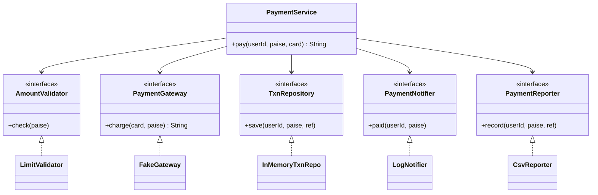
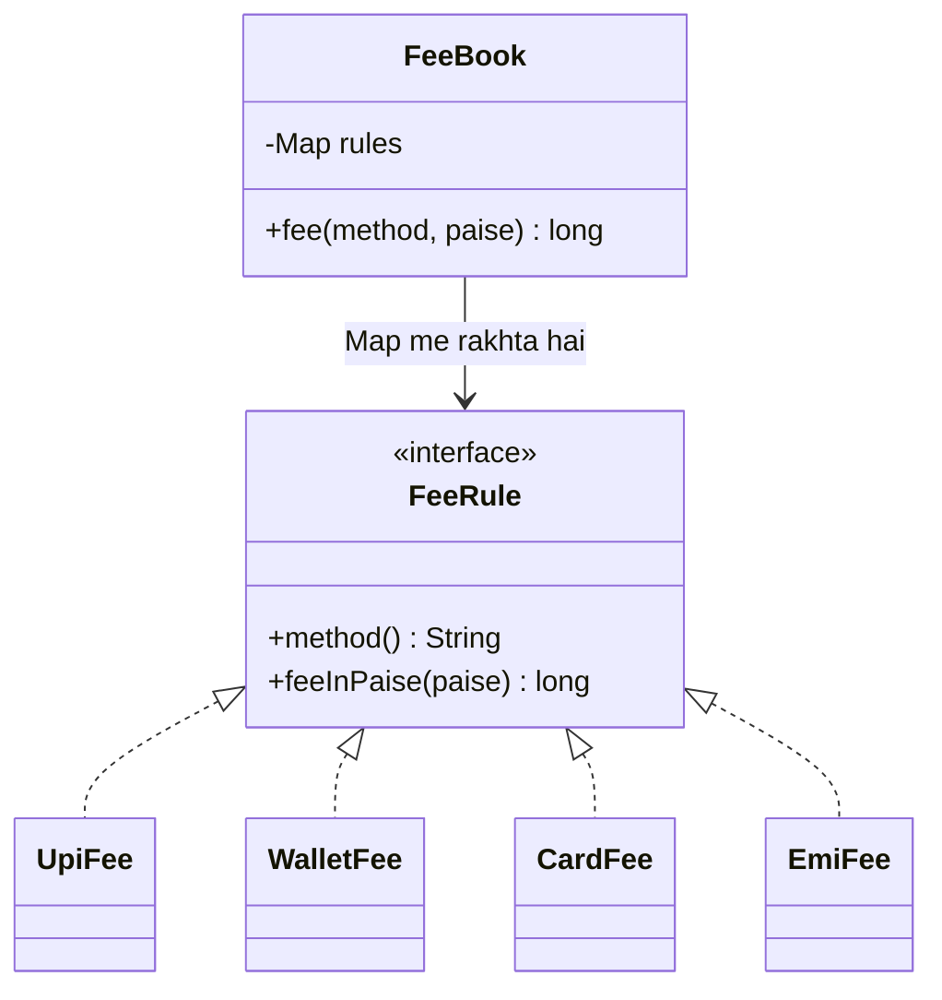
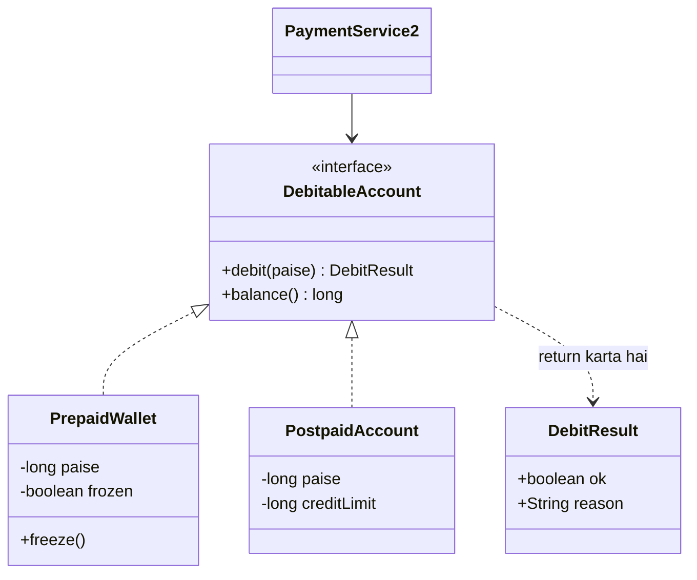
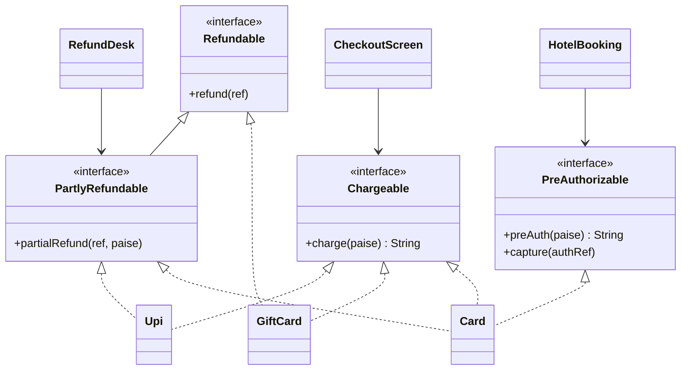
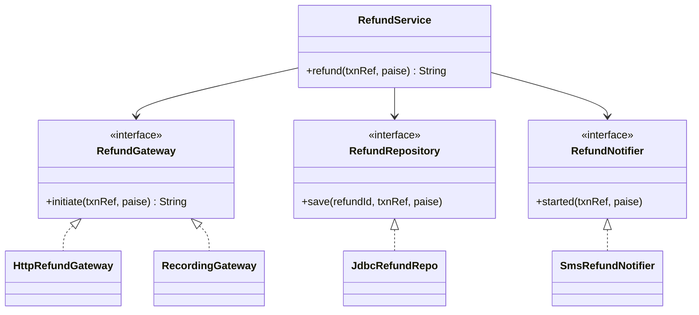

# 1B · SOLID Temple

Sep 30, 2026 · @saurav chaurasiya

**Is doc me 5 lessons:** S1 SRP · S2 OCP · S3 LSP · S4 ISP · S5 DIP

**Padhne ka tareeka — zaroori:** har lesson do hisso me hai. Core (\~20 min) woh hai jo pakka aana chahiye; neeche Deep Dive SDE-2 ke liye hai, pehli baar me chhod sakte ho. Roz ka target: 2 lessons ka Core, ya 1 lesson Core + Deep Dive. Dono ek din me mat karo.

**Code sirf padhna kaafi nahi — khud IDE me type karke chalao, copy-paste nahi.**

---

## S1 — Single Responsibility Principle (SRP)

Single Responsibility Principle (SRP) kehta hai ki ek class ke paas badalne ki ek hi wajah honi chahiye. Yani us class ko ek hi tarah ka requirement change chhuye. Agar ek class ko kabhi fee ke rules badalne pe, kabhi database ka schema badalne pe, aur kabhi report ka format badalne pe edit karna padta hai, to usme teen responsibilities ghusi hui hain.

**Core · \~20 min** — SDE-1: must-know · SDE-2: must-know

### Ye cheez hai kya

- **SOLID** paanch class-design principles ka short form hai (S, O, L, I, D). Inka maqsad ek hi hai: code ko aise likhna ki kal badalna sasta ho.
- **SRP (Single Responsibility Principle)** — ek class ke paas badalne ki sirf ek wajah honi chahiye.
- "Responsibility" ka matlab "kaam" nahi hai, matlab hai **kaun badlaav maangta hai**: ek class ko ek hi team/stakeholder ke liye badalna pade.
- Is lesson ke baad tum ek badi class dekh ke gin paoge usme kitni responsibilities hain, aur unko kaise todna hai.

> **Analogy:** tiffin service. Ek hi banda khana banata hai, dabba pack karta hai, scooter se pahunchata hai, aur hisaab bhi rakhta hai. 5 customer tak sab theek. Par jab delivery ka route badalna ho, tumhe usi bande ko rokna padta hai jo khana bana raha hai — aur khana kharab hota hai. Kaam baant do: cook, packer, delivery boy, accountant. Har ek ke badalne ki apni alag wajah.

### Sawaal

Ek `PaymentProcessor` class hai jo paanch kaam karti hai: amount validate karna, gateway ko call karna, DB me row likhna, user ko SMS bhejna, aur CSV report line banana.

Ab teen alag requests aayi:

1. Finance: CSV me ek naya column chahiye.
2. Infra: SMS ki jagah ek queue pe event daalo.
3. Risk: validation me ek naya rule.

Teeno ko ek hi class chhooni padegi. Dikkat kya hai, aur class ko kaise todoge?

> **Pehle khud socho — 5 min.** Hints: (1) teen request, teen alag team — matlab badalne ki teen alag wajah. (2) is class ke ek validation rule ka unit test likhne me kitni cheezein fake karni padengi? (3) kaunsa hissa "payment ka business rule" hai aur kaunsa "bahar ki duniya se baat"?

### Problem kyun aata hai

1. **Ek file pe teen team ka claim.** Teeno usi file ko badlenge — merge conflict, aur ek team ka bug doosri team ki release rok dega.
2. **Test karna mushkil ho jaata hai.** Ek validation rule check karne ke liye gateway, DB aur SMS teeno ka fake banana padta hai.
3. **Reuse nahi hota.** Kisi doosre flow me sirf validation chahiye, par woh gateway ke saath chipki hui hai — alag nikaali hi nahi ja sakti.

### Naive approach

Neeche ek class paanchon kaam khud kar rahi hai:

```java
// GALAT: ek class, paanch wajah badalne ki
class PaymentProcessor {
    void pay(long userId, long paise, String card) {
        // 1. validation - Risk team ka rule
        if (paise <= 0 || paise > 20000000L) throw new IllegalArgumentException("amount galat");
        // 2. gateway call - Payments team
        String ref = new GatewayHttpClient().charge(card, paise);
        // 3. DB write - Payments team
        new JdbcTemplate().update("INSERT INTO txn(user_id, paise, ref) VALUES(?,?,?)", userId, paise, ref);
        // 4. notification - Infra team ko queue chahiye, SMS nahi
        new SmsSender().send(userId, "Payment " + paise + " ok");
        // 5. reporting - Finance team ka naya column
        new CsvWriter("report.csv").append(userId + "," + paise + "," + ref);
    }
}
```

Kahan tootta hai:

1. Finance ka ek CSV column add karne ke liye wahi file badlegi jisme paise ka core logic hai — review ka scope bekaar me bada.
2. Ek chhota validation test likhne ke liye HTTP client, DB aur SMS teeno mock karne padenge.
3. `new GatewayHttpClient()` method ke andar likha hai — isliye test me fake daalna possible hi nahi hai. (Iska poora ilaaj S5 · DIP hai.)
4. SMS step me exception aaya toh paisa kat chuka hai par method fail dikha — kaunsa hissa hua aur kaunsa nahi, code se pata hi nahi chalta.

### Sahi design

1. Paanch responsibilities ko paanch jagah bhejo, aur har ek ke liye ek chhota **interface** banao (interface = sirf method ke naam aur shape ka contract, body nahi).
2. Ek `PaymentService` unko **orchestrate** kare — khud koi kaam na kare, sirf order tay kare.
3. Har dependency constructor se aaye, taaki test me asli ki jagah fake daala ja sake.

```java
import java.util.*;

// === contracts: har bahar wali cheez ka ek chhota interface ===
interface AmountValidator { void check(long paise); }                  // Risk team
interface PaymentGateway  { String charge(String card, long paise); }  // Payments team
interface TxnRepository   { void save(long userId, long paise, String ref); }
interface PaymentNotifier { void paid(long userId, long paise); }      // Infra team
interface PaymentReporter { void record(long userId, long paise, String ref); } // Finance

// === har ek ka apna chhota implementation ===
class LimitValidator implements AmountValidator {
    private static final long MAX_PAISE = 20000000L;   // 2 lakh rupaye, paise me
    public void check(long paise) {
        if (paise <= 0)        throw new IllegalArgumentException("amount 0 se bada ho");
        if (paise > MAX_PAISE) throw new IllegalArgumentException("per-txn limit cross");
    }
}

class FakeGateway implements PaymentGateway {
    public String charge(String card, long paise) {   // asli me HTTP call hoti
        return "REF-" + Math.abs(card.hashCode()) + "-" + paise;
    }
}

class InMemoryTxnRepo implements TxnRepository {
    private final List<String> rows = new ArrayList<>();
    public void save(long userId, long paise, String ref) {
        rows.add(userId + "|" + paise + "|" + ref);
    }
    int count() { return rows.size(); }
}

class LogNotifier implements PaymentNotifier {
    public void paid(long userId, long paise) {
        System.out.println("notify: user " + userId + " ne " + paise + " paise diye");
    }
}

class CsvReporter implements PaymentReporter {
    public void record(long userId, long paise, String ref) {
        System.out.println("csv: " + userId + "," + paise + "," + ref);
    }
}

// === orchestrator: khud kuch nahi karta, sirf sequence tay karta hai ===
class PaymentService {
    private final AmountValidator validator;
    private final PaymentGateway gateway;
    private final TxnRepository repo;
    private final PaymentNotifier notifier;
    private final PaymentReporter reporter;

    PaymentService(AmountValidator validator, PaymentGateway gateway, TxnRepository repo,
                   PaymentNotifier notifier, PaymentReporter reporter) {
        this.validator = validator; this.gateway = gateway; this.repo = repo;
        this.notifier = notifier;   this.reporter = reporter;
    }

    String pay(long userId, long paise, String card) {
        validator.check(paise);                    // fail fast, paisa chhoone se pehle
        String ref = gateway.charge(card, paise);  // paisa kata
        repo.save(userId, paise, ref);             // record pakka hua
        notifier.paid(userId, paise);              // ye fail ho toh payment fail nahi
        reporter.record(userId, paise, ref);
        return ref;
    }
}

public class Demo {
    public static void main(String[] args) {
        InMemoryTxnRepo repo = new InMemoryTxnRepo();
        PaymentService svc = new PaymentService(
                new LimitValidator(), new FakeGateway(), repo,
                new LogNotifier(), new CsvReporter());

        System.out.println("ref = " + svc.pay(7L, 25000L, "4111"));  // 250 rupaye
        System.out.println("rows = " + repo.count());                // 1

        try { svc.pay(7L, 0L, "4111"); }                             // validation fail
        catch (IllegalArgumentException e) { System.out.println("ruka: " + e.getMessage()); }
    }
}
```



Ye faisle is code me hain:

1. `PaymentService` khud koi kaam nahi karta — sirf sequence tay karta hai. Uske badalne ki ek hi wajah bachi: payment ka flow badle.
2. Har dependency **constructor** se aayi, `new` method ke andar nahi hai — isliye test me fake daalna aasaan hai.
3. `LimitValidator` me limit ek `static final` constant hai — Risk team sirf ek chhoti file chhoo ke rule badal sakti hai.
4. `notifier` aur `reporter` sabse aakhir me hain, kyunki unka fail hona paisa katne ko undo nahi karta — order khud ek design decision hai, sanyog nahi.
5. Interfaces ke naam **caller ki zaroorat** se aaye (`PaymentNotifier`), technology se nahi (`SmsSender`) — kal queue aa jaaye toh naam bhi galat nahi lagega.

### Notebook

SRP = ek class ke badalne ki ek wajah; "wajah" = ek stakeholder/team · test ka size SRP ka thermometer hai — 5 mock chahiye toh 5 responsibility hain · orchestrator class khud kaam nahi karti, sirf order tay karti hai · dependency constructor se aaye, `new` andar nahi · interface ka naam caller ki zaroorat se (`PaymentNotifier`), technology se nahi (`SmsSender`) · side-effects (notify, report) flow ke aakhir me, kyunki unka fail hona paisa undo nahi karta · SRP class chhoti nahi karta, ek-wajah wali banata hai — 40 ek-line classes bhi bug hai.

### Padhne ke liye

- **[Wikipedia — Single-responsibility principle](https://en.wikipedia.org/wiki/Single-responsibility_principle)** — ek hi padhna hai toh yahi: "reason to change" wali asli definition, jo "ek class ek kaam" se kaafi zyada sahi hai.
- [Wikipedia — SOLID](https://en.wikipedia.org/wiki/SOLID) — paanchon principles ek page me; is zone ka map samajh lo.
- [Oracle Java Tutorials — Interfaces and Inheritance](https://docs.oracle.com/javase/tutorial/java/IandI/index.html) — interface ka Java syntax aur semantics official jagah se; is zone ke saare lessons isi pe tike hain.
- [refactoring.guru — Factory Method](https://refactoring.guru/design-patterns/factory-method) — jab class ke andar se `new` hata ke object banane ka kaam bahar bhejna ho, uska agla kadam yahi pattern hai.

### Deep Dive (SDE-2) — jab time ho

#### Do aur naive approaches

- *"Har method ke liye ek class bana do."* — 40 classes jinme har ek me ek line hai; ab ek flow padhne ke liye 40 file kholni padti hain. SRP classes ki ginti nahi ginta, badalne ki wajah ginta hai.
- *"`PaymentUtils` me sab static methods rakh do."* — utility class codebase me sabse tez badhne wali file ban jaati hai, aur static hone ki wajah se test me replace bhi nahi hoti.

#### Kya choose karein aur kyun

| Option | Kab use karo | Kab mat karo |
| --- | --- | --- |
| Ek service + chhote collaborators (yahi code) | flow me 3+ alag concerns hain aur unke owner alag team hain | ek chhoti CRUD class jisme sirf ek repo call hai |
| Ek hi class, saaf private methods me baanti hui | prototype, ya jab poora code ek hi team ka hai | do se zyada team usko chhoo rahi ho |
| Event bus (service event chhodta hai, listeners kaam karte hain) | notification/reporting jaise side-effects badhte ja rahe hon | order ya failure handling matter karta ho — event me order ki guarantee nahi |

#### Interview follow-ups

1. *"SRP ka sabse common galat matlab?"* — "ek class me ek kaam". Asli baat: ek class ke badalne ki ek wajah, matlab ek audience.
2. *"Kaise pata chale SRP toot raha hai?"* — class ka naam `Manager`/`Util`/`Helper` ho, unit test me 4+ mock chahiye, ya ek hi file par do team ke PR aate rahein.
3. *"SRP aur cohesion me farq?"* — cohesion ek maap hai (class ke andar ke members ek doosre se kitne jude hain); SRP us maap ko ooncha rakhne ka rule hai.
4. *"Kitna todna zyada hai?"* — jab ek behavior samajhne ke liye teen file kholni padein, ya jab classes me sirf getters bache hon.
5. *"Ye microservices se juda hai?"* — wahi soch bade scale pe: service boundary bhi "kaun badlaav maangta hai" se banti hai, database tables se nahi.

#### India me kaise hota hai

Payment code me SRP ka fayda sabse pehle on-call me dikhta hai. UPI flow me ek payment ke peeche kai independent hisse hote hain — risk check, switch ko call, apna ledger, notification, reconciliation feed ([Wikipedia — Unified Payments Interface](https://en.wikipedia.org/wiki/Unified_Payments_Interface)). Paytm/PhonePe type codebase me ye hisse alag classes (aur aage chal ke alag services) me hote hain, kyunki raat ke 2 baje jab notification provider down hota hai, tum sirf notifier ko bypass karna chahte ho — us file ko chhoone ki himmat nahi chahiye jisme paisa katne ka code hai.

#### Self-check

(1) SRP ki asli definition ek line me? (2) Test me 5 mock chahiye — ye kis cheez ka signal hai? (3) Interface ka naam kis cheez se aana chahiye?

---

## S2 — Open/Closed Principle (OCP)

Open/Closed Principle (OCP) kehta hai ki class extension ke liye open honi chahiye par modification ke liye closed. Yani naya behaviour jodne ke liye nayi class banao, purani chalti hui class ka code mat chhedo. Naya payment method aane pe `FeeCalculator` ke andar ek aur `switch` case daalna exactly wahi cheez hai jo ye principle rokna chahta hai.

**Core · \~20 min** — SDE-1: must-know · SDE-2: must-know

### Ye cheez hai kya

- **OCP (Open/Closed Principle)** — class naya behaviour add karne ke liye **open** honi chahiye, par pehle se likhe code ko badalne ke liye **closed**.
- Practically iska matlab: naya case aane pe tum ek `if/else` branch add karne ke bajaye ek **nayi class** add karte ho.
- Ye kaam **polymorphism** se hota hai (ek hi interface ke peeche kai implementation; call karne wale ko pata nahi kaunsa chala).
- Is lesson ke baad tum ek badhta hua `switch` dekh ke usko rules ke set me convert kar paoge.

> **Analogy:** bijli ka extension board. Naya appliance lagana ho toh board ki wiring nahi kholte — bas ek socket me plug daal dete ho. Board naye appliances ke liye open hai, par apni wiring ke liye closed. Isliye naya device lagane ke baad purane devices ko dobara check karne ki zaroorat nahi padti — yahi OCP ka poora faida hai.

### Sawaal

Ek `FeeCalculator` hai jo payment method ke hisaab se fee nikalta hai. Aaj UPI, wallet, card hain. Kal netbanking aaya, parson EMI, uske baad rule aaya "card pe ₹2000 se upar 1%, neeche flat ₹3".

Ab class me 6-branch `switch` hai, har naye method pe wahi file badalti hai, aur har baar poore fee module ka regression test chalana padta hai. Isko kaise likhoge?

> **Pehle khud socho — 5 min.** Hints: (1) `switch` ke har branch me common kya hai — input aur output ka shape? (2) agar naya method ek nayi class hoti, toh purani classes ke test dobara chalane padte? (3) `switch` ki jagah kaun le sakta hai — ek `Map`?

### Problem kyun aata hai

1. **Har naya case purani file me ghusta hai.** Purana tested code chhoona = regression ka risk, aur poore module ka dobara test.
2. **Ek switch kai jagah duplicate ho jaata hai.** Fee ka switch, limit ka switch, display-name ka switch — naya method add karne pe teen jagah yaad rakhni padti hai, aur ek jagah bhool jaate hain.
3. **Merge conflict pakka hai.** Do log do naye payment method add karein toh dono usi switch ki lines badlenge.

### Naive approach

Neeche naya method add karne ka matlab isi file me ek aur branch hai:

```java
// GALAT: naya method = is file me ek aur branch
class FeeCalculator {
    long fee(String method, long paise) {
        switch (method) {
            case "UPI":        return 0L;
            case "WALLET":     return 0L;
            case "CARD":       return paise > 200000L ? paise / 100 : 300L; // 1% ya 3 rupaye
            case "NETBANKING": return 500L;
            default: throw new IllegalArgumentException("unknown method: " + method);
        }
    }
}
```

Kahan tootta hai:

1. EMI add karne ke liye yahi file badlegi, aur iske saare purane cases ka test dobara chalana padega.
2. `String method` me typo compile pe nahi pakda jaata, runtime pe fail hota hai (`"Upi"` vs `"UPI"`).
3. Ye switch dheere-dheere do-teen aur jagah copy hota jaata hai (limit, display name, settlement) — aur ek jagah update karna reh jaata hai.
4. Ek method ka fee logic akela test nahi kar sakte; poori class chahiye.

### Sahi design

1. Ek interface `FeeRule` banao jisme rule apna naam aur apni fee dono batata ho.
2. Har payment method ki apni chhoti class — naya method = **nayi file**, purani file untouched.
3. Ek registry (`Map`) jo naam se rule dhoondhti hai; naya rule sirf usme register hota hai.
4. Unknown method ka handling ek hi jagah, har switch me bikhra hua nahi.

```java
import java.util.*;

// ek rule ka contract: kis method ke liye hai, aur fee kitni
interface FeeRule {
    String method();                 // "UPI", "CARD", ...
    long feeInPaise(long paise);
}

class UpiFee implements FeeRule {
    public String method() { return "UPI"; }
    public long feeInPaise(long paise) { return 0L; }      // UPI pe fee nahi
}

class WalletFee implements FeeRule {
    public String method() { return "WALLET"; }
    public long feeInPaise(long paise) { return 0L; }
}

class CardFee implements FeeRule {
    private static final long SLAB = 200000L;              // 2000 rupaye, paise me
    public String method() { return "CARD"; }
    public long feeInPaise(long paise) {
        return paise > SLAB ? paise / 100 : 300L;          // 1% ya flat 3 rupaye
    }
}

// KAL aaya naya method: sirf ye nayi file bani, upar ka kuch nahi badla
class EmiFee implements FeeRule {
    public String method() { return "EMI"; }
    public long feeInPaise(long paise) { return paise * 2 / 100; }   // 2%
}

// registry: naam se rule dhoondhti hai. Is class ka code kabhi nahi badlega.
class FeeBook {
    private final Map<String, FeeRule> rules = new HashMap<>();
    FeeBook(List<FeeRule> all) {
        for (FeeRule r : all) {
            FeeRule purana = rules.put(r.method(), r);
            if (purana != null) throw new IllegalStateException("do rule ek hi key pe: " + r.method());
        }
    }
    long fee(String method, long paise) {
        FeeRule r = rules.get(method);
        if (r == null) throw new IllegalArgumentException("fee rule nahi mila: " + method);
        return r.feeInPaise(paise);
    }
}

public class Demo2 {
    public static void main(String[] args) {
        FeeBook book = new FeeBook(List.of(
                new UpiFee(), new WalletFee(), new CardFee(), new EmiFee()));

        System.out.println("UPI  50000  -> " + book.fee("UPI", 50000L));    // 0
        System.out.println("CARD 50000  -> " + book.fee("CARD", 50000L));   // 300 flat
        System.out.println("CARD 500000 -> " + book.fee("CARD", 500000L));  // 5000 = 1%
        System.out.println("EMI  500000 -> " + book.fee("EMI", 500000L));   // 10000 = 2%
    }
}
```



Ye faisle is code me hain:

1. `FeeBook` ka code kabhi nahi badlega — naya rule sirf uske constructor me list me aata hai. Yahi "closed for modification, open for extension" hai.
2. Har rule apna `method()` naam khud batata hai — isliye kisi ko bahar mapping likhni nahi padti, aur "ek jagah register karna bhool gaya" ka bug khatam.
3. Slab constant `CardFee` ke andar hai — rule ka data usi rule ke paas rehta hai.
4. Duplicate key pe startup me hi exception — `Map.put` chup-chaap ek rule kha jaata, isliye fail-fast daala.
5. Har rule akela unit-testable hai: `new CardFee().feeInPaise(500000L)` — na registry chahiye, na service.

### Notebook

OCP = naya behaviour nayi class se aaye, purani file badalne se nahi · practical shape: `switch` → interface + ek class per case + `Map` registry · rule khud apna key batata hai, mapping bahar nahi likhni padti · registry ka code freeze ho jaata hai — wahi asli faida hai · duplicate key pe startup me fail-fast · har rule akela unit-testable · OCP muft nahi: 2-3 case tak `switch` hi theek, teesre-chauthe case pe convert karo · ye Strategy pattern hi hai, doosre naam se.

### Padhne ke liye

- **[Wikipedia — SOLID](https://en.wikipedia.org/wiki/SOLID)** — ek hi padhna hai toh yahi: OCP ka chhota saaf statement aur baaki chaar principles se uska rishta.
- [Oracle Java Tutorials — Polymorphism](https://docs.oracle.com/javase/tutorial/java/IandI/polymorphism.html) — jis mechanism pe poora OCP khada hai, official example ke saath.
- [Oracle Java Tutorials — Using an Interface as a Type](https://docs.oracle.com/javase/tutorial/java/IandI/interfaceAsType.html) — `List<FeeRule>` me alag-alag classes kaise ek saath aati hain, wahi baat.
- [refactoring.guru — Factory Method](https://refactoring.guru/design-patterns/factory-method) — registry se ek kadam aage: naya case aane pe object kaun banaye.

### Deep Dive (SDE-2) — jab time ho

#### Do aur naive approaches

- *"`enum` me ek abstract method daal do."* — chhote fixed set pe theek chalta hai, par naya case add karne ke liye phir bhi wahi enum file badalti hai; aur enum me dependency inject nahi kar sakte, toh jis rule ko config ya DB chahiye wahan atak jaate ho.
- *"Reflection se saare rules scan kar lo."* — registry "jaadui" ban jaati hai: ek class add karne pe behaviour badal jaata hai aur code padh ke wajah nahi dikhti. Spring me yahi kaam `List<FeeRule>` injection se hota hai, jo saaf hai kyunki type explicit likha hai.

#### Kya choose karein aur kyun

| Option | Kab use karo | Kab mat karo |
| --- | --- | --- |
| `if/else` ya `switch` | 2-3 case, aur naye case rare ho | cases badh rahe ho, ya wahi switch kai jagah repeat ho raha ho |
| Interface + class per case + Map registry (yahi code) | cases badhte rehte hain, har case ka apna data aur logic hai | case ka logic ek line ka ho aur kabhi na badle |
| `enum` + abstract method | fixed chhota set (currency, status) jise compiler exhaustive check kar sake | case ko dependency injection chahiye |
| Rules as data (DB ya config table) | business team deploy ke bina rule badalna chahe | rule me asli logic ho (slabs + conditions) — tab config bhi code ban jaata hai, bina test ke |

#### Interview follow-ups

1. *"OCP aur Strategy pattern me farq?"* — OCP principle hai (kya chahiye), Strategy pattern hai (kaise milega). Upar ka code Strategy hai.
2. *"Har jagah OCP laga dena chahiye?"* — nahi; abstraction ki apni keemat hai. Rule of thumb: pehli baar seedha likho, doosri baar duplicate dikhe toh soch lo, teesri baar abstract karo.
3. *"Compile-time pe exhaustiveness kaise milegi?"* — sealed interface + pattern matching (Java 17+) se; tab compiler bata deta hai koi case chhoot gaya. Map registry ye nahi de sakti.
4. *"Naye rule ka order matter kare toh?"* — `Map` order nahi rakhta; tab rules ko ek sorted list me rakho aur har rule se `priority()` poocho.
5. *"OCP aur plugin architecture ek hi cheez hai?"* — haan, plugin system OCP ka bada version hai: core freeze, extension bahar se aayein.

#### India me kaise hota hai

Payment products me fee, limit aur routing — teeno wahi "per method ek rule" shape lete hain, aur teeno hi hafte-hafte badalte hain. Jab ek naya instrument add hota hai (naya bank, naya card network, naya EMI partner), team ko wahi chahiye hota hai jo OCP deta hai: ek nayi class, ek nayi test file, aur purane instruments ki release untouched. Paytm/PhonePe type codebase me tumhe yahi registry pattern milega, aksar Spring ke `List<FeeRule>` injection ke saath, kyunki wahan naya instrument add karna monthly kaam hai — exceptional nahi.

#### Self-check

(1) OCP ka practical shape ek line me? (2) Registry ka code kyun nahi badalta? (3) Kab OCP nahi lagana chahiye?

---

## S3 — Liskov Substitution Principle (LSP)

Liskov Substitution Principle (LSP) kehta hai ki jahan parent class ka object chalta hai, wahan uski kisi bhi child class ka object bina kuch tode chalna chahiye. Yani child ko parent ka contract todne ki ijaazat nahi hai: na naya exception phenkne ki, na koi extra shart lagane ki, na kaam karne se mana karne ki.

**Core · \~20 min** — SDE-1: must-know · SDE-2: must-know

### Ye cheez hai kya

- **LSP (Liskov Substitution Principle)** — jahan parent type ka object chal raha hai, wahan uski koi bhi child class daal do, aur program ka behaviour galat nahi hona chahiye.
- Matlab: child ko parent ka **vaada** todne ki ijaazat nahi. Vaada = kaunsa input maanta hai, kya return karta hai, kya exception phenkta hai, aur kaunsa **invariant** (ek baat jo object ki zindagi bhar sach honi chahiye) banaye rakhta hai.
- Inheritance ka asli test yahi hai — "is-a" bol dene se kuch nahi hota; substitutable hona padta hai.
- Is lesson ke baad tum ek inheritance hierarchy dekh ke bata paoge ki LSP kahan toot raha hai, aur usko composition ya siblings se kaise theek karna hai.

> **Analogy:** ATM. Har ATM ka vaada yahi hai — card daalo, PIN do, paisa milta hai ya ek saaf message milta hai. Ab ek "naya" ATM aaya jo paise dene se pehle mobile app pe OTP bhi maangta hai. Jo aadmi (ya code) ab tak kisi bhi ATM ko ek hi tareeke se use karta aaya hai, uske liye ye ATM tootta hai — maangta zyada hai, deta wahi hai. Child ne parent se **zyada input maang liya**: yahi LSP violation hai.

### Sawaal

Ek `Wallet` class hai jisme `debit(long paise)` hai, aur uska likha hua invariant hai: balance kabhi negative nahi.

Ab do child banaye:

1. `PostpaidWallet extends Wallet` — isme balance negative ja sakta hai (credit line hai).
2. `FrozenWallet extends Wallet` — iska `debit` `UnsupportedOperationException` phenkta hai.

`PaymentService` sirf `Wallet` type jaanta hai. Kya-kya tootega?

> **Pehle khud socho — 5 min.** Hints: (1) `PaymentService` ke code me kaunsi assumption likhi hai jo `PostpaidWallet` todta hai? (2) `FrozenWallet` ka exception caller ne handle kiya hai ya nahi — aur compiler ne usko bataya? (3) "Frozen" ek **type** honi chahiye, ya wallet ki ek **state**?

### Problem kyun aata hai

1. **Child ne invariant tod diya.** `Wallet` ka vaada "balance >= 0" tha. `PostpaidWallet` aane se woh saara code galat ho gaya jo is baat pe bharosa karta tha — aur woh code badla bhi nahi, isliye uske test bhi pass rahenge.
2. **Child ne naya exception add kiya.** `FrozenWallet.debit` woh exception phenkta hai jo caller ke contract me kabhi tha hi nahi, isliye caller usko catch nahi karta. Unchecked exception pe compiler bhi chup rehta hai.
3. **Caller ko `instanceof` likhna pad jaata hai.** Aur jis din `instanceof` likhna pada, us din inheritance ka poora faida chala gaya — polymorphism ka matlab hi yahi tha ki caller ko concrete type ka pata na ho.

### Naive approach

Neeche dono child parent ka vaada tod rahe hain:

```java
// GALAT: child parent ka vaada tod rahe hain
class Wallet {
    protected long paise;
    Wallet(long paise) { this.paise = paise; }
    // vaada: debit ke baad bhi paise >= 0 rahega
    void debit(long amount) {
        if (amount > paise) throw new IllegalStateException("insufficient balance");
        paise -= amount;
    }
    long balance() { return paise; }
}

class PostpaidWallet extends Wallet {            // invariant tod diya
    private final long creditLimit;
    PostpaidWallet(long paise, long limit) { super(paise); this.creditLimit = limit; }
    @Override void debit(long amount) {
        if (amount > paise + creditLimit) throw new IllegalStateException("limit cross");
        paise -= amount;                          // yahan paise negative ho sakta hai
    }
}

class FrozenWallet extends Wallet {              // naya exception add kar diya
    FrozenWallet(long paise) { super(paise); }
    @Override void debit(long amount) { throw new UnsupportedOperationException("frozen"); }
}
```

Kahan tootta hai:

1. Jo bhi code `if (w.balance() >= amt)` likhta hai, woh postpaid pe galat faisla leta hai — aur uska test pass rahega, kyunki test `Wallet` se likha gaya tha.
2. `FrozenWallet` ka `UnsupportedOperationException` production me pehli baar dikhta hai; compile time pe koi warning nahi mili.
3. Ledger aur reporting code, jo maanta hai total balance kabhi negative nahi, chup-chaap galat total deta hai — crash bhi nahi hota, jo aur bura hai.
4. Fix ke naam pe caller me `if (w instanceof FrozenWallet)` ghus jaata hai, aur har naye subtype pe ek aur `instanceof`.

### Sahi design

1. Jo cheez **state** hai usko type na banao: frozen ek flag hai, class nahi.
2. Jiska vaada alag hai usko child na banao, **sibling** banao — dono ek chhota common interface implement karein jisme sirf wahi vaada ho jo dono nibha sakein.
3. Failure ko exception ke bajaye ek explicit return value se batao, taaki caller ko handle karna hi pade.
4. Invariant ko ek hi jagah likho aur wahin enforce karo.

```java
// dono ka common vaada, itna hi jitna dono nibha sakein:
// "debit ki koshish karo, aur saaf result batao". Koi surprise exception nahi.
interface DebitableAccount {
    DebitResult debit(long paise);
    long balance();          // signed: postpaid me negative ho sakta hai
}

// result ek value hai, exception nahi - caller ko dekhna hi padega
record DebitResult(boolean ok, String reason) {
    static DebitResult ok()              { return new DebitResult(true, null); }
    static DebitResult no(String reason) { return new DebitResult(false, reason); }
}

// prepaid: invariant balance >= 0, aur woh ek hi jagah enforce hota hai
class PrepaidWallet implements DebitableAccount {
    private long paise;
    private boolean frozen;                       // FROZEN EK STATE HAI, TYPE NAHI
    PrepaidWallet(long paise) { this.paise = paise; }
    void freeze() { this.frozen = true; }

    public DebitResult debit(long amount) {
        if (frozen)         return DebitResult.no("wallet frozen");
        if (amount <= 0)    return DebitResult.no("amount 0 se bada ho");
        if (amount > paise) return DebitResult.no("insufficient balance");
        paise -= amount;
        assert paise >= 0;                        // invariant yahin, ek jagah
        return DebitResult.ok();
    }
    public long balance() { return paise; }
}

// postpaid: alag vaada hai, isliye SIBLING hai, child nahi
class PostpaidAccount implements DebitableAccount {
    private long paise;
    private final long creditLimit;
    PostpaidAccount(long paise, long creditLimit) {
        this.paise = paise; this.creditLimit = creditLimit;
    }
    public DebitResult debit(long amount) {
        if (amount <= 0)                  return DebitResult.no("amount 0 se bada ho");
        if (amount > paise + creditLimit) return DebitResult.no("credit limit cross");
        paise -= amount;                  // negative allowed hai, aur ye likha hua hai
        return DebitResult.ok();
    }
    public long balance() { return paise; }
}

// caller: koi instanceof nahi, koi surprise exception nahi
class PaymentService2 {
    boolean pay(DebitableAccount acc, long paise) {
        DebitResult r = acc.debit(paise);
        if (!r.ok()) { System.out.println("fail: " + r.reason()); return false; }
        System.out.println("ok, naya balance = " + acc.balance());
        return true;
    }
}

public class Demo3 {
    public static void main(String[] args) {
        PaymentService2 svc = new PaymentService2();
        PrepaidWallet w = new PrepaidWallet(10000L);          // 100 rupaye
        PostpaidAccount p = new PostpaidAccount(0L, 50000L);  // 0 balance, 500 ka credit

        svc.pay(w, 4000L);     // ok, naya balance = 6000
        svc.pay(w, 90000L);    // fail: insufficient balance
        w.freeze();
        svc.pay(w, 100L);      // fail: wallet frozen  (exception nahi aaya)
        svc.pay(p, 30000L);    // ok, naya balance = -30000 (postpaid ka apna vaada)
    }
}
```



Ye faisle is code me hain:

1. `frozen` ko flag banaya, subclass nahi — kyunki ek wallet apni zindagi me freeze aur unfreeze hota hai, aur object ka **type** zindagi me badal nahi sakta.
2. `PostpaidAccount` ko `PrepaidWallet` ka child nahi banaya — dono ke invariant alag hain, isliye dono sibling hain, aur common interface me sirf wahi vaada hai jo dono nibha sakte hain.
3. Failure `DebitResult` se return hua, exception se nahi — "insufficient balance" ek normal business answer hai, error nahi, aur caller usko ignore nahi kar sakta.
4. `balance()` ko signed rakha aur ye interface me saaf likha — isliye koi caller "kabhi negative nahi" maan ke code nahi likhega.
5. `assert paise >= 0` sirf usi class me hai jiska woh vaada hai — poore hierarchy pe thopa nahi gaya.

### Notebook

LSP = parent ki jagah child daalne pe behaviour galat na ho · child na input ki demand badha sakta (precondition strong nahi kar sakta), na output ka vaada kamzor kar sakta (postcondition weak nahi) · naya unchecked exception add karna = LSP violation, aur compiler chup rehta hai · invariant tootna sabse khatarnak, kyunki purane test pass rehte hain · caller me `instanceof` likhna padna = LSP toot chuka hai · state ko type mat banao (frozen = flag, class nahi) · alag vaada = sibling, child nahi · failure ko value se batao, surprise exception se nahi.

### Padhne ke liye

- **[Wikipedia — Liskov substitution principle](https://en.wikipedia.org/wiki/Liskov_substitution_principle)** — ek hi padhna hai toh yahi: precondition / postcondition / invariant ka exact rule, jo interview me seedha bolne layak hai.
- [Wikipedia — SOLID](https://en.wikipedia.org/wiki/SOLID) — LSP ka baaki chaar principles se rishta; ISP aur DIP isi soch se nikalte hain.
- [Oracle Java Tutorials — Abstract Methods and Classes](https://docs.oracle.com/javase/tutorial/java/IandI/abstract.html) — abstract class kab, interface kab; LSP tootne ki aadhi wajah yahi galat choice hoti hai.
- [Oracle Java Tutorials — Interfaces and Inheritance](https://docs.oracle.com/javase/tutorial/java/IandI/index.html) — override ke official rules (return type, exceptions, access level).

### Deep Dive (SDE-2) — jab time ho

#### Do aur naive approaches

- *"Base class ke method ko khaali override kar do."* — `FrozenWallet.debit()` jo chup-chaap kuch na kare, exception se bhi bura hai: paisa nahi kata par caller ko success mila, aur ye bug kai din baad reconciliation me pakda jaata hai.
- *"Base class me `isFrozen()` daal do, caller check karega."* — tumne vaada caller pe daal diya. Ek naya caller check karna bhoolega aur compiler madad nahi karega. Rule: check wahin ho jiska invariant hai.

#### Kya choose karein aur kyun

| Option | Kab use karo | Kab mat karo |
| --- | --- | --- |
| Inheritance (`extends`) | child parent ka poora vaada nibhata ho aur usse zyada kuch na maange | child ko koi rule todna pade — tab sibling banao |
| Composition (child ke andar parent ka object) | behaviour reuse chahiye par vaada alag hai | sach me substitutable relation ho |
| Common interface + siblings (yahi code) | do cheezein kaam ek jaisa karti hain par unke rules alag hain | rules same hon (tab ek base class hi theek hai) |
| State flag (`frozen`) | cheez apni zindagi me badalti rehti hai | permanent, mutually exclusive category ho |

#### Interview follow-ups

1. *"LSP ka classic example?"* — `Square extends Rectangle`. `setWidth` par square height bhi badal deta hai, aur jo code `width * height` maan ke chalta tha woh tootta hai.
2. *"Precondition strong karna kya hai?"* — child ne input pe parent se zyada shart lagayi (parent 0 accept karta tha, child nahi). Ye allowed nahi. Ulta chalta hai: child kam shart laga sakta hai.
3. *"Override me exception ka rule?"* — checked exceptions pe compiler enforce karta hai (child naya checked exception add nahi kar sakta), par unchecked pe nahi — LSP wahin chup-chaap tootta hai.
4. *"`@Override` likhne se LSP mil jaata hai?"* — nahi. `@Override` sirf signature check karta hai; behaviour ka vaada uska kaam nahi.
5. *"Defensive copy ka isse kya rishta?"* — (**defensive copy** — bahar se aayi mutable cheez ki apni copy rakhna, taaki bahar wala usko badal ke tumhara invariant na tod de.) Ye bhi invariant bachane ka hi tareeka hai, doosre raste se.

#### India me kaise hota hai

Payments me "paisa kaatne wali cheezein" kai hoti hain — prepaid wallet, postpaid/credit line, gift card, bank account — aur naye engineer ka pehla instinct hamesha ek `Account` base class banane ka hota hai. Woh 6 mahine me tootta hai, kyunki gift card pe partial refund allowed nahi, postpaid pe balance negative jaata hai, aur bank account pe debit asynchronous hota hai. Paytm/PhonePe type codebase me isliye base class ke bajaye ek chhota interface milta hai (debit, balance, capability flags), aur har instrument ki apni class hoti hai — exactly upar wala shape.

#### Self-check

(1) LSP ka rule teen shabdon me (precondition, postcondition, invariant) kaise banta hai? (2) Caller me `instanceof` dikhne ka matlab? (3) Frozen ko class kyun nahi banaya?

---

## S4 — Interface Segregation Principle (ISP)

Interface Segregation Principle (ISP) kehta hai ki kisi class ko aise methods implement karne pe majboor na karo jo wo use hi nahi karti. Yani ek bada interface jisme sab kuch bhara hua hai, usko chhote focused interfaces me todo. Warna aadhi implementations `UnsupportedOperationException` phenkti rehti hain, aur caller ko compile time pe pata hi nahi chalta ki kya support hai.

**Core · \~20 min** — SDE-1: padh lo aur ek-line fix jaano · SDE-2: must-know

### Ye cheez hai kya

- **ISP (Interface Segregation Principle)** — kisi class ko un methods pe depend karne ke liye majboor na karo jinki usko zaroorat nahi.
- Practically: ek mota interface (10 methods) ki jagah kai chhote interfaces (2-3 methods) rakho, caller ki zaroorat ke hisaab se.
- "Fat interface" ka pehla lakshan: implement karne wali class me `throw new UnsupportedOperationException()` ya khaali method bodies dikhne lagti hain.
- Is lesson ke baad tum ek mote interface ko uske users ke hisaab se kaat paoge, aur galat call ko runtime se compile time pe le aaoge.

> **Analogy:** TV ka remote jisme 60 button hain. Tumhe roz chaar chahiye — power, volume, channel, input. Baaki 56 ki wajah se remote bada hai aur galat button dabne ka chance zyada. Ab socho wahi 60-button remote AC ke saath aa jaaye: usme "channel" ka koi matlab hi nahi, par button maujood hai aur dabane pe kuch nahi hota. Yahi fat interface hai — button hai, kaam nahi.

### Sawaal

Ek `PaymentInstrument` interface hai jisme 7 methods hain: `charge`, `refund`, `partialRefund`, `preAuth`, `capture`, `tokenize`, `emiPlans`.

Teen implementations hain:

- `UpiInstrument` — preAuth, capture, tokenize, EMI kuch support nahi karta.
- `GiftCardInstrument` — full refund hota hai, partial nahi, aur EMI ka koi matlab nahi.
- `CardInstrument` — saare 7 karta hai.

Do classes me paanch methods `UnsupportedOperationException` phenkte hain. Interface ko kaise todoge?

> **Pehle khud socho — 5 min.** Hints: (1) inn 7 methods ko use karne wale kitne alag caller hain — checkout, refund desk, hotel booking? (2) kaunse methods hamesha jodi me aate hain? (3) `UnsupportedOperationException` ka matlab kya hai — S3 me isi pe kya padha tha?

### Problem kyun aata hai

1. **Naya implementation likhna bhaari ho jaata hai.** Ek naya instrument add karne ke liye 7 methods likhne padte hain, chahe usme 2 hi kaam ke hon.
2. **Interface me naya method add karne pe saari implementations tootti hain** — chahe unka us method se koi lena-dena na ho. (Java ke `default` method se compile bach jaata hai, par jhooth reh jaata hai.)
3. **Caller ko zaroorat se zyada power mil jaata hai.** Refund screen ke code ko `charge()` bhi dikh raha hai — galti se call hone ka rasta khula hai, aur code padhne wale ko pata nahi ki woh screen asal me kya-kya kar sakti hai.

### Naive approach

Neeche ek mota interface sabko sab kuch de raha hai:

```java
// GALAT: ek mota interface, sabko sab kuch
interface PaymentInstrument {
    String charge(long paise);
    void refund(String ref);
    void partialRefund(String ref, long paise);
    String preAuth(long paise);
    void capture(String authRef);
    String tokenize();
    List<Integer> emiPlans(long paise);
}

class UpiInstrument implements PaymentInstrument {
    public String charge(long paise) { return "UPI-" + paise; }
    public void refund(String ref) { /* ok */ }
    public void partialRefund(String ref, long paise) { /* ok */ }
    public String preAuth(long paise)  { throw new UnsupportedOperationException(); }  // jhooth
    public void capture(String ref)    { throw new UnsupportedOperationException(); }  // jhooth
    public String tokenize()           { throw new UnsupportedOperationException(); }  // jhooth
    public List<Integer> emiPlans(long paise) { throw new UnsupportedOperationException(); }
}
```

Kahan tootta hai:

1. `UpiInstrument` ke chaar methods jhooth bol rahe hain — signature keh raha hai "kar sakta hoon", behaviour keh raha hai "nahi".
2. Caller ko chalane se pehle pata nahi chalta ki ye instrument preAuth karega ya nahi, isliye usko `try/catch` ya `instanceof` likhna padta hai.
3. Interface me 8th method add karne pe teeno classes badalti hain, bina kisi wajah.
4. Ye S3 ka LSP violation bhi hai — implementation ne interface ka vaada tod diya. ISP aur LSP aksar ek saath tootte hain.

### Sahi design

1. Interface ko **caller ki zaroorat** ke hisaab se kaato, implementer ki technology ke hisaab se nahi.
2. Capability ko type me daalo: jo cheez preAuth kar sakti hai woh `PreAuthorizable` implement karti hai; jo nahi kar sakti woh us interface ko implement hi nahi karti.
3. Har caller apne parameter type me sirf utna maange jitna usko chahiye.

```java
import java.util.*;

// chhote interfaces: ek interface = ek capability
interface Chargeable       { String charge(long paise); }
interface Refundable       { void refund(String ref); }
interface PartlyRefundable extends Refundable { void partialRefund(String ref, long paise); }
interface PreAuthorizable  { String preAuth(long paise); void capture(String authRef); }
interface Tokenizable      { String tokenize(); }
interface EmiCapable       { List<Integer> emiPlans(long paise); }

// UPI: sirf jo kar sakta hai, wahi implement karta hai
class Upi implements Chargeable, PartlyRefundable {
    public String charge(long paise) { return "UPI-" + paise; }
    public void refund(String ref) { System.out.println("UPI full refund " + ref); }
    public void partialRefund(String ref, long paise) {
        System.out.println("UPI partial refund " + ref + " ka " + paise);
    }
}

// Gift card: refund poora hi hota hai, partial nahi. Isliye sirf Refundable.
class GiftCard implements Chargeable, Refundable {
    public String charge(long paise) { return "GC-" + paise; }
    public void refund(String ref) { System.out.println("gift card refund " + ref); }
}

// Card: sab kuch karta hai, toh sab implement karta hai
class Card implements Chargeable, PartlyRefundable, PreAuthorizable, Tokenizable, EmiCapable {
    public String charge(long paise) { return "CARD-" + paise; }
    public void refund(String ref) { System.out.println("card refund " + ref); }
    public void partialRefund(String ref, long paise) { System.out.println("card partial " + paise); }
    public String preAuth(long paise) { return "AUTH-" + paise; }
    public void capture(String authRef) { System.out.println("captured " + authRef); }
    public String tokenize() { return "TOK-xyz"; }
    public List<Integer> emiPlans(long paise) { return List.of(3, 6, 9, 12); }
}

// callers: har ek sirf utna maangta hai jitna chahiye
class CheckoutScreen {
    String pay(Chargeable c, long paise) { return c.charge(paise); }   // refund dikhta bhi nahi
}
class RefundDesk {
    void full(Refundable r, String ref) { r.refund(ref); }
    void partial(PartlyRefundable r, String ref, long paise) { r.partialRefund(ref, paise); }
}
class HotelBooking {
    String hold(PreAuthorizable p, long paise) { return p.preAuth(paise); }
}

public class Demo4 {
    public static void main(String[] args) {
        Upi upi = new Upi();
        GiftCard gc = new GiftCard();
        Card card = new Card();
        CheckoutScreen checkout = new CheckoutScreen();
        RefundDesk desk = new RefundDesk();
        HotelBooking hotel = new HotelBooking();

        System.out.println(checkout.pay(upi, 25000L));   // UPI-25000
        System.out.println(checkout.pay(gc, 5000L));     // GC-5000
        desk.full(gc, "GC-5000");                        // gift card pe full refund chalta hai
        desk.partial(upi, "UPI-25000", 5000L);
        System.out.println(hotel.hold(card, 100000L));   // AUTH-100000

        // desk.partial(gc, "GC-5000", 100L);  // COMPILE ERROR - aur yahi ISP ka faida hai
        // hotel.hold(upi, 100000L);           // COMPILE ERROR - UPI preAuth nahi karta
    }
}
```



Ye faisle is code me hain:

1. Jo cheez support nahi hai, woh interface implement hi nahi karti — isliye galat call **compile time** pe pakdi jaati hai, runtime exception se nahi.
2. `PartlyRefundable extends Refundable` rakha, kyunki jo partial refund kar sakta hai woh full bhi kar sakta hai — ye rishta type me likh diya, comment me nahi.
3. Har caller ne apne parameter me sabse **chhota** interface maanga jo uska kaam kara de — `CheckoutScreen` ko refund ke existence ka bhi pata nahi.
4. `UnsupportedOperationException` poore code se gayab ho gaya — yahi ISP sahi lagne ka test hai.
5. Naya instrument likhne wala sirf wahi interfaces implement karta hai jo woh nibha sakta hai — na khaali method, na jhooth.

### Notebook

ISP = class ko un methods pe depend na karao jinki use zaroorat nahi · fat interface ka lakshan: `UnsupportedOperationException` ya khaali method bodies · fix = capability ke hisaab se chhote interfaces, aur jo na kar sake woh implement hi na kare · caller apne parameter me sabse chhota interface maange · `PartlyRefundable extends Refundable` = "jo partial kar sakta hai woh full bhi" type me likha · faida = galat call compile pe pakdi jaati hai, runtime pe nahi · interface ka naam caller ke role se (`Refundable`), technology se nahi (`CardApi`) · fat interface hamesha LSP bhi todta hai.

### Padhne ke liye

- **[Wikipedia — Interface segregation principle](https://en.wikipedia.org/wiki/Interface_segregation_principle)** — ek hi padhna hai toh yahi: "fat interface" ka asli matlab aur usko kaatne ka rule, chhote example ke saath.
- [Oracle Java Tutorials — Defining an Interface](https://docs.oracle.com/javase/tutorial/java/IandI/interfaceDef.html) — ek class kai interfaces kaise implement karti hai, aur ek interface doosre ko kaise extend karta hai.
- [Oracle Java Tutorials — Summary of Interfaces](https://docs.oracle.com/javase/tutorial/java/IandI/summary-interface.html) — chhota recap page; `default` methods ka scope samajhne ke liye kaam ka.
- [Wikipedia — SOLID](https://en.wikipedia.org/wiki/SOLID) — ISP ka LSP aur DIP se rishta ek hi jagah.

### Deep Dive (SDE-2) — jab time ho

#### Do aur naive approaches

- *"`default` methods daal do jo exception phenke."* — compile error chala gaya, jhooth reh gaya. Ab naya implementer method likhna bhool jaayega aur usko pata bhi nahi chalega — pehle compiler batata tha.
- *"`supportsPreAuth()` boolean daal do."* — ye "capability as data" hai: caller ko har call se pehle `if` likhna padta hai, aur ek caller bhoolega. Jo cheez type system muft me deti hai, usko manual check bana diya.

#### Kya choose karein aur kyun

| Option | Kab use karo | Kab mat karo |
| --- | --- | --- |
| Ek chhota interface per capability (yahi code) | implementations ki capabilities sach me alag hain | sab implementations sab kuch karte hon — tab ek interface hi theek |
| Ek interface + `default` methods | ek naya optional method add karna hai aur purane implementers todne nahi hain | woh method har implementer ke liye meaningful na ho |
| Capability flags (`supportsX()`) | capability runtime pe decide hoti hai (merchant config se aati hai) | compile time pe pata hai — tab type use karo |
| Sealed interface + pattern matching (Java 17+) | instruments ka set closed hai aur caller ko exhaustive handling chahiye | naye instruments bahar se plug hone chahiye |

#### Interview follow-ups

1. *"Kitne chhote interfaces zyada ho jaate hain?"* — jab caller ko ek kaam ke liye 4 interfaces maangne pad jaayein, ya jab har interface me ek hi method ho aur woh hamesha saath use hote hon.
2. *"ISP aur SRP me farq?"* — SRP class ke baare me hai (kiske liye badalti hai), ISP interface ke baare me (kiske liye likha gaya hai). Ek hi soch, do jagah lagi hui.
3. *"Role interface kya hai?"* — wahi jo yahan banaya: interface ko **caller ke role** ke naam pe banana (`Refundable`), implementer ki technology pe nahi (`CardApi`).
4. *"Java me behaviour ka multiple inheritance?"* — `default` methods se aata hai. Do interfaces me same default ho toh compile error, aur tumhe explicitly resolve karna padta hai.
5. *"Runtime pe hi capability pata chale toh?"* — tab bhi type-based rakho, aur cast/check ek hi jagah karo (factory ya boundary pe), poore code me `if` na phailao.

#### India me kaise hota hai

Ek payment gateway ka instrument set exactly aisa hi dikhta hai — UPI, cards, netbanking, wallet, gift card, EMI — aur unki capabilities kabhi barabar nahi hoti. Cards pe pre-auth aur tokenization hote hain, UPI pe nahi; gift card pe partial refund allowed nahi; EMI sirf kuch banks pe. Paytm/Razorpay type integration code me isliye ek mota `PaymentInstrument` interface nahi milta — capability-wise chhote interfaces (ya sealed hierarchy) milte hain, kyunki wahan naya instrument add karna monthly kaam hai aur "woh method exception phenkta hai" wala note kabhi kisi ko yaad nahi rehta.

#### Self-check

(1) Fat interface ka pehla lakshan? (2) `PartlyRefundable extends Refundable` kyun, ulta nahi? (3) ISP ka faida compile time pe kya milta hai?

---

## S5 — Dependency Inversion Principle (DIP)

Dependency Inversion Principle (DIP) kehta hai ki high-level policy (business logic) ko low-level details (HTTP client, DB driver, SMS vendor) par depend nahi karna chahiye; dono ko ek abstraction par depend karna chahiye. Yani `RefundService` ke andar `new HttpGateway()` likhne ki jagah usko ek interface diya jaata hai, aur asli implementation bahar se inject hoti hai.

**Core · \~20 min** — SDE-1: must-know · SDE-2: must-know

### Ye cheez hai kya

- **DIP (Dependency Inversion Principle)** — high-level policy (business logic) ko low-level detail (HTTP client, DB driver, SMS provider) pe depend nahi karna chahiye. Dono ek **abstraction** (interface) pe depend karein.
- Uska doosra hissa aur bhi zaroori hai: abstraction ka **maalik high-level code** hona chahiye, detail nahi. Matlab `RefundGateway` interface payment module me define hoga, HTTP library ke paas nahi.
- "Inversion" ka matlab yahi hai: normally arrow business se library ki taraf jaata hai; DIP usko ghuma deta hai — library ka adapter tumhare interface ko implement karta hai.
- Is lesson ke baad tum ek untestable class ko testable bana paoge, aur bata paoge ki DI (dependency injection) DIP se kaise alag hai.

> **Analogy:** ghar ka bijli ka socket. Tumhara fridge kisi ek company ke socket se bandha nahi hai — woh standard 3-pin socket pe chalta hai. Socket ka design (abstraction) ghar banane wale ne tay kiya, fridge company ne nahi. Isliye tum fridge badlo ya bijli ka board badlo, doosri cheez chhooni nahi padti. DIP me business logic ghar hai, aur gateway/DB/SMS sirf plug hain.

### Sawaal

`RefundService.refund()` ke andar `new HttpGatewayClient()`, `new MysqlRefundRepo()`, aur `new TwilioSms()` likha hai. Ab teen kaam karne hain:

1. Iska unit test likhna hai jo asli gateway ko call na kare.
2. Ek merchant ke liye doosra gateway use karna hai.
3. SMS ki jagah WhatsApp lana hai.

Teeno me kya dikkat aayegi, aur code kaise likhna chahiye tha?

> **Pehle khud socho — 5 min.** Hints: (1) `new` method ke andar hai — test me usko replace karne ka koi rasta bacha hai? (2) `RefundService` ko gateway ke **HTTP hone** se matlab hai, ya bas "refund initiate ho jaaye" se? (3) interface kis package me rehna chahiye — payment module me, ya http module me?

### Problem kyun aata hai

1. **`new` ek hard link hai.** Class ne apna collaborator khud chun liya; bahar se koi usko badal nahi sakta — na test, na config, na doosra merchant.
2. **Compile-time dependency ki direction ulti hai.** Business logic HTTP client pe depend karta hai, isliye HTTP library ka version badalna payment logic ko chhoota hai.
3. **Test slow aur flaky ho jaata hai.** "Unit" test network pe jaata hai, CI me random fail hota hai, aur log se kuch pata nahi chalta.

### Naive approach

Neeche high-level class apne andar hi low-level detail bana rahi hai:

```java
// GALAT: high-level class ke andar low-level detail ka new
class RefundService {
    void refund(String txnRef, long paise) {
        HttpGatewayClient gw = new HttpGatewayClient("https://gw.prod/refund"); // hard link
        MysqlRefundRepo repo = new MysqlRefundRepo("jdbc:mysql://prod-db");     // hard link
        TwilioSms sms = new TwilioSms("AC-live-key");                           // hard link

        String refundId = gw.postRefund(txnRef, paise);
        repo.insert(refundId, txnRef, paise);
        sms.send("+9199xxxxxxx", "refund of " + paise + " started");
    }
}
```

Kahan tootta hai:

1. Unit test likha toh woh production gateway pe asli request maar dega — ya, jo zyada hota hai, test likha hi nahi jaayega.
2. Doosra gateway chahiye toh andar `if (merchant == X) new OtherClient()` ghusega — S2 ka OCP bhi saath me toot gaya.
3. Prod URL aur live key class ke andar hain; config badalne ke liye code badalna padta hai aur deploy karna padta hai.
4. `RefundService` ko kabhi kisi doosre repo ya notifier ke saath reuse karna possible hi nahi.

### Sahi design

1. High-level module apne liye interface **khud define kare**, apni business bhasha me (`RefundGateway`, `RefundRepository`, `RefundNotifier`).
2. Low-level classes un interfaces ko implement karein — arrow ghoom gaya, yahi "inversion" hai.
3. Concrete objects bahar banein (`main`, ya Spring config) aur constructor se andar aayein — yahi **dependency injection** hai.

```java
// ===== high-level module (payments) apni bhasha me contract likhta hai =====
interface RefundGateway    { String initiate(String txnRef, long paise); }
interface RefundRepository { void save(String refundId, String txnRef, long paise); }
interface RefundNotifier   { void started(String txnRef, long paise); }

// high-level policy: kisi concrete class ka naam yahan nahi hai
class RefundService {
    private final RefundGateway gateway;
    private final RefundRepository repo;
    private final RefundNotifier notifier;

    RefundService(RefundGateway gateway, RefundRepository repo, RefundNotifier notifier) {
        this.gateway = gateway; this.repo = repo; this.notifier = notifier;
    }

    String refund(String txnRef, long paise) {
        if (paise <= 0) throw new IllegalArgumentException("refund 0 se bada ho");
        String refundId = gateway.initiate(txnRef, paise);  // detail ka naam nahi, contract hai
        repo.save(refundId, txnRef, paise);
        notifier.started(txnRef, paise);
        return refundId;
    }
}

// ===== low-level details: ADAPTERS, jo upar wale interface ko implement karte hain =====
class HttpRefundGateway implements RefundGateway {
    private final String baseUrl;
    HttpRefundGateway(String baseUrl) { this.baseUrl = baseUrl; }
    public String initiate(String txnRef, long paise) {
        // asli me yahan HTTP POST hoti; abhi sirf shape dikhane ke liye
        return "RF-" + txnRef + "-" + paise;
    }
}

class JdbcRefundRepo implements RefundRepository {
    public void save(String refundId, String txnRef, long paise) {
        System.out.println("db insert " + refundId + " " + txnRef + " " + paise);
    }
}

class SmsRefundNotifier implements RefundNotifier {
    public void started(String txnRef, long paise) {
        System.out.println("sms: refund of " + paise + " for " + txnRef);
    }
}

// ===== test ke liye fake: koi mocking library nahi chahiye =====
class RecordingGateway implements RefundGateway {
    String lastRef; long lastPaise;
    public String initiate(String txnRef, long paise) {
        this.lastRef = txnRef; this.lastPaise = paise;
        return "RF-TEST";
    }
}

public class Demo5 {
    public static void main(String[] args) {
        // === production wiring: concrete classes ka naam SIRF yahan aata hai ===
        RefundService prod = new RefundService(
                new HttpRefundGateway("https://gw.example/refunds"),
                new JdbcRefundRepo(),
                new SmsRefundNotifier());
        System.out.println("prod -> " + prod.refund("TXN-9", 25000L));

        // === test wiring: network aur DB dono gayab, millisecond me chalta hai ===
        RecordingGateway fakeGw = new RecordingGateway();
        RefundService test = new RefundService(
                fakeGw,
                (id, ref, p) -> { },     // repo: kuch mat karo
                (ref, p) -> { });        // notifier: kuch mat karo
        test.refund("TXN-1", 700L);
        System.out.println("gateway ko mila: " + fakeGw.lastRef + " / " + fakeGw.lastPaise);
    }
}
```



Ye faisle is code me hain:

1. Interfaces payment module ke andar hain, HTTP module me nahi — isliye compile-time arrow detail se policy ki taraf jaata hai, ulta nahi. Yahi DIP ka asli test hai.
2. `RefundService` me kisi concrete class ka naam nahi hai — gateway badalne pe woh file chhooni bhi nahi padti.
3. Concrete objects sirf ek jagah bane (`main`, asli project me Spring config) — poore codebase me `new` ka ek hi ghar hai.
4. Test ke fake lambda se ban gaye, kyunki interfaces single-method hain — mocking library ki zaroorat hi nahi padi. Yahan S4 ka ISP apna faida de raha hai.
5. Interface ke method business bhasha me hain (`initiate`, `started`), technology bhasha me nahi (`postRefund`, `insert`) — kyunki abstraction ka maalik high-level code hai.

### Notebook

DIP = policy aur detail dono interface pe depend karein, aur interface ka maalik policy ho · `new` method ke andar = hard link, test aur config dono band · interface high-level module ke package me define hota hai, library ke package me nahi · low-level class us interface ka **adapter** banti hai — arrow ghoom gaya, wahi "inversion" hai · DI (dependency injection) DIP paane ka tareeka hai, DIP khud nahi · concrete `new` sirf ek jagah (main / Spring config) · interface ke method business bhasha me (`initiate`), technology bhasha me nahi (`postRefund`) · single-method interface = test me lambda se fake ban jaata hai.

### Padhne ke liye

- **[martinfowler.com — Inversion of Control Containers and the Dependency Injection pattern](https://martinfowler.com/articles/injection.html)** — ek hi padhna hai toh yahi: DI ke teen roop (constructor, setter, interface) aur DIP se uska farq, asli code ke saath.
- [Wikipedia — SOLID](https://en.wikipedia.org/wiki/SOLID) — DIP ka short statement aur baaki chaar principles se rishta; poore zone ka revision isi page se ho jaata hai.
- [martinfowler.com — DIP in the Wild](https://martinfowler.com/articles/dipInTheWild.html) — asli codebases me DIP kaise galat lagta hai aur kaise sahi; ye lesson ka aage ka hissa.
- [Oracle Java Tutorials — Using an Interface as a Type](https://docs.oracle.com/javase/tutorial/java/IandI/interfaceAsType.html) — constructor me interface type lene ka Java-side basis.

### Deep Dive (SDE-2) — jab time ho

#### Do aur naive approaches

- *"Service locator bana do: `Registry.get(Gateway.class)`."* — `new` chhup gaya par dependency chhipi hi rahi: constructor dekh ke pata nahi chalta class ko kya chahiye, aur test me registry set karna bhoolna runtime error deta hai, compile error nahi.
- *"Setter injection rakh do, `@Autowired` field pe."* — object aadha-bana state me exist kar sakta hai (`null` dependency), aur fields `final` nahi rakh sakte. Isliye constructor injection default honi chahiye.

#### Kya choose karein aur kyun

| Option | Kab use karo | Kab mat karo |
| --- | --- | --- |
| Constructor injection (yahi code) | almost hamesha; dependencies `final`, aur object banne ke baad poora valid | dependency sach me optional ho (tab ek overload constructor de do) |
| Setter injection | legacy framework ki majboori, ya genuinely optional collaborator | naya code — partially-built object ka rasta khul jaata hai |
| Framework DI (Spring) | app bada hai, wiring khud maintain karna mushkil | chhota tool ya library — plain constructor hi kaafi hai |
| Service locator | legacy code me DIP ghusaane ka pehla kadam | naya design — dependencies chhup jaati hain |

#### Interview follow-ups

1. *"DIP aur DI ek hi cheez hai?"* — nahi. DIP principle hai (arrow ki direction), DI mechanism hai (object kaun deta hai). DI ke bina DIP ho sakta hai (factory se), aur DI use karke bhi DIP toot sakta hai — agar interface library ke package me define ho.
2. *"Interface kis package me rakhna chahiye?"* — jo usko **use** karta hai, uske package me. Ye DIP ka sabse aasaan test hai, aur log yahi fail karte hain.
3. *"Har cheez ke liye interface bana dena chahiye?"* — nahi. Interface wahan jahan implementation badal sakti hai: external system, I/O, clock, randomness. Ek pure calculation ke liye interface sirf shor hai.
4. *"Ye hexagonal / ports-and-adapters architecture hai?"* — haan, wahi soch service level pe: interface = port, `HttpRefundGateway` = adapter.
5. *"Dynamic dispatch ka cost?"* — (**dynamic dispatch** — runtime pe decide hota hai kaunsa implementation chalega.) JVM aksar isko inline kar deta hai jab ek hi implementation load hui ho; 99% business code me ye cost sochne layak nahi hai.

#### India me kaise hota hai

Payment integrations me DIP ka fayda sabse saaf wahan dikhta hai jahan ek hi flow ke peeche kai providers hote hain — do-teen acquiring banks, kai UPI PSPs, alag SMS/WhatsApp vendors. In sab me business rule ek hi rehta hai ("refund initiate karo, record karo, user ko batao"), par provider hafte-hafte badalta hai, ya ek provider down hone pe traffic doosre pe shift karna padta hai. Paytm/Razorpay type codebase me isliye `RefundService` jaisi class me kisi provider ka naam nahi hota; ek interface hota hai aur uske kai adapters, aur wiring ek config me. Uska sabse bada rozmarra ka faida ye hai ki poora refund logic bina network ke, milliseconds me test hota hai.

#### Self-check

(1) "Inversion" me ulta kya hota hai? (2) Interface kis package me rehna chahiye, aur kyun? (3) DIP aur DI me farq ek line me?

---

## Aage kya

- **Pichhla zone:** [1A · OOP Village](https://claude.ai/code/artifact/cc69c0d1-92e9-4c1d-afd8-8add12f3e7db) — O1–O5: encapsulation, inheritance, polymorphism. S3 ka LSP asal me wahan padhi hui inheritance ka test paper hai.
- **Agla zone:** [2A · Creational Forge (P1–P5)](https://claude.ai/code/artifact/296276bb-5e6c-4e9d-82d1-c02909c5bd2f) — ab ban gaya hai. S2 ka registry aur S5 ki wiring wahan Factory, Builder aur Singleton ban ke laut ke aayenge.
- **Aage judne wale dhaage:** S1 ka orchestrator → 2C · Behavior Bazaar (Strategy, Command) · S4 ke capability interfaces → 2B · Structural Bridge (Adapter, Decorator) · S5 ki constructor injection → D-series case studies, jahan poora design isi shape me likha jaata hai. HLD side pe S5 ka "boundary pe interface" wala idea [1C · DB Dungeon](https://claude.ai/code/artifact/99909fe9-731e-4e31-9e7d-36e0c5aed845) ke repository layer me dobara milega.
