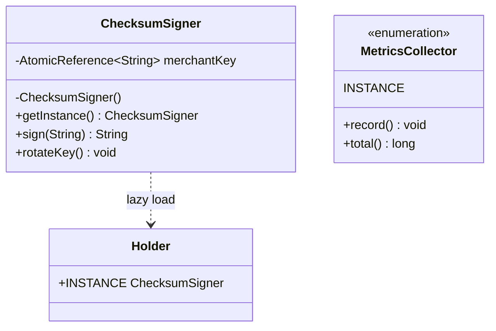
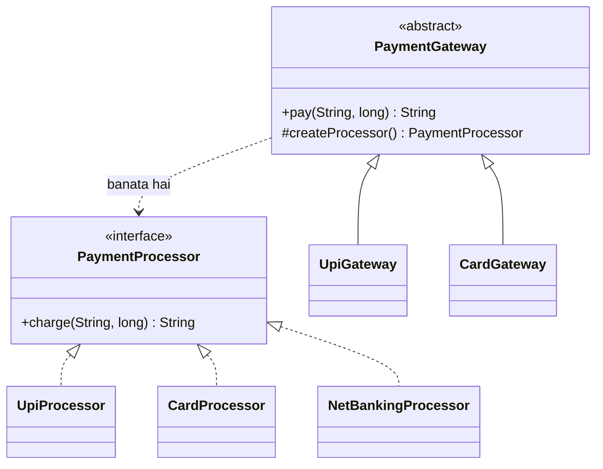
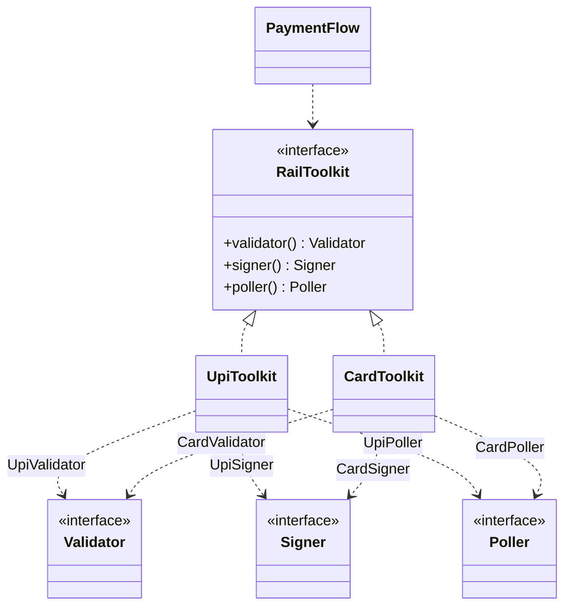
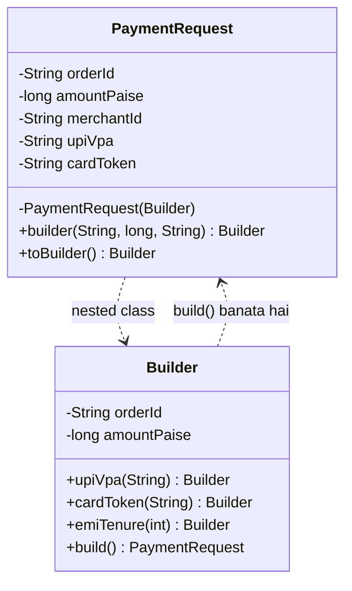
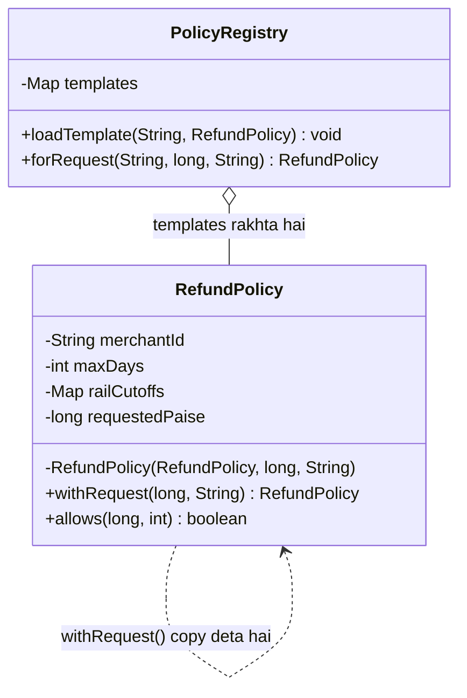

# 2A · Creational Forge

Oct 1, 2026 · @saurav chaurasiya

Is doc me paanch lessons hain: P1 (Singleton), P2 (Factory Method), P3 (Abstract Factory), P4 (Builder), P5 (Prototype). Ye sab creational patterns hain — yaani object banane ke tareeke.

Creational pattern ka matlab: `new` keyword ko seedha bikhre hue code me likhne ke bajaye, object banane ka kaam ek jagah samet lena, taaki baad me "kaunsa object bane" ya "kaise bane" badalna sasta ho jaaye.

---

## P1 — Singleton

Singleton ek pattern hai jisme kisi class ka poore application me sirf ek hi object banta hai, aur us ek object tak pahunchne ka ek hi rasta hota hai. Class khud apne object ko sambhalti hai; bahar se koi `new` nahi kar sakta.

### Ye cheez hai kya

- Category: creational pattern — object banane ki ginti control karta hai
- Kis problem ke liye banayi gayi: jab kisi cheez ki ek se zyada copy hona galat ya mehenga hai, jaise config registry, connection pool, metrics collector, ya wo object jo startup pe koi bhaari file padhta hai
- Is lesson ke baad tum kya kar paoge: thread-safe singleton ke teen tareeke likh paoge, aur bata paoge ki singleton kab ek design smell hai

### Sawaal

Paytm Payment Gateway integration me har outgoing request pe checksum (request ke data se banaya gaya ek signature, jo batata hai ki data raste me badla nahi gaya) lagana padta hai. Checksum ke liye merchant key ek encrypted file se padhni hoti hai, jisme lagbhag 80 ms lagte hain. Tumhara service 4,000 TPS (transactions per second — ek second me kitne requests) handle karta hai. Abhi code me har request pe `new ChecksumSigner()` ho raha hai, aur wo constructor me file padhta hai. Isko kaise theek karoge, aur multi-threaded environment me kya-kya tootne ka risk hai?

> Pehle khud socho — 5 min. Hints: (1) 4,000 TPS pe 80 ms wala kaam har request pe karne ka kya matlab hai? (2) agar do threads ek hi waqt pe pehli baar object banane ki koshish karein to? (3) key rotate ho jaaye to us ek object ka kya hoga?

### Problem kyun aata hai

- Har request pe bhaari initialization dohraya ja raha hai — 80 ms ka file read 4,000 baar per second ka matlab hai ki thread pool bhar jaayega aur p99 (wo latency jisse 99% requests tez hoti hain, yaani sabse dheemi 1% ko chhod kar sabse bura case) chhat pe chala jaayega
- Har object apni copy rakh raha hai, toh memory bewajah kharch ho rahi hai
- Agar aisi class ke andar koi shared state hai (counter, cache, pool), to do objects ka matlab do alag-alag sach — aur us se bugs aate hain jo reproduce hi nahi hote
- Multi-threaded me bina care ke lazy initialization likhne pe do threads do objects bana dete hain, ya ek thread aadha-bana object dekh leta hai

### Naive approach

- Pehla obvious solution: ek `static` field rakho aur jab pehli baar maange, tab bana do
- Ye exactly kahan tootta hai: `if (instance == null)` do threads ek saath chala sakte hain, dono ko `null` milega, aur dono object bana denge — yaani singleton do baar ban gaya. Aur bina `volatile` ke ek thread ko aadha-initialized object dikh sakta hai

Neeche ka snippet galat hai — ye dikhata hai ki naive lazy singleton race condition me kaise tootta hai.

```java
// BURA CODE — sirf samajhne ke liye
class ChecksumSigner {
    private static ChecksumSigner instance; // volatile nahi hai
    private final String merchantKey;

    private ChecksumSigner() {
        this.merchantKey = loadKeyFromFile(); // 80 ms ka kaam
    }

    static ChecksumSigner getInstance() {
        if (instance == null) {          // do threads ek saath yahan pahunch sakte hain
            instance = new ChecksumSigner(); // dono object bana denge
        }
        return instance;
    }

    private static String loadKeyFromFile() { return "KEY"; }
}
```

### Sahi design

1. Constructor `private` karo, taaki bahar se koi `new` na kar sake.
2. Instance ko `static final` field me rakho aur class load hote hi bana do (eager). JVM class loading ko khud thread-safe rakhta hai, toh yahan koi lock nahi lagana padta.
3. Agar initialization sach me bhaari hai aur ho sakta hai kabhi zaroorat hi na pade, to lazy chahiye — uske liye holder idiom use karo: ek `private static class Holder` ke andar `static final` field. Wo nested class tabhi load hoti hai jab pehli baar chhui jaaye, aur thread-safety phir bhi JVM deta hai.
4. Jo state badalti hai (jaise rotated key) usse ek `volatile` reference ke peeche rakho, ya AtomicReference me, taaki reload karte waqt reader ko phata-hua data na mile.
5. Interview ke liye sabse saaf jawab: enum singleton. Ek-element enum apne aap thread-safe hai, aur serialization aur reflection dono se ek hi instance ki guarantee deta hai.
6. Singleton ko global variable ki tarah har jagah mat bulao. Jahan possible ho, use constructor se pass karo (dependency injection) — isse test me mock dena aasan rehta hai.

Neeche ka code teen tareeke dikhata hai — holder idiom, enum singleton, aur reload-safe state — aur ek chhota main use chala kar dikhata hai.

```java
import java.util.concurrent.atomic.AtomicReference;

// Tarika 1: holder idiom — lazy + thread-safe, bina lock ke
final class ChecksumSigner {

    // key badal sakti hai (rotation), isliye atomic reference ke peeche rakhi hai
    private final AtomicReference<String> merchantKey = new AtomicReference<>();

    private ChecksumSigner() {
        merchantKey.set(loadKeyFromFile()); // bhaari kaam, sirf ek baar
    }

    // ye nested class tabhi load hogi jab getInstance() pehli baar chalega
    private static class Holder {
        static final ChecksumSigner INSTANCE = new ChecksumSigner();
    }

    static ChecksumSigner getInstance() {
        return Holder.INSTANCE;
    }

    // key rotate karne ka safe rasta — purana reader crash nahi karega
    void rotateKey() {
        merchantKey.set(loadKeyFromFile());
    }

    String sign(String payload) {
        return "sig(" + payload + "," + merchantKey.get() + ")";
    }

    private static String loadKeyFromFile() {
        return "MERCHANT_KEY_v2"; // asli code me file/KMS se aata
    }
}

// Tarika 2: enum singleton — sabse chhota aur sabse safe
enum MetricsCollector {
    INSTANCE;

    private long count;

    synchronized void record() { count++; }
    synchronized long total()  { return count; }
}

public class SingletonDemo {
    public static void main(String[] args) {
        // dono call same object dega
        ChecksumSigner a = ChecksumSigner.getInstance();
        ChecksumSigner b = ChecksumSigner.getInstance();
        System.out.println("same object? " + (a == b)); // true
        System.out.println(a.sign("ORDER_1001|500.00"));

        a.rotateKey(); // key badal di, object wahi raha
        System.out.println(b.sign("ORDER_1002|250.00"));

        MetricsCollector.INSTANCE.record();
        MetricsCollector.INSTANCE.record();
        System.out.println("metrics: " + MetricsCollector.INSTANCE.total()); // 2
    }
}
```



### Kya choose karein aur kyun

| Option | Kab use karo | Kab mat karo |
| --- | --- | --- |
| Eager `static final` instance | Jab object hamesha banega hi aur banana sasta hai — sabse simple aur thread-safe | Jab initialization bhaari ho aur ho sakta hai kabhi zaroorat na pade |
| Holder idiom (nested static class) | Jab lazy chahiye aur initialization bhaari ho — lock ke bina thread-safe milta hai | Jab instance banane ke liye runtime parameter chahiye (holder me parameter nahi ja sakta) |
| Enum singleton | Interview me, aur jab serialization/reflection se bhi ek hi instance chahiye | Jab class ko kisi base class ko extend karna ho — enum kisi class ko extend nahi kar sakta |
| Double-checked locking (`volatile` + `synchronized`) | Jab lazy chahiye aur parameter bhi dena ho — legacy code me milta hai | Naya code likhte waqt — holder idiom isse simple aur equally safe hai |
| Container-managed (Spring `@Bean`, ya DI) | Production service me — scope framework sambhalta hai aur test me mock aasani se ghusta hai | Chhote plain-Java exercise me jahan framework hi nahi hai |

### India me kaise hota hai

Paytm ka Payment Gateway integration checksum-based signing pe chalta hai: merchant key se har request ka signature banta hai aur response ka signature verify hota hai. Wo key process-wide ek hi baar load hoti hai aur uske liye ek singleton-type registry rakhna standard practice hai. Isi tarah access token lene wala client bhi ek hi rakha jaata hai, kyunki token ka expiry aur refresh ek jagah se manage karna padta hai — do copies ho gayi to dono alag-alag refresh karengi aur rate limit khaa jaayengi. Spring Boot use karne wale Indian payment teams me aam taur pe ye classes `@Component`/`@Bean` hoti hain, yaani singleton scope framework deta hai, code me `getInstance()` nahi likha jaata.

- [Paytm — Checksum Implementation](https://www.paytmpayments.com/docs/checksum-implementation)
- [Paytm — Access Token API](https://business.paytm.com/docs/api/access-token-api/)

### Interview follow-ups

- **Singleton thread-safe kaise banaoge bina `synchronized` ke?** — Holder idiom se: nested static class ka `static final` field JVM class loading ke bharose initialize hota hai, jo khud thread-safe hai.
- **Enum singleton kyun best mana jaata hai?** — Serialization pe naya object nahi banta aur reflection se constructor call karna JVM rokta hai, toh "ek hi instance" ki guarantee sach me poori hoti hai.
- **Singleton anti-pattern kab ban jaata hai?** — Jab wo mutable global state rakhe: test ek doosre ko gandagi de dete hain, dependency chhup jaati hai, aur parallel test flaky ho jaate hain.
- **Singleton aur static class me kya farak hai?** — Singleton ek object hai, toh wo interface implement kar sakta hai, inject ho sakta hai, aur mock ho sakta hai. Static methods me ye kuch nahi hota.
- **Clustered environment me singleton ka kya matlab hai?** — Sirf per-JVM. Do pods me do instances rahenge, toh "poore system me ek" chahiye to distributed lock ya leader election chahiye (2D · Lock Fort me aayega).

### Self-check

1. Naive lazy singleton multi-threaded me exactly kaise tootta hai?
2. Holder idiom lock ke bina thread-safety kahan se laata hai?
3. Enum singleton kaunsi do cheezon se bachata hai jo normal singleton nahi bachata?
4. Singleton ko anti-pattern kab kehte hain?

### Notebook

Singleton = ek class ka poore JVM me ek hi object, constructor private, access ek hi static method se · Naive `if (instance == null)` race me do object bana deta hai, aur bina `volatile` aadha-bana object dikh sakta hai · Sahi tareeke: eager `static final` (simple), holder idiom (lazy + lock-free), enum singleton (serialization aur reflection se bhi safe) · Mutable global state rakhne par singleton anti-pattern ban jaata hai — test flaky, dependency chhupi · Production me scope framework (Spring bean) se lo, `getInstance()` se nahi · Singleton per-JVM hai, cluster-wide nahi.

### Padhne ke liye

- [Refactoring Guru — Singleton](https://refactoring.guru/design-patterns/singleton)
- [Refactoring Guru — Singleton in Java (code examples)](https://refactoring.guru/design-patterns/singleton/java/example)
- [Paytm — Checksum Implementation](https://www.paytmpayments.com/docs/checksum-implementation)

### Deep Dive (SDE-2) — jab time ho

#### Double-checked locking kyun `volatile` maangta hai

- Bina `volatile`, JVM aur CPU instructions ko reorder kar sakte hain: reference set ho jaata hai par object ke fields abhi likhe nahi gaye hote
- Doosra thread us reference ko non-null dekh kar aage badh jaata hai aur aadha-bana object use karta hai — ye bug production me randomly dikhta hai
- `volatile` us reordering ko rokta hai aur ek happens-before relationship deta hai

#### Reflection aur serialization se singleton todna

- `Constructor.setAccessible(true)` se private constructor bhi call ho jaata hai — bachav: constructor ke andar check karo ki instance pehle se hai to exception phenko
- Serialization deserialize karte waqt naya object banata hai — bachav: `readResolve()` likho jo INSTANCE hi return kare; enum me ye dono problem hi nahi hoti

#### Testability ka rasta

- Singleton ko interface ke peeche rakho aur usse constructor se pass karo, taaki test me fake bheja ja sake
- Agar legacy code me `getInstance()` har jagah hai, to ek `setInstanceForTests()` package-private method rakhna practical compromise hai — par usse production code se kabhi na bulao

---

## P2 — Factory Method

Factory Method ek pattern hai jisme object banane ka kaam ek method me daal diya jaata hai, aur us method ko subclass override kar ke decide karti hai ki kaunsa object banega. Bulane wala code sirf interface se baat karta hai — usse pata hi nahi hota ki peeche kaunsi concrete class bani.

### Ye cheez hai kya

- Category: creational pattern — "kaunsa object bane" ka faisla ek jagah samet kar subclass ko de deta hai
- Kis problem ke liye banayi gayi: jab ek hi kaam karne wale kai variants hain (UPI, card, netbanking, wallet) aur nayi variety aati rehti hai
- Is lesson ke baad tum kya kar paoge: `if-else`/`switch` wali object creation ko factory me refactor kar paoge, aur simple factory aur Factory Method ka farak bata paoge

### Sawaal

Paytm checkout pe chaar payment mode hain: UPI, card, netbanking aur wallet. Har mode ka flow alag hai — UPI me collect request jaati hai, card me 3DS page pe redirect hota hai, netbanking me bank ka form, wallet me seedha debit. Abhi `PaymentService.pay()` ke andar ek bada `switch (mode)` hai jisme chaaron ka poora logic bhara hai, aur wo class 900 line ki ho gayi hai. Agle sprint me EMI aur "Pay Later" bhi aa rahe hain. Is class ko kaise todoge taaki naya mode add karne pe purani file chhuni na pade?

> Pehle khud socho — 5 min. Hints: (1) jo cheez badalti hai aur jo nahi badalti — unhe alag karo (2) `switch` har naye mode pe kahan-kahan edit karna padega? (3) SOLID ka O (Open-Closed) yahan kya keh raha hai?

### Problem kyun aata hai

- Ek `switch` ek jagah rehta nahi — validation, signing, status polling aur refund me alag-alag `switch` ban jaate hain, aur naya mode add karne pe saare dhoondhne padte hain
- Ek hi file me chaar mode ka logic hone se merge conflict roz hote hain, aur ek mode ka change doosre mode ko tod deta hai
- Open-Closed Principle tootta hai: naya behaviour add karne ke liye purani, tested class edit karni pad rahi hai (S2 · SOLID Temple me ye principle detail me hai)
- Unit test likhna mushkil ho jaata hai, kyunki ek test ke liye poora `switch` wala object khada karna padta hai

### Naive approach

- Pehla obvious solution: `switch` ko ek static method me nikaal do — `PaymentFactory.create(mode)`
- Ye actually theek kaam karta hai aur iska naam "simple factory" hai. Dhyan do: ye Gang of Four ka Factory Method pattern nahi hai, ye ek idiom hai
- Kahan tootta hai: naya mode add karne pe phir bhi us static method ko edit karna padta hai. Agar mode ka set library ke bahar se aa raha ho (plugin, ya alag team ka module), to tum us static method me unka case add hi nahi kar sakte

```java
// SIMPLE FACTORY — kaam chal jaata hai, par har naye mode pe ye file edit hogi
class PaymentFactory {
    static PaymentProcessor create(String mode) {
        switch (mode) {
            case "UPI":  return new UpiProcessor();
            case "CARD": return new CardProcessor();
            default: throw new IllegalArgumentException("unknown mode: " + mode);
        }
    }
}
```

### Sahi design

1. Pehle ek interface banao jo saare modes ka common kaam bataye — `PaymentProcessor` with `charge(...)`.
2. Har mode ki apni concrete class banao: `UpiProcessor`, `CardProcessor`, `NetBankingProcessor`. Inme sirf usi mode ka logic rahega.
3. Ek abstract class banao jisme common flow likha ho (log karo, charge karo, metric bhejo) aur ek abstract factory method ho: `protected abstract PaymentProcessor createProcessor();`. Yahi Factory Method hai — "kya banega" ka faisla subclass pe chhoda gaya.
4. Har mode ke liye ek subclass banao jo bas us factory method ko override kare. Common flow dohraana nahi padta.
5. Naya mode (EMI) aane pe sirf do nayi files banti hain — `EmiProcessor` aur `EmiGateway`. Koi purani file chhuni nahi padti; yahi Open-Closed hai.
6. Agar runtime pe string mode se object chahiye (checkout se "UPI" aata hai), to registry rakho: `Map<String, Supplier<PaymentProcessor>>`. Har module apna entry register kar deta hai, aur `switch` bilkul khatam ho jaata hai.

Neeche ka code Factory Method (abstract class + subclass) aur registry — dono dikhata hai, aur main use chala kar dikhata hai.

```java
import java.util.HashMap;
import java.util.Map;
import java.util.function.Supplier;

// Product interface — bulane wala code sirf isse baat karega
interface PaymentProcessor {
    String charge(String orderId, long paiseAmount);
}

class UpiProcessor implements PaymentProcessor {
    public String charge(String orderId, long paise) {
        // asli code me: collect request NPCI switch ko jaati hai
        return "UPI collect bheja: " + orderId + " / " + paise + " paise";
    }
}

class CardProcessor implements PaymentProcessor {
    public String charge(String orderId, long paise) {
        // asli code me: 3DS page pe redirect hota hai
        return "Card 3DS redirect: " + orderId + " / " + paise + " paise";
    }
}

class NetBankingProcessor implements PaymentProcessor {
    public String charge(String orderId, long paise) {
        return "Bank form kholo: " + orderId + " / " + paise + " paise";
    }
}

// Creator — common flow yahan, aur "kaunsa object" ka faisla subclass pe
abstract class PaymentGateway {

    // YE hai factory method
    protected abstract PaymentProcessor createProcessor();

    // template flow — ye kisi bhi mode ke liye same hai, isliye ek hi baar likha
    public final String pay(String orderId, long paise) {
        PaymentProcessor p = createProcessor();
        String result = p.charge(orderId, paise);
        audit(orderId, result);
        return result;
    }

    private void audit(String orderId, String result) {
        System.out.println("[audit] " + orderId + " -> " + result);
    }
}

class UpiGateway extends PaymentGateway {
    protected PaymentProcessor createProcessor() { return new UpiProcessor(); }
}

class CardGateway extends PaymentGateway {
    protected PaymentProcessor createProcessor() { return new CardProcessor(); }
}

// Registry — runtime string se object, bina kisi switch ke
class ProcessorRegistry {
    private final Map<String, Supplier<PaymentProcessor>> makers = new HashMap<>();

    // har module apna maker khud register karta hai
    void register(String mode, Supplier<PaymentProcessor> maker) {
        makers.put(mode, maker);
    }

    PaymentProcessor create(String mode) {
        Supplier<PaymentProcessor> maker = makers.get(mode);
        if (maker == null) throw new IllegalArgumentException("mode support nahi hai: " + mode);
        return maker.get();
    }
}

public class FactoryMethodDemo {
    public static void main(String[] args) {
        // Factory Method se
        PaymentGateway upi = new UpiGateway();
        System.out.println(upi.pay("ORDER_1001", 50000));

        PaymentGateway card = new CardGateway();
        System.out.println(card.pay("ORDER_1002", 129900));

        // Registry se — naya mode add karne pe ye file bhi nahi badalti
        ProcessorRegistry registry = new ProcessorRegistry();
        registry.register("UPI", UpiProcessor::new);
        registry.register("CARD", CardProcessor::new);
        registry.register("NETBANKING", NetBankingProcessor::new);

        System.out.println(registry.create("NETBANKING").charge("ORDER_1003", 25000));
    }
}
```



### Kya choose karein aur kyun

| Option | Kab use karo | Kab mat karo |
| --- | --- | --- |
| Seedha `new` call | Jab sirf ek hi implementation hai aur variants aane ka koi plan nahi | Jab variants hain, ya test me fake ghusana hai |
| Simple factory (static method me `switch`) | Jab variants ka set chhota aur band hai, aur ek hi module me rehta hai | Jab bahar se naye variants aane hain — us static method ko har baar edit karna padega |
| Factory Method (abstract creator + subclass override) | Jab creation ke aage-peeche ka common flow bhi share karna hai, aur har variant ki apni subclass banti hai | Jab variants sirf ek line se banti hain — tab poori subclass hierarchy bekaar bojh hai |
| Registry / `Map<String, Supplier<T>>` | Jab runtime string ya config se object choose hota hai, aur naye variants plugin ki tarah aate hain | Jab compile-time pe hi type pata ho — tab registry sirf indirection badha rahi hai |

### India me kaise hota hai

Har Indian payment gateway ka API isi shape me hai: request me ek payment method ya mode bheja jaata hai, aur peeche us mode ka apna flow chalta hai. Razorpay ke Orders API me ek order banta hai aur uske baad method ke hisaab se alag-alag payment flow chalta hai; Paytm ke checkout me `paymentMode` ke hisaab se flow badalta hai. Server side pe iska matlab hai ki `chargeUpi()`, `chargeCard()` type methods ek hi interface ke peeche rehte hain aur mode se resolve hote hain — aam taur pe Spring me `Map<String, PaymentProcessor>` inject kar ke, jo exactly upar wala registry pattern hai.

- [Razorpay — Orders API](https://razorpay.com/docs/api/orders/)
- [Paytm — Server SDK integration](https://www.paytmpayments.com/docs/server-sdk/)

### Interview follow-ups

- **Simple factory aur Factory Method me farak kya hai?** — Simple factory ek static method me `switch` hai. Factory Method me creation ek overridable method hai, aur faisla subclass leti hai — isse Open-Closed milta hai.
- **`switch` hataane se kya milta hai?** — Naya variant add karne pe purani, tested file chhuni nahi padti; naya code nayi file me aata hai.
- **Spring me ye pattern kaise dikhta hai?** — Saare `PaymentProcessor` beans ek `Map<String, PaymentProcessor>` me inject ho jaate hain, aur bean name mode ka key ban jaata hai.
- **Factory Method aur Abstract Factory me farak?** — Factory Method ek product banata hai; Abstract Factory ek saath milte-julte products ka poora family banata hai (agla lesson).
- **Factory se test kaise aasan hota hai?** — Test me tum registry me fake processor register kar dete ho, aur asli network call kabhi nahi chalti.

### Self-check

1. Factory Method me "kaunsa object banega" ka faisla kahan hota hai?
2. Simple factory Open-Closed Principle kahan tod deti hai?
3. Registry-based factory `switch` se behtar kaise hai?
4. Factory Method ka overkill kab hai?

### Notebook

Factory Method = creation ko ek overridable method me daal do; subclass decide karti hai kaunsa concrete product banega · Caller sirf interface se baat karta hai, concrete class ka naam usse pata nahi hota · `switch` wala simple factory kaam karta hai par har naye variant pe wahi file edit hoti hai — Open-Closed tootta hai · Registry (`Map<String, Supplier<T>>`) runtime/config se aane wale modes ke liye sabse practical hai, Spring isi ko bean map se deta hai · Overkill tab hai jab variant sirf ek line ka ho — tab poori subclass hierarchy bojh hai · Factory Method ek product, Abstract Factory poora family.

### Padhne ke liye

- [Refactoring Guru — Factory Method](https://refactoring.guru/design-patterns/factory-method)
- [Refactoring Guru — Creational patterns overview](https://refactoring.guru/design-patterns/creational-patterns)
- [Razorpay — Orders API](https://razorpay.com/docs/api/orders/)

### Deep Dive (SDE-2) — jab time ho

#### ServiceLoader se plugin-style factory

- Java ka `ServiceLoader` classpath se interface ke implementations dhoond leta hai, `META-INF/services` file dekh kar
- Isse naya payment mode ek alag jar me aa sakta hai aur core module ko uska naam bhi pata nahi hota

#### Factory aur object pooling

- Factory ke peeche pool bhi baith sakta hai: `create()` har baar naya object na de, balki pool se reuse kare
- Ye tab matlab rakhta hai jab object bhaari ho (socket, thread, parser) — lekin caller ko pata nahi chalta, aur yahi factory ka fayda hai

#### Parameterized creation aur validation

- Factory ek accha jagah hai jahan "is mode ke liye ye currency allowed hai?" jaisi validation ek hi baar likhi jaaye
- Par dhyan rakho: factory me business logic bharna usse ek naya god-object bana deta hai — wahan sirf creation aur creation-time validation rakho

---

## P3 — Abstract Factory

Abstract Factory ek pattern hai jo ek saath chalne wale kai objects ka poora set banata hai, taaki galti se do alag family ke objects mix na ho jaayein. Factory Method ek product deta hai; Abstract Factory ek family deta hai.

### Ye cheez hai kya

- Category: creational pattern — related objects ke group ko ek saath, consistent rakh kar banata hai
- Kis problem ke liye banayi gayi: jab ek rail ya vendor choose karne ka matlab ho ek se zyada cheez ek saath badalna — validator, signer, status-poller sab
- Is lesson ke baad tum kya kar paoge: bata paoge ki kab Factory Method kaafi hai aur kab Abstract Factory chahiye

### Sawaal

Paytm ka payment core do rails support karta hai: UPI aur card. Har rail ke liye teen cheezein chahiye — ek validator (UPI me VPA ka format check, card me Luhn check), ek signer (UPI me NPCI ka format, card me acquirer ka HMAC), aur ek status poller (UPI me collect status API, card me acquirer ka enquiry API). Ek bug aaya: kisi ne UPI validator ke saath card ka signer use kar liya, aur us se 40,000 transactions galat signature ke saath gaye. Aisa mix hona compile-time pe hi impossible kaise banaoge?

> Pehle khud socho — 5 min. Hints: (1) teen alag factory methods se ye galti rok paaoge? (2) agar ek hi object teenon de to mix hoga? (3) naya rail (netbanking) aane pe kitni nayi files banengi?

### Problem kyun aata hai

- Teen alag-alag factory se teen objects lene pe unhe milaana caller ki zimmedari ban jaati hai, aur caller galti kar sakta hai
- Compiler ko pata nahi ki `UpiValidator` aur `CardSigner` sath me galat hain — dono valid types hain, toh code compile ho jaata hai
- Configuration se rail choose hoti hai, aur config me ek jagah badalna bhool jaana aasan hai
- Aise bug test me pakde nahi jaate, kyunki unit test har cheez ko alag-alag test karta hai — galti combination me hai

### Naive approach

- Pehla obvious solution: teen separate factory rakho — `ValidatorFactory.create(rail)`, `SignerFactory.create(rail)`, `PollerFactory.create(rail)`
- Ye exactly kahan tootta hai: `rail` string teen jagah pass karna padta hai, aur ek jagah galat pass karne se mix ho jaata hai. Compiler chup rehta hai

```java
// BURA — rail teen jagah pass ho rahi hai, ek jagah galti = mix-up
Validator v = ValidatorFactory.create("UPI");
Signer    s = SignerFactory.create("CARD");   // galti — compile ho jaayega
Poller    p = PollerFactory.create("UPI");
```

### Sahi design

1. Ek abstract factory interface banao jo poore family ke saare products dene wale methods rakhe: `RailToolkit` with `validator()`, `signer()`, `poller()`.
2. Har rail ke liye us interface ka ek concrete implementation banao: `UpiToolkit` aur `CardToolkit`. Har toolkit apne hi rail ke objects deta hai.
3. Application ke shuru me ek hi baar rail se toolkit choose karo, aur uske baad code sirf toolkit se objects maange. Rail ka naam aage kahin pass nahi hota.
4. Isse mix-up structurally impossible ho jaata hai: `UpiToolkit` ke paas card ka signer hi nahi hai, toh galti ho hi nahi sakti.
5. Naya rail add karne pe ek nayi toolkit class banti hai aur usme teen naye products — purani classes chhuni nahi padti.
6. Trade-off: naya product family me add karna (jaise `refundHandler()`) mehenga hai, kyunki interface badalne se saari toolkits me wo method add karna padta hai. Isi liye Abstract Factory tab hi lagao jab family stable ho.

Neeche ka code do rails ke liye poora toolkit dikhata hai, aur main use chala kar dikhata hai ki mix-up ka rasta hi band ho gaya.

```java
// Products — family ke teen members
interface Validator { boolean valid(String instrument); }
interface Signer    { String sign(String payload); }
interface Poller    { String status(String txnId); }

// UPI family
class UpiValidator implements Validator {
    public boolean valid(String vpa) { return vpa != null && vpa.contains("@"); }
}
class UpiSigner implements Signer {
    public String sign(String payload) { return "NPCI_SIG(" + payload + ")"; }
}
class UpiPoller implements Poller {
    public String status(String txnId) { return "UPI collect status for " + txnId; }
}

// Card family
class CardValidator implements Validator {
    public boolean valid(String pan) { return pan != null && pan.length() == 16; }
}
class CardSigner implements Signer {
    public String sign(String payload) { return "ACQUIRER_HMAC(" + payload + ")"; }
}
class CardPoller implements Poller {
    public String status(String txnId) { return "Acquirer enquiry for " + txnId; }
}

// YE hai Abstract Factory — poora family ek jagah se
interface RailToolkit {
    Validator validator();
    Signer signer();
    Poller poller();
}

class UpiToolkit implements RailToolkit {
    public Validator validator() { return new UpiValidator(); }
    public Signer    signer()    { return new UpiSigner(); }
    public Poller    poller()    { return new UpiPoller(); }
}

class CardToolkit implements RailToolkit {
    public Validator validator() { return new CardValidator(); }
    public Signer    signer()    { return new CardSigner(); }
    public Poller    poller()    { return new CardPoller(); }
}

// Client — isse rail ka naam pata hi nahi, sirf toolkit milta hai
class PaymentFlow {
    private final RailToolkit kit;

    PaymentFlow(RailToolkit kit) { this.kit = kit; }

    String run(String instrument, String orderId) {
        if (!kit.validator().valid(instrument)) return "invalid instrument";
        String sig = kit.signer().sign(orderId + "|" + instrument);
        return "bheja " + sig + " | " + kit.poller().status(orderId);
    }
}

public class AbstractFactoryDemo {
    // rail se toolkit ek hi jagah choose hota hai
    static RailToolkit toolkitFor(String rail) {
        return switch (rail) {
            case "UPI"  -> new UpiToolkit();
            case "CARD" -> new CardToolkit();
            default -> throw new IllegalArgumentException("unknown rail: " + rail);
        };
    }

    public static void main(String[] args) {
        System.out.println(new PaymentFlow(toolkitFor("UPI")).run("saurav@paytm", "ORDER_2001"));
        System.out.println(new PaymentFlow(toolkitFor("CARD")).run("4111111111111111", "ORDER_2002"));
        // galat instrument — apne hi rail ka validator pakad leta hai
        System.out.println(new PaymentFlow(toolkitFor("UPI")).run("4111111111111111", "ORDER_2003"));
    }
}
```



### Kya choose karein aur kyun

| Option | Kab use karo | Kab mat karo |
| --- | --- | --- |
| Factory Method | Jab ek hi tarah ka product banana hai (sirf processor) | Jab do-teen objects ko ek saath consistent rakhna hai |
| Abstract Factory | Jab ek choice (rail, vendor, region) se kai objects ek saath badalte hain, aur unka mix hona bug hai | Jab family me naye product type aate rehte hain — interface badalne se saari factories todni padengi |
| Dependency injection se poora module bind karna (Spring profile, Guice module) | Production service me — framework family ko ek config se bind kar deta hai | Plain-Java LLD interview me, jahan framework ka naam lena jawab nahi hota |
| Ek bada config object jisme sab kuch string se aaye | Chhote script ya prototype me | Jab galat combination ka business impact ho — string se compiler kuch nahi pakad sakta |

### India me kaise hota hai

Indian payment stack me "family" ka concept do jagah saaf dikhta hai. Pehla, rail: UPI, card, netbanking aur wallet — har ek ka apna validation, apna signature format aur apna status-enquiry API hota hai, aur inko mix karna seedha failed ya wrongly-signed transaction banata hai. Doosra, acquirer/bank: ek hi card transaction do different acquiring banks se jaaye to signing key, enquiry endpoint aur error codes teenon alag hote hain. Isi liye gateway codebases me aam taur pe per-rail ya per-acquirer ek "adapter bundle" hota hai jo teenon cheezein ek saath deta hai — wahi Abstract Factory hai, bas naam kuch aur hota hai. Paytm ke server SDK aur Razorpay ke method-wise docs isi division ko API level pe dikhate hain.

- [Paytm — Server SDK integration](https://www.paytmpayments.com/docs/server-sdk/)
- [Razorpay — Orders API](https://razorpay.com/docs/api/orders/)

### Interview follow-ups

- **Factory Method aur Abstract Factory me exact farak?** — Factory Method ek product banata hai aur inheritance se decide hota hai. Abstract Factory ek object hai jo kai related products deta hai, aur composition se aata hai.
- **Abstract Factory ka sabse bada fayda?** — Galat combination banana structurally impossible ho jaata hai, kyunki ek family ke objects sirf ek hi factory se aate hain.
- **Sabse bada nuksaan?** — Family me naya product type add karna mehenga hai: interface me method add karo, aur saari concrete factories todo.
- **Kitni classes badh jaati hain?** — N rails aur M products pe N×M concrete classes plus N factories. Isliye chhote problem pe ye overkill hai.
- **Spring me ye kaise karte ho?** — Ek `@Configuration` class per rail, ya profile/qualifier se bind, aur client sirf interface inject karta hai.

### Self-check

1. Abstract Factory Factory Method se kaise alag hai — ek line me?
2. Teen alag factories rakhne se kaunsa bug possible reh jaata hai?
3. Abstract Factory me naya product type add karna kyun mehenga hai?
4. N rails aur M products pe kitni concrete classes banengi?

### Notebook

Abstract Factory = ek object jo poore family ke related products deta hai, taaki do family ka mix na ho · Factory Method ek product (inheritance se decide), Abstract Factory poora family (composition se) · Payments me family = rail (UPI/card/netbanking) ya acquirer — validator + signer + poller teenon ek saath badalte hain · Teen alag factories rakhne se mix-up compile ho jaata hai; ek toolkit rakhne se wo rasta hi band · Naya rail add karna sasta, family me naya product type add karna mehenga (saari factories todni padti hain) · N rails × M products = N×M classes, isliye chhote scope pe overkill.

### Padhne ke liye

- [Refactoring Guru — Abstract Factory](https://refactoring.guru/design-patterns/abstract-factory)
- [Refactoring Guru — Abstract Factory in Java (code examples)](https://refactoring.guru/design-patterns/abstract-factory/java/example)

### Deep Dive (SDE-2) — jab time ho

#### Sealed interface se family ko compile-time pe band karna

- Java 17 ke `sealed interface RailToolkit permits UpiToolkit, CardToolkit` se compiler ko pata ho jaata hai ki kitni toolkits hain
- `switch` pattern matching me exhaustiveness check milta hai — nayi toolkit add karne pe compiler har adhoora switch pakad leta hai

#### Abstract Factory aur Bridge ka farak

- Abstract Factory creation ki baat karta hai; Bridge abstraction aur implementation ko alag rakh kar unhe independently badalne deta hai
- Practice me dono saath dikhte hain: Bridge se do dimension alag hote hain, aur Abstract Factory se sahi implementation set inject hota hai (2B · Structural Bridge me aayega)

#### Testing strategy

- Ek `FakeToolkit` banao jo teenon fake products de — isse poora flow bina network test ho jaata hai
- Combination bug pakadne ke liye ek test rakho jo har toolkit pe poora flow chalaye (parameterized test), sirf individual products pe nahi

---

## P4 — Builder

Builder ek pattern hai jisme ek object step-by-step banaya jaata hai — ek-ek field set karte hue — aur aakhir me ek `build()` call se poora, validated, immutable object milta hai. Ye un objects ke liye hai jinme bahut se fields hain aur unme se zyadatar optional hain.

### Ye cheez hai kya

- Category: creational pattern — object banane ke process ko uske representation se alag karta hai
- Kis problem ke liye banayi gayi: telescoping constructor problem — jab ek hi class ke 6-7 constructors ban jaate hain kyunki har combination ke liye ek chahiye
- Is lesson ke baad tum kya kar paoge: required aur optional fields ko saaf alag kar ke thread-safe, immutable builder likh paoge

### Sawaal

Paytm ka internal `PaymentRequest` object ab 14 fields rakhta hai: `orderId`, `amountPaise`, `currency`, `customerId`, `callbackUrl`, `expiryMinutes`, `upiVpa`, `cardToken`, `emiTenure`, `notes`, `idempotencyKey`, `channel`, `merchantId`, `subscriptionId`. Inme se sirf `orderId`, `amountPaise` aur `merchantId` hamesha chahiye; baaki mode ke hisaab se aate hain. Abhi class me 6 constructors hain aur naye developer galat order me arguments pass kar dete hain — pichhle mahine `amountPaise` ki jagah `customerId` chala gaya tha. Is class ka API kaise design karoge?

> Pehle khud socho — 5 min. Hints: (1) do `long` parameters ko compiler alag kaise pehchane? (2) required aur optional ko alag kaise dikhaoge? (3) validation kahan chalegi — har setter pe ya ek jagah?

### Problem kyun aata hai

- Telescoping constructors: `new PaymentRequest(a, b)`, `(a, b, c)`, `(a, b, c, d)` — har naye field pe ek naya constructor, aur call site padhna namumkin ho jaata hai
- Same type ke parameters (do `long`, teen `String`) ka order galat ho jaaye to compiler kuch nahi kehta — bug production me milta hai
- JavaBeans style (khali constructor + setters) se object kuch der ke liye adhoora rehta hai, aur us beech koi usse padh le to invalid state dikh jaati hai
- Setters wala object mutable ho jaata hai, toh usse thread ke beech share karna asurakshit hai
- Validation bikhar jaati hai: kaunsa field kiske saath chahiye (EMI ke liye `emiTenure` chahiye, UPI ke liye `upiVpa`) ye check karne ki ek jagah hi nahi hoti

### Naive approach

- Pehla obvious solution: sabse bada constructor rakho aur na chahiye wale fields me `null`/`0` pass karo
- Ye exactly kahan tootta hai: call site aisa dikhta hai `new PaymentRequest("ORDER_1", 50000, "INR", null, null, 0, null, null, 0, null, key, "WEB", mid, null)` — koi nahi bata sakta kaunsa `null` kis field ka hai, aur ek `null` khisak jaaye to compiler chup rehta hai

```java
// BURA — telescoping constructor aur null ka jungle
class PaymentRequest {
    PaymentRequest(String orderId, long amountPaise, String merchantId) { }
    PaymentRequest(String orderId, long amountPaise, String merchantId, String upiVpa) { }
    PaymentRequest(String orderId, long amountPaise, String merchantId, String upiVpa,
                   String cardToken, int emiTenure, String callbackUrl) { }
    // ... aur 3 constructors
}
// call site: yahan kaunsa null kis field ka hai?
// new PaymentRequest("ORDER_1", 50000, "MID_9", null, null, 0, null);
```

### Sahi design

1. Class ke saare fields `private final` rakho aur constructor `private` kar do — bahar se object banane ka ek hi rasta bachega, builder.
2. Ek `static nested class Builder` banao. Required fields uske constructor me lo, taaki unhe bhoolna compile error ho.
3. Optional fields ke liye chaining methods rakho, jo `this` return karein: `.callbackUrl(url).expiryMinutes(15)`. Call site padhne me self-documenting ho jaata hai.
4. Saari cross-field validation `build()` me ek jagah karo: "EMI hai to `emiTenure` chahiye", "amount 0 se bada ho", "UPI hai to `upiVpa` chahiye". Ek jagah hone se rule dhoondhna aasan hai.
5. `build()` me object banate waqt saari collections ki defensive copy lo (`List.copyOf`) — warna caller baad me list badal kar tumhare "immutable" object ko badal dega.
6. Ek `toBuilder()` method do, jo maujooda object se ek pre-filled builder de. Isse "same request, bas amount badal do" likhna ek line ka kaam ban jaata hai.

Neeche ka code poora builder dikhata hai — required fields, optional chaining, `build()` me validation, aur `toBuilder()` — aur main use chala kar dikhata hai.

```java
import java.util.List;

final class PaymentRequest {
    // sab final — object bana to badal nahi sakta
    private final String orderId;
    private final long amountPaise;
    private final String merchantId;
    private final String currency;
    private final String callbackUrl;
    private final int expiryMinutes;
    private final String upiVpa;
    private final String cardToken;
    private final int emiTenure;
    private final String idempotencyKey;
    private final List<String> notes;

    // sirf Builder hi object bana sakta hai
    private PaymentRequest(Builder b) {
        this.orderId        = b.orderId;
        this.amountPaise    = b.amountPaise;
        this.merchantId     = b.merchantId;
        this.currency       = b.currency;
        this.callbackUrl    = b.callbackUrl;
        this.expiryMinutes  = b.expiryMinutes;
        this.upiVpa         = b.upiVpa;
        this.cardToken      = b.cardToken;
        this.emiTenure      = b.emiTenure;
        this.idempotencyKey = b.idempotencyKey;
        this.notes          = List.copyOf(b.notes); // defensive copy
    }

    // required fields builder ke constructor me — bhoolna compile error hai
    static Builder builder(String orderId, long amountPaise, String merchantId) {
        return new Builder(orderId, amountPaise, merchantId);
    }

    // maujooda request se nayi request banane ka aasan rasta
    Builder toBuilder() {
        Builder b = new Builder(orderId, amountPaise, merchantId);
        b.currency = currency; b.callbackUrl = callbackUrl;
        b.expiryMinutes = expiryMinutes; b.upiVpa = upiVpa;
        b.cardToken = cardToken; b.emiTenure = emiTenure;
        b.idempotencyKey = idempotencyKey; b.notes = notes;
        return b;
    }

    public String toString() {
        return "PaymentRequest{" + orderId + ", " + amountPaise + " paise, " + currency
             + ", vpa=" + upiVpa + ", emi=" + emiTenure + ", notes=" + notes + "}";
    }

    static final class Builder {
        // required
        private final String orderId;
        private final long amountPaise;
        private final String merchantId;
        // optional, sensible defaults ke saath
        private String currency = "INR";
        private String callbackUrl;
        private int expiryMinutes = 15;
        private String upiVpa;
        private String cardToken;
        private int emiTenure;
        private String idempotencyKey;
        private List<String> notes = List.of();

        private Builder(String orderId, long amountPaise, String merchantId) {
            this.orderId = orderId;
            this.amountPaise = amountPaise;
            this.merchantId = merchantId;
        }

        Builder currency(String c)        { this.currency = c; return this; }
        Builder callbackUrl(String u)     { this.callbackUrl = u; return this; }
        Builder expiryMinutes(int m)      { this.expiryMinutes = m; return this; }
        Builder upiVpa(String v)          { this.upiVpa = v; return this; }
        Builder cardToken(String t)       { this.cardToken = t; return this; }
        Builder emiTenure(int t)          { this.emiTenure = t; return this; }
        Builder idempotencyKey(String k)  { this.idempotencyKey = k; return this; }
        Builder notes(List<String> n)     { this.notes = n; return this; }

        // saari validation ek hi jagah
        PaymentRequest build() {
            if (orderId == null || orderId.isBlank())
                throw new IllegalStateException("orderId chahiye");
            if (amountPaise <= 0)
                throw new IllegalStateException("amount 0 se bada hona chahiye");
            if (upiVpa != null && cardToken != null)
                throw new IllegalStateException("UPI aur card dono ek saath nahi");
            if (emiTenure > 0 && cardToken == null)
                throw new IllegalStateException("EMI ke liye cardToken chahiye");
            if (idempotencyKey == null)
                throw new IllegalStateException("idempotencyKey chahiye — retry safe banane ke liye");
            return new PaymentRequest(this);
        }
    }
}

public class BuilderDemo {
    public static void main(String[] args) {
        // UPI request — padhne me saaf, kaunsa field kya hai dikh raha hai
        PaymentRequest upi = PaymentRequest
                .builder("ORDER_3001", 50000, "MID_PAYTM_9")
                .upiVpa("saurav@paytm")
                .callbackUrl("https://merchant.example/cb")
                .idempotencyKey("idem-3001-a")
                .notes(List.of("first order"))
                .build();
        System.out.println(upi);

        // wahi request, bas EMI card wali — toBuilder se
        PaymentRequest emi = upi.toBuilder()
                .upiVpa(null)
                .cardToken("tok_4111")
                .emiTenure(6)
                .idempotencyKey("idem-3001-b")
                .build();
        System.out.println(emi);

        // galat combination — build() pakad leta hai
        try {
            PaymentRequest.builder("ORDER_3002", 0, "MID_PAYTM_9")
                    .idempotencyKey("idem-3002")
                    .build();
        } catch (IllegalStateException e) {
            System.out.println("rejected: " + e.getMessage());
        }
    }
}
```



### Kya choose karein aur kyun

| Option | Kab use karo | Kab mat karo |
| --- | --- | --- |
| Simple constructor | 1–3 fields, sab required, type bhi alag-alag | 4 se zyada fields, ya do same-type parameters — order galat hone ka risk |
| Static factory method (`PaymentRequest.upi(...)`) | Jab do-teen fixed combinations hain aur unhe naam dena hi kaafi hai | Jab combinations bahut hain — naam ki list phat jaayegi |
| Builder | 4+ fields jinme zyadatar optional hain, immutability chahiye, cross-field validation ek jagah chahiye | Jab sirf 2–3 required fields hain — builder bewajah boilerplate hai |
| Java `record` | Jab sab fields required hain aur validation simple — immutability aur `equals`/`hashCode` mufat me | Jab optional fields bahut hain — `record` ka canonical constructor wahi telescoping problem de dega |
| Lombok `@Builder` | Production code me boilerplate bachane ke liye | LLD interview me — wahan haath se builder likhna hi expected hai |

### India me kaise hota hai

Har Indian payment gateway ka create-order request exactly isi shape ka hai: teen-chaar required fields (amount, currency, receipt/order id) aur uske aage bahut se optional fields (notes, partial payment allowed, customer details, callback URL, expiry). Razorpay ke Orders API me `amount` aur `currency` required hain aur baaki optional — server SDK me ye seedha builder ya map-based request object banta hai. Paytm ke server SDK me bhi request object step-by-step bharte hain aur phir ek hi call me bheja jaata hai. Java standard library me bhi yahi pattern hai: `HttpRequest.newBuilder().uri(...).timeout(...).POST(...).build()`, jo tumhare apne builder ke liye sabse accha reference hai.

- [Razorpay — Create an Order](https://razorpay.com/docs/api/orders/create/)
- [Oracle — HttpRequest.Builder (Java SE 21)](https://docs.oracle.com/en/java/javase/21/docs/api/java.net.http/java/net/http/HttpRequest.Builder.html)

### Interview follow-ups

- **Builder immutability kaise deta hai?** — Fields `final` hote hain, constructor `private` hota hai, aur `build()` ke baad object me kuch set karne ka koi rasta hi nahi bachta.
- **Required fields kaise enforce karoge?** — Unhe builder ke constructor me lo (compile-time enforcement), ya `build()` me check karo (runtime). Constructor wala tareeka behtar hai kyunki galti compile pe pakadi jaati hai.
- **Validation kahan rakhoge — setters me ya `build()` me?** — Single-field check setter me chal jaata hai, par cross-field rules `build()` me hi, kyunki tab tak saare fields aa gaye hote hain.
- **Builder thread-safe hai?** — Banaya gaya object immutable hai, toh wo safe hai. Builder khud mutable hai, isliye ek builder instance do threads me share mat karo.
- **`record` builder ki jagah le sakta hai?** — Jab sab fields required hon, haan. Optional fields zyada hone pe `record` ka canonical constructor wahi telescoping problem laata hai.
- **`toBuilder()` kyun rakhte ho?** — "Wahi request, bas ek field badal do" wale case ke liye — immutable object ke saath copy-with-change ka ye standard rasta hai.

### Self-check

1. Telescoping constructor problem kya hai, aur wo kahan se aati hai?
2. Required fields ko compile-time pe enforce karne ka tareeka kya hai?
3. Cross-field validation `build()` me kyun rakhte hain, setters me kyun nahi?
4. `build()` me `List.copyOf` kis bug se bachata hai?

### Notebook

Builder = object step-by-step banao, aakhir me `build()` se validated immutable object milta hai · Problem jo ye solve karta hai: telescoping constructors aur `null` ka jungle, jahan same-type parameters ka order galat hone pe compiler chup rehta hai · Required fields builder ke constructor me (compile-time enforcement), optional fields chaining methods se · Saari cross-field validation ek hi jagah — `build()` me, kyunki tab tak sab fields aa gaye hote hain · `build()` me collections ki defensive copy (`List.copyOf`) lo, warna caller baad me tumhara immutable object badal dega · `toBuilder()` = "same object, ek field badla hua" · Reference: `HttpRequest.newBuilder()`; `record` tab hi kaafi hai jab sab fields required hon.

### Padhne ke liye

- [Refactoring Guru — Builder](https://refactoring.guru/design-patterns/builder)
- [Refactoring Guru — Builder in Java (code examples)](https://refactoring.guru/design-patterns/builder/java/example)
- [Oracle — HttpRequest.Builder (Java SE 21)](https://docs.oracle.com/en/java/javase/21/docs/api/java.net.http/java/net/http/HttpRequest.Builder.html)

### Deep Dive (SDE-2) — jab time ho

#### Step builder (staged builder) se compile-time order enforce karna

- Har step ek alag interface return karta hai: `AmountStep -> CurrencyStep -> BuildStep`
- Isse galat order me call karna hi compile error ban jaata hai, aur `build()` tab tak available hi nahi hota jab tak required steps poore na hon
- Keemat: bahut se chhote interfaces, toh isse tab hi karo jab API public ho aur misuse mehenga ho

#### Builder aur Prototype ka combination

- `toBuilder()` actually Prototype ki soch hai builder ke andar: maujooda object se naya object banana
- Bade config objects me ye pattern sabse zyada kaam aata hai — base template ek baar banao, phir per-request usse copy-with-change karo

#### Generics wala builder aur inheritance ki dikkat

- Subclass ke builder me chaining `this` return karne se parent type mil jaata hai, aur chaining toot jaati hai
- Fix: self-referential generic — `abstract class Builder<T extends Builder<T>>` aur `abstract T self()`; isse subclass ke methods bhi chain me rehte hain

---

## P5 — Prototype

Prototype ek pattern hai jisme naya object zero se banane ke bajaye ek pehle se bane object ki copy bana kar milta hai, aur us copy me sirf zaroori fields badal diye jaate hain. "Naya banao" ki jagah "is jaisa ek aur do".

### Ye cheez hai kya

- Category: creational pattern — object ko clone kar ke banata hai, constructor chala kar nahi
- Kis problem ke liye banayi gayi: jab object banana mehenga ho (config parse, rules load, network call) aur zyadatar naye objects kisi template se thoda hi alag hote hain
- Is lesson ke baad tum kya kar paoge: shallow aur deep copy ka farak bata paoge, aur `Cloneable` ke bajaye copy constructor kyun use karte hain, ye justify kar paoge

### Sawaal

Paytm ka refund service har merchant ke liye ek `RefundPolicy` object rakhta hai, jisme 30 rules hote hain (kitne din tak refund allowed, partial allowed ya nahi, kaunse rail pe kaunsa cutoff, fee kaise bantegi). Ye policy database se aati hai aur parse hone me 120 ms lagte hain. Ek bulk refund job 50,000 refunds process karta hai, aur har refund ke liye policy ki ek copy chahiye jisme sirf `requestedAmount` aur `reason` alag ho — baaki 30 rules same. Abhi har refund pe policy dobara load ho rahi hai. Kaise theek karoge, aur copy banate waqt kaunsa bug ghaat laga kar baitha hai?

> Pehle khud socho — 5 min. Hints: (1) 50,000 × 120 ms kitna time hai? (2) agar sirf reference copy kar diya to do refunds ek doosre ka data badal denge? (3) policy ke andar ek `Map<String, Integer> railCutoffs` hai — uski copy kaise banegi?

### Problem kyun aata hai

- Mehenga initialization dohraaya ja raha hai — 50,000 × 120 ms lagbhag 100 minute ka fizool kaam hai, jabki asli data ek hi baar load hona tha
- Naya object banane ke liye 30 fields pass karna padta hai, aur unme se 28 hamesha same hote hain — call site bhaari aur error-prone ho jaata hai
- Sabse khatarnak part: naive copy sirf reference copy karti hai. Do refunds ek hi `Map` object share kar lete hain, aur ek refund ka change doosre me dikh jaata hai — ye bug data ke hisaab se kabhi-kabhi dikhta hai, isliye pakadna bahut mushkil hai
- Java ka `Cloneable` interface is kaam ke liye toota hua design hai: `clone()` `Object` me `protected` hai, `Cloneable` me koi method hi nahi hai, aur default clone shallow hota hai

### Naive approach

- Pehla obvious solution: `Cloneable` implement karo aur `super.clone()` return kar do
- Ye exactly kahan tootta hai: `super.clone()` shallow copy deta hai — andar ke `Map` aur `List` ka wahi reference naye object me chala jaata hai. Naya object badalne pe purana bhi badal jaata hai. Aur `final` fields ke saath `clone()` theek se kaam nahi karta

```java
// BURA — shallow clone, andar ka Map share ho gaya
class RefundPolicy implements Cloneable {
    Map<String, Integer> railCutoffs = new HashMap<>();

    public RefundPolicy clone() throws CloneNotSupportedException {
        return (RefundPolicy) super.clone(); // Map ka reference copy hua, Map nahi
    }
}
// copy.railCutoffs.put("UPI", 5) karne pe original ka bhi cutoff badal jaayega
```

### Sahi design

1. `Cloneable` chhod do. Ek apna copy constructor ya `copy()` method likho — usme tumhara poora control rehta hai aur `final` fields bhi chal jaate hain.
2. Mutable andar ke objects (`Map`, `List`, custom objects) ki nayi copy banao, sirf reference mat uthao. Yahi deep copy hai. Shallow copy = bas top-level object naya, andar ka sab share; deep copy = andar ke mutable objects bhi naye.
3. Sabse behtar: andar ke collections ko immutable bana do (`Map.copyOf`, `List.copyOf`). Tab share hona bhi safe hai, aur deep copy ka kharch bachta hai.
4. Ek prototype registry rakho: `Map<String, RefundPolicy>` jisme per-merchant template ek hi baar load ho. Bulk job us registry se template maange aur `withRequest(...)` se ek copy bana le.
5. Copy-with-change wala method chaining friendly rakho: `template.withRequest(amount, reason)` ek naya object de, purane ko chhue bhi na. Isse immutability aur prototype dono mil jaate hain.
6. Registry ko refresh karne ka rasta rakho (policy DB me badalti hai), par running job ke beech template swap na ho — job shuru me ek snapshot le le.

Neeche ka code prototype registry, deep copy aur copy-with-change dikhata hai, aur main use shallow-copy bug bhi demo karta hai.

```java
import java.util.ArrayList;
import java.util.HashMap;
import java.util.List;
import java.util.Map;

final class RefundPolicy {
    private final String merchantId;
    private final int maxDays;
    private final boolean partialAllowed;
    private final Map<String, Integer> railCutoffs; // mutable type, dhyan se
    private final List<String> auditTrail;
    private final long requestedPaise;
    private final String reason;

    // mehenga constructor — asli code me DB parse, 120 ms
    RefundPolicy(String merchantId, int maxDays, boolean partialAllowed,
                 Map<String, Integer> railCutoffs) {
        this.merchantId = merchantId;
        this.maxDays = maxDays;
        this.partialAllowed = partialAllowed;
        this.railCutoffs = Map.copyOf(railCutoffs); // immutable bana diya
        this.auditTrail = List.of();
        this.requestedPaise = 0;
        this.reason = null;
    }

    // copy constructor — Cloneable ki jagah yahi use karo
    private RefundPolicy(RefundPolicy other, long requestedPaise, String reason) {
        this.merchantId     = other.merchantId;
        this.maxDays        = other.maxDays;
        this.partialAllowed = other.partialAllowed;
        this.railCutoffs    = other.railCutoffs;              // immutable hai, share safe
        this.auditTrail     = List.copyOf(other.auditTrail);  // deep copy
        this.requestedPaise = requestedPaise;
        this.reason         = reason;
    }

    // copy-with-change — prototype se naya object, purana chhua nahi gaya
    RefundPolicy withRequest(long requestedPaise, String reason) {
        return new RefundPolicy(this, requestedPaise, reason);
    }

    boolean allows(long paise, int ageInDays) {
        if (ageInDays > maxDays) return false;
        if (!partialAllowed && paise != requestedPaise) return false;
        return true;
    }

    public String toString() {
        return "RefundPolicy{" + merchantId + ", maxDays=" + maxDays
             + ", cutoffs=" + railCutoffs + ", req=" + requestedPaise
             + ", reason=" + reason + "}";
    }
}

// Prototype registry — template ek hi baar banta hai
final class PolicyRegistry {
    private final Map<String, RefundPolicy> templates = new HashMap<>();

    void loadTemplate(String merchantId, RefundPolicy prototype) {
        templates.put(merchantId, prototype);
    }

    // clone nahi, copy-with-change — mehenga parse dobara nahi hota
    RefundPolicy forRequest(String merchantId, long paise, String reason) {
        RefundPolicy proto = templates.get(merchantId);
        if (proto == null) throw new IllegalStateException("policy nahi mili: " + merchantId);
        return proto.withRequest(paise, reason);
    }
}

public class PrototypeDemo {
    public static void main(String[] args) {
        Map<String, Integer> cutoffs = new HashMap<>();
        cutoffs.put("UPI", 7);
        cutoffs.put("CARD", 30);

        PolicyRegistry registry = new PolicyRegistry();
        // mehenga kaam sirf ek baar
        registry.loadTemplate("MID_PAYTM_9", new RefundPolicy("MID_PAYTM_9", 30, true, cutoffs));

        // 50,000 refunds ke liye sirf sasti copies
        RefundPolicy r1 = registry.forRequest("MID_PAYTM_9", 50000, "customer cancel");
        RefundPolicy r2 = registry.forRequest("MID_PAYTM_9", 12500, "partial return");
        System.out.println(r1);
        System.out.println(r2);

        // shallow copy ka bug dikhane ke liye — mutable list share karne pe kya hota hai
        List<String> shared = new ArrayList<>(List.of("step-1"));
        List<String> shallow = shared;               // sirf reference copy
        List<String> deep = new ArrayList<>(shared); // nayi list
        shared.add("step-2");
        System.out.println("shallow dekh raha hai: " + shallow); // [step-1, step-2]
        System.out.println("deep dekh raha hai: " + deep);       // [step-1]
    }
}
```



### Kya choose karein aur kyun

| Option | Kab use karo | Kab mat karo |
| --- | --- | --- |
| Copy constructor / `copy()` method | Hamesha, jab object ki copy chahiye — `final` fields chalte hain aur control tumhare paas rehta hai | Kabhi nahi; ye default choice hai |
| `Cloneable` + `clone()` | Legacy code padhte waqt samajhne ke liye | Naya code likhte waqt — shallow default, `protected` method aur `final` fields ki dikkat |
| Serialization se deep copy (object ko bytes me likh kar wapas padho) | Jab object graph gehra aur nested ho aur haath se deep copy likhna impractical ho | Hot path pe — ye bahut dheema hai aur saare fields serializable hone chahiye |
| Immutable object + structural sharing | Jab object ke andar sab immutable ho — tab copy ki zaroorat hi nahi, reference share karo | Jab andar mutable collections hain jo caller badal sakta hai |
| Prototype registry (template map) | Jab per-tenant/per-merchant config mehenga load hota hai aur baar-baar chahiye | Jab object banana sasta hai — registry sirf extra complexity hai |

### India me kaise hota hai

Payments me per-merchant configuration bahut bhaari hoti hai: refund window, MDR/fee rules, allowed payment methods, settlement cycle, risk limits — aur ye sab merchant ke hisaab se alag hota hai. Razorpay aur Paytm dono ke docs me settings aur notes merchant-level pe rehte hain, aur server side pe inhe request-per-request DB se padhna practical nahi hai. Isliye aam pattern hai: startup ya cache-refresh pe per-merchant template object banao, aur har transaction ke liye us template se ek copy-with-change nikaalo. Bulk settlement aur bulk refund jobs me ye difference minute-level se millisecond-level ka hota hai.

- [Razorpay — Create an Order (notes aur per-order settings)](https://razorpay.com/docs/api/orders/create/)
- [Paytm — Server SDK integration](https://www.paytmpayments.com/docs/server-sdk/)

### Interview follow-ups

- **Shallow aur deep copy me farak?** — Shallow me sirf top-level object naya hota hai, andar ke mutable objects ka wahi reference chala jaata hai. Deep me andar ke mutable objects ki bhi nayi copy banti hai.
- **`Cloneable` kyun avoid karte hain?** — `clone()` `Object` me `protected` hai, `Cloneable` me koi method nahi hai, default copy shallow hai, aur `final` fields ke saath theek se kaam nahi karta. Copy constructor in sabse bachata hai.
- **Deep copy ka kharch kaise bachaoge?** — Andar ke collections ko immutable bana do (`Map.copyOf`, `List.copyOf`). Immutable object share karna safe hai, toh copy karne ki zaroorat hi nahi padti.
- **Prototype aur Builder me farak?** — Builder zero se object banata hai step-by-step; Prototype ek maujooda object se copy bana kar chalta hai. `toBuilder()` dono ka mel hai.
- **Prototype kab overkill hai?** — Jab object banana sasta hai. Tab registry aur copy logic sirf padhne wale ka time kharch karte hain.

### Self-check

1. Shallow copy ka bug ek concrete example se batao.
2. `Cloneable` ke teen problems kya hain?
3. Andar ke collections ko immutable banane se deep copy ka kya faayda hota hai?
4. Prototype aur Builder me kaunsa kab use karoge?

### Notebook

Prototype = naya object zero se banane ke bajaye maujooda object ki copy bana kar, usme sirf badla hua field daal do · Fayda tab hai jab construction mehenga ho (config parse, DB load) aur naye objects template se thoda hi alag hon · Shallow copy = top-level naya, andar ka reference share — yahi sabse khatarnak bug; deep copy = andar ke mutable objects bhi naye · `Cloneable` avoid karo: `clone()` protected, interface khaali, default shallow, `final` fields ke saath dikkat — copy constructor ya `copy()` likho · Andar ke collections immutable (`Map.copyOf`) rakho to share karna safe, deep copy ka kharch bachta hai · Prototype registry = per-merchant template ek baar load, per-request copy-with-change · Builder zero se banata hai, Prototype maujooda se copy karta hai.

### Padhne ke liye

- [Refactoring Guru — Prototype](https://refactoring.guru/design-patterns/prototype)
- [Refactoring Guru — Prototype in Java (code examples)](https://refactoring.guru/design-patterns/prototype/java/example)

### Deep Dive (SDE-2) — jab time ho

#### Cyclic reference wale object graph ki deep copy

- Agar A me B ka reference hai aur B me A ka, to naive recursive copy infinite loop me chala jaata hai
- Fix: ek `IdentityHashMap<Object, Object>` rakho jo "original -> copy" ka mapping yaad rakhe; dobara wahi object mile to nayi copy banane ke bajaye purani copy return karo

#### Copy-on-write se copy ka kharch bachana

- Object ko immutable rakho aur badalne wale field pe naya wrapper banao — baaki structure share hota rehta hai (structural sharing)
- Java me `CopyOnWriteArrayList` isi soch pe hai: read bahut zyada aur write bahut kam wale case me ye bahut accha padta hai

#### Prototype registry ka refresh aur consistency

- Policy DB me badalti hai, toh registry ko periodically refresh karna padta hai
- Running bulk job ke beech template swap ho jaaye to aadhe refunds purani policy pe aur aadhe nayi pe chalenge — job shuru me ek immutable snapshot le lo aur poore run me wahi use karo

---

## Aage kya

- Pichhla zone: [1B · SOLID Temple (S1–S5)](https://claude.ai/code/artifact/f98bb328-8939-4ef4-a9a6-24c5ce970199)
- Agla zone: [2B · Structural Bridge](https://claude.ai/code/artifact/38514da5-5649-4d61-b49d-f65f893e6a5e) (P6–P12)
- Is zone ka cross-reference: Factory Method ka Open-Closed argument [1B · SOLID Temple (S1–S5)](https://claude.ai/code/artifact/f98bb328-8939-4ef4-a9a6-24c5ce970199) pe depend karta hai, aur encapsulation/polymorphism ki base [1A · OOP Village (O1–O5)](https://claude.ai/code/artifact/cc69c0d1-92e9-4c1d-afd8-8add12f3e7db) me hai
