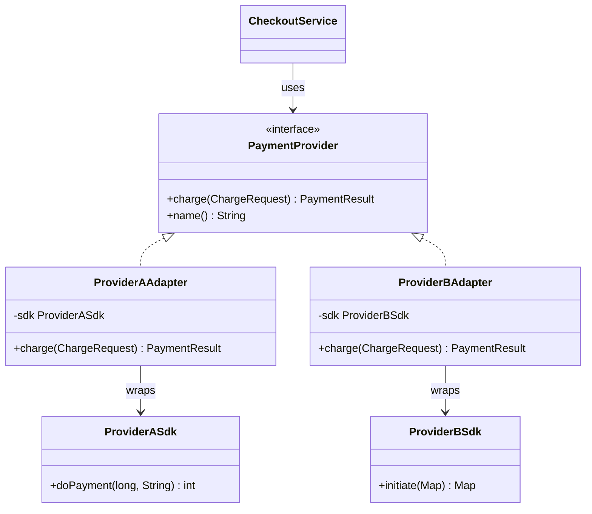
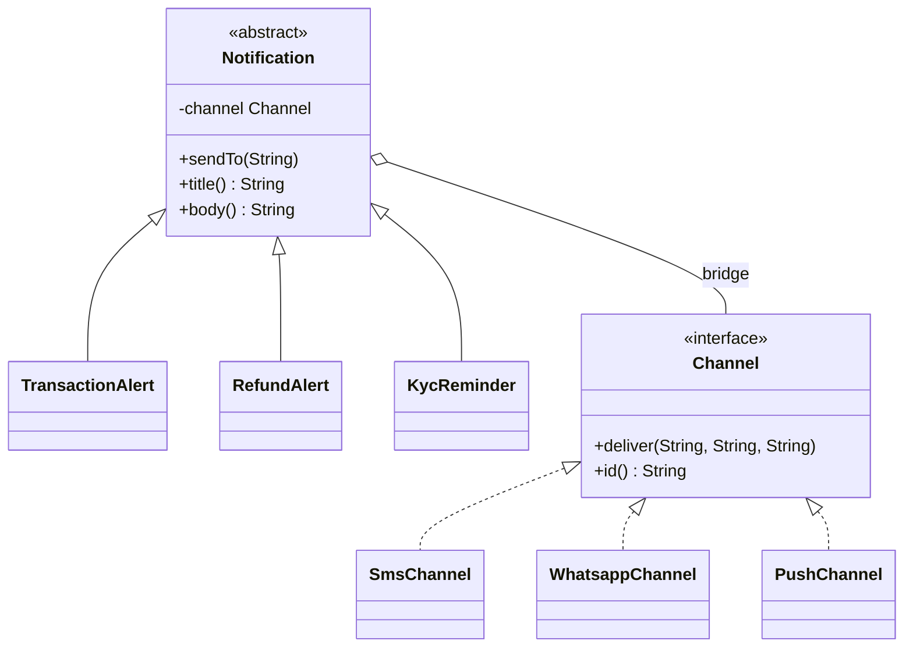
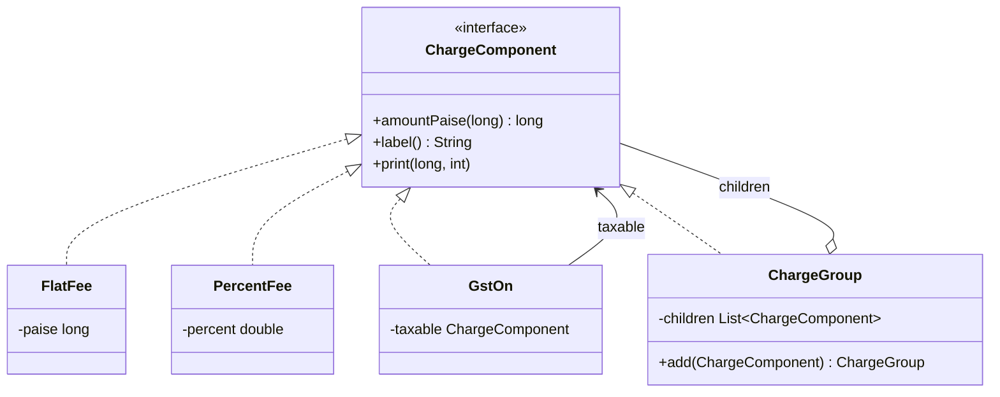
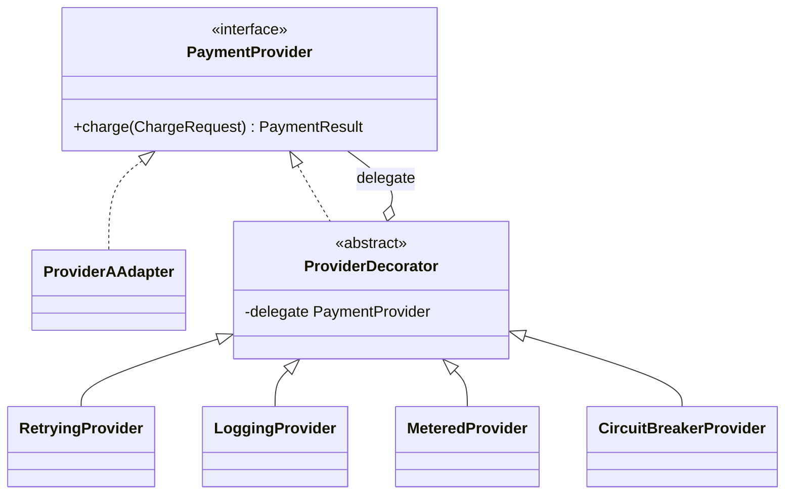
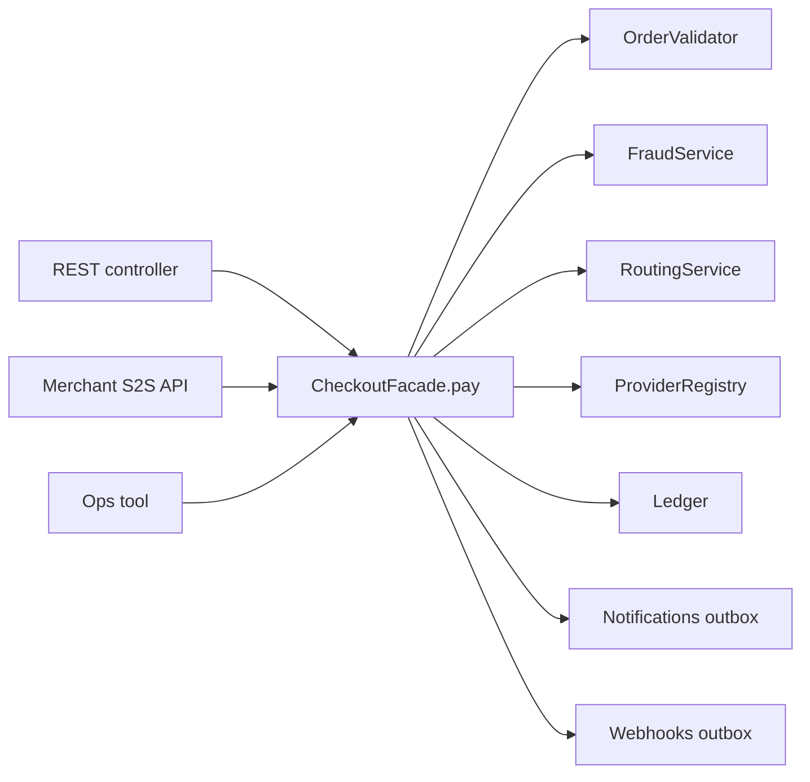
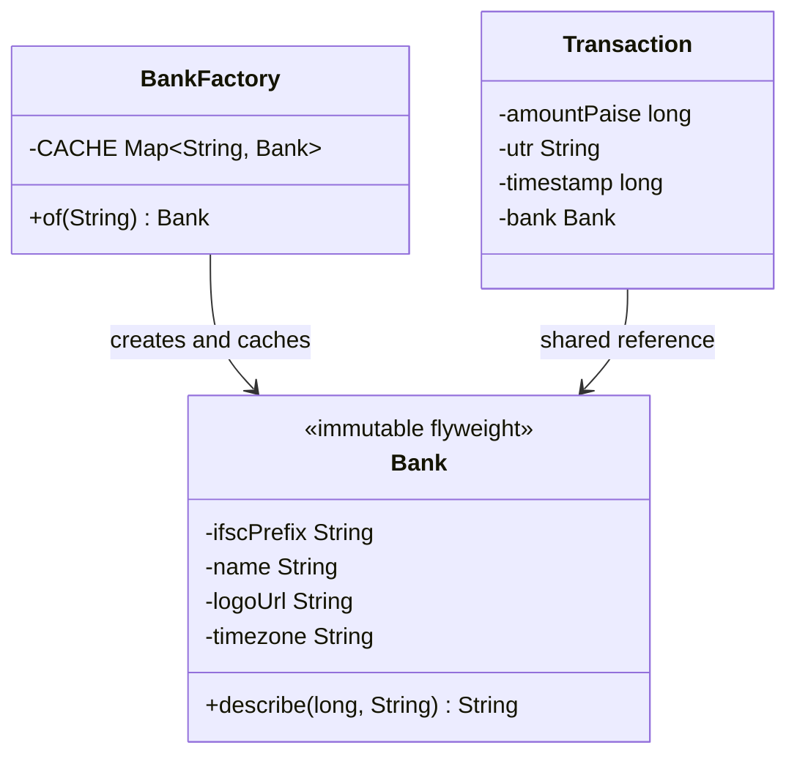
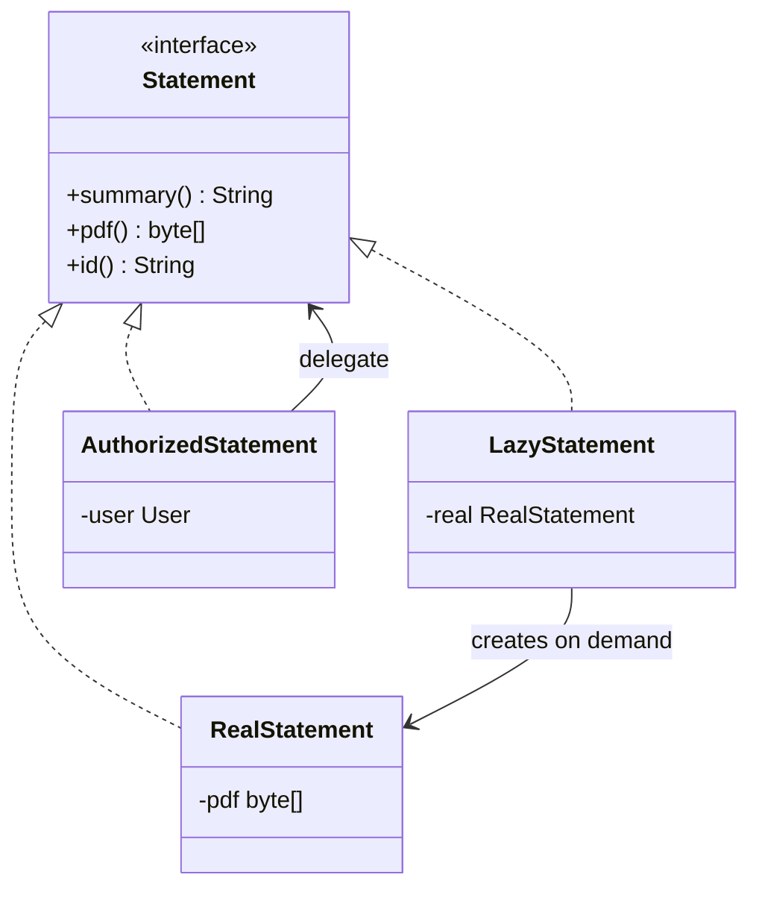

# 2B · Structural Bridge

Oct 2, 2026 · @saurav chaurasiya

Is doc me P6 se P12 tak — saat structural design patterns: Adapter, Bridge, Composite, Decorator, Facade, Flyweight aur Proxy. Structural pattern ka matlab: classes aur objects ko jodne ka tareeka, taaki bada structure banta jaaye par har hissa alag badalta rahe.

---

## P6 — Adapter

Adapter ek chhoti wrapper class hai jo kisi bahar wale ya purane class ke interface ko us shape me badal deti hai jo tumhara code expect karta hai. Tum na us bahar wale class ko badalte ho, na apne code ko — beech me ek translator rakh dete ho.

### Ye cheez hai kya

- Category: structural design pattern (interface ko badalne wala, behaviour ko nahi)
- Kis problem ke liye banaya gaya: tumhara code ek interface se baat karna chahta hai, par jo library mili hai uska interface alag hai — aur us library ka code tum badal nahi sakte
- Is lesson ke baad: tum kisi bhi third-party SDK ko apne domain interface ke peeche chhupa paoge, aur Adapter ko Facade aur Decorator se alag pehchan paoge

### Sawaal

Paytm ke checkout service me teen payment providers lagane hain. Teeno ke Java SDK alag hain:

- Provider A: `doPayment(long paiseAmount, String cardToken)` jo ek `int statusCode` return karta hai (0 = success)
- Provider B: `initiate(Map<String,String> params)` jo ek `JSONObject` return karta hai jisme `"result"` key hai (`"OK"` ya `"FAIL"`)
- Provider C: `pay(PayRequest req)` jo exception phenk deta hai fail hone par

Tumhara checkout code ek hi tarah se call karna chahta hai, aur kal chautha provider bhi aa sakta hai. Checkout service me kitni jagah `if (provider == A)` likhna padega?

> Pehle khud socho — 5 min. Hints: (1) tumhara code kis interface se baat karna chahta hai — pehle woh likho? (2) teeno SDK ke andar ka farak kahan sim jaana chahiye? (3) chautha provider aane par kitni purani files chhoogi?

### Problem kyun aata hai

- Tumhara domain aur SDK ka vocabulary alag hai: tum "charge" sochte ho, SDK "doPayment" bolta hai, aur fail batane ka tareeka bhi teeno ka alag hai (status code, JSON field, exception)
- SDK ka code tumhare haath me nahi hai — tum usme method add nahi kar sakte, na uske return type badal sakte
- Bina adapter ke SDK ka naam aur shape tumhare business logic me ghus jaata hai, aur provider badalna poore codebase ka change ban jaata hai
- Teen alag error shapes ka matlab: error handling teen jagah duplicate hoti hai aur ek bhi jagah chhoot gayi to silent bug

### Naive approach

- Pehla obvious solution: checkout service me ek bada `switch (provider)` likh do aur usme teeno SDK ko seedha call kar do
- Kahan tootta hai: woh switch ek jagah nahi rehta — charge, refund, status-check, webhook parse, har jagah dobara likha jaata hai. Chautha provider aane par tumhe saari jagah dhoondhni padengi, aur ek bhool jaana pakka hai. Ye Open-Closed Principle ka seedha ulta hai (dekho S2 — Open-Closed Principle, [1B · SOLID Temple](https://claude.ai/code/artifact/f98bb328-8939-4ef4-a9a6-24c5ce970199))

```java
// BURA code — SDK ka shape business logic me ghus gaya
class CheckoutService {
    PaymentResult charge(String provider, long paise, String token) {
        if (provider.equals("A")) {
            int code = sdkA.doPayment(paise, token);   // int status
            return code == 0 ? PaymentResult.ok("") : PaymentResult.fail("A-" + code);
        } else if (provider.equals("B")) {
            JSONObject r = sdkB.initiate(Map.of("amt", String.valueOf(paise)));
            // "result" key ka naam yahan hardcode ho gaya
            return "OK".equals(r.getString("result")) ? PaymentResult.ok("") : PaymentResult.fail("B");
        }
        // provider C aur kal D... yahi switch har method me dobara
        throw new IllegalArgumentException(provider);
    }
}
```

### Sahi design

1. Pehle apna interface likho, SDK dekhe bina. Ye tumhara domain bolta hai: `charge`, `PaymentResult`, `paise`. Isko target interface kehte hain
2. Har SDK ke liye ek adapter class banao jo us interface ko implement kare. Adapter ke andar sirf translation hoti hai — naam badalna, units badalna, error shape ko ek common shape me laana
3. Adapter ke andar SDK ka object ek field me rakho (composition), SDK ko extend na karo. Extend karne par tum uske internals se bandh jaate ho
4. Error ko ek hi shape me laao — code, JSON field aur exception, teeno ko `PaymentResult` me convert karo. Isse business logic me sirf ek error shape rehta hai
5. Adapter ko choose karne ka kaam ek factory ya map me rakho — ek hi jagah. Chautha provider aane par ek naya adapter file plus map me ek line, baaki kuch nahi chhuta
6. Adapter ko patla rakho: usme retry, logging ya business rules na daalo. Woh Decorator (P9) aur Facade (P10) ka kaam hai

Neeche poora chalne layak code hai: target interface, do adapters, ek factory aur ek demo main.

```java
import java.util.*;

// ---------- Target interface: ye tumhara domain bolta hai ----------
interface PaymentProvider {
    PaymentResult charge(ChargeRequest req);
    String name();
}

// amount hamesha paise me, kabhi double me nahi (paisa float me rakhna bug hai)
record ChargeRequest(long amountPaise, String cardToken, String orderId) {}

record PaymentResult(boolean success, String providerRef, String errorCode) {
    static PaymentResult ok(String ref)      { return new PaymentResult(true, ref, null); }
    static PaymentResult fail(String code)   { return new PaymentResult(false, null, code); }
}

// ---------- Adaptee 1: bahar wala SDK, hum isko badal nahi sakte ----------
class ProviderASdk {
    // 0 = success, baaki sab error code
    int doPayment(long paiseAmount, String cardToken) {
        return cardToken.startsWith("bad") ? 42 : 0;
    }
    String lastTxnId() { return "A-TXN-9001"; }
}

// ---------- Adaptee 2: doosra SDK, bilkul alag shape ----------
class ProviderBSdk {
    // Map in, Map out; fail hone par "result" = "FAIL"
    Map<String, String> initiate(Map<String, String> params) {
        boolean bad = params.get("token").startsWith("bad");
        return bad ? Map.of("result", "FAIL", "reason", "TOKEN_DECLINED")
                   : Map.of("result", "OK", "txn", "B-TXN-7700");
    }
}

// ---------- Adapter 1 ----------
class ProviderAAdapter implements PaymentProvider {
    private final ProviderASdk sdk;   // composition, inheritance nahi

    ProviderAAdapter(ProviderASdk sdk) { this.sdk = sdk; }

    @Override public PaymentResult charge(ChargeRequest req) {
        int code = sdk.doPayment(req.amountPaise(), req.cardToken());
        // int status ko common PaymentResult me translate kiya
        return code == 0 ? PaymentResult.ok(sdk.lastTxnId())
                         : PaymentResult.fail("A_" + code);
    }

    @Override public String name() { return "PROVIDER_A"; }
}

// ---------- Adapter 2 ----------
class ProviderBAdapter implements PaymentProvider {
    private final ProviderBSdk sdk;

    ProviderBAdapter(ProviderBSdk sdk) { this.sdk = sdk; }

    @Override public PaymentResult charge(ChargeRequest req) {
        // SDK ka param naming yahin, is file me, kaid ho gaya
        Map<String, String> out = sdk.initiate(Map.of(
                "amt",   String.valueOf(req.amountPaise()),
                "token", req.cardToken(),
                "oid",   req.orderId()));

        return "OK".equals(out.get("result"))
                ? PaymentResult.ok(out.get("txn"))
                : PaymentResult.fail("B_" + out.get("reason"));
    }

    @Override public String name() { return "PROVIDER_B"; }
}

// ---------- Provider chunne ki ek hi jagah ----------
class ProviderRegistry {
    private final Map<String, PaymentProvider> byCode = new HashMap<>();

    ProviderRegistry() {
        register(new ProviderAAdapter(new ProviderASdk()));
        register(new ProviderBAdapter(new ProviderBSdk()));
        // naya provider = naya adapter + yahan ek line. Business logic untouched.
    }

    private void register(PaymentProvider p) { byCode.put(p.name(), p); }

    PaymentProvider get(String code) {
        PaymentProvider p = byCode.get(code);
        if (p == null) throw new IllegalArgumentException("unknown provider " + code);
        return p;
    }
}

// ---------- Business logic: ab isme koi SDK ka naam nahi ----------
class CheckoutService {
    private final ProviderRegistry registry;

    CheckoutService(ProviderRegistry registry) { this.registry = registry; }

    PaymentResult pay(String providerCode, ChargeRequest req) {
        PaymentProvider provider = registry.get(providerCode);
        return provider.charge(req);   // ek hi call, ek hi result shape
    }
}

public class AdapterDemo {
    public static void main(String[] args) {
        CheckoutService checkout = new CheckoutService(new ProviderRegistry());
        ChargeRequest good = new ChargeRequest(49900, "tok_ok_123", "ORD-1");
        ChargeRequest bad  = new ChargeRequest(49900, "bad_tok_999", "ORD-2");

        System.out.println(checkout.pay("PROVIDER_A", good));
        System.out.println(checkout.pay("PROVIDER_B", good));
        System.out.println(checkout.pay("PROVIDER_A", bad));
        System.out.println(checkout.pay("PROVIDER_B", bad));
    }
}
```



Ek roz ki misaal: travel adapter. Videsh ka plug tumhare socket me nahi ghusta. Tum na plug kaatte ho, na socket todte ho — beech me ek adapter laga dete ho. Bijli wahi rehti hai, sirf shape badalta hai. Adapter pattern bilkul yahi hai: behaviour wahi, interface naya.

### Kya choose karein aur kyun

| Option | Kab use karo | Kab mat karo |
| --- | --- | --- |
| Adapter (object, composition) | Bahar wale class ka interface tumhare interface se match nahi karta, aur us class ko tum badal nahi sakte | Tumhara hi code hai aur tum uska interface seedha theek kar sakte ho |
| Adapter (class, inheritance) | Language multiple inheritance deti ho aur adaptee ke protected members chahiye | Java me — yahan ek hi class extend hoti hai, aur adaptee ke internals se bandhna khatarnaak hai |
| Facade (P10) | Kai classes ke poore subsystem ko ek simple entry point dena hai | Sirf ek class ka interface translate karna hai — woh Adapter ka kaam hai |
| Decorator (P9) | Interface wahi rakhna hai par behaviour add karna hai (retry, logging) | Interface hi badalna hai — woh Adapter hai |
| Seedha SDK call | Ek hi provider hai, ek hi jagah call hoti hai, aur badalne ka koi plan nahi | Do ya zyada providers hain, ya SDK kal badalne wala hai |

### India me kaise hota hai

Indian payments me ye pattern majboori hai, choice nahi, kyunki har rail ka apna shape hai: Paytm ka PG apna request/response format use karta hai aur uske server SDKs se integrate hota hai ([Paytm Server SDKs](https://www.paytmpayments.com/docs/server-sdk/), [Initiate Transaction API](https://www.paytmpayments.com/docs/api/initiate-transaction-api/)), Razorpay ka apna REST shape hai ([Razorpay API reference](https://razorpay.com/docs/api/)), aur UPI me NPCI ka switch poora alag protocol bolta hai ([NPCI UPI overview](https://www.npci.org.in/what-we-do/upi/product-overview)).

Isliye bade merchants ke codebase me aam taur pe ek internal `PaymentProvider` interface hota hai aur har gateway ka ek adapter. Routing logic (kaunsa provider is transaction ke liye) upar baithti hai aur usko SDK ke naam tak pata nahi hote — yahi is pattern ka asli faayda hai: ek provider down hone par traffic doosre par shift karna ek config change ban jaata hai, code change nahi.

### Interview follow-ups

- **Adapter aur Facade me farak?** — Adapter ek interface ko doosre interface me badalta hai (shape ka problem). Facade kai classes ke complex subsystem ko ek simple interface deta hai (complexity ka problem)
- **Adapter aur Decorator me farak?** — Decorator interface wahi rakhta hai aur behaviour add karta hai. Adapter interface badalta hai aur behaviour wahi rakhta hai
- **Adapter me inheritance kyun na use karein?** — Kyunki Java me ek hi class extend hoti hai, aur adaptee ke internals badalne par tumhara adapter toot jaayega. Composition se tum sirf uske public contract se bandhe rehte ho
- **Adapter ko kaise test karoge?** — Adaptee ko fake karo aur sirf translation check karo: input mapping, output mapping, aur teeno error shapes ka common shape me convert hona
- **Kitne adapters ke baad ye over-engineering hai?** — Ek provider aur badalne ka koi plan nahi ho to adapter extra layer hai. Doosra provider aate hi faayda nikal aata hai

### Self-check

1. Target interface pehle likhna kyun zaroori hai, SDK dekhne ke baad kyun nahi?
2. Adapter me composition aur inheritance me se Java me kaunsa behtar hai aur kyun?
3. Adapter aur Decorator ka ek line ka farak kya hai?
4. Teen providers ke teen alag error shapes ko adapter kahan handle karta hai?
5. Chautha provider add karne par kitni purani files badalni padengi?

### Notebook

Adapter = interface translate karta hai, behaviour nahi badalta · target interface pehle likho, apne domain ki bhaasha me · adaptee ko field me rakho (composition), extend na karo · error shapes ko ek common result type me laao, yahi adapter ka asli kaam hai · provider chunne ka switch ek registry ya factory me, business logic me nahi · adapter patla rakho — retry aur logging Decorator ka kaam · Facade = complexity chhupata hai, Adapter = shape badalta hai

### Padhne ke liye

- [Refactoring Guru — Adapter pattern](https://refactoring.guru/design-patterns/adapter)
- [Java `InputStreamReader` — JDK ka hi ek Adapter (byte stream se char stream)](https://docs.oracle.com/en/java/javase/21/docs/api/java.base/java/io/InputStreamReader.html)
- [Paytm Server SDKs](https://www.paytmpayments.com/docs/server-sdk/)

### Deep Dive (SDE-2) — jab time ho

#### Two-way adapter aur leaky abstraction

Kabhi-kabhi tumhe dono taraf translate karna padta hai — jaise webhook aate hue bhi provider ka format hota hai. Tab adapter me do methods hote hain: `charge()` jaate hue, aur `parseWebhook()` aate hue. Khatra ye hai ki ek provider ka koi unique concept (jaise sirf uske paas ek "partial capture" flag hai) tumhare common interface me ghus jaata hai aur sab adapters ko nakli implementation likhni padti hai — isko leaky abstraction kehte hain. Ilaaj: common interface me sirf woh rakho jo sab providers me sach hai, aur provider-specific baat ek optional capability interface me daalo jise sirf woh adapter implement kare.

#### Adapter ka error aur timeout contract

Adapter ka sabse under-rated kaam error classification hai: har provider ke error codes ko teen buckets me daalo — retryable (network, 5xx, timeout), terminal (card declined, insufficient funds) aur unknown (jahan tumhe pata nahi paisa kata ya nahi). Teesra bucket payments me sabse important hai, kyunki uska jawab retry nahi, status-check API hai. Agar adapter ye classification nahi karta to upar wala caller provider ke raw codes padhne lagega aur abstraction bekaar ho jaayegi.

#### Adapter ko kahan rakhein aur version kaise handle karein

Adapter ko apne hi module me rakho jisme us SDK ki dependency ho, aur business module me us SDK ki dependency bilkul na ho — isse compiler hi galti rok dega. Jab provider apna API v2 nikaale, naya adapter (`ProviderAV2Adapter`) banao aur registry me dono rakho, phir traffic ek flag se shift karo. Purana adapter traffic zero hone ke baad hatao. Isse migration ek config change ban jaati hai aur rollback turant possible rehta hai.

---

## P7 — Bridge

Bridge ek cheez ko do alag inheritance trees me tod deta hai: "kya kaam hai" (abstraction) aur "kaise hota hai" (implementation). Dono ek interface ke zariye jude rehte hain, isliye dono apni marzi se badh sakte hain bina ek doosre ko chhue.

### Ye cheez hai kya

- Category: structural design pattern (inheritance ki do dimensions ko alag karne wala)
- Kis problem ke liye banaya gaya: jab ek cheez do swatantra dimensions me vary karti hai, to inheritance se class explosion hota hai — N kinds into M platforms = N into M classes
- Is lesson ke baad: tum class explosion pehchan paoge aur usko do interfaces me tod paoge, aur Bridge ko Strategy aur Adapter se alag bata paoge

### Sawaal

Paytm me notifications bhejne hain. Chaar tarah ke notifications hain: transaction alert, refund alert, KYC reminder, aur cashback offer. Aur chaar channels hain: SMS, WhatsApp, push notification, email.

Agar tum `SmsTransactionAlert`, `WhatsappTransactionAlert`, `PushTransactionAlert`, `EmailTransactionAlert`, `SmsRefundAlert` aise classes banane lage, to kitni classes banengi? Aur kal paanchva channel (RCS) aane par kitni nayi classes likhni padengi? Aur paanchva notification type aane par?

> Pehle khud socho — 5 min. Hints: (1) 4 into 4 kitna hota hai, aur 5 into 5? (2) "message ka content banana" aur "message bhejna" — ye do kaam ek hi class me hone chahiye? (3) agar dono ko alag interface de do to naya channel kitni classes todega?

### Problem kyun aata hai

- Do swatantra dimensions ek hi inheritance tree me daalne se classes multiply hoti hain: 4 types into 4 channels = 16 classes, 5 into 5 = 25. Ye multiplicative growth hai, linear nahi
- Har cell me content-banane ka logic dobara likha jaata hai: `SmsTransactionAlert` aur `PushTransactionAlert` dono me "amount aur UTR se text banao" wahi code hai
- Naya channel add karne par tumhe har notification type chhoona padta hai — yaani ek dimension ka change doosri dimension ki saari classes todta hai
- Inheritance compile-time par fix ho jaati hai: runtime par "ye alert SMS se bhejo, woh WhatsApp se" decide karna mushkil ho jaata hai

### Naive approach

- Pehla obvious solution: ek abstract `Notification` class banao aur har combination ke liye ek subclass
- Kahan tootta hai: 16 classes ka maintenance, content logic ka duplication, aur naya channel aane par 4-5 nayi files. Aur ek channel ka bug (jaise SMS me 160-character limit) ka fix 4 jagah lagana padta hai

```java
// BURA code — class explosion
abstract class Notification { abstract void send(User u); }

class SmsTransactionAlert extends Notification {
    void send(User u) {
        String text = "Rs " + amt + " debited, UTR " + utr;  // content logic
        smsGateway.send(u.mobile(), text);                   // delivery logic
    }
}
class WhatsappTransactionAlert extends Notification {
    void send(User u) {
        String text = "Rs " + amt + " debited, UTR " + utr;  // wahi content, dobara
        whatsappApi.post(u.mobile(), text);
    }
}
// ...aur 14 classes. Naya channel = 4 nayi files.
```

### Sahi design

1. Do dimensions pehchano. Dimension 1: notification ka type (kya kehna hai). Dimension 2: channel (kaise bhejna hai). Ye ek doosre se swatantra hain — koi bhi type kisi bhi channel se ja sakta hai
2. Implementation side ke liye ek interface banao: `Channel`, jisme sirf `deliver(to, title, body)` hai. Har channel iska ek implementation hai. Ye "kaise" wala tree hai
3. Abstraction side ke liye ek abstract class banao: `Notification`, jisme ek `Channel` field ho (yahi bridge hai — composition ka woh link jisse dono trees jude hain). Har notification type iska subclass hai aur sirf content banata hai. Ye "kya" wala tree hai
4. Notification ko channel constructor me do, compile time par nahi. Isse runtime par channel chunna possible ho jaata hai (user ki preference, ya SMS down hone par WhatsApp fallback)
5. Ab ganit badal gaya: 4 types plus 4 channels = 8 classes, 16 nahi. Naya channel = 1 nayi class, aur koi purani file nahi chhoogi
6. Channel ke andar ki per-channel detail (SMS ka character limit, push ka payload size) usi channel class me rakho. Notification ko uska pata hi nahi hona chahiye

```java
import java.util.*;

// ---------- Implementation side: "kaise bhejna hai" ----------
interface Channel {
    void deliver(String to, String title, String body);
    String id();
}

class SmsChannel implements Channel {
    @Override public void deliver(String to, String title, String body) {
        // SMS me title ki jagah nahi hoti, aur length cap hai
        String text = body.length() > 160 ? body.substring(0, 157) + "..." : body;
        System.out.println("[SMS -> " + to + "] " + text);
    }
    @Override public String id() { return "SMS"; }
}

class WhatsappChannel implements Channel {
    @Override public void deliver(String to, String title, String body) {
        // WhatsApp me template aur title dono chalte hain
        System.out.println("[WA -> " + to + "] *" + title + "*\n" + body);
    }
    @Override public String id() { return "WHATSAPP"; }
}

class PushChannel implements Channel {
    @Override public void deliver(String to, String title, String body) {
        System.out.println("[PUSH -> device:" + to + "] {\"t\":\"" + title + "\",\"b\":\"" + body + "\"}");
    }
    @Override public String id() { return "PUSH"; }
}

// ---------- Abstraction side: "kya kehna hai" ----------
abstract class Notification {
    protected final Channel channel;   // YE hai bridge: composition ka link

    protected Notification(Channel channel) { this.channel = channel; }

    abstract String title();
    abstract String body();

    // sab types ke liye common flow, ek hi jagah
    void sendTo(String destination) {
        channel.deliver(destination, title(), body());
    }
}

class TransactionAlert extends Notification {
    private final long amountPaise;
    private final String utr;

    TransactionAlert(Channel channel, long amountPaise, String utr) {
        super(channel);
        this.amountPaise = amountPaise;
        this.utr = utr;
    }

    @Override String title() { return "Payment successful"; }
    @Override String body()  {
        // paise ko rupees me dikhane ka logic ek hi jagah
        return "Rs " + (amountPaise / 100.0) + " debited. UTR " + utr + ".";
    }
}

class RefundAlert extends Notification {
    private final long amountPaise;
    private final int days;

    RefundAlert(Channel channel, long amountPaise, int days) {
        super(channel);
        this.amountPaise = amountPaise;
        this.days = days;
    }

    @Override String title() { return "Refund initiated"; }
    @Override String body()  {
        return "Rs " + (amountPaise / 100.0) + " refund " + days + " working days me aa jaayega.";
    }
}

class KycReminder extends Notification {
    private final String deadline;

    KycReminder(Channel channel, String deadline) { super(channel); this.deadline = deadline; }

    @Override String title() { return "KYC pending"; }
    @Override String body()  { return "Apna KYC " + deadline + " tak poora karein."; }
}

public class BridgeDemo {
    public static void main(String[] args) {
        Channel sms  = new SmsChannel();
        Channel wa   = new WhatsappChannel();
        Channel push = new PushChannel();

        // wahi type, alag channel — runtime par choose kiya
        new TransactionAlert(sms,  49900, "UTR123456789").sendTo("9876543210");
        new TransactionAlert(wa,   49900, "UTR123456789").sendTo("9876543210");
        new RefundAlert(push, 120000, 5).sendTo("dev-token-abc");
        new KycReminder(wa, "31 Oct").sendTo("9876543210");

        // user ki preference se channel — ye inheritance se possible hi nahi tha
        Map<String, Channel> preference = Map.of("u1", wa, "u2", sms);
        new TransactionAlert(preference.get("u1"), 25000, "UTR999").sendTo("9000000001");
    }
}
```



Ek roz ki misaal: TV ka remote. Remote ke paas apni hierarchy hai (basic remote, universal remote, voice remote) aur TV ke paas apni (LED, smart TV, projector). Remote TV ko ek fix interface se chalata hai — on, off, channel badlo. Naya TV model aane par remote ka design nahi badalta, aur naya remote aane par TV nahi badalta. Bridge wahi link hai.

### Kya choose karein aur kyun

| Option | Kab use karo | Kab mat karo |
| --- | --- | --- |
| Bridge | Do swatantra dimensions hain aur dono badhne wali hain (type into channel, shape into renderer, report into export format) | Ek hi dimension vary karti ho — tab simple inheritance ya Strategy kaafi hai |
| Simple inheritance | Sirf ek dimension hai, aur subclasses ki ginti chhoti aur stable hai | Do dimensions dikh rahi hain — class explosion aane wala hai |
| Strategy | Ek algorithm runtime par badalna hai, par structure ki do swatantra hierarchies nahi hain | Dono taraf poori hierarchy hai, jo apne aap badhti rahegi |
| Adapter (P6) | Jo class pehle se hai uska interface match karana hai | Tum naya design bana rahe ho — tab Bridge upfront chuno |

### India me kaise hota hai

Indian consumer fintech me notification layer ka ye shape bahut aam hai, kyunki channels regulatory aur commercial reasons se badalte rehte hain: SMS templates ko TRAI ke DLT (Distributed Ledger Technology — TRAI ka woh registry system jahan commercial SMS ke sender id aur template pehle register karne padte hain) par register karna padta hai ([TRAI DLT / commercial communication regulations](https://www.trai.gov.in/)), WhatsApp par template approval ka apna process hai, aur push notification ka payload format platform ke hisaab se badalta hai. Agar content logic channel ke andar ghusa hua ho, to ek template rule badalne par chaaron jagah change karna padta hai.

Isliye production codebase me aam taur pe `NotificationTemplate` (kya kehna hai) aur `DeliveryChannel` (kaise bhejna hai) do alag interfaces hote hain, aur user ki channel preference runtime par bridge ke through inject hoti hai. Isse SMS gateway down hone par ek hi notification ko doosre channel par bhejna ek line ka kaam ban jaata hai.

### Interview follow-ups

- **Bridge aur Strategy me farak?** — Strategy me ek behaviour plug hota hai. Bridge me do poori hierarchies hoti hain jo swatantra badhti hain. Structure me code milta-julta lagta hai, intent alag hai
- **Bridge aur Adapter me farak?** — Adapter baad me lagaya jaata hai, do already-existing interfaces ko jodne ke liye. Bridge shuru me design kiya jaata hai, taaki do dimensions kabhi na uljhein
- **Class explosion ka formula?** — Inheritance me N into M, Bridge ke baad N plus M. 5 into 5 = 25 vs 5 plus 5 = 10
- **Abstraction side par refined abstractions kab banate hain?** — Jab kuch types ka flow hi alag ho (jaise ek urgent notification jo do channels par ek saath jaaye) — tab `Notification` ka ek subclass jo `sendTo` ko override kare
- **Bridge me channel ko constructor me dena zaroori hai?** — Nahi, setter se bhi ho sakta hai, par constructor se object immutable rehta hai aur "adha-bana" notification nahi banta

### Self-check

1. Bridge me "bridge" exactly kaunsa code hai?
2. 6 notification types aur 5 channels par inheritance me aur Bridge me kitni classes banengi?
3. Bridge aur Strategy ka intent-level farak kya hai?
4. SMS ka 160-character rule kis class ke andar rehna chahiye aur kyun?
5. Runtime par channel badalna inheritance approach me kyun mushkil tha?

### Notebook

Bridge = abstraction (kya) aur implementation (kaise) do alag trees me, ek composition link se jude · inheritance me N into M classes, Bridge me N plus M · abstraction ke paas implementation ka reference hota hai — yahi bridge hai · per-channel detail channel class me, notification ko uska pata nahi · channel runtime par inject hota hai, isliye fallback aur user preference possible · Strategy = ek behaviour plug, Bridge = do hierarchies · Adapter baad me lagta hai, Bridge pehle se design hota hai

### Padhne ke liye

- [Refactoring Guru — Bridge pattern](https://refactoring.guru/design-patterns/bridge)
- [Refactoring Guru — Bridge aur Strategy ka farak](https://refactoring.guru/design-patterns/bridge#:~:text=Bridge%2C%20State%2C%20Strategy)

### Deep Dive (SDE-2) — jab time ho

#### Teesri dimension aa gayi to?

Maan lo ab language bhi dimension ban gayi (Hindi, English, Tamil). Teen dimensions par Bridge ko aur todna padta hai: `Notification` ke paas `Channel` aur `Translator` dono ka reference ho. Par dhyan rakho — do se zyada injected dependencies ke baad constructor bhaari ho jaata hai aur object banane ki jagah bikhar jaati hai. Tab ek builder (P4 ke aas-paas) ya ek factory rakho jo yeh wiring ek jagah kare, warna Bridge ka faayda call sites par bikhre hue `new` me kho jaata hai.

#### Bridge aur dependency direction

Bridge ka asli structural faayda ye hai ki dependency ek hi direction me jaati hai: abstraction implementation interface ko jaanti hai, par koi bhi concrete channel kisi notification type ko nahi jaanta. Isse channels ko apne module me rakha ja sakta hai aur unko alag se test kiya ja sakta hai. Agar kabhi ek channel ko notification ke type ka pata chahiye (jaise "transaction alert ko priority queue me bhejo"), to woh type leak hai — uske bajaye `deliver` me ek `priority` ya `category` parameter do, type ka naam nahi.

#### Testing me Bridge ka faayda

Dono sides alag hone se test matrix bhi N into M se N plus M ho jaata hai: har notification type ka test ek fake channel ke saath (content check), aur har channel ka test ek fake content ke saath (delivery aur limits check). Inheritance wale design me tumhe 16 combinations test karne padte, aur practically log sirf 3-4 test karte hain aur baaki me bug chhupa rehta hai.

---

## P8 — Composite

Composite ek tree structure banata hai jisme ek single cheez aur cheezon ka group — dono ek hi interface implement karte hain. Isliye caller ko farak hi nahi padta ki uske haath me ek item hai ya poora group: woh dono par wahi method call karta hai.

### Ye cheez hai kya

- Category: structural design pattern (part aur whole ko ek jaise treat karne wala)
- Kis problem ke liye banaya gaya: jab data recursive tree hai (group ke andar group) aur tumhara code har level par `if (ye group hai) ... else ...` likhne lagta hai
- Is lesson ke baad: tum recursive structure ko ek interface ke peeche chhupa paoge aur bina type-check ke poore tree par kaam kar paoge

### Sawaal

Paytm par ek merchant transaction par charges lagte hain, aur unka structure nested hai:

- Total charge
  - MDR (Merchant Discount Rate — merchant se liya gaya commission)
    - Interchange fee: 1.2% (bank ko jaata hai)
    - Network fee: 0.15% (card network ko)
    - Gateway fee: flat Rs 2 (gateway ko)
  - Platform charges
    - Payout fee: flat Rs 5
    - GST: upar ke total ka 18%

Tumhe teen cheezein chahiye: (1) poora total nikalna, (2) merchant ko line-by-line breakdown dikhana, (3) kal "Platform charges" ke andar ek naya sub-group daal dena bina calculation code chhue. Tum ise kaise model karoge?

> Pehle khud socho — 5 min. Hints: (1) "ek fee" aur "fees ka group" — dono se caller kya same cheez poochhta hai? (2) agar dono same interface implement karein to total nikalne ka code kitna lamba hoga? (3) GST "upar ke total ka 18%" hai — ye leaf hai ya kuch aur?

### Problem kyun aata hai

- Data recursive hai par code recursive nahi: tum nested list par loop likhte ho, aur andar phir check karte ho "ye item hai ya list?" — ye check har method me dobara aata hai
- Depth badalne par code todta hai: 2-level ke liye likha hua loop 3-level par galat total deta hai, aur ye bug silently paisa galat kar deta hai
- Leaf aur group ke liye alag types rakhne par caller ko dono ka pata rakhna padta hai — abstraction leak ho jaati hai
- Breakdown dikhane ka logic total nikaalne ke logic se alag ho jaata hai, to dono kabhi-kabhi match nahi karte (total 10 rupees, breakdown 9.80 ka — classic production bug)

### Naive approach

- Pehla obvious solution: nested `Map<String, Object>` ya nested list rakho aur `instanceof` se recurse karo
- Kahan tootta hai: har naya operation (total, breakdown, percentage-of-total, GST base) me wahi `instanceof` chain dobara likhni padti hai. Ek jagah bhool gaye to total galat. Aur compiler madad nahi karta, kyunki `Object` me sab chalta hai

```java
// BURA code — instanceof chain, har method me dobara
long total(Object node) {
    if (node instanceof Long amt) {
        return amt;
    } else if (node instanceof List<?> list) {
        long sum = 0;
        for (Object child : list) sum += total(child);   // depth sambhal gayi...
        return sum;
    }
    throw new IllegalArgumentException();
    // ...par breakdown(), gstBase(), share() me yahi chain dobara likhni padegi
}
```

### Sahi design

1. Ek common interface banao jo leaf aur group dono implement karein: `ChargeComponent`, jisme `amountPaise(long base)` aur `describe(int depth)` ho. Caller sirf isko jaanta hai
2. Leaf classes banao: `FlatFee` (fix rupaye) aur `PercentFee` (base ka percent). Ye khud ke andar koi child nahi rakhte
3. Composite class banao: `ChargeGroup`, jisme children ki list ho aur jo `amountPaise` me apne saare children ka sum return kare. Yahi ek jagah hai jahan recursion likhi gayi hai — poore codebase me ek hi baar
4. Composite bhi usi interface ko implement karta hai, isliye group ke andar group daalna apne aap chal jaata hai. Depth ki koi limit code me nahi likhni padti
5. Naya operation add karna ho (jaise "har component ka total me kitna percent") to woh bhi interface par ek default method ban jaata hai — `instanceof` kahin nahi
6. GST jaisi "upar ke total par lagne wali" cheez ko ek special leaf banao jo dusre component ka reference le (`GstOn`). Isse breakdown aur total dono automatic sahi rehte hain, kyunki dono ek hi tree se nikal rahe hain

```java
import java.util.*;

// ---------- Common interface: leaf aur group dono isko implement karte hain ----------
interface ChargeComponent {
    // base = transaction ka amount paise me
    long amountPaise(long basePaise);
    String label();

    // breakdown bhi usi tree se nikalta hai, isliye total se kabhi mismatch nahi hoga
    default void print(long basePaise, int depth) {
        System.out.printf("%s%-22s %10.2f%n",
                "  ".repeat(depth), label(), amountPaise(basePaise) / 100.0);
    }
}

// ---------- Leaf 1: fix amount ----------
class FlatFee implements ChargeComponent {
    private final String label;
    private final long paise;

    FlatFee(String label, long paise) { this.label = label; this.paise = paise; }

    @Override public long amountPaise(long basePaise) { return paise; }
    @Override public String label() { return label; }
}

// ---------- Leaf 2: base ka percent ----------
class PercentFee implements ChargeComponent {
    private final String label;
    private final double percent;

    PercentFee(String label, double percent) { this.label = label; this.percent = percent; }

    @Override public long amountPaise(long basePaise) {
        // paisa hamesha long me; round karke hi store karo, double me nahi chhodo
        return Math.round(basePaise * percent / 100.0);
    }
    @Override public String label() { return label + " (" + percent + "%)"; }
}

// ---------- Composite: group, jo khud bhi ek component hai ----------
class ChargeGroup implements ChargeComponent {
    private final String label;
    private final List<ChargeComponent> children = new ArrayList<>();

    ChargeGroup(String label) { this.label = label; }

    ChargeGroup add(ChargeComponent c) { children.add(c); return this; }

    @Override public long amountPaise(long basePaise) {
        long sum = 0;
        // POORE codebase me recursion sirf yahan hai
        for (ChargeComponent c : children) sum += c.amountPaise(basePaise);
        return sum;
    }

    @Override public String label() { return label; }

    @Override public void print(long basePaise, int depth) {
        ChargeComponent.super.print(basePaise, depth);   // pehle group ka apna total
        for (ChargeComponent c : children) c.print(basePaise, depth + 1);
    }
}

// ---------- Special leaf: dusre component ke total par lagne wala tax ----------
class GstOn implements ChargeComponent {
    private final ChargeComponent taxable;
    private final double percent;

    GstOn(ChargeComponent taxable, double percent) { this.taxable = taxable; this.percent = percent; }

    @Override public long amountPaise(long basePaise) {
        // base transaction par nahi, taxable component ke total par
        return Math.round(taxable.amountPaise(basePaise) * percent / 100.0);
    }
    @Override public String label() { return "GST (" + percent + "% on " + taxable.label() + ")"; }
}

public class CompositeDemo {
    public static void main(String[] args) {
        long txnPaise = 100000;   // Rs 1000 ka transaction

        ChargeGroup mdr = new ChargeGroup("MDR")
                .add(new PercentFee("Interchange", 1.2))
                .add(new PercentFee("Network", 0.15))
                .add(new FlatFee("Gateway", 200));          // Rs 2

        ChargeGroup platform = new ChargeGroup("Platform charges")
                .add(new FlatFee("Payout", 500));           // Rs 5

        ChargeGroup feesBeforeTax = new ChargeGroup("Fees before tax")
                .add(mdr)
                .add(platform);

        ChargeGroup total = new ChargeGroup("Total charge")
                .add(feesBeforeTax)
                .add(new GstOn(feesBeforeTax, 18.0));

        total.print(txnPaise, 0);
        System.out.println("-----");
        System.out.printf("Merchant ko milega: %.2f%n",
                (txnPaise - total.amountPaise(txnPaise)) / 100.0);

        // kal naya sub-group: calculation code me ek line bhi nahi badli
        platform.add(new ChargeGroup("Value added")
                .add(new FlatFee("Invoice service", 100))
                .add(new PercentFee("Analytics", 0.05)));

        System.out.println("=== naya sub-group add karne ke baad ===");
        total.print(txnPaise, 0);
    }
}
```



Ek roz ki misaal: restaurant ka bill. Bill me kuch single items hain (ek chai) aur kuch combos (thali, jiske andar roti, dal, sabzi). Jab tum total poochhte ho, waiter dono ko ek hi tarah jodta hai — use farak nahi padta ki woh single item hai ya combo. Aur combo ke andar ek aur combo (family pack) daal do to total nikaalne ka tareeka wahi rehta hai.

### Kya choose karein aur kyun

| Option | Kab use karo | Kab mat karo |
| --- | --- | --- |
| Composite | Data recursive tree hai (group ke andar group), aur caller ko leaf aur group ka farak nahi pata hona chahiye | Structure flat hai — ek simple list kaafi hai, tree banana faltu complexity hai |
| Flat list plus type field | Depth hamesha 1 hi rahegi aur tum sirf iterate karte ho | Depth badhne wali ho, ya nested group aane wale hon |
| Nested Map ya JSON plus instanceof | Data bahar se aa raha ho aur tum sirf ek baar padh rahe ho | Us data par kai operations karne hain — tab usko Composite me parse karo |
| Visitor plus Composite | Tree par bahut saare alag operations add hone hain aur tum tree classes chhune se bachna chahte ho | Sirf do-teen operations hain — interface par default methods kaafi hain |

### India me kaise hota hai

Payments me ye structure settlement aur fee calculation me seedha dikhta hai. Ek transaction par MDR ke andar kai components hote hain — interchange, network fee, gateway fee — aur uske upar GST lagta hai, jo fees ke total par lagta hai, transaction amount par nahi. Settlement report me merchant ko yahi tree line-by-line dikhana padta hai, kyunki GST input credit claim karne ke liye breakdown chahiye hota hai. Paytm aur Razorpay dono apne settlement aur fee breakdown API me ye nested shape dete hain ([Razorpay Settlements API](https://razorpay.com/docs/api/settlements/), [Paytm for Business docs](https://business.paytm.com/docs)).

Doosra bada use case marketplace hierarchy hai: ek aggregator ke neeche sub-merchants, unke neeche outlets. "Is aggregator ka aaj ka total" ek recursive sum hai, aur agar code me depth hardcode ho jaaye to ek naya level add hone par reports chup-chaap galat ho jaati hain.

### Interview follow-ups

- **Composite ka core idea ek line me?** — Leaf aur group ek hi interface implement karte hain, isliye caller ko farak nahi padta aur recursion ek hi jagah likhni padti hai
- **`add()` aur `remove()` interface par rakhein ya sirf composite par?** — Do school hain. Interface par rakhne se uniformity milti hai par leaf par woh method bemaani ho jaata hai (aur exception phenkna padta hai). Sirf composite par rakhne se type safety milti hai par caller ko cast karna padta hai. Java ki practice me type safety behtar mani jaati hai
- **Tree par naya operation add karna ho to?** — Interface par default method, ya Visitor pattern agar operations bahut hon aur tree classes stable hon
- **Cycle ban gaya to?** — Composite me cycle infinite recursion de dega. Tree banate waqt parent-child add karte hue cycle check karo, ya structure ko immutable banao (jaise builder se banao aur baad me badal hi na sako)
- **Paisa `double` me kyun nahi rakha?** — Percent calculation me floating point error jama hoti hai aur breakdown ka sum total se match nahi karta. `long` paise plus ek fix rounding rule hi production me chalta hai

### Self-check

1. Composite me recursion kitni jagah likhi jaati hai, aur kyun?
2. Leaf aur group ko ek hi interface dene se caller ko kya faayda hai?
3. GST ko normal `PercentFee` se kyun nahi banaya ja sakta tha?
4. `add()` ko interface par rakhne ka nuksaan kya hai?
5. Breakdown aur total ka mismatch is design me kyun nahi ho sakta?

### Notebook

Composite = leaf aur group, dono ek hi interface; caller ko farak nahi padta · recursion sirf composite ki `amountPaise` me, poore codebase me ek jagah · group ke andar group apne aap chalta hai, depth code me hardcode nahi · naya operation = interface par default method, `instanceof` chain nahi · total aur breakdown ek hi tree se nikalte hain, isliye mismatch impossible · `add`/`remove` interface par rakhna uniformity deta hai par leaf par bemaani; Java me type safety behtar · paisa `long` paise me, `double` me nahi

### Padhne ke liye

- [Refactoring Guru — Composite pattern](https://refactoring.guru/design-patterns/composite)
- [Java `java.io.File` aur `java.nio.file.Path` — JDK me tree-shaped APIs](https://docs.oracle.com/en/java/javase/21/docs/api/java.base/java/nio/file/Path.html)
- [Razorpay Settlements API — nested fee breakdown ka asli shape](https://razorpay.com/docs/api/settlements/)

### Deep Dive (SDE-2) — jab time ho

#### Rounding ko tree me kaise sambhalein

Sabse bada production bug yahan aata hai: har leaf alag-alag round hota hai, aur sum parent ke round se match nahi karta. Do approaches hain. Ek: har leaf ko round karo aur parent ka total un rounded values ka sum ho — isse breakdown aur total hamesha match karte hain (jo audit ke liye zaroori hai) par total exact percentage se 1-2 paise hat sakta hai. Do: parent par exact total round karo aur bachi hui paisa difference ko sabse bade child par daal do (largest remainder method). Payments me pehla common hai, kyunki merchant ko dikha breakdown hi sach maana jaata hai.

#### Immutability aur caching

Agar tree banne ke baad badalta nahi, to use immutable banao: `children` ko `List.copyOf()` se store karo aur `add` ki jagah builder rakho. Phir `amountPaise` ka result safely cache ho sakta hai, jo bade trees par (marketplace hierarchy me hazaron outlets) kaafi farak karta hai. Mutable tree me caching khatarnak hai — ek `add` ke baad stale total return hoga, aur woh bug reports me mahino baad dikhega.

#### Composite ko database se kaise load karein

Tree ko DB me rakhne ke teen aam tareeke hain: adjacency list (`parent_id` column — likhna aasaan, poora tree padhne ke liye recursive CTE chahiye), path enumeration (`path` column jaise `/1/4/9/` — subtree query aasaan, move karna mehnga), aur closure table (har ancestor-descendant pair ki row — query sabse tez, storage sabse zyada). Fee templates jaisi chhoti depth ke liye adjacency list plus ek recursive CTE kaafi hai; marketplace hierarchy jahan "is aggregator ke neeche sab" roz poochha jaata hai, wahan closure table ka kharcha wajib ban jaata hai.

---

## P9 — Decorator

Decorator ek object ko usi interface wale doosre object me lapet deta hai aur beech me kuch extra kaam jod deta hai. Interface wahi rehta hai, isliye caller ko pata bhi nahi chalta ki andar ek layer hai ya paanch.

### Ye cheez hai kya

- Category: structural design pattern (interface same rakh kar behaviour add karne wala)
- Kis problem ke liye banaya gaya: cross-cutting kaam (retry, logging, metrics, caching, rate limit) add karna hai, par na asli class ko bhaari banana hai aur na har combination ke liye subclass
- Is lesson ke baad: tum behaviour ko chhote layers me tod paoge aur runtime par unhe jod paoge, aur bata paoge Decorator inheritance se kab behtar hai

### Sawaal

P6 wala `PaymentProvider` interface yaad hai ([P6 — Adapter](https://claude.ai/code/artifact/38514da5-5649-4d61-b49d-f65f893e6a5e) isi doc me upar hai). Ab product team chaar cheezein maang rahi hai:

- Har provider call ka latency aur success-fail count metrics me jaaye
- Network error par 3 baar retry ho, exponential backoff ke saath (backoff — har retry ke beech badhta hua wait, jaise 100 ms, 200 ms, 400 ms)
- Har call ka request-response log ho, par card token mask hoke
- Provider lagataar fail kare to kuch der ke liye call band (circuit breaker)

Tum ye chaar cheezein kahan likhoge? Adapter ke andar? Aur agar kal ek provider ko retry chahiye par circuit breaker nahi, to?

> Pehle khud socho — 5 min. Hints: (1) in chaar kaamon me se kaunsa provider-specific hai aur kaunsa generic? (2) har combination ke liye subclass banao to kitni classes banengi? (3) agar har kaam ek alag class ho jo usi interface ko implement kare aur andar asli object rakhe, to?

### Problem kyun aata hai

- Ye chaar kaam cross-cutting hain — har provider par lagte hain, par kisi ek provider ka business logic nahi hain. Adapter me daalne par woh code teen-chaar adapters me duplicate ho jaata hai
- Inheritance se combination explosion hota hai: retry, retry plus log, retry plus log plus metrics, metrics plus breaker — har mix ke liye nayi subclass. 4 features ke 2 ki power 4 = 16 possible combinations
- Combination compile time par fix ho jaati hai: "provider A par breaker chalu, provider B par band" runtime par decide nahi kar sakte
- Sab kuch ek class me daalne par woh class Single Responsibility todti hai aur test karna mushkil ho jaata hai (dekho S1 — Single Responsibility, [1B · SOLID Temple](https://claude.ai/code/artifact/f98bb328-8939-4ef4-a9a6-24c5ce970199))

### Naive approach

- Pehla obvious solution: adapter ke `charge()` ke andar hi retry loop, timer, logging aur failure counter daal do
- Kahan tootta hai: ek method 80 line ka ho jaata hai jisme chaar unrelated cheezein ghusi hain. Retry ka bug fix karne ke liye payment code chhoona padta hai. Aur teesre provider ka adapter likhte waqt ye saara code copy-paste hota hai, jisme ek jagah backoff galat likh jaata hai

```java
// BURA code — ek method me chaar zimmedaariyan
@Override public PaymentResult charge(ChargeRequest req) {
    long start = System.nanoTime();
    int attempt = 0;
    while (true) {
        try {
            log.info("charging {} {}", req.orderId(), req.cardToken()); // token leak!
            int code = sdk.doPayment(req.amountPaise(), req.cardToken());
            metrics.timer("charge").record(System.nanoTime() - start);
            if (code == 0) return PaymentResult.ok(sdk.lastTxnId());
            return PaymentResult.fail("A_" + code);
        } catch (IOException e) {
            if (++attempt >= 3) throw new RuntimeException(e);
            Thread.sleep(100L * (1L << attempt));  // backoff bhi yahin
        }
    }
    // ...aur circuit breaker bhi isi method me aayega
}
```

### Sahi design

1. Interface wahi rakho: `PaymentProvider`. Ye sabse important shart hai — Decorator interface badalta nahi, warna woh Adapter ban jaayega
2. Har extra kaam ke liye ek class banao jo `PaymentProvider` implement kare aur andar ek `PaymentProvider` field rakhe (jise delegate ya wrapped kehte hain). Method ke andar apna kaam karo aur beech me `delegate.charge(req)` call karo
3. Ek abstract base class rakho (`ProviderDecorator`) jo delegate ko hold kare, taaki har decorator me wahi boilerplate na likhna pade
4. Layers ko bahar se, ek jagah, wire karo. Order matter karta hai — metrics sabse bahar rakho (taaki retry ke saare attempts ka total time dikhe), retry beech me, logging andar (taaki har attempt log ho)
5. Decorator ko stateless ya chhoti-state wala rakho. Circuit breaker ki state per-provider honi chahiye, isliye har provider ka apna breaker instance banao, shared nahi
6. Sensitive data decorator me mask karo, source par nahi. Logging decorator ka kaam hai ki card token poora na likhe

```java
import java.io.IOException;
import java.util.*;
import java.util.function.Supplier;

// ---------- Base: delegate hold karne ka boilerplate ek jagah ----------
abstract class ProviderDecorator implements PaymentProvider {
    protected final PaymentProvider delegate;

    protected ProviderDecorator(PaymentProvider delegate) { this.delegate = delegate; }

    @Override public String name() { return delegate.name(); }   // naam andar wale ka hi rehta hai
}

// ---------- Decorator 1: retry with backoff ----------
class RetryingProvider extends ProviderDecorator {
    private final int maxAttempts;
    private final long baseDelayMs;

    RetryingProvider(PaymentProvider delegate, int maxAttempts, long baseDelayMs) {
        super(delegate);
        this.maxAttempts = maxAttempts;
        this.baseDelayMs = baseDelayMs;
    }

    @Override public PaymentResult charge(ChargeRequest req) {
        RuntimeException last = null;
        for (int attempt = 0; attempt < maxAttempts; attempt++) {
            try {
                return delegate.charge(req);
            } catch (TransientException e) {   // SIRF retryable error par retry
                last = e;
                sleep(baseDelayMs * (1L << attempt));   // 100, 200, 400 ms
            }
        }
        return PaymentResult.fail("RETRIES_EXHAUSTED");
    }

    private void sleep(long ms) {
        try { Thread.sleep(ms); } catch (InterruptedException ie) { Thread.currentThread().interrupt(); }
    }
}

// ---------- Decorator 2: masked logging ----------
class LoggingProvider extends ProviderDecorator {
    LoggingProvider(PaymentProvider delegate) { super(delegate); }

    @Override public PaymentResult charge(ChargeRequest req) {
        System.out.println("-> " + name() + " charge order=" + req.orderId()
                + " amount=" + req.amountPaise() + " token=" + mask(req.cardToken()));
        PaymentResult r = delegate.charge(req);
        System.out.println("<- " + name() + " success=" + r.success() + " err=" + r.errorCode());
        return r;
    }

    // token poora kabhi log me nahi jaana chahiye
    private String mask(String token) {
        return token.length() <= 4 ? "****" : "****" + token.substring(token.length() - 4);
    }
}

// ---------- Decorator 3: metrics ----------
class MeteredProvider extends ProviderDecorator {
    private long calls, failures, totalMs;

    MeteredProvider(PaymentProvider delegate) { super(delegate); }

    @Override public PaymentResult charge(ChargeRequest req) {
        long start = System.currentTimeMillis();
        calls++;
        try {
            PaymentResult r = delegate.charge(req);
            if (!r.success()) failures++;
            return r;
        } finally {
            totalMs += System.currentTimeMillis() - start;
        }
    }

    String stats() {
        return name() + ": calls=" + calls + " failures=" + failures
                + " avgMs=" + (calls == 0 ? 0 : totalMs / calls);
    }
}

// ---------- Decorator 4: circuit breaker ----------
class CircuitBreakerProvider extends ProviderDecorator {
    private final int threshold;
    private final long openMs;
    private int consecutiveFailures;
    private long openedAt;

    CircuitBreakerProvider(PaymentProvider delegate, int threshold, long openMs) {
        super(delegate);
        this.threshold = threshold;
        this.openMs = openMs;
    }

    @Override public PaymentResult charge(ChargeRequest req) {
        if (isOpen()) return PaymentResult.fail("CIRCUIT_OPEN");   // provider ko chhua bhi nahi
        PaymentResult r = delegate.charge(req);
        if (r.success()) consecutiveFailures = 0;
        else if (++consecutiveFailures >= threshold) openedAt = System.currentTimeMillis();
        return r;
    }

    private boolean isOpen() {
        if (openedAt == 0) return false;
        if (System.currentTimeMillis() - openedAt < openMs) return true;
        openedAt = 0; consecutiveFailures = 0;   // half-open: ek call try karne do
        return false;
    }
}

class TransientException extends RuntimeException {
    TransientException(String m) { super(m); }
}

public class DecoratorDemo {
    public static void main(String[] args) {
        // ek flaky provider jo pehli do baar network error deta hai
        PaymentProvider flaky = new PaymentProvider() {
            int n = 0;
            public PaymentResult charge(ChargeRequest req) {
                if (++n <= 2) throw new TransientException("socket timeout");
                return PaymentResult.ok("TXN-" + n);
            }
            public String name() { return "PROVIDER_A"; }
        };

        // Wiring ek hi jagah. Order: metrics (bahar) -> breaker -> retry -> logging (andar)
        MeteredProvider metered = new MeteredProvider(
                new CircuitBreakerProvider(
                        new RetryingProvider(
                                new LoggingProvider(flaky), 3, 100), 5, 30_000));

        System.out.println(metered.charge(new ChargeRequest(49900, "tok_ok_1234", "ORD-1")));
        System.out.println(metered.stats());

        // doosre provider ko retry chahiye par breaker nahi — bas wiring badli
        PaymentProvider lite = new MeteredProvider(new RetryingProvider(flaky, 2, 50));
        System.out.println(lite.charge(new ChargeRequest(1000, "tok_x_9999", "ORD-2")));
    }
}
```



Ek roz ki misaal: thand me kapde. Tum apna sharir nahi badalte — shirt ke upar sweater, sweater ke upar jacket pehan lete ho. Har layer ek kaam karti hai, aur tum garmi ke hisaab se layers jod-ghata lete ho. Bahar se dekhne wale ko "ek insaan" dikhta hai, kitni layers hain pata nahi.

### Kya choose karein aur kyun

| Option | Kab use karo | Kab mat karo |
| --- | --- | --- |
| Decorator | Cross-cutting behaviour chahiye, interface same rakhna hai, aur combinations runtime par badalte hain | Sirf ek hi extra kaam hai aur woh hamesha lagta hai — tab woh base class me rakhna theek hai |
| Inheritance (subclass) | Behaviour ka ek hi fix variant chahiye aur woh kabhi mix nahi hoga | Do ya zyada features mix hone wale hain — combination explosion aayega |
| AOP ya proxy framework (Spring AOP) | Poore application me ek hi tarah ka concern lagana hai (jaise har service method par timing) | Per-instance alag wiring chahiye, ya tum explicit aur debuggable code chahte ho |
| Decorator plus Adapter saath | Adapter interface theek karta hai, Decorator uske upar behaviour jodta hai — ye normal production shape hai | Dono kaam ek hi class me ghus jaayein — tab dono patterns ka faayda khatam |

### India me kaise hota hai

Payment integrations me ye layering practically hamesha hoti hai, kyunki gateways par timeout aur intermittent failure normal hai. Ek important baat: retry decorator sirf retryable error par retry kare — "insufficient funds" par retry karna bekaar hai, aur "timeout" par blind retry duplicate charge bana sakta hai. Isliye Indian payment stacks me retry decorator ke saath ek idempotency key bheji jaati hai: Razorpay apne APIs par `X-Payment-Idempotency` style header support karta hai ([Razorpay idempotency](https://razorpay.com/docs/api/idempotency/)), aur UPI me UTR (Unique Transaction Reference) wahi kaam karta hai.

Timeout par teesra rasta bhi hota hai: retry ki jagah status-check API call karo ("us order ka kya hua?") — Paytm ke PG me Transaction Status API isi liye hai ([Paytm Transaction Status API](https://www.paytmpayments.com/docs/api/transaction-status-api/)). Production me aam shape yahi hai: status-check decorator sabse andar, uske upar retry, phir breaker, phir metrics.

### Interview follow-ups

- **Decorator aur Adapter me farak?** — Decorator interface same rakhta hai aur behaviour badalta hai. Adapter interface badalta hai aur behaviour same rakhta hai
- **Decorator aur Proxy me farak?** — Dono interface same rakhte hain. Decorator naya behaviour jodta hai; Proxy access control karta hai ya object banane me deri karta hai (P12)
- **Layers ka order matter karta hai?** — Bahut. Metrics retry ke bahar ho to woh poora retry-sequence ka time naapega; andar ho to per-attempt. Breaker retry ke bahar ho to retry ko hi rok dega, andar ho to retry breaker ko tez trip karwa dega
- **Har decorator me `name()` kyun delegate kiya?** — Taaki pehchaan andar wale asli provider ki rahe. Decorator identity nahi badalta, behaviour badalta hai
- **Decorator stateful ho sakta hai?** — Ho sakta hai (breaker hai), par tab thread safety dekhni padti hai. Counter ko `AtomicInteger` ya proper lock se rakho, warna concurrent calls par breaker galat trip karega

### Self-check

1. Decorator ka ek sabse zaroori rule kya hai (interface ke baare me)?
2. 4 optional features par inheritance me kitne combinations ban sakte hain?
3. Metrics decorator ko retry ke bahar rakhne se kya naapa jaayega?
4. Retry decorator ko kaunse error par retry karna chahiye aur kaunse par nahi?
5. Card token ko mask karne ki zimmedari kis layer ki hai?

### Notebook

Decorator = usi interface me lapet kar behaviour add karna; caller ko layers ka pata nahi · delegate field plus abstract base = boilerplate ek jagah · inheritance me 2 ki power N combinations, Decorator me N chhoti classes · wiring ek jagah; order matter karta hai (metrics bahar, retry beech, logging andar) · retry sirf retryable error par, aur timeout par status-check behtar · breaker ki state per-provider, shared nahi; stateful decorator me thread safety · Adapter = interface badalta, Decorator = behaviour badalta, Proxy = access control

### Padhne ke liye

- [Refactoring Guru — Decorator pattern](https://refactoring.guru/design-patterns/decorator)
- [Java `BufferedInputStream` — JDK ka classic Decorator](https://docs.oracle.com/en/java/javase/21/docs/api/java.base/java/io/BufferedInputStream.html)
- [Razorpay — Idempotency](https://razorpay.com/docs/api/idempotency/)

### Deep Dive (SDE-2) — jab time ho

#### Retry aur idempotency ka jodna

Retry decorator akela khatarnak hai: timeout par tumhe pata nahi request pahunchi ya nahi, aur blind retry do baar paisa kaat sakti hai. Isliye retry decorator ko idempotency key ke saath hi design karo — `ChargeRequest` me ek key ho jo saare attempts me same rahe (order id se derive karo, random nahi), aur provider us key par duplicate detect kare. Jahan provider ye support na kare, wahan retry ki jagah status-check decorator lagao: pehle poochho "us order ka status kya hai", aur sirf "not found" par dobara bhejo.

#### Order ka asli asar

Layers ko ulta-pulta lagane se bug aata hai jo test me nahi dikhta. Breaker retry ke andar hai to ek call ke teen attempts breaker ke teen failures ban jaate hain, aur breaker 5 ke threshold par do calls me trip ho jaayega — jo tumne socha nahi tha. Cache decorator agar logging ke bahar hai to cache hit par log hi nahi aayega aur debugging me aisa lagega ki call hua hi nahi. Isliye wiring ko ek hi factory method me rakho aur uske upar ek comment me order ka reason likho.

#### Kitni layers ke baad ye zyada ho jaata hai

Decorator ka nuksaan debugging hai: stack trace me chaar-paanch wrapper classes dikhti hain aur "asli call kahan gaya" dhoondhna padta hai. Thumb rule: chaar-paanch layers tak theek hai; usse zyada ho to concerns ko do groups me baanto (transport-level: retry, timeout, breaker; observability-level: logging, metrics) aur do composed objects banao. Aur har decorator ka naam uske kaam se rakho, taaki stack trace khud bata de ki kis layer me ho.

---

## P10 — Facade

Facade ek simple class hai jo kai complicated classes ke saamne khadi hoti hai aur caller ko ek chhota, saaf interface deti hai. Andar ka subsystem waisa hi rehta hai — Facade sirf uske use karne ka tareeka aasaan banata hai.

### Ye cheez hai kya

- Category: structural design pattern (complexity chhupane wala)
- Kis problem ke liye banaya gaya: ek kaam karne ke liye caller ko 6-7 classes ka naam, unka order, aur unka error handling pata hona padta hai — aur woh gyaan har caller me duplicate ho jaata hai
- Is lesson ke baad: tum ek multi-step flow ko ek method ke peeche la paoge, aur Facade ko Adapter aur God-class se alag kar paoge

### Sawaal

Paytm me ek payment complete karne ke liye ye steps hone hain, isi order me:

1. Order validate karo aur amount check karo
2. Fraud service se risk score lo; score zyada ho to reject
3. Routing service se decide karo kaunsa provider use hoga
4. Provider se charge karo
5. Ledger me double-entry likho
6. Notification aur merchant webhook queue me daalo

Ab teen callers hain: mobile app ka REST controller, merchant ka server-to-server API, aur ek internal ops tool. Teeno ko ye 6 steps isi order me karne hain. Tum teeno controllers me ye 6 steps likhoge?

> Pehle khud socho — 5 min. Hints: (1) agar step 2 me ek naya check add ho to kitni jagah badalna padega? (2) ye 6 steps ka gyaan kiska hona chahiye — controller ka ya domain ka? (3) Facade ke andar business rules honi chahiye ya sirf orchestration?

### Problem kyun aata hai

- Flow ka gyaan (kaunsa step pehle, kaunsa baad me) caller me chala jaata hai, aur har naye caller me copy hota hai
- Order galat hona silent bug deta hai: ledger pehle likh diya aur charge fail ho gaya, to books galat ho gayi
- Error handling 6 jagah bikhar jaati hai, aur ek caller me ek case chhoot jaata hai
- Subsystem ki ek class ka constructor badalne par saare callers compile fail hote hain — yaani internal change ka blast radius poora codebase ban jaata hai

### Naive approach

- Pehla obvious solution: controller me hi saare 6 services inject karo aur steps likh do
- Kahan tootta hai: teeno controllers ka code 80% same hota hai par 20% alag, aur woh 20% hi bug hota hai. Naya step add karne par tumhe teen jagah dhoondhni padti hai, aur ops tool aam taur pe chhoot jaata hai — jo mahino baad ek galat report me pakda jaata hai

```java
// BURA code — flow ka gyaan controller me
@PostMapping("/pay")
ResponseEntity<?> pay(@RequestBody PayDto dto) {
    orderValidator.validate(dto.orderId(), dto.amountPaise());
    RiskScore risk = fraudService.score(dto.userId(), dto.amountPaise());
    if (risk.value() > 80) return ResponseEntity.status(403).body("blocked");
    String provider = routingService.pick(dto);
    PaymentResult r = registry.get(provider).charge(toChargeRequest(dto));
    if (r.success()) {
        ledger.recordDoubleEntry(dto.orderId(), dto.amountPaise());   // order galat hone ka khatra
        notifications.enqueue(dto.userId(), dto.amountPaise());
        webhooks.enqueue(dto.merchantId(), r.providerRef());
    }
    return ResponseEntity.ok(r);
    // ...aur ye poora block merchant API aur ops tool me dobara
}
```

### Sahi design

1. Ek Facade class banao: `CheckoutFacade`, jisme ek hi public method ho — `pay(PaymentCommand)`. Caller ko sirf ye method aur do types (command aur receipt) pata hon
2. Subsystem ke saare collaborators Facade ke constructor me injected rahen, aur Facade ke bahar koi unko seedha na chhue (ya kam se kam controllers na chhuen)
3. Facade ke andar sirf orchestration rakho: order, error translation, aur "success hone par ye teen cheezein queue me daalo". Business rules (risk threshold kitna hai, routing ka rule kya hai) un services ke andar hi rehen
4. Facade ka return type apna banao (`Receipt`), subsystem ka type nahi. Isse andar ka type badalne par caller safe rehta hai
5. Facade subsystem ko chhupata hai, band nahi karta: agar kisi ko advanced control chahiye (jaise ops tool ko manually provider choose karna hai) to woh underlying service seedha use kar sakta hai. Facade ek shortcut hai, deewar nahi
6. Facade ko patla rakho — jis din usme `if` ki ginti badhne lage aur woh khud rules decide karne lage, woh God-class ban raha hai. Tab us flow ko ek domain service me tod do

```java
import java.util.*;

// ---------- Caller ke liye sirf ye do types ----------
record PaymentCommand(String orderId, String userId, String merchantId,
                      long amountPaise, String cardToken) {}

record Receipt(boolean success, String providerRef, String reason) {
    static Receipt ok(String ref)       { return new Receipt(true, ref, null); }
    static Receipt rejected(String why) { return new Receipt(false, null, why); }
}

// ---------- Subsystem ke hisse (asli code me ye alag classes aur modules hain) ----------
class OrderValidator {
    boolean valid(String orderId, long paise) { return paise > 0 && orderId != null; }
}

class FraudService {
    int score(String userId, long paise) { return paise > 500000 ? 90 : 10; }  // Rs 5000 se upar risky
}

class RoutingService {
    String pick(long paise) { return paise > 100000 ? "PROVIDER_B" : "PROVIDER_A"; }
}

class Ledger {
    void recordDoubleEntry(String orderId, long paise) {
        System.out.println("ledger: " + orderId + " debit/credit " + paise);
    }
}

class OutboxQueue {
    private final String topic;
    OutboxQueue(String topic) { this.topic = topic; }
    void enqueue(String payload) { System.out.println("outbox[" + topic + "] <- " + payload); }
}

// ---------- FACADE: ek method, poora flow ----------
class CheckoutFacade {
    private final OrderValidator validator;
    private final FraudService fraud;
    private final RoutingService routing;
    private final ProviderRegistry providers;
    private final Ledger ledger;
    private final OutboxQueue notifications;
    private final OutboxQueue webhooks;

    CheckoutFacade(OrderValidator validator, FraudService fraud, RoutingService routing,
                   ProviderRegistry providers, Ledger ledger,
                   OutboxQueue notifications, OutboxQueue webhooks) {
        this.validator = validator; this.fraud = fraud; this.routing = routing;
        this.providers = providers; this.ledger = ledger;
        this.notifications = notifications; this.webhooks = webhooks;
    }

    // Caller ke liye poora flow ek call me. Steps ka order yahan, ek hi jagah.
    Receipt pay(PaymentCommand cmd) {
        if (!validator.valid(cmd.orderId(), cmd.amountPaise()))
            return Receipt.rejected("INVALID_ORDER");

        if (fraud.score(cmd.userId(), cmd.amountPaise()) > 80)
            return Receipt.rejected("RISK_BLOCKED");

        String providerCode = routing.pick(cmd.amountPaise());
        PaymentResult result = providers.get(providerCode)
                .charge(new ChargeRequest(cmd.amountPaise(), cmd.cardToken(), cmd.orderId()));

        if (!result.success())
            return Receipt.rejected(result.errorCode());   // provider ka code translate hoke bahar

        // success ke baad ka order: ledger pehle, batane wale kaam baad me
        ledger.recordDoubleEntry(cmd.orderId(), cmd.amountPaise());
        notifications.enqueue("user=" + cmd.userId() + " amount=" + cmd.amountPaise());
        webhooks.enqueue("merchant=" + cmd.merchantId() + " ref=" + result.providerRef());

        return Receipt.ok(result.providerRef());
    }
}

public class FacadeDemo {
    public static void main(String[] args) {
        CheckoutFacade checkout = new CheckoutFacade(
                new OrderValidator(), new FraudService(), new RoutingService(),
                new ProviderRegistry(), new Ledger(),
                new OutboxQueue("notifications"), new OutboxQueue("webhooks"));

        // teeno callers ke liye ek hi line
        System.out.println(checkout.pay(new PaymentCommand("ORD-1", "u1", "m1", 49900, "tok_ok_1")));
        System.out.println(checkout.pay(new PaymentCommand("ORD-2", "u1", "m1", 900000, "tok_ok_2")));
        System.out.println(checkout.pay(new PaymentCommand("ORD-3", "u1", "m1", 0, "tok_ok_3")));
    }
}
```



Ek roz ki misaal: restaurant ka waiter. Kitchen me chef, tandoor, grill aur dishwasher — sab alag hain. Tum unse baat nahi karte, waiter se ek line bolte ho: "ek thali". Waiter order ka sahi sequence kitchen me pahunchata hai. Par agar tumhe kuch khaas chahiye, tum chef se baat kar sakte ho — waiter rasta rokta nahi.

### Kya choose karein aur kyun

| Option | Kab use karo | Kab mat karo |
| --- | --- | --- |
| Facade | Ek kaam ke liye kai classes ko fix order me call karna padta hai, aur kai callers wahi kaam karte hain | Sirf ek caller hai aur flow do line ka hai — extra class faltu hai |
| Adapter (P6) | Ek class ka interface match karana hai | Poore subsystem ko simple banana hai — woh Facade hai |
| Mediator | Kai objects ko aapas me baat karni hai aur tum unka coupling kam karna chahte ho (two-way) | Sirf caller se subsystem tak ek taraf ka simplification chahiye (one-way) — woh Facade hai |
| Seedha services call karna | Caller ko advanced ya unusual control chahiye (ops tool, migration script) | Normal application flow — wahan Facade hi default hona chahiye |

### India me kaise hota hai

Indian payment gateways khud apne SDK me Facade dete hain, aur yahi iska best real example hai: Paytm ke server SDK me ek call se signature banana, request format karna, HTTPS call karna, response verify karna — ye saare steps chhup jaate hain, jab ki andar checksum generation, transaction initiation aur status verification teen alag APIs hain ([Paytm Server SDKs](https://www.paytmpayments.com/docs/server-sdk/), [paytm-pg-java-sdk](https://github.com/paytm/paytm-pg-java-sdk)).

Merchant ke apne codebase me bhi yahi shape hota hai: ek `PaymentService` ya `CheckoutFacade` jisme fraud, routing, provider, ledger aur outbox ka order kaid hota hai, aur controllers sirf usko call karte hain. Iska sabse bada faayda compliance me dikhta hai — jab RBI ya audit ke liye ek naya step add karna ho (jaise additional factor authentication ka log), woh ek hi file me jaata hai, teen controllers me nahi.

### Interview follow-ups

- **Facade aur Adapter me farak?** — Facade kai classes ke subsystem ko simple interface deta hai (complexity ka problem). Adapter ek class ke interface ko doosre shape me badalta hai (mismatch ka problem)
- **Facade God-class kab ban jaata hai?** — Jab usme business rules aane lagein aur `if` badhne lagein. Facade ko orchestration tak rakho; rules unke apne services me
- **Facade subsystem ko chhupata hai ya band karta hai?** — Chhupata hai. Advanced caller ko andar ki classes seedha use karne ki azaadi rehni chahiye
- **Facade testing ko kaise badalta hai?** — Facade ka test flow ka test ban jaata hai (order, rejection paths), aur har subsystem ka apna unit test rehta hai. Controllers ka test patla ho jaata hai
- **Microservices me Facade kahan dikhta hai?** — API Gateway aur BFF (Backend For Frontend — ek service jo ek specific client ke liye kai backend calls ko ek response me jodti hai) dono Facade ke hi distributed version hain

### Self-check

1. Facade ke andar kya hona chahiye aur kya nahi?
2. Facade ka return type subsystem ka type kyun nahi hona chahiye?
3. Facade aur Adapter ka ek line ka farak kya hai?
4. Facade ke God-class ban jaane ka pehla signal kya hai?
5. Ops tool ko subsystem seedha use karne dena theek hai ya nahi, aur kyun?

### Notebook

Facade = kai classes ke subsystem ke saamne ek simple method · flow ka order Facade me kaid, callers me nahi · andar sirf orchestration plus error translation; business rules unke services me · apna command aur receipt type do, subsystem ke types bahar na jaayein · chhupata hai, band nahi karta — advanced caller andar ja sakta hai · `if` badhne lage to woh God-class ban raha hai · API Gateway aur BFF = distributed Facade

### Padhne ke liye

- [Refactoring Guru — Facade pattern](https://refactoring.guru/design-patterns/facade)
- [Paytm Server SDKs — ek asli Facade](https://www.paytmpayments.com/docs/server-sdk/)
- [paytm-pg-java-sdk source — andar ke steps dekho](https://github.com/paytm/paytm-pg-java-sdk)

### Deep Dive (SDE-2) — jab time ho

#### Facade aur transaction boundary

Facade aam taur pe wahi jagah hoti hai jahan transaction shuru aur khatam hoti hai, aur yahi uska sabse important design decision hai. Paisa wale steps (ledger write) ek DB transaction me rahen, aur batane wale steps (notification, webhook) usi transaction ke outbox table me jaayein — bahar network call transaction ke andar kabhi nahi, kyunki slow network transaction ko lamba kar deta hai aur lock pakde rehta hai. Provider ka charge call transaction ke bahar hona chahiye (woh external hai), aur uske result ke baad transaction kholni chahiye.

#### Ek Facade ya kai

Jab ek Facade me paanch se zyada public methods aa jaayein ya callers ki zarooratein alag ho jaayein (mobile app ko kam data, merchant API ko zyada), to ek Facade ki jagah per-use-case Facades behtar hote hain: `CheckoutFacade`, `RefundFacade`, `SettlementFacade`. Ye Interface Segregation ka hi application hai — kisi caller ko aise methods na dikhen jo usse matlab hi nahi rakhte.

#### Facade ko kaise na banayein

Teen anti-patterns yaad rakho. Ek: pass-through Facade, jisme har method bas ek service ka ek method call karta hai — isse koi complexity nahi chhupi, bas ek layer badhi. Do: leaky Facade, jo subsystem ke exceptions aur types seedha bahar phenkta hai — phir caller phir bhi subsystem se bandha rehta hai. Teen: growing Facade, jisme naya requirement aane par log naye `if` daal dete hain, aur chhe mahine me woh 800 line ki class ban jaati hai jise koi chhune se darta hai.

---

## P11 — Flyweight

Flyweight ek memory bachane wala pattern hai: jo data kai objects me bilkul same repeat ho raha hai, usko ek shared immutable object me nikaal do, aur jo data har object me alag hai woh method ke parameter se bhejo.

### Ye cheez hai kya

- Category: structural design pattern (object ki ginti kam karke memory bachane wala)
- Kis problem ke liye banaya gaya: lakhon chhote objects banane par heap bhar jaata hai aur GC (Garbage Collector — Java ka woh hissa jo bekaar objects ki memory wapas leta hai) pause badh jaate hain, jab ki un objects ka bahut sa data duplicate hai
- Is lesson ke baad: tum intrinsic aur extrinsic state ka farak kar paoge aur bata paoge Flyweight kab zaroori hai aur kab premature optimization

### Sawaal

Ek reconciliation batch job 50 lakh (5 million) transactions memory me load karti hai. Har `Transaction` object me ye fields hain:

- `amountPaise`, `utr`, `timestamp` — har transaction me alag
- `bankName` ("State Bank of India"), `bankIfscPrefix` ("SBIN"), `bankLogoUrl`, `bankTimezone` — ye poore India me sirf \~100 banks ke hain, par 50 lakh objects me copy ho rahe hain

Job OOM (Out Of Memory) se mar rahi hai. Tum kaunsa data nikaloge aur kahan rakhoge? Aur kya tumhe `Transaction` ka interface badalna padega?

> Pehle khud socho — 5 min. Hints: (1) 50 lakh objects me se kitni unique bank values hain? (2) agar bank ka object share kar diya to kya woh mutable reh sakta hai? (3) share karne par object ko thread-safe kaise rakhoge?

### Problem kyun aata hai

- Duplicate data memory me multiply hota hai: 50 lakh into (4 string references plus unke char arrays) — agar har bank ka data 200 bytes hai to 1 GB se zyada sirf bank ki repeat info me chala jaata hai
- Har duplicate object GC ka kaam badhata hai, aur bade heap par GC pause p99 latency ko kharab karte hain
- Java me String literals pool hote hain par runtime par bani strings (DB se padhi hui) pool nahi hoti — to "State Bank of India" 50 lakh baar alag object ban jaata hai
- Agar bank ka data mutable object me rakha ho to share karna khatarnaak hai: ek jagah badla, sab transactions ka bank badal gaya

### Naive approach

- Pehla obvious solution: har `Transaction` me bank ke saare fields rakho, jaise DB row aaya tha
- Kahan tootta hai: memory linearly transactions ke saath badhti hai, jab ki asli unique information constant hai (\~100 banks). Chhoti dataset par ye chalti hai aur production ke bade batch par OOM deti hai — classic "dev me theek tha" bug

```java
// BURA code — har object me wahi bank data dobara
class Transaction {
    long amountPaise; String utr; long timestamp;
    String bankName;        // "State Bank of India" x 50 lakh
    String bankIfscPrefix;  // "SBIN" x 50 lakh
    String bankLogoUrl;     // wahi URL x 50 lakh
    String bankTimezone;    // "Asia/Kolkata" x 50 lakh
}
```

### Sahi design

1. Data ko do hisson me baanto. Intrinsic state = jo object ki pehchaan hai aur repeat hota hai (bank ka naam, IFSC prefix, logo, timezone). Extrinsic state = jo har use me alag hai (amount, UTR, timestamp)
2. Intrinsic state ko ek immutable class me rakho: `Bank`. Immutable hona zaroori hai, kyunki ye object lakhon jagah share hoga — ek bhi setter usko race condition ka source bana dega
3. Ek factory rakho jo har unique key par wahi instance return kare: `BankFactory.of("SBIN")`. Isko flyweight factory kehte hain, aur ye hi pattern ka dil hai — "same key, same object"
4. `Transaction` me bank ke chaar fields ki jagah ek `Bank` reference rakho. Ab 50 lakh objects me 50 lakh references hain par sirf \~100 `Bank` objects
5. Extrinsic state ko flyweight ke method me parameter se bhejo, uske andar store na karo — warna woh share ho hi nahi sakega
6. Factory ka cache concurrent-safe banao (`ConcurrentHashMap.computeIfAbsent`), aur uska size bounded rakho ya keys ka set fix rakho, warna woh cache ek memory leak ban jaata hai

```java
import java.util.*;
import java.util.concurrent.*;

// ---------- Flyweight: intrinsic state, immutable, shared ----------
final class Bank {
    private final String ifscPrefix;
    private final String name;
    private final String logoUrl;
    private final String timezone;

    // package-private: sirf factory banaye
    Bank(String ifscPrefix, String name, String logoUrl, String timezone) {
        this.ifscPrefix = ifscPrefix;
        this.name = name;
        this.logoUrl = logoUrl;
        this.timezone = timezone;
    }

    public String name() { return name; }
    public String ifscPrefix() { return ifscPrefix; }

    // extrinsic state (amount) parameter se aata hai, field me store NAHI hota
    public String describe(long amountPaise, String utr) {
        return name + " | Rs " + (amountPaise / 100.0) + " | UTR " + utr + " | " + timezone;
    }
}

// ---------- Flyweight factory: same key, same instance ----------
final class BankFactory {
    // ~100 entries, 50 lakh nahi
    private static final Map<String, Bank> CACHE = new ConcurrentHashMap<>();

    private static final Map<String, String[]> MASTER = Map.of(
            "SBIN", new String[]{"State Bank of India", "https://cdn/x/sbi.png", "Asia/Kolkata"},
            "HDFC", new String[]{"HDFC Bank",            "https://cdn/x/hdfc.png", "Asia/Kolkata"},
            "ICIC", new String[]{"ICICI Bank",           "https://cdn/x/icici.png", "Asia/Kolkata"});

    private BankFactory() {}

    static Bank of(String ifscPrefix) {
        // computeIfAbsent = thread-safe, aur ek key ka object ek hi baar banega
        return CACHE.computeIfAbsent(ifscPrefix, key -> {
            String[] row = MASTER.get(key);
            if (row == null) throw new IllegalArgumentException("unknown bank " + key);
            return new Bank(key, row[0], row[1], row[2]);
        });
    }

    static int distinctObjects() { return CACHE.size(); }
}

// ---------- Extrinsic state yahan: har transaction ka apna ----------
final class Transaction {
    private final long amountPaise;
    private final String utr;
    private final long timestamp;
    private final Bank bank;     // chaar fields ki jagah ek shared reference

    Transaction(long amountPaise, String utr, long timestamp, Bank bank) {
        this.amountPaise = amountPaise;
        this.utr = utr;
        this.timestamp = timestamp;
        this.bank = bank;
    }

    String line() { return bank.describe(amountPaise, utr); }   // extrinsic state pass kiya
    Bank bank() { return bank; }
}

public class FlyweightDemo {
    public static void main(String[] args) {
        String[] prefixes = {"SBIN", "HDFC", "ICIC"};
        List<Transaction> batch = new ArrayList<>();

        // 9 transactions, par Bank objects sirf 3
        for (int i = 0; i < 9; i++) {
            Bank bank = BankFactory.of(prefixes[i % 3]);
            batch.add(new Transaction(10000L * (i + 1), "UTR" + (1000 + i),
                    System.currentTimeMillis(), bank));
        }

        batch.forEach(t -> System.out.println(t.line()));

        System.out.println("transactions = " + batch.size());
        System.out.println("distinct Bank objects = " + BankFactory.distinctObjects());

        // sabse important check: same key par wahi object, naya nahi
        System.out.println("same instance? " +
                (batch.get(0).bank() == batch.get(3).bank()));   // true
    }
}
```



Ek roz ki misaal: cinema ki ticket. Har ticket par film ka naam, poster aur show time chhap sakta tha — par theatre ek hi poster lobby me laga deta hai aur ticket par sirf tumhari seat number hoti hai. Poster shared hai (intrinsic), seat number tumhari apni (extrinsic). Ek lakh ticket par ek lakh poster chhapna bewakoofi hai.

### Kya choose karein aur kyun

| Option | Kab use karo | Kab mat karo |
| --- | --- | --- |
| Flyweight | Lakhon objects hain, unka bahut sa data duplicate hai, aur woh data immutable ban sakta hai | Objects hazaron me hain — tab ye complexity ka faayda nahi, premature optimization hai |
| Java enum | Unique values ki ginti fix aur compile time par pata hai (currency, transaction status) | Values DB se aati hain ya runtime par badalti hain (banks ki list) |
| `String.intern()` | Sirf duplicate strings ka problem hai aur unki ginti bounded hai | Bade volume par — intern pool par pressure aur unpredictable performance |
| Normal objects | Memory problem hi nahi hai, ya data mutable hona zaroori hai | Heap profile me ek hi tarah ka data crore baar dikh raha ho |
| External cache (Redis) | Data bada hai aur processes ke beech share karna hai | Data chhota hai aur ek hi JVM me chahiye — network hop faltu hai |

### India me kaise hota hai

Payments me iska sabse seedha use BIN aur bank master data hai. Card ka BIN (Bank Identification Number — card number ke pehle 6 ya 8 digits, jinse issuing bank, card network aur card type pata chalta hai) ek bounded set hai, aur uske saath juda metadata (bank, network, debit ya credit, country) crore transactions me repeat hota hai. Isliye processing systems me BIN metadata ek shared in-memory table se aata hai, har transaction object me copy nahi hota — Paytm ke PG me BIN detail ek alag lookup API se aati hai ([Paytm Fetch Bin Details](https://www.paytmpayments.com/docs/api/fetch-bin-details/)).

Doosra bada use case IFSC aur bank master hai: NPCI aur RBI ke paas banks aur IFSC codes ka fix set hai, aur reconciliation jobs me ye data crore rows ke saath attach hota hai ([RBI — bank-wise IFSC data](https://www.rbi.org.in/)). Agar har row me bank ka poora naam copy ho to batch job ki memory transaction count ke saath badhti hai; flyweight se woh constant ho jaati hai.

### Interview follow-ups

- **Intrinsic aur extrinsic state ka farak?** — Intrinsic object ki pehchaan hai aur repeat hota hai, isliye share hota hai. Extrinsic har use me alag hai, isliye parameter se aata hai
- **Flyweight immutable kyun hona chahiye?** — Kyunki woh lakhon jagah share hai. Ek mutation sab callers ko dikhega, aur multi-threaded code me race condition ban jaayega
- **Flyweight aur object pool me farak?** — Flyweight me ek hi object ek saath kai jagah use hota hai (shared). Pool me object ek waqt par ek hi user ko milta hai aur wapas aata hai (reused, shared nahi)
- **Flyweight aur cache me farak?** — Cache ka maksad speed hai (dobara compute se bachna), Flyweight ka maksad memory hai (duplicate objects se bachna). Factory ka map dono jaisa dikhta hai, intent alag hai
- **Equals aur hashCode ka kya karein?** — Agar factory har key par wahi instance deti hai to reference equality kaafi hai, par phir bhi `equals`/`hashCode` sahi likho, kyunki serialization ke baad instance identity toot jaati hai

### Self-check

1. Flyweight me kaunsa state share hota hai aur kaunsa parameter se aata hai?
2. Flyweight ko immutable banana kyun zaroori hai?
3. 50 lakh transactions aur 100 banks par kitne `Bank` objects banenge?
4. Flyweight aur object pool ka farak kya hai?
5. Flyweight factory ka map memory leak kaise ban sakta hai?

### Notebook

Flyweight = duplicate intrinsic state ko ek shared immutable object me nikaalna · extrinsic state method parameter se aata hai, field me nahi · factory ka rule: same key, same instance (`computeIfAbsent`) · immutability majboori hai, kyunki object lakhon jagah share hai · cache ka maksad speed, flyweight ka maksad memory — dikhte same hain · pool me object ek waqt par ek user ko; flyweight ek saath sab ko · factory ka map bounded rakho warna leak

### Padhne ke liye

- [Refactoring Guru — Flyweight pattern](https://refactoring.guru/design-patterns/flyweight)
- [Java `Integer.valueOf` — JDK ka built-in flyweight cache](<https://docs.oracle.com/en/java/javase/21/docs/api/java.base/java/lang/Integer.html#valueOf(int)>)
- [Paytm — Fetch BIN Details API](https://www.paytmpayments.com/docs/api/fetch-bin-details/)

### Deep Dive (SDE-2) — jab time ho

#### Kitni memory actually bachti hai

Hisaab lagana seekho, warna ye guesswork ban jaata hai. Java me ek object header 12-16 bytes ka hota hai aur ek reference compressed oops ke saath 4 bytes. Agar tum 4 string references (16 bytes) ko 1 reference (4 bytes) se replace karte ho, to per object 12 bytes bache — 50 lakh par \~60 MB. Par asli bachat strings ke char arrays ki hai: "State Bank of India" ka data \~40 bytes plus header, aur agar woh 50 lakh baar alag object tha to woh \~300 MB tha. Isliye flyweight se pehle heap dump lo (jmap plus Eclipse MAT ya VisualVM) aur dekho duplicate kis cheez ka hai — andaza se optimize karne par aam taur pe galat cheez optimize hoti hai.

#### Java me pehle se maujood flyweights

JDK khud kai jagah ye karta hai: `Integer.valueOf()` default me -128 se 127 tak cached objects deta hai (isi liye `Integer a = 127, b = 127; a == b` true hai par 128 par false — ye interview me aam sawaal hai), `Boolean.valueOf()`, aur String literals ka constant pool. Lekin DB se padhi hui strings pool me nahi aati, isliye bade batch jobs me explicit interning ya apna flyweight factory chahiye.

#### Flyweight ke saath record aur value types

Java records flyweight ke liye accha fit hain, kyunki woh by default immutable hote hain aur `equals`/`hashCode` khud dete hain — bas factory ke andar unko cache karo. Aage Project Valhalla ke value classes aane par ye problem language level par kam ho jaayegi, par aaj ka practical rule yahi hai: intrinsic data ko `record` banao, uska ek `ConcurrentHashMap` factory rakho, aur kabhi bhi us record ke andar extrinsic field na daalo — ek bhi per-transaction field daal dene se poora sharing khatam ho jaata hai.

---

## P12 — Proxy

Proxy ek stand-in object hai jo asli object ke saamne khada hota hai, usi interface ke saath, aur call ko aage bhejne se pehle ya baad me kuch control karta hai — jaise permission check, lazy loading, caching ya remote call. Caller ko lagta hai woh asli object se baat kar raha hai.

### Ye cheez hai kya

- Category: structural design pattern (asli object tak pahunch control karne wala)
- Kis problem ke liye banaya gaya: asli object mehnga hai (bada data, network call) ya sensitive hai (permission chahiye), par caller ka code badalna nahi hai
- Is lesson ke baad: tum Proxy ke teen common roop (virtual, protection, remote) pehchan paoge aur Decorator se uska farak bata paoge

### Sawaal

Paytm ke merchant dashboard me ek `AccountStatement` dikhana hai. Do problems hain:

- Statement ka PDF 40 MB ka hai aur usko generate karne me 8 second lagte hain. Par dashboard page par 20 statements ki list dikhti hai, aur user aam taur pe sirf ek kholta hai. Abhi code list banate waqt hi saare 20 generate kar raha hai
- Statement me bank account number aur balance hai. Merchant ka owner use dekh sakta hai, par uska "viewer" role ka employee nahi. Abhi ye check teen jagah likha hua hai aur ek jagah chhoot gaya tha

Dono problems ko bina `AccountStatement` ka interface badle, aur bina caller ka code badle, kaise theek karoge?

> Pehle khud socho — 5 min. Hints: (1) 20 me se 19 statements ka data load karne ki zaroorat hai? (2) permission check kahan hona chahiye — har caller me ya ek jagah? (3) agar ek class usi interface ko implement kare aur asli object ko sirf zaroorat par banaye, to?

### Problem kyun aata hai

- Eager loading: object banate waqt poora mehnga kaam ho jaata hai, chahe use kiya jaaye ya nahi. 20 into 8 second = 160 second, jab ki asli zaroorat 8 second ki thi
- Permission check caller me bikhra hua hai, to ek naye caller me woh chhoot jaata hai — aur permission bug ek security incident hai, simple bug nahi
- Caller ka code badalne ka matlab hai saare call sites par change, aur ek bhi jagah chhootna
- Asli object ko hi "lazy" banane par woh do zimmedaariyan le leta hai (data dena aur loading manage karna), aur uska test mushkil ho jaata hai

### Naive approach

- Pehla obvious solution: `AccountStatement` ke andar hi ek `loaded` flag aur permission check daal do
- Kahan tootta hai: ab woh class teen kaam karti hai — data hold karna, lazy loading, aur authorization. Uska unit test ko teen fake dependencies chahiye. Aur jis din kisi flow me permission check nahi chahiye (internal reconciliation job), tumhe us check ko bypass karne ke liye ek `boolean skipAuth` parameter daalna padega — jo khud ek security bug hai

```java
// BURA code — ek class, teen zimmedaari
class AccountStatement {
    private byte[] pdf;         // 40 MB
    private boolean loaded;
    private User currentUser;   // domain object ko user ka pata kyun?

    byte[] pdf() {
        if (!currentUser.hasRole("OWNER")) throw new SecurityException();  // auth yahan?
        if (!loaded) { pdf = generator.generate(id); loaded = true; }      // loading bhi yahan?
        return pdf;
    }
}
```

### Sahi design

1. Ek interface nikaalo: `Statement`, jisme `summary()` (sasta: amount, date) aur `pdf()` (mehnga: 40 MB) hon. Caller sirf is interface ko jaanta hai
2. Asli implementation banao: `RealStatement`, jo sirf ek kaam kare — data dena. Usme na permission ka pata ho, na lazy loading ka
3. Virtual proxy banao: `LazyStatement`, jo `summary()` turant de de (woh metadata se aa jaata hai) par `pdf()` pehli baar call hone par hi asli object banaye. Ye 20 me se 19 ka kaam bacha leta hai
4. Protection proxy banao: `AuthorizedStatement`, jo `pdf()` se pehle role check kare aur fail hone par exception phenke. Ab check ek hi jagah hai, aur naya caller automatically protected hai
5. Dono proxies ko chain karo: caller ko `AuthorizedStatement` mile, uske andar `LazyStatement`, uske andar `RealStatement`. Order matter karta hai — auth bahar, kyunki permission na hone par mehnga load hona hi nahi chahiye
6. Proxy ko asli object ki tarah hi behave karna chahiye: wahi interface, wahi semantics. Agar proxy naya behaviour jod raha hai (retry, metrics) to woh Decorator hai, Proxy nahi

```java
import java.util.*;

// ---------- Interface: caller sirf ise jaanta hai ----------
interface Statement {
    String summary();     // sasta
    byte[] pdf();         // mehnga: 40 MB, 8 second
    String id();
}

record User(String name, Set<String> roles) {
    boolean hasRole(String r) { return roles.contains(r); }
}

// ---------- Asli object: sirf ek kaam, data dena ----------
class RealStatement implements Statement {
    private final String id;
    private final String summary;
    private final byte[] pdf;

    RealStatement(String id, String summary) {
        this.id = id;
        this.summary = summary;
        // constructor me hi mehnga kaam — isliye isko banane me deri karni hai
        System.out.println("  [REAL] " + id + " ka 40 MB PDF generate kar raha hoon (8s)...");
        this.pdf = new byte[1024];   // demo me chhota
    }

    @Override public String summary() { return summary; }
    @Override public byte[] pdf()     { return pdf; }
    @Override public String id()      { return id; }
}

// ---------- Virtual proxy: asli object sirf zaroorat par bane ----------
class LazyStatement implements Statement {
    private final String id;
    private final String summaryFromMetadata;   // ye sasta data list API se aa gaya
    private RealStatement real;                 // null jab tak koi pdf() na maange

    LazyStatement(String id, String summaryFromMetadata) {
        this.id = id;
        this.summaryFromMetadata = summaryFromMetadata;
    }

    @Override public String summary() { return summaryFromMetadata; }   // asli object chhua bhi nahi
    @Override public String id()      { return id; }

    @Override public byte[] pdf() {
        if (real == null) real = new RealStatement(id, summaryFromMetadata);   // lazy init
        return real.pdf();
    }
}

// ---------- Protection proxy: permission ek hi jagah ----------
class AuthorizedStatement implements Statement {
    private final Statement delegate;
    private final User user;

    AuthorizedStatement(Statement delegate, User user) {
        this.delegate = delegate;
        this.user = user;
    }

    @Override public String summary() { return delegate.summary(); }   // summary sab dekh sakte hain
    @Override public String id()      { return delegate.id(); }

    @Override public byte[] pdf() {
        // account number aur balance sirf OWNER dekhe
        if (!user.hasRole("OWNER"))
            throw new SecurityException(user.name() + " ko " + delegate.id() + " ka PDF dekhne ki permission nahi");
        return delegate.pdf();
    }
}

public class ProxyDemo {
    public static void main(String[] args) {
        User owner  = new User("asha",  Set.of("OWNER"));
        User viewer = new User("rahul", Set.of("VIEWER"));

        // dashboard par 20 statements ki list — ek bhi PDF generate nahi hua
        List<Statement> list = new ArrayList<>();
        for (int i = 1; i <= 20; i++) {
            Statement lazy = new LazyStatement("STMT-" + i, "Sep 2026 | Rs " + (i * 1000));
            list.add(new AuthorizedStatement(lazy, owner));   // auth bahar, lazy andar
        }

        System.out.println("list bani, PDF generate hua: NAHI");
        list.subList(0, 3).forEach(s -> System.out.println("  " + s.id() + " -> " + s.summary()));

        // user ne ek statement khola — ab sirf ek PDF bana
        System.out.println("owner ne STMT-5 khola:");
        System.out.println("  bytes = " + list.get(4).pdf().length);

        // dobara kholne par cached — phir se generate nahi hua
        System.out.println("owner ne dobara STMT-5 khola:");
        System.out.println("  bytes = " + list.get(4).pdf().length);

        // viewer ke liye wahi object, par permission nahi — aur PDF generate bhi nahi hua
        Statement forViewer = new AuthorizedStatement(new LazyStatement("STMT-9", "Sep 2026"), viewer);
        System.out.println("viewer ka summary: " + forViewer.summary());
        try {
            forViewer.pdf();
        } catch (SecurityException e) {
            System.out.println("  blocked: " + e.getMessage());
        }
    }
}
```



Ek roz ki misaal: bank ka security guard aur locker. Tum locker room ka darwaza kholne jaate ho — guard pehle tumhara ID dekhta hai (protection proxy). Aur locker khud bhi strong-room se tab nikaala jaata hai jab tum aate ho, pehle se bahar rakha nahi rehta (virtual proxy). Tumhare liye "locker" ek hi cheez hai, par beech me do layers hain.

### Kya choose karein aur kyun

| Option | Kab use karo | Kab mat karo |
| --- | --- | --- |
| Virtual proxy (lazy init) | Asli object banana mehnga hai aur aam taur pe use hi nahi hota (bada PDF, bhaari report) | Object hamesha use hota hai — tab lazy sirf complexity hai |
| Protection proxy | Access control ek hi jagah chahiye aur domain object ko user ka pata nahi hona chahiye | Permission request-level hai aur framework (Spring Security) pehle se handle kar raha hai |
| Remote proxy | Local object jaisa interface chahiye par call network par jaati hai (RPC stub, gRPC client) | Caller ko network ki reality pata honi chahiye (timeout, retry) — tab usko chhupana khatarnaak hai |
| Caching proxy | Wahi call baar-baar hoti hai aur result kuch der valid rehta hai | Data har call par fresh chahiye |
| Decorator (P9) | Naya behaviour jodna hai (retry, logging, metrics) | Access ya creation control karna hai — woh Proxy hai |

### India me kaise hota hai

Payments me teeno proxy roop dikhte hain. Remote proxy sabse aam hai: gateway ka Java SDK ek local object deta hai jiske method call andar HTTPS request bante hain — caller ko network ka code nahi likhna padta ([Paytm Server SDKs](https://www.paytmpayments.com/docs/server-sdk/)). Protection proxy merchant dashboard me aata hai, jahan settlement aur statement data role ke hisaab se dikhta hai, aur ye check ek hi layer me hona chahiye warna ek naya endpoint add karte waqt woh chhoot jaata hai.

Virtual aur caching proxy reconciliation aur reporting me dikhte hain: settlement file 100 MB ki ho sakti hai, aur usko list screen par load karna bekaar hai — metadata se summary dikhao aur file sirf download par laao ([Razorpay Settlement Reports](https://razorpay.com/docs/api/settlements/)). Ek important caution: remote proxy ka interface local jaisa dikhta hai par latency aur failure local jaisi nahi hoti — isliye uske upar timeout aur circuit breaker decorator lagana zaroori hai (P9), warna ek slow gateway poore thread pool ko khaa jaata hai.

### Interview follow-ups

- **Proxy aur Decorator me farak?** — Structure same (same interface, delegate field), intent alag. Decorator naya behaviour jodta hai; Proxy access ya creation control karta hai. Interview me intent bolna important hai
- **Proxy ke kaun-kaun se roop hote hain?** — Virtual (lazy init), protection (access control), remote (network ke aage stand-in), caching, aur smart reference (reference count, cleanup)
- **Java me Proxy ke liye kya built-in hai?** — `java.lang.reflect.Proxy` aur `InvocationHandler` se runtime par dynamic proxy ban jaata hai; Spring AOP aur Hibernate ke lazy entities isi par bane hain
- **Hibernate ka lazy loading kaunsa pattern hai?** — Virtual proxy. Isi liye session band hone ke baad `LazyInitializationException` aata hai — proxy ne asli object load karne ki koshish ki par connection ja chuka tha
- **Protection proxy ko domain me rakhna chahiye ya framework par chhod dena?** — Request-level authorization framework par chhod do. Object-level ("ye user is specific statement ko dekh sakta hai") domain me proxy ya explicit check se karo, kyunki framework ko data ka pata nahi

### Self-check

1. Proxy aur Decorator ka structural aur intent-level farak kya hai?
2. Virtual proxy ne 20 statements par kitna kaam bachaya?
3. Auth proxy ko lazy proxy ke bahar rakhna kyun zaroori hai?
4. Remote proxy ka sabse bada khatra kya hai?
5. `LazyInitializationException` kaunse pattern ki wajah se aata hai?

### Notebook

Proxy = usi interface wala stand-in jo asli object tak access ya uska banna control karta hai · teen roop: virtual (lazy), protection (auth), remote (network) — plus caching aur smart reference · asli object sirf apna kaam kare; auth aur loading proxies me · chain ka order: auth bahar, lazy andar (bina permission mehnga load na ho) · Decorator = naya behaviour, Proxy = access control — structure same, intent alag · Java me `java.lang.reflect.Proxy`; Hibernate lazy = virtual proxy · remote proxy ke upar timeout aur breaker lagana zaroori

### Padhne ke liye

- [Refactoring Guru — Proxy pattern](https://refactoring.guru/design-patterns/proxy)
- [Java `java.lang.reflect.Proxy` — dynamic proxy](https://docs.oracle.com/en/java/javase/21/docs/api/java.base/java/lang/reflect/Proxy.html)
- [Razorpay Settlements API — bade report files ka shape](https://razorpay.com/docs/api/settlements/)

### Deep Dive (SDE-2) — jab time ho

#### Dynamic proxy aur uski keemat

`java.lang.reflect.Proxy` se tum runtime par kisi bhi interface ka proxy bana sakte ho, ek `InvocationHandler` likh kar — isi par Spring AOP, Mockito aur Hibernate ke lazy entities khade hain. Faayda: ek handler se poore interface ke saare methods cover ho jaate hain, to 20 methods ke liye 20 override nahi likhne padte. Keemat: reflection ki ek chhoti performance cost, stack trace me extra frames, aur sabse bada — compile-time safety chali jaati hai, kyunki method name string se match hota hai. Isliye core payment path par explicit proxy classes behtar hain, aur cross-cutting infrastructure par dynamic proxy theek hai.

#### Lazy proxy ke chhupe hue bugs

Virtual proxy ke teen classic bugs. Ek: thread safety — do threads ek saath `pdf()` call karein to do real objects ban sakte hain; ilaaj double-checked locking ya `synchronized` initializer. Do: exception timing — object banane ki galti ab constructor me nahi, pehle `pdf()` call par aati hai, to error us jagah dikhti hai jahan koi expect nahi karta. Teen: resource lifetime — Hibernate ka `LazyInitializationException` isi ka example hai: proxy ne load karne ki koshish ki jab connection band tha. Rule: proxy ka lifetime us resource ke lifetime se zyada kabhi na ho jisse woh load karta hai.

#### Protection proxy aur authorization ka sahi layer

Authorization ko do levels me baanto. Request-level ("is endpoint ko kaun call kar sakta hai") framework ka kaam hai — wahan proxy likhna faltu hai. Object-level ya row-level ("ye user is particular merchant ka statement dekh sakta hai") domain ka kaam hai, aur yahi jagah hai jahan protection proxy ki value hai, kyunki check data ke paas baithta hai. Sabse khatarnaak pattern hai `boolean skipAuth` parameter: woh ek din default `true` ke saath kisi naye caller me chala jaata hai. Uski jagah do alag objects do — ek authorized wrapper user ke flows ke liye, aur raw object sirf internal jobs ke liye, jo apne module me kaid ho.

---

## Saat patterns, ek table me

Structural patterns aapas me milte-julte dikhte hain, aur interview me farak intent se poochha jaata hai. Ye table yaad rakhne layak hai.

| Pattern | Ek line me kaam | Interface badalta hai? | Pehchaan |
| --- | --- | --- | --- |
| Adapter (P6) | Ek class ke interface ko doosre shape me badalna | Haan | "SDK ka shape mere code se match nahi karta" |
| Bridge (P7) | Abstraction aur implementation ko do swatantra trees me todna | Nahi | "N into M classes ban rahi hain" |
| Composite (P8) | Leaf aur group ko ek hi interface dena | Nahi | "Group ke andar group hai" |
| Decorator (P9) | Interface same rakh kar behaviour add karna | Nahi | "Retry, logging, metrics jodna hai" |
| Facade (P10) | Kai classes ke subsystem ko ek simple method dena | Haan (simplify karke) | "Ye 6 steps har caller me likhe hain" |
| Flyweight (P11) | Duplicate immutable data ko share karna | Nahi | "Lakhon objects, wahi data repeat" |
| Proxy (P12) | Asli object tak access ya uska banna control karna | Nahi | "Permission chahiye, ya object mehnga hai" |

Teen jode jinme log sabse zyada confuse hote hain:

- Adapter vs Facade: Adapter ek class ka shape theek karta hai, Facade poore subsystem ki complexity chhupata hai
- Decorator vs Proxy: structure bilkul same, intent alag — Decorator behaviour jodta hai, Proxy access control karta hai
- Bridge vs Strategy: Strategy me ek behaviour plug hota hai, Bridge me do poori hierarchies swatantra badhti hain

---

## Aage kya

- Pichla zone: [2A · Creational Forge](https://claude.ai/code/artifact/296276bb-5e6c-4e9d-82d1-c02909c5bd2f) (P1–P5)
- Agla zone: [2C · Behavior Bazaar (P13–P26)](https://claude.ai/code/artifact/d1ac6852-9994-4501-9b0a-7d0f654e5c38)
- Isse juda: [1B · SOLID Temple](https://claude.ai/code/artifact/f98bb328-8939-4ef4-a9a6-24c5ce970199) (S1–S5), kyunki in saaton patterns ki wajah Open-Closed aur Single Responsibility hi hai; aur [1A · OOP Village](https://claude.ai/code/artifact/cc69c0d1-92e9-4c1d-afd8-8add12f3e7db) (O1–O5) me composition vs inheritance
