# 2C · Behavior Bazaar

Oct 3, 2026 · @saurav chaurasiya

Is doc me 14 behavioural design patterns hain: P13 Chain of Responsibility, P14 Command, P15 Iterator, P16 Mediator, P17 Memento, P18 Observer, P19 State, P20 Strategy, P21 Template Method, P22 Visitor, P23 Interpreter, P24 Repository, P25 Dependency Injection, P26 Null Object. Behavioural patterns ka ek hi kaam hai — objects ke beech kaam kaise baantna hai aur baat kaise karni hai, ye tay karna.

---

## P13 — Chain of Responsibility

Chain of Responsibility ek aisa pattern hai jisme ek request kai handlers ki ek line se guzarti hai, aur har handler ya to usko khud handle karta hai ya agle handler ko pass kar deta hai. Caller ko nahi pata ki chain me kitne handlers hain ya kaunsa handler jawab dega.

### Ye cheez hai kya

- Category: behavioural pattern. Ye processing ko steps ki ek list me todta hai, jahan har step independent hai aur order configurable hai.
- Kis problem ke liye: jab ek request pe 8–10 checks chalane hain, aur wo checks business ke saath badalte rehte hain. Agar sab checks ek hi method me `if-else` ban jaayein to wo method kabhi test nahi hoga.
- Is lesson ke baad: tum ek validation ya fraud pipeline bana paoge jisme naya check add karne ke liye purana code chhuna hi na pade.

Analogy: bank me loan file. Pehle clerk documents check karta hai, phir officer credit check karta hai, phir manager limit check karta hai. Koi bhi ek banda file reject kar sakta hai, aur reject hone pe aage nahi jaati. Clerk ko manager ke rules ka pata nahi, aur manager ko clerk ke rules ka nahi.

### Sawaal

Paytm ke checkout pe ek payment request aati hai. Usse pehle ye checks chahiye: (1) merchant active hai, (2) amount limit ke andar hai, (3) KYC done hai bade amount pe, (4) velocity check — is card se 1 minute me 5 se zyada attempts nahi, (5) blacklist check, (6) device fingerprint risk score. Risk team roz naya check add karti hai aur purane ko on-off karti hai. Alag-alag merchant ke liye chain alag hoti hai — kisi ko velocity check nahi chahiye. Design karo.

> Pehle khud socho — 5 min. Hints: (1) ek check ko na jaanna chahiye ki uske aage kaun hai — kaise? (2) chain order config se aani chahiye, code se nahi — kahan rakhoge? (3) check ka result sirf haan ya na hai, ya usme reason aur action bhi hai?

### Problem kyun aata hai

- Checks ki list badalti rehti hai, par code ka shape fix ho jaata hai. Ek hi `validate()` method 400 line ka ban jaata hai aur uske andar 20 nested `if` hote hain.
- Har merchant ke liye alag combination chahiye. `if (merchant.isX()) { check4(); }` likhne se checks aur merchant config aapas me gundh jaate hain.
- Testing impossible ho jaati hai. Ek check ko test karne ke liye tumhe baaki 9 ke liye data banana padta hai.
- Order matter karta hai. Sasta check (merchant active hai?) pehle, mehnga check (external risk API) baad me — par ek bade method me order ko badalna risk ban jaata hai.

### Naive approach

Pehla obvious solution ek hi method me saare checks, aur wo yahi ban jaata hai:

```java
// Ye code production me milta hai aur chhuna sabko darr lagta hai
public class PaymentValidator {
    public boolean validate(PaymentRequest req) {
        if (!merchantRepo.isActive(req.merchantId())) return false;
        if (req.amount().paise() > 200_000_00L) return false;
        if (req.amount().paise() > 50_000_00L && !kycRepo.isDone(req.customerId())) return false;
        // velocity check — par ye sirf kuch merchants ke liye chahiye
        if (!req.merchantId().equals("mrc_trusted_1")) {
            if (velocityRepo.attemptsInLastMinute(req.cardToken()) > 5) return false;
        }
        if (blacklistRepo.contains(req.customerId())) return false;
        // risk API mehnga hai, par ye sabse aakhir me nahi hai — kisne kab add kiya pata nahi
        if (riskClient.score(req.deviceId()) > 80) return false;
        return true;
    }
}
```

Ye exactly kahan tootta hai:

- `boolean` return karta hai, isliye caller ko pata hi nahi chalta ki kis check ne reject kiya. Support ticket pe tum reason nahi bata sakte.
- Merchant-specific logic (`mrc_trusted_1`) hard-code ho gaya. Kal 50 trusted merchants honge.
- Mehnga risk API call tab bhi chalta hai jab sasta merchant check hi fail hone wala tha — bas luck se wo pehle aa gaya.
- Ek naya check add karne ke liye isi file ko edit karna padta hai — Open-Closed Principle ka seedha ulanghan ([S2 — Open-Closed Principle](https://claude.ai/code/artifact/f98bb328-8939-4ef4-a9a6-24c5ce970199) dekho).

### Sahi design

1. Ek chhota interface banao jisme ek hi method ho, aur result rich ho — sirf `boolean` nahi, balki decision plus reason code.
2. Har check ek apni class ho, apne dependency ke saath, aur usko chain ke baare me kuch na pata ho — wo bas allow ya reject bolta hai.
3. Chain ko ek `List<Check>` banao, aur order plus membership config se aaye (merchant profile se). Code me chain nahi likhi jaati.
4. Checks ko cost ke hisaab se order karo: sasta local check pehle, mehnga network call baad me — isse 95% rejects turant ho jaate hain.
5. Classic GoF version me har handler apne `next` ko khud call karta hai. Modern Java me list plus loop zyada readable hai aur same benefit deta hai. Dono interview me valid hain, par list version debug karna aasaan hai.

Neeche poora chalne layak design hai: interface, teen checks, config-driven chain, aur ek chhota main.

```java
// Decision rich hai — reason code support aur analytics dono ko chahiye
public record CheckResult(boolean allowed, String reasonCode, String message) {
    public static CheckResult allow() { return new CheckResult(true, null, null); }
    public static CheckResult reject(String code, String msg) { return new CheckResult(false, code, msg); }
}

// Ek check ko chain ke baare me kuch nahi pata — yahi poora point hai
public interface PaymentCheck {
    String name();
    CheckResult check(PaymentRequest req);
}

public class MerchantActiveCheck implements PaymentCheck {
    private final MerchantRepository merchants;
    public MerchantActiveCheck(MerchantRepository merchants) { this.merchants = merchants; }
    public String name() { return "MERCHANT_ACTIVE"; }
    public CheckResult check(PaymentRequest req) {
        return merchants.isActive(req.merchantId())
                ? CheckResult.allow()
                : CheckResult.reject("MERCHANT_INACTIVE", "Merchant suspended hai");
    }
}

public class AmountLimitCheck implements PaymentCheck {
    private final long maxPaise;
    public AmountLimitCheck(long maxPaise) { this.maxPaise = maxPaise; }
    public String name() { return "AMOUNT_LIMIT"; }
    public CheckResult check(PaymentRequest req) {
        return req.amountPaise() <= maxPaise
                ? CheckResult.allow()
                : CheckResult.reject("AMOUNT_EXCEEDED", "Limit " + maxPaise + " paise hai");
    }
}

// Mehnga check — isliye chain me sabse aakhir me rakha jaata hai
public class DeviceRiskCheck implements PaymentCheck {
    private final RiskClient risk;
    private final int threshold;
    public DeviceRiskCheck(RiskClient risk, int threshold) { this.risk = risk; this.threshold = threshold; }
    public String name() { return "DEVICE_RISK"; }
    public CheckResult check(PaymentRequest req) {
        int score = risk.score(req.deviceId());
        return score <= threshold
                ? CheckResult.allow()
                : CheckResult.reject("HIGH_RISK_DEVICE", "Risk score " + score);
    }
}

// Chain ka runner — pehla reject hi final jawab hai (short-circuit)
public class CheckChain {
    private final List<PaymentCheck> checks;
    public CheckChain(List<PaymentCheck> checks) { this.checks = List.copyOf(checks); }

    public CheckResult run(PaymentRequest req) {
        for (PaymentCheck c : checks) {
            CheckResult r = c.check(req);
            if (!r.allowed()) {
                // kis check ne roka, ye log me jaata hai — support ko reason milta hai
                System.out.println("rejected by " + c.name() + ": " + r.reasonCode());
                return r;
            }
        }
        return CheckResult.allow();
    }
}

// Chain merchant ke profile se banti hai, code me hard-code nahi hoti
public class CheckChainFactory {
    private final Map<String, PaymentCheck> available;   // naam se check
    public CheckChainFactory(Map<String, PaymentCheck> available) { this.available = Map.copyOf(available); }

    public CheckChain forMerchant(MerchantProfile profile) {
        List<PaymentCheck> chain = profile.enabledCheckNames().stream()   // order config se aaya
                .map(available::get)
                .filter(Objects::nonNull)
                .toList();
        return new CheckChain(chain);
    }
}

public class Main {
    public static void main(String[] args) {
        Map<String, PaymentCheck> all = Map.of(
                "MERCHANT_ACTIVE", new MerchantActiveCheck(new InMemoryMerchantRepo()),
                "AMOUNT_LIMIT",    new AmountLimitCheck(200_000_00L),
                "DEVICE_RISK",     new DeviceRiskCheck(new StubRiskClient(), 80));

        CheckChainFactory factory = new CheckChainFactory(all);

        // Trusted merchant: sirf do sasta check, risk API bilkul nahi
        MerchantProfile trusted = new MerchantProfile("mrc_1",
                List.of("MERCHANT_ACTIVE", "AMOUNT_LIMIT"));
        // Naya merchant: teeno, aur mehnga wala aakhir me
        MerchantProfile fresh = new MerchantProfile("mrc_2",
                List.of("MERCHANT_ACTIVE", "AMOUNT_LIMIT", "DEVICE_RISK"));

        PaymentRequest req = new PaymentRequest("pay_1", "mrc_2", "cust_9", "dev_x", 49_900L);
        System.out.println(factory.forMerchant(fresh).run(req));
        System.out.println(factory.forMerchant(trusted).run(req));
        // Naya check chahiye? Ek nayi class + map me ek entry. Baaki kuch nahi badla.
    }
}
```

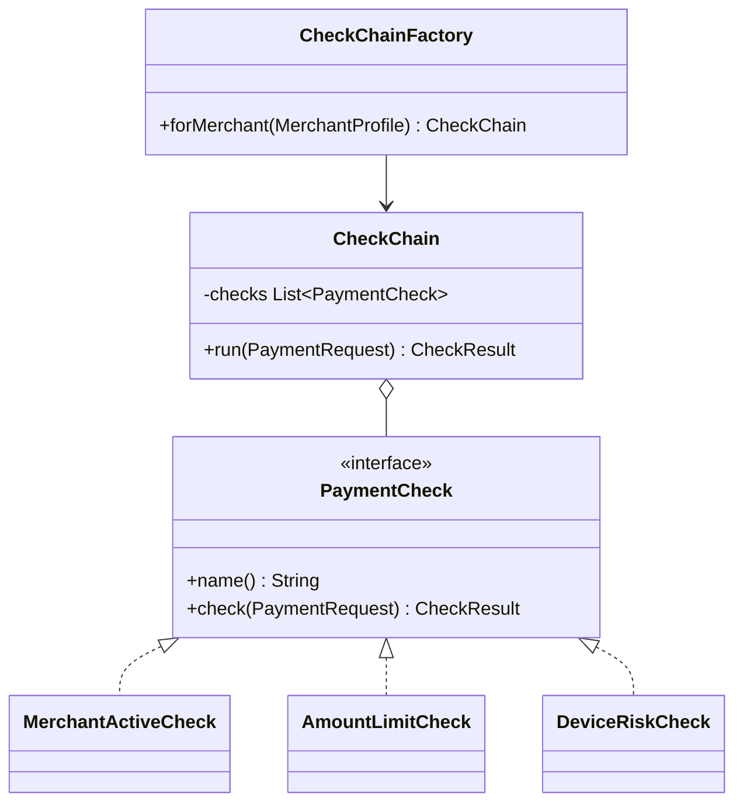

### Kya choose karein aur kyun

| Option | Kab use karo | Kab mat karo |
| --- | --- | --- |
| Chain of Responsibility (list ya linked handlers) | Jab checks ki list aur unka order runtime pe badalna ho, aur pehla reject hi final jawab ho | Jab sirf do fixed checks hain — tab ek simple method behtar hai |
| Strategy (P20) | Jab ek hi kaam ke kai alag tarike hon aur ek hi chuna jaana ho | Jab kai steps ek ke baad ek chalne hain |
| Decorator (P9) | Jab har layer core behaviour ko wrap kare aur usko call kare (logging, retry) | Jab layer ka kaam core ko rokna ho, aage badhna hi nahi |
| Pipeline with collected results | Jab tumhe saare failures ek saath chahiye — form validation jaisa | Payment reject me — wahan pehla reject hi kaafi hai aur mehnga call bachta hai |

### India me kaise hota hai

- Razorpay ka public API error response me ek `code` aur `description` aata hai — matlab unke andar bhi rejection ka reason structured hai, sirf boolean nahi. Yahi `CheckResult` ka asli roop hai. ([Razorpay — common error codes](https://razorpay.com/docs/errors/common.md))
- UPI me checks ki chain regulatory bhi hai: per-transaction limit, per-day limit, aur per-API usage limits NPCI ne 2025 me explicitly set kiye (balance enquiry 50 per day, autopay 1 attempt plus 3 retries). Matlab chain ka ek hissa tumhara business rule hai aur ek hissa regulator ka — dono ko alag handler rakhna chahiye taki regulator badle to tumhara business code na chhuna pade. ([Inc42 — NPCI additional measures](https://inc42.com/buzz/npci-brings-in-additional-measures-to-curb-upi-outage))
- Framework level pe tumne ye pattern already dekha hai: Java Servlet `Filter` chain aur Spring Security ka filter chain bilkul yahi hai — har filter request ko handle karta hai ya `chain.doFilter()` se aage bhejta hai.

### Interview follow-ups

- **Linked handlers aur list me se kya better hai?** List, zyadatar cases me — order ek hi jagah dikhta hai, config se aata hai, aur debug karna aasaan hai. Linked version tab useful hai jab handler khud decide kare ki aage bhejna hai ya nahi, dynamically.
- **Agar koi handler exception phenk de to?** Chain runner me per-handler try-catch rakho aur decide karo: fail-open (check skip, log kar do) ya fail-close (payment reject). Mehnge external checks pe usually fail-open plus alert, kyunki risk API ka down hona poora business nahi rok sakta.
- **Saare checks parallel chala sakte ho?** Independent checks, haan — `CompletableFuture.allOf` se latency gir jaati hai. Par phir short-circuit ka fayda chala jaata hai aur mehnge call har baar hote hain. Hybrid: sasta checks sequential, mehnge checks parallel.
- **Order kaise decide karoge?** Do cheezein: cost (sasta pehle) aur rejection rate (jo zyada reject karta hai, wo pehle). Dono ko mila ke sabse zyada rejections sabse kam cost pe milte hain.
- **Ye Decorator se kaise alag hai?** Decorator core behaviour ko wrap karke uska result badalta hai, aur usko call karna hi hota hai. Chain me handler ka kaam request ko rokna ya aage bhejna hai — wo core ka result nahi badalta.

### Self-check

1. Chain of Responsibility me handler ko kis cheez ka pata NAHI hona chahiye?
2. `boolean` ki jagah `CheckResult` return karne se exactly kya milta hai?
3. Chain ka order kis do criteria se decide karte hain?
4. Ek handler ka external API down ho jaaye to kaunse do options hain aur payments me kaunsa choose karoge?
5. Chain of Responsibility aur Decorator me structural difference ek line me batao.

### Notebook

Chain = handlers ki list, pehla reject final · Handler ko next ka pata nahi · Result rich ho: allowed + reasonCode + message · Chain config se bane, code se nahi · Order = sasta pehle, zyada reject karne wala pehle · Naya check = nayi class + map entry, purana code untouched · External check down = fail-open + alert (payments me) · Servlet Filter aur Spring Security filter chain = real examples · Decorator wrap karta hai, chain rokta hai.

### Padhne ke liye

- [Refactoring Guru — Chain of Responsibility](https://refactoring.guru/design-patterns/chain-of-responsibility)
- [Razorpay — common error codes](https://razorpay.com/docs/errors/common.md)

### Deep Dive (SDE-2) — jab time ho

#### Chain ko observable banana

Production me sabse important sawaal ye hota hai: kis check ne kitne payments reject kiye? Isliye runner me per-check metrics daalo — `check_duration_ms{check=DEVICE_RISK}` aur `check_rejections_total{check=DEVICE_RISK,reason=HIGH_RISK_DEVICE}`. Phir tum data se chain ka order tune kar sakte ho, guess se nahi. Ye HLD ke observability lesson se seedha jud jaata hai.

#### Shadow mode: naya check safely add karna

Naya risk check seedha enable karna khatarnak hai — wo galti se 5% genuine payments reject kar sakta hai. Pattern: check ko chain me `shadow` flag ke saath daalo. Shadow check ka result sirf log aur metric me jaata hai, decision pe asar nahi karta. Ek hafte ka data dekho, false-positive rate nikaalo, phir enforce karo. Interview me ye bolna rollout maturity dikhata hai.

#### Idempotency aur chain ka interaction

Agar client wahi payment retry karta hai (same idempotency key), to chain dobara chalani chahiye ya nahi? Velocity check dobara chalega to wo khud hi apne pichle attempt ko count kar lega aur jhoothi rejection degi. Isliye retry pe idempotent reads pehle hone chahiye: agar us key ka decision already stored hai, chain chalaye bina wahi decision wapas do. Ye `L2.1 — Idempotency keys (abhi banna baaki)` se judta hai.

---

## P14 — Command

Command pattern me ek operation (jo kaam karna hai) ko ek object bana diya jaata hai — uske andar kya karna hai aur kis data pe karna hai, dono bandh hote hain. Phir us object ko queue me daal sakte ho, retry kar sakte ho, log kar sakte ho, ya undo kar sakte ho.

### Ye cheez hai kya

- Category: behavioural pattern. Ye method call ko ek first-class value me badal deta hai — jisko tum store kar sakte ho aur baad me chala sakte ho.
- Kis problem ke liye: jab operation ko turant nahi, baad me chalana ho; ya jab usko retry, audit aur undo chahiye ho. Normal method call ko tum queue me nahi daal sakte, command object ko daal sakte ho.
- Is lesson ke baad: tum ek async operation system design kar paoge jisme operations durable, retryable aur auditable hain — jo payments ka asli requirement hai.

Analogy: restaurant me order slip. Waiter order slip banata hai (command object), kitchen usko queue se uthati hai. Slip pe likha hai kya banana hai. Slip ko tum rakh sakte ho, dobara bhej sakte ho, cancel kar sakte ho. Waiter ko khana banana nahi aata, aur chef ko table number se matlab nahi.

### Sawaal

Paytm me ek bulk refund feature hai: merchant dashboard se CSV upload karta hai jisme 10,000 refunds hain. Requirement ye hai: (1) upload turant success bole, processing background me ho, (2) bank fail kare to retry ho exponential backoff ke saath, (3) audit me dikhe ki kisne kaunsa refund kab initiate kiya, (4) merchant beech me poora batch cancel kar sake, (5) agle mahine isi system se bulk settlement bhi chalana hai. Design karo.

> Pehle khud socho — 5 min. Hints: (1) 10,000 refunds ko ek hi HTTP request me process karna kyun galat hai? (2) retry ke liye operation ko kahan store karoge — memory ya DB? (3) refund aur settlement ka common shape kya hai?

### Problem kyun aata hai

- Synchronous call me operation ka koi wajood nahi hota. Agar process beech me crash ho gaya, to 4,000 refunds ho chuke aur 6,000 ka koi record nahi — tumhe pata hi nahi kahan se resume karna hai.
- Retry ke liye tumhe operation ko dobara banana padta hai. Agar wo sirf stack pe tha, to crash ke baad gaya.
- Audit requirement me “kya hone wala tha” bhi chahiye, sirf “kya hua” nahi. Method call log me argument values aadhe-adhoore aate hain.
- Har naye bulk operation (refund, settlement, payout) ke liye poora naya plumbing likhna padta hai, kyunki operation ka koi common type nahi hai.

### Naive approach

Pehla obvious solution — loop me seedha service call:

```java
// Upload handler jo 10,000 refunds synchronously maarta hai
public class BulkRefundController {
    public Response upload(List<RefundRow> rows, String userId) {
        for (RefundRow row : rows) {
            try {
                refundService.refund(row.paymentId(), row.amountPaise());   // bank call, 300 ms
            } catch (Exception e) {
                log.error("failed " + row.paymentId(), e);                   // aur phir? kuch nahi
            }
        }
        return Response.ok();   // 10,000 x 300 ms = 50 minute. HTTP timeout kab hua, pata hi nahi
    }
}
```

Ye exactly kahan tootta hai:

- HTTP request 30 second me timeout ho jaayega, par loop chalta rahega ya mar jaayega — merchant ko pata nahi kitne hue.
- `catch` me log kar diya, matlab wo refund hamesha ke liye gaya. Koi retry ka raasta nahi, kyunki operation kahin stored nahi.
- Pod restart hone pe baaki rows ka koi nishan nahi.
- Cancel karne ka koi tarika hi nahi — loop ko bahar se rok nahi sakte.

### Sahi design

1. Har operation ko ek command object banao: `RefundCommand`, `SettlementCommand`. Usme sirf data aur ek `execute()` ho.
2. Command ko serialise karke DB table ya Kafka topic me likho — yahi usko durable banata hai. Ab command record hai, memory ka object nahi.
3. Ek generic worker commands uthata hai aur `execute()` chalata hai. Worker ko nahi pata ki refund hai ya settlement — isliye naya operation add karna sirf ek nayi class hai.
4. Status machine chalao command pe: `PENDING`, `RUNNING`, `DONE`, `FAILED`, `CANCELLED`. Retry count aur `nextAttemptAt` bhi usi row me rakho — exponential backoff isi se chalta hai.
5. Audit automatically mil jaata hai: command row me `createdBy`, `createdAt`, aur poora payload pada hai. Koi alag audit code nahi likhna padta.
6. Undo chahiye to command pe ek `undo()` method rakho, par dhyan rakho — payments me undo ka matlab reverse operation hota hai (refund ka undo nahi hota, uska compensating entry hota hai), delete nahi.
7. Important: command ko idempotent banao. Worker crash ke baad wahi command dobara chal sakti hai, isliye uske paas ek stable key honi chahiye.

```java
// Har command apna kaam aur apna data dono rakhta hai
public interface Command {
    String type();
    String idempotencyKey();     // crash ke baad dobara chalne pe duplicate na ho
    void execute();
}

public class RefundCommand implements Command {
    private final String paymentId;
    private final long amountPaise;
    private final RefundGateway gateway;

    public RefundCommand(String paymentId, long amountPaise, RefundGateway gateway) {
        this.paymentId = paymentId; this.amountPaise = amountPaise; this.gateway = gateway;
    }
    public String type() { return "REFUND"; }
    public String idempotencyKey() { return "refund:" + paymentId + ":" + amountPaise; }
    public void execute() { gateway.refund(paymentId, amountPaise, idempotencyKey()); }
}

public class SettlementCommand implements Command {
    private final String merchantId;
    private final LocalDate cycleDate;
    private final SettlementService settlements;

    public SettlementCommand(String merchantId, LocalDate cycleDate, SettlementService settlements) {
        this.merchantId = merchantId; this.cycleDate = cycleDate; this.settlements = settlements;
    }
    public String type() { return "SETTLEMENT"; }
    public String idempotencyKey() { return "settle:" + merchantId + ":" + cycleDate; }
    public void execute() { settlements.settle(merchantId, cycleDate, idempotencyKey()); }
}

// Durable record — yahi cheez DB me jaati hai, object nahi
public record CommandRecord(
        long id, String type, String payloadJson, String idempotencyKey,
        String status, int attempts, Instant nextAttemptAt, String createdBy) {}

// Worker ko nahi pata kaunsa command hai — isliye naya type add karna sasta hai
public class CommandWorker {
    private final CommandStore store;
    private final Map<String, Function<String, Command>> deserialisers;  // type -> payload se command
    private final int maxAttempts;

    public CommandWorker(CommandStore store,
                         Map<String, Function<String, Command>> deserialisers,
                         int maxAttempts) {
        this.store = store;
        this.deserialisers = Map.copyOf(deserialisers);
        this.maxAttempts = maxAttempts;
    }

    public void runOnce() {
        // sirf wo commands jinka time aa gaya hai aur jo cancelled nahi hain
        for (CommandRecord rec : store.claimDue(100)) {
            Command cmd = deserialisers.get(rec.type()).apply(rec.payloadJson());
            try {
                cmd.execute();
                store.markDone(rec.id());
            } catch (RetryableException e) {
                int next = rec.attempts() + 1;
                if (next >= maxAttempts) {
                    store.markFailed(rec.id(), e.getMessage());   // dead letter, manual review
                } else {
                    // exponential backoff: 1s, 2s, 4s, 8s ...
                    Instant when = Instant.now().plusSeconds(1L << (next - 1));
                    store.reschedule(rec.id(), next, when);
                }
            } catch (RuntimeException fatal) {
                store.markFailed(rec.id(), fatal.getMessage());    // retry ka fayda nahi
            }
        }
    }
}

public class BulkRefundController {
    private final CommandStore store;
    public BulkRefundController(CommandStore store) { this.store = store; }

    public Response upload(List<RefundRow> rows, String userId) {
        // 10,000 rows = 10,000 PENDING records, ek batch insert me. HTTP turant wapas.
        store.enqueueAll(rows.stream()
                .map(r -> new CommandRecord(0, "REFUND",
                        "{\"paymentId\":\"" + r.paymentId() + "\",\"amountPaise\":" + r.amountPaise() + "}",
                        "refund:" + r.paymentId() + ":" + r.amountPaise(),
                        "PENDING", 0, Instant.now(), userId))
                .toList());
        return Response.accepted();
    }

    // Cancel = PENDING rows ko CANCELLED kar do. Jo chal chuke hain wo nahi badlenge.
    public Response cancelBatch(String userId, Instant uploadedAt) {
        store.cancelPending(userId, uploadedAt);
        return Response.ok();
    }
}

public class Main {
    public static void main(String[] args) {
        CommandStore store = new InMemoryCommandStore();
        CommandWorker worker = new CommandWorker(store, Map.of(
                "REFUND",     json -> new RefundCommand("pay_1", 49_900L, new StubRefundGateway()),
                "SETTLEMENT", json -> new SettlementCommand("mrc_1", LocalDate.now(), new StubSettlementService())
        ), 5);

        new BulkRefundController(store).upload(List.of(new RefundRow("pay_1", 49_900L)), "user_7");
        worker.runOnce();   // background me, HTTP request ke bahar
    }
}
```

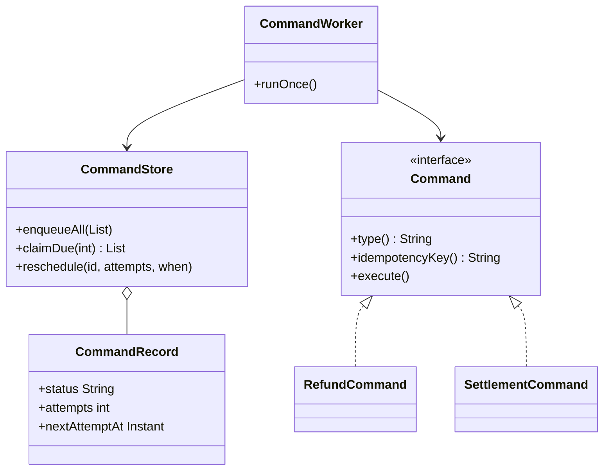

### Kya choose karein aur kyun

| Option | Kab use karo | Kab mat karo |
| --- | --- | --- |
| Command object plus DB store | Jab operation durable, retryable aur auditable chahiye — paisa chhune wala kaam | Simple read query ke liye — wahan ye sirf boilerplate hai |
| Command plus Kafka topic | Jab throughput bahut high ho aur ordering per-key chahiye | Jab tumhe per-command status query karni ho — Kafka me row update nahi hota |
| Seedha method call | Jab operation fast, local aur safe ho; crash pe dobara karna sasta ho | Jab operation bank ko call karta hai ya paisa move karta hai |
| Spring `@Async` ya thread pool | Internal background kaam jo kho jaane se farak na pade | Payments me — pod restart pe queue memory se gayab ho jaati hai |

### India me kaise hota hai

- Razorpay ka refund API khud is shape me hai: tum refund create karte ho, usko ek id milti hai, aur uska status alag se query hota hai — matlab refund ek durable record hai, ek function call nahi. ([Razorpay — Understand Razorpay APIs](https://razorpay.com/docs/api/understand))
- Bulk aur recurring operations pe NPCI ki apni limits hain — AutoPay mandate execution pe maximum ek attempt aur teen retries, aur non-peak hours me. Matlab retry policy tumhare command worker me regulatory constraint ke hisaab se configure honi chahiye, mann se nahi. ([Inc42 — NPCI additional measures](https://inc42.com/buzz/npci-brings-in-additional-measures-to-curb-upi-outage))
- Interview me ye kehna strong hai: har paisa-chhune wala operation hamare system me ek persisted command hai jiska status, attempts aur idempotency key DB me hai — isliye crash ke baad hum exactly wahin se resume karte hain.

### Interview follow-ups

- **Command aur Event me farq?** Command ek instruction hai — “ye karo”, future ki baat, ek hi receiver. Event ek fact hai — “ye ho gaya”, past ki baat, kai listeners. Naming se hi pata chalta hai: `RefundPayment` command hai, `PaymentRefunded` event hai.
- **Do worker ek hi command uthaa lein to?** Isliye `claimDue` me row-level lock ya `SELECT ... FOR UPDATE SKIP LOCKED` chahiye, aur command khud idempotent honi chahiye — dono layers, kyunki lock bhi fail ho sakta hai.
- **Undo kaise karoge?** Payments me undo nahi hota, reverse hota hai. `RefundCommand` ka undo ek `ReverseRefundCommand` hai jo naya ledger entry banata hai. Original record kabhi delete nahi hota — audit ke liye.
- **Max attempts ke baad kya?** Dead letter queue plus alert. Manual review ke liye ek dashboard. Chup-chaap drop karna payments me kabhi acceptable nahi hai.
- **Ye Strategy se kaise alag hai?** Strategy me tum ek hi kaam ke tarike badalte ho aur call turant hota hai. Command me kaam khud ek object hai jisko tum store aur defer karte ho.

### Self-check

1. Command object ko DB me persist karne se exactly kaunse teen fayde milte hain?
2. Command aur Event me naming aur semantics ka farak batao.
3. Worker crash ke baad duplicate execution se kaise bachoge — do layers batao.
4. Payments me `undo()` ka sahi matlab kya hai?
5. `nextAttemptAt` column kis cheez ko enable karta hai?

### Notebook

Command = operation ek object, data plus execute() · DB ya Kafka me persist karo = durable, retryable, auditable · Generic worker, type se deserialise — naya operation = nayi class · Status: PENDING RUNNING DONE FAILED CANCELLED · attempts + nextAttemptAt = exponential backoff · Command idempotent honi chahiye (stable key) · SELECT FOR UPDATE SKIP LOCKED se do worker ek row na uthaein · Payments me undo nahi, reverse command · Max attempts ke baad dead letter + alert, drop nahi · Command = instruction (future), Event = fact (past).

### Padhne ke liye

- [Refactoring Guru — Command](https://refactoring.guru/design-patterns/command)
- [Razorpay — Understand Razorpay APIs](https://razorpay.com/docs/api/understand)

### Deep Dive (SDE-2) — jab time ho

#### Transactional outbox: command ko business write ke saath atomically likhna

Sabse common bug: tum payment DB me likhte ho aur phir Kafka pe command bhejte ho — beech me crash hua to payment ho gaya par command gayab. Fix: command ko usi DB transaction me ek `outbox` table me likho. Ek alag publisher process outbox se padh ke Kafka pe bhejta hai aur row mark kar deta hai. Ab business write aur command ek hi transaction me hain, aur publishing at-least-once ho gayi — isliye consumer ko idempotent hona hi padta hai.

#### Command sourcing aur event sourcing ka farak

Event sourcing me tum facts store karte ho aur state unhe replay karke banati hai. Command sourcing me tum instructions store karte ho. Command sourcing ka khatra ye hai ki replay karne pe command dobara external call kar degi (bank ko dobara refund). Isliye production me pattern yahi hota hai: commands ko queue ki tarah use karo (ek bar chalein, phir DONE), aur state ke liye events store karo.

#### Priority aur fairness command queue me

10,000 refund wala ek merchant baaki sab merchants ka refund block kar dega agar queue plain FIFO hai. Do lever: `priority` column (customer-initiated refund bulk se upar), aur per-merchant fairness — `claimDue` me ek merchant se maximum N rows per batch. Ye bilkul wahi fair-queueing idea hai jo rate limiting ke deep dive me aata hai.

---

## P15 — Iterator

Iterator pattern ek collection ke elements ko ek-ek karke dene ka tarika deta hai, bina ye bataye ki andar wo kaise store hain. Java me ye `Iterator` aur `Iterable` interfaces se banta hai, aur `for (T x : collection)` loop isi pe chalta hai.

### Ye cheez hai kya

- Category: behavioural pattern. Ye traversal ko collection se alag kar deta hai.
- Kis problem ke liye: jab data ek simple list me nahi hai — wo paginated API ke peeche hai, ya 50 lakh rows ka DB result hai jo memory me nahi aa sakta. Caller ko phir bhi ek saaf loop chahiye.
- Is lesson ke baad: tum paginated external API ya streaming DB query ko ek normal `for` loop ke peeche chhupa paoge, aur memory blow-up se bach paoge.

Analogy: auto ka meter. Tum meter dekhte ho aur har kilometre ka number aata rehta hai. Tumhe nahi pata meter andar kaise count kar raha hai — tumhe bas agla number chahiye. Aur tum poora safar pehle se nahi jaante, ek-ek kadam milta hai.

### Sawaal

Roz raat ko tumhe ek reconciliation job chalani hai jo gateway se pichle din ke saare settled transactions laati hai aur apne ledger se match karti hai. Gateway ka API paginated hai: ek call me maximum 100 records, aur response me ek `next_cursor` aata hai. Ek din me 8 lakh transactions hote hain. Reconciliation code me tum nahi chahte ki pagination ka logic bhara ho. Design karo.

> Pehle khud socho — 5 min. Hints: (1) 8 lakh records ko `List` me jama karna kyun galat hai? (2) agla page kab fetch hona chahiye? (3) agar page 4,000 pe API fail ho jaaye to kya hona chahiye?

### Problem kyun aata hai

- Paginated API ka loop aur business logic ka loop gundh jaate hain. Reconciliation code me `while (cursor != null)` dikhne lagta hai, aur business logic uske andar chhup jaata hai.
- Sab records pehle collect karna memory me 8 lakh objects laata hai — OutOfMemoryError ya GC pause, dono bure.
- Pagination ka logic 5 jagah copy ho jaata hai: recon job, report export, dashboard, audit, aur ek backfill script.
- Failure handling confusing ho jaati hai, kyunki fetch aur process ek hi code me hain.

### Naive approach

Pehla obvious solution — sab pehle laao, phir process karo:

```java
// Memory me 8 lakh objects. Aur pagination logic business logic ke beech me.
public class ReconJob {
    public void run(LocalDate day) {
        List<Txn> all = new ArrayList<>();
        String cursor = null;
        do {
            Page<Txn> page = gatewayClient.listSettled(day, cursor, 100);
            all.addAll(page.items());             // yahan memory badhti jaati hai
            cursor = page.nextCursor();
        } while (cursor != null);

        for (Txn t : all) {                       // asli kaam yahan se shuru hota hai
            ledger.match(t);
        }
    }
}
```

Ye exactly kahan tootta hai: pehla record process hone se pehle 8 lakh fetch ho chuke hain, matlab job ka pehla output 40 minute baad aayega aur heap bhar chuki hogi. Agar page 4,000 pe API fail hua, to 3,999 pages ka kaam bekaar gaya — kuch bhi process nahi hua.

### Sahi design

1. Ek `Iterable<Txn>` banao jo paginated API ko wrap kare. Uska `Iterator` sirf current page memory me rakhe.
2. `hasNext()` me logic: current page me element bacha hai to `true`; nahi bacha par cursor hai to agla page fetch karo; cursor bhi nahi to `false`. Ye lazy fetching hai — jab zaroorat ho tabhi network call.
3. Business code ab sirf `for (Txn t : gatewaySettledTxns) { ledger.match(t); }` likhta hai. Pagination poori tarah chhup gayi.
4. Resumability ke liye last successful cursor ko checkpoint karo. Fail hone pe job wahi cursor se shuru hoti hai, zero se nahi.
5. Java me `Iterable` banane se `for-each` muft milta hai; chaho to usko `Stream` me bhi badal sakte ho `StreamSupport.stream(spliterator(), false)` se.

```java
public record Page<T>(List<T> items, String nextCursor) {}

public interface GatewayClient {
    Page<Txn> listSettled(LocalDate day, String cursor, int limit);
}

// Ye class poori pagination chhupa leti hai. Caller ko bas for-each dikhta hai.
public class SettledTxnsOfDay implements Iterable<Txn> {
    private final GatewayClient client;
    private final LocalDate day;
    private final int pageSize;
    private final Consumer<String> checkpoint;   // resume ke liye cursor save karta hai

    public SettledTxnsOfDay(GatewayClient client, LocalDate day, int pageSize,
                            Consumer<String> checkpoint) {
        this.client = client; this.day = day; this.pageSize = pageSize; this.checkpoint = checkpoint;
    }

    @Override public Iterator<Txn> iterator() {
        return new Iterator<>() {
            private Iterator<Txn> current = Collections.emptyIterator();
            private String cursor = null;
            private boolean firstFetchDone = false;

            @Override public boolean hasNext() {
                if (current.hasNext()) return true;
                // current page khatam. Agla page sirf ab fetch hoga — yahi lazy hai.
                if (firstFetchDone && cursor == null) return false;
                Page<Txn> page = client.listSettled(day, cursor, pageSize);
                firstFetchDone = true;
                current = page.items().iterator();
                cursor = page.nextCursor();
                if (cursor != null) checkpoint.accept(cursor);   // crash ke baad yahin se resume
                return current.hasNext() || (cursor != null && hasNext());
            }

            @Override public Txn next() {
                if (!hasNext()) throw new NoSuchElementException();
                return current.next();
            }
        };
    }
}

public class ReconJob {
    private final Ledger ledger;
    public ReconJob(Ledger ledger) { this.ledger = ledger; }

    public void run(Iterable<Txn> settledTxns) {
        int matched = 0, mismatched = 0;
        for (Txn t : settledTxns) {        // pagination ka ek shabd bhi yahan nahi
            if (ledger.match(t)) matched++; else mismatched++;
        }
        System.out.println("matched=" + matched + " mismatched=" + mismatched);
    }
}

public class Main {
    public static void main(String[] args) {
        Map<String, String> checkpoints = new HashMap<>();
        Iterable<Txn> txns = new SettledTxnsOfDay(
                new StubGatewayClient(), LocalDate.now().minusDays(1), 100,
                c -> checkpoints.put("recon_cursor", c));

        new ReconJob(new InMemoryLedger()).run(txns);
        // Memory me ek baar me sirf 100 records — 8 lakh nahi.
    }
}
```

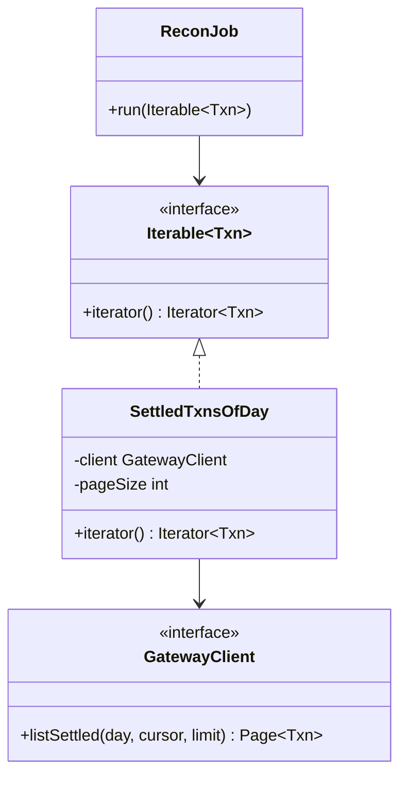

### Kya choose karein aur kyun

| Option | Kab use karo | Kab mat karo |
| --- | --- | --- |
| Custom `Iterable` with lazy paging | Jab source paginated ya unbounded ho aur caller ko simple loop chahiye | Jab data chhota ho (100 rows) — tab plain `List` hi saaf hai |
| Java `Stream` (lazy) | Jab tumhe map, filter, groupBy chahiye aur parallelism ka option | Jab tumhe mid-loop resume aur explicit checkpoint chahiye — Stream me wo awkward hai |
| Load all into `List` | Chhote bounded datasets, test data | Lakhon rows pe — memory aur first-output latency dono kharab |
| DB cursor ya `ScrollableResults` | Jab source apna DB ho aur tum fetch size control kar sako | Jab transaction lamba khul jaaye — wo DB pe lock aur bloat banata hai |

### India me kaise hota hai

- Razorpay ke saare list APIs cursor ya `skip`/`count` based pagination dete hain, aur docs explicitly bolte hain ki bade result sets ko page karke lena chahiye. Isliye Indian payment integrations me iterator-style wrapper likhna almost standard practice hai. ([Razorpay — API pagination](https://razorpay.com/docs/api/pagination))
- Reconciliation India me daily regulatory kaam hai, aur uska data volume hi usko interesting banata hai. Isliye recon code me streaming traversal choice design decision hai, micro-optimisation nahi. Detail `L2.21 — Reconciliation basics (abhi banna baaki)` me aayega.

### Interview follow-ups

- **`Iterator` aur `Iterable` me farak?** `Iterable` matlab is cheez pe loop chal sakta hai (`iterator()` deta hai). `Iterator` wo actual position-holder hai jo `hasNext()` aur `next()` deta hai. Ek `Iterable` se kai `Iterator` ban sakte hain.
- **`hasNext()` me network call karna theek hai?** Practically haan, aur ye common hai — par usko idempotent rakhna padta hai (do baar `hasNext()` call karne pe do fetch na hon). Isliye state (`current`, `cursor`) iterator me hoti hai.
- **Offset pagination aur cursor pagination me kya farak?** Offset (`LIMIT 100 OFFSET 500000`) DB ko 5 lakh rows skip karwata hai — bada offset bahut dheema. Cursor last seen key se aage padhta hai — constant time. Bade datasets pe cursor hi sahi hai.
- **Data beech me badal jaaye to?** Cursor pagination me naye records aage aa jaate hain aur delete hue skip ho jaate hain. Recon me isliye ek fixed window (pichla din, closed period) pe chalate hain, live data pe nahi.
- **Thread-safe banana ho to?** Iterator ko share mat karo. Har consumer apna iterator le, ya ek producer iterator se padh ke bounded queue me daale.

### Self-check

1. Lazy iterator se memory ke alawa kaunsa doosra fayda milta hai?
2. `Iterable` aur `Iterator` ka farak ek line me.
3. Offset pagination bade datasets pe kyun dheemi hai?
4. Checkpoint cursor kahan save hona chahiye aur kis liye?
5. `hasNext()` ko do baar call karne pe do network call kyun nahi hone chahiye?

### Notebook

Iterator = traversal ko collection se alag karna · Paginated API ko Iterable me wrap karo, caller ko sirf for-each dikhe · Lazy fetch: page khatam hone pe hi agla call · Memory me ek page, poora dataset nahi · First output turant milta hai, 40 minute baad nahi · Checkpoint cursor se resume, zero se nahi · Cursor pagination > offset pagination bade data pe · Recon closed period pe chalao, live data pe nahi · Iterator share mat karo across threads.

### Padhne ke liye

- [Refactoring Guru — Iterator](https://refactoring.guru/design-patterns/iterator)
- [Razorpay — API pagination](https://razorpay.com/docs/api/pagination)

### Deep Dive (SDE-2) — jab time ho

#### Prefetch aur backpressure ek saath

Pure lazy iterator me har page ke beech ek network round-trip ka gap aata hai — processing rukti hai. Fix: ek background thread agla page prefetch kare aur ek bounded queue (jaise `ArrayBlockingQueue` of size 2) me rakhe. Queue full ho to prefetcher khud ruk jaata hai — yahi backpressure hai. Isse throughput badhta hai par memory bounded rehti hai.

#### Fail-fast aur fail-safe iterator

Java ke `ArrayList` ka iterator fail-fast hai — loop ke beech list badli to `ConcurrentModificationException` aata hai, kyunki ek `modCount` check hota hai. `CopyOnWriteArrayList` ka iterator fail-safe hai — wo snapshot pe chalta hai, exception nahi deta par purana data dikha sakta hai. Interview me ye farak poocha jaata hai, aur asli jawab ye hai: fail-fast bug chhupata nahi, isliye default me behtar hai.

#### At-least-once traversal aur duplicate match

Agar job page 4,000 pe crash hui aur checkpoint page 3,900 ka tha, to resume pe 100 pages dobara process honge. Isliye recon ka `match()` idempotent hona chahiye — wahi transaction dobara match hone pe mismatched count galat nahi badhna chahiye. Pattern: match result ko `(txn_id, run_date)` unique key pe upsert karo.

---

## P16 — Mediator

Mediator pattern me kai objects ek dusre se seedha baat karna band kar dete hain, aur sab ek beech wale object (mediator) se baat karte hain. Mediator hi tay karta hai ki kis event pe kaun kya karega.

### Ye cheez hai kya

- Category: behavioural pattern. Ye many-to-many communication ko one-to-many me badal deta hai.
- Kis problem ke liye: jab 5 services ek dusre ko call karne lagti hain, to 5 objects ke beech 20 possible connections ban jaate hain. Kisi ek ka behaviour samajhna mushkil ho jaata hai kyunki wo 4 jagah se call hota hai.
- Is lesson ke baad: tum ek multi-step business flow ko ek hi jagah readable bana paoge, aur participants ko ek dusre se decouple kar paoge.

Analogy: airport ka control tower. Pilots ek dusre se baat nahi karte — sab tower se baat karte hain, aur tower batata hai kaun kab utrega. Agar pilots aapas me baat karein to 20 planes ke beech 190 conversations ho jaayengi.

### Sawaal

Paytm me ek refund complete hone pe ye sab hona hai: ledger me reverse entry, wallet balance update (agar wallet se paid tha), merchant ko webhook, customer ko SMS, risk system ko signal, aur loyalty points reverse. Abhi `RefundService` seedha in sabko call karta hai, aur `WalletService` bhi `NotificationService` ko call karta hai, aur `LedgerService` risk ko. Naya requirement aata hai aur kisi ko pata nahi kahan add karna hai. Design karo.

> Pehle khud socho — 5 min. Hints: (1) kaunse steps mandatory hain aur kaunse best-effort? (2) ek participant ko doosre ke baare me jaanna kyun bura hai? (3) Mediator khud god object ban jaaye to kya karoge?

### Problem kyun aata hai

- Spaghetti dependencies: har service doosri ko janti hai, isliye koi bhi service akele test nahi hoti. `WalletService` ka unit test `NotificationService` ka mock maangta hai, jiska wallet se koi lena dena nahi.
- Flow kahin likha hua nahi hai. Order samajhne ke liye tumhe 6 files padhni padti hain.
- Mandatory aur best-effort steps mil gaye hain. SMS vendor down hone pe refund hi fail ho jaata hai, jo bilkul galat hai.
- Naya step add karna guess ka kaam ban jaata hai, aur log usko wahan daal dete hain jahan jagah mil jaaye.

### Naive approach

```java
// Har service doosri ko seedha jaanti hai — yahi spaghetti hai
public class RefundService {
    private final LedgerService ledger;
    private final WalletService wallet;
    private final NotificationService notify;

    public void completeRefund(Refund r) {
        ledger.postReverseEntry(r);          // mandatory
        wallet.credit(r.customerId(), r.amountPaise());   // wallet ke andar bhi notify call hai
        notify.sms(r.customerId(), "Refund done");         // vendor down = exception = refund fail
        // risk aur loyalty kahan hain? Wallet ke andar. Kisi ko pata nahi.
    }
}

public class WalletService {
    private final NotificationService notify;   // wallet ko SMS se kya matlab?
    private final RiskService risk;
    public void credit(String customerId, long paise) {
        // ... balance update
        notify.push(customerId, "Wallet credited");
        risk.signal(customerId, "REFUND_CREDIT");
    }
}
```

Ye exactly kahan tootta hai: `notify.sms` ka exception poora `completeRefund` gira deta hai, jabki paisa already ledger me chala gaya. Aur `WalletService` ka naam wallet hai par wo notification aur risk bhi chalaata hai — Single Responsibility ka seedha ulanghan ([S1 — Single Responsibility Principle](https://claude.ai/code/artifact/f98bb328-8939-4ef4-a9a6-24c5ce970199)).

### Sahi design

1. Ek `RefundCoordinator` (mediator) banao jo poora flow ek jagah likhe. Participants ek dusre ko nahi jaante, sirf mediator sabko jaanta hai.
2. Steps ko do buckets me baanto: mandatory (ledger, wallet) aur best-effort (SMS, loyalty, risk signal). Mandatory fail = poora flow fail. Best-effort fail = log plus metric, flow chalu rahe.
3. Mandatory steps ka order business decision hai aur usko code me explicitly dikhna chahiye, comment ke saath — ledger pehle, kyunki wahi source of truth hai.
4. Mediator ko god object banne se bachao: usme business rules nahi, sirf orchestration rahe. Har actual kaam participant ke andar hi ho.
5. Jab participants bahut badh jaayein ya loosely coupled chahiye, mediator ki jagah event bus lo (P18 Observer) — wo iska scaled-out roop hai.

```java
public interface RefundStep {
    String name();
    boolean mandatory();
    void apply(Refund refund);
}

public class LedgerReverseStep implements RefundStep {
    private final LedgerService ledger;
    public LedgerReverseStep(LedgerService ledger) { this.ledger = ledger; }
    public String name() { return "LEDGER_REVERSE"; }
    public boolean mandatory() { return true; }       // paisa ka sach — fail hua to sab ruke
    public void apply(Refund r) { ledger.postReverseEntry(r); }
}

public class WalletCreditStep implements RefundStep {
    private final WalletService wallet;
    public WalletCreditStep(WalletService wallet) { this.wallet = wallet; }
    public String name() { return "WALLET_CREDIT"; }
    public boolean mandatory() { return true; }
    public void apply(Refund r) { wallet.credit(r.customerId(), r.amountPaise()); }
}

public class SmsStep implements RefundStep {
    private final NotificationService notify;
    public SmsStep(NotificationService notify) { this.notify = notify; }
    public String name() { return "SMS"; }
    public boolean mandatory() { return false; }      // vendor down = refund phir bhi hua
    public void apply(Refund r) { notify.sms(r.customerId(), "Refund of " + r.amountPaise() + " paise done"); }
}

// MEDIATOR: poora flow ek hi jagah padha ja sakta hai
public class RefundCoordinator {
    private final List<RefundStep> steps;
    public RefundCoordinator(List<RefundStep> steps) { this.steps = List.copyOf(steps); }

    public void completeRefund(Refund r) {
        for (RefundStep step : steps) {
            try {
                step.apply(r);
            } catch (RuntimeException e) {
                if (step.mandatory()) {
                    // mandatory fail: aage nahi badhna, caller ko pata chale
                    throw new RefundFailedException(step.name() + " failed for " + r.id(), e);
                }
                // best-effort fail: sirf log aur metric, flow chalu
                System.out.println("best-effort step " + step.name() + " failed: " + e.getMessage());
            }
        }
    }
}

public class Main {
    public static void main(String[] args) {
        RefundCoordinator coordinator = new RefundCoordinator(List.of(
                new LedgerReverseStep(new InMemoryLedgerService()),   // pehle ledger
                new WalletCreditStep(new InMemoryWalletService()),
                new SmsStep(new FlakySmsService())));                // best-effort, aakhir me

        coordinator.completeRefund(new Refund("rfnd_1", "cust_9", 49_900L));
        // WalletService ab NotificationService ko nahi jaanti. Dono akele test ho sakti hain.
    }
}
```

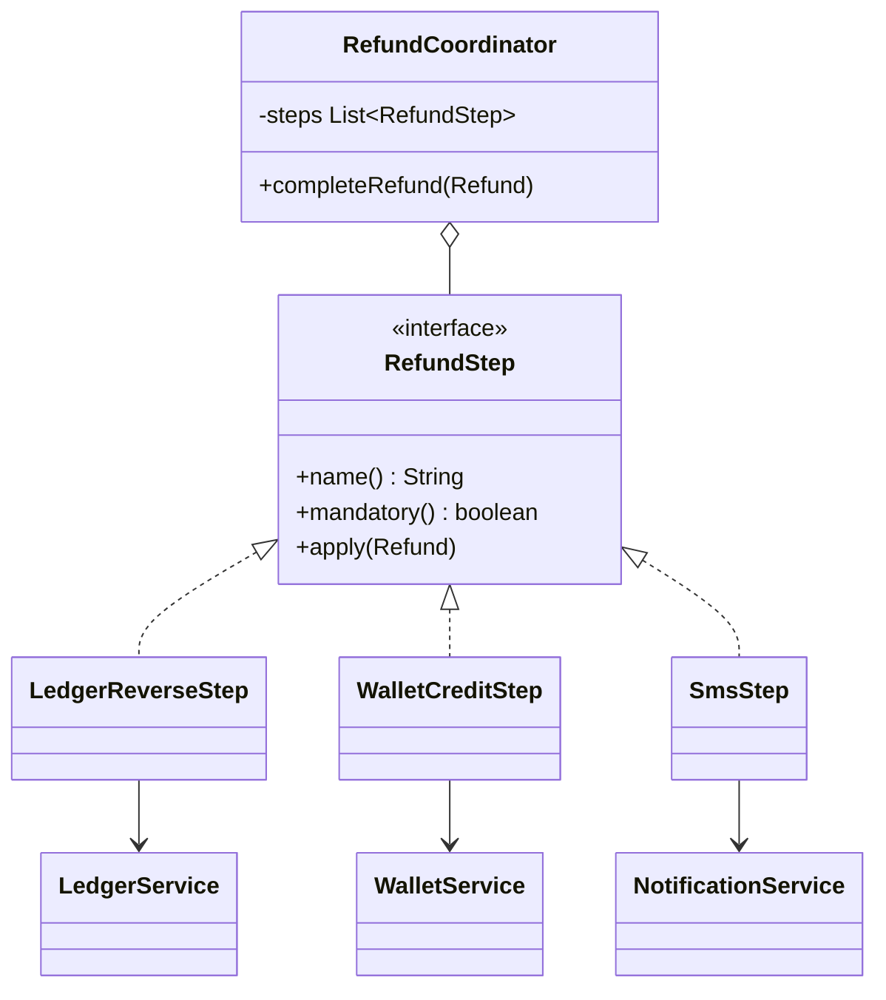

### Kya choose karein aur kyun

| Option | Kab use karo | Kab mat karo |
| --- | --- | --- |
| Mediator (ek coordinator class) | Jab flow ka order aur mandatory/optional ka farak important ho, aur ek hi jagah padhna ho | Jab participants 15+ ho jaayein — tab mediator khud god object ban jaata hai |
| Observer / event bus (P18) | Jab publisher ko subscribers ki parwah hi nahi, aur sab best-effort hain | Jab order aur failure semantics matter karti hain — event bus me order guarantee nahi |
| Chain of Responsibility (P13) | Jab pehla handler jawab de de aur aage jaana band ho | Jab saare steps chalne hi hain |
| Saga orchestrator | Jab steps alag services me hon aur compensating transactions chahiye | Ek hi service ke andar — wahan simple mediator kaafi hai |

### India me kaise hota hai

- Razorpay ke refund flow me ye do-bucket idea API me hi dikhta hai: refund ka apna status hota hai (`pending`, `processed`, `failed`) aur webhook alag se bheja jaata hai — matlab notification refund ke success ka hissa nahi hai. ([Razorpay — Understand Razorpay APIs](https://razorpay.com/docs/api/understand))
- Indian payments me ek hard rule hai: ledger pehle, baaki sab baad me. Reason regulatory hai — reconciliation aur audit ledger pe chalte hain, SMS pe nahi. Interview me ye bolna ki tum mandatory steps ko ledger ke around order karte ho, domain understanding dikhata hai.

### Interview follow-ups

- **Mediator god object ban gaya to?** Usko flow ke hisaab se todo — ek coordinator per business flow (refund, settlement, payout), aur steps ko shared rakho. Ek 2,000-line `PaymentManager` galat answer hai.
- **Mandatory step fail hone ke baad pichle steps ka kya?** Agar wo same DB me the to ek transaction me rakho. Agar alag services me the to saga plus compensating transaction chahiye — `L2.9 — Saga pattern (abhi banna baaki)`.
- **Best-effort step ko kabhi retry karoge?** Haan, par flow ke bahar — usko ek command banake queue me daal do (P14). Isse flow fast rehta hai aur notification phir bhi guarantee ke saath jaati hai.
- **Mediator aur Facade me farak?** Facade (P10) bas ek simple entry point deta hai aur usme coordination logic nahi hoti. Mediator participants ke beech interaction rules rakhta hai, aur participants usko jaante hain.
- **Steps ko parallel chala sakte ho?** Independent best-effort steps haan. Mandatory steps nahi, kyunki unka order business rule hai.

### Self-check

1. 5 services aapas me baat karein to kitne possible connections hain, aur mediator ke saath kitne?
2. Mandatory aur best-effort step me code level pe kya farak rakha hai?
3. Mediator god object kab ban jaata hai aur fix kya hai?
4. Mediator aur Facade me ek line ka farak.
5. Ledger step sabse pehle kyun hai?

### Notebook

Mediator = sab beech wale se baat karein, aapas me nahi · Many-to-many ko one-to-many banata hai · Participants ek dusre ko nahi jaante = akele testable · Steps do bucket: mandatory (fail = flow fail) aur best-effort (fail = log + metric) · Ledger pehle, kyunki wahi source of truth · Mediator me orchestration rahe, business rules nahi · Flow ke hisaab se mediator todo, ek bada manager nahi · Best-effort retry flow ke bahar command queue me · Facade = simple entry, Mediator = interaction rules.

### Padhne ke liye

- [Refactoring Guru — Mediator](https://refactoring.guru/design-patterns/mediator)
- [Razorpay — Understand Razorpay APIs](https://razorpay.com/docs/api/understand)

### Deep Dive (SDE-2) — jab time ho

#### Mediator se orchestrator tak ka raasta

Ek hi service ke andar mediator ek simple class hai. Jab steps alag services me chale jaate hain, wahi mediator ek workflow orchestrator ban jaata hai jisko state persist karni padti hai: kaunsa step hua, kaunsa pending, kis step pe retry chal raha hai. Isi jagah Temporal, Netflix Conductor ya apna DB-backed state machine aata hai. Pattern wahi hai, durability add hui hai.

#### Step ko idempotent banana orchestration ki shart hai

Orchestrator crash ke baad step 2 se resume karega, par kya pata step 2 pehle aadha chal chuka tha. Isliye har step ko apna idempotency key chahiye — `refund:rfnd_1:LEDGER_REVERSE`. Step shuru hone se pehle check kare ki ye key already done hai ya nahi. Ye P14 Command ke idempotency key se wahi idea hai.

#### Observability: step-level metrics

Mediator ka sabse bada operational fayda ye hai ki tum har step pe metric daal sakte ho ek hi jagah — `refund_step_duration_ms{step=SMS}` aur `refund_step_failures_total{step=SMS}`. Spaghetti version me ye 6 files me scatter hota. Isliye mediator ko wrap karke metrics daalna almost free observability hai.

---

## P17 — Memento

Memento pattern se tum ek object ki state ka snapshot bana sakte ho aur baad me usko wapas us state me laa sakte ho — bina object ke andar ki details bahar expose kiye. Snapshot ek closed box hota hai: jisne banaya wahi padh sakta hai.

### Ye cheez hai kya

- Category: behavioural pattern. Ye state capture aur restore ko ek safe interface deta hai.
- Kis problem ke liye: jab user ka kaam multi-step ho aur beech me save karna ho, ya jab undo chahiye ho. Seedha getters-setters expose karne se encapsulation tooti hai.
- Is lesson ke baad: tum ek draft-save aur restore feature design kar paoge jisme object ke internals private rehte hain.

Analogy: form bharte waqt save-as-draft. Draft ek sealed envelope hai — tum usko wapas kholke form me daal sakte ho, par envelope ke andar ki fields se koi doosra module khelta nahi.

### Sawaal

Merchant onboarding ka 6-step wizard hai: business details, KYC documents, bank account, pricing plan, settlement preference, review. Merchant step 4 pe chhod ke chala jaata hai aur agle din wapas aata hai. Requirement: (1) draft auto-save har step pe, (2) merchant ek step peeche ja sake, (3) internal validation flags aur risk score draft me honi chahiye par merchant ko dikhni nahi chahiye, (4) draft 30 din baad expire ho. Design karo.

> Pehle khud socho — 5 min. Hints: (1) agar tum poora object JSON me serialise kar do to kya problem hai? (2) peeche jaane ke liye kitne snapshots rakhoge? (3) snapshot ko kaun padh sakta hai?

### Problem kyun aata hai

- Draft save karne ke liye log object ke saare fields public kar dete hain, aur phir koi bhi module unko badalne lagta hai.
- Internal fields (risk score, validation flags, internal notes) bhi state ka hissa hain, par unko API response me nahi jaana chahiye. Ek hi serialisation dono kaam nahi kar sakti.
- Undo ke liye log purane values ko ad-hoc variables me rakhte hain, aur phir ek field add hone pe undo chup-chaap toot jaata hai.
- Snapshot format aur live object ka shape ek ho jaate hain — phir class badalne pe purane drafts load hi nahi hote.

### Naive approach

```java
// Sab kuch public — draft save karne ke liye encapsulation bech diya
public class OnboardingForm {
    public String businessName;
    public String pan;
    public String bankAccount;
    public int internalRiskScore;      // merchant ko ye dikhna hi nahi chahiye
    public List<String> validationFlags;

    // Undo ke liye ad-hoc
    public String previousBusinessName;   // ek field ke liye ek backup field. 20 fields? 20 backups.
}
```

Ye exactly kahan tootta hai: `internalRiskScore` public hai, isliye kal koi controller usko response me daal dega aur merchant apna risk score dekh lega. Aur undo sirf un fields pe chalega jinke liye kisi ne backup field banaya tha — naya field add karne wale ko ye yaad hi nahi rahega.

### Sahi design

1. State rakhne wala object (originator) do method de: `save()` jo ek memento return kare, aur `restore(memento)` jo usse wapas load kare.
2. Memento ko ek immutable type banao (Java `record` perfect hai) jiske fields originator ke andar ka matlab rakhte hain. Bahar wale uske andar jhaank na sakein — isliye wo nested private record ya sealed interface ho.
3. Memento me ek `version` field rakho. Class badalne pe purane drafts migrate kar sako.
4. Caretaker (jo snapshots rakhta hai) ko memento ka andar dekhne ki zaroorat nahi — wo bas list me rakhta hai aur wapas deta hai. Yahi pattern ki asli baat hai.
5. Undo ke liye bounded stack rakho (jaise last 10 snapshots), warna memory badhti jaayegi.

```java
// Memento: bahar se opaque. Caretaker isko sirf rakhta hai, padhta nahi.
public sealed interface OnboardingSnapshot permits OnboardingForm.Snapshot {}

public class OnboardingForm {
    private String businessName;
    private String pan;
    private String bankAccount;
    private int internalRiskScore;              // kabhi bahar nahi jaata
    private List<String> validationFlags = new ArrayList<>();
    private int step = 1;

    // Nested record — sirf OnboardingForm iske fields padh sakta hai
    record Snapshot(int version, String businessName, String pan, String bankAccount,
                    int internalRiskScore, List<String> validationFlags, int step,
                    Instant takenAt) implements OnboardingSnapshot {}

    public void fillBusiness(String name, String pan) {
        this.businessName = name; this.pan = pan; this.step = 2;
    }
    public void fillBank(String account) { this.bankAccount = account; this.step = 3; }
    public void scoreRisk(int score, String flag) {
        this.internalRiskScore = score; this.validationFlags.add(flag);
    }

    // SAVE: andar ki state ka sealed snapshot
    public OnboardingSnapshot save() {
        return new Snapshot(1, businessName, pan, bankAccount, internalRiskScore,
                List.copyOf(validationFlags), step, Instant.now());
    }

    // RESTORE: sirf apne hi snapshot type ko samajhta hai
    public void restore(OnboardingSnapshot snapshot) {
        if (!(snapshot instanceof Snapshot s)) throw new IllegalArgumentException("galat snapshot");
        if (s.version() != 1) throw new IllegalStateException("purana draft version, migrate karo");
        this.businessName = s.businessName();
        this.pan = s.pan();
        this.bankAccount = s.bankAccount();
        this.internalRiskScore = s.internalRiskScore();
        this.validationFlags = new ArrayList<>(s.validationFlags());
        this.step = s.step();
    }

    // Merchant ko sirf ye dikhta hai — risk score nahi
    public Map<String, Object> publicView() {
        return Map.of("businessName", String.valueOf(businessName),
                      "bankAccount", String.valueOf(bankAccount),
                      "step", step);
    }
}

// CARETAKER: snapshots sambhaalta hai, unke andar nahi jhaankta
public class DraftHistory {
    private final Deque<OnboardingSnapshot> stack = new ArrayDeque<>();
    private final int maxDepth;
    public DraftHistory(int maxDepth) { this.maxDepth = maxDepth; }

    public void push(OnboardingSnapshot s) {
        if (stack.size() == maxDepth) stack.removeLast();   // bounded, memory nahi badhegi
        stack.push(s);
    }
    public Optional<OnboardingSnapshot> pop() {
        return stack.isEmpty() ? Optional.empty() : Optional.of(stack.pop());
    }
}

public class Main {
    public static void main(String[] args) {
        OnboardingForm form = new OnboardingForm();
        DraftHistory history = new DraftHistory(10);

        form.fillBusiness("Sharma Traders", "ABCDE1234F");
        history.push(form.save());                     // auto-save step 1 ke baad

        form.fillBank("HDFC0001234/50200012345");
        form.scoreRisk(42, "PAN_NAME_MISMATCH");
        history.push(form.save());                     // auto-save step 2 ke baad

        System.out.println(form.publicView());         // risk score yahan nahi hai

        history.pop();                                 // current snapshot hatao
        history.pop().ifPresent(form::restore);        // ek step peeche
        System.out.println(form.publicView());
    }
}
```

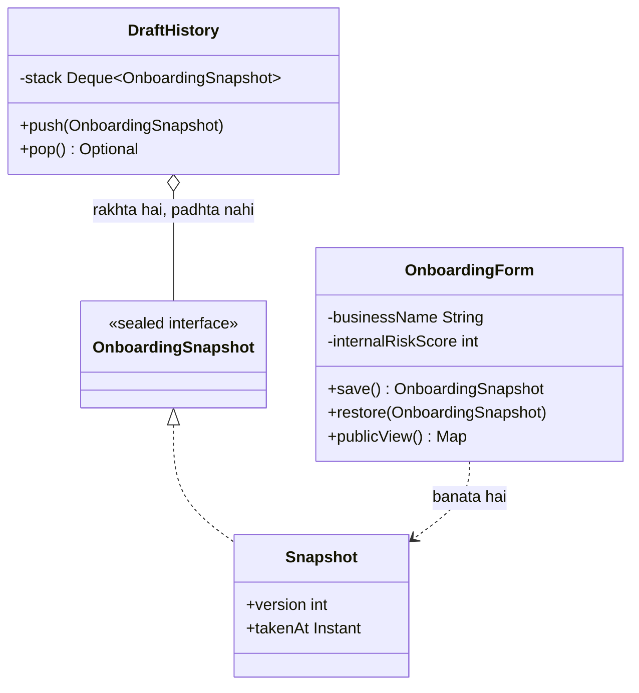

### Kya choose karein aur kyun

| Option | Kab use karo | Kab mat karo |
| --- | --- | --- |
| Memento (sealed snapshot record) | Jab state private rehni chahiye par save-restore chahiye — wizard, undo, draft | Jab state chhoti aur poori tarah public ho — tab plain DTO hi kaafi hai |
| Full JSON serialisation of the object | Internal tooling, debugging dumps | Jab internal fields kabhi bahar nahi jaani chahiye — ek galti aur wo API me aa jaayengi |
| Event sourcing (saare changes store karo) | Jab poora history aur audit trail business requirement ho | Jab sirf “last 5 steps undo” chahiye — wo over-engineering hai |
| Database row with version column | Jab draft long-lived ho aur cross-device chahiye | Short-lived in-session undo ke liye — wahan memory stack sasta hai |

### India me kaise hota hai

- Merchant onboarding India me heavily multi-step hai kyunki KYC documents, PAN, GST aur bank account verification sab alag-alag external checks pe depend karte hain, aur har check async hota hai. Isliye draft state yahan optional feature nahi hai — wo core requirement hai.
- Internal risk score ko draft me rakhna par merchant ko na dikhana regulatory aur fraud-prevention dono wajah se zaroori hai. Memento ka sealed snapshot exactly isi liye fit hota hai: ek hi state, do views.
- Razorpay ke onboarding me bhi merchant ka account ek status rakhta hai aur verification steps alag-alag complete hote hain — matlab server pe partial state ek first-class cheez hai. ([Razorpay — About Payments](https://www.razorpay.com/docs/payments/payments))

### Interview follow-ups

- **Memento aur DTO me farak?** DTO data bahar bhejne ke liye hai, uske fields public contract hain. Memento andar ki state wapas laane ke liye hai, uske fields private implementation detail hain.
- **Snapshot bada ho jaaye to?** Incremental memento: sirf changed fields store karo plus ek base snapshot. Isse memory bachti hai par restore ka code complex ho jaata hai.
- **Class me naya field add hone pe purane drafts ka kya?** `version` field hi tumhara bachao hai. Restore me version check karo, aur ek migration function rakho `v1 -> v2`.
- **Mutable collections ka khatra kya hai snapshot me?** Agar tum `validationFlags` ko seedha reference de do, to live object usko badal dega aur tumhara snapshot bhi badal jaayega. Isliye `List.copyOf` — defensive copy.
- **Ye Prototype (P4) se kaise alag hai?** Prototype ka maqsad naya object banana hai jo purane jaisa ho. Memento ka maqsad purani state wapas laana hai usi object me.

### Self-check

1. Memento ko sealed ya nested private kyun rakhte hain?
2. `version` field snapshot me kis problem se bachata hai?
3. Caretaker ko snapshot ke andar kya dekhna chahiye?
4. `List.copyOf` ke bina kaunsa bug aata hai?
5. Memento aur DTO ka ek line me farak.

### Notebook

Memento = state ka opaque snapshot, save() aur restore() · Snapshot immutable record, sealed ya nested · Caretaker rakhta hai, padhta nahi · version field se purane drafts migrate · Defensive copy (List.copyOf) warna snapshot live object ke saath badal jaayega · Internal fields snapshot me rahein, publicView me nahi · Undo stack bounded rakho (last 10) · Bada state = incremental memento + base · DTO = public contract, Memento = private implementation.

### Padhne ke liye

- [Refactoring Guru — Memento](https://refactoring.guru/design-patterns/memento)
- [Razorpay — About Payments](https://www.razorpay.com/docs/payments/payments)

### Deep Dive (SDE-2) — jab time ho

#### Snapshot ko DB me rakhna: schema evolution ka asli dard

Jab draft 30 din tak DB me rehta hai, tumhara code 30 din me 3 bar deploy hoga. Isliye snapshot ka JSON schema backward-compatible hona chahiye: naye fields optional with defaults, purane fields kabhi delete nahi (sirf ignore), aur `version` hamesha present. Ek upcasting layer rakho — ek function per version jump — jo load pe purane shape ko naye shape me badal de. Isi liye production me snapshot ka record live domain class se alag rakha jaata hai.

#### Memento plus Command se poora undo stack

Memento state capture karta hai, Command operation capture karta hai. Dono mila ke ek strong undo system banta hai: chhote operations ke liye command ka `undo()` sasta hai, aur complex ya risky operations ke liye pehle memento le lo aur undo pe poori state restore kar do. Editor-type systems isi hybrid pe chalte hain.

#### Kab memento galat jawab hai

Agar business ko poora history chahiye — kisne kab kya badla, audit ke liye — to memento ka bounded stack kaafi nahi. Wahan event sourcing sahi hai: har change ek immutable event, aur current state events ka fold. Payments me ledger khud event-sourced hota hai, isliye ye distinction interview me important hai: draft ke liye memento, paisa ke liye events.

---

## P18 — Observer

Observer pattern me ek object (publisher) kuch hone pe ek event nikaalta hai, aur jitne bhi objects usme interested hain (subscribers) unko wo event mil jaata hai. Publisher ko nahi pata kitne subscribers hain ya wo kya karenge.

### Ye cheez hai kya

- Category: behavioural pattern. Ye one-to-many notification deta hai, bina publisher ko receivers se baandhe.
- Kis problem ke liye: jab ek business event pe 6 alag-alag cheezein honi hain, aur wo list har mahine badalti hai. Publisher me har baar ek naya call add karna galat hai.
- Is lesson ke baad: tum ek event-driven flow design kar paoge jisme naya consumer add karne pe publisher ka code chhuna hi na pade.

Analogy: cricket match ka live score feed. Scoreboard operator ek hi baar score announce karta hai. TV channel, mobile app, SMS service — sab sun rahe hain aur apna kaam kar rahe hain. Operator ko nahi pata kaun sun raha hai, aur agar ek channel band ho jaaye to match rukta nahi.

### Sawaal

Paytm me jab payment `SUCCESS` hoti hai, to ye sab chahiye: merchant ko webhook, customer ko SMS plus push, loyalty points add, analytics event, risk system ko signal, aur settlement scheduler me entry. Agle quarter me do naye consumers aayenge jinke baare me abhi kisi ko pata nahi. Requirement: payment ka response time 200 ms se kam rahe, aur ek consumer ke down hone se payment fail na ho. Design karo.

> Pehle khud socho — 5 min. Hints: (1) 6 consumers ko synchronously call karne me total latency kitni? (2) ek consumer crash kare to publisher ko kaise pata chalega? (3) event me kya bhejoge — poora payment object ya sirf id?

### Problem kyun aata hai

- Synchronous fan-out me latency judti hai. 6 consumers × 50 ms = 300 ms, aur ek slow consumer poora payment response slow kar deta hai.
- Publisher ka code consumers ki list ban jaata hai. Naya consumer matlab `PaymentService` ka code change, deploy aur regression testing — jabki `PaymentService` ka kaam badla hi nahi.
- Ek consumer ka exception poora flow gira deta hai. SMS vendor down hone se payment fail hona business ke liye ajeeb hai.
- Testing bhaari ho jaati hai: payment ka ek unit test 6 mocks maangta hai.

### Naive approach

```java
// Publisher consumers ki list ban gaya — har naya consumer isi file me
public class PaymentService {
    public Payment markSuccess(String paymentId) {
        Payment p = repo.markSuccess(paymentId);
        webhookSender.send(p);        // 80 ms
        smsService.send(p);           // 60 ms, vendor down to exception
        loyaltyService.addPoints(p);  // 40 ms
        analytics.track(p);           // 30 ms
        riskService.signal(p);        // 50 ms
        settlementScheduler.add(p);   // 40 ms  — total 300 ms, sab mandatory ban gaye
        return p;
    }
}
```

Ye exactly kahan tootta hai: `smsService.send` ka exception payment ko fail dikhata hai jabki paisa aa chuka hai — aur customer ko “payment failed” dikh raha hai jabki wo success hui. Aur `settlementScheduler.add` jo asli business requirement hai, SMS ke baad hai — isliye SMS fail hone pe settlement bhi nahi hua.

### Sahi design

1. Ek immutable event type banao: `PaymentSucceeded`. Usme business facts hon — id, amount, merchant, timestamp — service objects nahi.
2. Ek `EventBus` banao jisme listeners register karte hain. Publisher sirf `bus.publish(event)` bolta hai, aur usko listeners ka naam bhi nahi pata.
3. Listener ka failure publisher pe nahi aana chahiye: bus ke andar per-listener try-catch, plus metric. Ek listener ka crash doosre listeners ko nahi rokta.
4. Latency ke liye async dispatch: bus event ko ek queue me daale, aur worker threads listeners chalayein. Payment response 200 ms ke andar nikal jaata hai.
5. Important payments wali baat: in-memory bus crash-safe nahi hai. Jo consumers business-critical hain (settlement, webhook) unke liye durable bus chahiye — Kafka topic ya transactional outbox table. In-memory bus sirf best-effort consumers (analytics, cache warm) ke liye.
6. Event me `eventId` rakho. At-least-once delivery me consumer ko duplicate milega, aur `eventId` se wo dedupe karega.

```java
// Event ek fact hai — past tense naam, immutable, sirf data
public record PaymentSucceeded(
        String eventId, String paymentId, String merchantId, String customerId,
        long amountPaise, String method, Instant occurredAt) {}

public interface PaymentEventListener {
    String name();
    void onPaymentSucceeded(PaymentSucceeded event);
}

public class WebhookListener implements PaymentEventListener {
    private final WebhookSender sender;
    public WebhookListener(WebhookSender sender) { this.sender = sender; }
    public String name() { return "WEBHOOK"; }
    public void onPaymentSucceeded(PaymentSucceeded e) {
        sender.send(e.merchantId(), "payment.captured", e.paymentId());
    }
}

public class SmsListener implements PaymentEventListener {
    private final SmsService sms;
    public SmsListener(SmsService sms) { this.sms = sms; }
    public String name() { return "SMS"; }
    public void onPaymentSucceeded(PaymentSucceeded e) {
        sms.send(e.customerId(), "Payment of " + e.amountPaise() + " paise successful");
    }
}

// BUS: async dispatch plus per-listener isolation
public class PaymentEventBus {
    private final List<PaymentEventListener> listeners = new CopyOnWriteArrayList<>();
    private final ExecutorService pool;

    public PaymentEventBus(int threads) { this.pool = Executors.newFixedThreadPool(threads); }

    public void subscribe(PaymentEventListener l) { listeners.add(l); }

    public void publish(PaymentSucceeded event) {
        for (PaymentEventListener l : listeners) {
            pool.submit(() -> {
                try {
                    l.onPaymentSucceeded(event);
                } catch (RuntimeException ex) {
                    // ek listener ka crash baaki listeners ko nahi rokta
                    System.out.println("listener " + l.name() + " failed: " + ex.getMessage());
                }
            });
        }
    }
}

public class PaymentService {
    private final PaymentRepository repo;
    private final PaymentEventBus bus;
    public PaymentService(PaymentRepository repo, PaymentEventBus bus) {
        this.repo = repo; this.bus = bus;
    }

    public Payment markSuccess(String paymentId) {
        Payment p = repo.markSuccess(paymentId);
        // publisher ko listeners ka naam bhi nahi pata — yahi poora point hai
        bus.publish(new PaymentSucceeded(UUID.randomUUID().toString(), p.id(), p.merchantId(),
                p.customerId(), p.amountPaise(), p.method(), Instant.now()));
        return p;   // response turant, listeners background me
    }
}

public class Main {
    public static void main(String[] args) {
        PaymentEventBus bus = new PaymentEventBus(4);
        bus.subscribe(new WebhookListener(new StubWebhookSender()));
        bus.subscribe(new SmsListener(new FlakySmsService()));
        // Naya consumer? Ek nayi class + ek subscribe line. PaymentService untouched.

        new PaymentService(new InMemoryPaymentRepo(), bus).markSuccess("pay_1");
    }
}
```

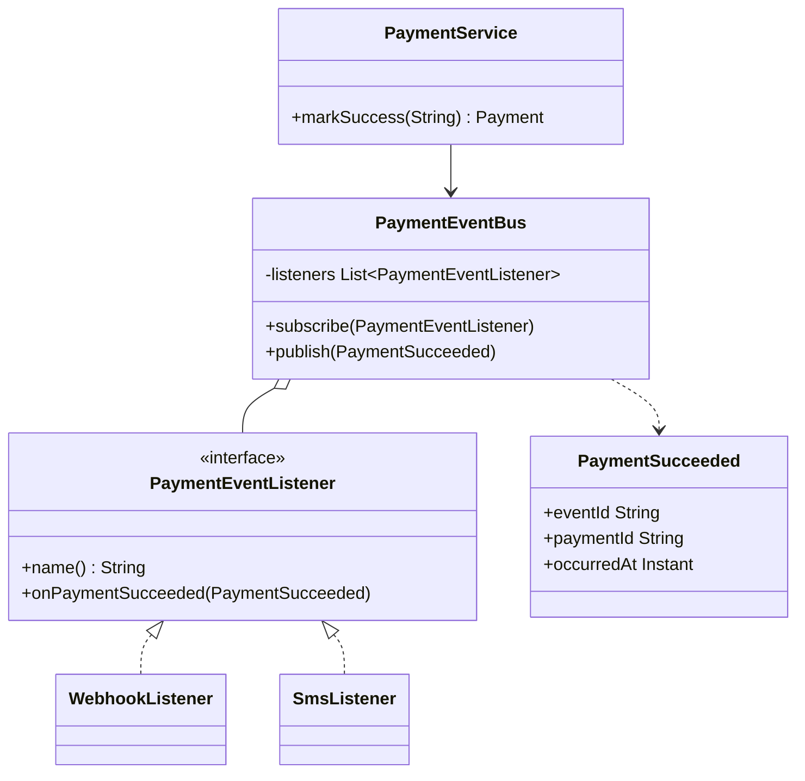

### Kya choose karein aur kyun

| Option | Kab use karo | Kab mat karo |
| --- | --- | --- |
| In-memory event bus (async) | Best-effort consumers — analytics, cache warm, metrics; same process me | Business-critical consumers ke liye — pod crash pe event hamesha ke liye gaya |
| Transactional outbox plus publisher | Jab event business write ke saath atomically jaana chahiye — settlement, webhook | Jab event matter hi nahi karta — tab ye extra table aur job overhead hai |
| Kafka topic | Cross-service fan-out, replay chahiye, high throughput | Same-process notification ke liye — wahan ye bhaari infra hai |
| Synchronous listeners | Jab consumer ka result publisher ko chahiye hi (validation) | Jab consumer ka kaam side-effect ho — tab latency aur coupling muft me milti hai |

### India me kaise hota hai

- Razorpay ka poora integration model webhook-based hai: payment capture hone pe wo merchant ko event bhejta hai, aur merchant ko bola jaata hai ki webhook handler idempotent ho aur duplicate events handle kare. Ye bilkul observer plus at-least-once delivery ka production roop hai. ([Razorpay — subscribe to webhooks](https://razorpay.com/docs/payments/recurring-payments/subscribe-to-webhooks.md))
- UPI me payment ka asli status callback se aata hai, aur callback miss ho jaana normal hai — isliye yahan observer ke saath ek reconciliation loop bhi chahiye. Aur status poll karne pe NPCI ki limit hai: pehla check transaction ke 90 second baad. Matlab India me event-driven design ke saath patience built-in karni padti hai. ([Inc42 — NPCI additional measures](https://inc42.com/buzz/npci-brings-in-additional-measures-to-curb-upi-outage))
- Spring me ye pattern ready-made hai: `ApplicationEventPublisher` plus `@EventListener`, aur `@TransactionalEventListener` se tum event ko DB commit ke baad hi fire kar sakte ho — jo payments me bahut important hai.

### Interview follow-ups

- **Event me poora object bhejoge ya sirf id?** Facts bhejo jo consumer ko chahiye, par mutable domain object kabhi nahi. Sirf id bhejne se consumer ko ek extra DB read karna padta hai aur race condition aati hai (wo naya state padh lega). Middle ground: id plus wo fields jo event ke waqt sach the.
- **Transaction commit se pehle event publish ho gaya to?** Classic bug — consumer DB se padhega aur usko data milega hi nahi. Fix: event ko commit ke baad publish karo (`@TransactionalEventListener(phase = AFTER_COMMIT)`), ya transactional outbox use karo.
- **Duplicate events kaise handle karoge?** Consumer side pe `eventId` ko ek `processed_events` table me unique key pe insert karo. Insert fail = already processed = skip. Isko consumer-side idempotency kehte hain.
- **Order guarantee chahiye to?** In-memory thread pool me order nahi hai. Kafka me per-partition order hota hai, isliye `paymentId` ko partition key banao — ek payment ke events order me rahenge.
- **Observer aur Mediator me farak?** Mediator participants ke beech rules aur order rakhta hai aur unko jaanta hai. Observer me publisher subscribers ko bilkul nahi jaanta aur koi order guarantee nahi.

### Self-check

1. Publisher ko subscribers ka pata na hona kis practical fayde me badalta hai?
2. Event ka naam past tense me kyun rakhte hain?
3. Commit se pehle event publish karne se kaunsa bug aata hai?
4. `eventId` consumer side pe kis cheez ke liye hai?
5. In-memory bus business-critical consumer ke liye kyun galat hai?

### Notebook

Observer = publisher ek event, kai subscribers, publisher unko nahi jaanta · Event = immutable fact, past tense naam, sirf data · Per-listener try-catch: ek ka crash baaki ko na roke · Async dispatch se latency nahi badhti · In-memory bus = best-effort only; critical ke liye outbox ya Kafka · Event commit ke BAAD publish karo · eventId se consumer-side dedupe · Kafka partition key = paymentId, per-payment order · Razorpay webhooks = at-least-once, handler idempotent · Mediator jaanta hai aur order rakhta hai, Observer nahi.

### Padhne ke liye

- [Refactoring Guru — Observer](https://refactoring.guru/design-patterns/observer)
- [Razorpay — Subscribe to webhooks](https://razorpay.com/docs/payments/recurring-payments/subscribe-to-webhooks.md)

### Deep Dive (SDE-2) — jab time ho

#### Transactional outbox: observer ka production roop

In-memory bus ka ek hi fatal flaw hai — publish hone ke baad pod crash hua to event gaya. Outbox pattern: event ko usi DB transaction me ek `outbox` table me insert karo jisme payment update hua. Ek separate publisher process outbox se padhta hai, Kafka pe bhejta hai, aur row ko `published` mark karta hai. Guarantee at-least-once ban jaati hai, aur duplicate consumer ke `eventId` dedupe se handle hote hain. Ye P14 Command ke outbox deep dive se same mechanism hai.

#### Fat events vs thin events

Thin event (sirf id) consumer ko DB read karwata hai — extra load aur race condition. Fat event (saare relevant fields) consumer ko self-sufficient banata hai par event schema ko contract bana deta hai, jo badalna mushkil ho jaata hai. Production rule: event me wo fields rakho jo us waqt ka sach hain aur jo kabhi badlenge nahi (amount, method, timestamp), aur jo mutable hai usko consumer DB se padhe. Isko “event-carried state transfer, selectively” kehte hain.

#### Slow consumer aur backpressure

Ek slow listener thread pool ko bhar deta hai aur baaki listeners bhi atak jaate hain. Do fix: per-listener bounded queue plus apna thread pool (bulkhead isolation), aur queue full hone pe us listener ke events drop ya spill-to-disk karna. Bulkhead ka matlab hai ek consumer ka resource budget doosre se alag rakhna — ye resilience ka core idea hai aur `L2.16 — Bulkhead pattern (abhi banna baaki)` me detail me aayega.

---

## P19 — State

State pattern me ek object ka behaviour uski current state ke hisaab se badalta hai, aur har state apni ek class hoti hai. State object hi decide karta hai ki kaunsa transition allowed hai aur kaunsa nahi — ek bade `switch` ki jagah.

### Ye cheez hai kya

- Category: behavioural pattern. Ye ek state machine ko type-safe code me badal deta hai.
- Kis problem ke liye: jab ek entity ki lifecycle me 6–8 states hon aur unke beech sirf kuch transitions legal hon. Payments me yahi sabse bada source of bugs hai — ek illegal transition ka matlab paisa galat jagah.
- Is lesson ke baad: tum payment lifecycle ko aise likh paoge jisme illegal transition compile ya runtime pe saaf reject ho, aur naya state add karna safe ho.

Analogy: train ka signal. Red pe train ruki hai, green pe chal sakti hai, yellow pe dheere. Signal ka rang hi tay karta hai driver kya kar sakta hai — driver har baar poora rulebook nahi padhta.

### Sawaal

Paytm ka payment ye states rakhta hai: `CREATED`, `PENDING`, `AUTHORIZED`, `CAPTURED`, `FAILED`, `REFUNDED`, `PARTIALLY_REFUNDED`. Rules: `CREATED` se `PENDING` ya `FAILED` ja sakte hain; `PENDING` se `AUTHORIZED` ya `FAILED`; `AUTHORIZED` se `CAPTURED` ya `FAILED` (aur 3 din me capture na hua to auto-refund); `CAPTURED` se `REFUNDED` ya `PARTIALLY_REFUNDED`; `FAILED` aur `REFUNDED` terminal hain. Ab ek bug report aata hai: ek `FAILED` payment `CAPTURED` ban gaya. Design karo taki ye kabhi na ho.

> Pehle khud socho — 5 min. Hints: (1) transition ka rule kahan likha hona chahiye? (2) concurrent do webhook aa jaayein to? (3) terminal state ko kaise enforce karoge?

### Problem kyun aata hai

- `status` ek `String` ya enum column hai aur transition rules code me bikhre hain. 8 jagah `if (payment.status.equals("PENDING"))` likha hai, aur ek jagah check chhoot gaya.
- Naya state add karna matlab saare `switch` dhundhna. Ek bhi miss hua to default branch chup-chaap galat kaam karega.
- Concurrency: do webhooks ek saath aate hain (ek `FAILED`, ek `AUTHORIZED`). Dono purana state padhte hain aur dono likh dete hain — last writer jeet jaata hai, aur wo galat ho sakta hai.
- Terminal states enforce nahi hoti, isliye ek `REFUNDED` payment phir se `CAPTURED` ban sakta hai.

### Naive approach

```java
// Rules code me bikhre hue — aur ek jagah check chhoot gaya
public class Payment {
    private String status;

    public void capture() {
        // kisne check kiya ki status AUTHORIZED hai? Kisi ne nahi.
        this.status = "CAPTURED";
    }

    public void fail(String reason) {
        if (status.equals("CAPTURED")) throw new IllegalStateException("already captured");
        this.status = "FAILED";
    }

    public void refund() {
        if (status.equals("CAPTURED")) {           // PARTIALLY_REFUNDED ka case bhool gaye
            this.status = "REFUNDED";
        }
    }
}
```

Ye exactly kahan tootta hai: `capture()` me koi guard hi nahi hai, isliye `FAILED` payment bhi `CAPTURED` ban jaata hai — wahi production bug. Aur `refund()` chup-chaap kuch nahi karta jab status kuch aur ho, isliye bug 3 mahine chhupa rehta hai.

### Sahi design

1. Allowed transitions ko ek jagah declare karo — ek map `state -> allowed next states`. Ye poora rulebook ek nazar me dikhna chahiye.
2. Transition karne ka ek hi raasta rakho: `transitionTo(next)`. Wo check karta hai aur illegal transition pe exception phenkta hai, chup-chaap ignore nahi karta.
3. Terminal states ko explicitly mark karo — unke allowed set khaali hota hai, isliye rule apne aap enforce ho jaata hai.
4. Behaviour ko state ke saath rakho: jab ek state me kaam alag hota hai (jaise `AUTHORIZED` me auto-refund timer chalta hai, `CAPTURED` me settlement eligible hota hai), to ek interface plus per-state class use karo.
5. Concurrency ko DB level pe handle karo: optimistic locking (`UPDATE ... WHERE id = ? AND status = ?`). Agar 0 rows update hui, matlab state beech me badal gaya — phir re-read karo aur dobara decide karo.
6. Har transition ko audit karo: `payment_status_history` table me `from`, `to`, `reason`, `at`, `source`. Payments me ye regulatory bhi kaam aata hai aur debugging bhi.

```java
public enum PaymentStatus {
    CREATED, PENDING, AUTHORIZED, CAPTURED, FAILED, REFUNDED, PARTIALLY_REFUNDED;

    // Poora rulebook ek jagah — ye padh ke koi bhi lifecycle samajh sakta hai
    private static final Map<PaymentStatus, Set<PaymentStatus>> ALLOWED = Map.of(
            CREATED,            EnumSet.of(PENDING, FAILED),
            PENDING,            EnumSet.of(AUTHORIZED, FAILED),
            AUTHORIZED,         EnumSet.of(CAPTURED, FAILED, REFUNDED),   // 3 din me auto-refund
            CAPTURED,           EnumSet.of(REFUNDED, PARTIALLY_REFUNDED),
            PARTIALLY_REFUNDED, EnumSet.of(REFUNDED, PARTIALLY_REFUNDED),
            FAILED,             EnumSet.noneOf(PaymentStatus.class),      // terminal
            REFUNDED,           EnumSet.noneOf(PaymentStatus.class));     // terminal

    public boolean canGoTo(PaymentStatus next) { return ALLOWED.get(this).contains(next); }
    public boolean isTerminal() { return ALLOWED.get(this).isEmpty(); }
}

// Per-state behaviour — jab kaam state ke hisaab se badalta hai
public interface PaymentState {
    PaymentStatus status();
    boolean settlementEligible();
    Optional<Duration> autoRefundAfter();
}

public class AuthorizedState implements PaymentState {
    public PaymentStatus status() { return PaymentStatus.AUTHORIZED; }
    public boolean settlementEligible() { return false; }                 // capture se pehle nahi
    public Optional<Duration> autoRefundAfter() { return Optional.of(Duration.ofDays(3)); }
}

public class CapturedState implements PaymentState {
    public PaymentStatus status() { return PaymentStatus.CAPTURED; }
    public boolean settlementEligible() { return true; }
    public Optional<Duration> autoRefundAfter() { return Optional.empty(); }
}

public record StatusChange(PaymentStatus from, PaymentStatus to, String reason,
                           String source, Instant at) {}

public class Payment {
    private final String id;
    private PaymentStatus status;
    private long version;                         // optimistic locking ke liye
    private final List<StatusChange> history = new ArrayList<>();

    public Payment(String id) { this.id = id; this.status = PaymentStatus.CREATED; }

    // Transition ka EK hi raasta — isliye guard kabhi chhoot nahi sakta
    public void transitionTo(PaymentStatus next, String reason, String source) {
        if (status.isTerminal()) {
            throw new IllegalStateTransitionException(id + " already terminal: " + status);
        }
        if (!status.canGoTo(next)) {
            throw new IllegalStateTransitionException(id + ": " + status + " -> " + next + " allowed nahi");
        }
        history.add(new StatusChange(status, next, reason, source, Instant.now()));
        this.status = next;
        this.version++;
    }

    public PaymentStatus status() { return status; }
    public long version() { return version; }
    public List<StatusChange> history() { return List.copyOf(history); }
}

public class PaymentRepository {
    // Optimistic locking: state us waqt bhi wahi ho jab hum likh rahe hain
    public boolean compareAndSetStatus(String id, PaymentStatus expected, PaymentStatus next) {
        // UPDATE payments SET status = next, version = version + 1
        //   WHERE id = ? AND status = expected
        // 0 rows => koi aur pehle badal gaya => re-read karo
        return jdbc.update(/* ... */) == 1;
    }
}

public class Main {
    public static void main(String[] args) {
        Payment p = new Payment("pay_1");
        p.transitionTo(PaymentStatus.PENDING,    "UPI collect bheja", "checkout");
        p.transitionTo(PaymentStatus.AUTHORIZED, "bank ne approve kiya", "npci-callback");
        p.transitionTo(PaymentStatus.CAPTURED,   "merchant ne capture kiya", "merchant-api");

        try {
            p.transitionTo(PaymentStatus.FAILED, "late failure webhook", "npci-callback");
        } catch (IllegalStateTransitionException e) {
            // CAPTURED se FAILED allowed nahi — wahi bug ab yahan pakda gaya
            System.out.println("blocked: " + e.getMessage());
        }
        System.out.println(p.history());
    }
}
```

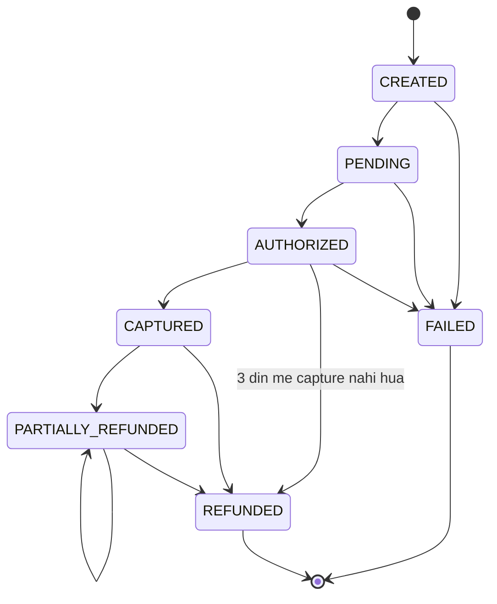

### Kya choose karein aur kyun

| Option | Kab use karo | Kab mat karo |
| --- | --- | --- |
| Enum plus transition map | 5–10 states, behaviour mostly same, rules hi important hain — payments ka default | Jab har state me behaviour bahut alag ho — tab map kaafi nahi |
| State classes (ek class per state) | Jab per-state behaviour alag ho (settlement eligibility, timers, allowed operations) | 3 states ke liye — wahan ye sirf extra files hain |
| Workflow engine (Temporal, Camunda) | Jab states ke beech long-running waits, timers aur human approval hon | Simple in-process lifecycle ke liye — bhaari infra |
| Plain `String` status with scattered ifs | Kabhi nahi, production code me | Hamesha — yahi wo bug hai jo is lesson ka sawaal tha |

### India me kaise hota hai

- Razorpay ke payment states public documented hain: `created`, `authorized`, `captured`, `refunded`, `failed`. Aur ek important rule unke docs me likha hai — `authorized` payment agar 3 din ke andar capture nahi hua to automatically customer ko refund ho jaata hai. Ye exactly wo tarah ka time-based transition hai jo state machine me explicit hona chahiye, warna paisa latka reh jaata hai. ([Razorpay — About Payments](https://www.razorpay.com/docs/payments/payments))
- UPI me ek extra reality hai: late callbacks. Payment `FAILED` mark ho chuka hai aur 2 minute baad bank ka `SUCCESS` callback aata hai. Isliye Indian systems me `FAILED` ko turant terminal maanna khatarnak hai — practical design me ek `FAILED` state hoti hai jo reconciliation se correct ho sakti hai, aur wo correction ek audited special transition hoti hai, normal path nahi.
- NPCI ne status checking pe limit lagayi hai (pehla check 90 second baad), isliye state machine me ek `PENDING` state ka timeout bhi regulation ke hisaab se set hota hai, mann se nahi. ([Inc42 — NPCI additional measures](https://inc42.com/buzz/npci-brings-in-additional-measures-to-curb-upi-outage))

### Interview follow-ups

- **Do concurrent webhooks ek saath aayein to?** Optimistic locking: `UPDATE ... WHERE id = ? AND status = ?`. 0 rows update hui matlab koi aur jeet gaya — phir re-read karo aur naye state se decide karo. In-memory guard akela kaafi nahi, kyunki do pods hain.
- **Illegal transition pe exception ya ignore?** Exception, hamesha. Payments me chup-chaap ignore karna matlab bug 3 mahine chhupa rahega. Exception ko ek alert aur ek metric se jodo.
- **Late `SUCCESS` callback aane pe kya?** Usko normal transition na banao. Ek separate reconciliation-correction path banao jisme approval aur audit entry zaroori ho. Normal state machine terminal ko terminal hi maane.
- **State classes aur enum map me se kya choose karoge?** Agar sirf transitions enforce karni hain, enum plus map saaf aur sasta hai. Agar har state me behaviour alag hai (eligibility, timers, allowed ops), tab state classes.
- **History table kyun chahiye?** Debugging, dispute resolution aur regulatory audit — teeno. Aur ye at-least-once webhooks ke saath yeh batata hai ki kaunsa callback kab kis state pe aaya tha.

### Self-check

1. Transition ka ek hi raasta rakhne se kaunsa bug structurally impossible ho jaata hai?
2. Terminal state ko map me kaise represent kiya hai?
3. Do pods ek saath transition karein to kaunsa mechanism bachata hai?
4. Illegal transition pe exception kyun, ignore kyun nahi?
5. Razorpay me `authorized` payment 3 din me capture na ho to kya hota hai?

### Notebook

State = behaviour current state ke hisaab se, rules ek jagah · Enum + ALLOWED map = poora rulebook ek nazar me · transitionTo() ek hi raasta, guard chhoot nahi sakta · Terminal state = khaali allowed set · Illegal transition = exception + alert, ignore kabhi nahi · Concurrency = optimistic locking, UPDATE WHERE status = expected · Per-state behaviour alag ho to state classes · Status history table: from, to, reason, source, at · Razorpay: authorized 3 din me capture nahi = auto-refund · UPI late callback = special audited correction path, normal transition nahi.

### Padhne ke liye

- [Refactoring Guru — State](https://refactoring.guru/design-patterns/state)
- [Razorpay — About Payments (payment states)](https://www.razorpay.com/docs/payments/payments)

### Deep Dive (SDE-2) — jab time ho

#### State machine ko data-driven banana

Jab business roz transitions badalta hai, to code deploy karna slow pad jaata hai. Pattern: transitions ko ek config table me rakho (`from_status`, `to_status`, `requires_role`, `enabled`), aur code usko load kare. Fayda: naya transition ek DB row hai. Khatra: galat row paisa galat jagah bhej sakti hai — isliye config change pe bhi review, versioning aur audit chahiye, code change jitna hi strict.

#### Idempotent transitions

Webhook dobara aata hai aur wahi transition dobara maangta hai — `AUTHORIZED` se `CAPTURED`, par payment already `CAPTURED` hai. Strict rules isko illegal batayenge aur alert bhej denge, jo shor banega. Sahi design: same-state transition ko explicitly no-op karo jab wo already applied hai aur source wahi hai. Isko self-transition tolerance kehte hain, aur ye at-least-once webhooks ke saath zaroori hai.

#### Time-based transitions ko kaun chalaata hai

`AUTHORIZED` se auto-refund 3 din baad hona hai — par koi request us waqt aa nahi rahi. Isliye state machine ko ek scheduler chahiye: ek table me `next_action_at` column, aur ek job jo due rows uthaa ke transition chalaata hai. Ye P14 Command ke `nextAttemptAt` jaisa hi mechanism hai, aur dono ek hi scheduler pe chal sakte hain.

---

## P20 — Strategy

Strategy pattern me ek hi kaam ke kai alag tarike alag-alag classes me rakhe jaate hain, sabka ek common interface hota hai, aur runtime pe decide hota hai kaunsa chalega. Caller ko sirf interface dikhta hai, algorithm nahi.

### Ye cheez hai kya

- Category: behavioural pattern. Ye algorithm ko uske use se alag kar deta hai.
- Kis problem ke liye: jab ek calculation ya decision ke 6 variants hon — merchant plan ke hisaab se, country ke hisaab se, payment method ke hisaab se — aur wo list badalti rehti hai.
- Is lesson ke baad: tum ek `if-else` ladder ko config-driven strategies me badal paoge, aur naya variant add karne pe purana code na chhuoge.

Analogy: auto ka meter aur Ola ka surge pricing. Dono ka kaam ek hai — kiraya nikalna. Par formula alag hai. Passenger ko bas final amount chahiye; usse farak nahi padta ki andar kaunsa formula chala.

### Sawaal

Paytm me merchant discount rate (MDR — wo fee jo payment gateway merchant se charge karta hai) nikalna hai. Rules: UPI pe ek flat fee, card pe percentage plus fixed, netbanking pe flat per transaction, wallet pe percentage with a cap, aur enterprise merchants ke liye negotiated slabs. Har quarter pricing team naye slabs deti hai, aur ek bada merchant apna custom formula maangta hai. Design karo.

> Pehle khud socho — 5 min. Hints: (1) fee calculation me rounding kahan hogi aur kis direction me? (2) naya pricing slab aane pe kitni files badalni chahiye? (3) purane transactions ka fee recalculate ho jaaye to kya hoga?

### Problem kyun aata hai

- `if-else` ladder me har naye rule pe ek aur branch judta hai. 6 mahine me wo method 300 line ka ho jaata hai aur uska test ek hi giant test ban jaata hai.
- Pricing change ka deploy risk bahut zyada ho jaata hai, kyunki ek hi method sab methods ke liye zimmedar hai. UPI ka fix card ka fee tod sakta hai.
- Custom merchant formula ke liye log `if (merchantId.equals("mrc_big"))` daal dete hain, aur phir wo hamesha ke liye wahan reh jaata hai.
- Fee ek paisa galat hone pa bhi mahine ke end me lakhon ka farak aa jaata hai, aur blame kis branch pe hai, pata nahi chalta.

### Naive approach

```java
// Ek hi method sab pricing ka zimmedar — har change poore method ka risk hai
public class FeeCalculator {
    public long feeInPaise(String method, long amountPaise, String merchantId) {
        if (merchantId.equals("mrc_big")) {            // custom deal, hamesha ke liye hard-coded
            return Math.round(amountPaise * 0.0075);
        }
        if (method.equals("UPI")) return 0L;
        if (method.equals("CARD")) return Math.round(amountPaise * 0.0195) + 200L;
        if (method.equals("NETBANKING")) return 1500L;
        if (method.equals("WALLET")) {
            long f = Math.round(amountPaise * 0.021);
            return Math.min(f, 5000L);                 // cap. Aur double se rounding ka khel
        }
        return Math.round(amountPaise * 0.02);          // default. Kisko pata ye kab chalta hai?
    }
}
```

Ye exactly kahan tootta hai: `double` arithmetic paise pe kabhi nahi karna chahiye — `0.0195 * 999999` floating point me exact nahi hai, aur mahine bhar me paisa drift hota hai. Aur `return Math.round(amountPaise * 0.02)` wala default branch chup-chaap galat fee charge karega jab koi naya method aayega.

### Sahi design

1. Ek interface banao `FeeStrategy` jisme ek method ho: amount lo, fee do. Money ke liye `long paise` ya `BigDecimal` use karo — `double` kabhi nahi.
2. Har pricing rule ek class: `FlatFeeStrategy`, `PercentagePlusFixedStrategy`, `CappedPercentageStrategy`, `SlabStrategy`. Har ek akele testable.
3. Strategy chunne ka kaam ek `FeeStrategyResolver` kare, jo merchant plan plus payment method se strategy nikaale. Resolution config se aaye (DB ya config service), code se nahi.
4. Default branch ko explicit failure banao. Agar kis combination ke liye strategy nahi mili, to exception — chup-chaap koi aur fee charge karna galat hai.
5. Fee ko transaction pe freeze karke store karo. Pricing kal badal jaaye to purane transaction ka fee nahi badlega — ye accounting ka hard requirement hai.
6. Rounding ka ek hi rule poore system me ho aur wo explicitly likha ho (jaise `RoundingMode.HALF_UP` to nearest paisa), warna recon me ek paisa ke mismatch ki line lagi rahegi.

```java
// Money paise me, long. Double kabhi nahi.
public record Money(long paise) {
    public Money plus(Money o) { return new Money(paise + o.paise); }
    public static Money ofRupees(String rupees) {
        return new Money(new BigDecimal(rupees).movePointRight(2).longValueExact());
    }
}

public interface FeeStrategy {
    String name();
    Money fee(Money amount);
}

public class FlatFeeStrategy implements FeeStrategy {
    private final Money flat;
    public FlatFeeStrategy(Money flat) { this.flat = flat; }
    public String name() { return "FLAT"; }
    public Money fee(Money amount) { return flat; }
}

// BigDecimal plus explicit rounding — paisa drift nahi hoga
public class PercentagePlusFixedStrategy implements FeeStrategy {
    private final BigDecimal rate;     // 0.0195 = 1.95%
    private final Money fixed;
    public PercentagePlusFixedStrategy(BigDecimal rate, Money fixed) {
        this.rate = rate; this.fixed = fixed;
    }
    public String name() { return "PCT_PLUS_FIXED"; }
    public Money fee(Money amount) {
        BigDecimal pct = BigDecimal.valueOf(amount.paise()).multiply(rate)
                .setScale(0, RoundingMode.HALF_UP);      // ek hi rounding rule, poore system me
        return new Money(pct.longValueExact()).plus(fixed);
    }
}

public class CappedPercentageStrategy implements FeeStrategy {
    private final BigDecimal rate;
    private final Money cap;
    public CappedPercentageStrategy(BigDecimal rate, Money cap) { this.rate = rate; this.cap = cap; }
    public String name() { return "CAPPED_PCT"; }
    public Money fee(Money amount) {
        long pct = BigDecimal.valueOf(amount.paise()).multiply(rate)
                .setScale(0, RoundingMode.HALF_UP).longValueExact();
        return new Money(Math.min(pct, cap.paise()));
    }
}

// Enterprise slabs: amount ke hisaab se rate badalti hai
public class SlabStrategy implements FeeStrategy {
    public record Slab(Money upTo, BigDecimal rate) {}
    private final List<Slab> slabs;      // ascending upTo
    public SlabStrategy(List<Slab> slabs) { this.slabs = List.copyOf(slabs); }
    public String name() { return "SLAB"; }
    public Money fee(Money amount) {
        for (Slab s : slabs) {
            if (amount.paise() <= s.upTo().paise()) {
                return new Money(BigDecimal.valueOf(amount.paise()).multiply(s.rate())
                        .setScale(0, RoundingMode.HALF_UP).longValueExact());
            }
        }
        throw new IllegalStateException("Slab nahi mila amount ke liye: " + amount.paise());
    }
}

// Kaunsi strategy chalegi, ye config decide karta hai — code nahi
public class FeeStrategyResolver {
    private final Map<String, FeeStrategy> byKey;   // key = merchantPlan + ":" + method
    public FeeStrategyResolver(Map<String, FeeStrategy> byKey) { this.byKey = Map.copyOf(byKey); }

    public FeeStrategy resolve(String merchantPlan, String method) {
        FeeStrategy s = byKey.get(merchantPlan + ":" + method);
        if (s == null) {
            // chup-chaap default fee charge karna accounting bug hai — isliye fail karo
            throw new NoFeeStrategyException(merchantPlan + ":" + method + " ke liye pricing nahi hai");
        }
        return s;
    }
}

public class Main {
    public static void main(String[] args) {
        FeeStrategyResolver resolver = new FeeStrategyResolver(Map.of(
                "STANDARD:UPI",        new FlatFeeStrategy(new Money(0)),
                "STANDARD:CARD",       new PercentagePlusFixedStrategy(new BigDecimal("0.0195"), new Money(200)),
                "STANDARD:NETBANKING", new FlatFeeStrategy(new Money(1500)),
                "STANDARD:WALLET",     new CappedPercentageStrategy(new BigDecimal("0.021"), new Money(5000)),
                "ENTERPRISE:CARD",     new SlabStrategy(List.of(
                        new SlabStrategy.Slab(Money.ofRupees("5000"),   new BigDecimal("0.0150")),
                        new SlabStrategy.Slab(Money.ofRupees("100000"), new BigDecimal("0.0120"))))));

        Money amount = Money.ofRupees("1999.00");
        FeeStrategy s = resolver.resolve("STANDARD", "CARD");
        System.out.println(s.name() + " fee = " + s.fee(amount).paise() + " paise");
        // Naya pricing? Ek nayi class ya ek nayi map entry. Purana code untouched.
    }
}
```

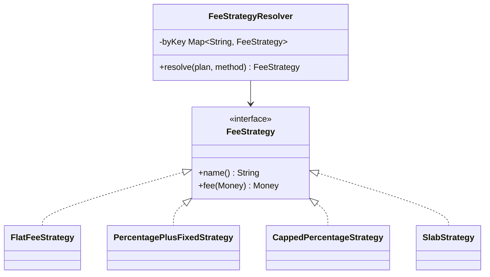

### Kya choose karein aur kyun

| Option | Kab use karo | Kab mat karo |
| --- | --- | --- |
| Strategy classes plus resolver map | Jab variants 3 se zyada hon aur list badalti rehti ho — pricing, routing, risk scoring | Jab sirf do fixed variants hain — tab ek `if` saaf hai |
| Enum with abstract method | Jab variants fixed aur chhote hon, aur unka naam hi domain me use hota ho | Jab variant ko constructor parameters chahiye (rate, cap) — enum me wo awkward hai |
| Lambda ya `Function` map | Chhoti stateless calculations, internal tooling | Jab strategy ko naam, metrics aur apna test chahiye — class behtar hai |
| Rule engine ya DSL (P23) | Jab non-engineers rules likhein aur wo roz badlein | Jab rules engineering team ke paas hi hain — tab DSL extra layer hai |

### India me kaise hota hai

- MDR India me regulated aur method-specific hai, aur UPI person-to-merchant transactions pe zero MDR ka regime hai — isliye `UPI` ki strategy literally flat zero hoti hai, jo baaki methods se bilkul alag shape hai. Yahi strategy pattern ka sabse saaf justification hai: ek hi `if-else` me zero-MDR aur slab-based card pricing dono rakhna galat hai.
- Razorpay apne pricing aur fees ko method ke hisaab se publish karta hai aur API response me fee aur tax alag fields me deta hai — matlab fee calculation ek first-class, stored value hai, derived-on-the-fly nahi. ([Razorpay — Understand Razorpay APIs](https://razorpay.com/docs/api/understand))
- Interview me ye bolna strong hai: fee ko transaction pe freeze karke store karte hain, kyunki pricing badalne pe purana settlement nahi badalna chahiye — aur recon isi stored fee pe match karta hai.

### Interview follow-ups

- **Strategy aur State me farak?** Strategy me caller (ya config) chunta hai kaunsa algorithm chalega, aur strategies ek dusre ko nahi jaantin. State me object khud apni state ke hisaab se behave karta hai, aur state transitions define hoti hain.
- **`double` se kya galat hota hai paise me?** `0.1 + 0.2` binary floating point me exactly `0.3` nahi hota. Lakhon transactions pe ye drift accumulate hota hai aur recon me mismatch deta hai. Isliye `long paise` ya `BigDecimal` plus explicit `RoundingMode`.
- **Default strategy rakhni chahiye?** Pricing me nahi — missing config ko exception banao plus alert. Routing jaise non-financial decision me ek safe default theek hai.
- **Strategy stateful ho sakti hai?** Behtar hai ki na ho. Stateless strategy thread-safe hoti hai aur singleton ki tarah share ho sakti hai. State chahiye to usko method parameter me pass karo.
- **100 merchants ke 100 custom formulas ho jaayein to?** Tab strategy classes nahi, ek data-driven pricing model chahiye — ek generic `SlabStrategy` plus per-merchant config rows. 100 classes maintainable nahi hain.

### Self-check

1. Strategy aur State ka ek line me farak.
2. Paise ke calculation me `double` kyun nahi?
3. Pricing me missing strategy pe exception kyun, default kyun nahi?
4. Fee ko transaction pe freeze karke store karna kis cheez se bachata hai?
5. Kab 100 strategy classes galat jawab hai, aur sahi kya hai?

### Notebook

Strategy = ek kaam ke kai algorithms, common interface, runtime pe choose · Har variant apni class, akele testable · Resolver config se strategy chune, code se nahi · Missing strategy = exception + alert, silent default nahi · Money = long paise ya BigDecimal, double kabhi nahi · Ek hi rounding rule poore system me (HALF\_UP to paisa) · Fee transaction pe freeze karke store karo · Stateless strategy = thread-safe, shareable · Bahut saare custom formulas = data-driven config, 100 classes nahi · UPI P2M zero MDR = literally flat-zero strategy.

### Padhne ke liye

- [Refactoring Guru — Strategy](https://refactoring.guru/design-patterns/strategy)
- [Razorpay — Understand Razorpay APIs](https://razorpay.com/docs/api/understand)

### Deep Dive (SDE-2) — jab time ho

#### Strategy ko versioned banana

Pricing ek effective-dated cheez hai: 1 April se naya rate. Isliye production me strategy ka lookup key me date bhi hoti hai — `resolve(plan, method, asOf)`. Config table me `effective_from` aur `effective_to` columns rakho, aur resolver us transaction ke timestamp ke hisaab se strategy chune. Isse backdated settlement bhi sahi fee ke saath calculate hota hai, aur audit me tum sabit kar sakte ho ki us din kaunsa rate laga tha.

#### Strategy plus Decorator se cross-cutting concerns

Fee calculation pe tumhe GST add karna hai, aur metrics bhi chahiye. Inko strategy ke andar mat likho — wo har strategy me duplicate hoga. Decorator (P9) lagao: `new MeteredFeeStrategy(new TaxedFeeStrategy(baseStrategy, gstRate))`. Base strategy sirf apna formula jaanti hai, tax aur metrics layers me hain. Ye Structural Bridge zone ke decorator lesson se seedha jud jaata hai.

#### Shadow calculation: pricing change safely deploy karna

Naya pricing seedha enable karna khatarnak hai — ek galat slab lakhon ka farak de dega. Pattern: naye strategy ko shadow me chalao, result ko purane result ke saath log karo, aur difference ka distribution dekho. Agar 99.9% transactions pe diff zero hai aur baaki expected hai, tab switch karo. Ye P13 ke shadow-mode idea ka financial version hai.

---

## P21 — Template Method

Template Method me ek base class poore algorithm ka skeleton likhti hai — steps ka order fix — aur kuch steps ko subclass ke liye chhod deti hai. Order base class ke control me rehta hai, details subclass ke.

### Ye cheez hai kya

- Category: behavioural pattern, inheritance pe based.
- Kis problem ke liye: jab ek process ke 7 steps hon, 5 steps har jagah same hon aur 2 steps source ke hisaab se badlein. Poora process har source ke liye copy karna invitation hai bugs ki.
- Is lesson ke baad: tum ek multi-step pipeline ka skeleton fix kar paoge taki koi integration ek critical step skip na kar sake.

Analogy: tiffin service ka process — order lo, pack karo, label lagao, deliver karo, confirm karo. Order ka tarika customer ke hisaab se badalta hai (app, phone, WhatsApp), par pack-label-deliver-confirm hamesha wahi order me hota hai. Manager steps ka order fix rakhta hai.

### Sawaal

Paytm ko teen gateways ke webhooks handle karne hain: Razorpay, Stripe aur ek legacy bank. Har webhook pe ye steps chahiye, isi order me: (1) signature verify, (2) payload parse, (3) duplicate check `eventId` se, (4) business apply, (5) `processed_events` me record, (6) `200 OK` return. Signature algorithm aur payload format teeno me alag hai, baaki sab same. Pichle mahine ek integration me signature verify skip ho gaya tha aur fake webhook accept ho gaya. Design karo.

> Pehle khud socho — 5 min. Hints: (1) kaunsa step kabhi skip nahi hona chahiye, aur usko structurally kaise force karoge? (2) duplicate check business apply se pehle kyun? (3) `200 OK` kab bhejna chahiye?

### Problem kyun aata hai

- Copy-paste integration: naya gateway add karne wala purane handler ko copy karta hai aur ek step bhool jaata hai. Security step bhoolna sabse mehnga hai.
- Order business-critical hai. Duplicate check business apply ke baad kiya to duplicate webhook do baar refund kar dega.
- Common steps 3 jagah hain, isliye ek bug fix 3 jagah karna padta hai aur ek jagah chhoot jaata hai.
- Code review me ye pakadna mushkil hai, kyunki handler dekhne me theek lagta hai — jo missing hai wo dikhta nahi.

### Naive approach

```java
// Teen handlers, teen copy. Ek me signature verify hi nahi hai.
public class RazorpayWebhookHandler {
    public Response handle(String body, Map<String, String> headers) {
        if (!verifyRazorpaySignature(body, headers.get("X-Razorpay-Signature"))) {
            return Response.status(401);
        }
        Event e = parseRazorpay(body);
        if (processedRepo.exists(e.id())) return Response.ok();
        apply(e);
        processedRepo.save(e.id());
        return Response.ok();
    }
}

public class LegacyBankWebhookHandler {
    public Response handle(String body, Map<String, String> headers) {
        Event e = parseLegacyXml(body);        // signature verify kahan hai? Kahin nahi.
        apply(e);                               // duplicate check bhi nahi — double refund possible
        return Response.ok();
    }
}
```

Ye exactly kahan tootta hai: `LegacyBankWebhookHandler` me do critical steps missing hain, aur compiler ne kuch nahi bola. Fake webhook accept ho gaya aur duplicate webhook se do refund ho gaye. Problem code me nahi, code ke structure me hai — skeleton kahin enforce nahi hua.

### Sahi design

1. Ek abstract base class banao jisme ek `final` template method ho: wahi steps ka order likhta hai. `final` isliye ki subclass order badal na sake.
2. Jo steps har gateway me alag hain unko `protected abstract` banao — subclass ko unhe likhna hi padega, warna compile nahi hoga. Yahi structural guarantee hai.
3. Jo steps common hain unko base class me concrete likho: duplicate check, record save, response.
4. Optional customisation ke liye hook methods rakho — default empty implementation, subclass chahe to override kare.
5. Duplicate check business apply se pehle, aur `processed_events` ka insert business apply ke baad usi transaction me — warna crash ke beech me duplicate ho sakta hai.
6. `200 OK` tab bhejo jab tum event ko surely store kar chuke ho. Jaldi `200` bhejna matlab gateway dobara nahi bhejega aur tumhara event gaya.

```java
public abstract class WebhookHandler {
    private final ProcessedEventRepository processed;
    protected WebhookHandler(ProcessedEventRepository processed) { this.processed = processed; }

    // TEMPLATE METHOD: order yahan fix hai aur final hai — koi subclass isko badal nahi sakta
    public final Response handle(String body, Map<String, String> headers) {
        if (!verifySignature(body, headers)) {         // step 1: subclass ko likhna PADEGA
            return Response.status(401);
        }
        WebhookEvent event = parse(body);             // step 2: subclass ko likhna PADEGA

        if (processed.exists(event.eventId())) {       // step 3: duplicate check, apply se PEHLE
            return Response.ok();                     // idempotent ack
        }

        beforeApply(event);                           // optional hook
        applyBusiness(event);                         // step 4: subclass ko likhna PADEGA
        processed.save(event.eventId(), gatewayName());// step 5: common
        afterApply(event);                            // optional hook

        return Response.ok();                         // step 6: common, sabse aakhir me
    }

    protected abstract String gatewayName();
    protected abstract boolean verifySignature(String body, Map<String, String> headers);
    protected abstract WebhookEvent parse(String body);
    protected abstract void applyBusiness(WebhookEvent event);

    // Hooks: default me kuch nahi karte
    protected void beforeApply(WebhookEvent event) {}
    protected void afterApply(WebhookEvent event) {}
}

public class RazorpayWebhookHandler extends WebhookHandler {
    private final String secret;
    private final PaymentService payments;

    public RazorpayWebhookHandler(ProcessedEventRepository p, String secret, PaymentService payments) {
        super(p); this.secret = secret; this.payments = payments;
    }

    protected String gatewayName() { return "RAZORPAY"; }

    protected boolean verifySignature(String body, Map<String, String> headers) {
        String given = headers.get("X-Razorpay-Signature");
        // HMAC SHA256, aur comparison constant-time — warna timing attack possible hai
        return given != null && MessageDigest.isEqual(
                hmacSha256(body, secret), given.getBytes(StandardCharsets.UTF_8));
    }

    protected WebhookEvent parse(String body) {
        // JSON parse — yahan simplified
        return WebhookEvent.fromJson(body);
    }

    protected void applyBusiness(WebhookEvent e) {
        payments.applyStatus(e.paymentId(), e.type());
    }

    private static byte[] hmacSha256(String body, String secret) { /* ... */ return new byte[0]; }
}

public class LegacyBankWebhookHandler extends WebhookHandler {
    private final PaymentService payments;
    public LegacyBankWebhookHandler(ProcessedEventRepository p, PaymentService payments) {
        super(p); this.payments = payments;
    }
    protected String gatewayName() { return "LEGACY_BANK"; }

    // Ab ye likhna MAJBOORI hai — bhoolne ka option hi nahi
    protected boolean verifySignature(String body, Map<String, String> headers) {
        return LegacyChecksum.matches(body, headers.get("X-Bank-Checksum"));
    }
    protected WebhookEvent parse(String body) { return WebhookEvent.fromXml(body); }
    protected void applyBusiness(WebhookEvent e) { payments.applyStatus(e.paymentId(), e.type()); }
}

public class Main {
    public static void main(String[] args) {
        ProcessedEventRepository repo = new InMemoryProcessedEventRepo();
        PaymentService payments = new PaymentService();

        Map<String, WebhookHandler> handlers = Map.of(
                "razorpay", new RazorpayWebhookHandler(repo, "whsec_x", payments),
                "legacy",   new LegacyBankWebhookHandler(repo, payments));

        handlers.get("legacy").handle("<resp><rc>00</rc></resp>",
                Map.of("X-Bank-Checksum", "abc123"));
    }
}
```

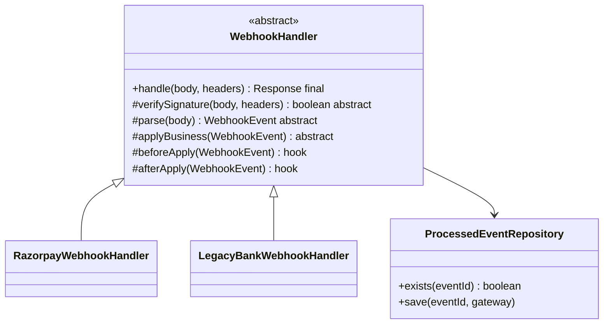

### Kya choose karein aur kyun

| Option | Kab use karo | Kab mat karo |
| --- | --- | --- |
| Template Method (abstract base, final template) | Jab steps ka order security ya correctness ke liye critical ho aur usko enforce karna ho | Jab variations bahut zyada hon — inheritance tree gehra aur bhaari ho jaata hai |
| Strategy (P20) with a fixed orchestrator | Jab tum composition prefer karte ho aur steps ko independently swap karna ho | Jab tumhe compile-time guarantee chahiye ki subclass step likhe |
| Chain of Responsibility (P13) | Jab steps optional hon aur pehla reject final ho | Jab saare steps fix order me chalne hi hain |
| Copy-paste per integration | Kabhi nahi | Hamesha — yahi is lesson ka bug tha |

### India me kaise hota hai

- Razorpay webhooks ke docs explicitly bolte hain: signature verify karo, aur handler ko idempotent banao kyunki same event dobara aa sakta hai. Matlab “signature verify” aur “duplicate check” gateway ka documented contract hai, tumhari choice nahi — isliye unko template me final kar dena bilkul sahi design hai. ([Razorpay — subscribe to webhooks](https://razorpay.com/docs/payments/recurring-payments/subscribe-to-webhooks.md))
- Indian ecosystem me ek aur reality hai: legacy bank integrations XML aur custom checksum bhejte hain, modern gateways JSON aur HMAC. Matlab tumhare paas hamesha 2-3 formats rahenge — ye pattern isi liye yahan bahut practical hai.
- UPI me callbacks miss ho jaate hain aur dobara aate hain, aur status polling pe NPCI ki limit hai. Isliye webhook handler ka idempotent hona India me optional nahi hai. ([Inc42 — NPCI additional measures](https://inc42.com/buzz/npci-brings-in-additional-measures-to-curb-upi-outage))

### Interview follow-ups

- **Template method `final` kyun hai?** Taki subclass steps ka order badal na sake. Agar wo override kar sake, to pattern ka poora point chala gaya — phir wahi bug wapas aa jaayega.
- **Template Method aur Strategy me kya choose karoge?** Agar tumhe compile-time majboori chahiye ki subclass ek step likhe, Template Method. Agar composition aur runtime swap chahiye, Strategy plus ek fixed orchestrator. Modern Java me log Strategy prefer karte hain, par security-critical order ke liye Template Method ka enforcement strong hai.
- **Hook method aur abstract method me farak?** Abstract method likhna majboori hai (compile error). Hook optional hai, default me khaali. Jo step miss hona khatarnak hai usko abstract banao, convenience ko hook.
- **`200 OK` jaldi bhej dena kyun galat hai?** Gateway `200` dekh ke event ko delivered maan leta hai aur retry nahi karta. Agar tumne store nahi kiya tha to event hamesha ke liye gaya.
- **Inheritance ka downside kya hai yahan?** Ek subclass ek hi base class le sakti hai, aur base class me change saare subclasses ko affect karta hai. Isliye base class ko chhota rakho — sirf order aur common steps, business logic nahi.

### Self-check

1. Template method ko `final` banane se exactly kaunsa bug impossible ho jaata hai?
2. Duplicate check business apply se pehle kyun hona chahiye?
3. Abstract method aur hook method me farak, aur kis step ko kaunsa banaoge?
4. Webhook pe `200 OK` kab bhejna chahiye?
5. Signature comparison constant-time kyun honi chahiye?

### Notebook

Template Method = base class order fix kare, subclass details de · Template method `final`, order badal nahi sakta · Critical steps `protected abstract` = subclass ko likhna majboori · Common steps base me concrete · Hooks optional, default khaali · Duplicate check apply se PEHLE · processed\_events insert apply ke saath usi transaction me · 200 OK sirf store hone ke baad · Signature comparison constant-time (MessageDigest.isEqual) · Base class chhoti rakho, business logic subclass me · Razorpay webhooks: verify signature + idempotent handler = documented contract.

### Padhne ke liye

- [Refactoring Guru — Template Method](https://refactoring.guru/design-patterns/template-method)
- [Razorpay — Subscribe to webhooks](https://razorpay.com/docs/payments/recurring-payments/subscribe-to-webhooks.md)

### Deep Dive (SDE-2) — jab time ho

#### Template method ko composition se banana

Inheritance ki jagah tum ek `final` orchestrator class bana sakte ho jo ek `WebhookSteps` interface leti hai (verify, parse, apply). Order orchestrator me final hai, steps injected hain. Fayda: multiple inheritance ka problem nahi, steps independently testable aur mockable, aur steps ko decorator se wrap kar sakte ho. Nuksaan: compiler ki wo majboori nahi rehti ki koi step likha jaaye — par interface implement karte waqt compiler phir bhi saare methods maangta hai, isliye practically guarantee bani rehti hai.

#### Idempotency aur transaction boundary

Sabse sookshm bug yahan hai: `applyBusiness` aur `processed.save` agar alag transactions me hain, to beech me crash hone pe business apply ho chuka hai par event recorded nahi — retry pe wo dobara apply hoga. Fix: dono ko ek hi DB transaction me rakho, ya `processed_events` ka insert hi apne unique constraint se business apply ko guard kare (insert pehle, constraint violation = duplicate = skip).

#### Webhook handler ko fast rakhna

Gateway webhook pe timeout rakhte hain (kuch second). Agar tumhara `applyBusiness` 5 second leta hai to gateway retry karega aur tumhare paas duplicate flood aa jaayega. Production pattern: handler sirf verify, dedupe aur enqueue kare (P14 Command), aur asli business kaam worker me ho. Phir `200 OK` 50 ms me chala jaata hai aur retry storm nahi aata.

---

## P22 — Visitor

Visitor pattern me tum ek naya operation kai alag-alag types pe chalate ho, bina un types ka code chhuye. Operation ek alag class (visitor) me rehta hai, aur har type usko bolta hai “mujhe visit karo”.

### Ye cheez hai kya

- Category: behavioural pattern. Ye data structure aur uspe chalne wale operations ko alag kar deta hai.
- Kis problem ke liye: jab tumhare paas 6 fixed types hain aur unpe 10 alag reports banani hain. Har report ko type ke andar method banana galat hai — type 10 kaam karne lagega.
- Is lesson ke baad: tum ek naya report ya export add kar paoge jisme domain classes ka ek line bhi na badle.

Analogy: bank ka inspector. Branch me khaate, locker, loan files pehle se hain. Inspector aata hai aur har cheez ko apne hisaab se dekhta hai. Agle mahine doosra inspector doosra sawaal le ke aata hai — par branch ka saaman wahi rehta hai. Naya inspector matlab naya visitor, branch untouched.

### Sawaal

Paytm ke ledger me ye entry types hain: `PaymentEntry`, `RefundEntry`, `ChargebackEntry`, `SettlementEntry`, `AdjustmentEntry`. Inpe teen cheezein chahiye: (1) GST report jisme sirf fee-bearing entries ka tax nikle, (2) accounting export jisme har type ka apna debit-credit mapping ho, (3) recon summary jisme type-wise count aur total. Finance team agle quarter do naye reports maangegi. Design karo.

> Pehle khud socho — 5 min. Hints: (1) agar har report ko entry class ke andar method banaoge to kya hoga? (2) naya entry type add hone pe kya tootna chahiye — compile ya runtime? (3) `instanceof` ki ladder se kya problem hai?

### Problem kyun aata hai

- Agar report logic entry class ke andar jaaye, to `PaymentEntry` me `toGstRow()`, `toAccountingRow()`, `toReconRow()` sab aa jaata hai. Ab wo class payment ke baare me nahi, reports ke baare me hai — Single Responsibility gaya.
- `instanceof` ki ladder ek-ek report me likhne par naya type add hone pe wo chup-chaap default branch me chala jaata hai. Finance report me ek type gayab — aur ye mahine ke end me pata chalta hai.
- Har naya report 5 classes ko chhoota hai, isliye review bhaari ho jaata hai aur domain classes ka ownership dhundhla ho jaata hai.

### Naive approach

```java
// instanceof ladder — naya type add hone pe chup-chaap chhoot jaayega
public class GstReport {
    public long taxPaise(LedgerEntry e) {
        if (e instanceof PaymentEntry p)    return gst(p.feePaise());
        if (e instanceof RefundEntry r)     return -gst(r.feeReversedPaise());
        if (e instanceof ChargebackEntry c) return gst(c.penaltyPaise());
        return 0L;   // SettlementEntry? AdjustmentEntry? Naya type? Sab yahan — chup-chaap zero
    }
}
```

Ye exactly kahan tootta hai: `return 0L` wala branch sab anjaan types ko zero tax de deta hai. Jab `AdjustmentEntry` add hua, kisi ne GST report update nahi ki — aur tax filing galat chali gayi. Compiler ne ek shabd nahi kaha.

### Sahi design

1. Ek `LedgerEntryVisitor<R>` interface banao jisme har entry type ke liye ek `visit` method ho. Generic `R` isliye ki ek visitor row return kare, doosra number.
2. Har entry type me ek hi method: `accept(visitor)`, jo apne type ka `visit` call kare. Ye double dispatch hai — pehla dispatch entry pe, doosra visitor pe.
3. Naya report = naya visitor class. Domain classes ka ek line nahi badalta.
4. Naya entry type = interface me naya method = saare visitors compile fail. Yahi visitor ka asli superpower hai: compiler tumhe majboor karta hai ki har report me naya type handle karo. Chup-chaap zero nahi aayega.
5. Java 21 me alternative hai: `sealed interface` plus exhaustive `switch` pattern matching. Compiler wahi guarantee deta hai, aur code kaafi chhota hota hai. Interview me dono bolna best hai.

```java
public interface LedgerEntryVisitor<R> {
    R visitPayment(PaymentEntry e);
    R visitRefund(RefundEntry e);
    R visitChargeback(ChargebackEntry e);
    R visitSettlement(SettlementEntry e);
    R visitAdjustment(AdjustmentEntry e);
}

public interface LedgerEntry {
    String id();
    <R> R accept(LedgerEntryVisitor<R> visitor);   // double dispatch ka doosra half
}

public record PaymentEntry(String id, long amountPaise, long feePaise) implements LedgerEntry {
    public <R> R accept(LedgerEntryVisitor<R> v) { return v.visitPayment(this); }
}
public record RefundEntry(String id, long amountPaise, long feeReversedPaise) implements LedgerEntry {
    public <R> R accept(LedgerEntryVisitor<R> v) { return v.visitRefund(this); }
}
public record ChargebackEntry(String id, long amountPaise, long penaltyPaise) implements LedgerEntry {
    public <R> R accept(LedgerEntryVisitor<R> v) { return v.visitChargeback(this); }
}
public record SettlementEntry(String id, long amountPaise) implements LedgerEntry {
    public <R> R accept(LedgerEntryVisitor<R> v) { return v.visitSettlement(this); }
}
public record AdjustmentEntry(String id, long amountPaise, String reason) implements LedgerEntry {
    public <R> R accept(LedgerEntryVisitor<R> v) { return v.visitAdjustment(this); }
}

// Report 1: GST sirf fee-bearing entries pe. Har type explicitly handled.
public class GstVisitor implements LedgerEntryVisitor<Long> {
    private static final BigDecimal GST = new BigDecimal("0.18");
    private static long gst(long feePaise) {
        return BigDecimal.valueOf(feePaise).multiply(GST)
                .setScale(0, RoundingMode.HALF_UP).longValueExact();
    }
    public Long visitPayment(PaymentEntry e)       { return gst(e.feePaise()); }
    public Long visitRefund(RefundEntry e)         { return -gst(e.feeReversedPaise()); }
    public Long visitChargeback(ChargebackEntry e) { return gst(e.penaltyPaise()); }
    public Long visitSettlement(SettlementEntry e) { return 0L; }   // explicitly zero, by decision
    public Long visitAdjustment(AdjustmentEntry e) { return 0L; }   // explicitly zero, by decision
}

public record AccountingRow(String debitAccount, String creditAccount, long amountPaise) {}

// Report 2: accounting export, har type ka apna debit-credit mapping
public class AccountingVisitor implements LedgerEntryVisitor<AccountingRow> {
    public AccountingRow visitPayment(PaymentEntry e) {
        return new AccountingRow("MERCHANT_PAYABLE", "CUSTOMER_RECEIVABLE", e.amountPaise());
    }
    public AccountingRow visitRefund(RefundEntry e) {
        return new AccountingRow("CUSTOMER_RECEIVABLE", "MERCHANT_PAYABLE", e.amountPaise());
    }
    public AccountingRow visitChargeback(ChargebackEntry e) {
        return new AccountingRow("CHARGEBACK_LOSS", "MERCHANT_PAYABLE", e.amountPaise());
    }
    public AccountingRow visitSettlement(SettlementEntry e) {
        return new AccountingRow("BANK", "MERCHANT_PAYABLE", e.amountPaise());
    }
    public AccountingRow visitAdjustment(AdjustmentEntry e) {
        return new AccountingRow("SUSPENSE", "MERCHANT_PAYABLE", e.amountPaise());
    }
}

public class Main {
    public static void main(String[] args) {
        List<LedgerEntry> entries = List.of(
                new PaymentEntry("le_1", 199_900L, 3_898L),
                new RefundEntry("le_2", 199_900L, 3_898L),
                new AdjustmentEntry("le_3", 500L, "ROUNDING"));

        GstVisitor gst = new GstVisitor();
        long totalTax = entries.stream().mapToLong(e -> e.accept(gst)).sum();
        System.out.println("GST total = " + totalTax + " paise");

        AccountingVisitor acc = new AccountingVisitor();
        entries.forEach(e -> System.out.println(e.accept(acc)));
        // Naya report? Naya visitor class. LedgerEntry classes untouched.
    }
}
```

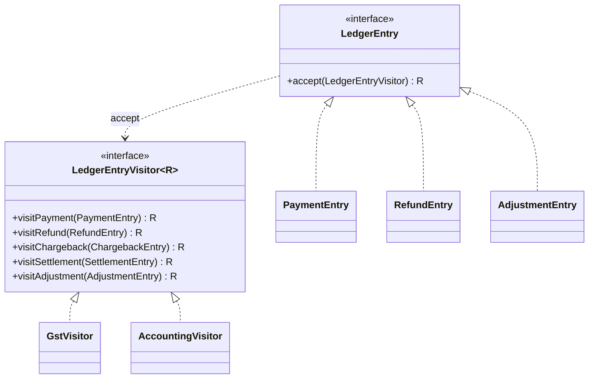

### Kya choose karein aur kyun

| Option | Kab use karo | Kab mat karo |
| --- | --- | --- |
| Visitor (accept plus visit methods) | Jab types fixed hon aur operations badhte rehte hon — reports, exports, validations | Jab types roz badalte hon — har naya type saare visitors todega |
| Sealed interface plus exhaustive `switch` (Java 17+) | Modern Java me default choice — wahi compile-time exhaustiveness, kaafi kam code | Jab tumhe visitor ko runtime pe inject aur compose karna ho |
| `instanceof` ladder | Kabhi nahi, production financial code me | Hamesha — naya type chup-chaap default branch me jaata hai |
| Method on each type | Jab operation genuinely us type ka behaviour ho (jaise `amountPaise()`) | Jab operation ek report ya export ho — wo domain class ka kaam nahi |

### India me kaise hota hai

- Indian payments me ledger entry types ki list regulatory reporting se aati hai: payment, refund, chargeback, settlement, adjustment — aur GST ka treatment har type pe alag hota hai. Isliye yahan types genuinely fixed hain aur reports genuinely badhte rehte hain, jo visitor ke liye exact fit hai.
- Sabse bada practical fayda interview me ye hai: naya entry type add karne pe compiler tumhe batata hai ki GST report aur accounting export dono me decision lena hai. Financial system me “chup-chaap zero” sabse khatarnak default hai.
- Razorpay ke APIs me bhi payment, refund aur settlement alag-alag resources hain apne-apne fields ke saath, aur fee plus tax alag fields me aate hain — matlab type-wise treatment unke data model me bhi explicit hai. ([Razorpay — Understand Razorpay APIs](https://razorpay.com/docs/api/understand))

### Interview follow-ups

- **Visitor ka sabse bada downside?** Naya type add karna mehnga hai — interface me method judta hai aur saare visitors todte hain. Isliye visitor sirf wahan use karo jahan types stable hon.
- **Double dispatch kya hai?** Pehla dispatch `entry.accept(visitor)` pe hota hai (konsa entry type), doosra `visitor.visitX(this)` pe (konsa visitor). Java me single dispatch hi built-in hai, isliye ye do-step trick chahiye.
- **Sealed interface plus switch visitor se behtar hai?** Zyadatar cases me haan — kam code, wahi exhaustiveness, aur domain classes me `accept` method ka bojh nahi. Visitor tab behtar hai jab operations ko objects ki tarah pass karna ho.
- **Visitor me state rakh sakte ho?** Haan, aur ye kaam aata hai — jaise `ReconSummaryVisitor` jo type-wise counters maintain kare. Par phir wo thread-safe nahi hai, isliye per-run naya instance banao.
- **Agar ek visitor ko 2 types ka same treatment chahiye?** Ek private helper method banao aur dono `visit` methods usko call karein. Default method banane se exhaustiveness ka fayda chala jaata hai.

### Self-check

1. Naya entry type add hone pe visitor approach me kya hota hai, aur `instanceof` ladder me kya?
2. Double dispatch ke do steps batao.
3. Visitor kab galat choice hai?
4. Financial reports me “silent zero” default kyun khatarnak hai?
5. Sealed interface plus switch kab visitor se behtar hai?

### Notebook

Visitor = operations ko types se alag karna · Har type me sirf accept(), operation visitor me · Double dispatch: accept pe type, visit pe operation · Naya report = naya visitor, domain untouched · Naya type = interface me method = saare visitors compile fail (ye fayda hai) · instanceof ladder me naya type chup-chaap default me — financial bug · Java 17+ sealed interface + exhaustive switch = same guarantee, kam code · Visitor me state rakho to per-run instance · Types fixed, operations badhte — tab visitor; ulta ho to nahi.

### Padhne ke liye

- [Refactoring Guru — Visitor](https://refactoring.guru/design-patterns/visitor)
- [Razorpay — Understand Razorpay APIs](https://razorpay.com/docs/api/understand)

### Deep Dive (SDE-2) — jab time ho

#### Expression problem: visitor kya solve karta hai aur kya nahi

Do axes hain: naye types add karna, aur naye operations add karna. Normal OOP (method per type) naye types me aasaan hai par naye operations me mehnga. Visitor ulta hai — naye operations sasta, naye types mehnge. Koi bhi ek approach dono ko sasta nahi banata; isko expression problem kehte hain. Design decision isliye data-driven hai: pooch lo ki tumhare domain me kya tezi se badalta hai. Ledger entry types regulation se aate hain (slow), reports finance team se (fast) — isliye visitor fit hai.

#### Visitor plus fold se reports ek pass me

Teen reports ke liye teen passes chalana bade datasets pe mehnga hai. Pattern: ek composite visitor banao jo andar se teeno visitors ko call kare aur teen accumulators maintain kare. Ek hi pass me GST total, accounting rows aur recon summary mil jaate hain. Ye P15 Iterator ke streaming traversal ke saath mila ke 8 lakh rows pe ek hi din ka pass banta hai.

#### Visitor aur schema evolution

Jab ledger entries DB se aati hain aur unka JSON purana ho, to naya field missing ho sakta hai. Visitor ko iska pata nahi hona chahiye — ye mapping layer ka kaam hai. Rule: DB se domain object banate waqt defaults aur migrations handle karo, aur visitor ko sirf well-formed domain objects do. Warna har visitor me null checks bhar jaayenge.

---

## P23 — Interpreter

Interpreter pattern me tum ek chhoti bhasha (rules ki grammar) define karte ho aur uske expressions ko objects ke tree me badal dete ho, jo khud ko evaluate kar sakte hain. Isko ek chhota DSL (domain specific language — ek chhoti bhasha jo sirf ek kaam ke liye bani ho) kehte hain.

### Ye cheez hai kya

- Category: behavioural pattern. Ye business rules ko code se nikaal ke data bana deta hai.
- Kis problem ke liye: jab non-engineers (risk team, ops team) rules roz badalna chahte hain, aur har rule change ke liye deploy karna practical nahi hai.
- Is lesson ke baad: tum ek rule engine ka core design kar paoge — expression tree, evaluation, aur safety guards.

Analogy: cricket ka playing condition. Match ke rules ek document me likhe hain, umpire unko padh ke apply karta hai. Rules badalne pe umpire ko badalna nahi padta — document badalta hai.

### Sawaal

Risk team ko ye rules chahiye, aur wo unko dashboard se badalna chahte hain: `amount > 50000 AND method == CARD`, `country != IN OR riskScore > 70`, `merchantAge < 30 AND amount > 10000`. Har rule ka ek action hai: `BLOCK`, `REVIEW`, `OTP`. Requirement: rule change pe deploy nahi, rule galat likha ho to save hone se pehle reject, aur ek rule infinite loop na bana sake. Design karo.

> Pehle khud socho — 5 min. Hints: (1) rule ko string me rakhoge ya tree me? (2) `eval()` ya scripting engine kyun khatarnak hai? (3) rule me available fields ko kaun define karega?

### Problem kyun aata hai

- Rules code me hain, isliye risk team engineer pe depend hai. Ek rule change me 2 din aur ek deploy lagta hai, jabki fraud 2 ghante me badalta hai.
- Log shortcut lete hain: rule ko ek string me rakhte hain aur JavaScript engine se `eval` kar dete hain. Ye remote code execution ka darwaza hai — ek galat rule server pe kuch bhi chala sakta hai.
- Galat rule save ho jaata hai aur production me exception deta hai, aur phir saare payments atak jaate hain.
- Rule ka performance unbounded ho jaata hai — ek rule DB query kar baithta hai aur payment latency 2 second ho jaati hai.

### Naive approach

```java
// Script engine se rule chalana — flexible, aur bilkul asurakshit
public class RuleEngine {
    private final ScriptEngine js = new ScriptEngineManager().getEngineByName("nashorn");

    public boolean matches(String ruleText, Map<String, Object> context) throws Exception {
        // ruleText dashboard se aaya. Agar wo "java.lang.Runtime.getRuntime().exec(...)" ho?
        js.getBindings(ScriptContext.ENGINE_SCOPE).putAll(context);
        return Boolean.TRUE.equals(js.eval(ruleText));
    }
}
```

Ye exactly kahan tootta hai: rule text user input hai, aur script engine usko poori JVM ka access de deta hai. Ye flexibility nahi, ye vulnerability hai. Doosra problem: galat syntax pe exception runtime me aata hai, save ke waqt nahi — isliye ek typo production payments rok deta hai.

### Sahi design

1. Ek chhoti aur closed grammar define karo: comparisons (`>`, `<`, `==`, `!=`) aur boolean combinators (`AND`, `OR`, `NOT`). Bas. Koi function call, koi loop, koi field assignment nahi.
2. Expression ko ek tree banao: har node ek class jo `evaluate(context)` jaanti hai. `AndExpression` apne do children ko evaluate karti hai, `ComparisonExpression` ek field ko ek constant se compare karti hai.
3. Available fields ko explicitly declare karo — ek enum ya whitelist. Rule sirf un fields ko chhoo sakta hai. Isse unknown field save hone se pehle reject hota hai.
4. Rule save karte waqt parse aur validate karo, aur validation fail hone pe save hi na hone do. Runtime pe tree already valid hai.
5. Safety guards: tree ki depth pe limit (jaise 10), nodes pe limit, aur evaluation me koi I/O allowed nahi. Context pehle se bhara hua aata hai, rule khud kuch fetch nahi karta — isse performance bounded rehti hai.
6. Rule ko version aur effective date do, aur evaluation ka result audit karo: kaunsa rule match hua aur kaunsa action nikla.

```java
// Context pehle se bhara hua — rule khud kuch fetch nahi karega
public record RuleContext(Map<Field, Object> values) {
    public Object get(Field f) {
        if (!values.containsKey(f)) throw new IllegalStateException("field missing: " + f);
        return values.get(f);
    }
}

// Whitelist: rule sirf ye fields chhoo sakta hai
public enum Field {
    AMOUNT_PAISE(Long.class), METHOD(String.class), COUNTRY(String.class),
    RISK_SCORE(Long.class), MERCHANT_AGE_DAYS(Long.class);

    private final Class<?> type;
    Field(Class<?> type) { this.type = type; }
    public Class<?> type() { return type; }
}

public interface Expression {
    boolean evaluate(RuleContext ctx);
    int depth();
}

public record Comparison(Field field, Op op, Object constant) implements Expression {
    public enum Op { GT, LT, EQ, NEQ }

    public Comparison {
        // Save ke waqt hi type check — runtime pe surprise nahi
        if (!field.type().isInstance(constant)) {
            throw new IllegalArgumentException(field + " ko " + field.type().getSimpleName() + " chahiye");
        }
        if ((op == Op.GT || op == Op.LT) && !(constant instanceof Long)) {
            throw new IllegalArgumentException(op + " sirf numbers pe chalta hai");
        }
    }

    public boolean evaluate(RuleContext ctx) {
        Object v = ctx.get(field);
        return switch (op) {
            case EQ  -> Objects.equals(v, constant);
            case NEQ -> !Objects.equals(v, constant);
            case GT  -> ((Long) v) > ((Long) constant);
            case LT  -> ((Long) v) < ((Long) constant);
        };
    }
    public int depth() { return 1; }
}

public record And(Expression left, Expression right) implements Expression {
    public boolean evaluate(RuleContext ctx) {
        return left.evaluate(ctx) && right.evaluate(ctx);   // short-circuit
    }
    public int depth() { return 1 + Math.max(left.depth(), right.depth()); }
}

public record Or(Expression left, Expression right) implements Expression {
    public boolean evaluate(RuleContext ctx) { return left.evaluate(ctx) || right.evaluate(ctx); }
    public int depth() { return 1 + Math.max(left.depth(), right.depth()); }
}

public record Not(Expression inner) implements Expression {
    public boolean evaluate(RuleContext ctx) { return !inner.evaluate(ctx); }
    public int depth() { return 1 + inner.depth(); }
}

public record Rule(String id, int version, Expression condition, Action action) {
    public enum Action { BLOCK, REVIEW, OTP }

    private static final int MAX_DEPTH = 10;
    public Rule {
        // save hone se pehle guard — production me ye check kabhi fail nahi hona chahiye
        if (condition.depth() > MAX_DEPTH) {
            throw new IllegalArgumentException("rule bahut gehra hai: " + condition.depth());
        }
    }
}

public class RiskRuleEvaluator {
    private final List<Rule> rules;    // DB se load, effective-dated
    public RiskRuleEvaluator(List<Rule> rules) { this.rules = List.copyOf(rules); }

    public Optional<Rule> firstMatch(RuleContext ctx) {
        for (Rule r : rules) {
            if (r.condition().evaluate(ctx)) {
                // audit: kaunsa rule aur kaunsa version match hua
                System.out.println("matched rule " + r.id() + " v" + r.version() + " -> " + r.action());
                return Optional.of(r);
            }
        }
        return Optional.empty();
    }
}

public class Main {
    public static void main(String[] args) {
        // amount > 50000 paise AND method == CARD  -> OTP
        Expression cond1 = new And(
                new Comparison(Field.AMOUNT_PAISE, Comparison.Op.GT, 50_000L),
                new Comparison(Field.METHOD, Comparison.Op.EQ, "CARD"));

        // country != IN OR riskScore > 70  -> REVIEW
        Expression cond2 = new Or(
                new Comparison(Field.COUNTRY, Comparison.Op.NEQ, "IN"),
                new Comparison(Field.RISK_SCORE, Comparison.Op.GT, 70L));

        RiskRuleEvaluator evaluator = new RiskRuleEvaluator(List.of(
                new Rule("r1", 3, cond1, Rule.Action.OTP),
                new Rule("r2", 1, cond2, Rule.Action.REVIEW)));

        RuleContext ctx = new RuleContext(Map.of(
                Field.AMOUNT_PAISE, 199_900L, Field.METHOD, "CARD",
                Field.COUNTRY, "IN", Field.RISK_SCORE, 20L,
                Field.MERCHANT_AGE_DAYS, 400L));

        System.out.println(evaluator.firstMatch(ctx).map(Rule::action).orElse(null));
    }
}
```

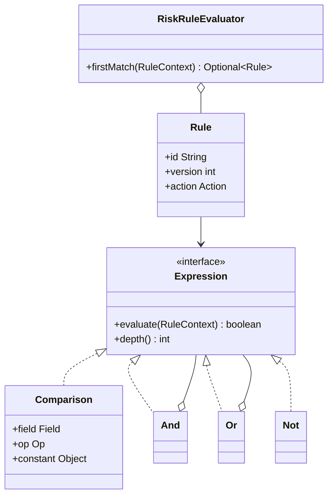

### Kya choose karein aur kyun

| Option | Kab use karo | Kab mat karo |
| --- | --- | --- |
| Own interpreter (closed grammar, typed fields) | Jab non-engineers rules badlein aur safety plus audit chahiye | Jab rules engineering team ke paas hi hain aur kam badalte hain — tab Strategy classes saaf hain |
| Mature rule engine (Drools jaisa) | Jab rules bahut zyada aur complex hon, aur rule authoring tooling chahiye | Chhote use case ke liye — wo poora naya ecosystem le aata hai |
| Script engine with `eval` | Kabhi nahi, user-supplied rules ke liye | Hamesha — ye remote code execution ka raasta hai |
| Hard-coded Strategy classes (P20) | Jab variants kam hon aur deploy cycle acceptable ho | Jab fraud rules din me kai baar badalne hon |

### India me kaise hota hai

- Indian payment risk rules regulation plus fraud patterns dono se chalte hain, aur dono tez badalte hain. NPCI ne 2025 me transaction aur API limits bar bar revise kiye — matlab ek system jisme limit code me hard-coded ho, wo compliance ke liye structurally kamzor hai. Rules ko data banana yahan compliance requirement ban jaata hai. ([Inc42 — NPCI additional measures](https://inc42.com/buzz/npci-brings-in-additional-measures-to-curb-upi-outage))
- Additional Factor of Authentication (AFA) jaisi requirements se `OTP` action India me ek first-class rule outcome hai, jo global systems me kam dikhta hai — isliye `Action` enum me usko rakhna domain-correct hai.
- Interview me ye line strong hai: rule ko save hone se pehle validate karte hain, aur evaluation me koi I/O allowed nahi — isse rule ka blast radius bounded rehta hai.

### Interview follow-ups

- **Interpreter aur Strategy me kab kya?** Strategy me variants engineer likhta hai aur deploy hota hai. Interpreter me variants data hain aur non-engineer likh sakta hai. Flexibility ki keemat complexity aur safety work hai.
- **`eval` kyun nahi?** User-supplied code ko full runtime access milta hai — remote code execution. Closed grammar me jo likha ja sakta hai wo tumne khud define kiya hai, isliye attack surface almost zero hai.
- **Rule galat likha jaaye to?** Save ke waqt parse plus type check plus depth check. Aur phir shadow mode: naya rule pehle sirf log kare, uska match rate dekho, tab enforce karo.
- **Performance kaise bounded rakhoge?** Context pehle se bhara hua ho, rule me koi DB ya network call na ho, depth aur node count pe limit, aur `AND`/`OR` me short-circuit. Phir ek rule evaluation microseconds ka kaam hai.
- **100 rules me first-match ya all-match?** Depends: `BLOCK` ke liye first-match sasta hai. Par analytics ke liye saare matches chahiye hote hain. Practical design: evaluate sab, action me sabse strict jeete (`BLOCK` > `REVIEW` > `OTP`), aur saare matches audit me jaayein.

### Self-check

1. Grammar ko closed rakhne se kaunsa security problem khatam ho jaata hai?
2. Rule validation save ke waqt kyun, runtime pe kyun nahi?
3. Context pehle se bhara hua rakhne se kaunsa performance problem bachta hai?
4. Interpreter aur Strategy me decide karne ka ek criterion batao.
5. Depth limit kis cheez se bachati hai?

### Notebook

Interpreter = rules ko data banao, expression tree jo khud evaluate kare · Grammar closed rakho: comparisons + AND OR NOT, bas · Fields ka whitelist enum, unknown field reject · Validate save ke waqt (type, depth), runtime pe surprise nahi · eval ya script engine = remote code execution, kabhi nahi · Evaluation me koi I/O nahi, context pehle se bhara · Depth aur node limit se blast radius bounded · Rule pe version + effective date + audit of match · Naya rule shadow mode me pehle · Strict action jeete: BLOCK > REVIEW > OTP.

### Padhne ke liye

- [Refactoring Guru — Interpreter ka parent: behavioural patterns](https://refactoring.guru/design-patterns/behavioral-patterns)
- [Inc42 — NPCI brings in additional measures to curb UPI outage](https://inc42.com/buzz/npci-brings-in-additional-measures-to-curb-upi-outage)

### Deep Dive (SDE-2) — jab time ho

#### Parser: text se tree tak

Dashboard pe risk team text likhti hai, aur tumhe tree chahiye. Do-step: tokeniser (text ko tokens me tode) aur recursive descent parser (tokens se tree banaye, precedence ke saath — `NOT` sabse strong, phir `AND`, phir `OR`). Parser ka error message important hai: “column 14 pe `>` expected” jaisa message hi rule authoring ko usable banata hai. Parser ko hamesha save-time pe chalao, evaluate-time pe nahi — tree ko serialised form me store karo.

#### Rule ko compile karna performance ke liye

Agar ek payment pe 500 rules evaluate karne hain, tree walking bhi mehnga ho jaata hai. Optimisation: rules ko field ke hisaab se index karo — jo rules `METHOD == CARD` pe depend karte hain unko ek bucket me rakho, aur UPI payment pe wo bucket skip kar do. Isko predicate indexing kehte hain, aur ye 500 rules ko practically 20 evaluations me badal deta hai.

#### Rule changes ka governance

Rule ko data banane ka khatra ye hai ki ek galat row paisa rok sakti hai ya fraud jaane de sakti hai. Isliye production me rule change ka lifecycle code change jitna strict hota hai: author, reviewer, effective-from date, shadow period, aur ek kill switch jo saare naye rules ko ek second me disable kar de. Interview me ye bolna seniority dikhata hai — flexibility ke saath governance aana chahiye.

---

## P24 — Repository

Repository ek layer hai jo domain code ko database ki detail se bachati hai. Business code bolta hai “is id ka payment do”, aur usko nahi pata ki wo SQL se aaya, cache se, ya kisi API se.

### Ye cheez hai kya

- Category: architectural pattern. Ye GoF ki list me nahi hai, Martin Fowler ke enterprise patterns se aata hai.
- Kis problem ke liye: jab SQL aur query logic business classes me ghus jaate hain, to business rules test karne ke liye poora database chalana padta hai — aur phir koi test likhta hi nahi.
- Is lesson ke baad: tum domain layer ko persistence se decouple kar paoge aur business logic ko database ke bina test kar paoge.

Analogy: bank ka counter. Tum bolte ho ki mere khaate ka balance batao. Clerk peeche jaake ledger dekhe, computer dekhe, ya file dekhe — tumhe farak nahi padta. Counter ka interface wahi rehta hai.

### Sawaal

Paytm ka `SettlementService` ek business rule chalaata hai: ek merchant ke saare captured payments lo, unki fee minus karo, aur settlement amount nikaalo. Abhi us service me 6 raw SQL queries hain, ek JPA `EntityManager` hai, aur ek jagah seedha `jdbcTemplate` bhi. Uska unit test chalane ke liye poora Postgres chahiye, isliye koi test likhta hi nahi. Ab ek nayi requirement: captured payments read replica se aane chahiye, par settlement write primary pe. Design karo.

> Pehle khud socho — 5 min. Hints: (1) is method me kaunsa hissa domain rule hai aur kaunsa persistence? (2) repository ka interface kis layer me rakhna chahiye? (3) repository me generic CRUD methods rakhoge ya business-specific queries?

### Problem kyun aata hai

- Business logic aur SQL ek method me ho to na business rule akele test hota hai, na query akele optimise hoti hai.
- Persistence ka choice leak ho jaata hai: service me `EntityManager` dikhne ka matlab hai ki JPA se nikalna ab 40 files ka kaam hai.
- Read replica, cache ya sharding jaisa infra change business code ko chhoota hai, jabki business rule badla hi nahi.
- Test ke bina refactor darr ka kaam ban jaata hai, aur phir code sirf badhta hai, saaf nahi hota.

### Naive approach

```java
// Domain rule aur SQL ek hi jagah — test ke liye poora DB chahiye
public class SettlementService {
    private final JdbcTemplate jdbc;
    public SettlementService(JdbcTemplate jdbc) { this.jdbc = jdbc; }

    public long settlementAmountPaise(String merchantId, LocalDate day) {
        // SQL yahan, business rule bhi yahan — dono ek dusre me ghule hue
        return jdbc.queryForObject(
            "SELECT COALESCE(SUM(amount_paise - fee_paise), 0) FROM payments " +
            "WHERE merchant_id = ? AND status = 'CAPTURED' AND DATE(captured_at) = ?",
            Long.class, merchantId, day);
    }
}
```

Ye exactly kahan tootta hai: business rule (captured payments ka amount minus fee) SQL ke andar chhup gaya hai, isliye usko padhne ke liye SQL padhna padta hai aur test karne ke liye DB chahiye. Aur read replica pe shift karne ke liye isi method ko chhuna padega, jabki rule bilkul nahi badla.

### Sahi design

1. Repository ka interface domain layer me rakho, implementation infrastructure layer me. Interface domain ki bhasha bole (`findCapturedFor`), SQL ki nahi (`executeQuery`).
2. Methods business-specific rakho, generic CRUD nahi. `findCapturedFor(merchantId, day)` behtar hai `findAll(Specification)` se — kyunki wo intent batata hai aur query optimise karne ki jagah deta hai.
3. Repository domain objects return kare, database rows ya entities nahi. Mapping repository ke andar ho.
4. Business rule service me rahe, repository me nahi. Repository ka kaam data laana hai, decide karna nahi.
5. Read aur write ko alag repositories me baanto jab unki infra alag ho — read replica aur primary. Isse ek infra decision ek hi class me dikhta hai.
6. Transaction boundary service layer pe rakho, repository ke andar nahi. Ek business operation = ek transaction, chahe wo 3 repository calls kare.

```java
// Domain object — DB ki koi annotation nahi, koi JPA nahi
public record CapturedPayment(String id, String merchantId, Money amount, Money fee,
                              Instant capturedAt) {
    public Money netPayable() { return new Money(amount.paise() - fee.paise()); }
}

// Interface DOMAIN layer me — domain ki bhasha, SQL ka ek shabd nahi
public interface PaymentReadRepository {
    List<CapturedPayment> findCapturedFor(String merchantId, LocalDate day);
    Optional<CapturedPayment> findById(String paymentId);
}

public interface SettlementWriteRepository {
    void save(Settlement settlement);
}

// Business rule service me — DB ke bina test ho sakta hai
public class SettlementService {
    private final PaymentReadRepository payments;
    private final SettlementWriteRepository settlements;

    public SettlementService(PaymentReadRepository payments, SettlementWriteRepository settlements) {
        this.payments = payments; this.settlements = settlements;
    }

    public Settlement settle(String merchantId, LocalDate day) {
        List<CapturedPayment> captured = payments.findCapturedFor(merchantId, day);
        // Business rule saaf dikh raha hai, SQL me chhupa nahi
        long net = captured.stream().mapToLong(p -> p.netPayable().paise()).sum();
        Settlement s = new Settlement(merchantId, day, new Money(net), captured.size());
        settlements.save(s);
        return s;
    }
}

// Implementation INFRASTRUCTURE layer me — read replica ka faisla sirf yahan
public class JdbcPaymentReadRepository implements PaymentReadRepository {
    private final JdbcTemplate replicaJdbc;      // read replica, primary nahi
    public JdbcPaymentReadRepository(JdbcTemplate replicaJdbc) { this.replicaJdbc = replicaJdbc; }

    public List<CapturedPayment> findCapturedFor(String merchantId, LocalDate day) {
        return replicaJdbc.query(
            "SELECT id, merchant_id, amount_paise, fee_paise, captured_at FROM payments " +
            "WHERE merchant_id = ? AND status = 'CAPTURED' AND captured_at >= ? AND captured_at < ?",
            (rs, i) -> new CapturedPayment(
                    rs.getString("id"), rs.getString("merchant_id"),
                    new Money(rs.getLong("amount_paise")), new Money(rs.getLong("fee_paise")),
                    rs.getTimestamp("captured_at").toInstant()),
            merchantId, day.atStartOfDay(), day.plusDays(1).atStartOfDay());
    }

    public Optional<CapturedPayment> findById(String paymentId) { /* ... */ return Optional.empty(); }
}

// Test ke liye in-memory implementation — Postgres ki zaroorat nahi
public class InMemoryPaymentReadRepository implements PaymentReadRepository {
    private final List<CapturedPayment> data = new ArrayList<>();
    public void add(CapturedPayment p) { data.add(p); }

    public List<CapturedPayment> findCapturedFor(String merchantId, LocalDate day) {
        return data.stream().filter(p -> p.merchantId().equals(merchantId)).toList();
    }
    public Optional<CapturedPayment> findById(String id) {
        return data.stream().filter(p -> p.id().equals(id)).findFirst();
    }
}

public class Main {
    public static void main(String[] args) {
        InMemoryPaymentReadRepository repo = new InMemoryPaymentReadRepository();
        repo.add(new CapturedPayment("pay_1", "mrc_1", new Money(199_900), new Money(3_898), Instant.now()));
        repo.add(new CapturedPayment("pay_2", "mrc_1", new Money(49_900),  new Money(973),   Instant.now()));

        Settlement s = new SettlementService(repo, new InMemorySettlementRepo())
                .settle("mrc_1", LocalDate.now());
        System.out.println(s);   // business rule ka test, zero database
    }
}
```

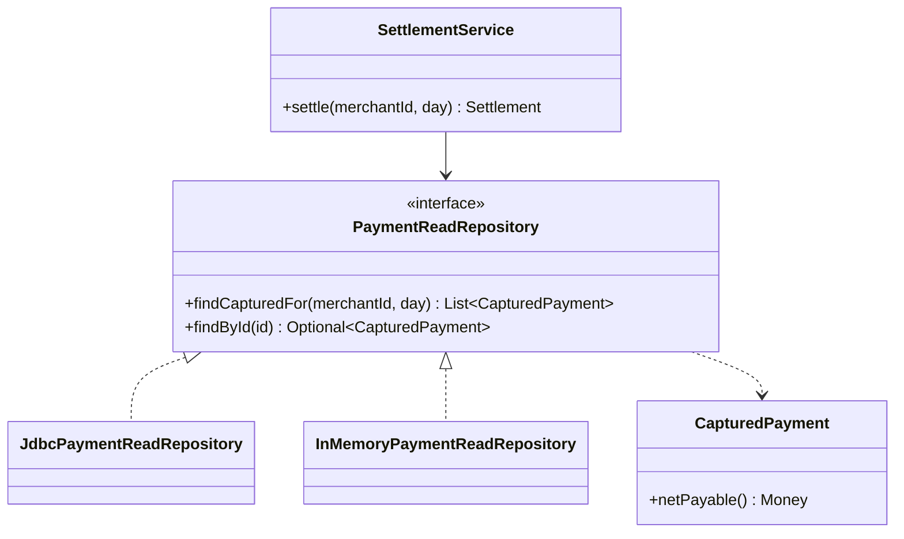

### Kya choose karein aur kyun

| Option | Kab use karo | Kab mat karo |
| --- | --- | --- |
| Repository interface plus per-store implementation | Jab business rules non-trivial hon aur unka test DB ke bina chahiye | CRUD-only admin screens pe — wahan ye sirf extra layer hai |
| Spring Data `JpaRepository` directly in services | Prototype aur internal tooling me, jaldi chalana ho | Core payments domain me — JPA ka shape business code me leak ho jaata hai |
| DAO (Data Access Object) | Jab tumhe table-oriented access chahiye, domain modelling nahi | Jab tum domain objects aur business rules model kar rahe ho |
| CQRS (read aur write ka alag model) | Jab read pattern aur write pattern bilkul alag hon — reporting vs transaction | Simple domain me — do models maintain karna mehnga hai |

### India me kaise hota hai

- Indian payments me ek hard reality hai: settlement aur reconciliation ke queries bade aur analytical hote hain, aur transaction path ke queries chhote aur latency-sensitive. Isliye read-replica aur primary ka split almost hamesha hota hai — aur repository interface hi wo jagah hai jahan ye split business code ko chhuye bina ho jaata hai.
- Razorpay ke APIs me payment, refund aur settlement alag resources hain, aur settlement apne cycle aur apne report ke saath aata hai — matlab unke andar bhi read model aur transaction model ka farak hai. ([Razorpay — Understand Razorpay APIs](https://razorpay.com/docs/api/understand))
- Interview me ye line kaam karti hai: humne repository interface domain me rakha aur JDBC implementation infra me, isliye read replica pe shift karna ek class ka change tha, business code ka nahi.

### Interview follow-ups

- **Repository aur DAO me farak?** DAO table ke aas-paas socha jaata hai aur rows deta hai. Repository domain ke aas-paas socha jaata hai aur domain objects deta hai, aur uska interface business ki bhasha me hota hai.
- **Generic `findAll(Specification)` acchha hai?** Flexible hai par intent chhupa deta hai aur query optimise karna mushkil kar deta hai. Business-specific methods padhne me saaf hain aur unpe index design kar sakte ho.
- **Transaction kahan manage hoga?** Service layer pe. Repository ko transaction ke baare me nahi pata hona chahiye, warna ek business operation ke do repository calls do transactions ban jaayenge.
- **Caching repository me ya service me?** Repository implementation me — ek `CachingPaymentReadRepository` jo asli repository ko wrap kare (Decorator, P9). Service ko cache ka pata nahi chalna chahiye.
- **Kya repository har jagah chahiye?** Nahi. Jahan business rule nahi hai, sirf data pass-through hai, wahan ye ceremony hai. Pattern ko domain complexity ke hisaab se lagao.

### Self-check

1. Repository ka interface kis layer me aur implementation kis layer me, aur kyun?
2. Repository business-specific methods kyun rakhta hai, generic query object kyun nahi?
3. Transaction boundary kahan honi chahiye?
4. Caching kahan lagaoge aur kis pattern se?
5. Read replica pe shift karte waqt kitni classes badalni chahiye?

### Notebook

Repository = domain ko persistence se bachane wali layer · Interface domain layer me, implementation infra me · Methods business ki bhasha me (findCapturedFor), SQL ki nahi · Domain objects return karo, entities ya rows nahi · Business rule service me, repository sirf data laaye · Read aur write repositories alag jab infra alag (replica vs primary) · Transaction boundary service pe, repository me nahi · Caching repository implementation me, decorator se · In-memory implementation = business rules ka test bina DB · CRUD-only screens pe repository ceremony hai.

### Padhne ke liye

- [Martin Fowler — Repository](https://martinfowler.com/eaaCatalog/repository.html)
- [Razorpay — Understand Razorpay APIs](https://razorpay.com/docs/api/understand)

### Deep Dive (SDE-2) — jab time ho

#### Repository plus Unit of Work

Ek business operation me teen repositories likhti hain — payment, ledger, settlement. Agar har repository apna commit kare, to beech me crash hone pe data aadha likha reh jaata hai. Unit of Work pattern: ek object poore operation ke changes jama karta hai aur ek hi commit me likhta hai. Spring me `@Transactional` yahi kaam karta hai, par interview me pattern ka naam jaanna aur ye batana ki transaction boundary service pe hai, seniority dikhata hai.

#### Read model aur write model ka split (CQRS)

Settlement report ke liye tumhe joins aur aggregates chahiye; payment write ke liye ek single row ka fast insert. Ek hi model dono ke liye optimise nahi hota. CQRS me read ke liye ek denormalised projection table hoti hai jo events se build hoti hai, aur write ke liye normalised transaction tables. Repository interface dono ke liye alag hota hai — aur yahi wo jagah hai jahan ye pattern naturally fit ho jaata hai.

#### N plus 1 query problem repository ke peeche

Sabse common performance bug: service loop me `repo.findById()` call karta hai, aur 500 payments ke liye 500 queries chali jaati hain. Fix repository ke interface me hai, implementation me nahi: ek `findByIds(Collection<String>)` method do, aur service usko use kare. Interface ka design hi performance decide karta hai — isliye repository methods business ke hisaab se banao, aur batch access ko pehle se soch lo.

---

## P25 — Dependency Injection

Dependency Injection (DI) ka matlab hai: ek class apni dependencies khud nahi banati, balki wo use bahar se di jaati hain — usually constructor ke through. Class sirf ye batati hai ki usko kya chahiye, aur kaun dega ye koi aur tay karta hai.

### Ye cheez hai kya

- Category: design principle plus pattern. Ye Dependency Inversion Principle ko practical banata hai ([S5 — Dependency Inversion Principle](https://claude.ai/code/artifact/f98bb328-8939-4ef4-a9a6-24c5ce970199)).
- Kis problem ke liye: jab class ke andar `new` likha ho, to tum us dependency ko test me badal nahi sakte aur configuration bhi hard-code ho jaati hai.
- Is lesson ke baad: tum wiring ko ek jagah rakh paoge, aur har class ko test me isolate kar paoge — bina mocking framework ke bhi.

Analogy: tiffin service me chef. Chef sabzi khud kheton me ugaata nahi — usko supplier deta hai. Chef bas batata hai ki usko kya chahiye. Supplier badal jaaye to chef ka kaam wahi rehta hai.

### Sawaal

Paytm ka `PaymentService` apne constructor me kuch nahi leta, aur andar ye likha hai: `new RazorpayGateway(System.getenv("RZP_KEY"))`, `new JdbcPaymentRepository(DataSourceHolder.get())`, aur `FraudClient.getInstance()`. Ab teen requirements: (1) uska unit test likhna hai bina network ke, (2) ek naye merchant segment ke liye Stripe gateway chahiye, (3) staging me fraud check band rakhna hai. Design karo.

> Pehle khud socho — 5 min. Hints: (1) `new` andar hone se test me kya problem hai? (2) wiring ka code kahan rehna chahiye? (3) constructor injection aur field injection me kaunsa behtar hai aur kyun?

### Problem kyun aata hai

- `new` andar hone ka matlab hai ki dependency compile time pe fix ho gayi. Test me usko replace karne ka koi raasta nahi, isliye test ko asli network aur asli DB chahiye.
- Singleton `getInstance()` global mutable state hai. Ek test doosre test ka state dekh leta hai, aur failures random lagne lagte hain.
- Configuration business class me ghus jaati hai. `System.getenv` ek service class me hona matlab us class ko deployment environment ka pata hai, jo uska kaam nahi.
- Environment-specific behaviour ke liye log `if (env.equals("staging"))` daal dete hain, aur ye branches hamesha ke liye production code me reh jaati hain.

### Naive approach

```java
// Dependencies andar banayi gayi — class apne environment se bandh gayi
public class PaymentService {
    private final PaymentGateway gateway = new RazorpayGateway(System.getenv("RZP_KEY"));
    private final PaymentRepository repo = new JdbcPaymentRepository(DataSourceHolder.get());
    private final FraudClient fraud = FraudClient.getInstance();   // global singleton

    public Payment pay(ChargeRequest req) {
        if (System.getenv("ENV").equals("staging")) {   // env check business code me
            // staging me fraud skip — ye line production me bhi deploy hoti hai
        } else if (fraud.isRisky(req)) {
            throw new FraudException("blocked");
        }
        return repo.save(gateway.charge(req));
    }
}
```

Ye exactly kahan tootta hai: is class ka ek bhi test bina network, bina DB aur bina env variables ke nahi chal sakta. Aur `ENV` check ek production risk hai — ek galat env value fraud check poore production me band kar degi.

### Sahi design

1. Constructor injection use karo: dependencies constructor me aayein, `final` fields me store hon. Ab class ka contract compiler enforce karta hai — bina dependency wo ban hi nahi sakti.
2. Dependencies ko interface type me lo, concrete class me nahi. `PaymentGateway`, `PaymentRepository`, `FraudChecker` — teeno interfaces.
3. Wiring ek jagah rakho: ek composition root (`Main`, ya Spring ka `@Configuration` class). Sirf wahi jaanta hai ki kaunsa implementation kahan jaata hai.
4. Environment ka faisla wiring me ho, business code me nahi. Staging me fraud band karna matlab wiring me `NoOpFraudChecker` inject karna (P26 Null Object), class me `if` nahi.
5. Field injection (`@Autowired` directly on fields) se bacho: wo circular dependencies chhupa deta hai, test me reflection chahiye, aur object aadha-bana state me ho sakta hai. Constructor injection me ye problems nahi hote.
6. `Supplier` ya factory inject karo jab dependency ko per-request banana ho; warna singleton stateless beans hi theek hain.

```java
public interface FraudChecker {
    boolean isRisky(ChargeRequest req);
}

public class RemoteFraudChecker implements FraudChecker {
    private final FraudClient client;
    public RemoteFraudChecker(FraudClient client) { this.client = client; }
    public boolean isRisky(ChargeRequest req) { return client.score(req) > 80; }
}

// Staging ke liye — business code me koi env check nahi chahiye
public class NoOpFraudChecker implements FraudChecker {
    public boolean isRisky(ChargeRequest req) { return false; }
}

// CONSTRUCTOR INJECTION: class batati hai usko kya chahiye, banata koi aur hai
public class PaymentService {
    private final PaymentGateway gateway;
    private final PaymentRepository repo;
    private final FraudChecker fraud;

    public PaymentService(PaymentGateway gateway, PaymentRepository repo, FraudChecker fraud) {
        this.gateway = Objects.requireNonNull(gateway);
        this.repo = Objects.requireNonNull(repo);
        this.fraud = Objects.requireNonNull(fraud);
    }

    public Payment pay(ChargeRequest req) {
        // Ab yahan na env ka pata hai, na gateway ke naam ka — sirf business rule hai
        if (fraud.isRisky(req)) throw new FraudException("blocked: " + req.paymentId());
        return repo.save(gateway.charge(req));
    }
}

// COMPOSITION ROOT: poora wiring ek hi jagah, environment ka faisla bhi yahin
public class AppWiring {
    public static PaymentService paymentService(String env, Map<String, String> config) {
        PaymentGateway gateway = switch (config.get("GATEWAY")) {
            case "STRIPE" -> new StripeGateway(config.get("STRIPE_KEY"));
            default       -> new RazorpayGateway(config.get("RZP_KEY"));
        };

        PaymentRepository repo = new JdbcPaymentRepository(dataSource(config));

        // staging me fraud band — ek wiring decision, business code untouched
        FraudChecker fraud = env.equals("staging")
                ? new NoOpFraudChecker()
                : new RemoteFraudChecker(new FraudClient(config.get("FRAUD_URL")));

        return new PaymentService(gateway, repo, fraud);
    }

    private static DataSource dataSource(Map<String, String> config) { /* ... */ return null; }
}

// Test: zero network, zero DB, zero mocking framework
public class PaymentServiceTest {
    public static void main(String[] args) {
        PaymentService svc = new PaymentService(
                new StubGateway(),                    // haath se likha stub
                new InMemoryPaymentRepository(),
                req -> req.amountPaise() > 100_000L); // FraudChecker ek lambda, kyunki single method hai

        Payment p = svc.pay(new ChargeRequest("pay_1", 49_900L));
        System.out.println("ok: " + p.id());
    }
}
```

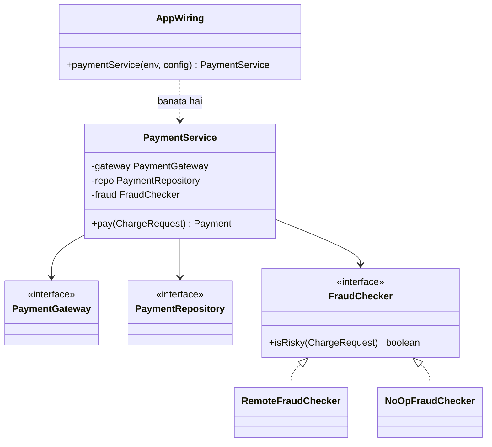

### Kya choose karein aur kyun

| Option | Kab use karo | Kab mat karo |
| --- | --- | --- |
| Constructor injection | Hamesha default — compiler enforce karta hai, fields `final`, test aasaan | Jab dependencies 6 se zyada ho jaayein — wo signal hai ki class bahut kaam kar rahi hai |
| Setter injection | Jab dependency genuinely optional ho aur baad me set ho | Mandatory dependencies ke liye — object aadha-bana reh sakta hai |
| Field injection (`@Autowired` on fields) | Legacy code me jahan constructor badalna mushkil ho | Naye code me — circular dependency chhupata hai, test me reflection chahiye |
| Service locator ya `getInstance()` | Kabhi nahi, naye code me | Hamesha — ye global state aur chhupi hui dependency dono deta hai |

### India me kaise hota hai

- Indian payments stack me multiple gateways aur multiple banks parallel chalte hain, aur merchant segment ke hisaab se routing badalti hai. Isliye `PaymentGateway` interface plus wiring-time selection yahan normal production design hai, academic exercise nahi.
- Regulatory testing aur certification ke liye tumhe sandbox aur production ke liye alag credentials aur alag endpoints chahiye hote hain. Agar wo business class ke andar `System.getenv` se aayenge, to certification ke waqt code badalna padega — jo audit me bura dikhta hai.
- Razorpay test aur live mode ke liye alag API keys deta hai, aur docs me bola jaata hai ki keys ko code se bahar rakho — matlab wiring aur configuration ka separation vendor ka documented expectation hai. ([Razorpay — Understand Razorpay APIs](https://razorpay.com/docs/api/understand))

### Interview follow-ups

- **Dependency Injection aur Dependency Inversion me farak?** Inversion ek principle hai — high-level module abstraction pe depend kare. Injection wo technique hai jisse tum wo abstraction andar pahunchate ho. Principle kya, technique kaise.
- **Constructor me 8 dependencies ho jaayein to?** Pattern ka nahi, class ka problem hai — wo bahut zyada kaam kar rahi hai. Usko todo. Constructor ka lamba hona ek useful design smell hai, aur field injection usko chhupa deta hai.
- **Spring ke bina DI ho sakta hai?** Haan, aur ye zaroori samajhna hai: DI ek pattern hai, framework nahi. Ek `Main` class jo sab wire kare, wo poora DI hai. Framework sirf wiring ko automate karta hai.
- **Circular dependency aaye to?** Constructor injection me wo compile ya startup pe fail hoti hai, jo acchi baat hai. Fix design me hai — ek shared abstraction nikaalo ya ek taraf ko event-driven karo, setter injection se chhupao nahi.
- **Singleton pattern aur singleton scope me farak?** GoF Singleton class ke andar `getInstance()` rakhta hai — global state aur chhupi dependency. Framework ka singleton scope sirf ek instance banata hai aur usko inject karta hai — dependency explicit rehti hai. Doosra theek hai, pehla nahi.

### Self-check

1. Constructor injection field injection se behtar kyun hai — do kaaran batao.
2. Staging me fraud band karne ka sahi tareeka kya hai?
3. Constructor me 8 dependencies kis cheez ka signal hai?
4. DI aur Dependency Inversion me farak ek line me.
5. `getInstance()` se kaunse do problems aate hain?

### Notebook

DI = dependencies bahar se aayein, class khud na banaye · Constructor injection default: fields final, compiler enforce, test aasaan · Interface type me lo, concrete class me nahi · Wiring ek composition root me (Main ya @Configuration) · Environment ka faisla wiring me, business code me if nahi · Field injection se bacho: circular dependency chhupata hai, reflection chahiye · getInstance() = global state + chhupi dependency · 8 dependencies = class bahut kaam kar rahi hai, todo · Single-method interface = test me lambda, mocking framework ki zaroorat nahi · DI pattern hai, Spring framework hai.

### Padhne ke liye

- [Martin Fowler — Inversion of Control Containers and the Dependency Injection pattern](https://martinfowler.com/articles/injection.html)
- [Razorpay — Understand Razorpay APIs](https://razorpay.com/docs/api/understand)

### Deep Dive (SDE-2) — jab time ho

#### Composition root ko testable banana

Wiring class me bhi bug ho sakta hai — galat gateway, galat key, galat fraud checker. Isliye wiring ko ek function banao jo config leta hai aur object graph deta hai, aur uska bhi test likho: staging config do aur assert karo ki `NoOpFraudChecker` mila. Ye ek chhota test hai par wo poore environment ka contract check karta hai, aur production misconfiguration se bachaata hai.

#### Startup-time validation

DI ka ek bada fayda ye hai ki saari dependencies startup pe resolve hoti hain. Isko jaan-boojh ke use karo: constructor me `Objects.requireNonNull`, aur config values ko startup pe validate karo (key present hai, URL parse hota hai). Phir galat config pod ko start hone hi nahi degi, aur tumhe pehli payment pe pata nahi chalega. Fail fast at boot, not at first transaction.

#### Scopes aur thread safety

Singleton-scoped bean me mutable field rakhna sabse common concurrency bug hai — do requests ek hi field pe likhte hain. Rule: injected services stateless rakho, aur per-request state method parameters me pass karo. Agar per-request object chahiye hi, to `Supplier<T>` inject karo aur har call pe naya banao. Ye `Part 3 · Thread Jungle (abhi banna baaki)` me detail me aayega.

---

## P26 — Null Object

Null Object pattern me `null` return karne ki jagah tum ek aisa object dete ho jo kuch nahi karta, par poora interface implement karta hai. Caller ko `null` check karne ki zaroorat nahi padti, kyunki usko hamesha ek valid object milta hai.

### Ye cheez hai kya

- Category: behavioural pattern. Ye “absence” ko bhi ek polymorphic object bana deta hai.
- Kis problem ke liye: jab ek optional dependency ya optional data ke liye poore codebase me `if (x != null)` bhar jaata hai, aur ek jagah check chhoot jaane se `NullPointerException` production me aata hai.
- Is lesson ke baad: tum optional behaviour ko config se on-off kar paoge bina business code me ek bhi `if` daale.

Analogy: tiffin service me “no pickle” option. Rasoi ek khaali pickle ka dabba nahi bhejti aur chhod bhi nahi deti — wo ek aisa dabba bhejti hai jisme kuch nahi hai, par dabba wahi shape ka hai. Packing line ka code wahi rehta hai.

### Sawaal

Paytm ke `PaymentService` me teen optional cheezein hain: loyalty points (sirf kuch merchants pe), SMS notification (sandbox me band), aur analytics tracking (load test me band). Abhi code me ye likha hai: `if (loyalty != null) loyalty.add(...)`, `if (sms != null) sms.send(...)`, `if (analytics != null) analytics.track(...)`. Kal ek naya optional feature aayega. Aur pichle hafte ek `NullPointerException` production me aaya tha kyunki ek naye code path me check chhoot gaya tha. Design karo.

> Pehle khud socho — 5 min. Hints: (1) `null` ka matlab kya hai yahan — error, ya “ye feature off hai”? (2) agar woh dono alag cheezein hain to unko ek hi tarike se represent karna theek hai? (3) Null Object kahan galat hoga?

### Problem kyun aata hai

- `null` do bilkul alag cheezein represent karne lagta hai: “feature off hai” aur “kuch galat ho gaya”. Caller dono ko ek hi tarah handle karta hai, isliye asli bug chhup jaata hai.
- Null check har call site pe duplicate hota hai. Chaar call sites, chaar checks — aur paanchva naya code path check ke bina.
- `NullPointerException` ka stack trace batata hai kahan phata, par nahi batata kisne `null` set kiya tha. Debugging lamba ho jaata hai.
- Business logic ka pathan mushkil ho jaata hai, kyunki asli 3 line ke rule ke aas-paas 9 line ke null checks hain.

### Naive approach

```java
// Teen optional dependencies, teen null checks, aur ek chhoot jaane ka intezaar
public class PaymentService {
    private final LoyaltyService loyalty;     // null ho sakta hai
    private final SmsService sms;             // null ho sakta hai
    private final Analytics analytics;        // null ho sakta hai

    public Payment pay(ChargeRequest req) {
        Payment p = gateway.charge(req);
        if (loyalty != null) loyalty.addPoints(p.customerId(), p.amountPaise());
        if (sms != null) sms.send(p.customerId(), "Payment successful");
        if (analytics != null) analytics.track("payment_success", p.id());
        return p;
    }

    public Payment retry(ChargeRequest req) {
        Payment p = gateway.charge(req);
        // yahan loyalty ka check chhoot gaya — production NPE, ek retry path pe
        loyalty.addPoints(p.customerId(), p.amountPaise());
        return p;
    }
}
```

Ye exactly kahan tootta hai: `retry()` me check chhoot gaya aur wo code path kam chalta hai, isliye bug 3 mahine chhupa raha aur ek badi sale ke din phata. Problem logic me nahi, approach me hai — jab tak `null` possible hai, check chhoot sakta hai.

### Sahi design

1. Har optional dependency ke liye ek Null Object class banao jo interface implement kare aur methods me kuch na kare. Naming saaf rakho: `NoOpSmsService`, `NoLoyaltyService`.
2. Dependency ko kabhi `null` mat hone do — constructor me `Objects.requireNonNull`. Wiring layer feature off hone pe Null Object inject kare (P25 Dependency Injection).
3. Business code se saare `if (x != null)` hata do. Ab method body sirf business rule dikhati hai.
4. Null Object ko silent rakho par invisible nahi: usme ek debug-level log ya ek counter metric rakho, taki tumhe pata chale ki feature off hai. Warna production me “kuch nahi ho raha” aur “feature off hai” ek jaisa dikhta hai.
5. Important limit: Null Object sirf wahan use karo jahan “kuch na karna” sach me valid behaviour hai. Agar koi cheez miss hona error hai, to wo exception ya `Optional` hona chahiye — chup-chaap kuch na karna nahi.
6. Data ke liye `Optional` behtar hai, dependency ke liye Null Object behtar hai. `Optional<Payment>` theek hai; `Optional<SmsService>` field me rakhna sirf null check ka naya naam hai.

```java
public interface SmsService {
    void send(String customerId, String message);
}

public interface LoyaltyService {
    void addPoints(String customerId, long amountPaise);
}

// NULL OBJECTS: interface poora, kaam zero, aur ek counter jisse visibility bani rahe
public class NoOpSmsService implements SmsService {
    private final Counter skipped;
    public NoOpSmsService(Counter skipped) { this.skipped = skipped; }
    public void send(String customerId, String message) {
        skipped.increment();        // chup, par invisible nahi — metric me dikhta hai
    }
}

public class NoLoyaltyService implements LoyaltyService {
    private final Counter skipped;
    public NoLoyaltyService(Counter skipped) { this.skipped = skipped; }
    public void addPoints(String customerId, long amountPaise) { skipped.increment(); }
}

public class PaymentService {
    private final PaymentGateway gateway;
    private final SmsService sms;
    private final LoyaltyService loyalty;

    public PaymentService(PaymentGateway gateway, SmsService sms, LoyaltyService loyalty) {
        // null ab structurally impossible hai — isliye check ki zaroorat hi nahi
        this.gateway = Objects.requireNonNull(gateway);
        this.sms = Objects.requireNonNull(sms);
        this.loyalty = Objects.requireNonNull(loyalty);
    }

    public Payment pay(ChargeRequest req) {
        Payment p = gateway.charge(req);
        loyalty.addPoints(p.customerId(), p.amountPaise());     // ek bhi null check nahi
        sms.send(p.customerId(), "Payment successful");
        return p;
    }

    public Payment retry(ChargeRequest req) {
        Payment p = gateway.charge(req);
        loyalty.addPoints(p.customerId(), p.amountPaise());     // yahan bhi safe, bina yaad rakhe
        return p;
    }
}

public class AppWiring {
    public static PaymentService paymentService(String env, Set<String> enabledFeatures,
                                                Metrics metrics) {
        // Feature on-off ka faisla sirf yahan — business code me ek bhi if nahi
        SmsService sms = enabledFeatures.contains("SMS")
                ? new TwilioSmsService()
                : new NoOpSmsService(metrics.counter("sms_skipped_total"));

        LoyaltyService loyalty = enabledFeatures.contains("LOYALTY")
                ? new RealLoyaltyService()
                : new NoLoyaltyService(metrics.counter("loyalty_skipped_total"));

        return new PaymentService(new RazorpayGateway("key"), sms, loyalty);
    }
}

public class Main {
    public static void main(String[] args) {
        Metrics metrics = new SimpleMetrics();
        // sandbox: SMS band, loyalty band — phir bhi code wahi chalega
        PaymentService svc = AppWiring.paymentService("sandbox", Set.of(), metrics);
        svc.pay(new ChargeRequest("pay_1", 49_900L));
        svc.retry(new ChargeRequest("pay_1", 49_900L));   // NPE ka koi chance nahi
    }
}
```

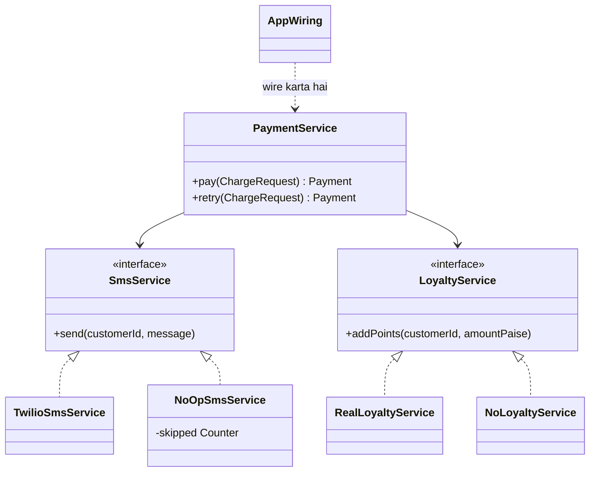

### Kya choose karein aur kyun

| Option | Kab use karo | Kab mat karo |
| --- | --- | --- |
| Null Object (no-op implementation) | Optional dependency aur optional behaviour — notification, analytics, loyalty | Jab absence ek error hai — chup-chaap kuch na karna bug chhupa dega |
| `Optional<T>` | Optional DATA ke liye — `Optional<Payment> findById(id)` | Fields aur dependencies ke liye — wo sirf null check ka naya naam hai |
| Exception | Jab missing cheez genuinely galat hai — missing pricing, missing merchant | Jab feature jaan-boojh ke off hai — wahan exception shor hai |
| `null` plus checks | Legacy code me jahan interface badla nahi ja sakta | Naye code me — ek check chhootna hi kaafi hai |

### India me kaise hota hai

- Indian payment systems me feature flags bahut common hain, kyunki har merchant segment ke liye alag capabilities hoti hain — kisi ko loyalty, kisi ko EMI, kisi ko sirf UPI. Null Object plus wiring se ye per-merchant on-off business code ko chhuye bina hota hai.
- Sandbox aur certification environments me external vendors (SMS, risk, loyalty) available hi nahi hote. Isliye no-op implementations yahan testing ki structural zaroorat hain, convenience nahi.
- Razorpay test mode me actual SMS aur actual bank calls nahi hote — matlab vendor khud apne sandbox me no-op-jaise behaviour deta hai. Yahi pattern tumhare apne system me bhi chahiye. ([Razorpay — Understand Razorpay APIs](https://razorpay.com/docs/api/understand))

### Interview follow-ups

- **Null Object aur `Optional` me kab kya?** Data ke liye `Optional`, dependency aur behaviour ke liye Null Object. `Optional` caller ko decide karne pe majboor karta hai; Null Object caller ko decide karne se bachata hai.
- **Null Object se bug chhup sakta hai?** Haan, aur yahi iska sabse bada khatra hai. Isliye no-op me counter ya debug log rakho, aur usko sirf wahan use karo jahan “kuch na karna” business ke liye valid ho.
- **Null Object ko singleton bana sakte ho?** Haan, agar wo stateless ho — ek hi instance share karna theek hai. Par metrics ke liye counter inject karna behtar hai, static state rakhne se nahi.
- **Ye Strategy ka special case hai?** Structurally bahut kareeb hai — ek strategy jo kuch nahi karti. Farak intent me hai: Strategy alag algorithms ke liye hai, Null Object absence ko safe banane ke liye.
- **Paisa chhune wale operations pe Null Object theek hai?** Nahi. Ledger posting ya gateway charge ka no-op version production me kabhi nahi hona chahiye. Null Object sirf best-effort side effects pe lagao, mandatory steps pe kabhi nahi (P16 ka mandatory aur best-effort ka farak yahin kaam aata hai).

### Self-check

1. Null Object se business code me exactly kya hat jaata hai?
2. Null Object me counter ya log kyun rakhna chahiye?
3. `Optional` kahan sahi hai aur Null Object kahan?
4. Null Object kis situation me galat choice hai?
5. Paisa chhune wale step pe no-op implementation kyun khatarnak hai?

### Notebook

Null Object = null ki jagah ek object jo kuch nahi karta par interface poora deta hai · Business code se saare null checks hat jaate hain · Dependency kabhi null na ho: requireNonNull + wiring me no-op inject · Naming saaf: NoOpSmsService, NoLoyaltyService · No-op me counter ya debug log rakho, warna off aur toota ek jaisa dikhega · Optional = optional DATA, Null Object = optional DEPENDENCY · Absence error hai to exception, no-op nahi · Stateless no-op singleton ho sakta hai · Mandatory money steps pe Null Object kabhi nahi · Feature on-off wiring ka faisla, business code ka nahi.

### Padhne ke liye

- [Refactoring Guru — Introduce Null Object](https://refactoring.guru/introduce-null-object)
- [Martin Fowler — Special Case](https://martinfowler.com/eaaCatalog/specialCase.html)

### Deep Dive (SDE-2) — jab time ho

#### Null Object plus feature flags: ek saaf architecture

Feature flag ko business code me padhna (`if (flags.isOn("SMS"))`) wahi problem wapas laata hai jo null checks ki thi — bas naam badla hai. Saaf design ye hai: flag ko wiring layer padhe aur uske hisaab se implementation chune. Flag runtime pe badalta hai to ek `DelegatingSmsService` rakho jo har call pe flag dekhe aur real ya no-op ko delegate kare — phir bhi business code me ek bhi `if` nahi aata.

#### Null Object aur recon: silent skip ka khatra

Payments me sabse mehnga bug “kuch nahi hua aur kisi ko pata nahi chala” hota hai. Agar ek no-op galti se production me wire ho gaya (config typo), to loyalty points mahine bhar add nahi honge aur dashboards green rahenge. Isliye production wiring ka ek startup-time assertion rakho: production env me koi bhi no-op implementation wired nahi honi chahiye, except explicitly allow-listed features. Ye ek choti check hai jo bahut mehnga bug rokti hai.

#### Null Object ka functional roop

Single-method interfaces me Null Object ek lambda hai: `SmsService noOp = (c, m) -> {};`. Chhote code ke liye ye saaf hai. Par named class ka ek fayda hai jo lambda nahi deta — stack trace aur logs me naam dikhta hai (`NoOpSmsService`), aur debugging me turant pata chal jaata hai ki no-op wired tha. Production code me named class prefer karo.

---

## Aage kya

- Pichla zone: [2B · Structural Bridge (P6–P12)](https://claude.ai/code/artifact/38514da5-5649-4d61-b49d-f65f893e6a5e)
- Agla zone: `Part 3 · Thread Jungle (T1–T12)` — abhi banna baaki. Wahan se concurrency shuru hoti hai, jo in patterns ko multi-threaded duniya me test karti hai.
- Is zone se jude purane zones: [1A · OOP Village (O1–O5)](https://claude.ai/code/artifact/cc69c0d1-92e9-4c1d-afd8-8add12f3e7db) · [1B · SOLID Temple (S1–S5)](https://claude.ai/code/artifact/f98bb328-8939-4ef4-a9a6-24c5ce970199) · [2A · Creational Forge (P1–P5)](https://claude.ai/code/artifact/296276bb-5e6c-4e9d-82d1-c02909c5bd2f)
- Agla zone: [Part 3 · Thread Jungle (T1–T12)](https://claude.ai/code/artifact/05d7fa44-518a-49fd-a70c-40ac902f184f) — race conditions, volatile aur JMM, locks, atomics, concurrent collections, executors, producer-consumer, deadlocks.
