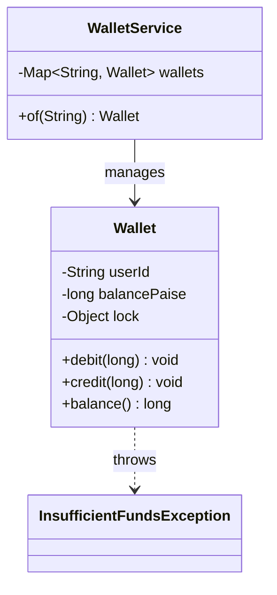
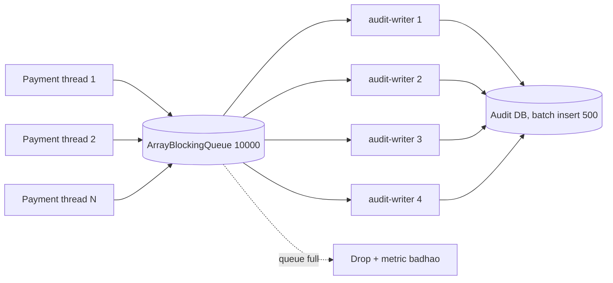
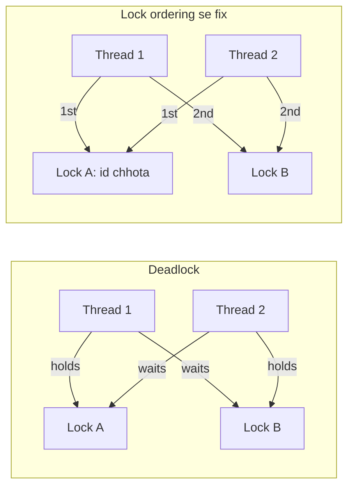

# Part 3 · Thread Jungle

Oct 4, 2026 · @saurav chaurasiya

Is doc me T1 se T12 tak — race condition aur synchronized, volatile aur Java Memory Model, ReentrantLock, ReadWriteLock, atomics aur CAS, ConcurrentHashMap, ExecutorService, CompletableFuture, producer-consumer, thread-safe singleton, deadlocks, aur semaphore/latch/barrier.

Machine coding round me interviewer thread-safety wahan poochhta hai jahan paisa ya seat ya inventory shared ho. Isliye har lesson ka example wallet, ledger ya payment pipeline se hai.

---

## T1 — Race condition & synchronized

Race condition tab hoti hai jab do ya zyada threads ek hi shared data ko badalte hain aur final result is baat pe depend karta hai ki kaun pehle chala. `synchronized` Java ka sabse purana aur sabse simple hathyaar hai — woh ek block ya method ko ek waqt me sirf ek thread ke liye khol deta hai.

### Ye cheez hai kya

- Category: concurrency ka base — isko samjhe bina aage kuch samajh nahi aayega.
- Kis problem ke liye: shared mutable state ko do threads se bachana. Wallet ka balance, seat count, inventory — sab shared mutable state hai.
- Is lesson ke baad: tum bata paoge ki `balance -= amount` ek line hone ke baad bhi atomic kyun nahi hai, aur critical section kahan se kahan tak hona chahiye.

### Sawaal

Paytm wallet me 100 rupaye hain. User ne do device se ek hi waqt pe 80 rupaye ka payment maar diya — do threads, dono `debit(8000)` call kar rahe hain (paise me 8000 paise). Ek `Wallet` class likho jisme balance kabhi negative na ho, aur dono threads ke baad balance 20 rupaye ho (ek payment fail ho).

> Pehle khud socho — 5 min. Hints: (1) `if (balance >= amt) balance -= amt` me kitne steps hain? (2) critical section kahan shuru aur khatam hoga? (3) lock object public hona chahiye ya private? (4) `balance()` read ko bhi lock chahiye ya nahi?

### Problem kyun aata hai

- `balance -= amount` ek line hai par CPU ke liye teen kaam hain: read, modify, write. Beech me thread switch ho sakta hai.
- Ye "check-then-act" pattern hai: pehle check (`balance >= amt`), phir act (`balance -= amt`). Dono ke beech balance badal sakta hai.
- Race ka result non-deterministic hai — 100 test run pe pass ho sakta hai, production me 1000 TPS (transactions per second — ek second me kitni requests) pe daily dikhega.
- Read bhi safe nahi: bina lock ke doosra thread ka write visible hoga ya nahi, ye guarantee nahi hai (ye T2 ka visibility problem hai).

### Naive approach

- Pehla obvious solution: bas `balance -= amount` likho, do line hi to hai.
- Ye exactly kahan tootta hai: dono threads `balance = 10000` padhte hain, dono `10000 >= 8000` pass karte hain, dono `balance = 2000` likhte hain. Final balance 2000 (20 rupaye) dikhta hai par **160 rupaye nikal gaye** — 60 rupaye hawa se bane. Ya ulta: dono 8000 ghatate hain aur balance `-6000` ho jaata hai.

```java
// BURA code: ye production me paisa bana dega ya khaa jayega
class BadWallet {
    private long balancePaise;
    void debit(long amt) {
        if (balancePaise >= amt) {   // T1 yahan pass hua...
                                     // ...aur T2 bhi yahan pass ho gaya
            balancePaise -= amt;     // dono ghataate hain = balance negative
        }
    }
}
```

### Sahi design

1. Check aur update ko **ek hi critical section** me daalo. Alag-alag `synchronized` blocks me daalna bekaar hai.
2. Lock ke liye ek **private final** object rakho, `this` nahi. `this` pe bahar se koi bhi `synchronized (wallet)` kar sakta hai aur tumhara lock hijack kar sakta hai — ye encapsulation ka hi extension hai (dekho [O1 — Encapsulation](https://claude.ai/code/artifact/cc69c0d1-92e9-4c1d-afd8-8add12f3e7db)).
3. Read (`balance()`) ko bhi usi lock me rakho, warna caller ko stale value mil sakti hai.
4. Paisa hamesha `long` paise me, `double` me kabhi nahi — floating point me 0.1 + 0.2 exactly 0.3 nahi hota.
5. **Per-user lock** rakho, ek global lock nahi. Ek global lock se poora system serial ho jayega aur throughput (ek second me kitna kaam ho raha hai) gir jayega.

Ye poora chalne layak code hai — do threads ek hi wallet pe 80 rupaye maarte hain, sirf ek safal hota hai:

```java
import java.util.Map;
import java.util.concurrent.ConcurrentHashMap;

public final class Wallet {
    private final String userId;
    private long balancePaise;                 // paisa always long, kabhi double nahi
    private final Object lock = new Object();  // private lock: bahar se koi lock na kar sake

    public Wallet(String userId, long openingPaise) {
        this.userId = userId;
        this.balancePaise = openingPaise;
    }

    public void debit(long amountPaise) {
        if (amountPaise <= 0) throw new IllegalArgumentException("amount must be > 0");
        synchronized (lock) {
            if (balancePaise < amountPaise) {
                throw new InsufficientFundsException(userId, balancePaise, amountPaise);
            }
            balancePaise -= amountPaise;   // check aur update EK hi critical section me
        }
    }

    public void credit(long amountPaise) {
        synchronized (lock) { balancePaise += amountPaise; }
    }

    public long balance() {
        synchronized (lock) { return balancePaise; }  // read bhi lock me, warna stale value
    }
}

class InsufficientFundsException extends RuntimeException {
    InsufficientFundsException(String user, long have, long want) {
        super("user=" + user + " have=" + have + " want=" + want);
    }
}

// Per-user lock: ek global lock pura system slow kar dega
public class WalletService {
    private final Map<String, Wallet> wallets = new ConcurrentHashMap<>();

    Wallet of(String userId) {
        return wallets.computeIfAbsent(userId, u -> new Wallet(u, 0L));
    }

    public static void main(String[] args) throws Exception {
        Wallet w = new Wallet("u1", 100_00L);   // 100 rupaye
        Runnable task = () -> { try { w.debit(80_00L); } catch (RuntimeException ignored) {} };
        Thread t1 = new Thread(task), t2 = new Thread(task);
        t1.start(); t2.start(); t1.join(); t2.join();
        System.out.println("balance = " + w.balance());  // 20_00, kabhi -60_00 nahi
    }
}
```



### Kya choose karein aur kyun

| Option | Kab use karo | Kab mat karo |
| --- | --- | --- |
| `synchronized` method | Chhoti class, poora object hi guard karna ho | Jab method me network ya DB call ho — lock pakad ke IO karna sabse mehnga blunder hai |
| `synchronized (privateLock)` block | Default choice — critical section exactly jitna chahiye utna | Jab tumhe timeout ya tryLock chahiye (tab ReentrantLock, T3) |
| Per-entity lock (`Map<String, Lock>`) | Wallet, seat, inventory — jahan entities independent hain | Jab entities ke beech transfer ho (tab lock ordering chahiye, T11) |
| Ek global lock | Prototype, ya jab contention practically zero ho | Production me — throughput ek thread jitna reh jaata hai |

### India me kaise hota hai

- Single JVM ka lock multi-pod deployment me kuch nahi karta. Paytm ya PhonePe jaise systems me 200 pods chal rahe hote hain, to asli guarantee DB se aati hai: `UPDATE wallet SET bal = bal - ? WHERE id = ? AND bal >= ?` — 0 rows updated matlab insufficient. Ye wahi check-then-act ka atomic version hai, bas DB ke andar (dekho [L1.11 — ACID & isolation](https://claude.ai/code/artifact/99909fe9-731e-4e31-9e7d-36e0c5aed845)).
- In-process lock ka asli kaam machine coding round me hai, aur production me un cases me jahan state sirf ek JVM me hai (local cache, in-memory rate limiter, connection pool).
- Distributed systems me iska equivalent distributed lock hai (L2.13 — Distributed locks, abhi banna baaki), jo apni hi problems laata hai.

### Interview follow-ups

- **"`balance -= amt` atomic hai ya nahi?"** — Nahi. Read-modify-write ke teen steps hain. `long` ke case me 32-bit JVM pe write bhi do halves me ho sakta hai.
- **"`synchronized` method aur `synchronized (this)` me fark?"** — Koi nahi, same lock hai. Dono me problem wahi: lock public hai.
- **"Read ko lock kyun chahiye, read to kuch badalta nahi?"** — Visibility ke liye. Bina lock (ya `volatile`) ke doosre thread ka write kabhi dikhega ya nahi, JMM guarantee nahi deta (T2).
- **"Lock ke andar DB call karun?"** — Kabhi nahi. Lock milliseconds ke liye hona chahiye, seconds ke liye nahi. Lock pakad ke IO = poora pool block.
- **"Do wallets ke beech transfer me kitne lock?"** — Dono ke. Aur lock ordering chahiye warna deadlock — ye T11 ka setup hai.

### Self-check

1. `if (bal >= amt) bal -= amt` me exactly kitne points pe thread switch ho sakta hai?
2. Lock object `private final` kyun hona chahiye?
3. Getter method pe lock kyun chahiye?
4. Per-user lock global lock se behtar kyun hai?

### Notebook

Race condition = result thread interleaving pe depend kare · `balance -= amt` = read + modify + write, atomic nahi · Check-then-act: check aur act EK hi critical section me · Lock object `private final Object`, `this` nahi (hijack se bachao) · Read bhi lock me, warna stale/invisible write · Paisa `long` paise me, `double` kabhi nahi · Per-entity lock, global lock nahi · Lock ke andar IO kabhi nahi · Multi-pod pe asli guarantee DB se: `UPDATE ... WHERE bal >= ?`.

### Padhne ke liye

- [Oracle Java Tutorials — Synchronized methods](https://docs.oracle.com/javase/tutorial/essential/concurrency/syncmeth.html)
- [Oracle Java Tutorials — Intrinsic locks and synchronization](https://docs.oracle.com/javase/tutorial/essential/concurrency/locksync.html)

### Deep Dive (SDE-2) — jab time ho

#### Monitor aur reentrancy

Har Java object ke paas ek monitor hota hai. `synchronized` us monitor ko lock karta hai, aur woh **reentrant** hai — jo thread lock pakda hua hai woh usi lock ko dobara le sakta hai bina deadlock ke. Isi wajah se ek `synchronized` method doosre `synchronized` method ko call kar sakta hai.

#### Lock granularity ka trade-off

Lock chhota = zyada parallelism, par zyada bugs (kuch cheez guard se bahar reh jaati hai). Lock bada = safe, par throughput kam. Rule: lock ka scope exactly utna rakho jitna ek **invariant** ko bachane ke liye chahiye. Wallet ka invariant hai `balance >= 0`, to lock ko sirf us check aur update ko cover karna hai.

#### Striped locks

Agar entities lakhon hain to `Map<String, Object>` me lakhon lock objects banenge. Alternative: fixed 1024 locks ka array aur `locks[key.hashCode() & 1023]` — isko lock striping kehte hain. Thodi si false contention aati hai (do keys same stripe pe), par memory bounded reh jaati hai. Guava ka `Striped` class yahi deta hai.

---

## T2 — volatile & JMM

Java Memory Model (JMM) woh rulebook hai jo batata hai ki ek thread ka write doosre thread ko kab dikhega. `volatile` ek field pe lagane se do cheezein milti hain: us field ka write hamesha turant sab threads ko dikhega, aur compiler us field ke aas-paas ke instructions ko reorder nahi karega.

### Ye cheez hai kya

- Category: memory visibility — locking se alag problem hai, isliye alag tool.
- Kis problem ke liye: ek thread ne flag `true` kiya, doosra thread hamesha ke liye `false` hi dekhta raha. Ye lock se related nahi, visibility se hai.
- Is lesson ke baad: tum bata paoge ki `volatile` kab kaafi hai aur kab nahi, aur "happens-before" ka matlab kya hai.

### Sawaal

Paytm ka settlement batch job ek background thread me chalta hai. Deploy ke waqt graceful shutdown chahiye: main thread ek `shutdownRequested` flag `true` karega, aur worker thread apna current batch khatam kar ke ruk jayega. Code likho. Phir batao: `boolean shutdownRequested` kaafi hai, ya kuch aur chahiye? Aur agar tumhe shutdown se pehle "kitne batch process hue" ka count bhi chahiye to?

> Pehle khud socho — 5 min. Hints: (1) worker ka loop kabhi rukega ya nahi? (2) compiler loop ke andar flag ko cache kar sakta hai? (3) count ke liye bhi `volatile` kaafi hai?

### Problem kyun aata hai

- Har CPU core ka apna cache hota hai. Ek core ne memory me likha, doosre core ka cache purani value rakhe baitha hai — use pata hi nahi chalta.
- Compiler aur CPU performance ke liye instructions **reorder** karte hain. Single thread me result same rehta hai, par doosra thread ulta order dekh sakta hai.
- Bina `volatile` ke JIT compiler ek loop-invariant read ko loop ke bahar hoist kar sakta hai — `while (!flag)` literally `if (!flag) while (true)` ban jaata hai. Loop kabhi nahi rukega.
- Visibility aur atomicity do **alag** problems hain. `volatile` pehli solve karta hai, doosri nahi.

### Naive approach

- Pehla obvious solution: plain `private boolean shutdownRequested = false;`
- Ye exactly kahan tootta hai: worker thread ka loop kabhi exit nahi karega, kyunki uske core ka cache (ya hoisted read) hamesha `false` deta rahega. Deploy atak jayega aur pod ko `SIGKILL` se maarna padega — beech ka batch aadha process.

```java
// BURA: ye loop kabhi nahi rukega
class BadWorker implements Runnable {
    private boolean stop = false;            // volatile nahi
    void requestStop() { stop = true; }
    public void run() {
        while (!stop) { processBatch(); }     // JIT ise while(true) bana sakta hai
    }
}
```

### Sahi design

1. Flag ko `volatile boolean` banao. Write turant visible, read hamesha memory se, koi hoisting nahi.
2. Count ke liye `volatile` **kaafi nahi hai** — `count++` read-modify-write hai, aur `volatile` atomicity nahi deta. Uske liye `AtomicLong` (T5).
3. `volatile` ka asli rule yaad rakho: woh ek **happens-before** edge banata hai. `volatile` write se pehle jo kuch hua, woh us `volatile` read ke baad padhne wale thread ko dikhega. Isliye flag ko "last" set karo, aur usse pehle data likho.
4. Thread interruption bhi use karo — `Thread.interrupt()` blocking call (jaise `sleep` ya `queue.take()`) se bhi bahar nikaal deta hai, jahan `volatile` flag kaam nahi karega.

```java
import java.util.concurrent.atomic.AtomicLong;

public class SettlementWorker implements Runnable {
    private volatile boolean shutdownRequested = false;   // visibility ke liye volatile
    private final AtomicLong batchesDone = new AtomicLong();  // count ke liye volatile KAAFI NAHI
    private volatile String lastBatchId = null;           // flag se PEHLE set hoga

    public void requestShutdown() { this.shutdownRequested = true; }
    public long batchesDone() { return batchesDone.get(); }
    public String lastBatchId() { return lastBatchId; }

    @Override
    public void run() {
        while (!shutdownRequested && !Thread.currentThread().isInterrupted()) {
            String id = nextBatchId();
            processBatch(id);
            lastBatchId = id;                 // ye write...
            batchesDone.incrementAndGet();    // ...isse pehle visible ho jaata hai
            try {
                Thread.sleep(1000);           // interrupt yahan se bahar nikalega
            } catch (InterruptedException e) {
                Thread.currentThread().interrupt();  // flag wapas set karo, nigal mat jao
                break;
            }
        }
        System.out.println("Clean stop. Batches=" + batchesDone.get() + " last=" + lastBatchId);
    }

    private String nextBatchId() { return "b" + System.nanoTime(); }
    private void processBatch(String id) { /* ledger entries likho */ }

    public static void main(String[] args) throws Exception {
        SettlementWorker w = new SettlementWorker();
        Thread t = new Thread(w, "settlement");
        t.start();
        Thread.sleep(3000);
        w.requestShutdown();     // volatile write: worker ko turant dikhega
        t.join();
    }
}
```

### Kya choose karein aur kyun

| Option | Kab use karo | Kab mat karo |
| --- | --- | --- |
| `volatile` field | Ek flag ya ek reference jo ek thread likhe, baaki padhein | Jab value apne purane value pe depend kare (`count++`, `balance -= x`) |
| `AtomicLong` / `AtomicInteger` | Counter, sequence, metric — read-modify-write chahiye | Jab ek saath do fields consistent rakhni hon |
| `synchronized` | Jab do ya zyada fields ka ek saath invariant ho | Jab sirf visibility chahiye — lock overhead bekaar |
| `final` field | Immutable object — constructor ke baad kabhi nahi badalta | Jab value runtime pe badalni ho |

### India me kaise hota hai

- Graceful shutdown payment systems me mandatory hai: pod ko `SIGTERM` milta hai, usko in-flight transactions khatam karne hain aur naye accept karna band karna hai. Spring Boot ka `server.shutdown=graceful` andar isi tarah ke volatile flag aur executor shutdown pe based hai.
- Feature flag aur runtime config (jaise "UPI route band karo") ke liye `volatile` reference ka pattern common hai: ek background thread config refresh kare aur ek `volatile Config current` reference swap kar de. Reader threads ko turant naya config dikhta hai, aur Config object khud immutable hota hai.

### Interview follow-ups

- **"`volatile` counter ko thread-safe banata hai?"** — Nahi. `count++` ke teen steps ab bhi non-atomic hain. `volatile` sirf visibility deta hai, mutual exclusion nahi.
- **"Happens-before kya hai?"** — Ek ordering guarantee. Agar A happens-before B, to A ke saare writes B ko dikhenge. `volatile` write se `volatile` read, lock release se lock acquire, aur `Thread.start()`/`join()` — ye sab happens-before edges banate hain.
- **`volatile` performance?"** — Read almost free hai, write me ek memory barrier hai (lock se kaafi sasta). Par hot loop me `volatile` read bhi optimization rok deta hai.
- **"`final` field thread-safe hai?"** — Haan, agar constructor me `this` leak na kare. JMM guarantee karta hai ki constructor khatam hone ke baad `final` fields sab threads ko correctly dikhenge.
- **"Do volatile writes ka order guaranteed hai?"** — Haan, volatile ke aapas me reorder nahi hote. Isliye "data pehle, flag baad me" pattern kaam karta hai.

### Self-check

1. Bina `volatile` ke `while (!stop)` loop kyun kabhi nahi rukta?
2. `volatile` kaunsi do guarantees deta hai, aur kaunsi nahi deta?
3. Happens-before edge banane wale teen mechanisms batao.
4. Counter ke liye `volatile` ki jagah kya use karoge?

### Notebook

JMM = kaunsa write kis thread ko kab dikhega ka rulebook · `volatile` deta hai: visibility + no reordering; deta NAHI: atomicity · `count++` pe `volatile` bekaar, `AtomicLong` chahiye · Bina volatile `while(!stop)` JIT hoisting se infinite loop ban jaata hai · Happens-before edges: volatile write to read, unlock to lock, `Thread.start()`, `join()` · Pattern: data pehle likho, `volatile` flag baad me set karo · Blocking call se nikalne ke liye `interrupt()`, volatile flag nahi · `InterruptedException` pakad ke flag wapas set karo.

### Padhne ke liye

- [Oracle Java Tutorials — Atomic access](https://docs.oracle.com/javase/tutorial/essential/concurrency/atomicvars.html)
- [JSR-133 Java Memory Model FAQ (Jeremy Manson, Brian Goetz)](https://www.cs.umd.edu/~pugh/java/memoryModel/jsr-133-faq.html)

### Deep Dive (SDE-2) — jab time ho

#### Safe publication

Ek object ko "publish" karna matlab doosre threads ko uska reference dena. Safely publish karne ke 4 raaste: static initializer me, `volatile` ya `AtomicReference` field se, `final` field se (constructor ke baad), ya lock se guard kiye field se. In char ke bahar publish karna = doosre thread ko half-constructed object dikh sakta hai.

#### Reordering ka concrete example

```java
// Thread A            Thread B
// x = 1;              r1 = y;
// y = 1;              r2 = x;
```

Intuition kehti hai ki `r1 == 1` hone pe `r2` bhi `1` hoga. Bina `volatile` ke ye galat hai — compiler A ke writes reorder kar sakta hai, to `r1 == 1, r2 == 0` possible hai. `y` ko `volatile` banane se ye khatam ho jaata hai.

#### Double-checked locking ka connection

Singleton me `volatile` ki zaroorat isi reordering se aati hai: object construction aur reference assignment reorder ho sakte hain, to doosre thread ko non-null par adhoora object dikh sakta hai. Poora code T10 me.

---

## T3 — ReentrantLock

`ReentrantLock` `synchronized` ka explicit version hai: lock lena aur chhodna tum code me likhte ho. Isse teen cheezein milti hain jo `synchronized` nahi de sakta — timeout ke saath lock lena (`tryLock`), interruptible lock, aur fairness ka option.

### Ye cheez hai kya

- Category: explicit locking API (`java.util.concurrent.locks`).
- Kis problem ke liye: `synchronized` me lock ka wait unbounded hai — thread hamesha ke liye atak sakta hai. Payment API me 200 millisecond ka SLA hai, to unbounded wait allowed nahi.
- Is lesson ke baad: tum `tryLock` ke saath fail-fast design kar paoge, aur bata paoge ki `finally` me `unlock` kyun life-or-death hai.

### Sawaal

Paytm P2P transfer: user A se user B ko 400 rupaye. Dono wallets pe lock chahiye. Business requirement: agar 200 millisecond me dono lock na milein to transfer ko fail kar do aur user ko "please retry" bolo — user ko 10 second tak spinner dikhana allowed nahi. `transfer(a, b, amount)` likho.

> Pehle khud socho — 5 min. Hints: (1) `synchronized` se timeout possible hai? (2) do lock lene ka order kya hoga? (3) pehla lock mil gaya par doosra nahi mila to kya karoge? (4) `unlock` kahan likhoge?

### Problem kyun aata hai

- `synchronized` block me ghuste waqt timeout dene ka koi tarika nahi hai. Thread wahan hamesha ke liye wait kar sakta hai.
- Lock pakda hua thread agar slow ho gaya (GC pause, slow DB call) to saare waiting threads ka SLA toot jaata hai, aur thread pool bhar jaata hai — cascading failure.
- Do lock lene me deadlock ka khatra hai: A ne wallet-1 pakda aur wallet-2 maang raha hai, B ne ulta kiya (T11).
- `ReentrantLock` me `unlock` manual hai — bhool gaye ya exception aa gaya to lock hamesha ke liye leak ho jaata hai aur saare threads hang.

### Naive approach

- Pehla obvious solution: `lock.lock(); doTransfer(); lock.unlock();`
- Ye exactly kahan tootta hai: `doTransfer()` me `InsufficientFundsException` aaya to `unlock()` line kabhi nahi chalegi. Lock permanently held. Us wallet pe aane wala har request forever block. Ek exception se poora user account dead ho gaya.

### Sahi design

1. `unlock()` **hamesha** `finally` me. Ye negotiable nahi hai.
2. Do lock lene se pehle **deterministic order** banao — wallet id ke lexicographic order me. Dono threads same order follow karenge to circular wait ban hi nahi sakta.
3. `tryLock(timeout, unit)` use karo, plain `lock()` nahi. Timeout khatam = `false` return = business ko fail-fast jawab.
4. Pehla lock mil gaya aur doosra nahi mila to **pehla bhi chhod do** aur poora operation fail karo. Pehla pakad ke baithna hold-and-wait hai, jo deadlock ki condition hai.
5. `tryLock()` (bina timeout) `fair` setting ko bypass karta hai — agar fairness chahiye to `tryLock(0, TimeUnit.SECONDS)` likho.
6. Fairness default `false` rakho. Fair lock me har acquire pe queue check hota hai — throughput kaafi gir jaata hai. Fair sirf tab jab starvation actually dikh rahi ho.

```java
import java.util.concurrent.TimeUnit;
import java.util.concurrent.locks.ReentrantLock;

public final class LockedWallet {
    private final String id;
    private long balancePaise;
    private final ReentrantLock lock = new ReentrantLock();   // non-fair (default) = fast

    public LockedWallet(String id, long opening) { this.id = id; this.balancePaise = opening; }

    public String id() { return id; }
    ReentrantLock lock() { return lock; }

    public void debit(long amt) {
        lock.lock();
        try {
            if (balancePaise < amt) throw new InsufficientFundsException(id, balancePaise, amt);
            balancePaise -= amt;
        } finally {
            lock.unlock();      // finally me HAMESHA, warna lock leak aur sab thread hang
        }
    }

    public void credit(long amt) {
        lock.lock();
        try { balancePaise += amt; } finally { lock.unlock(); }
    }

    public long balance() {
        lock.lock();
        try { return balancePaise; } finally { lock.unlock(); }
    }
}

public class TransferService {

    /** SLA-friendly transfer: 200ms me lock na mile to fail-fast, aur deadlock-free ordering. */
    public boolean transfer(LockedWallet a, LockedWallet b, long amt) throws InterruptedException {
        // Lock ordering: hamesha id ke order me lo. Yahi deadlock rokta hai (T11)
        LockedWallet first  = a.id().compareTo(b.id()) < 0 ? a : b;
        LockedWallet second = (first == a) ? b : a;

        if (!first.lock().tryLock(200, TimeUnit.MILLISECONDS)) return false;
        try {
            if (!second.lock().tryLock(200, TimeUnit.MILLISECONDS)) return false;  // pehla finally me chhut jayega
            try {
                a.debit(amt);      // reentrant: same thread dobara lock le sakta hai
                b.credit(amt);
                return true;
            } finally { second.lock().unlock(); }
        } finally { first.lock().unlock(); }
    }

    public static void main(String[] args) throws Exception {
        LockedWallet u1 = new LockedWallet("u1", 100_00);
        LockedWallet u2 = new LockedWallet("u2", 0);
        System.out.println(new TransferService().transfer(u1, u2, 40_00));  // true
        System.out.println(u1.balance() + " / " + u2.balance());            // 6000 / 4000
    }
}
```

### Kya choose karein aur kyun

| Option | Kab use karo | Kab mat karo |
| --- | --- | --- |
| `synchronized` | Simple, single lock, koi timeout nahi chahiye | Jab SLA ho, ya do lock lene hon, ya interruptible wait chahiye |
| `ReentrantLock` + `lock()` | Jab `Condition` chahiye (producer-consumer, T9) | Jab tum `finally` bhool sakte ho — tab `synchronized` safer hai |
| `ReentrantLock` + `tryLock(timeout)` | Payment API, kisi bhi SLA-bound path pe | Background batch job jahan wait karna theek hai |
| Fair `ReentrantLock(true)` | Jab ek thread actually starve ho raha ho (measured, guessed nahi) | Default me — throughput kaafi gir jaata hai |

### India me kaise hota hai

- `tryLock` ka pattern UPI ke TAT (turnaround time) requirements se seedha judta hai: NPCI ne response time windows define ki hain, to andar ka koi bhi step unbounded wait nahi kar sakta. Jo request time pe nahi ho sakti usko jaldi fail karna behtar hai — user retry kar lega, par thread pool bacha rahega.
- Production me in-process lock ke saath hamesha ek metric rakha jaata hai: lock wait time ka p99 aur `tryLock` failure rate. Failure rate badhe to woh contention ka early signal hai, aur usually lock granularity ka problem hota hai, lock type ka nahi.

### Interview follow-ups

- **"`ReentrantLock` me 'reentrant' ka matlab?"** — Jo thread lock pakda hua hai woh usi lock ko dobara le sakta hai; andar ek hold count badhta hai. `unlock` utni hi baar karna padta hai.
- **"`tryLock()` aur `tryLock(0, SECONDS)` me fark?"** — Pehla barging karta hai: queue me khade threads ko ignore kar ke lock le leta hai, fair lock pe bhi. Doosra fairness policy respect karta hai.
- **"Dono lock na mile to pehla kyun chhodna hai?"** — Hold-and-wait deadlock ki 4 conditions me se ek hai. Use todne se deadlock impossible ho jaata hai.
- **"`lockInterruptibly()` kab?"** — Jab operation cancellable hona chahiye (user ne request abort kar di, ya shutdown aa gaya). Plain `lock()` interrupt ko ignore karta hai.
- **"Lock ke andar exception aaye to balance corrupt?"** — Nahi, agar `finally` me unlock hai aur state change exception se pehle ya baad me poora hota hai. Half-updated state se bachne ke liye validation sabse pehle karo.

### Self-check

1. `unlock()` `finally` me na ho to kya hota hai?
2. Do wallets pe lock lene ka order kaise decide karoge aur kyun?
3. `tryLock` timeout fail hone pe pehla lock ka kya karoge?
4. Fair lock default me kyun nahi rakhte?

### Notebook

`ReentrantLock` = explicit lock; deta hai `tryLock(timeout)`, `lockInterruptibly()`, fairness option · `unlock()` HAMESHA `finally` me, warna lock leak = permanent hang · Do lock = fixed order (id ka compareTo), warna deadlock · Doosra lock na mile to pehla bhi chhodo (hold-and-wait todo) · SLA path pe `tryLock(200ms)`, plain `lock()` nahi · Fairness default false; fair = throughput down · `tryLock()` bina timeout fairness bypass karta hai · Metric: lock wait p99 + tryLock failure rate.

### Padhne ke liye

- [Java API — ReentrantLock](https://docs.oracle.com/en/java/javase/21/docs/api/java.base/java/util/concurrent/locks/ReentrantLock.html)
- [Oracle Java Tutorials — Lock objects](https://docs.oracle.com/javase/tutorial/essential/concurrency/newlocks.html)

### Deep Dive (SDE-2) — jab time ho

#### AbstractQueuedSynchronizer

`ReentrantLock`, `Semaphore`, `CountDownLatch` — sab andar se ek hi class pe bane hain: `AbstractQueuedSynchronizer` (AQS). AQS ek `volatile int state` aur waiting threads ki ek CLH queue rakhta hai. Lock lena = CAS se state 0 se 1 karna; fail hone pe thread queue me park ho jaata hai. Interview me AQS ka naam lena SDE-2 signal hai.

#### Barging aur throughput

Non-fair lock me naya aane wala thread queue ko bypass kar ke lock le sakta hai — isko barging kehte hain. Ye "anuchit" lagta hai par throughput kaafi badhata hai, kyunki thread ko unpark karne me microseconds lagte hain aur us beech barging wala thread kaam khatam kar leta hai.

#### Lock-free alternative pehle socho

`tryLock` ka design sochne se pehle poochho: kya ye kaam CAS se ho sakta hai? Single counter ya single reference ke liye `AtomicLong`/`AtomicReference` lock se tez hai (T5). Lock tab chahiye jab **do ya zyada** fields ko ek saath consistent rakhna ho.

---

## T4 — ReadWriteLock

`ReadWriteLock` ek lock ke do mode deta hai: read lock (kai threads ek saath le sakte hain) aur write lock (ek waqt me sirf ek, aur tab koi reader bhi nahi). Logic simple hai — do threads ka saath me padhna safe hai, likhna nahi.

### Ye cheez hai kya

- Category: specialized lock, `java.util.concurrent.locks.ReentrantReadWriteLock`.
- Kis problem ke liye: read-heavy shared state. Plain lock me 1000 readers queue me khade rehte hain, chahe koi likh hi na raha ho.
- Is lesson ke baad: tum bata paoge ki ReadWriteLock kab actually fayda deta hai aur kab ulta nuksaan.

### Sawaal

Paytm ka in-memory merchant config cache: har payment request pe `getConfig(merchantId)` padha jaata hai (lakhon reads per minute), aur config sirf tab update hota hai jab ops team dashboard se change kare (din me 10-20 baar). Ek thread-safe `MerchantConfigCache` likho jisme reads parallel chalein.

> Pehle khud socho — 5 min. Hints: (1) read aur write ka ratio kya hai? (2) read lock ke andar `Map` ka reference de dena safe hai? (3) read lock se write lock pe upgrade ho sakte ho? (4) kya is case me lock ki zaroorat hi hai?

### Problem kyun aata hai

- `synchronized` ya `ReentrantLock` reads ko bhi serialize kar deta hai. 1000 readers me se 999 bekaar wait kar rahe hain.
- Lekin ReadWriteLock free nahi hai: read lock lene me bhi ek CAS (compare-and-swap, T5) operation hota hai, aur reader count maintain karna padta hai. Kam contention pe ye plain lock se **slow** hota hai.
- Writer starvation ka khatra hai: readers aate rehte hain to writer kabhi lock na mile.
- Lock upgrade (read lock pakad ke write lock maangna) `ReentrantReadWriteLock` me **deadlock** hai — ye likha hua rule hai.

### Naive approach

- Pehla obvious solution: poore cache method ko `synchronized` kar do.
- Ye exactly kahan tootta hai: har payment request ek hi lock pe line me lag jaati hai. 1000 TPS pe lock contention tumhara p99 latency bana deta hai, aur CPU profile me `park`/`unpark` dikhega. Write din me 20 baar hota hai — to tum 99.99% reads ko 0.01% writes ke liye serialize kar rahe ho.

### Sahi design

1. Read path pe read lock, write path pe write lock. Read lock ke andar sirf padho, kuch mutate na karo.
2. Read lock ke andar se **mutable collection ka reference bahar na do** — caller lock chhodne ke baad usko modify kar dega. Copy do, ya immutable object do.
3. Lock upgrade kabhi nahi: read lock chhodo, write lock lo, aur **dobara check karo** (state badal chuka ho sakta hai).
4. `new ReentrantReadWriteLock(true)` se fairness on karo agar writer starve ho raha hai. Non-fair me writer ko reader barge kar sakte hain.
5. **Pehle ye poochho ki lock chahiye hi kya.** Is exact case ka best jawab lock nahi hai: `volatile` reference + immutable map. Readers ko koi lock nahi chahiye.

```java
import java.util.*;
import java.util.concurrent.locks.ReentrantReadWriteLock;

public class MerchantConfigCache {
    private final Map<String, MerchantConfig> configs = new HashMap<>();   // plain HashMap, lock se guarded
    private final ReentrantReadWriteLock rw = new ReentrantReadWriteLock();

    public MerchantConfig get(String merchantId) {
        rw.readLock().lock();                  // kai threads ek saath yahan ho sakte hain
        try {
            return configs.get(merchantId);    // MerchantConfig immutable record hai, safe
        } finally { rw.readLock().unlock(); }
    }

    public List<String> allMerchantIds() {
        rw.readLock().lock();
        try {
            return List.copyOf(configs.keySet());  // COPY do, andar ka set bahar nahi
        } finally { rw.readLock().unlock(); }
    }

    public void put(String merchantId, MerchantConfig cfg) {
        rw.writeLock().lock();                 // ek waqt me ek, aur koi reader nahi
        try { configs.put(merchantId, cfg); }
        finally { rw.writeLock().unlock(); }
    }

    /** Upgrade ka sahi tarika: read chhodo, write lo, DOBARA check karo. */
    public MerchantConfig getOrLoad(String merchantId) {
        rw.readLock().lock();
        try {
            MerchantConfig c = configs.get(merchantId);
            if (c != null) return c;
        } finally { rw.readLock().unlock(); }   // read lock pakad ke write lock = DEADLOCK

        rw.writeLock().lock();
        try {
            MerchantConfig again = configs.get(merchantId);   // beech me koi daal chuka ho sakta hai
            if (again != null) return again;
            MerchantConfig loaded = loadFromDb(merchantId);
            configs.put(merchantId, loaded);
            return loaded;
        } finally { rw.writeLock().unlock(); }
    }

    private MerchantConfig loadFromDb(String id) { return new MerchantConfig(id, 200, true); }
}

// Immutable config: read lock ke andar se bahar dena safe hai
record MerchantConfig(String merchantId, int feeBps, boolean upiEnabled) {}

// IS CASE KA SABSE ACHA JAWAB: koi lock hi nahi. Read path bilkul free.
class ConfigHolder {
    private volatile Map<String, MerchantConfig> snapshot = Map.of();  // immutable

    MerchantConfig get(String id) { return snapshot.get(id); }         // zero lock

    void reload(Map<String, MerchantConfig> fresh) {
        this.snapshot = Map.copyOf(fresh);   // reference swap, atomic + visible (T2)
    }
}
```

### Kya choose karein aur kyun

| Option | Kab use karo | Kab mat karo |
| --- | --- | --- |
| `synchronized` / `ReentrantLock` | Read aur write dono kaafi hon, ya critical section bahut chhota ho | Read:write ratio 100:1 se zyada ho aur read me kaam ho |
| `ReentrantReadWriteLock` | Read bahut zyada, aur read ke andar actual kaam ho (search, filter, aggregate) | Read ek `map.get()` ho — tab lock ka overhead hi pura cost hai |
| `volatile` + immutable snapshot | Config, feature flags, routing table — jo kabhi-kabhi badalta hai | Jab data bada ho aur poora copy karna mehnga pade |
| `ConcurrentHashMap` | Per-key independent updates, high read aur write dono | Jab kai keys pe ek saath consistent view chahiye |
| `StampedLock` | Jab aur squeeze karna ho, optimistic read se | Jab reentrancy chahiye — `StampedLock` reentrant nahi hai |

### India me kaise hota hai

- Payment gateways ka routing table (kaunsa merchant kis acquirer pe jayega) exactly ye shape hai: lakhon reads, din me kuch writes. Production pattern almost hamesha `volatile` immutable snapshot hota hai, ReadWriteLock nahi — kyunki read path pe ek bhi atomic operation bachana p99 latency me dikhta hai.
- ReadWriteLock ka asli use case wahan hai jahan read ke andar sach me kaam hota ho: jaise ek in-memory order book ya ek index pe range scan, jisme 50 entries traverse karni padti hain.

### Interview follow-ups

- **"ReadWriteLock hamesha tez hai?"** — Nahi. Agar critical section bahut chhota hai (ek `map.get()`) to bookkeeping ka overhead gain se zyada ho jaata hai. Measure karo, assume na karo.
- **"Read lock se write lock pe upgrade?"** — `ReentrantReadWriteLock` me ye deadlock hai. Read chhod ke write lo, phir state dobara check karo (double-check).
- **"Downgrade (write se read) possible hai?"** — Haan. Write lock pakde hue read lock lo, phir write chhod do. Isse beech me koi writer nahi ghus sakta.
- **"Writer starvation kaise rokoge?"** — Fair mode on karo. Fair mode me naye readers tab tak nahi ghusenge jab tak queue me writer khada hai.
- **"`StampedLock` kab?"** — Jab optimistic read chahiye: version stamp lo, bina lock padho, phir validate karo ki version badla nahi. Fail hone pe real read lock lo. Non-reentrant hai, isliye careful.

### Self-check

1. Read lock kai threads ek saath le sakte hain — write lock ke saath kaunsa combination allowed hai?
2. Lock upgrade kyun deadlock hai, aur sahi tarika kya hai?
3. Read lock ke andar se `HashSet` ka reference return karna kyun bug hai?
4. Is config cache ka sabse accha solution kya hai aur kyun?

### Notebook

ReadWriteLock: N readers ek saath, ya 1 writer akela · Fayda sirf tab jab read:write ratio bada HO aur read ke andar kaam ho · Chhote critical section pe plain lock se slow (bookkeeping overhead) · Read lock se write lock upgrade = deadlock; read chhodo, write lo, DOUBLE-CHECK karo · Downgrade (write to read) allowed hai · Read lock ke andar se mutable collection bahar na do — copy ya immutable · Writer starvation = fair mode on · Config/flags ka best answer: `volatile` + immutable snapshot, zero lock on read · `StampedLock` = optimistic read, par non-reentrant.

### Padhne ke liye

- [Java API — ReentrantReadWriteLock](https://docs.oracle.com/en/java/javase/21/docs/api/java.base/java/util/concurrent/locks/ReentrantReadWriteLock.html)
- [Java API — StampedLock](https://docs.oracle.com/en/java/javase/21/docs/api/java.base/java/util/concurrent/locks/StampedLock.html)

### Deep Dive (SDE-2) — jab time ho

#### Copy-on-write

Ek aur read-optimized pattern: `CopyOnWriteArrayList`. Read bilkul lock-free hai (ek immutable array pe iterate), aur har write poora array copy karta hai. Listener lists aur config lists ke liye perfect, par write-heavy data ke liye disaster (O(n) per write).

#### Reader count ka cache line bouncing

ReadWriteLock ka hidden cost: har reader ek shared counter ko badhata hai. Woh counter ek hi cache line me hai, to har core use apne cache me khinchta hai — "cache line bouncing". 32-core machine pe ye read path ko surprisingly slow kar deta hai. `LongAdder` ya striped counters isi problem ka hal hain.

#### Sequence lock ka idea

Linux kernel ka `seqlock` aur Java ka `StampedLock` same idea pe hain: writer ek version counter badhata hai, reader version padhta hai, data padhta hai, phir version dobara padhta hai. Dono version same to data consistent tha. Readers ka koi shared write nahi — isliye scalability bahut acchi.

---

## T5 — Atomics & CAS

CAS (compare-and-swap) ek hardware instruction hai jo kehta hai: "agar is memory location me `expected` value hai to usko `newValue` se badal do, warna fail batao" — aur ye poora operation atomic hai. Java ke `Atomic*` classes isi pe bani hain, aur ye lock liye bina thread-safe counters dete hain.

### Ye cheez hai kya

- Category: lock-free concurrency, `java.util.concurrent.atomic`.
- Kis problem ke liye: ek single variable ka read-modify-write safely karna, lock ke overhead ke bina.
- Is lesson ke baad: tum CAS loop khud likh paoge aur bata paoge ki lock-free ka matlab "wait-free" nahi hota.

### Sawaal

Paytm ka per-merchant rate limiter: har merchant ko 100 requests per second allowed. Ek in-memory counter chahiye jo 50,000 requests per second pe bhi correct ho, aur jiska latency add almost zero ho. Saath me ek "total successful payments today" counter bhi chahiye jo 200 threads se badhta hai. Dono ke liye kya use karoge?

> Pehle khud socho — 5 min. Hints: (1) `synchronized count++` 50k TPS pe kitna cost karega? (2) `volatile count++` kaam karega? (3) 200 threads ek hi `AtomicLong` pe CAS karein to kya hota hai? (4) kya koi aur class hai?

### Problem kyun aata hai

- Lock lene ka matlab: contention pe thread park hota hai, OS context switch hota hai (roughly 1 se 10 microsecond), phir unpark. Ek `count++` ke liye ye bahut mehnga hai.
- Par bina lock ke `count++` racy hai (T1), aur `volatile` se bhi racy rehta hai kyunki `volatile` atomicity nahi deta (T2).
- Beech ka raasta hardware ka CAS instruction hai — x86 pe `LOCK CMPXCHG`. Ye ek single atomic instruction hai, koi thread park nahi hota.
- Lekin bahut zyada contention pe CAS loop bar-bar fail hota hai aur CPU jalta hai (spin). 200 threads ek hi `AtomicLong` pe = CAS failure storm.

### Naive approach

- Pehla obvious solution: `private volatile long count; void inc() { count++; }`
- Ye exactly kahan tootta hai: `count++` = read, add, write. `volatile` sirf itna karta hai ki read fresh ho aur write visible ho — par do threads same value padh ke same value likh denge. 1 lakh increments ke baad counter 93,482 dikhega. Rate limiter 100 ki jagah 180 requests paas kar dega.

### Sahi design

1. Single counter ke liye `AtomicLong.incrementAndGet()`. Andar ek CAS loop hai, lock nahi.
2. Conditional update ke liye `compareAndSet` khud likho ya `updateAndGet(fn)` use karo — `updateAndGet` ka lambda **pure** hona chahiye kyunki retry pe woh dobara chalega.
3. **Bahut high contention pe `LongAdder` use karo**, `AtomicLong` nahi. `LongAdder` kai internal cells rakhta hai (per-thread striping), aur `sum()` pe sabko jod deta hai. Write-heavy counters pe ye `AtomicLong` se kaafi tez hai.
4. Reference swap ke liye `AtomicReference` + `compareAndSet` — isse tum ek immutable state object ko lock-free update kar sakte ho.
5. Yaad rakho: CAS **ek** variable pe atomic hai. Do fields ek saath consistent rakhni hon to lock chahiye, ya dono ko ek immutable object me daal ke `AtomicReference` swap karo.

```java
import java.util.concurrent.atomic.*;
import java.util.concurrent.ConcurrentHashMap;

public class PaymentCounters {

    // 1. Simple counter: AtomicLong. Andar CAS loop, koi lock nahi.
    private final AtomicLong successfulPayments = new AtomicLong();

    // 2. BAHUT high contention (200 threads): LongAdder, striped cells
    private final LongAdder totalRequests = new LongAdder();

    // 3. Per-merchant counters
    private final ConcurrentHashMap<String, AtomicLong> perMerchant = new ConcurrentHashMap<>();

    public void recordSuccess(String merchantId) {
        successfulPayments.incrementAndGet();
        totalRequests.increment();                       // add() se bhi faster, lock-free
        perMerchant.computeIfAbsent(merchantId, k -> new AtomicLong()).incrementAndGet();
    }

    public long successes() { return successfulPayments.get(); }
    public long requests()  { return totalRequests.sum(); }   // sum() = sab cells ka jod

    /** Conditional update: cap se aage na badhe. Ye CAS loop ka asli shape hai. */
    public boolean tryConsumeToken(AtomicLong remaining) {
        while (true) {
            long current = remaining.get();
            if (current <= 0) return false;              // limit khatam, rate limited
            if (remaining.compareAndSet(current, current - 1)) {
                return true;                             // CAS safal: humne token liya
            }
            // CAS fail: doosre thread ne beech me badal diya. Loop dobara, fresh value ke saath.
        }
    }

    /** Do fields ek saath: immutable object + AtomicReference swap */
    record Window(long windowStartMs, long count) {}
    private final AtomicReference<Window> window = new AtomicReference<>(new Window(0, 0));

    public boolean allow(long nowMs, long limitPerSec) {
        while (true) {
            Window w = window.get();
            Window next = (nowMs - w.windowStartMs() >= 1000)
                    ? new Window(nowMs, 1)                       // naya window
                    : new Window(w.windowStartMs(), w.count() + 1);
            if (next.count() > limitPerSec && next.windowStartMs() == w.windowStartMs()) return false;
            if (window.compareAndSet(w, next)) return true;      // dono fields ek saath swap
        }
    }

    public static void main(String[] args) throws Exception {
        PaymentCounters c = new PaymentCounters();
        Thread[] ts = new Thread[8];
        for (int i = 0; i < ts.length; i++) {
            ts[i] = new Thread(() -> { for (int j = 0; j < 100_000; j++) c.recordSuccess("mrc_1"); });
            ts[i].start();
        }
        for (Thread t : ts) t.join();
        System.out.println(c.successes());   // exactly 800000, kabhi kam nahi
    }
}
```

### Kya choose karein aur kyun

| Option | Kab use karo | Kab mat karo |
| --- | --- | --- |
| `AtomicInteger` / `AtomicLong` | Counter, sequence, id generator — moderate contention | 100+ threads ek hi counter pe — CAS failure storm |
| `LongAdder` / `DoubleAdder` | Metrics, high-throughput counters jahan write bahut zyada ho | Jab exact instantaneous value chahiye — `sum()` ek approximate snapshot hai |
| `AtomicReference` + immutable state | Do ya zyada fields ko ek saath atomically badalna | Jab state object bada ho — har update pe naya object = GC pressure |
| `synchronized` / `ReentrantLock` | Jab multi-step invariant ho, ya blocking wait chahiye | Single counter ke liye — lock bekaar mehnga |
| `AtomicStampedReference` | ABA problem se bachna ho (stamp ke saath) | Jab ABA tumhare case me matter na kare — extra complexity |

### India me kaise hota hai

- In-memory rate limiter ka token bucket exactly `AtomicLong` ka CAS loop hota hai. Multi-pod pe wahi logic Redis me jaata hai (`INCR` + `EXPIRE`, ya ek Lua script) — dekho [L1.21 — Rate limiting](https://claude.ai/code/artifact/6a87e8d2-04fb-418e-b433-e5a88508f83e).
- Micrometer aur Dropwizard Metrics jaise libraries apne counters ke liye `LongAdder` use karte hain, exactly isi wajah se: metrics write-heavy hain aur read kabhi-kabhi (scrape pe).
- Snowflake-style id generators (txn id, order id) `AtomicLong` ke CAS loop pe bane hote hain — sequence badhao, same millisecond me overflow ho to next millisecond ka wait karo.

### Interview follow-ups

- **"Lock-free ka matlab wait-free hai?"** — Nahi. Lock-free guarantee karta hai ki **koi ek** thread aage badhega. Ek specific thread theoretically hamesha CAS fail kar sakta hai (starvation). Wait-free me har thread bounded steps me khatam hota hai — ye bahut strong aur bahut mushkil guarantee hai.
- **"ABA problem kya hai?"** — Value A thi, doosre thread ne A se B aur phir wapas A kar di. Tumhara CAS "A hi hai" dekh ke safal ho jayega, par beech me kuch ho chuka hai. Counters pe matter nahi karta, pointer-based structures (stack, linked list) pe karta hai. Fix: `AtomicStampedReference`.
- **"`updateAndGet` ka lambda side effect kar sakta hai?"** — Nahi. CAS fail hone pe lambda dobara chalega, to side effect do baar ho jayega. Lambda pure rakho.
- **"`LongAdder` ka `sum()` exact hai?"** — Concurrent updates ke dauran nahi — woh cells ko ek-ek karke padhta hai. Metrics ke liye theek, accounting ke liye nahi.
- **"CAS contention ko kaise kam karoge?"** — Striping (per-thread ya per-key counters) aur batching (local me 100 count karo, phir ek baar add karo).

### Self-check

1. CAS ka exact contract kya hai — kaunse teen cheezein lagti hain?
2. `volatile long count` pe `count++` kyun galat hai?
3. `AtomicLong` aur `LongAdder` me kab kaunsa?
4. ABA problem kahan matter karta hai aur fix kya hai?

### Notebook

CAS = compare(expected) aur swap(new), atomic, hardware instruction (x86 `LOCK CMPXCHG`) · CAS loop: `get()` → compute → `compareAndSet()` → fail pe loop · `volatile count++` galat; `AtomicLong.incrementAndGet()` sahi · Bahut high contention = `LongAdder` (striped cells, `sum()` approximate) · Do fields ek saath = immutable record + `AtomicReference.compareAndSet` · `updateAndGet` lambda PURE ho, retry pe dobara chalega · Lock-free ≠ wait-free: koi ek thread aage badhega, har thread nahi · ABA: pointers pe matter karta hai, `AtomicStampedReference` se fix · Contention kam karo: striping + batching.

### Padhne ke liye

- [Oracle Java Tutorials — Atomic variables](https://docs.oracle.com/javase/tutorial/essential/concurrency/atomicvars.html)
- [Java API — LongAdder](https://docs.oracle.com/en/java/javase/21/docs/api/java.base/java/util/concurrent/atomic/LongAdder.html)

### Deep Dive (SDE-2) — jab time ho

#### VarHandle aur Unsafe

Java 9 se pehle library writers `sun.misc.Unsafe` se CAS karte the. Ab `VarHandle` official API hai: `MethodHandles.lookup().findVarHandle(...)` se ek handle lo aur `vh.compareAndSet(obj, expected, newValue)` karo. Isse tum apne custom lock-free structures bana sakte ho bina `Atomic*` wrapper object ke memory cost ke.

#### Memory ordering modes

`VarHandle` char ordering modes deta hai: plain, opaque, acquire/release, aur volatile. `getAcquire`/`setRelease` volatile se sasta hai kyunki woh poora full barrier nahi lagata. High-performance queues (jaise LMAX Disruptor) isi se latency nikaalte hain.

#### Treiber stack: lock-free structure ka shape

Ek classic lock-free stack: `AtomicReference<Node> head`. Push = naya node banao jiska `next` current head ho, phir `head.compareAndSet(old, newNode)`. Fail hone pe dobara. Pop = `head.compareAndSet(old, old.next)`. Ye 15 line ka code hai aur ABA ka textbook example bhi — isliye real implementations me stamp ya hazard pointers aate hain.

---

## T6 — ConcurrentHashMap

`ConcurrentHashMap` ek thread-safe map hai jisme har individual operation atomic hai aur poore map pe ek global lock nahi lagta. Lekin — aur ye sabse important baat hai — **do operations ka sequence atomic nahi hota**.

### Ye cheez hai kya

- Category: concurrent collection, `java.util.concurrent`.
- Kis problem ke liye: kai threads se ek shared map read aur write karna, bina `synchronized` map ke bottleneck ke.
- Is lesson ke baad: tum `containsKey`-then-`put` ki race pehchaan loge aur `computeIfAbsent`/`merge` se usko theek karoge.

### Sawaal

Paytm ka idempotency cache (in-memory, L2.1 ka in-process version): `Map<String, PaymentResult>` jisme key idempotency key hai. Ek method likho `process(key, request)` jo guarantee kare ki ek key pe payment **sirf ek baar** process ho, chahe 10 threads same key ke saath ek hi time pe aa jayein.

> Pehle khud socho — 5 min. Hints: (1) `if (!map.containsKey(k)) map.put(k, process())` me race hai? (2) `putIfAbsent` me `process()` kab chalega? (3) `computeIfAbsent` ka lambda kitni baar chalega? (4) lambda ke andar DB call karna safe hai?

### Problem kyun aata hai

- `ConcurrentHashMap` ke **individual** operations atomic hain, lekin do operations ka **sequence** atomic nahi. `containsKey` ke baad `put` ke beech thread switch ho sakta hai — dono threads "nahi hai" dekhenge aur dono payment process kar denge. Ye wahi check-then-act race hai jo T1 me dekhi, bas ab collection pe.
- `putIfAbsent(k, compute())` me `compute()` **pehle** chalta hai, map me daalne se pehle — to payment 10 baar process hoga chahe sirf ek value map me jaaye.
- `size()` aur iteration weakly consistent hain — woh ek exact snapshot nahi hain.
- `computeIfAbsent` ka lambda **bin ka lock pakad ke** chalta hai, isliye uske andar slow kaam ya usi map pe recursive update karna khatarnak hai.

### Naive approach

- Pehla obvious solution: `if (!cache.containsKey(key)) { cache.put(key, processPayment(req)); }`
- Ye exactly kahan tootta hai: dono threads `containsKey` pe `false` paate hain, dono `processPayment` chalate hain — **user ka paisa do baar kat gaya**. Map me sirf ek entry dikhegi, isliye bug test me pakda bhi nahi jayega.

```java
// BURA: do operations, sequence atomic nahi
if (!cache.containsKey(key)) {        // T1: false, T2: bhi false
    cache.put(key, processPayment(req));   // dono process karte hain = double charge
}

// Ye bhi BURA: processPayment() hamesha chalta hai, chahe key pehle se ho
cache.putIfAbsent(key, processPayment(req));
```

### Sahi design

1. `computeIfAbsent(key, k -> processPayment(req))` use karo. Lambda **sirf tab** chalta hai jab key absent ho, aur us key ke bin pe lock hota hai — to ek hi thread process karega, baaki uska result paayenge.
2. Counter ke liye `merge(key, 1L, Long::sum)` ya `compute(...)`. Ye atomic read-modify-write hai.
3. Lambda ko **short aur side-effect-free** rakho. Lambda bin ka lock pakda hua hai: uske andar network call, DB call ya usi map pe dobara likhna map ko block ya corrupt kar sakta hai (Java 9+ me recursive update `IllegalStateException` deta hai).
4. Agar process slow hai (DB ya gateway call) to map me `CompletableFuture` daalo, result nahi — lambda turant return karega, aur slow kaam lock ke bahar hoga.
5. `size()`, `isEmpty()` aur iteration ko decision ke liye use na karo — woh approximate hain. Capacity check ke liye `AtomicLong` counter alag rakho.

```java
import java.util.concurrent.*;

public class IdempotencyCache {
    // Value me Future hai, result nahi: computeIfAbsent ka lambda turant return karta hai
    private final ConcurrentHashMap<String, CompletableFuture<PaymentResult>> inFlight =
            new ConcurrentHashMap<>();
    private final ConcurrentHashMap<String, Long> perMerchantCount = new ConcurrentHashMap<>();
    private final ExecutorService gatewayPool = Executors.newFixedThreadPool(20);

    /** Ek key pe gateway EXACTLY ek baar call hoga, chahe 10 threads ek saath aayein. */
    public PaymentResult process(String idempotencyKey, PaymentRequest req) {
        CompletableFuture<PaymentResult> f = inFlight.computeIfAbsent(idempotencyKey, k ->
                // Lambda bin ka lock pakda hua hai, isliye yahan sirf TASK SCHEDULE karo.
                // supplyAsync turant return karta hai; gateway call doosre thread pe, lock ke bahar.
                CompletableFuture.supplyAsync(() -> callGateway(req), gatewayPool)
        );
        // Jo thread future bana paya usne kaam schedule kiya; baaki sab usi ka result wait karte hain.
        try {
            return f.join();                        // sab threads ko WAHI result milta hai
        } catch (CompletionException e) {
            inFlight.remove(idempotencyKey, f);     // fail hua to entry hatao, retry allow karo
            throw e;
        }
    }

    /** Atomic counter per merchant: merge() ek hi atomic step hai */
    public void countRequest(String merchantId) {
        perMerchantCount.merge(merchantId, 1L, Long::sum);
    }

    public long countOf(String merchantId) {
        return perMerchantCount.getOrDefault(merchantId, 0L);
    }

    private PaymentResult callGateway(PaymentRequest req) {
        return new PaymentResult("txn_" + System.nanoTime(), "SUCCESS");
    }

    public static void main(String[] args) throws Exception {
        IdempotencyCache cache = new IdempotencyCache();
        PaymentRequest req = new PaymentRequest("u1", 49900);
        ExecutorService pool = Executors.newFixedThreadPool(10);
        for (int i = 0; i < 10; i++) {
            pool.submit(() -> System.out.println(cache.process("key-abc", req)));
        }
        pool.shutdown();
        pool.awaitTermination(5, TimeUnit.SECONDS);
        // Saari 10 lines me WAHI txn id — gateway sirf ek baar call hua
    }
}

record PaymentRequest(String userId, long amountPaise) {}
record PaymentResult(String txnId, String status) {}
```

### Kya choose karein aur kyun

| Option | Kab use karo | Kab mat karo |
| --- | --- | --- |
| `ConcurrentHashMap` | Default concurrent map — high read aur write dono | Jab kai keys pe ek saath consistent snapshot chahiye |
| `Collections.synchronizedMap` | Legacy code, ya jab poore map pe ek lock actually chahiye | Nayi code me — har operation global lock leta hai |
| `ConcurrentSkipListMap` | Jab keys sorted chahiye ya range query karni ho | Jab order ki zaroorat na ho — ye `O(log n)` hai |
| `CopyOnWriteArrayList` | Listener list, config list — read bahut, write na ke barabar | Write-heavy — har write poora array copy karta hai |
| `volatile` + immutable `Map.of()` | Config snapshot jo poora ek saath badalta hai | Per-key independent updates — poora copy mehnga |

### India me kaise hota hai

- In-process idempotency cache aur dedup ke liye `computeIfAbsent` ka pattern bahut common hai, par woh **sirf ek pod** ke liye kaam karta hai. Multi-pod pe asli guarantee DB ka unique constraint ya Redis `SET NX` deta hai — dekho [L2.1 — Idempotency keys](https://claude.ai/code/artifact/c269ac61-440b-4525-bd04-31baf708dece).
- Per-merchant metrics, connection pools, aur local rate limiter ki buckets — ye sab `ConcurrentHashMap<String, Something>` ke shape me hote hain, aur `computeIfAbsent` se lazily banaye jaate hain.
- Ek common production bug: `computeIfAbsent` ke lambda me DB call. Woh bin ka lock pakad ke 200 millisecond baitha rehta hai, aur usi bin ke doosre keys ke requests bhi block ho jaate hain. Isliye lambda me sirf object banao.

### Interview follow-ups

- **"`ConcurrentHashMap` thread-safe hai, to `containsKey` + `put` safe hai?"** — Nahi. Individual operations atomic hain, sequence nahi. Ye sabse zyada poocha jaane wala trick question hai.
- **"`putIfAbsent` aur `computeIfAbsent` me fark?"** — `putIfAbsent` me value **pehle** compute hoti hai (argument hai), `computeIfAbsent` me lambda sirf absent hone pe chalta hai. Expensive value ke liye hamesha `computeIfAbsent`.
- **"Java 7 aur Java 8 ka implementation kaise badla?"** — Java 7 me segment-based locking thi (default 16 segments). Java 8 se per-bin CAS plus `synchronized` on bin head, aur bin bada hone pe linked list se red-black tree me convert hota hai.
- **"`null` key ya value?"** — Dono allowed nahi. `HashMap` me allowed hain. Reason: `get()` ka `null` ambiguous ho jaata — "key nahi hai" ya "value `null` hai"? Concurrent map me ye distinction check-then-act ke bina nahi ban sakti.
- **"`size()` reliable hai?"** — Concurrent updates ke dauran nahi. Ye best-effort hai. Exact count chahiye to `LongAdder` alag maintain karo.

### Self-check

1. `containsKey` + `put` ka race concretely kaise hota hai?
2. `putIfAbsent(k, expensive())` me `expensive()` kab chalta hai?
3. `computeIfAbsent` ke lambda me kya nahi karna chahiye aur kyun?
4. Slow computation ko lock ke bahar rakhne ka trick kya hai?

### Notebook

`ConcurrentHashMap`: individual ops atomic, SEQUENCE atomic nahi · `containsKey` + `put` = check-then-act race = double charge · `computeIfAbsent(k, lambda)` sahi; `putIfAbsent(k, expensive())` galat (value pehle compute) · Counter: `merge(k, 1L, Long::sum)` · Lambda chhota, no IO, no recursive update (Java 9+ pe exception) — bin ka lock pakda hua hai · Slow kaam ke liye map me `CompletableFuture` daalo, result nahi · `null` key/value allowed nahi · `size()`/iteration weakly consistent, decision ke liye na use karo · Java 8+: per-bin CAS, bada bin tree ban jaata hai · Multi-pod pe asli guarantee DB/Redis se.

### Padhne ke liye

- [Java API — ConcurrentHashMap](https://docs.oracle.com/en/java/javase/21/docs/api/java.base/java/util/concurrent/ConcurrentHashMap.html)
- [Oracle Java Tutorials — Concurrent collections](https://docs.oracle.com/javase/tutorial/essential/concurrency/collections.html)

### Deep Dive (SDE-2) — jab time ho

#### Weakly consistent iterators

`ConcurrentHashMap` ka iterator `ConcurrentModificationException` nahi phenkta — woh map ko iterate karte waqt hone wale changes ko dekh bhi sakta hai aur miss bhi kar sakta hai. Ye design choice hai: strong consistency ke liye poore map pe lock lagana padta, jo iska poora point khatam kar deta.

#### Bin se tree me conversion

Jab ek bin me 8 se zyada entries ho jaayein aur table 64 se bada ho, to woh bin linked list se red-black tree ban jaata hai. Isse worst case `O(n)` se `O(log n)` ho jaata hai — ye ek hash-collision DoS attack ke against defence bhi hai (attacker same-hash keys bhej ke lookup ko slow karne ki koshish kare).

#### Scalable counters ke liye striping

Agar tumhe ek **global** counter chahiye jo map ke saath update ho, to use map ke andar na rakho. `LongAdder` alag rakho (T5). Map ke andar ek shared counter ko update karna hot bin bana deta hai, aur woh poore map ka bottleneck ban jaata hai.

---

## T7 — ExecutorService

`ExecutorService` ek thread pool ka manager hai: tum usko kaam (`Runnable` ya `Callable`) dete ho aur woh apne pool ke threads se karwa deta hai. Iska maqsad hai har kaam ke liye naya thread na banana — thread banana mehnga hai aur unbounded thread creation server gira deti hai.

### Ye cheez hai kya

- Category: task execution framework, `java.util.concurrent`.
- Kis problem ke liye: concurrency ko control me rakhna. `new Thread()` ka koi limit nahi hota; pool ka hota hai.
- Is lesson ke baad: tum pool size justify kar paoge, bounded queue ka rejection handle kar paoge, aur `Executors.newCachedThreadPool()` kyun khatarnak hai bata paoge.

### Sawaal

Paytm ka bulk refund job: ek merchant ne 50,000 refunds trigger kiye. Har refund me ek bank API call hai jo average 300 millisecond leti hai. Ek `BulkRefundService` likho jo in refunds ko parallel process kare, par (a) bank ko 20 se zyada concurrent requests na bhejein, (b) memory me 50,000 tasks ek saath na pade rahein, (c) shutdown pe in-flight refunds poore hon.

> Pehle khud socho — 5 min. Hints: (1) pool size 20 kaise justify karoge? (2) queue unbounded hogi to kya hoga? (3) queue bhar gayi to naya task ka kya? (4) `shutdown()` aur `shutdownNow()` me fark?

### Problem kyun aata hai

- Har task pe `new Thread()` = 50,000 threads. Har thread ka default stack lagbhag 1 MB hota hai, to 50 GB memory — JVM `OutOfMemoryError` ya OS ka "cannot create native thread" dega.
- `Executors.newCachedThreadPool()` ka queue `SynchronousQueue` hai aur max pool `Integer.MAX_VALUE` — matlab practically unbounded threads. Load spike pe ye bilkul `new Thread()` jaisa behave karta hai.
- `Executors.newFixedThreadPool(n)` ka queue **unbounded** `LinkedBlockingQueue` hai — threads bounded hain par queue nahi. 50,000 tasks heap me pade rahenge, aur backpressure (slow consumer pe producer ko rokna) kabhi nahi lagega.
- Pool shutdown na karo to JVM exit nahi hoga (non-daemon threads), aur in-flight kaam beech me mar jayega.

### Naive approach

- Pehla obvious solution: `for (Refund r : refunds) new Thread(() -> process(r)).start();`
- Ye exactly kahan tootta hai: 50,000 threads banenge, bank ko 50,000 concurrent requests jayengi (woh tumhe rate limit ya block kar dega), aur JVM memory khatam ho jayega. Agar bach bhi gaya to context switching me CPU 90% time thread scheduling me jalayega, kaam me nahi.

### Sahi design

1. **Bounded pool, bounded queue.** `ThreadPoolExecutor` ko seedha construct karo — `Executors` ki factory methods me se most unbounded hain.
2. **Pool size downstream se decide karo**, CPU se nahi. Yahan constraint bank ka concurrency limit (20) hai, to pool 20. IO-bound kaam ke liye formula: `threads = cores * (1 + wait/compute)`; par agar downstream ki limit choti hai to woh jeet jaati hai.
3. **RejectedExecutionHandler socho.** Queue bhar gayi to kya? `CallerRunsPolicy` sabse accha backpressure deta hai — submit karne wala thread khud task chala leta hai, to woh naye tasks submit karna band kar deta hai.
4. **`shutdown()` phir `awaitTermination()`**, phir timeout pe `shutdownNow()`. `shutdown()` naye tasks band karta hai, chal rahe tasks khatam hone deta hai. `shutdownNow()` interrupt bhejta hai.
5. **Threads ko naam do.** `pool-1-thread-7` thread dump me kuch nahi batata; `refund-worker-7` sab batata hai.
6. **Task ke andar exception pakdo.** `submit()` se exception `Future` me chhup jaata hai — agar tum `Future.get()` nahi karte to error silently gayab ho jayega.

```java
import java.util.*;
import java.util.concurrent.*;
import java.util.concurrent.atomic.AtomicInteger;

public class BulkRefundService {
    private final ThreadPoolExecutor pool;
    private final AtomicInteger done = new AtomicInteger();
    private final AtomicInteger failed = new AtomicInteger();

    public BulkRefundService() {
        // Thread ko naam do: thread dump me 'refund-worker-7' dikhega, 'pool-1-thread-7' nahi
        AtomicInteger seq = new AtomicInteger();
        ThreadFactory named = r -> {
            Thread t = new Thread(r, "refund-worker-" + seq.incrementAndGet());
            t.setUncaughtExceptionHandler((th, e) -> System.err.println(th.getName() + ": " + e));
            return t;
        };

        this.pool = new ThreadPoolExecutor(
                20, 20,                                   // core = max = 20 (bank ki limit)
                60L, TimeUnit.SECONDS,
                new ArrayBlockingQueue<>(500),            // BOUNDED queue: 50k heap me nahi padenge
                named,
                new ThreadPoolExecutor.CallerRunsPolicy() // queue full: submitter khud chalaye = backpressure
        );
    }

    public void refundAll(List<Refund> refunds) {
        for (Refund r : refunds) {
            pool.execute(() -> {
                try {
                    callBankRefundApi(r);                 // ~300ms, IO-bound
                    done.incrementAndGet();
                } catch (RuntimeException e) {
                    failed.incrementAndGet();             // exception yahin pakdo, nigalo mat
                    System.err.println("refund failed id=" + r.id() + " " + e.getMessage());
                }
            });
        }
    }

    /** Graceful shutdown: pehle politely, phir zabardasti. */
    public void shutdown() {
        pool.shutdown();                                  // naye tasks band, chal rahe chalte rahein
        try {
            if (!pool.awaitTermination(2, TimeUnit.MINUTES)) {
                pool.shutdownNow();                       // interrupt bhejo
                pool.awaitTermination(30, TimeUnit.SECONDS);
            }
        } catch (InterruptedException e) {
            pool.shutdownNow();
            Thread.currentThread().interrupt();            // flag wapas set karo
        }
        System.out.println("done=" + done.get() + " failed=" + failed.get());
    }

    private void callBankRefundApi(Refund r) {
        try { Thread.sleep(300); } catch (InterruptedException e) { Thread.currentThread().interrupt(); }
    }

    public static void main(String[] args) {
        List<Refund> refunds = new ArrayList<>();
        for (int i = 0; i < 2000; i++) refunds.add(new Refund("rfnd_" + i, 49900));
        BulkRefundService svc = new BulkRefundService();
        svc.refundAll(refunds);
        svc.shutdown();
    }
}

record Refund(String id, long amountPaise) {}
```

### Kya choose karein aur kyun

| Option | Kab use karo | Kab mat karo |
| --- | --- | --- |
| `new ThreadPoolExecutor(...)` explicit | Production me hamesha — queue aur rejection policy tumhare control me | Quick script jahan bounds matter na karein |
| `Executors.newFixedThreadPool(n)` | Chhote jobs, jahan task count bounded ho | High volume — queue unbounded hai, OOM ka raasta |
| `Executors.newCachedThreadPool()` | Bahut kam, short-lived tasks jinki count predictable ho | Server me — max pool `Integer.MAX_VALUE`, spike pe thread explosion |
| `Executors.newVirtualThreadPerTaskExecutor()` (Java 21) | IO-bound kaam, lakhon concurrent tasks — pool sizing ka sawaal hi mit jaata hai | CPU-bound kaam; aur downstream limit ke liye phir bhi semaphore chahiye (T12) |
| `ForkJoinPool` / parallel streams | CPU-bound divide-and-conquer | Blocking IO — common pool block ho jayega aur poori JVM affect hogi |

### India me kaise hota hai

- Bulk payout aur refund jobs me downstream (bank ya NPCI) ki concurrency limit hi pool size decide karti hai — CPU count irrelevant hai. Bank ne 20 bola to 20, chahe machine pe 64 core hon.
- `CallerRunsPolicy` ka backpressure pattern batch jobs me bahut useful hai: producer loop apne aap dheere ho jaata hai aur memory flat rehti hai. Streaming consumers me iski jagah queue se pull karna behtar hai (T9).
- Java 21 ke virtual threads ne IO-bound services me pool sizing ka sawaal lagbhag khatam kar diya hai, par downstream rate limit ab bhi semaphore se lagana padta hai — varna tum bank ko 10,000 concurrent calls maar denge.

### Interview follow-ups

- **"Pool size kaise decide karoge?"** — CPU-bound: cores ke aas-paas. IO-bound: `cores * (1 + wait/compute)`. Par agar downstream ki concurrency limit chhoti hai to wahi number lo — limit ko respect karna formula se zyada important hai.
- **"`submit()` aur `execute()` me fark?"** — `submit()` `Future` deta hai aur exception us `Future` me chhup jaata hai. `execute()` kuch nahi deta aur exception `UncaughtExceptionHandler` tak jaata hai. Fire-and-forget me `execute()` plus explicit try-catch behtar hai.
- **"Unbounded queue ka asli nuksaan?"** — Backpressure khatam ho jaata hai. Producer unlimited speed se bharta rehta hai, memory badhti hai, aur latency silently 10 second ho jaati hai (queue me wait). Fail fast se bura hai slow fail.
- **"`shutdown()` ke baad `submit()` karo to?"** — `RejectedExecutionException`. Shutdown ke dauran ye normal hai, isliye shutdown path pe handle karo.
- **"`ThreadLocal` pool ke saath safe hai?"** — Khatarnak. Thread reuse hota hai, to purane task ka `ThreadLocal` naye task ko dikhega. `finally` me `remove()` karo, warna memory leak aur cross-request data leak dono.

### Self-check

1. `newFixedThreadPool` aur `newCachedThreadPool` me kaunsa cheez unbounded hai?
2. IO-bound pool size ka formula kya hai, aur woh kab override hota hai?
3. `CallerRunsPolicy` backpressure kaise deta hai?
4. `shutdown()` aur `shutdownNow()` me exactly kya fark hai?

### Notebook

`new Thread()` per task = OOM; pool chahiye · Production me `ThreadPoolExecutor` explicitly banao · `newFixedThreadPool`: queue UNBOUNDED; `newCachedThreadPool`: threads UNBOUNDED — dono khatarnak · Bounded queue + `CallerRunsPolicy` = backpressure · Pool size: CPU-bound = cores; IO-bound = cores \* (1 + wait/compute); downstream limit sabse upar · `shutdown()` = naye band, chal rahe chalein; `shutdownNow()` = interrupt · Shutdown: `shutdown()` then `awaitTermination` then timeout pe `shutdownNow()` · Threads ko naam do (thread dump) · `submit()` ka exception `Future` me chhup jaata hai · `ThreadLocal` ko `finally` me `remove()` · Java 21 virtual threads: IO-bound ke liye pool sizing khatam, par semaphore phir bhi chahiye.

### Padhne ke liye

- [Java API — ThreadPoolExecutor](https://docs.oracle.com/en/java/javase/21/docs/api/java.base/java/util/concurrent/ThreadPoolExecutor.html)
- [Oracle Java Tutorials — Executors](https://docs.oracle.com/javase/tutorial/essential/concurrency/executors.html)

### Deep Dive (SDE-2) — jab time ho

#### Core pool, max pool aur queue ka order

`ThreadPoolExecutor` ka logic counter-intuitive hai: (1) threads `corePoolSize` se kam hain to naya thread banao; (2) nahi to **queue me daalo**; (3) queue full hai tab jaake `maxPoolSize` tak naye threads banao; (4) phir reject. Iska matlab: unbounded queue ke saath `maxPoolSize` ka koi matlab nahi — queue kabhi full nahi hogi, to pool kabhi core se aage nahi badhega.

#### Thread pool starvation

Agar pool ka ek task usi pool me doosra task submit kare aur uska result wait kare, to deadlock ho sakta hai: saare threads waiting tasks pakde baithe hain aur kaam karne wala koi nahi. Fix: dependent stages ke liye alag pools, ya `CompletableFuture` se non-blocking composition (T8).

#### Virtual threads ka sahi mental model

Virtual threads sasti hain kyunki blocking pe woh carrier thread chhod dete hain. Isliye "pool" ka concept hat jaata hai — har task apna virtual thread. Par woh **rate limit** nahi dete: 50,000 virtual threads ek saath bank ko call kar sakte hain. Concurrency cap ke liye `Semaphore` chahiye (T12). Yaad rakho: `synchronized` block me blocking virtual thread ko pin kar sakta hai, isliye virtual threads ke saath `ReentrantLock` prefer karo.

---

## T8 — CompletableFuture

`CompletableFuture` ek async result ka handle hai jispe tum callbacks chain kar sakte ho: "jab ye khatam ho tab ye karo", "ye do kaam parallel karo phir jodo", "error aaye to ye fallback do". Ye blocking wait ki jagah composition deta hai.

### Ye cheez hai kya

- Category: async composition API (Java 8+).
- Kis problem ke liye: kai independent remote calls parallel chalana aur unke results jodna, bina thread block karne.
- Is lesson ke baad: tum parallel fan-out likh paoge with timeout aur fallback, aur `thenApply` vs `thenCompose` ka fark bata paoge.

### Sawaal

Paytm checkout page khulne pe ek hi API call me ye sab chahiye: (1) user ka wallet balance, (2) available offers, (3) saved cards, (4) risk score. Char alag services hain, har ek 100 se 150 millisecond leti hai. Total SLA 250 millisecond hai. Aur: offers service down ho jaye to page phir bhi khulna chahiye (offers khaali dikhein). Likho.

> Pehle khud socho — 5 min. Hints: (1) sequentially karoge to kitna time? (2) char calls parallel kaise? (3) ek call fail ho to poora fail hoga? (4) overall timeout kaise lagayenge?

### Problem kyun aata hai

- Sequential calls ka latency jod ho jaata hai: 4 x 125ms = 500ms, SLA 250ms ka. Fail.
- Plain `Future.get()` blocking hai — thread wahan baitha rehta hai. Char `Future` pe `get()` karna thodi help karta hai (calls parallel hain) par thread phir bhi block hai, aur error handling bahut bhadda ho jaata hai.
- Ek service ka failure poore response ko mar deta hai, chahe woh optional ho. Risk aur balance critical hain; offers nahi.
- Default `ForkJoinPool.commonPool()` par blocking IO daalna poori JVM ko affect karta hai — parallel streams aur doosre `CompletableFuture` bhi wahi pool use karte hain.

### Naive approach

- Pehla obvious solution: ek ke baad ek `walletClient.get()`, `offersClient.get()`, `cardsClient.get()`, `riskClient.get()`.
- Ye exactly kahan tootta hai: 500ms latency, SLA 250ms ka — p99 pe 800ms se zyada. Aur offers service 5 second ka timeout leke baithi hai to poora checkout 5 second ka ho jaata hai, chahe offers optional hain.

### Sahi design

1. Char calls `supplyAsync` se **ek saath** shuru karo — total latency sabse slow call ke barabar, jod nahi.
2. **Apna executor do**, `commonPool()` nahi. Blocking IO ke liye dedicated pool.
3. Optional dependencies pe `exceptionally` ya `handle` se **fallback** do. Offers fail = khaali list, poora request fail nahi.
4. Har call pe `orTimeout` ya `completeOnTimeout` lagao, aur poore combine pe bhi ek overall budget.
5. `allOf(...)` se wait karo, phir individual `join()` se values nikaalo (`allOf` ke baad `join()` block nahi karta, sab complete hain).
6. `thenApply` (value se value) aur `thenCompose` (value se naya `CompletableFuture`) ka fark samjho — warna nested `CompletableFuture<CompletableFuture<T>>` ban jaata hai.

```java
import java.util.*;
import java.util.concurrent.*;

public class CheckoutAggregator {
    // Blocking IO ke liye APNA pool, commonPool nahi
    private final ExecutorService io = Executors.newFixedThreadPool(50, r -> {
        Thread t = new Thread(r, "checkout-io"); t.setDaemon(true); return t;
    });

    public CheckoutPage load(String userId) {
        // Char calls ek saath shuru: total latency = sabse slow call, jod nahi
        CompletableFuture<Long> balance = CompletableFuture
                .supplyAsync(() -> walletService.balance(userId), io)
                .orTimeout(200, TimeUnit.MILLISECONDS);          // critical: fail hona allowed

        CompletableFuture<List<Offer>> offers = CompletableFuture
                .supplyAsync(() -> offerService.forUser(userId), io)
                .completeOnTimeout(List.of(), 120, TimeUnit.MILLISECONDS)  // optional: khaali chalega
                .exceptionally(e -> List.of());                  // service down = khaali list

        CompletableFuture<List<Card>> cards = CompletableFuture
                .supplyAsync(() -> cardService.saved(userId), io)
                .exceptionally(e -> List.of());                  // optional

        CompletableFuture<Integer> risk = CompletableFuture
                .supplyAsync(() -> riskService.score(userId), io)
                .orTimeout(200, TimeUnit.MILLISECONDS);          // critical

        // allOf = sab khatam hone ka intezaar. Overall budget bhi lagao.
        CompletableFuture<CheckoutPage> page = CompletableFuture
                .allOf(balance, offers, cards, risk)
                .thenApply(ignored -> new CheckoutPage(          // ab join() block nahi karta
                        balance.join(), offers.join(), cards.join(), risk.join()))
                .orTimeout(250, TimeUnit.MILLISECONDS);

        return page.join();   // yahan ek hi baar block karte hain, 250ms budget ke andar
    }

    /** thenApply vs thenCompose: value chahiye ya naya future chahiye */
    public CompletableFuture<String> chainedExample(String txnId) {
        return CompletableFuture
                .supplyAsync(() -> paymentService.find(txnId), io)   // CF<Payment>
                .thenApply(Payment::merchantId)                      // CF<String>: value se value
                .thenCompose(mid -> CompletableFuture                // CF<String>: value se FUTURE
                        .supplyAsync(() -> merchantService.name(mid), io))
                .handle((name, ex) -> ex == null ? name : "Unknown merchant");  // success + error ek jagah
    }

    // --- stub services, sirf chalane ke liye ---
    private final WalletService walletService = u -> 50_000L;
    private final OfferService offerService  = u -> List.of(new Offer("CASHBACK10"));
    private final CardService cardService    = u -> List.of(new Card("**** 4242"));
    private final RiskService riskService    = u -> 12;
    private final PaymentService paymentService = id -> new Payment(id, "mrc_1");
    private final MerchantService merchantService = id -> "Chai Point";

    public static void main(String[] args) {
        System.out.println(new CheckoutAggregator().load("u1"));
    }
}

record CheckoutPage(long balancePaise, List<Offer> offers, List<Card> cards, int riskScore) {}
record Offer(String code) {}
record Card(String masked) {}
record Payment(String txnId, String merchantId) {}
interface WalletService   { long balance(String userId); }
interface OfferService    { List<Offer> forUser(String userId); }
interface CardService     { List<Card> saved(String userId); }
interface RiskService     { int score(String userId); }
interface PaymentService  { Payment find(String txnId); }
interface MerchantService { String name(String merchantId); }
```

### Kya choose karein aur kyun

| Option | Kab use karo | Kab mat karo |
| --- | --- | --- |
| `CompletableFuture` + `allOf` | Kai independent remote calls parallel chalane hon | Ek hi sequential call — overhead bekaar |
| `thenApply` | Value se value transform (sync function) | Jab function khud `CompletableFuture` deta ho — nesting ban jayegi |
| `thenCompose` | Value se naya async call (flatMap jaisa) | Simple sync transform — extra wrapping |
| `handle` / `exceptionally` | Fallback chahiye, optional dependency | Critical dependency — fallback se silent wrong answer ja sakta hai |
| Virtual threads + plain blocking code (Java 21) | Jab readability chahiye aur Java 21 available ho | Java 8 ya 11 pe; ya jab fine-grained composition chahiye |
| `ExecutorService.invokeAll` | Same type ke N tasks, sab ka result chahiye, blocking theek hai | Jab per-task timeout aur per-task fallback chahiye |

### India me kaise hota hai

- Checkout aur home screen jaise "aggregator" APIs payment apps me exactly isi shape me bante hain: 5 se 10 downstream calls parallel, har ek pe apna timeout, aur non-critical ones pe graceful degradation. Agar offers service down ho to user payment kar sake — yahi graceful degradation hai (L2.18 — Graceful degradation, abhi banna baaki).
- Ek common production bug: default `commonPool()` pe blocking IO. Woh pool `cores - 1` threads ka hota hai, to 4-core machine pe 3 threads — 8 concurrent requests me poori service thread-starved ho jaati hai. Hamesha apna pool do.
- Java 21 ke baad kai teams ne is composition ko wapas simple sequential code me badal diya, virtual threads ke saath — kyunki blocking ab sasti hai. Par timeout aur fallback ki zaroorat waise hi rehti hai.

### Interview follow-ups

- **"`thenApply` aur `thenApplyAsync` me fark?"** — `thenApply` callback ko us thread pe chala sakta hai jisne future complete kiya (ya calling thread pe, agar already complete ho). `thenApplyAsync` explicitly executor pe daalta hai. Agar callback me kaam hai to `Async` version aur apna executor do.
- **"`allOf` ka return type kyun `Void` hai?"** — Kyunki futures ke types different ho sakte hain. Isliye `allOf` ke baad individual `join()` karte hain — us waqt woh block nahi karta.
- **"`join()` aur `get()` me fark?"** — `get()` checked `ExecutionException` aur `InterruptedException` phenkta hai, `join()` unchecked `CompletionException`. Lambda ke andar `join()` likhna aasaan hai.
- **"`anyOf` kab?"** — Jab kai sources me se jo pehle jawab de woh chalega — jaise do gateways se same info maangna (hedged request). Par doosri call ab bhi chalti rehti hai, usko cancel karna padta hai.
- **"`CompletableFuture` cancel karna actually kaam karta hai?"** — `cancel(true)` underlying task ko interrupt nahi karta jaise `Future` karta hai — woh sirf future ko cancelled mark karta hai. Asli cancellation ke liye task ko khud interruption check karna padta hai.

### Self-check

1. Char calls sequential aur parallel me latency ka fark kya hoga?
2. `thenApply` kab `thenCompose` se galat choice hai?
3. Optional dependency ke liye kaunse do methods use karoge?
4. `commonPool()` pe blocking IO kyun khatarnak hai?

### Notebook

`CompletableFuture` = async result + composition · Parallel fan-out: `supplyAsync` x N, phir `allOf`, phir `join()` (tab block nahi karta) · HAMESHA apna executor do, `commonPool()` nahi (woh cores-1 threads ka hai) · `thenApply` = value se value; `thenCompose` = value se future (flatMap) · `handle`/`exceptionally` = fallback; `orTimeout` = fail on timeout; `completeOnTimeout` = default value · Critical dependency pe fallback mat do, fail karo · `join()` unchecked, `get()` checked · `cancel(true)` task ko interrupt nahi karta · Java 21 me virtual threads se plain blocking code bhi theek hai, par timeout aur fallback phir bhi chahiye.

### Padhne ke liye

- [Java API — CompletableFuture](https://docs.oracle.com/en/java/javase/21/docs/api/java.base/java/util/concurrent/CompletableFuture.html)
- [Java API — CompletionStage](https://docs.oracle.com/en/java/javase/21/docs/api/java.base/java/util/concurrent/CompletionStage.html)

### Deep Dive (SDE-2) — jab time ho

#### Callback kis thread pe chalta hai

Agar future **already complete** hai jab tum `thenApply` lagate ho, to callback **calling thread** pe chalta hai. Agar nahi, to us thread pe jo future complete karega. Iska matlab: ek bhaari callback galti se tumhare IO thread pe ya request thread pe chal sakta hai. Production me `thenApplyAsync(fn, myPool)` safer default hai.

#### Hedged requests

`anyOf` ka asli use: p99 latency kam karna. Request bhejo, 50ms wait karo, agar jawab na aaye to doosre replica pe wahi request bhejo, aur jo pehle aaye use lo. Isse p99 dramatically girta hai, par load badhta hai — isliye hedging sirf us traffic pe karo jo idempotent hai (dekho [L2.1 — Idempotency keys](https://claude.ai/code/artifact/c269ac61-440b-4525-bd04-31baf708dece)).

#### Structured concurrency (Java 21+)

`StructuredTaskScope` is poore pattern ka clean version hai: ek scope me subtasks fork karo, `join()` karo, aur scope exit pe saare subtasks **guaranteed** khatam ya cancelled hote hain. `ShutdownOnFailure` policy se ek fail hone pe baaki apne aap cancel ho jaate hain — jo `CompletableFuture` me manually likhna padta hai.

---

## T9 — Producer-consumer

Producer-consumer ek pattern hai jisme kuch threads kaam banate hain (producers) aur kuch threads woh kaam karte hain (consumers), aur dono ke beech ek **bounded queue** hoti hai. Queue dono ko decouple karti hai aur bounded hone ki wajah se backpressure deti hai.

### Ye cheez hai kya

- Category: concurrency ka classic design pattern; `BlockingQueue` iska Java implementation hai.
- Kis problem ke liye: producer aur consumer ki speed alag hai. Bina queue ke tez wala dheere wale ka intezaar karega, ya memory bhar jayegi.
- Is lesson ke baad: tum `BlockingQueue` se producer-consumer likh paoge, aur poison pill se clean shutdown kar paoge.

### Sawaal

Paytm ka transaction audit logger: payment API ke threads (producers, 2000 TPS) har transaction ka audit event banate hain. Ek alag writer thread pool (consumers, 4 threads) un events ko batch me DB me likhta hai. Requirement: (a) payment API kabhi audit ki wajah se slow na ho, (b) agar DB slow ho jaye to memory unbounded na badhe, (c) shutdown pe queue me pada sab kuch likha jaye.

> Pehle khud socho — 5 min. Hints: (1) queue bounded ya unbounded? (2) queue full ho to producer ka kya? (3) consumer ko kaise pata chalega ki aur kaam nahi aayega? (4) `wait`/`notify` khud likhna padega?

### Problem kyun aata hai

- Unbounded queue me DB slow hone pe events jamte rehte hain — heap bharta hai, GC pause badhte hain, aur phir `OutOfMemoryError`. Queue bounded honi chahiye.
- Bounded queue me "full" ka decision lena padta hai: producer block kare (backpressure) ya event drop kare (lossy)? Audit ke liye drop-with-metric, ledger ke liye kuch aur.
- Khud `wait`/`notify` likhna error-prone hai: `notify` ki jagah `notifyAll`, `if` ki jagah `while` (spurious wakeup), aur check lock ke andar — teeno galat karna aasaan hai.
- Consumer ka loop kabhi khatam nahi hota — shutdown pe woh queue pe hamesha ke liye block rehta hai.

### Naive approach

- Pehla obvious solution: ek `ArrayList` plus `synchronized` plus `wait()`/`notify()` khud likho.
- Ye exactly kahan tootta hai: `if (queue.isEmpty()) wait();` ke saath spurious wakeup pe consumer khaali queue se `remove(0)` kar ke `IndexOutOfBoundsException` dega. `notify()` (ek thread) ke saath agar multiple producers aur consumers hain to galat thread jag sakta hai aur lost-wakeup deadlock ho sakta hai. Aur list unbounded hai, to backpressure zero.

```java
// BURA: 'if' ki jagah 'while' chahiye, aur notify ki jagah notifyAll
synchronized (lock) {
    if (queue.isEmpty()) lock.wait();   // spurious wakeup pe aage badh jayega
    return queue.remove(0);             // khaali list pe exception
}
```

### Sahi design

1. `BlockingQueue` use karo — `ArrayBlockingQueue` (fixed array, bounded) ya `LinkedBlockingQueue(capacity)`. Khud `wait`/`notify` kabhi na likho.
2. Producer ke liye method chuno: `put()` (full pe block = backpressure), `offer(e, timeout, unit)` (thodi der try karo phir drop), ya `offer(e)` (turant drop). Audit ke liye `offer` with timeout aur ek drop metric.
3. Consumer `take()` pe block kare — woh CPU nahi jalata, thread park hota hai.
4. **Batching** ke liye `drainTo(list, maxBatch)` — ek DB round trip me 500 events. Ye throughput kai guna badha deta hai.
5. **Poison pill** se clean shutdown: queue me ek special sentinel object daalo. Consumer usko dekhe to usko wapas queue me daal ke loop break kar de (taaki baaki consumers bhi dekhein).
6. Producer ka thread **kabhi** critical path pe block na ho — payment API ke liye drop-with-metric sahi hai, kyunki audit DB ke down hone se payment nahi rukna chahiye.

```java
import java.util.*;
import java.util.concurrent.*;
import java.util.concurrent.atomic.AtomicLong;

public class AuditLogPipeline {
    private static final AuditEvent POISON = new AuditEvent("__POISON__", 0);

    private final BlockingQueue<AuditEvent> queue = new ArrayBlockingQueue<>(10_000); // BOUNDED
    private final ExecutorService writers = Executors.newFixedThreadPool(4,
            r -> new Thread(r, "audit-writer"));
    private final AtomicLong dropped = new AtomicLong();
    private final AtomicLong written = new AtomicLong();
    private static final int BATCH = 500;

    public void start() {
        for (int i = 0; i < 4; i++) writers.submit(this::consumeLoop);
    }

    /** PRODUCER: payment thread. Audit ki wajah se payment kabhi slow nahi hoga. */
    public void log(AuditEvent e) {
        try {
            // 50ms tak try karo; na ghusa to DROP karo aur metric badhao.
            // put() yahan GALAT hoga: DB slow hone pe payment API block ho jayegi.
            if (!queue.offer(e, 50, TimeUnit.MILLISECONDS)) {
                dropped.incrementAndGet();
            }
        } catch (InterruptedException ie) {
            Thread.currentThread().interrupt();
        }
    }

    /** CONSUMER: take() pe block hota hai, CPU nahi jalata. Batch me likhta hai. */
    private void consumeLoop() {
        List<AuditEvent> batch = new ArrayList<>(BATCH);
        try {
            while (true) {
                AuditEvent first = queue.take();        // block, koi spin nahi
                if (first == POISON) {
                    queue.put(POISON);                  // baaki consumers bhi dekh lein
                    break;
                }
                batch.add(first);
                queue.drainTo(batch, BATCH - 1);        // jo mila le lo, ek DB trip me likho
                boolean sawPoison = batch.remove(POISON);
                try {
                    writeBatchToDb(batch);              // try-catch LOOP KE ANDAR
                    written.addAndGet(batch.size());
                } catch (RuntimeException ex) {
                    System.err.println("batch write failed size=" + batch.size() + " " + ex);
                }
                batch.clear();
                if (sawPoison) { queue.put(POISON); break; }
            }
        } catch (InterruptedException e) {
            Thread.currentThread().interrupt();
        }
    }

    /** Clean shutdown: poison pill daalo, phir writers ko khatam hone do. */
    public void shutdown() throws InterruptedException {
        queue.put(POISON);
        writers.shutdown();
        if (!writers.awaitTermination(30, TimeUnit.SECONDS)) writers.shutdownNow();
        System.out.println("written=" + written.get() + " dropped=" + dropped.get());
    }

    private void writeBatchToDb(List<AuditEvent> batch) { /* ek INSERT ... VALUES (...), (...) */ }

    public static void main(String[] args) throws Exception {
        AuditLogPipeline p = new AuditLogPipeline();
        p.start();
        for (int i = 0; i < 50_000; i++) p.log(new AuditEvent("txn_" + i, 49900));
        p.shutdown();
    }
}

record AuditEvent(String txnId, long amountPaise) {}
```



### Kya choose karein aur kyun

| Option | Kab use karo | Kab mat karo |
| --- | --- | --- |
| `ArrayBlockingQueue(n)` | Fixed capacity chahiye, predictable memory | Jab capacity runtime pe badalni ho |
| `LinkedBlockingQueue(n)` | Zyada throughput (head aur tail pe alag lock) | Bina capacity argument ke — woh unbounded ban jaata hai |
| `LinkedBlockingQueue()` unbounded | Kabhi nahi, production me | Hamesha — OOM ka seedha raasta |
| `SynchronousQueue` | Direct handoff, zero buffering (`newCachedThreadPool` isko use karta hai) | Jab buffer chahiye |
| `put()` (block) | Jab ek bhi item khona allowed na ho aur producer rukna afford kar sake | Critical request path pe — payment API block ho jayegi |
| `offer(e, timeout)` + drop metric | Audit, metrics, analytics — jahan latency sabse upar hai | Ledger ya accounting events — woh khone nahi chahiye |
| Disruptor / ring buffer | Microsecond-level latency chahiye (trading, HFT) | Normal CRUD services — complexity ka fayda nahi |

### India me kaise hota hai

- Audit log, analytics event aur notification dispatch — teeno payment systems me isi pattern pe hote hain: in-memory bounded queue, batch writer, aur drop metric.
- Lekin ek important line: **jo events kho nahi sakte** (ledger entries, settlement events) woh in-memory queue me nahi jaate. Woh same DB transaction me ek outbox table me likhe jaate hain, aur ek relay unko Kafka pe daalta hai — kyunki pod crash hone pe in-memory queue ka sab kuch gaya. Ye [L2.2 — Delivery semantics](https://claude.ai/code/artifact/c269ac61-440b-4525-bd04-31baf708dece) ki hi baat hai, bas ek JVM ke andar.
- Cross-service producer-consumer ka asli jawab Kafka hai, `BlockingQueue` nahi — woh durable hai aur replay deta hai (dekho [L1.17 — Queue kyun?](https://claude.ai/code/artifact/eeb39ee8-3f52-4c04-b57b-68213f02c429)).

### Interview follow-ups

- **"`wait()` ko `if` ki jagah `while` me kyun?"** — Spurious wakeup: thread bina `notify` ke bhi jag sakta hai, aur `notifyAll` ke baad doosra thread condition badal chuka ho sakta hai. Condition ko dobara check karna hi safe hai.
- **"`notify()` aur `notifyAll()`?"** — `notify()` ek random waiting thread jagata hai. Agar woh galat thread hai (consumer ki jagah doosra producer) to lost-wakeup deadlock ho sakta hai. Default `notifyAll()`.
- **"Poison pill ki jagah kya?"** — `shutdownNow()` plus interrupt, ya ek `volatile boolean running` flag ke saath `poll(timeout)`. Poison pill ka fayda: queue me pehle se pade items pehle process hote hain.
- **"Queue full pe drop karna acceptable hai?"** — Event ki nature pe depend karta hai. Metrics: haan. Audit: usually haan, par metric aur alert ke saath. Ledger: bilkul nahi — woh outbox me jaana chahiye.
- **"Consumer thread exception se mar gaya to?"** — Queue bharti rahegi aur koi nahi padhega. Isliye try-catch **loop ke andar** rakho (per-batch), loop ke bahar nahi, aur ek health metric rakho ki kitne consumers alive hain.

### Self-check

1. Bounded queue backpressure kaise deti hai?
2. `put()`, `offer(e)` aur `offer(e, timeout)` me kab kaunsa?
3. `wait()` ko `while` loop me kyun rakhte hain?
4. Poison pill ko consumer wapas queue me kyun daalta hai?

### Notebook

Producer-consumer = producers + bounded queue + consumers; queue decouple karti hai aur backpressure deti hai · Khud `wait`/`notify` kabhi na likho, `BlockingQueue` use karo · Agar likho: `while` (spurious wakeup), `notifyAll`, check lock ke andar · Queue HAMESHA bounded; unbounded = OOM · Producer: `put()` = block/backpressure, `offer(e, timeout)` = drop with metric, `offer(e)` = turant drop · Critical request path pe `put()` nahi — drop with metric · Consumer: `take()` pe block, phir `drainTo` se batch · Clean shutdown = poison pill, consumer usko wapas queue me daal ke break kare · try-catch LOOP KE ANDAR, warna ek exception consumer maar dega · Jo events kho nahi sakte: in-memory queue nahi, outbox table + Kafka · Sabse useful metric = queue depth.

### Padhne ke liye

- [Java API — BlockingQueue](https://docs.oracle.com/en/java/javase/21/docs/api/java.base/java/util/concurrent/BlockingQueue.html)
- [Oracle Java Tutorials — Guarded blocks (wait/notify)](https://docs.oracle.com/javase/tutorial/essential/concurrency/guardmeth.html)

### Deep Dive (SDE-2) — jab time ho

#### Condition objects se do waiting sets

`ReentrantLock` ke saath `newCondition()` se tum **alag** waiting sets bana sakte ho: `notFull` aur `notEmpty`. Phir producer sirf `notFull.await()` kare aur consumer `notEmpty.signal()` kare — galat thread jagane ka sawaal hi nahi. `synchronized` me sirf ek waiting set hota hai, isliye `notifyAll` majboori hai. `ArrayBlockingQueue` andar se exactly yahi karta hai.

#### Queue depth ka metric

Producer-consumer system ka sabse useful metric queue depth hai, throughput nahi. Depth consistently badhti dikhe = consumers producer se slow hain = ya consumers badhao ya producer ko throttle karo. Depth zero pe chipki rahe = consumers idle hain, capacity waste. Isko dashboard pe rakho.

#### Little's Law se sizing

`L = lambda * W`: queue me average items (L) = arrival rate (lambda) x average time in system (W). 2000 TPS aur 50ms processing = 100 items average in flight. Queue capacity isse kaafi bada rakho (burst ke liye) par itna nahi ki queue me wait hi latency ban jaye — 10,000 capacity pe worst case wait 5 second hai, jo audit ke liye theek aur user-facing ke liye bekaar.

---

## T10 — Thread-safe singleton

Singleton ka matlab: poore application me us class ka sirf **ek** instance ho. Multi-threaded environment me ye surprisingly mushkil hai, kyunki do threads ek saath "instance null hai?" check kar ke do instances bana sakte hain.

### Ye cheez hai kya

- Category: creational pattern ka thread-safe version — dekho [P1 — Singleton](https://claude.ai/code/artifact/296276bb-5e6c-4e9d-82d1-c02909c5bd2f) pattern ke liye, ye lesson concurrency ke liye hai.
- Kis problem ke liye: shared expensive resource (connection pool, HSM client, config holder) ka exactly ek instance.
- Is lesson ke baad: tum char implementations likh paoge aur bata paoge ki `volatile` kyun zaroori hai aur enum kyun sabse safe hai.

### Sawaal

Paytm ka `HsmClient` — Hardware Security Module se baat karne wala client jo card data encrypt karta hai. Uska initialization 2 second leta hai (certificate load, TLS handshake) aur HSM sirf ek connection allow karta hai. Ek thread-safe singleton likho jo lazy ho (startup slow na ho) aur jisme 100 threads ek saath aane pe bhi ek hi instance bane.

> Pehle khud socho — 5 min. Hints: (1) `if (instance == null) instance = new ...` me race kahan hai? (2) poore method ko `synchronized` karne ka cost? (3) `volatile` kis problem ko solve karta hai? (4) koi aisa tarika hai jisme `synchronized` likhna hi na pade?

### Problem kyun aata hai

- `if (instance == null) { instance = new HsmClient(); }` classic check-then-act race hai: do threads `null` dekhenge, do instances banenge, do HSM connections khulenge — HSM doosra reject kar dega.
- Poore `getInstance()` ko `synchronized` karna correct hai par mehnga: har call pe lock, chahe instance kab se bana hua ho. Lakhon calls pe ye measurable hai.
- Double-checked locking (do baar `null` check, beech me lock) `volatile` ke bina **toota hua** hai: object construction aur reference assignment reorder ho sakte hain (T2), to doosra thread non-null reference par **adhoora object** dekh sakta hai.
- Reflection, serialization aur `clone()` se singleton tod diya ja sakta hai — enum ke alawa sab implementations me.

### Naive approach

- Pehla obvious solution: double-checked locking, par `volatile` bhool jao.
- Ye exactly kahan tootta hai: JIT compiler `instance = new HsmClient()` ko do steps me kar sakta hai — memory allocate kar ke reference assign karna, phir constructor chalana. Doosra thread pehle `null` check pe non-null dekhega aur ek **half-constructed** `HsmClient` return kar dega. Encryption call pe `NullPointerException` ya, bura ho to, galat key ke saath encrypt.

```java
// BURA: volatile ke bina double-checked locking toota hua hai
private static HsmClient instance;                 // volatile MISSING
public static HsmClient getInstance() {
    if (instance == null) {                        // T2 yahan adhoora object dekh sakta hai
        synchronized (HsmClient.class) {
            if (instance == null) instance = new HsmClient();  // reorder ho sakta hai
        }
    }
    return instance;
}
```

### Sahi design

Char sahi tarike hain. Interview me chaaron jaante ho to strong signal hai.

1. **Eager static final** — sabse simple. Class load pe ban jaata hai, JVM class loading ki thread-safety guarantee deti hai. Lazy nahi.
2. **Holder idiom** — ek nested static class me instance rakho. Nested class pehli baar access hone pe load hoti hai, aur class loading ka lock JVM deta hai. Lazy **aur** koi `synchronized` nahi. Ye best general answer hai.
3. **Double-checked locking with `volatile`** — jab instance runtime parameters pe depend karta ho (holder idiom me parameter pass nahi kar sakte).
4. **Enum singleton** — reflection aur serialization se bhi safe. Joshua Bloch ki recommendation. Lazy nahi, aur inheritance nahi kar sakte.

```java
import java.util.concurrent.atomic.AtomicInteger;

// ===== 1. HOLDER IDIOM: lazy + thread-safe + ZERO synchronized. Best default. =====
public final class HsmClient {
    private static final AtomicInteger constructions = new AtomicInteger();  // proof ke liye

    private HsmClient() {
        constructions.incrementAndGet();
        try { Thread.sleep(2000); } catch (InterruptedException e) { Thread.currentThread().interrupt(); }
        System.out.println("HSM connection khul gaya (2s laga)");
    }

    // Ye nested class TAB load hoti hai jab Holder.INSTANCE pehli baar access ho.
    // Class loading ka lock JVM khud deta hai - humein synchronized likhna hi nahi padta.
    private static class Holder {
        private static final HsmClient INSTANCE = new HsmClient();
    }

    public static HsmClient getInstance() { return Holder.INSTANCE; }

    public byte[] encrypt(byte[] cardData) { return cardData; }

    static int constructionCount() { return constructions.get(); }
}

// ===== 2. DOUBLE-CHECKED LOCKING: tab jab runtime parameter chahiye =====
final class ConfigurableHsmClient {
    private static volatile ConfigurableHsmClient instance;   // volatile LAZMI hai
    private final String endpoint;

    private ConfigurableHsmClient(String endpoint) { this.endpoint = endpoint; }

    public static ConfigurableHsmClient getInstance(String endpoint) {
        ConfigurableHsmClient local = instance;      // local me padho: ek hi volatile read
        if (local == null) {                          // 1st check: lock ke bina, fast path
            synchronized (ConfigurableHsmClient.class) {
                local = instance;
                if (local == null) {                  // 2nd check: lock ke andar
                    local = new ConfigurableHsmClient(endpoint);
                    instance = local;                 // volatile write: construction visible hoga
                }
            }
        }
        return local;
    }
}

// ===== 3. ENUM SINGLETON: reflection aur serialization se bhi safe =====
enum TokenVault {
    INSTANCE;
    private final java.util.Map<String, String> tokens = new java.util.concurrent.ConcurrentHashMap<>();

    public String tokenize(String pan) {
        return tokens.computeIfAbsent(pan, p -> "tok_" + p.hashCode());
    }
}

class SingletonDemo {
    public static void main(String[] args) throws Exception {
        // 100 threads ek saath getInstance() maarte hain
        Thread[] ts = new Thread[100];
        for (int i = 0; i < ts.length; i++) {
            ts[i] = new Thread(() -> HsmClient.getInstance().encrypt(new byte[16]));
            ts[i].start();
        }
        for (Thread t : ts) t.join();
        System.out.println("constructions = " + HsmClient.constructionCount());  // exactly 1
        System.out.println(TokenVault.INSTANCE.tokenize("4242424242424242"));
    }
}
```

### Kya choose karein aur kyun

| Option | Kab use karo | Kab mat karo |
| --- | --- | --- |
| `private static final` eager | Instance sasta ho aur hamesha chahiye ho | Mehnga init (2 second) jo shayad use hi na ho — startup slow |
| Holder idiom (nested static class) | Default lazy singleton — clean, fast, no lock | Jab instance banane ke liye runtime parameter chahiye |
| Double-checked locking + `volatile` | Runtime parameter chahiye, ya field-level lazy init | Jab holder idiom chal jaye — ye zyada code aur zyada galti ka chance |
| Enum singleton | Jab reflection aur serialization attacks se bachna ho | Jab lazy init chahiye, ya constructor me parameter chahiye |
| Dependency injection (Spring `@Bean`) | Production code me — singleton scope container deta hai | Machine coding round me — wahan interviewer pattern dekhna chahta hai |

### India me kaise hota hai

- Production Java services me handwritten singleton kam dikhta hai, kyunki Spring ka default bean scope hi singleton hai aur container lifecycle manage karta hai. Isliye `@Component` wala class effectively ek thread-safe lazy singleton hai — par uska **state** thread-safe banana ab bhi tumhara kaam hai.
- Jahan handwritten singleton ab bhi dikhta hai: static utility holders, metric registries, aur native ya hardware clients (HSM, smartcard reader) jo genuinely ek hi connection allow karte hain.
- Machine coding round me interviewer singleton ko DI ke bina maangta hai — isliye holder idiom aur enum dono yaad rakho.

### Interview follow-ups

- **"Double-checked locking me `volatile` kyun zaroori hai?"** — Bina uske constructor ka write aur reference ka write reorder ho sakte hain, to doosre thread ko half-constructed object dikhega. Ye sabse zyada poocha jaane wala JMM sawaal hai.
- **"Holder idiom me lock kahan hai?"** — JVM ke andar. Class initialization thread-safe hai (JLS guarantee), aur woh lock sirf pehli baar lagta hai. Isliye ye lazy aur lock-free dono hai.
- **"Enum singleton reflection se kaise safe hai?"** — `Constructor.newInstance()` enum pe `IllegalArgumentException` phenkta hai. Aur serialization me enum apne naam se resolve hota hai, naya object nahi banta.
- **"Local variable (`local = instance`) kyun?"** — `volatile` read thoda mehnga hai. Local me ek baar padh ke reuse karne se fast path me ek hi volatile read hoti hai, do nahi.
- **"Singleton ek anti-pattern hai?"** — Iski burai: global state, testing mushkil (mock nahi kar sakte), aur hidden dependency. Isliye production me DI prefer karte hain — dekho [S5 — Dependency Inversion](https://claude.ai/code/artifact/f98bb328-8939-4ef4-a9a6-24c5ce970199).

### Self-check

1. Double-checked locking `volatile` ke bina exactly kaise tootta hai?
2. Holder idiom lazy kaise hai aur uska lock kahan hai?
3. Enum singleton ke do extra fayde kya hain?
4. Runtime parameter chahiye to kaunsa approach bachta hai?

### Notebook

Singleton = ek instance; multi-thread me check-then-act race · `synchronized getInstance()` correct par har call pe lock = slow · Double-checked locking me `volatile` LAZMI — warna reorder se half-constructed object dikhta hai · Best default: **holder idiom** (nested static class) — lazy + thread-safe + zero lock, JVM ka class-init lock · Enum singleton: reflection aur serialization se bhi safe (Joshua Bloch), par lazy nahi · Eager `static final`: simple, lazy nahi · Runtime parameter chahiye = double-checked locking · Local variable me volatile read cache karo (fast path me ek read) · Production me DI (Spring singleton scope) prefer karo — testability.

### Padhne ke liye

- [JSR-133 Java Memory Model FAQ — double-checked locking](https://www.cs.umd.edu/~pugh/java/memoryModel/jsr-133-faq.html)
- [The "Double-Checked Locking is Broken" Declaration](https://www.cs.umd.edu/~pugh/java/memoryModel/DoubleCheckedLocking.html)

### Deep Dive (SDE-2) — jab time ho

#### Class initialization ka lock

JVM har class ke liye ek init lock rakhta hai. Jab pehla thread `Holder.INSTANCE` touch karta hai, JVM `Holder` ki initialization shuru karta hai aur baaki threads ko block karta hai. Init khatam hone ke baad woh lock **kabhi dobara nahi lagta** — JIT us check ko bilkul hata deta hai. Isliye holder idiom ka steady-state cost zero hai.

#### Singleton aur class loader

"Ek instance" ka scope actually **ek class loader** hai, poora JVM nahi. Application server me har webapp ka apna class loader hota hai, to wahan ek singleton ke kai instances ho sakte hain. Aur ek JVM ka singleton doosre pod me kuch nahi — distributed uniqueness ke liye alag mechanism chahiye.

#### Static initializer me exception

Agar `Holder` ke static init me exception aa jaye to JVM `ExceptionInInitializerError` phenkta hai, aur us class ko **permanently** unusable mark kar deta hai — har aage ka access `NoClassDefFoundError` dega, original cause ke bina. Isliye static init me network ya IO karna khatarnak hai: ek transient failure process ko permanently toot deta hai. HSM connection jaisi cheez ke liye double-checked locking behtar ho sakta hai, jahan retry possible hai.

---

## T11 — Deadlocks

Deadlock tab hota hai jab do ya zyada threads ek doosre ke lock ka intezaar karte hain aur koi aage nahi badhta — hamesha ke liye. Program crash nahi hota, bas chup-chaap hang ho jaata hai, jo debug karne me sabse mushkil failure hai.

### Ye cheez hai kya

- Category: concurrency failure mode, aur uske teen pakke fixes.
- Kis problem ke liye: do resources pe lock lena. Wallet-to-wallet transfer iska canonical example hai.
- Is lesson ke baad: tum deadlock ki 4 conditions bata paoge, aur transfer code likh paoge jo deadlock-free hai.

### Sawaal

Paytm P2P: user A se B ko 100 rupaye, aur **usi waqt** B se A ko 50 rupaye. Do threads, ulti direction me. Ek `transfer` likho jo 1000 baar dono directions me chale aur kabhi hang na ho. Twist: agar A aur B ka id same aa jaye (self-transfer ya duplicate id) to kya hoga?

> Pehle khud socho — 5 min. Hints: (1) naive code kahan hang hoga? (2) 4 conditions me se kaunsi todna sabse aasaan hai? (3) `tryLock` fail hone pe pehla lock chhodna kyun zaroori hai? (4) same id pe `compareTo` 0 dega — tab order kaise banega?

### Problem kyun aata hai

Deadlock ke liye **chaar** conditions ek saath chahiye (Coffman conditions). Ek bhi tod do to deadlock impossible:

- **Mutual exclusion** — resource ek waqt me ek hi thread ke paas. Lock ka matlab hi yahi hai, isko todna usually possible nahi.
- **Hold and wait** — ek lock pakad ke doosre ka intezaar. `tryLock` + release se ye tootta hai.
- **No preemption** — lock zabardasti chhudaya nahi ja sakta. Timeout se effectively ye tootta hai.
- **Circular wait** — A B ka intezaar, B A ka. **Lock ordering** se ye tootta hai, aur ye sabse practical fix hai.

### Naive approach

- Pehla obvious solution: `synchronized (from) { synchronized (to) { ... } }`
- Ye exactly kahan tootta hai: Thread-1 `transfer(A, B)` chalata hai aur A pakad leta hai. Thread-2 `transfer(B, A)` chalata hai aur B pakad leta hai. Ab Thread-1 B maangta hai (Thread-2 ke paas) aur Thread-2 A maangta hai (Thread-1 ke paas). Dono anant tak wait. Koi exception nahi, koi log nahi — bas do threads `BLOCKED` state me, aur transfer API ka p99 infinity.

```java
void transfer(Account from, Account to, long amt) {
    synchronized (from) {           // T1: from=A, to=B -> A pakda
        synchronized (to) {         // T2: from=B, to=A -> B pakda, ab A maang raha
            from.debit(amt);        // dono anant tak wait - DEADLOCK
            to.credit(amt);
        }
    }
}
```

### Sahi design

Teen fixes, aur ek hi code me teeno dekho:

1. **Lock ordering** (circular wait todo) — locks hamesha ek fixed global order me lo, jaise account id ka `compareTo`. Dono threads same order follow karenge to cycle ban hi nahi sakta. Ye sabse solid aur sabse common fix hai.
2. **tryLock + backoff** (hold-and-wait todo) — timeout ke saath lock lo; doosra na mile to **pehla bhi chhod do** aur random backoff ke baad dobara. Random backoff zaroori hai, warna dono threads same time pe dobara try karenge — woh livelock hai (threads chal rahe hain par progress zero).
3. **Coarse single lock** — ek hi global lock se poora transfer. Simple aur correct, par throughput ek thread jitna. Chhote systems ya low-traffic paths pe theek.

Tie-breaker wala case important hai: id same aa jaye to `compareTo` 0 dega aur order ban hi nahi sakta — tab ek dedicated tie-breaker lock chahiye.

```java
import java.util.concurrent.TimeUnit;
import java.util.concurrent.ThreadLocalRandom;
import java.util.concurrent.locks.ReentrantLock;

public class DeadlockFreeTransfer {

    public static class Account {
        private final String id;
        private long balancePaise;
        final ReentrantLock lock = new ReentrantLock();
        public Account(String id, long opening) { this.id = id; this.balancePaise = opening; }
        public String id() { return id; }
        void debit(long a)  { if (balancePaise < a) throw new IllegalStateException("low balance"); balancePaise -= a; }
        void credit(long a) { balancePaise += a; }
        public long balance() { return balancePaise; }
    }

    private static final Object TIE_BREAKER = new Object();

    /** FIX 1 - Lock ordering: circular wait tod do. Sabse common aur sabse solid. */
    public void transferOrdered(Account a, Account b, long amt) {
        if (a == b) throw new IllegalArgumentException("self transfer allowed nahi");  // twist handle

        int cmp = a.id().compareTo(b.id());
        Account first, second;
        if (cmp < 0)      { first = a; second = b; }
        else if (cmp > 0) { first = b; second = a; }
        else {
            // id collide ho gayi (do alag objects, same id) - order ban hi nahi sakta.
            // Tie-breaker lock: System.identityHashCode bhi collide ho sakta hai, isliye ek global lock.
            synchronized (TIE_BREAKER) { doTransfer(a, b, amt); return; }
        }

        first.lock.lock();
        try {
            second.lock.lock();
            try { doTransfer(a, b, amt); } finally { second.lock.unlock(); }
        } finally { first.lock.unlock(); }
    }

    /** FIX 2 - tryLock + backoff: hold-and-wait tod do. Dono lock na milein to sab chhod do. */
    public boolean transferTryLock(Account a, Account b, long amt) throws InterruptedException {
        while (true) {
            if (a.lock.tryLock(50, TimeUnit.MILLISECONDS)) {
                try {
                    if (b.lock.tryLock(50, TimeUnit.MILLISECONDS)) {
                        try { doTransfer(a, b, amt); return true; }
                        finally { b.lock.unlock(); }
                    }
                } finally { a.lock.unlock(); }     // B na mila to A bhi CHHOD do - yahi asli fix hai
            }
            // random backoff - warna dono thread phir se same time pe try karenge (livelock)
            Thread.sleep(ThreadLocalRandom.current().nextInt(10, 50));
        }
    }

    /** FIX 3 - Coarse single lock: simple, par throughput kam. Chhote systems me theek. */
    private static final Object GLOBAL_LEDGER_LOCK = new Object();
    public void transferGlobalLock(Account a, Account b, long amt) {
        synchronized (GLOBAL_LEDGER_LOCK) { doTransfer(a, b, amt); }
    }

    private void doTransfer(Account a, Account b, long amt) { a.debit(amt); b.credit(amt); }

    public static void main(String[] args) throws Exception {
        DeadlockFreeTransfer svc = new DeadlockFreeTransfer();
        Account x = new Account("acc-A", 1000_00), y = new Account("acc-B", 1000_00);

        // ulti direction me 1000 transfers - naive code yahan hang hota, yeh nahi hoga
        Thread t1 = new Thread(() -> { for (int i = 0; i < 1000; i++) svc.transferOrdered(x, y, 100); });
        Thread t2 = new Thread(() -> { for (int i = 0; i < 1000; i++) svc.transferOrdered(y, x, 100); });
        t1.start(); t2.start(); t1.join(); t2.join();
        System.out.println(x.balance() + " / " + y.balance());   // 100000 / 100000
    }
}
```



### Kya choose karein aur kyun

| Option | Kab use karo | Kab mat karo |
| --- | --- | --- |
| Lock ordering (`compareTo` pe) | Default fix — jab resources pe ek natural total order ho (id, hash) | Jab resources runtime pe discover hote hon aur order pata na ho |
| `tryLock` + timeout + random backoff | Jab order banana possible na ho, ya SLA pe fail-fast chahiye | Jab contention bahut high ho — retry loop CPU jalayega |
| Ek global coarse lock | Low traffic, ya jab correctness se zyada kuch matter na kare | High TPS — throughput ek thread jitna reh jaayega |
| Lock hi na lo (single-threaded actor per entity) | Jab tum design badal sakte ho — per-entity queue, ek thread | Jab existing code me retrofit karna ho |
| DB-level ordering (`SELECT ... FOR UPDATE ORDER BY id`) | Multi-pod — asli guarantee DB se aani chahiye | In-process-only state pe |

### India me kaise hota hai

- Multi-pod payment systems me in-process lock ordering kaafi nahi hai — do pods ek hi do accounts pe kaam kar sakte hain. Asli fix DB me hai: dono rows ko **id ke order me** `SELECT ... FOR UPDATE` karo. MySQL aur Postgres dono me row-lock deadlock hota hai aur DB usko detect kar ke ek transaction ko rollback kar deta hai (`ER_LOCK_DEADLOCK` / `40P01`), jisko application retry karta hai.
- Yahi reason hai ki ledger services me "consistent lock ordering + timeout + retry" teeno ek saath hote hain — dekho [L1.11 — ACID & isolation](https://claude.ai/code/artifact/99909fe9-731e-4e31-9e7d-36e0c5aed845).
- Production me deadlock pakadne ka tarika: `jstack <pid>` ya `jcmd <pid> Thread.print`. JVM output me seedha "Found one Java-level deadlock" likh deta hai aur dono threads ka stack dikhata hai. Kubernetes me ye liveness probe ke saath jodo, warna pod hang pada rahega aur traffic usko milta rahega.

### Interview follow-ups

- **"Deadlock ki 4 conditions?"** — Mutual exclusion, hold and wait, no preemption, circular wait. Ek bhi tod do to deadlock impossible.
- **"Deadlock aur livelock me fark?"** — Deadlock me threads blocked hain (CPU 0%). Livelock me threads chal rahe hain par progress zero (CPU high) — jaise do threads bar-bar lock lete aur chhodte rehte hain. Fix: random backoff.
- **"Starvation kya hai?"** — Ek thread ko lock milta hi nahi kyunki doosre threads barging karte rehte hain. Fix: fair lock.
- **"Java deadlock detect karta hai?"** — `synchronized` aur `ReentrantLock` ke deadlocks `ThreadMXBean.findDeadlockedThreads()` se detect ho sakte hain, aur thread dump me dikhte hain. Par JVM unhe **resolve** nahi karta — DB ki tarah ek transaction ko kill nahi karta.
- **"Lock pakad ke doosri service ko call karna?"** — Ye deadlock se bhi bura hai. Remote call 30 second le sakta hai, aur us poore waqt lock held. Rule: lock ke andar sirf in-memory kaam.

### Self-check

1. Deadlock ki 4 conditions aur har ek ka fix batao.
2. `tryLock` fail hone pe pehla lock chhodna kyun zaroori hai?
3. Do accounts ke id same aa jayein to lock ordering kaise banegi?
4. Livelock deadlock se kaise alag dikhta hai (CPU ke hisaab se)?

### Notebook

Deadlock = threads ek doosre ke lock ka anant intezaar; crash nahi, hang · 4 conditions: mutual exclusion, hold-and-wait, no preemption, circular wait — ek todo to deadlock impossible · FIX 1 (best): lock ordering `id.compareTo` pe; id same ho to tie-breaker global lock · FIX 2: `tryLock(timeout)` + **pehla lock bhi chhodo** + RANDOM backoff (warna livelock) · FIX 3: ek coarse global lock — simple, throughput kam · Livelock = CPU high, progress zero; deadlock = CPU 0, threads BLOCKED · Starvation = fair lock se fix · Detect: `jstack` / `jcmd Thread.print` — "Found one Java-level deadlock" · JVM detect kar sakta hai par resolve nahi karta · Multi-pod: `SELECT ... FOR UPDATE` id ke ORDER me; DB deadlock pe retry · Lock ke andar remote call KABHI nahi.

### Padhne ke liye

- [Oracle Java Tutorials — Deadlock](https://docs.oracle.com/javase/tutorial/essential/concurrency/deadlock.html)
- [Oracle — Troubleshooting with thread dumps](https://docs.oracle.com/en/java/javase/21/troubleshoot/troubleshoot-process-hangs-and-loops.html)

### Deep Dive (SDE-2) — jab time ho

#### Wait-for graph

Deadlock detection ka formal tareeka: ek directed graph banao jisme node = thread aur edge = "ye thread us thread ke lock ka intezaar kar raha hai". Graph me cycle = deadlock. DB engines exactly yahi karte hain, aur cycle milne pe sabse sasti transaction ko "victim" chun ke rollback kar dete hain. JVM `ThreadMXBean` me ye graph build karta hai par koi victim nahi maarta.

#### Lock ordering ko enforce kaise karo

Code review pe bharosa karna kaafi nahi — ek naya developer ulta order likh dega. Practical technique: lock lene ka ek hi helper method rakho (`withLocks(a, b, action)`) aur raw `lock()` calls ko code review me ban kar do. Ek aur: test me ek `LockOrderTracker` lagao jo per-thread lock acquisition order record kare aur violation pe test fail kar de.

#### Resource allocation ke time deadlock se bachna

Deadlock avoidance ka ek aur angle: locks lene se pehle **saare** resources pehle se maang lo (all-or-nothing), ya ek atomic multi-lock primitive banao jo saare locks ek saath tryLock kare. Database me iska equivalent hai ek hi statement me saare rows lock karna: `SELECT * FROM accounts WHERE id IN (?, ?) ORDER BY id FOR UPDATE` — DB khud consistent order me rows lock karta hai, aur ye in-process ordering se bhi reliable hai.

---

## T12 — Semaphore, latch, barrier

Teen coordination tools, teen alag kaam. `Semaphore` ek permit counter hai jo batata hai ki ek waqt me kitne threads andar ja sakte hain. `CountDownLatch` ek one-time gate hai jo N events hone ka intezaar karta hai. `CyclicBarrier` ek meeting point hai jahan N threads ek doosre ka intezaar karte hain, aur ye dobara use ho sakta hai.

### Ye cheez hai kya

- Category: coordination primitives, `java.util.concurrent`.
- Kis problem ke liye: concurrency ko limit karna (semaphore), kai kaam khatam hone ka intezaar (latch), aur threads ko phase-wise sync karna (barrier).
- Is lesson ke baad: tum teeno me se sahi tool chun paoge, aur bata paoge ki latch reusable kyun nahi hai.

### Sawaal

Paytm ka settlement job teen cheezein chahta hai. (a) Bank ka API sirf 10 concurrent requests allow karta hai, par tumhara pool 50 threads ka hai — 10 ka cap lagao. (b) Settlement report banane se pehle teen alag services (ledger, fee, tax) se data chahiye — teeno khatam hone ka intezaar karo. (c) Ek reconciliation job 4 workers me chalta hai aur har phase ke baad sabko mil ke checkpoint likhna hai — phase-wise sync karo. Teeno ke liye kaunsa tool?

> Pehle khud socho — 5 min. Hints: (1) "10 se zyada nahi" kaunsa tool? (2) "3 kaam khatam hone ka intezaar" kaunsa? (3) "sab mil ke aage badhein, phir dobara" kaunsa? (4) latch ka count wapas badh sakta hai?

### Problem kyun aata hai

- Pool size concurrency cap nahi hai: 50-thread pool ka matlab hai ki 50 threads bank ko ek saath call kar sakte hain. Bank 10 allow karta hai — baaki 40 ko `429` ya connection reset milega.
- Virtual threads ne ye problem badi kar di: lakhon virtual threads ban sakte hain, to concurrency cap **explicitly** lagana padta hai.
- `thread.join()` se N kaam ka intezaar karna kaam karta hai par sirf tab jab tumhare paas `Thread` objects hon — thread pool ke saath ye nahi hota.
- Barrier aur latch ko confuse karna common hai: latch **ek baar** khulta hai aur hamesha khula rehta hai; barrier har round pe reset hota hai.

### Naive approach

- Pehla obvious solution: bank calls ke liye ek alag 10-thread pool bana lo.
- Ye exactly kahan tootta hai: ye actually theek kaam karta hai agar bank call hi poora task ho. Par agar ek task me bank call ke saath DB write aur business logic bhi hai, to 10-thread pool poore task ko 10 pe limit kar dega — tumhari CPU idle rahegi jab 10 threads bank ka intezaar kar rahe hain. Semaphore se tum **sirf us section** ko limit karte ho jahan limit chahiye, baaki kaam 50 threads pe parallel chalta rehta hai.

### Sahi design

1. **Concurrency cap = `Semaphore`.** `acquire()` lo, kaam karo, `finally` me `release()`. `release()` `finally` me na ho to permits leak ho jaate hain aur system permanently rook jaata hai — bilkul lock leak ki tarah.
2. **N kaam ka intezaar = `CountDownLatch(n)`.** Har worker `countDown()` kare, main thread `await()` kare. Latch one-shot hai: count 0 ho gaya to `await()` hamesha turant return karega. Reuse nahi kar sakte.
3. **Phase-wise sync = `CyclicBarrier(n, action)`.** Har worker `await()` kare; jab n-waan pahunche to optional barrier action chalta hai aur sab ek saath aage badhte hain. Ye apne aap reset ho jaata hai.
4. **`acquire(k)`** se ek saath k permits lo jab ek task ka weight zyada ho (jaise ek bulk call 5 slots ka kaam karta hai).
5. **`tryAcquire(timeout)`** use karo SLA path pe — permit na mile to fail-fast, hamesha ke liye wait na karo.
6. Barrier ka khatra: ek worker exception se mar gaya to baaki hamesha ke liye `await()` pe atke rahenge. Isliye `BrokenBarrierException` handle karo aur worker ke andar try-catch rakho.

```java
import java.util.*;
import java.util.concurrent.*;
import java.util.concurrent.atomic.AtomicInteger;

public class SettlementCoordination {

    // (a) SEMAPHORE: bank 10 concurrent allow karta hai, pool 50 ka hai
    private final Semaphore bankSlots = new Semaphore(10);        // 10 permits
    private final ExecutorService pool = Executors.newFixedThreadPool(50);

    public void settleMerchant(String merchantId) {
        // Ye hissa 50 threads pe parallel chalta hai - koi limit nahi
        Report local = computeLocally(merchantId);

        // Sirf YE section 10 pe limited hai
        try {
            if (!bankSlots.tryAcquire(2, TimeUnit.SECONDS)) {      // SLA path: fail-fast
                throw new IllegalStateException("bank slot nahi mila: " + merchantId);
            }
            try {
                callBankSettlementApi(local);
            } finally {
                bankSlots.release();      // finally me HAMESHA, warna permit leak
            }
        } catch (InterruptedException e) {
            Thread.currentThread().interrupt();
        }

        writeToDb(local);               // ye bhi 50 threads pe parallel
    }

    // (b) COUNTDOWNLATCH: teen services se data chahiye, phir report
    public Report buildReport(String merchantId) throws InterruptedException {
        CountDownLatch gate = new CountDownLatch(3);              // one-shot, 3 events
        Map<String, Object> parts = new ConcurrentHashMap<>();    // thread-safe collect

        pool.submit(() -> { try { parts.put("ledger", fetchLedger(merchantId)); }
                           finally { gate.countDown(); } });      // finally me countDown!
        pool.submit(() -> { try { parts.put("fee", fetchFee(merchantId)); }
                           finally { gate.countDown(); } });
        pool.submit(() -> { try { parts.put("tax", fetchTax(merchantId)); }
                           finally { gate.countDown(); } });

        if (!gate.await(5, TimeUnit.SECONDS)) {                   // timeout ke saath await
            throw new IllegalStateException("report parts time pe nahi aaye");
        }
        return new Report(merchantId, parts);
    }

    // (c) CYCLICBARRIER: 4 workers, har phase ke baad mil ke checkpoint
    public void reconcileInPhases(int phases) {
        final int workers = 4;
        AtomicInteger phase = new AtomicInteger();
        // Barrier action: jab chaaron pahunchte hain, ye EK BAAR chalta hai (aakhri thread pe)
        CyclicBarrier barrier = new CyclicBarrier(workers, () ->
                System.out.println("checkpoint likha, phase " + phase.incrementAndGet()));

        for (int w = 0; w < workers; w++) {
            final int id = w;
            pool.submit(() -> {
                try {
                    for (int p = 0; p < phases; p++) {
                        reconcileChunk(id, p);
                        barrier.await(30, TimeUnit.SECONDS);  // sab ka intezaar, phir sab aage
                    }
                } catch (BrokenBarrierException | TimeoutException e) {
                    // koi worker mar gaya ya late hua - barrier toot gaya
                    System.err.println("barrier broken, worker " + id + ": " + e);
                } catch (InterruptedException e) {
                    Thread.currentThread().interrupt();
                }
            });
        }
    }

    // --- stubs ---
    private Report computeLocally(String m) { return new Report(m, Map.of()); }
    private void callBankSettlementApi(Report r) { sleep(200); }
    private void writeToDb(Report r) { sleep(10); }
    private Object fetchLedger(String m) { sleep(100); return "ledger"; }
    private Object fetchFee(String m)    { sleep(80);  return "fee"; }
    private Object fetchTax(String m)    { sleep(120); return "tax"; }
    private void reconcileChunk(int w, int p) { sleep(50); }
    private static void sleep(long ms) {
        try { Thread.sleep(ms); } catch (InterruptedException e) { Thread.currentThread().interrupt(); }
    }

    public static void main(String[] args) throws Exception {
        SettlementCoordination c = new SettlementCoordination();
        System.out.println(c.buildReport("mrc_1"));
        c.reconcileInPhases(3);
        c.pool.shutdown();
        c.pool.awaitTermination(30, TimeUnit.SECONDS);
    }
}

record Report(String merchantId, Map<String, Object> parts) {}
```

### Kya choose karein aur kyun

| Option | Kab use karo | Kab mat karo |
| --- | --- | --- |
| `Semaphore(n)` | "Ek waqt me n se zyada nahi" — downstream cap, connection pool, rate limit | Mutual exclusion ke liye — `Semaphore(1)` lock se bura hai (reentrant nahi, owner track nahi hota) |
| `CountDownLatch(n)` | N kaam khatam hone ka ek baar intezaar; ya ek start-gate | Jab dobara use karna ho — latch reset nahi hota |
| `CyclicBarrier(n)` | Phase-wise parallel algorithm, har round ke baad sync | Jab worker count badal sakta ho — barrier fixed n pe hai |
| `Phaser` | Jab participants dynamically register ya deregister hon | Simple fixed-n case — barrier simpler hai |
| `CompletableFuture.allOf` | Jab results bhi chahiye, sirf "khatam hua" nahi | Jab plain blocking wait kaafi ho |
| `ExecutorService.invokeAll` | Same type ke N tasks, sab ke results, blocking theek | Per-task timeout aur fallback chahiye |

### India me kaise hota hai

- Bank aur NPCI integrations me per-partner concurrency cap normal hai, aur woh almost hamesha `Semaphore` se lagta hai — kyunki pool size poore service ke liye hota hai aur cap sirf us ek downstream ke liye.
- Java 21 ke virtual threads ke saath `Semaphore` **zyada** zaroori ho gaya hai: pool ab concurrency ko limit nahi karta, to permit counter hi tumhara ekmaatr brake hai.
- `CountDownLatch` ka ek underrated use: service startup. Main thread ek latch pe `await()` karta hai jab tak saare dependencies (DB pool, Kafka consumer, cache warm-up) ready na ho jaayein — tab health endpoint ready bolta hai. Isse Kubernetes readiness probe sahi kaam karta hai.

### Interview follow-ups

- **"`Semaphore(1)` aur lock me fark?"** — Lock ka owner hota hai: jo thread lock liya wahi chhod sakta hai, aur woh reentrant hai. `Semaphore` ownerless hai — koi bhi thread `release()` kar sakta hai, aur reentrancy nahi hai. Mutual exclusion ke liye lock use karo.
- **"`CountDownLatch` reuse kar sakte ho?"** — Nahi. Count sirf ghat sakta hai. Reusable chahiye to `CyclicBarrier` ya `Phaser`.
- **"Barrier ka ek worker mar gaya to?"** — Barrier "broken" ho jaata hai aur baaki sab threads ko `BrokenBarrierException` milta hai. `reset()` se theek kar sakte ho, par usually matlab ye hai ki poora phase fail hai.
- **"`countDown()` kahan likhoge?"** — `finally` me. Task exception se mar gaya aur `countDown()` nahi hua to `await()` hamesha ke liye block ho jayega — ye ek production hang hai.
- **"Fair semaphore?"** — `new Semaphore(n, true)` FIFO order deta hai. Default non-fair me ek thread starve ho sakta hai. Fairness tab chuno jab wait time ka p99 matter kare.

### Self-check

1. Pool size aur semaphore permits me conceptual fark kya hai?
2. `CountDownLatch` aur `CyclicBarrier` me teen fark batao.
3. `countDown()` aur `release()` kahan likhna chahiye aur kyun?
4. Virtual threads ke saath semaphore kyun zyada zaroori hai?

### Notebook

`Semaphore(n)` = n permits = "ek waqt me n se zyada nahi"; `acquire()` → kaam → `finally release()` · Permit leak = system permanently rook jaata hai · `Semaphore(1)` lock ka substitute NAHI (ownerless, non-reentrant) · `CountDownLatch(n)` = ONE-SHOT gate; `countDown()` `finally` me, warna `await()` hamesha block · Latch reset nahi hota; reusable chahiye to `CyclicBarrier` ya `Phaser` · `CyclicBarrier(n, action)` = n threads ka meeting point, apne aap reset, aakhri thread barrier action chalata hai · Worker mar gaya = `BrokenBarrierException` sabko · `await(timeout)` aur `tryAcquire(timeout)` SLA path pe · Pool size cap nahi hai — cap `Semaphore` se; virtual threads ke saath ye must hai · `acquire(k)` = weighted tasks · `new Semaphore(n, true)` = fair/FIFO.

### Padhne ke liye

- [Java API — Semaphore](https://docs.oracle.com/en/java/javase/21/docs/api/java.base/java/util/concurrent/Semaphore.html)
- [Java API — CountDownLatch](https://docs.oracle.com/en/java/javase/21/docs/api/java.base/java/util/concurrent/CountDownLatch.html)
- [Java API — CyclicBarrier](https://docs.oracle.com/en/java/javase/21/docs/api/java.base/java/util/concurrent/CyclicBarrier.html)

### Deep Dive (SDE-2) — jab time ho

#### Semaphore se bounded resource pool

Ek classic use: object pool. `Semaphore(n)` permits ke saath ek `ConcurrentLinkedQueue` me n objects rakho. `acquire()` safal = queue se ek object milega guaranteed. Ye pattern DB connection pools ka core hai — semaphore capacity enforce karta hai aur queue objects rakhti hai.

#### Start-gate aur end-gate pattern

Benchmarking ke liye do latches: `startGate(1)` aur `endGate(n)`. Saare worker threads `startGate.await()` pe khade rehte hain, phir main thread `startGate.countDown()` karta hai — sab ek saath shuru. Har worker khatam pe `endGate.countDown()` karta hai, aur main thread `endGate.await()` pe total time measure karta hai. Isse thread creation ka overhead measurement se bahar ho jaata hai.

#### Phaser aur dynamic participants

`CyclicBarrier` ka participant count fixed hai. `Phaser` me `register()` aur `arriveAndDeregister()` se workers runtime pe aa jaa sakte hain, aur `onAdvance()` override kar ke tum decide kar sakte ho ki phaser kab terminate ho. Tree-structured `Phaser` hazaron participants pe bhi scale karta hai, jahan single barrier ka contention problem ban jaata hai.

---

## Aage kya

- Pichhla zone: [2C · Behavior Bazaar (P13–P26)](https://claude.ai/code/artifact/d1ac6852-9994-4501-9b0a-7d0f654e5c38) — behavioral design patterns.
- Agla zone: Part 4 · Machine Coding Arena (D1 se D24). Study order me pehla case study [D4 · Parking lot](https://claude.ai/code/artifact/8808bc69-f983-4ccc-b9b4-789d7394520f) ban gaya hai, aur [D1 · Payment gateway / UPI flow](https://claude.ai/code/artifact/3a14c198-3582-4167-9d22-bb2756140172) bhi. Baaki (LRU cache, rate limiter, Splitwise, digital wallet) abhi banna baaki hain.
- Is zone ka HLD jodi: [L2.1 — Idempotency keys](https://claude.ai/code/artifact/c269ac61-440b-4525-bd04-31baf708dece) aur [L2.2 — Delivery semantics](https://claude.ai/code/artifact/c269ac61-440b-4525-bd04-31baf708dece) — jo yahan ek JVM ke andar lock se hota hai, wahi distributed system me idempotency aur dedup se hota hai.
- Aage aane wale related topics: L2.13 — Distributed locks, L2.14 — Optimistic vs pessimistic, L2.15 — Hot wallet / hot key (sab abhi banna baaki).
